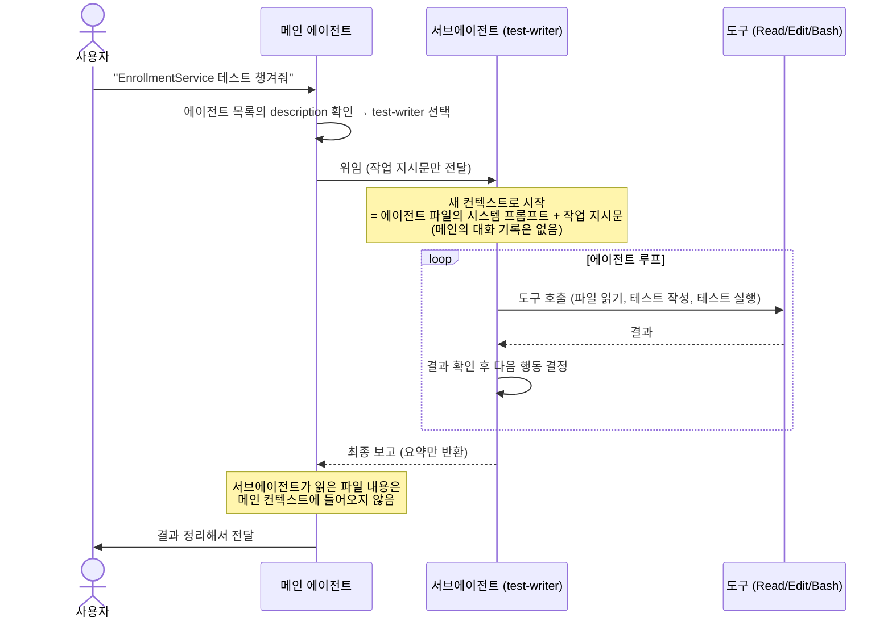
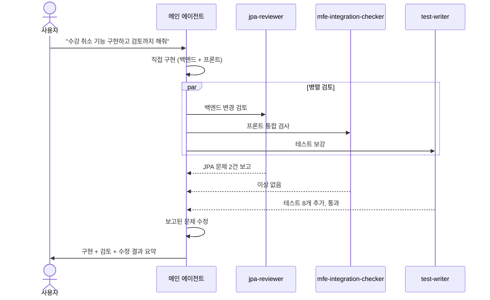
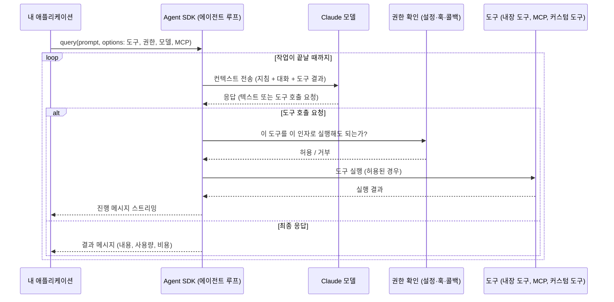
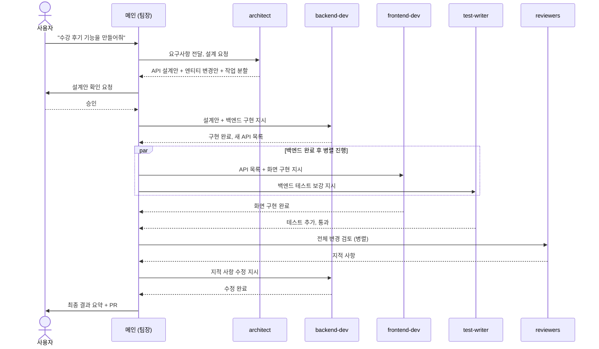

# 예제: 에이전트를 언제, 어떻게 만들고, 어떻게 동작하는가

> 관련 모듈: 11 (서브에이전트), 18 (Agent SDK), 1 (에이전트 루프)과 연결
> 예제 프로젝트: [EduHub](./00-sample-project.md)

---

## 1. "에이전트"의 세 가지 의미

| 구분 | 무엇인가 | 만드는 방법 |
|---|---|---|
| **메인 에이전트** | 내가 대화하는 Claude Code 자체 | 만들 필요 없음. CLAUDE.md, 스킬, 설정으로 조정 |
| **서브에이전트** | 메인 에이전트가 일을 맡기는 전문 에이전트 | `.claude/agents/*.md` 파일 작성 |
| **커스텀 에이전트** | 내 애플리케이션 안에서 돌아가는 에이전트 | Claude Agent SDK로 코드 작성 |

이 문서는 주로 **서브에이전트**를 다루고, 마지막에 **SDK 에이전트**의 동작을 비교합니다.

---

## 2. 언제 서브에이전트를 만드는가

### 2-1. 만들면 좋은 경우

| 상황 | 이유 | EduHub 예시 |
|---|---|---|
| **넓은 탐색, 많은 파일 읽기** | 탐색 결과가 메인 컨텍스트를 채우지 않고 **요약만** 돌아온다 | "프론트 전체에서 Axios 직접 사용 위치 찾기" |
| **독립된 관점의 검토** | 구현한 맥락에 끌려가지 않고 새 눈으로 본다 | `jpa-reviewer`, `security-reviewer` |
| **병렬 처리** | 서로 독립된 작업을 동시에 진행 | 백엔드 리뷰와 MFE 통합 검사를 동시에 |
| **권한 제한이 필요한 역할** | 읽기 전용 도구만 주어 실수로 수정하지 못하게 | 리뷰어는 `Read, Grep, Glob`만 |
| **다른 모델이 적합한 작업** | 단순 탐색은 빠르고 저렴한 모델로 | 코드 위치 찾기 전용 에이전트 |
| **반복되는 전문 역할** | 같은 역할 지시를 매번 쓰지 않는다 | 테스트 작성자, 마이그레이션 검토자 |

### 2-2. 만들지 않는 편이 나은 경우

| 상황 | 대안 |
|---|---|
| 한 번만 하는 작업 | 그냥 메인 대화에서 지시 |
| 지금까지의 대화 맥락이 꼭 필요한 작업 | 메인 에이전트가 직접 처리 (서브에이전트는 대화 기록을 모른다) |
| "절차"를 알려주는 것이 목적 | **스킬** (메인 에이전트가 절차를 따라 직접 수행) |
| 반드시 실행되어야 하는 검사 | **훅** (에이전트 판단에 맡기지 않음) |
| 사람 없이 서버에서 돌아야 함 | **헤드리스 / Agent SDK** |

### 2-3. 선택 가이드

```
질문 1. 매번 반드시 실행되어야 하나?          → 예: 훅
질문 2. 작업 "방법"을 알려주면 충분한가?        → 예: 스킬
질문 3. 별도 컨텍스트·권한·모델이 필요한가?      → 예: 서브에이전트
질문 4. 내 서비스/서버에서 독립 실행되어야 하나?  → 예: Agent SDK
```

---

## 3. 서브에이전트 만드는 방법

### 3-1. 만드는 두 가지 방법

1. **대화형**: Claude Code에서 `/agents` 실행 → 새 에이전트 생성 → 역할을 설명하면 초안을 만들어 줌
2. **파일 직접 작성**: 아래 위치에 마크다운 파일 생성

| 위치 | 범위 |
|---|---|
| `.claude/agents/` | 프로젝트 (Git으로 팀 공유) |
| `~/.claude/agents/` | 나의 모든 프로젝트 |
| 플러그인의 `agents/` | 플러그인을 설치한 모든 곳 |

### 3-2. 파일 구조

```markdown
---
name: test-writer                     # 고유 이름 (소문자, 하이픈)
description: EduHub 백엔드 서비스의 단위 테스트를 작성할 때 사용한다. 구현이 끝난 서비스 클래스를 받아 성공·실패·경계값 테스트를 작성하고 실행까지 확인한다. 구현 후 적극적으로 사용한다.
tools: Read, Grep, Glob, Write, Edit, Bash   # 생략하면 메인의 도구를 상속
model: sonnet                         # 선택: 사용할 모델 (생략하면 기본값)
---

너는 EduHub 백엔드의 테스트 전문가다.

## 작업 방식
1. 대상 서비스 클래스와 관련 엔티티, 기존 테스트를 읽는다
2. backend/CLAUDE.md의 테스트 규칙을 따른다 (JUnit 5, Mockito, 한국어 @DisplayName, Fixture 사용)
3. 메서드마다 성공 1개 이상, 실패·예외 케이스, 경계값(정원 0, 정원 정확히 찼을 때)을 작성한다
4. `./gradlew test --tests "{클래스명}Test" -q`로 실행해 통과를 확인한다
5. 구현 코드에 버그가 의심되면 테스트를 억지로 맞추지 말고 보고한다

## 결과 보고 형식
- 추가한 테스트 파일과 테스트 개수
- 실행 결과 (통과/실패)
- 발견한 구현상의 의심 지점
```

### 3-3. 잘 만드는 원칙

| 원칙 | 설명 |
|---|---|
| **단일 책임** | 하나의 에이전트는 하나의 역할만 |
| **description에 "언제"를 명확히** | 메인 에이전트가 설명을 보고 맡길지 결정한다. "적극적으로 사용"을 넣으면 자동 위임이 늘어난다 |
| **최소 권한 도구** | 리뷰어에게 `Edit`, `Bash`를 주지 않는다 |
| **결과 형식 지정** | 메인 에이전트가 받아 쓰기 좋게 "보고 형식"을 정한다 |
| **필요한 맥락은 프롬프트로** | 서브에이전트는 대화 기록을 모르므로, 따라야 할 규칙 파일 위치를 명시한다 |
| **검증 수단 제공** | 실행할 테스트 명령을 알려준다 |
| **Git으로 관리** | `.claude/agents/`를 커밋하고 리뷰한다 |

### 3-4. 호출하는 방법

```text
# 자동 위임: description과 맞는 작업이면 메인 에이전트가 알아서 맡김
EnrollmentService 구현이 끝났어. 테스트도 챙겨줘.

# 명시적 호출
test-writer 에이전트로 EnrollmentService 테스트를 작성해줘.

# 병렬 호출
jpa-reviewer와 mfe-integration-checker로 이번 변경을 동시에 검토해줘.
```

---

## 4. 서브에이전트의 동작 시퀀스

### 4-1. 단일 위임



**단계별 설명**

| 단계 | 일어나는 일 | 알아둘 점 |
|---|---|---|
| ① 선택 | 메인 에이전트가 작업과 에이전트 description을 비교 | description이 모호하면 위임되지 않는다 |
| ② 위임 | 메인이 작업 지시문을 작성해 전달 | 이 지시문이 서브에이전트가 아는 **유일한 대화 맥락** |
| ③ 시작 | 서브에이전트가 **새 컨텍스트**로 시작 | 메인의 이전 대화를 모른다 |
| ④ 루프 | 허용된 도구로 탐색·수정·실행을 반복 | 도구 목록 밖의 작업은 할 수 없다 |
| ⑤ 반환 | 마지막 메시지(보고)만 메인에게 전달 | 중간 과정은 메인 컨텍스트를 차지하지 않는다 → 토큰 절약 |
| ⑥ 이어가기 | 메인이 보고를 바탕으로 다음 행동 결정 | 필요하면 다른 서브에이전트에 이어서 위임 |

### 4-2. 병렬 위임과 오케스트레이션



**주의할 점**
- 병렬로 맡기는 작업은 **서로 같은 파일을 수정하지 않도록** 나눈다
- 서브에이전트는 다른 서브에이전트를 다시 부를 수 없다. 전체 조율은 메인 에이전트가 맡는다
- 서브에이전트의 결과도 **검증 대상**이다. 메인 에이전트나 사람이 확인한다

---

## 5. Agent SDK로 만든 커스텀 에이전트의 동작 시퀀스

서브에이전트와 같은 에이전트 루프를 **내 프로그램이 직접** 제어합니다.



| 단계 | 내 코드가 관여하는 지점 |
|---|---|
| 시작 | 프롬프트, 허용 도구, 권한 모드, 모델, MCP 서버, 작업 디렉터리 지정 |
| 도구 실행 전 | 권한 콜백·훅으로 허용/거부 판단 (예: `db/migration` 수정 거부) |
| 진행 중 | 스트리밍 메시지를 받아 화면·로그에 표시 |
| 종료 | 결과와 사용량을 받아 저장, 후속 처리 |

**EduHub 예시:** [API 계약 테스트 생성 에이전트](./05-automation-and-capstone.md#모듈-18-claude-agent-sdk)

---

## 6. EduHub 서브에이전트 구성 예시

| 에이전트 | 역할 | 도구 | 모델 |
|---|---|---|---|
| `code-explorer` | 코드 위치·호출 흐름 탐색, 요약 보고 | Read, Grep, Glob | 빠르고 저렴한 모델 |
| `jpa-reviewer` | JPA/Hibernate 성능·정합성 검토 | Read, Grep, Glob, Bash | 기본 |
| `mfe-integration-checker` | Module Federation, MUI 테마, Axios 사용 규칙 검사 | Read, Grep, Glob | 기본 |
| `test-writer` | 백엔드 단위 테스트 작성·실행 | Read, Grep, Glob, Write, Edit, Bash | 기본 |
| `migration-reviewer` | Flyway 마이그레이션 검토 (잠금, 대용량 테이블 영향) | Read, Grep, Glob | 성능이 높은 모델 |
| `acme-compliance-reviewer` | 사내 프레임워크 준수 검사 ([예제](./07-custom-framework.md)) | Read, Grep, Glob | 기본 |

---

## 7. 서브에이전트로 역할 분담하기: "AI 개발팀" 구성

실제 개발팀처럼 역할을 나눠 서브에이전트를 구성하고, 메인 에이전트가 **팀장(오케스트레이터)** 역할을 맡습니다.

### 7-1. 팀 구성

```
                   메인 에이전트 (팀장: 계획, 분배, 통합, 최종 확인)
                                      │
   ┌──────────────┬───────────────┬───┴───────────┬──────────────┬──────────────┐
   ▼              ▼               ▼               ▼              ▼              ▼
architect     backend-dev    frontend-dev     test-writer    reviewers     doc-writer
(설계)         (백엔드 구현)    (프론트 구현)     (테스트)        (검토 전문)     (문서화)
```

| 에이전트 | 맡는 일 | 작업 범위 (수정 가능 영역) | 도구 |
|---|---|---|---|
| `architect` | 요구사항 분석, API 설계(경로, DTO), 엔티티 변경안, 작업 분할 | 수정하지 않음 (설계안만 보고) | Read, Grep, Glob |
| `backend-dev` | Entity, Repository, Service, Controller, Flyway 구현 | `backend/` | Read, Grep, Glob, Write, Edit, Bash |
| `frontend-dev` | API 클라이언트 재생성, 훅, MUI 화면 구현 | `frontend/` | Read, Grep, Glob, Write, Edit, Bash |
| `test-writer` | 단위·통합 테스트 작성과 실행 | `backend/src/test/`, `frontend/**/*.test.tsx` | Read, Grep, Glob, Write, Edit, Bash |
| `jpa-reviewer`, `mfe-integration-checker` | 전문 분야 검토 | 수정하지 않음 | Read, Grep, Glob (+Bash) |
| `doc-writer` | PR 본문, 릴리스 노트, API 변경 안내 | `docs/` | Read, Grep, Glob, Write |

**`backend-dev` 정의 예시 (핵심 부분)**

```markdown
---
name: backend-dev
description: EduHub 백엔드 구현 담당. architect의 설계안을 받아 backend/ 아래 Entity, Repository, Service, Controller, Flyway 마이그레이션을 구현할 때 사용한다.
tools: Read, Grep, Glob, Write, Edit, Bash
---

너는 EduHub 백엔드 개발자다.
- backend/CLAUDE.md 규칙을 먼저 읽고 따른다
- 수정은 backend/ 디렉터리 안에서만 한다. frontend/는 절대 수정하지 않는다
- 전달받은 설계안(API 경로, DTO 필드)을 임의로 바꾸지 않는다. 바꿔야 하면 이유와 함께 보고한다
- 완료 조건: ./gradlew spotlessApply test -q 통과, Swagger에 새 API 표시

보고 형식: 변경 파일 목록, 추가한 API(메서드, 경로), 테스트 결과, 설계와 달라진 점
```

### 7-2. 작업 흐름



**흐름의 핵심**
1. **설계 먼저, 사람이 승인**: 방향이 틀리면 이후 모든 작업이 낭비된다
2. **의존 관계를 지켜 순서 결정**: 프론트는 백엔드 API가 나온 뒤 시작 (API 클라이언트 생성이 필요)
3. **독립적인 작업만 병렬로**: 프론트 구현과 백엔드 테스트는 서로 다른 디렉터리 → 동시 진행 가능
4. **결과물 전달은 메인이 중계**: 서브에이전트끼리는 직접 대화하지 않는다. 설계안, API 목록 같은 산출물은 메인이 다음 에이전트의 지시문에 넣어 준다 (또는 `docs/design/` 파일로 남겨 경로를 알려 준다)
5. **검토와 구현을 분리**: 구현한 에이전트가 아닌 별도 리뷰어가 검토

### 7-3. 오케스트레이션 지시문 예시

```text
수강 후기 기능(별점 1~5, 코멘트, 과정 상세 화면에 목록 표시)을 우리 서브에이전트 팀으로 진행해줘.

1. architect에게 설계를 맡기고, 설계안을 docs/design/review.md로 저장한 뒤 나에게 보여줘. 내가 승인하면 다음 단계로 가.
2. backend-dev에게 설계안대로 백엔드를 구현시켜줘.
3. 백엔드가 끝나면 frontend-dev(화면)와 test-writer(백엔드 테스트)를 병렬로 실행해줘.
4. 모두 끝나면 jpa-reviewer와 mfe-integration-checker로 병렬 검토하고, 지적 사항은 해당 담당 에이전트에게 수정시켜줘.
5. 마지막으로 전체 테스트를 직접 실행해 확인하고, doc-writer에게 PR 본문을 작성시켜 PR을 만들어줘.

각 단계가 끝날 때마다 누가 무엇을 했는지 한 줄로 알려줘.
```

### 7-4. 역할 분담 시 주의 사항

| 문제 | 원인 | 대책 |
|---|---|---|
| 두 에이전트가 같은 파일을 수정해 충돌 | 작업 범위가 겹침 | 디렉터리 단위로 범위를 나누고 프롬프트에 명시. 필요하면 git worktree로 분리 |
| 설계와 다르게 구현 | 설계안이 지시문에 충분히 전달되지 않음 | 설계안을 파일로 저장하고 경로를 전달 |
| 비용이 많이 듦 | 에이전트마다 같은 파일을 반복해서 읽음 | 작은 기능은 메인 혼자 처리. 팀 구성은 중간 이상 규모 기능에만 |
| 결과를 믿고 넘어감 | 서브에이전트의 "완료" 보고만 확인 | 메인이 마지막에 전체 테스트를 직접 실행, 사람이 PR 리뷰 |
| 역할이 너무 잘게 쪼개짐 | 에이전트가 많을수록 조율 비용 증가 | 3~6개 정도에서 시작해 필요할 때 추가 |

---

## 8. 실습

1. `/agents`로 `code-explorer`를 만들고, "수강 신청 버튼부터 DB까지 호출 흐름 찾아줘"를 맡긴 뒤 `/context`로 메인 컨텍스트 사용량을 서브에이전트 없이 했을 때와 비교
2. `test-writer`를 파일로 직접 작성하고, description만 바꿔 가며 자동 위임이 되는지 실험
3. 수강 취소 기능을 구현한 뒤 리뷰 에이전트 3개를 병렬로 실행하고, 보고된 문제를 메인 에이전트가 수정하는 흐름 관찰
4. 리뷰어 에이전트에 `Edit` 도구를 주지 않았을 때와 주었을 때의 행동 차이 관찰
