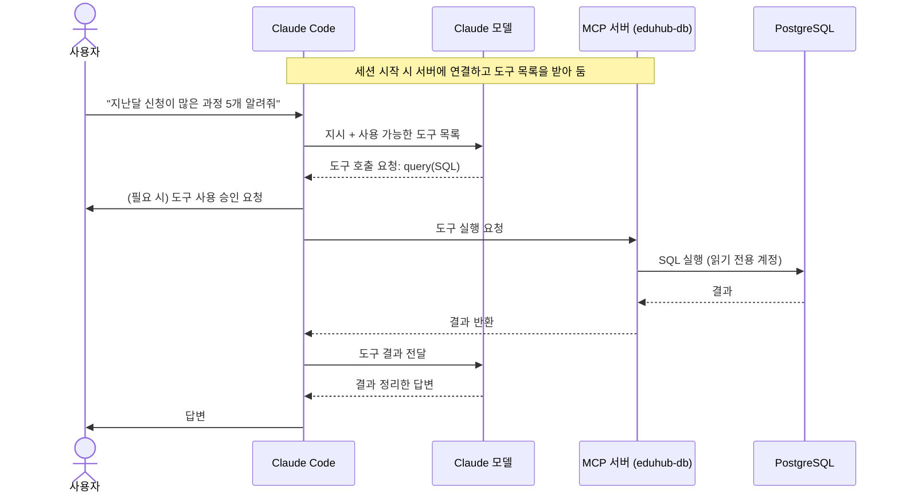
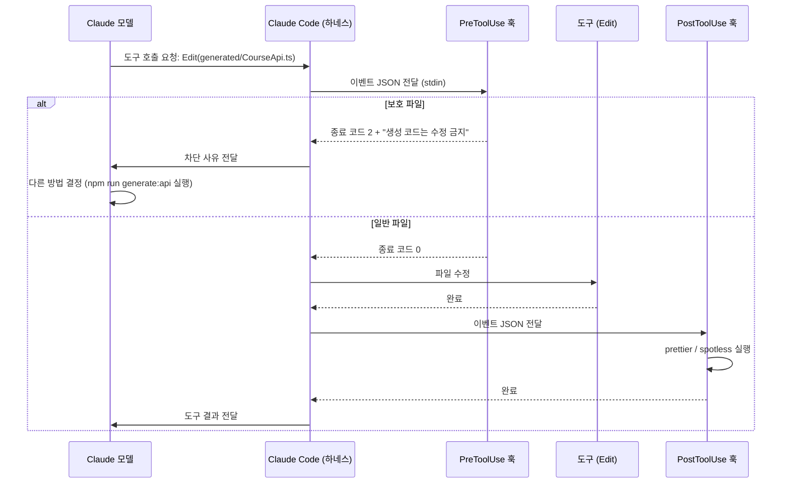

# 개념 정리: MCP와 훅(Hooks) — 무엇인가, 왜 필요한가, 어떻게 쓰는가

> 관련 모듈: 12 (훅), 13 (커넥터와 MCP)
> 실전 예제: [훅 예제](./03-settings-skills-agents-hooks.md#모듈-12-훅), [MCP 예제](./04-mcp-plugins-artifacts.md)

MCP와 훅은 모두 "에이전트 바깥"과 연결하는 장치지만 방향이 다릅니다.

| | MCP | 훅 |
|---|---|---|
| 한 줄 정의 | 에이전트가 **외부 도구·데이터를 쓸 수 있게** 해 주는 표준 연결 방식 | 에이전트의 **특정 시점에 내 스크립트가 자동 실행**되게 하는 장치 |
| 누가 실행을 결정하나 | **Claude**가 필요하다고 판단할 때 도구를 호출 | **하네스(Claude Code)**가 이벤트마다 무조건 실행 |
| 비유 | 에이전트에게 주는 새 **도구 상자** | 작업장에 설치한 **자동 검문소** |
| 주 용도 | 능력 확장 (조회, 외부 시스템 조작) | 규칙 강제, 자동화, 감사 |

---

# Part 1. MCP (Model Context Protocol)

## 1. 무엇인가

**AI 애플리케이션이 외부 도구와 데이터에 연결하는 방법을 정한 개방형 표준 프로토콜**입니다. 흔히 "AI용 USB-C"에 비유합니다. 규격이 하나로 정해져 있어서, MCP 서버를 한 번 만들면 그 규격을 지원하는 여러 AI 도구에서 같이 쓸 수 있습니다.

### 구성 요소

```
┌───────────── 호스트 (Claude Code, Claude 앱 등) ─────────────┐
│  Claude 모델  ⇄  MCP 클라이언트 ─┬─ MCP 클라이언트 ─┬─ ...      │
└──────────────────────────────────┼──────────────────┼──────────┘
                                   │ stdio            │ HTTP
                                   ▼                  ▼
                           MCP 서버 (로컬)      MCP 서버 (원격)
                           예: DB 조회           예: GitHub, Jira
                                   │                  │
                                   ▼                  ▼
                              PostgreSQL          외부 서비스 API
```

| 용어 | 설명 |
|---|---|
| **호스트** | 사용자가 쓰는 AI 애플리케이션 (Claude Code, Claude 앱) |
| **클라이언트** | 호스트 안에서 MCP 서버 하나와 연결을 담당 |
| **서버** | 외부 시스템을 감싸서 MCP 규격으로 기능을 제공하는 프로그램 |
| **전송 방식** | 로컬 프로세스는 **stdio**, 원격 서버는 **HTTP** |

### 서버가 제공하는 세 가지

| 종류 | 설명 | 예시 |
|---|---|---|
| **도구 (Tools)** | Claude가 호출하는 함수 | `search_courses`, `create_issue`, `run_query` |
| **리소스 (Resources)** | Claude가 읽을 수 있는 데이터 | DB 스키마, 문서 |
| **프롬프트 (Prompts)** | 미리 만들어 둔 지시 템플릿 | 슬래시 커맨드처럼 사용 |

## 2. 왜 필요한가

| 문제 | MCP 없이 | MCP로 |
|---|---|---|
| **최신·사내 데이터** | 모델은 학습 시점 이후나 사내 정보를 모른다. 사람이 복사해서 붙여넣어야 한다 | Claude가 직접 조회한다 |
| **실제 행동** | 결과를 사람이 다른 시스템에 옮겨 입력해야 한다 | 이슈 생성, 메시지 전송 등을 Claude가 수행한다 |
| **연동 방식이 제각각** | 도구마다 따로 연동 코드를 만든다 | 표준 하나로 여러 AI 도구에서 재사용한다 |
| **권한 관리** | 비밀번호, 토큰을 프롬프트에 넣는 위험 | 서버가 인증을 맡고, Claude는 도구만 호출한다 |

> 💡 **CLI 도구가 있으면 MCP가 꼭 필요하진 않습니다.** Claude Code는 터미널 명령(`gh`, `psql`, `curl`)도 쓸 수 있습니다. MCP는 CLI가 없는 서비스, 인증 관리가 필요한 경우, 여러 AI 도구에서 같이 써야 할 때 특히 유용합니다.

## 3. 어떻게 쓰는가

### 3-1. Claude Code에서 연결

```bash
# 로컬 서버 (stdio): -- 뒤가 실행 명령
claude mcp add eduhub-db -- npx -y @modelcontextprotocol/server-postgres "$EDUHUB_DB_READONLY_URL"

# 원격 서버 (HTTP)
claude mcp add --transport http github https://api.githubcopilot.com/mcp/

# 팀과 공유하려면 project 범위로 → .mcp.json에 저장됨
claude mcp add --scope project eduhub-db -- npx -y @modelcontextprotocol/server-postgres "\${EDUHUB_DB_READONLY_URL}"

# 확인과 관리
claude mcp list
```

대화 중에는 `/mcp`로 연결 상태 확인과 인증(로그인)을 할 수 있습니다.

| 범위 | 저장 위치 | 용도 |
|---|---|---|
| local (기본) | 내 설정 (이 프로젝트에서만) | 개인 실험 |
| project | 저장소의 `.mcp.json` | 팀 공유 |
| user | 내 설정 (모든 프로젝트) | 개인적으로 늘 쓰는 서버 |

> 명령 옵션은 버전에 따라 다를 수 있으므로 `claude mcp --help`와 공식 문서로 확인하세요.

### 3-2. Claude 앱에서 연결 (커넥터)

설정의 커넥터 메뉴에서 서비스(Google Drive, Slack, GitHub 등)를 선택하고 로그인합니다. 조직에서는 관리자가 허용한 커넥터만 쓸 수 있게 관리할 수 있습니다.

### 3-3. 동작 시퀀스



### 3-4. 보안과 운영 원칙

- **신뢰할 수 있는 서버만** 설치한다. MCP 서버는 내 권한으로 실행되는 프로그램이다
- **최소 권한**: DB는 읽기 전용 계정, 토큰은 필요한 범위만
- **비밀정보는 환경 변수로**: `.mcp.json`에 직접 쓰지 않는다
- **외부 데이터의 프롬프트 인젝션 주의**: 이슈 본문, 웹 페이지 등에 숨은 지시가 있을 수 있다. 변경 작업 도구는 승인을 거치게 한다
- **토큰 비용**: 도구 검색(기본 켜짐)으로 도구 정의는 필요할 때만 로드된다. 그래도 도구 **결과**가 크면 컨텍스트를 많이 차지하고, 쓰지 않는 서버는 끄는 것이 좋다 ([토큰 최적화](./08-token-optimization.md), [MCP 가이드](./19-mcp-server-guide.md))

---

# Part 2. 훅 (Hooks)

## 1. 무엇인가

Claude Code가 동작하는 **특정 시점(이벤트)에 자동으로 실행되는 사용자 정의 명령**입니다. Claude의 판단과 상관없이 **하네스가 항상 실행**한다는 점이 핵심입니다.

### 주요 이벤트

| 이벤트 | 실행 시점 | 대표 용도 |
|---|---|---|
| `SessionStart` | 세션 시작·재개 시 | 개발 환경 준비, 최신 정보를 컨텍스트에 주입 |
| `UserPromptSubmit` | 사용자가 프롬프트를 보낸 직후 | 프롬프트 검사, 추가 맥락 주입 |
| `PreToolUse` | 도구 실행 **직전** | 위험한 명령·보호 파일 수정 **차단** |
| `PostToolUse` | 도구 실행 **직후** | 자동 포맷, 린트, 테스트 실행 |
| `Notification` | Claude가 알림을 보낼 때 (승인 대기 등) | 데스크톱·메신저 알림 |
| `Stop` / `SubagentStop` | 메인·서브에이전트가 응답을 마칠 때 | 마무리 검사, 작업 완료 알림 |
| `PreCompact` | 컨텍스트 압축 직전 | 대화 기록 백업 |
| `SessionEnd` | 세션 종료 시 | 정리 작업, 사용 로그 기록 |

> 이벤트 종류는 버전에 따라 추가될 수 있으므로 공식 문서로 확인하세요.

## 2. 왜 필요한가

| 지침(CLAUDE.md, 스킬) | 훅 |
|---|---|
| Claude에게 **부탁**한다 | 하네스가 **강제**한다 |
| 대부분 지키지만 놓칠 수 있다 | 매번 반드시 실행된다 |
| 판단이 필요한 규칙에 적합 | 기계적으로 검사할 수 있는 규칙에 적합 |

**훅이 필요한 대표 상황**
1. **반드시 지켜야 하는 규칙**: 생성 코드·마이그레이션 파일 수정 금지, 운영 DB 명령 차단
2. **매번 하는 기계적 작업**: 파일 수정 후 포맷터, 린터 실행
3. **즉각적인 피드백**: 규칙 위반을 바로 알려 Claude가 스스로 고치게 함
4. **감사와 기록**: 어떤 명령이 실행되었는지 로그로 남김
5. **알림**: 승인이 필요하거나 작업이 끝나면 알림

## 3. 어떻게 쓰는가

### 3-1. 설정 위치

| 위치 | 범위 |
|---|---|
| `~/.claude/settings.json` | 나의 모든 프로젝트 |
| `.claude/settings.json` | 프로젝트 (팀 공유) |
| `.claude/settings.local.json` | 프로젝트 (나만, 커밋하지 않음) |
| 플러그인의 `hooks/hooks.json` | 플러그인 설치 범위 |

대화 중에 `/hooks`로 현재 설정된 훅을 확인할 수 있습니다.

### 3-2. 설정 구조

```json
{
  "hooks": {
    "이벤트 이름": [
      {
        "matcher": "도구 이름 패턴 (예: Edit|Write, Bash)",
        "hooks": [
          { "type": "command", "command": "실행할 명령" }
        ]
      }
    ]
  }
}
```

- `matcher`: 도구 관련 이벤트(`PreToolUse`, `PostToolUse`)에서 어떤 도구에 반응할지 지정
- 훅 명령은 **표준 입력(stdin)으로 JSON**을 받는다: 세션 ID, 이벤트 이름, 도구 이름, 도구 입력(`tool_input.file_path`, `tool_input.command` 등)

### 3-3. 훅의 결과가 동작에 미치는 영향 (종료 코드)

| 종료 코드 | 의미 | 결과 |
|---|---|---|
| `0` | 성공 | 정상 진행 |
| `2` | **차단** | `PreToolUse`라면 도구 실행을 막고, stderr 메시지를 Claude에게 전달 → Claude가 이유를 보고 다른 방법을 찾는다 |
| 그 외 | 오류 (차단 아님) | 사용자에게 오류를 보여 주고 진행 |

더 세밀하게 제어하려면 JSON을 출력해 허용·거부·사용자에게 확인 요청 등을 지정할 수 있습니다.

### 3-4. 동작 시퀀스



### 3-5. EduHub 훅 모음

| 이벤트 | matcher | 하는 일 |
|---|---|---|
| `PreToolUse` | `Edit\|Write` | 생성된 API 클라이언트, 기존 Flyway 파일 수정 차단 ([스크립트](./03-settings-skills-agents-hooks.md#모듈-12-훅)) |
| `PreToolUse` | `Bash` | `flywayClean`, 운영 DB 접속, `git push --force` 차단 |
| `PostToolUse` | `Edit\|Write` | `.java` → Spotless, `.ts/.tsx` → Prettier + ESLint |
| `PostToolUse` | `Edit\|Write` | 사내 프레임워크 규칙 검사 ([예제](./07-custom-framework.md)) |
| `SessionStart` | | 클라우드 환경에서 의존성 설치, 현재 브랜치·이슈 정보 주입 |
| `Stop` | | 변경한 영역의 테스트를 실행해 실패 시 Claude에게 알림 |
| `Notification` | | 승인 대기 시 사내 메신저로 알림 |

### 3-6. 주의 사항

- **훅은 내 권한으로 실행되는 명령**이다. 다른 사람이 만든 훅(플러그인 포함)은 내용을 확인하고 쓴다
- **빠르게** 만든다. 매 도구 호출마다 실행되므로 느린 훅은 전체 작업을 느리게 한다 (전체 테스트는 `Stop`에서, 포맷은 해당 파일만)
- 입력 JSON의 경로·명령은 **따옴표로 감싸** 처리하고, 예상 밖 입력에도 안전하게 동작하도록 작성한다
- 훅 설정 변경도 코드처럼 **리뷰**한다 (`.claude/`에 CODEOWNERS 지정)

---

## 정리: 언제 무엇을 쓰나

| 하고 싶은 것 | 선택 |
|---|---|
| Claude가 사내 DB·이슈 트래커를 조회하게 하고 싶다 | MCP |
| 파일을 고칠 때마다 포맷터가 돌게 하고 싶다 | 훅 (`PostToolUse`) |
| 특정 파일·명령을 절대 못 쓰게 하고 싶다 | 훅 (`PreToolUse`) + 권한 설정(deny) |
| Claude가 외부 서비스에 이슈를 만들게 하고 싶다 | MCP (변경 도구는 승인 필수) |
| 작업 방법을 알려주고 싶다 | 스킬 |

## 실습

1. `claude mcp add`로 PostgreSQL MCP를 연결하고 `/mcp`로 상태 확인 → 자연어로 수강 통계 조회
2. 같은 조회를 MCP 없이 `psql` 명령으로 시켜 보고 차이 토론
3. `PostToolUse` 포맷 훅을 설정하고, 일부러 들여쓰기가 엉망인 코드를 쓰게 지시 → 자동 정리 확인
4. `PreToolUse` 보호 훅을 설정하고 생성 코드 수정을 지시 → 차단 후 Claude가 `npm run generate:api`로 우회하는 과정 관찰
