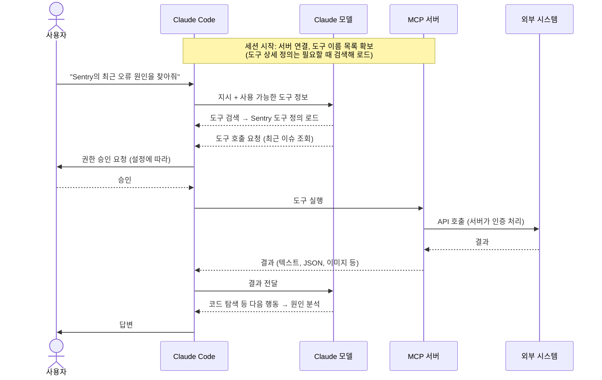

# MCP 서버 완전 가이드: 무엇이고, 왜 필요하고, 어떻게 쓰고, 어떻게 환경을 구성하나

> 관련 모듈: 13 (16, 19, 20과 연결)
> 기준: 공식 문서 [Connect Claude Code to tools via MCP](https://code.claude.com/docs/en/mcp) (2026년 10월 확인), [MCP 공식 사이트](https://modelcontextprotocol.io)
> 기본 개념 요약은 [MCP와 훅 개념 정리](./12-mcp-and-hooks-concepts.md)에도 있습니다. 이 문서는 MCP만 깊게 다룹니다.

---

## 1. MCP 서버란 무엇인가

### 1-1. 한 문장 정의

**MCP(Model Context Protocol) 서버**는 외부 시스템(DB, GitHub, Jira, 사내 API 등)을 감싸서, AI 에이전트가 **표준화된 방식으로 그 기능과 데이터를 쓸 수 있게** 해 주는 프로그램입니다.

### 1-2. 비유

| 비유 | 설명 |
|---|---|
| **USB-C** | 기기(AI 도구)와 주변기기(외부 시스템)를 하나의 규격으로 연결 |
| **통역사 겸 창구** | Claude의 요청을 외부 시스템 API로 바꿔 전달하고, 결과를 Claude가 이해하는 형태로 돌려줌 |
| **에이전트의 도구 상자** | 서버를 연결할 때마다 Claude가 쓸 수 있는 도구가 늘어남 |

### 1-3. 구조

```
┌─────────────────── 호스트 (Claude Code, Claude 앱, IDE 등) ───────────────────┐
│   Claude 모델  ⇄  MCP 클라이언트 A   MCP 클라이언트 B   MCP 클라이언트 C          │
└──────────────────────┬──────────────────┬──────────────────┬─────────────────┘
                       │ stdio            │ HTTP             │ HTTP
                       ▼                  ▼                  ▼
               [로컬 MCP 서버]       [원격 MCP 서버]      [사내 MCP 서버]
               PostgreSQL 조회       GitHub, Jira         EduHub API
```

| 구성 요소 | 역할 |
|---|---|
| **호스트** | 사용자가 쓰는 AI 애플리케이션 |
| **클라이언트** | 호스트 안에서 서버 하나와의 연결을 담당 |
| **서버** | 외부 시스템의 기능을 MCP 규격으로 제공 |

### 1-4. 서버가 제공할 수 있는 것

| 기능 | 설명 | Claude Code에서 쓰는 방법 |
|---|---|---|
| **도구 (Tools)** | Claude가 호출하는 함수 (조회, 생성, 수정) | Claude가 필요할 때 자동 호출 (권한 승인) |
| **리소스 (Resources)** | 읽을 수 있는 데이터 (스키마, 문서, 이슈) | `@서버:프로토콜://경로`로 참조. 예: `@github:issue://123` |
| **프롬프트 (Prompts)** | 미리 만든 지시 템플릿 | `/mcp__서버__프롬프트` 슬래시 명령으로 실행 |
| **입력 요청 (Elicitation)** | 서버가 작업 중 사용자에게 추가 정보 요청 | 대화 상자가 자동으로 표시됨 |

### 1-5. 전송 방식

| 방식 | 동작 | 언제 |
|---|---|---|
| **stdio** | 내 컴퓨터에서 서버 프로세스를 실행하고 표준 입출력으로 통신 | 로컬 DB, 로컬 파일, 내 컴퓨터의 도구 |
| **HTTP** (권장 원격 방식) | 원격 서버 URL에 접속 | SaaS(GitHub, Jira, Sentry 등), 사내 공용 서버 |
| SSE | 이전 원격 방식 (지원 중단 예정) | 가능하면 HTTP 사용 |

---

## 2. 왜 필요한가

### 2-1. MCP가 해결하는 문제

| 문제 | MCP 없이 | MCP로 |
|---|---|---|
| **모델이 모르는 정보** | 최신·사내 데이터를 사람이 복사해서 붙여넣음 | Claude가 직접 조회 |
| **실제 행동** | 결과를 사람이 다른 시스템에 옮겨 입력 | 이슈 생성, 댓글, 알림 등을 Claude가 수행 |
| **연동 방식이 제각각** | AI 도구마다 연동 코드를 따로 만듦 | 표준 하나로 여러 AI 도구에서 재사용 |
| **인증·권한** | 토큰을 프롬프트나 스크립트에 노출 | 서버·OAuth가 인증을 맡고, Claude는 도구만 호출 |
| **맥락 전환 비용** | 개발자가 IDE, Jira, DB 도구, 모니터링을 오가며 정보 수집 | 한 대화 안에서 모든 정보를 모아 작업 |

### 2-2. MCP가 꼭 필요하지 않은 경우

- **CLI 도구로 충분한 경우**: `gh`, `psql`, `curl`, `kubectl` 등은 Claude Code가 Bash로 바로 쓸 수 있다
- **한 번만 필요한 정보**: 직접 붙여넣는 것이 더 빠르다

**MCP가 특히 유리한 경우:** CLI가 없는 서비스, OAuth 인증이 필요한 SaaS, 여러 AI 도구에서 같은 연동을 재사용해야 할 때, 조직에서 허용된 연동만 쓰도록 관리해야 할 때

### 2-3. Java + React 팀의 활용 예

| 업무 | MCP로 하는 일 |
|---|---|
| 기능 개발 | Jira 이슈 읽기 → 구현 → GitHub PR 생성 → 이슈에 PR 링크 댓글 |
| 버그 분석 | Sentry 오류 스택 조회 → 관련 코드 찾기 → 재현 테스트 작성 |
| DB 작업 | 실제 스키마·인덱스 확인 → JPA 엔티티와 비교 → Flyway 마이그레이션 제안 |
| 프론트 검증 | Playwright로 React 화면을 열어 클릭·입력 시나리오 실행 |
| 디자인 구현 | Figma 디자인 정보를 읽어 MUI 컴포넌트로 구현 |
| 사내 시스템 | 사내 API·위키·코드 표준 문서 조회 |

---

## 3. 어떤 MCP 서버가 있나

| 유형 | 설명 | 예시 |
|---|---|---|
| **서비스 제공사의 공식 원격 서버** | SaaS 회사가 운영하는 HTTP 서버. OAuth로 로그인 | GitHub, Atlassian(Jira·Confluence), Sentry, Notion, Figma, Asana 등 |
| **공개 로컬 서버** | npm·PyPI 패키지로 받아 내 컴퓨터에서 실행 | Playwright(브라우저 자동화), DB 서버, 파일 시스템 등 |
| **Claude 앱 커넥터** | claude.ai에서 연결한 커넥터를 Claude Code에서도 사용 | Google Drive, Slack 등 |
| **플러그인에 포함된 서버** | 플러그인 설치 시 함께 설정 | 사내 개발 키트 플러그인 ([예제](./04-mcp-plugins-artifacts.md)) |
| **직접 만든 서버** | 사내 시스템용으로 개발 | EduHub API 서버 (아래 6장) |

> ⚠️ 서버 이름, 패키지, URL은 자주 바뀝니다. 각 서비스의 **공식 문서에서 최신 연결 방법**을 확인하고, 출처가 분명한 서버만 사용하세요. MCP 서버는 내 권한으로 실행되는 프로그램입니다.

---

## 4. 어떻게 사용하나: Claude Code에서 연결하기

### 4-1. 서버 추가

```bash
# ① 원격 HTTP 서버 (권장 원격 방식)
claude mcp add --transport http <이름> <URL>
claude mcp add --transport http notion https://mcp.notion.com/mcp

# 헤더로 인증 토큰 전달
claude mcp add --transport http company-api https://mcp.example.com/mcp \
  --header "Authorization: Bearer ${COMPANY_API_TOKEN}"

# ② 로컬 stdio 서버: -- 뒤가 서버 실행 명령
claude mcp add [옵션] <이름> -- <명령> [인자...]
claude mcp add --env DB_URL=postgresql://readonly@localhost:5432/eduhub --transport stdio eduhub-db \
  -- npx -y <PostgreSQL MCP 서버 패키지> 

# ③ JSON으로 한 번에 추가
claude mcp add-json weather '{"type":"http","url":"https://api.weather.example/mcp"}'
```

**주요 옵션**

| 옵션 | 의미 |
|---|---|
| `--transport` (`-t`) | `stdio`, `http`, `sse` |
| `--scope` (`-s`) | `local`(기본), `project`, `user` |
| `--env` (`-e`) | 서버 프로세스에 넘길 환경 변수 `KEY=값` |
| `--header` (`-H`) | 원격 서버 요청 헤더 |
| `--` | 이 뒤부터는 서버 실행 명령 (Claude 옵션과 구분) |

### 4-2. 범위(scope): 누구와 공유할 것인가

| 범위 | 적용 | 공유 | 저장 위치 | 용도 |
|---|---|---|---|---|
| `local` (기본) | 현재 프로젝트 | ✕ | `~/.claude.json` (프로젝트 경로 아래) | 개인 실험, 개인 토큰이 필요한 서버 |
| `project` | 현재 프로젝트 | ○ (Git) | 프로젝트 루트 `.mcp.json` | **팀 공용 서버** |
| `user` | 내 모든 프로젝트 | ✕ | `~/.claude.json` | 늘 쓰는 개인 서버 |

- 같은 이름이 여러 곳에 있으면 **local → project → user → 플러그인 → claude.ai 커넥터** 순으로 우선 (필드를 합치지 않고 하나를 통째로 사용)
- 팀원이 처음 `.mcp.json`의 서버를 쓸 때는 **사용 승인 질문**이 나온다 (보안 장치). 선택을 초기화하려면 `claude mcp reset-project-choices`

### 4-3. 팀 공용 `.mcp.json`

```json
{
  "mcpServers": {
    "github": {
      "type": "http",
      "url": "https://api.githubcopilot.com/mcp/"
    },
    "eduhub-db": {
      "type": "stdio",
      "command": "npx",
      "args": ["-y", "<PostgreSQL MCP 서버 패키지>", "${EDUHUB_DB_READONLY_URL}"]
    },
    "playwright": {
      "type": "stdio",
      "command": "npx",
      "args": ["-y", "@playwright/mcp@latest"]
    },
    "eduhub-api": {
      "type": "http",
      "url": "${EDUHUB_MCP_URL:-http://localhost:8090}/mcp",
      "headers": { "Authorization": "Bearer ${EDUHUB_MCP_TOKEN}" }
    }
  }
}
```

**환경 변수 치환 규칙**
- `${VAR}`: 환경 변수 값으로 바뀜
- `${VAR:-기본값}`: 변수가 없으면 기본값 사용
- `command`, `args`, `env`, `url`, `headers`에서 사용 가능
- 값이 없고 기본값도 없으면 경고 후 `${VAR}` 글자 그대로 남음
- 👉 **비밀정보는 파일에 쓰지 말고 환경 변수로**. `.mcp.json`은 Git에 커밋되기 때문

### 4-4. 인증 (OAuth)

원격 서버가 로그인을 요구하면:

```text
> /mcp          # 대화 중: 서버 목록에서 인증 선택 → 브라우저 로그인
```

```bash
claude mcp login <이름>     # 터미널에서 바로 인증
claude mcp logout <이름>    # 인증 정보 삭제
```

토큰은 자동 저장·갱신되며, `/mcp` 메뉴에서 인증을 해제할 수 있습니다.

### 4-5. 관리

| 명령 | 하는 일 |
|---|---|
| `claude mcp list` | 서버 목록과 상태 |
| `claude mcp get <이름>` | 서버 상세 정보 |
| `claude mcp remove <이름>` | 서버 삭제 (저장된 인증 정보도 삭제) |
| `/mcp` | 대화 중 상태 확인, 인증, 재연결 |
| `/mcp disable <이름>` / `enable` | 서버 끄기·켜기 |
| `claude mcp add-from-claude-desktop` | Claude 데스크톱 앱 설정의 서버 가져오기 (macOS, WSL) |

### 4-6. 대화에서 사용하기

```text
# 도구: 그냥 요청하면 Claude가 적절한 도구를 골라 호출
eduhub-db에서 지난달 수강 신청이 많은 과정 5개를 조회해줘.

# 리소스: @로 참조
@github:issue://42 내용을 읽고 구현 계획을 세워줘.

# 프롬프트: 슬래시 명령으로 실행
/mcp__github__pr_review 456
```

### 4-7. 동작 시퀀스



---

## 5. 환경 구성

### 5-1. 사전 준비

| 서버 종류 | 필요한 것 |
|---|---|
| npm 패키지 서버 (`npx`) | Node.js (LTS) |
| Python 패키지 서버 (`uvx` 등) | Python, uv |
| Docker 이미지 서버 | Docker |
| 원격 HTTP 서버 | 네트워크 접근, 계정·권한 |

### 5-2. 운영체제별 주의

| 환경 | 주의 |
|---|---|
| **macOS / Linux / WSL** | 대부분의 예시가 그대로 동작 |
| **윈도우 네이티브** | `npx` 기반 로컬 서버가 바로 실행되지 않으면 `cmd /c`로 감싸 실행: `claude mcp add my-server -- cmd /c npx -y <패키지>` (공식 문서의 최신 안내 확인) |
| **WSL** | 서버는 WSL 안에서 실행됨. 윈도우 쪽 프로그램·포트 접근 여부 확인 |
| **클라우드 세션** | 네트워크 정책에서 허용된 호스트만 접근 가능. 로컬 DB·사내망 서버는 접근 불가 |
| **사내 프록시** | 서버 프로세스가 프록시 환경 변수(`HTTPS_PROXY`)를 쓰는지 확인 |

### 5-3. 성능·용량 관련 설정

| 설정 | 의미 | 예시 |
|---|---|---|
| `MCP_TIMEOUT` | 서버 시작 대기 시간(ms) | `MCP_TIMEOUT=10000 claude` |
| 서버별 `"timeout"` | 도구 실행 제한 시간(ms), `.mcp.json` 항목에 지정 | `"timeout": 600000` |
| `MAX_MCP_OUTPUT_TOKENS` | 도구 결과 최대 토큰 (기본: 1만 초과 시 경고, 2만5천에서 자름) | `export MAX_MCP_OUTPUT_TOKENS=50000` |
| `ENABLE_TOOL_SEARCH` | 도구 정의를 필요할 때만 불러오는 **도구 검색** (기본 켜짐) | `auto`, `true`, `false` |
| 서버별 `"alwaysLoad": true` | 이 서버의 도구는 항상 미리 로드 (매 턴 꼭 필요한 소수 도구만) | |

> 💡 **토큰 관점:** 도구 검색이 켜져 있으면 세션 시작 시 도구 **이름**만 불러오므로, 서버를 여러 개 연결해도 컨텍스트 부담이 작습니다. 다만 도구 **결과**가 크면 컨텍스트를 많이 차지하므로, 조회 범위를 좁혀 요청하세요 ([토큰 최적화](./08-token-optimization.md)).

### 5-4. 권한 설정과 함께 쓰기

```json
// .claude/settings.json (일부)
{
  "permissions": {
    "allow": ["mcp__eduhub-db__query"],
    "deny":  ["mcp__github__merge_pull_request"]
  }
}
```

- MCP 도구 이름은 `mcp__서버__도구` 형식
- 자주 쓰는 **조회 도구는 허용**, 되돌릴 수 없는 **변경 도구는 차단 또는 매번 승인**

### 5-5. 조직 단위 관리

관리자는 관리 설정으로 사용 가능한 서버를 통제할 수 있습니다.
- 회사가 정한 서버 목록을 모든 사용자에게 배포 (`managed-mcp.json`, `managedMcpServers`)
- 허용·차단 목록 (`allowedMcpServers`, `deniedMcpServers`)

자세한 내용은 공식 문서의 [Managed MCP configuration](https://code.claude.com/docs/en/managed-mcp)을 참고하세요.

### 5-6. 환경 구성 체크리스트

- [ ] 필요한 런타임(Node.js, Python, Docker) 설치
- [ ] 팀 공용 서버는 `.mcp.json`(project 범위), 개인 토큰이 필요한 서버는 local/user 범위
- [ ] 비밀정보는 환경 변수로, `.env`는 `.gitignore`
- [ ] DB는 **읽기 전용 계정**, 토큰은 **최소 권한**
- [ ] `settings.json`에서 MCP 도구 허용·차단 규칙 설정
- [ ] `claude mcp list`, `/mcp`로 연결 상태 확인
- [ ] README나 CLAUDE.md에 "필요한 환경 변수와 연결 방법" 안내

---

## 6. 직접 MCP 서버 만들기

### 6-1. 언제 만드나

- 사내 API·시스템을 Claude가 쓰게 하고 싶을 때
- 공개 서버가 없거나, 필요한 기능만 안전하게 노출하고 싶을 때

### 6-2. TypeScript 예시 (EduHub API)

전체 예시는 [MCP 실전 예제](./04-mcp-plugins-artifacts.md#13-3-직접-만드는-mcp-서버-eduhub-api-래핑)를 참고하세요.

```ts
import { McpServer } from "@modelcontextprotocol/sdk/server/mcp.js";
import { StdioServerTransport } from "@modelcontextprotocol/sdk/server/stdio.js";
import { z } from "zod";

const server = new McpServer({ name: "eduhub", version: "1.0.0" });

server.tool(
  "get_session_status",
  "교육 회차의 정원, 신청 인원, 대기 인원을 조회한다",
  { sessionId: z.number() },
  async ({ sessionId }) => {
    const res = await fetch(`${process.env.EDUHUB_API_URL}/api/v1/sessions/${sessionId}/status`);
    return { content: [{ type: "text", text: JSON.stringify(await res.json()) }] };
  },
);

await server.connect(new StdioServerTransport());
```

### 6-3. Python 예시

```python
# eduhub_mcp.py — Python MCP SDK의 FastMCP 사용 예시
import os, httpx
from mcp.server.fastmcp import FastMCP

mcp = FastMCP("eduhub")

@mcp.tool()
def search_courses(keyword: str) -> str:
    """키워드로 교육과정을 검색한다."""
    r = httpx.get(f"{os.environ['EDUHUB_API_URL']}/api/v1/courses", params={"keyword": keyword})
    return r.text

if __name__ == "__main__":
    mcp.run()
```

### 6-4. Java(Spring) 팀이라면

Spring 생태계에도 MCP 서버를 만들 수 있는 라이브러리(예: Spring AI의 MCP 지원)가 있습니다. 기존 Spring Boot 서비스에 MCP 엔드포인트를 추가하는 방식도 검토할 수 있습니다. 버전별 사용법은 해당 프로젝트 문서를 확인하세요.

### 6-5. 좋은 MCP 서버 설계 원칙

| 원칙 | 설명 |
|---|---|
| **도구 설명을 명확히** | Claude는 설명을 보고 도구를 고른다. 무엇을 하는지, 언제 쓰는지 |
| **서버 안내문(instructions)** | 도구 검색이 켜져 있을 때 "어떤 작업에 이 서버를 쓰는지"를 알려줌 |
| **작은 단위의 도구** | "모든 걸 하는 도구" 대신 목적별 도구 |
| **결과는 필요한 만큼만** | 큰 목록은 페이지 단위로, 필요한 필드만 → 토큰 절약 |
| **조회와 변경 분리** | 변경 도구는 사용자 승인이 필요하도록 (승인 강제 표시 기능 활용 가능) |
| **입력 검증은 서버에서** | Claude가 보낸 인자도 반드시 검증 |
| **인증은 서버가** | 토큰을 도구 인자로 받지 않음 |

### 6-6. 테스트

```bash
# MCP Inspector: 서버의 도구·리소스를 화면에서 직접 호출해 보는 개발 도구
npx @modelcontextprotocol/inspector node dist/index.js
```

그다음 `claude mcp add`로 연결하고 `/mcp`에서 상태를 확인한 뒤 실제 대화로 테스트합니다.

---

## 7. 보안 체크리스트

| 위험 | 대책 |
|---|---|
| 신뢰할 수 없는 서버가 내 권한으로 실행됨 | 공식·검증된 서버만 사용, 소스 확인, 조직 허용 목록 |
| 과도한 권한 | 읽기 전용 계정, 최소 범위 토큰 |
| 비밀정보 노출 | 환경 변수 사용, `.mcp.json`에 직접 쓰지 않기 |
| **프롬프트 인젝션** | 이슈 본문, 웹 페이지, 문서에 숨은 지시가 있을 수 있음 → 외부 데이터는 "데이터"로만, 변경 도구는 승인 필수 |
| 의도치 않은 변경 | `settings.json`의 deny 규칙, 변경 도구 승인 |
| 클라우드·CI에서 자동 실행 | 비대화형 실행에서는 프로젝트 서버가 승인 없이 로드됨 → 필요한 서버만 `--mcp-config`, `--strict-mcp-config`로 지정 |

---

## 8. 문제 해결

| 증상 | 확인 |
|---|---|
| 서버가 "실패"로 표시 | `claude mcp get <이름>`, 실행 명령을 터미널에서 직접 실행해 오류 확인 |
| 시작이 느리거나 시간 초과 | `MCP_TIMEOUT` 늘리기, 첫 `npx` 다운로드 시간 고려 |
| 인증 오류 | `/mcp`에서 다시 인증, `claude mcp logout` 후 재로그인 |
| 도구가 안 보임 | `/mcp`에서 서버 활성화 여부, 프로젝트 서버 승인 여부(`reset-project-choices`) |
| 결과가 잘림 | `MAX_MCP_OUTPUT_TOKENS` 조정 또는 조회 범위 축소 |
| 환경 변수가 적용 안 됨 | `${VAR}`가 글자 그대로 남는지 확인, 셸에서 `echo $VAR` |
| 윈도우에서 `npx` 서버 실패 | `cmd /c` 감싸기 또는 WSL 사용 |

---

## 9. 실습

1. **연결**: GitHub(HTTP) 서버를 연결하고 `/mcp`로 인증 → "열린 이슈 목록 보여줘"
2. **팀 공유**: EduHub용 `.mcp.json`을 만들어 커밋하고, 다른 팀원 환경에서 승인 질문과 동작 확인
3. **리소스·프롬프트**: `@github:issue://번호`로 이슈를 참조해 구현 계획 세우기
4. **권한**: 조회 도구는 허용, 머지 도구는 차단하는 `settings.json` 규칙 작성 후 확인
5. **직접 만들기**: EduHub API용 MCP 서버를 만들고 MCP Inspector로 테스트 → Claude Code에 연결
6. **토론**: "MCP를 쓸까, CLI(`gh`, `psql`)를 쓸까?" 우리 팀 기준 정하기
