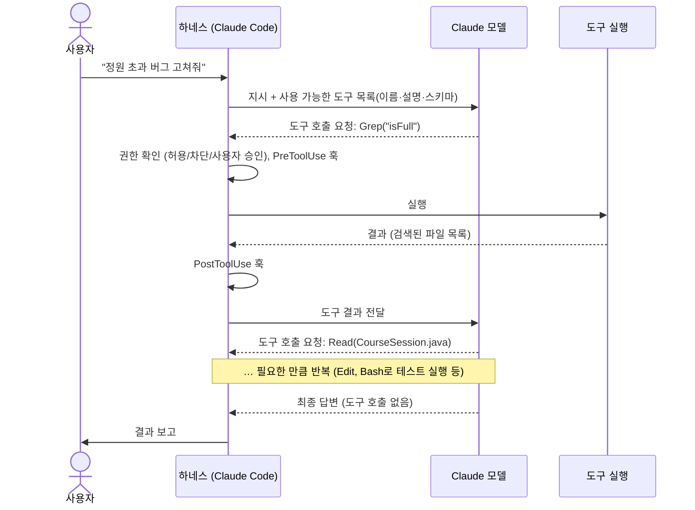

# 개념 정리: 도구(Tools) — 무엇이고, 왜 필요하고, 어떻게 쓰는가

> 관련 모듈: 1 (9, 11~13, 18과 연결)
> 기준: 공식 문서 [Tools reference](https://code.claude.com/docs/en/tools-reference), [Permissions](https://code.claude.com/docs/en/permissions) (2026년 10월 확인). 도구 이름과 목록은 버전에 따라 바뀔 수 있습니다.

---

## 1. 도구란 무엇인가

**도구(Tool)**는 AI 모델이 **"이 기능을 이런 인자로 실행해 달라"고 요청할 수 있는 기능**입니다.

- 모델 자체는 글(토큰)만 만들 수 있다. 파일을 읽거나 명령을 실행할 수 없다
- 대신 "Read 도구로 `EnrollmentService.java`를 읽어줘"라는 **요청**을 출력한다
- 실제 실행은 **하네스(Claude Code)**가 하고, 결과를 다시 모델에게 돌려준다

```
모델 = 두뇌 (무엇을 할지 결정)
도구 = 손과 발 (실제 행동)
하네스 = 신경계 (요청 전달, 권한 확인, 실행, 결과 전달)
```

### 도구의 구성 요소

| 요소 | 설명 | 예 |
|---|---|---|
| **이름** | 모델이 호출할 때 쓰는 식별자 | `Read`, `Bash`, `mcp__github__create_issue` |
| **설명** | 무엇을 하는지, 언제 쓰는지 (모델이 도구를 고르는 기준) | "파일 내용을 읽는다" |
| **입력 스키마** | 받는 인자의 형식 (JSON Schema) | `{ "file_path": "string" }` |
| **실행 로직** | 하네스나 MCP 서버가 실제로 수행하는 코드 | 파일 시스템 읽기 |

---

## 2. 왜 필요한가

| 도구가 없으면 | 도구가 있으면 |
|---|---|
| 내가 코드를 복사해 붙여넣어야 한다 | Claude가 직접 찾아 읽는다 |
| Claude가 제안한 코드를 내가 붙여넣어야 한다 | Claude가 직접 수정한다 |
| 테스트를 내가 돌리고 결과를 알려줘야 한다 | Claude가 실행하고 결과를 보고 고친다 |
| 학습 시점 이후 정보는 모른다 | 웹 검색, 문서 조회로 최신 정보를 얻는다 |
| "답을 말하는 AI" | **"일을 해내는 AI" (에이전트)** |

**도구는 에이전트의 핵심입니다.** [모듈 1의 에이전트 루프](./01-basics-and-workflow.md#모듈-1-에이전트-루프-관찰하기)는 결국 "도구 호출 → 결과 확인 → 다음 도구 호출"의 반복입니다.

---

## 3. 도구는 어떻게 동작하는가



**알아둘 점**
- 모델은 한 번에 **여러 도구를 동시에** 요청할 수도 있다 (예: 파일 3개 동시 읽기)
- 모든 도구 호출은 **권한 확인**과 **훅**을 거친다 → 사람이 통제할 수 있는 지점
- 도구 결과는 **컨텍스트에 쌓인다** → 큰 결과는 토큰을 많이 쓴다 ([토큰 최적화](./08-token-optimization.md))

---

## 4. Claude Code의 도구 종류

### 4-1. 내장 도구 (대표적인 것)

| 분류 | 도구 | 하는 일 |
|---|---|---|
| **파일 읽기·탐색** | `Read`, `Glob`, `Grep` | 파일 읽기, 파일 이름 패턴 검색, 내용 검색 |
| **파일 수정** | `Edit`, `Write`, `NotebookEdit` | 부분 수정, 새로 쓰기, 노트북 셀 수정 |
| **명령 실행** | `Bash` (윈도우는 PowerShell 등) | 테스트, 빌드, git 등 셸 명령 |
| **웹** | `WebFetch`, `WebSearch` | 웹 페이지 가져오기, 검색 |
| **위임** | `Agent` | 서브에이전트에게 작업 위임 ([에이전트](./10-agents.md)) |
| **확장 기능** | `Skill`, `ToolSearch` | 스킬 불러오기, 필요한 도구 정의 검색·로드 |
| **진행 관리** | 작업 목록(Task) 관련 도구 | 할 일 목록 만들고 상태 갱신 |
| **사용자와 소통** | `AskUserQuestion` 등 | 선택지를 보여 주고 질문 |

> 정확한 목록은 공식 [Tools reference](https://code.claude.com/docs/en/tools-reference)에서 확인하세요. 실행 환경(운영체제, 설정)에 따라 기본 제공 도구가 조금씩 다릅니다.

### 4-2. 도구가 추가되는 경로

| 경로 | 도구 이름 형식 | 예 |
|---|---|---|
| **내장** | `Read`, `Bash` … | |
| **MCP 서버** | `mcp__서버__도구` | `mcp__github__create_issue`, `mcp__eduhub-db__query` ([MCP 가이드](./19-mcp-server-guide.md)) |
| **Agent SDK의 커스텀 도구** | 내 코드에서 정의 | `get_session_status` ([SDK 예제](./05-automation-and-capstone.md#모듈-18-claude-agent-sdk)) |
| **Claude API 직접 사용** | 요청에 도구 정의를 넣음 | 아래 6장 |

---

## 5. 도구를 어떻게 통제하나

### 5-1. 권한 규칙 (`settings.json`, `/permissions`)

```json
{
  "permissions": {
    "allow": [
      "Bash(./gradlew test *)",
      "Bash(npm run lint)",
      "mcp__eduhub-db__query"
    ],
    "ask": [
      "Bash(git push *)"
    ],
    "deny": [
      "Read(./.env)",
      "Edit(./frontend/packages/api-client/src/generated/**)",
      "WebFetch",
      "mcp__github__merge_pull_request"
    ]
  }
}
```

| 규칙 | 의미 |
|---|---|
| `allow` | 묻지 않고 실행 |
| `ask` | 매번 사용자 승인 |
| `deny` | 실행 차단 |
| `도구이름` | 그 도구 전체 |
| `도구이름(패턴)` | 특정 인자만 (명령, 경로, 도메인 등) |

> 규칙 문법의 세부 사항은 공식 문서의 permission rule syntax를 확인하세요.

### 5-2. 권한 모드

| 모드 | 동작 | 언제 |
|---|---|---|
| 기본(Manual) | 위험할 수 있는 도구는 승인 요청 | 처음 쓸 때, 중요한 저장소 |
| `acceptEdits` | 파일 수정은 자동 승인 | 믿을 수 있는 작업을 빠르게 |
| `plan` | 읽기·탐색만, 수정 안 함 | 계획 세우기 |
| `auto` | 분류기가 위험도를 판단해 자동 승인·차단 | 반복적인 작업을 덜 끊기게 |
| `bypassPermissions` | 모든 확인 생략 | **격리된 환경에서만** |

`Shift + Tab`으로 전환하거나 `--permission-mode`로 시작합니다.

### 5-3. 그 밖의 통제 방법

| 방법 | 용도 | 예 |
|---|---|---|
| 서브에이전트 `tools:` | 역할별 도구 제한 | 리뷰어는 `Read, Grep, Glob`만 ([Java+React 에이전트](./18-java-react-agents.md)) |
| CLI `--tools` | 사용할 수 있는 내장 도구 자체를 제한 | `claude --tools "Read,Edit,Bash"` |
| CLI `--allowedTools` / `--disallowedTools` | 세션 단위 허용·차단 규칙 | CI 실행 시 |
| 훅 `matcher` | 특정 도구 실행 전후에 스크립트 실행 | `Edit\|Write` 후 포맷터 ([훅](./12-mcp-and-hooks-concepts.md)) |

---

## 6. Claude API에서 도구를 직접 정의하기 (개념 이해용)

Claude Code를 쓰지 않고 API로 직접 에이전트를 만들 때는 도구를 직접 정의하고, 실행도 내 코드가 합니다.

```json
{
  "name": "get_session_status",
  "description": "교육 회차의 정원, 신청 인원, 대기 인원을 조회한다. 사용자가 특정 회차의 신청 현황을 물을 때 사용한다.",
  "input_schema": {
    "type": "object",
    "properties": {
      "sessionId": { "type": "integer", "description": "교육 회차 ID" }
    },
    "required": ["sessionId"]
  }
}
```

1. 요청에 위 도구 정의를 포함
2. 모델이 `tool_use` 블록으로 `{"sessionId": 17}` 호출 요청
3. 내 코드가 EduHub API를 호출
4. 결과를 `tool_result`로 모델에 돌려줌
5. 모델이 최종 답변 작성

> 이 과정을 대신 처리해 주는 것이 **Claude Code와 Agent SDK**입니다. API를 직접 쓸 때의 상세 방법은 Claude API 문서(Tool use)를 참고하세요.

---

## 7. 도구와 다른 개념의 관계

| 개념 | 도구와의 관계 |
|---|---|
| **MCP** | 외부 시스템의 기능을 **도구로 추가**하는 표준 방법 |
| **스킬** | 도구가 아니라 **지침**. `Skill` 도구로 불러와 읽고, 그 안의 절차에 따라 다른 도구를 사용 |
| **서브에이전트** | `Agent` 도구로 실행. 서브에이전트에게 허용된 도구만 쓸 수 있음 |
| **훅** | 도구 **실행 전후**에 끼어드는 장치 |
| **권한** | 도구 실행을 **허용·차단**하는 규칙 |
| **CLAUDE.md** | 도구를 **어떻게 쓸지** 알려줌 (예: "테스트는 `./gradlew test -q`로") |

---

## 8. 모범 사례

| 원칙 | 설명 |
|---|---|
| **검증 도구를 주라** | 테스트·빌드 명령을 허용하고 알려주면 Claude가 스스로 확인한다 |
| **최소 권한** | 필요한 도구만, 필요한 범위만. 특히 리뷰·탐색 역할은 읽기 전용 |
| **자주 쓰는 안전한 명령은 허용** | 매번 승인하면 흐름이 끊기고 사람이 피로해져 무심코 승인하게 된다 |
| **되돌릴 수 없는 행동은 승인 또는 차단** | `git push`, 배포, DB 변경, 외부 메시지 전송 |
| **결과 크기 관리** | 출력이 큰 명령은 `-q`, `tail` 등으로 줄이기 |
| **도구 설명을 잘 쓰라** (MCP·SDK 개발 시) | 모델은 설명을 보고 도구를 고른다 |
| **도구 호출 기록을 읽어라** | 문제가 생기면 Claude가 어떤 도구를 어떤 순서로 썼는지 보면 원인이 보인다 |

---

## 9. 실습

1. 간단한 작업을 시키고 Claude가 사용한 도구를 순서대로 기록 (어떤 도구를 왜 썼는지 토론)
2. `/permissions`로 `./gradlew test`는 허용, `git push`는 `ask`, `.env` 읽기는 `deny`로 설정 후 동작 확인
3. Plan 모드에서 수정을 요청해 보고, 어떤 도구가 막히는지 관찰
4. 읽기 전용 도구만 가진 서브에이전트에게 수정을 시켜 보고 어떻게 응답하는지 확인
5. (심화) API로 `get_session_status` 도구를 정의해 직접 도구 호출 흐름 구현
