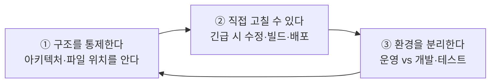
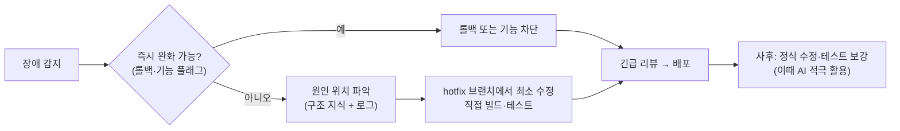
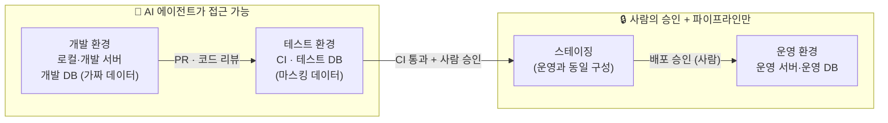
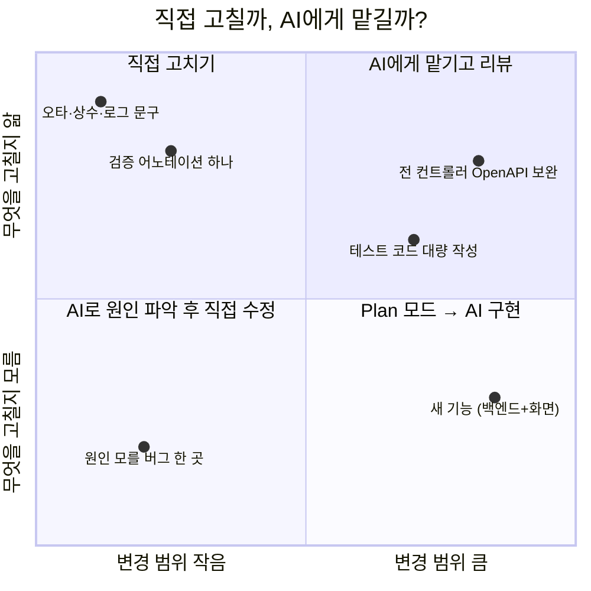

# 바이브 코딩 시대, 개발자가 놓치면 안 되는 것

> 관련 모듈: 1(첫 시간에 강조), 7, 8, 9, 20, 캡스톤 — **모든 회차에서 반복해서 강조할 원칙**
> 예제 프로젝트: [EduHub](./00-sample-project.md)

AI가 복잡한 코드를 대신 작성해 주는 **바이브 코딩(Vibe Coding)** 시대에도, 코드에 대한 **책임은 여전히 개발자에게** 있습니다. 이 문서는 교육 전반에서 반복해서 강조할 세 가지 원칙과, 그 바탕이 되는 습관(원칙 4: 간단한 코드는 직접 고친다)을 정리합니다.

---

## 원칙 1. 소스 코드의 구조와 아키텍처는 개발자가 통제한다

### 왜

- AI는 **요청한 일을 끝내는 데** 집중합니다. 전체 구조의 일관성, 장기적인 유지보수성은 사람이 지키지 않으면 서서히 무너집니다
- 구조를 모르면 AI가 만든 변경이 **맞는지 틀린지 판단할 수 없습니다** → 리뷰가 형식이 되고, 장애가 나면 손을 쓸 수 없습니다
- "동작은 하는데 아무도 이해하지 못하는 코드"는 가장 비싼 기술 부채입니다

### 개발자가 최소한 알고 있어야 할 것

| 수준 | 내용 | EduHub 예 |
|---|---|---|
| **아키텍처** | 시스템이 어떤 덩어리로 나뉘고 어떻게 연결되는가 | shell + remote 2개 → Axios → Spring Boot → PostgreSQL |
| **모듈·패키지 구조** | 어떤 기능이 어느 모듈·패키지에 있는가 | 수강 신청 로직은 `backend/.../enrollment/` |
| **핵심 파일의 역할** | 어느 파일에 어떤 내용이 있는가 | `EnrollmentService` = 신청·취소·대기 처리, `GlobalExceptionHandler` = 공통 에러 응답 |
| **데이터 흐름** | 요청 하나가 어떤 경로로 처리되는가 | 신청 버튼 → `enrollmentApi.enroll()` → `EnrollmentController` → `EnrollmentService` → `enrollment` 테이블 |
| **설정과 배포** | 환경별 설정 파일, 빌드·배포 방법 | `application-{profile}.yml`, CI 워크플로우, 배포 스크립트 |

### 구조를 통제하는 방법

| 방법 | 설명 |
|---|---|
| **설계는 사람이 결정** | 새 모듈, 계층 구조, 주요 라이브러리 도입은 Plan 모드로 계획을 받아 **사람이 승인** |
| **구조를 문서로 고정** | `docs/architecture.md`, ADR(설계 결정 기록), 루트 CLAUDE.md의 "지도" ([저장소 구조](./20-repository-structure.md)) |
| **구조 규칙을 강제** | ArchUnit(패키지 의존 규칙), ESLint(import 제한), 훅 ([사내 프레임워크](./07-custom-framework.md)) |
| **작은 단위로 리뷰** | PR은 사람이 이해할 수 있는 크기로. **이해하지 못한 코드는 머지하지 않는다** |
| **AI에게 설명을 요구** | "무엇을 왜 바꿨는지, 어느 파일에 무엇이 추가됐는지 요약해줘" → 내 이해와 비교 |
| **정기적으로 직접 읽기** | 핵심 파일은 직접 읽고 흐름을 따라가 본다. AI 요약만 믿지 않는다 |

### 자가 점검 질문

- [ ] 우리 서비스의 아키텍처를 그림 한 장으로 그릴 수 있는가?
- [ ] "수강 취소 시 대기자 승격"은 어느 파일, 어느 메서드에 있는가?
- [ ] 이번 주에 AI가 추가한 파일과 그 역할을 말할 수 있는가?
- [ ] 장애 로그의 스택 트레이스를 보고 어느 코드부터 볼지 바로 알 수 있는가?

---

## 원칙 2. 긴급 상황에서는 직접 수정·빌드·배포할 수 있어야 한다

### 왜

- 운영 장애는 **AI 서비스가 느리거나, 사용 한도에 걸리거나, 접속이 안 될 때** 일어날 수도 있습니다
- 보안 사고 대응 중에는 외부 서비스 사용이 제한될 수 있습니다
- 급할수록 AI가 엉뚱한 곳을 고치는 위험이 커지고, 검토할 시간도 부족합니다
- **"AI 없이는 고칠 수 없는 시스템"은 운영할 수 없는 시스템**입니다

### 개발자가 직접 할 수 있어야 하는 것

| 역량 | 확인 방법 |
|---|---|
| 로컬에서 **빌드·실행** | `./gradlew build`, `npm run build`, 로컬 서버 기동 |
| 로그·스택 트레이스로 **원인 위치 찾기** | 원칙 1의 구조 지식 |
| **직접 코드 수정** | IDE에서 수정, 디버거 사용 |
| **테스트 실행** | 단위·통합 테스트를 직접 실행하고 결과 해석 |
| **배포·롤백** | 배포 절차, 이전 버전으로 되돌리는 절차 (런북) |
| **설정 변경** | 기능 플래그, 환경 변수로 문제 기능 차단 |

### 준비해 둘 것

| 준비물 | 내용 |
|---|---|
| **런북(runbook)** | `docs/runbooks/`에 장애 유형별 대응 절차, 배포·롤백 명령 ([저장소 구조](./20-repository-structure.md)) |
| **빌드·배포 스크립트** | 사람이 그대로 실행할 수 있는 명령 (`scripts/deploy.sh`, CI 수동 실행 버튼) |
| **핫픽스 절차** | `hotfix/*` 브랜치 → 최소 수정 → 테스트 → 긴급 리뷰 → 배포 → 사후 정리 |
| **기능 플래그** | 문제 기능을 코드 수정 없이 끌 수 있게 |
| **정기 훈련** | 분기에 한 번 "AI 없이 핫픽스" 훈련 (게임 데이) |

### 긴급 핫픽스 흐름

> 💡 AI는 **사후 정리 단계**(원인 분석 리포트, 재발 방지 테스트, 정식 수정)에서 특히 큰 도움이 됩니다. 긴급 대응 중에 쓰더라도 **변경 내용을 사람이 이해하고 승인**해야 합니다.

---

## 원칙 3. AI로 유지보수할 때는 운영 환경과 개발·테스트 환경을 반드시 분리한다

### 왜

- 에이전트는 **명령을 실행**합니다. 운영 DB, 운영 서버에 닿을 수 있으면 실수 한 번이 장애나 데이터 손실로 이어집니다
- 외부 문서·이슈에 숨은 지시(프롬프트 인젝션)로 의도치 않은 명령이 실행될 수 있습니다
- 운영 데이터에는 개인정보가 있습니다. AI 도구로 전송되면 정책 위반이 될 수 있습니다

### 환경 분리 구조

### 분리의 기준

| 항목 | 개발·테스트 환경 | 운영 환경 |
|---|---|---|
| AI 에이전트 접근 | 허용 | **금지** (읽기 전용 조회도 최소화) |
| 데이터 | 가짜 데이터, 마스킹된 데이터 | 실제 데이터 (개인정보) |
| 계정·자격 증명 | 개발용, 권한 제한 | 운영용, AI 도구에 **절대 노출 금지** |
| 배포 방법 | 자유롭게 실험 | CI/CD 파이프라인 + **사람의 승인** |
| 설정 파일 | `application-dev.yml`, `application-test.yml` | `application-prod.yml` (AI 읽기 차단) |

### Claude Code에서 분리를 지키는 방법

| 방법 | 설정 예 |
|---|---|
| **운영 설정·비밀 읽기 차단** | `"deny": ["Read(./backend/src/main/resources/application-prod.yml)", "Read(./.env.prod)"]` ([권한](./23-permissions.md)) |
| **운영 접속 명령 차단** | `"deny": ["Bash(kubectl * --context prod*)", "Bash(ssh prod-*)"]` + PreToolUse 훅으로 운영 호스트·DB 접속 패턴 차단 |
| **MCP는 개발·테스트용만** | DB MCP는 개발 DB의 **읽기 전용 계정**으로만 연결 ([MCP 가이드](./19-mcp-server-guide.md)) |
| **운영 자격 증명은 다른 곳에** | 개발자 PC·저장소·AI 세션 환경 변수에 운영 키를 두지 않음. 비밀 관리 도구 사용 |
| **배포는 파이프라인으로만** | AI가 운영에 직접 배포하지 않음. PR → CI → 승인 → 배포 |
| **보호 브랜치** | `main`·`release` 직접 푸시 금지, 필수 리뷰 ([GitHub](./06-github-version-control.md)) |
| **조직 관리 설정** | `bypassPermissions` 금지, 운영 관련 deny 규칙을 관리 설정으로 강제 |
| **운영 장애 분석은 사본으로** | 운영 로그는 필요한 부분만 마스킹해 전달. 데이터 재현은 테스트 환경에서 |

### 하지 말아야 할 것

- ❌ "운영 DB에 접속해서 데이터 고쳐줘"
- ❌ 운영 서버에 SSH로 들어가 Claude Code 실행
- ❌ 운영 API 키를 `.env`에 두고 AI 세션에서 사용
- ❌ AI가 만든 마이그레이션을 검토 없이 운영에 적용
- ❌ 운영 데이터를 그대로 복사해 AI에게 분석 요청

## 원칙 4. 간단한 코드는 직접 고친다: 언제 직접, 언제 AI에게?

> **"간단한 코드는 직접 고친다."** 이 습관이 가능하려면 **항상 코드를 이해하고 있어야** 합니다. 반대로, 직접 고치는 습관이 코드를 계속 이해하게 만듭니다.

**왜 중요한가**

| 관점 | 직접 고치면 |
|---|---|
| **시간** | 상수 하나, 오타 하나는 IDE에서 10초. AI에게 맡기면 지시 작성 → 탐색·수정 대기 → diff 검토로 몇 분이 걸린다 |
| **토큰** | 작은 수정에도 AI는 파일을 찾고 읽으며 컨텍스트를 쓴다. 직접 고치면 **0토큰** |
| **이해 유지** | 코드를 직접 만지는 개발자는 구조와 파일 위치를 잊지 않는다 → 원칙 1, 2의 바탕 |
| **긴급 대응력** | 평소 직접 고쳐 본 코드여야 장애 때도 직접 고칠 수 있다 |

**판단 기준: 4가지 질문**

| 질문 | 직접 고치기 쪽 | AI에게 맡기기 쪽 |
|---|---|---|
| ① 무엇을, 어디를 고칠지 **이미 아는가?** | 정확히 안다 | 원인·위치부터 찾아야 한다 |
| ② 변경 **범위**는? | 한두 줄, 파일 하나 | 여러 파일, 계층을 가로지름 |
| ③ **반복**되는 작업인가? | 한 번뿐 | 같은 패턴을 여러 곳에 (테스트, 어노테이션, 마이그레이션) |
| ④ **설명하는 비용** vs 고치는 비용 | 설명이 더 오래 걸린다 | 고치는 것이 훨씬 오래 걸린다 |

| 영역 | 예 (EduHub) | 권장 방식 |
|---|---|---|
| **직접 고치기** | 오타, 상수·설정값 변경, 로그 문구, `@NotNull` 하나 추가, 조건문 하나 수정, 긴급 핫픽스 | IDE에서 바로 수정 → 테스트 실행 |
| **AI에게 맡기고 리뷰** | 모든 컨트롤러에 OpenAPI 어노테이션 보완, 테스트 대량 작성, 반복 리팩터링 | 지시 + 검증 기준 → diff 리뷰 |
| **AI로 원인 파악 → 직접 수정** | 원인을 모르는 버그, 낯선 코드의 동작 이해 | "원인과 위치만 찾아줘, 수정은 하지 마" → 직접 수정 |
| **Plan 모드 → AI 구현** | 새 기능, 여러 계층에 걸친 변경 | 계획 검토·승인 → 구현 → 리뷰 |

**함께 쓰는 패턴**
- **AI가 찾고, 사람이 고친다**: 탐색·설명은 AI, 핵심 로직 수정은 직접
- **사람이 핵심을, AI가 주변을**: 비즈니스 규칙은 직접 쓰고, 테스트·문서·반복 코드는 AI
- **AI가 초안, 사람이 마무리**: 큰 변경은 AI 초안 후 세부 조정은 IDE에서 직접

**주의할 점**
- ❌ 변수 이름 하나 바꾸려고 AI에게 지시하고 기다리기 → 시간·토큰 낭비 (IDE의 이름 바꾸기 기능이 더 정확)
- ❌ 수십 개 파일의 기계적인 반복 수정을 손으로 하기 → AI나 IDE 일괄 기능을 쓴다
- ❌ **이해하지 못한 코드**를 AI에게 맡기고 리뷰도 형식적으로 → 원칙 1 위반
- 💡 세션 중에 직접 고쳤다면 Claude에게 "방금 X를 직접 수정했어"라고 알려 주면 이후 작업의 맥락이 맞는다
- 💡 보안·결제·권한처럼 **위험이 큰 코드**는 AI가 쓰더라도 사람이 한 줄씩 이해하고 검토한다

> 💡 "AI를 많이 쓰는 것"이 목표가 아니라 **"가장 빠르고 안전하게 끝내는 것"**이 목표입니다. 직접 고치는 능력이 있어야 AI에게 맡길 일과 맡기지 않을 일을 고를 수 있습니다.

---

## 정리: 개발자의 역할 변화

| 예전 | 바이브 코딩 시대 |
|---|---|
| 코드를 직접 **작성**하는 사람 | 구조를 **설계·통제**하고, AI의 결과를 **검증·판단**하는 사람 |
| 모든 줄을 직접 씀 | 모든 줄을 직접 쓰지 않아도 **모든 변경을 이해함** |
| 무엇이든 직접 | **작고 명확한 일은 직접**, 크고 반복적인 일은 AI에게 |
| 배포·운영 직접 수행 | 배포·운영은 **여전히 직접 할 수 있어야 함** + 안전장치 설계 |

> **"AI가 코드를 쓰더라도, 시스템의 주인은 개발자다."**

---

## 실습·토론

1. EduHub 아키텍처를 **AI 도움 없이** 화이트보드에 그려 보고, AI가 만든 설명과 비교
2. "수강 취소 기능" 구현 후 AI 없이 다음 질문에 답하기: 어느 파일이 바뀌었나? 트랜잭션 경계는 어디인가? 롤백하려면?
3. 장애 시나리오 훈련: "대기자 승격이 안 되는 운영 장애" → AI 없이 원인 찾기 → 핫픽스 → 배포 절차 수행
4. 팀의 `.claude/settings.json`에 운영 환경 보호 규칙(deny, 훅)을 추가하고 차단되는지 확인
5. 토론: 우리 팀에서 AI가 접근해도 되는 환경과 안 되는 환경의 경계는 어디인가?
