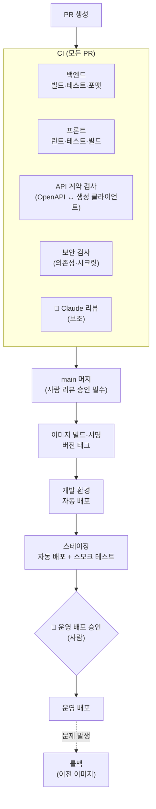

# Claude Code로 빌드·배포 파이프라인 구축하기: 모범 사례

> 관련 모듈: 17 (7, 9, 20과 연결)
> 예제 프로젝트: [EduHub](./00-sample-project.md) — Spring Boot + React 마이크로프론트엔드, GitHub Actions 기준
> ⚠️ 액션 버전, 입력값, 클라우드별 배포 방법은 바뀔 수 있습니다. 아래 YAML은 **구조와 모범 사례를 보여주는 예시**이므로 실제 적용 전에 각 공식 문서로 확인하세요.

---

## 1. 큰 그림: Claude Code의 세 가지 역할

| 역할 | 설명 | 예 |
|---|---|---|
| **① 파이프라인을 만드는 도구** | 워크플로우 YAML, Dockerfile, 배포 스크립트를 Claude Code와 함께 작성·개선 | "Gradle 캐시를 쓰는 CI 워크플로우를 만들어줘" |
| **② 파이프라인 안의 보조 단계** | PR 리뷰, CI 실패 원인 분석, 릴리스 노트 작성 | `claude-code-action`, `claude -p` |
| **③ 로컬 검증 도우미** | CI와 같은 검증을 로컬에서 먼저 실행 | `scripts/verify.sh` |

> ⭐ **절대 원칙:** AI는 파이프라인을 **만들고 돕지만**, **운영 배포를 직접 실행하거나 승인하지 않습니다.** 운영 배포는 파이프라인과 **사람의 승인**으로만 진행합니다. ([개발자의 책임](./27-developer-responsibility.md))

---

## 2. 목표 파이프라인 구조



| 단계 | 자동/수동 | 핵심 |
|---|---|---|
| CI | 자동 | 빠르게(10분 이내 목표), 실패하면 머지 불가 |
| 이미지 빌드 | 자동 | **한 번 빌드한 이미지를 모든 환경에 그대로** 배포 (환경별 재빌드 금지) |
| 개발·스테이징 배포 | 자동 | 스테이징은 운영과 같은 구성, 스모크 테스트 |
| 운영 배포 | **사람 승인** | GitHub Environments의 필수 승인자, 배포 시간대 제한 |
| 롤백 | 버튼 한 번 | 이전 이미지 태그로 재배포, 절차는 런북에 |

---

## 3. 단계별 구축: Claude Code와 함께 만들기

### 3-1. 시작하기: 계획부터

```text
/plan EduHub에 GitHub Actions 기반 CI/CD를 구축하려고 해.
- 백엔드: Gradle(Java 21), 프론트: npm 워크스페이스(shell, course-mfe, enrollment-mfe)
- 환경: dev, staging, prod (prod는 사람 승인 필수)
- 이미지는 컨테이너 레지스트리에 한 번만 빌드해서 모든 환경에 같은 이미지로 배포
- 클라우드 인증은 장기 키 대신 OIDC
현재 저장소 구조를 읽고, 워크플로우 파일 구성과 단계별 구현 계획을 세워줘. 아직 파일은 만들지 마.
```

> 💡 파이프라인은 **팀 전체와 운영에 영향**을 줍니다. 반드시 Plan 모드로 계획을 검토한 뒤 작은 단위로 구현하세요.

### 3-2. CI 워크플로우 (예시)

```yaml
# .github/workflows/ci.yml
name: CI
on:
  pull_request:
  push:
    branches: [main]

permissions:
  contents: read            # 기본은 최소 권한

concurrency:
  group: ci-${{ github.ref }}
  cancel-in-progress: true  # 같은 브랜치의 이전 실행 취소

jobs:
  changes:                  # 변경된 영역만 검사해 시간 절약
    runs-on: ubuntu-latest
    outputs:
      backend: ${{ steps.filter.outputs.backend }}
      frontend: ${{ steps.filter.outputs.frontend }}
    steps:
      - uses: actions/checkout@v4
      - id: filter
        uses: dorny/paths-filter@v3
        with:
          filters: |
            backend:  ['backend/**']
            frontend: ['frontend/**']

  backend:
    needs: changes
    if: needs.changes.outputs.backend == 'true'
    runs-on: ubuntu-latest
    steps:
      - uses: actions/checkout@v4
      - uses: actions/setup-java@v4
        with: { distribution: temurin, java-version: '21' }
      - uses: gradle/actions/setup-gradle@v4      # Gradle 캐시
      - name: Format, test, build
        working-directory: backend
        run: ./gradlew spotlessCheck test bootJar
      - name: Export OpenAPI spec
        working-directory: backend
        run: ./gradlew generateOpenApiDocs         # 예: springdoc 플러그인 사용 시
      - uses: actions/upload-artifact@v4
        with: { name: openapi, path: backend/build/openapi.json }

  frontend:
    needs: [changes, backend]
    if: always() && needs.changes.outputs.frontend == 'true'
    runs-on: ubuntu-latest
    steps:
      - uses: actions/checkout@v4
      - uses: actions/setup-node@v4
        with: { node-version: 'lts/*', cache: npm, cache-dependency-path: frontend/package-lock.json }
      - working-directory: frontend
        run: |
          npm ci
          npm run lint
          npm test -- --ci
          npm run build

  api-contract:             # 백엔드 API와 프론트 생성 클라이언트가 어긋나지 않았는지
    needs: backend
    runs-on: ubuntu-latest
    steps:
      - uses: actions/checkout@v4
      - uses: actions/download-artifact@v4
        with: { name: openapi, path: spec }
      - working-directory: frontend
        run: |
          npm ci
          npm run generate:api -- --input ../spec/openapi.json
          git diff --exit-code packages/api-client/src/generated \
            || (echo "::error::API 클라이언트가 최신이 아닙니다. npm run generate:api 후 커밋하세요." && exit 1)
```

**Claude Code에게 맡길 때의 지시 예**

```text
ci.yml의 backend 잡이 8분 걸려. Gradle 빌드 스캔이나 로그를 보고 느린 단계를 찾아서
캐시·병렬화로 줄이는 방법을 제안해줘. 테스트를 건너뛰는 방법은 제외해.
```

### 3-3. 컨테이너 이미지 (예시)

```dockerfile
# backend/Dockerfile — 멀티 스테이지 빌드
FROM eclipse-temurin:21-jdk AS build
WORKDIR /app
COPY . .
RUN ./gradlew bootJar --no-daemon

FROM eclipse-temurin:21-jre
WORKDIR /app
RUN useradd -r app && chown app /app
USER app                                   # root로 실행하지 않음
COPY --from=build /app/build/libs/*.jar app.jar
EXPOSE 8080
ENTRYPOINT ["java", "-jar", "app.jar"]
```

```dockerfile
# frontend/apps/course-mfe/Dockerfile — remote 하나당 이미지 하나
FROM node:lts AS build
WORKDIR /app
COPY . .
RUN npm ci && npm run build -w apps/course-mfe

FROM nginx:stable
COPY --from=build /app/apps/course-mfe/dist /usr/share/nginx/html
# remoteEntry.js는 캐시하지 않고, 해시가 붙은 정적 파일은 오래 캐시 (nginx 설정)
```

**마이크로프론트엔드 배포 요령**
- remote마다 **독립 배포** 가능하게 (각자 이미지·파이프라인)
- `remoteEntry.js`는 **캐시 금지**, 나머지 정적 파일은 해시 파일명 + 장기 캐시
- shared 의존성(React, MUI) 버전 변경은 shell과 remote를 **함께 배포**하는 별도 절차로

### 3-4. 배포 워크플로우 (예시)

```yaml
# .github/workflows/deploy.yml
name: Deploy
on:
  push:
    branches: [main]
  workflow_dispatch:           # 수동 실행 (롤백 시 이미지 태그 지정)
    inputs:
      image_tag: { description: '배포할 이미지 태그 (롤백용)', required: false }

permissions:
  contents: read
  id-token: write              # OIDC로 클라우드 인증 (장기 키 불필요)
  packages: write

jobs:
  build-image:
    runs-on: ubuntu-latest
    outputs:
      tag: ${{ steps.meta.outputs.tag }}
    steps:
      - uses: actions/checkout@v4
      - id: meta
        run: echo "tag=${GITHUB_SHA::12}" >> "$GITHUB_OUTPUT"   # 커밋 기반 불변 태그
      # 이미지 빌드·푸시·서명 단계 (레지스트리별 공식 액션 사용)

  deploy-dev:
    needs: build-image
    runs-on: ubuntu-latest
    environment: dev
    steps:
      - run: ./scripts/deploy.sh dev "${{ inputs.image_tag || needs.build-image.outputs.tag }}"

  deploy-staging:
    needs: [build-image, deploy-dev]
    runs-on: ubuntu-latest
    environment: staging
    steps:
      - run: ./scripts/deploy.sh staging "${{ inputs.image_tag || needs.build-image.outputs.tag }}"
      - run: ./scripts/smoke-test.sh staging

  deploy-prod:
    needs: [build-image, deploy-staging]
    runs-on: ubuntu-latest
    environment: production        # ⭐ GitHub 설정에서 필수 승인자 지정 → 사람이 승인해야 실행
    steps:
      - run: ./scripts/deploy.sh prod "${{ inputs.image_tag || needs.build-image.outputs.tag }}"
      - run: ./scripts/smoke-test.sh prod
```

**GitHub 저장소 설정 (사람이 직접)**
- Settings → Environments → `production`: **Required reviewers** 지정, 배포 가능 브랜치를 `main`으로 제한
- 운영 시크릿은 `production` 환경에만 등록 (PR이나 다른 환경에서는 접근 불가)
- 보호 브랜치: `main` 직접 푸시 금지, CI 통과·리뷰 승인 필수

> `scripts/deploy.sh`처럼 배포 로직을 **스크립트로 분리**하면, 긴급 시 사람이 같은 스크립트로 직접 배포·롤백할 수 있습니다. ([개발자의 책임 — 원칙 ②](./27-developer-responsibility.md))

### 3-5. DB 마이그레이션 (Flyway)

| 원칙 | 설명 |
|---|---|
| **하위 호환 변경** | 컬럼 추가 → 코드 배포 → 이전 컬럼 제거처럼 **나눠서**(expand → contract). 롤백해도 이전 버전 앱이 동작해야 함 |
| **배포와 분리된 단계** | 마이그레이션은 별도 잡·명령으로 실행하고 결과 확인 |
| **운영 적용은 사람 검토** | `migration-reviewer` 에이전트 검토 + DBA 리뷰(CODEOWNERS) ([에이전트](./18-java-react-agents.md)) |
| **파괴적 명령 차단** | `flywayClean` 등은 운영 설정에서 비활성화, 권한 규칙으로도 차단 |

---

## 4. 파이프라인 안에서 Claude 활용하기

### 4-1. PR 자동 리뷰 (보조 리뷰어)

```yaml
# .github/workflows/claude-review.yml (발췌)
on:
  pull_request:
    types: [opened, synchronize]
permissions:
  contents: read
  pull-requests: write
jobs:
  review:
    if: github.event.pull_request.head.repo.full_name == github.repository   # 외부 포크 PR 제외
    runs-on: ubuntu-latest
    steps:
      - uses: actions/checkout@v4
      - uses: anthropics/claude-code-action@v1
        with:
          anthropic_api_key: ${{ secrets.ANTHROPIC_API_KEY }}
          prompt: |
            CLAUDE.md 규칙에 따라 이 PR을 리뷰해줘.
            특히 .github/workflows/, Dockerfile, scripts/deploy.sh 변경이 있으면
            권한 확대, 시크릿 노출, 운영 배포 우회 가능성을 중점적으로 확인해줘.
```

또는 터미널에서 `/install-github-app`으로 설정을 안내받을 수 있습니다. ([GitHub 연결](./06-github-version-control.md))

### 4-2. CI 실패 원인 자동 분석

```yaml
  analyze-failure:
    needs: [backend, frontend]
    if: failure() && github.event_name == 'pull_request'
    runs-on: ubuntu-latest
    permissions: { contents: read, pull-requests: write, actions: read }
    steps:
      - uses: actions/checkout@v4
      - name: 실패 로그 수집
        env: { GH_TOKEN: '${{ github.token }}' }
        run: gh run view ${{ github.run_id }} --log-failed | tail -300 > failed.log
      - name: Claude로 원인 분석
        env:
          ANTHROPIC_API_KEY: ${{ secrets.ANTHROPIC_API_KEY }}
        run: |
          npm install -g @anthropic-ai/claude-code
          claude -p "failed.log는 CI 실패 로그야. 원인을 찾고, 관련 파일과 수정 방향을 5줄 이내로 요약해줘. 코드는 수정하지 마." \
            --permission-mode dontAsk --allowedTools "Read" "Grep" "Glob" \
            --max-turns 8 > analysis.md
      - name: PR에 코멘트
        env: { GH_TOKEN: '${{ github.token }}' }
        run: gh pr comment ${{ github.event.pull_request.number }} --body-file analysis.md
```

**설계 포인트**
- **읽기 전용 도구만** 허용, 턴 수 제한 → 비용과 위험 통제
- 분석만 하고 **수정·푸시는 하지 않음** → 개발자가 판단해 수정

### 4-3. 그 밖의 활용

| 활용 | 방법 |
|---|---|
| 릴리스 노트 초안 | 태그 생성 시 `claude -p`로 커밋 목록 요약 → 릴리스 초안 |
| 의존성 업데이트 영향 분석 | 의존성 봇 PR에 Claude 리뷰로 변경 내역·위험 요약 |
| 배포 후 리포트 | 스모크 테스트 결과를 요약해 팀 채널에 공유 (아티팩트로 대시보드화) |

---

## 5. 파이프라인 보안 모범 사례

| 항목 | 모범 사례 |
|---|---|
| **권한** | 워크플로우 최상단 `permissions: contents: read`, 필요한 잡에서만 추가 |
| **클라우드 인증** | 장기 액세스 키 대신 **OIDC** (`id-token: write`) |
| **시크릿** | 환경(Environment)별로 분리, 운영 시크릿은 `production` 환경에만 |
| **외부 액션** | 신뢰할 수 있는 액션만, 가능하면 **커밋 SHA로 고정** |
| **외부 포크 PR** | 시크릿이 필요한 잡(Claude 리뷰 포함)은 실행하지 않음 |
| **프롬프트 인젝션** | PR 제목·본문·코드 주석에 숨은 지시가 있을 수 있음 → Claude 단계는 읽기 전용·최소 권한, 결과는 코멘트로만 |
| **워크플로우 변경 리뷰** | `.github/workflows/`, `scripts/deploy.sh`에 CODEOWNERS 지정 (플랫폼 팀 승인) |
| **AI 비용 통제** | `--max-turns`, `--max-budget-usd`, 실행 조건 제한 |
| **로컬 Claude Code 권한** | 배포 스크립트 실행·운영 컨텍스트 명령은 deny ([권한](./23-permissions.md)) |

```json
// .claude/settings.json (발췌): 개발자 PC의 Claude Code가 배포를 직접 하지 못하게
{
  "permissions": {
    "deny": [
      "Bash(./scripts/deploy.sh prod*)",
      "Bash(kubectl * --context prod*)",
      "Edit(./.github/workflows/deploy.yml)"
    ],
    "ask": [
      "Edit(./.github/workflows/**)",
      "Bash(gh workflow run *)"
    ]
  }
}
```

> 배포 워크플로우 수정을 아예 막을지, 확인 후 허용할지는 팀이 정합니다. 파이프라인을 만드는 초기에는 `ask`로 두고, 안정화된 뒤에는 운영 배포 워크플로우를 `deny` + 플랫폼 팀 리뷰로 관리하는 방식을 권장합니다.

---

## 6. 모범 사례 요약

| # | 원칙 |
|---|---|
| 1 | **파이프라인도 코드다**: 워크플로우·Dockerfile·배포 스크립트를 저장소에서 PR로 관리하고 리뷰 |
| 2 | **로컬과 CI가 같은 명령**을 쓴다: `scripts/verify.sh`, `scripts/deploy.sh` → 사람·AI·CI 모두 같은 기준 |
| 3 | **빠른 CI**: 변경 영역만 검사, 캐시, 병렬화. 느린 CI는 AI의 반복 수정 비용도 키운다 |
| 4 | **한 번 빌드, 여러 번 배포**: 불변 이미지 태그, 환경별 재빌드 금지 |
| 5 | **운영 배포는 사람 승인**: Environments 필수 승인자, AI는 승인하지 않음 |
| 6 | **롤백이 쉬워야 한다**: 이전 태그로 재배포, 런북, 정기 훈련 |
| 7 | **DB 변경은 하위 호환**으로 나눠서 |
| 8 | **최소 권한과 OIDC**, 시크릿은 환경별로 |
| 9 | **AI는 보조 단계로**: 리뷰·분석·문서화는 맡기되 결과는 코멘트로, 판단은 사람이 |
| 10 | **비용·보안 통제**: 턴·예산 제한, 외부 PR 제외, 읽기 전용 도구 |

---

## 7. 실습

1. Plan 모드로 EduHub CI/CD 계획을 받고, 팀과 검토해 수정 의견 반영
2. Claude Code와 `ci.yml`을 만들고, 일부러 테스트를 깨뜨린 PR로 CI 실패 → 실패 분석 코멘트 확인
3. `api-contract` 잡이 생성 클라이언트 누락을 잡아내는지 확인 (클라이언트 재생성 없이 API 변경 PR)
4. `production` 환경에 필수 승인자를 설정하고, 승인 없이는 운영 배포 잡이 대기하는 것 확인
5. `workflow_dispatch`로 이전 이미지 태그를 지정해 **롤백 훈련** (AI 없이 사람이 직접 수행)
6. 팀 토론: 우리 파이프라인에서 AI가 맡아도 되는 단계와 사람이 반드시 해야 하는 단계 구분
