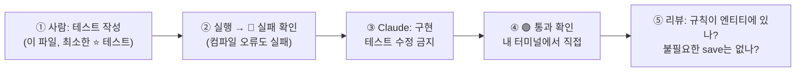

# 예제: CourseServiceTest — 과정·회차 관리(FR-03) 서비스 단위 테스트

> [3회차: 기능 개발과 GitHub 협업](../sessions/session-03-feature-dev-and-github.md)의 TDD 실습(1-2)과 FR-03 구현(Step 5, B 담당)에서 쓰는 테스트 코드입니다.
> **사람이 먼저 쓰는 테스트**의 예시로, 이 테스트를 저장소에 넣어 두고 Claude에게 "테스트는 고치지 말고 통과하도록 `CourseService`를 구현해줘"라고 지시합니다.
>
> ✅ **검증**: JDK 21, Spring Boot 3.4.1(JUnit 5, Mockito, AssertJ) 최소 프로젝트에서 아래 테스트 11개가 모두 통과하는 것을 확인했습니다 (2026년 10월).

---

## 1. 무엇을 검증하나

| 기능 (FR-03) | 테스트 | 업무 규칙 |
|---|---|---|
| 과정 등록 | `create_savesOpenCourse` | 요청 내용 그대로, **OPEN 상태**로 저장하고 id를 돌려준다 |
| 과정 수정 | `update_openCourse_changesFields` | 열린 과정은 수정된다. 변경 감지로 반영되므로 `save`를 다시 부르지 않는다 |
| | ⭐ `update_closedCourse_throwsCourseClosedException` | **종료된 과정은 수정할 수 없다.** 예외가 나면 값이 하나도 바뀌지 않는다 |
| | `update_missingCourse_throwsNotFound` | 없는 과정은 `CourseNotFoundException` (→ 컨트롤러에서 404) |
| 회차 추가 | `addSession_openCourse_savesSession` | 열린 과정에 회차를 추가하고 회차 id를 돌려준다 |
| | `addSession_closedCourse_throwsCourseClosedException` | 종료된 과정에는 회차를 추가할 수 없다 |
| | `addSession_invalidCapacity_throwsIllegalArgument` (0, -1) | 정원은 1명 이상 |
| 과정 종료 | `close_changesStatusToClosed` | 종료하면 CLOSED |
| | `close_alreadyClosed_isIdempotent` | 이미 종료된 과정을 다시 종료해도 예외 없이 CLOSED (멱등) |
| | `close_missingCourse_throwsNotFound` | 없는 과정은 `CourseNotFoundException` |

> 💡 **왜 단위 테스트인가**: DB 없이 Mockito로 리포지토리를 대신하므로 1초 안에 끝납니다. 업무 규칙은 여기서 빠르게 확인하고, 쿼리·매핑은 `@DataJpaTest`, HTTP 응답(404, 409)은 `@WebMvcTest`로 따로 확인합니다 (3회차 Step 3, Step 5).

---

## 2. 이 테스트가 전제하는 코드 (API 계약)

테스트는 **구현이 지켜야 할 계약**이기도 합니다. 3회차 Step 3의 `Course` 엔티티에 다음을 더한 형태를 전제로 합니다.

| 종류 | 이름 | 계약 |
|---|---|---|
| 서비스 | `CourseService` | `Long create(CourseCreateRequest)`, `void update(Long, CourseUpdateRequest)`, `Long addSession(Long, SessionCreateRequest)`, `void close(Long)` |
| 엔티티 | `Course` | `static create(title, category, description)`, `update(...)`, `CourseSession addSession(startDate, place, capacity)`, `close()` |
| 엔티티 | `CourseSession` | `create(course, startDate, place, capacity)`: 정원이 1보다 작으면 `IllegalArgumentException` |
| 리포지토리 | `CourseRepository`, `CourseSessionRepository` | Spring Data JPA |
| 요청 DTO | `CourseCreateRequest`, `CourseUpdateRequest`, `SessionCreateRequest` | record |
| 예외 | `CourseNotFoundException(Long id)`, `CourseClosedException(Long id)` | 메시지에 `id=` 포함 |
| 상태 | `CourseStatus`, `SessionStatus` | `OPEN`, `CLOSED` |

> ⚠️ 업무 규칙(종료된 과정 수정 금지, 정원 1 이상)은 **엔티티 안에** 둡니다. 서비스는 조회하고 위임만 합니다. 그래야 다른 서비스에서 `Course`를 써도 규칙이 지켜집니다.

---

## 3. 테스트 코드

`backend/src/test/java/com/example/eduhub/course/CourseServiceTest.java`

```java
package com.example.eduhub.course;

import static org.assertj.core.api.Assertions.assertThat;
import static org.assertj.core.api.Assertions.assertThatThrownBy;
import static org.mockito.ArgumentMatchers.any;
import static org.mockito.BDDMockito.given;
import static org.mockito.BDDMockito.then;
import static org.mockito.Mockito.never;

import com.example.eduhub.course.dto.CourseCreateRequest;
import com.example.eduhub.course.dto.CourseUpdateRequest;
import com.example.eduhub.course.dto.SessionCreateRequest;
import java.time.LocalDate;
import java.util.Optional;
import org.junit.jupiter.api.DisplayName;
import org.junit.jupiter.api.Nested;
import org.junit.jupiter.api.Test;
import org.junit.jupiter.api.extension.ExtendWith;
import org.junit.jupiter.params.ParameterizedTest;
import org.junit.jupiter.params.provider.ValueSource;
import org.mockito.ArgumentCaptor;
import org.mockito.InjectMocks;
import org.mockito.Mock;
import org.mockito.junit.jupiter.MockitoExtension;
import org.springframework.test.util.ReflectionTestUtils;

/**
 * CourseService 단위 테스트 (FR-03 과정·회차 관리).
 * DB 없이 Mockito로 리포지토리를 대신해, 서비스와 엔티티의 업무 규칙만 빠르게 검증한다.
 */
@ExtendWith(MockitoExtension.class)
class CourseServiceTest {

    @Mock
    CourseRepository courseRepository;

    @Mock
    CourseSessionRepository courseSessionRepository;

    @InjectMocks
    CourseService courseService;

    // ---------- 테스트 데이터 ----------

    private static Course openCourse(Long id) {
        Course course = Course.create("Spring Boot 입문", "BACKEND", "스프링 부트 기초");
        ReflectionTestUtils.setField(course, "id", id);   // DB가 없으므로 id를 직접 넣는다
        return course;
    }

    private static Course closedCourse(Long id) {
        Course course = openCourse(id);
        course.close();
        return course;
    }

    @Nested
    @DisplayName("과정 등록")
    class Create {

        @Test
        @DisplayName("요청 내용으로 OPEN 상태의 과정을 저장하고 id를 돌려준다")
        void create_savesOpenCourse() {
            // given
            var request = new CourseCreateRequest("JPA 실전", "BACKEND", "연관관계와 성능");
            given(courseRepository.save(any(Course.class))).willAnswer(invocation -> {
                Course saved = invocation.getArgument(0);
                ReflectionTestUtils.setField(saved, "id", 1L);
                return saved;
            });

            // when
            Long id = courseService.create(request);

            // then
            assertThat(id).isEqualTo(1L);

            ArgumentCaptor<Course> captor = ArgumentCaptor.forClass(Course.class);
            then(courseRepository).should().save(captor.capture());
            assertThat(captor.getValue())
                    .extracting(Course::getTitle, Course::getCategory, Course::getDescription, Course::getStatus)
                    .containsExactly("JPA 실전", "BACKEND", "연관관계와 성능", CourseStatus.OPEN);
        }
    }

    @Nested
    @DisplayName("과정 수정")
    class Update {

        @Test
        @DisplayName("열린 과정은 제목·분류·설명을 수정한다")
        void update_openCourse_changesFields() {
            // given
            Course course = openCourse(1L);
            given(courseRepository.findById(1L)).willReturn(Optional.of(course));

            // when
            courseService.update(1L, new CourseUpdateRequest("Spring Boot 심화", "BACKEND", "운영과 성능"));

            // then
            assertThat(course.getTitle()).isEqualTo("Spring Boot 심화");
            assertThat(course.getDescription()).isEqualTo("운영과 성능");
            // 변경 감지(dirty checking)로 반영되므로 save를 다시 부르지 않는다
            then(courseRepository).should(never()).save(any());
        }

        @Test
        @DisplayName("종료된 과정은 수정할 수 없다 (FR-03)")
        void update_closedCourse_throwsCourseClosedException() {
            // given
            Course course = closedCourse(1L);
            given(courseRepository.findById(1L)).willReturn(Optional.of(course));
            var request = new CourseUpdateRequest("바뀐 제목", "BACKEND", "바뀐 설명");

            // when & then
            assertThatThrownBy(() -> courseService.update(1L, request))
                    .isInstanceOf(CourseClosedException.class)
                    .hasMessageContaining("id=1");

            // 예외가 나면 값이 하나도 바뀌지 않아야 한다
            assertThat(course.getTitle()).isEqualTo("Spring Boot 입문");
        }

        @Test
        @DisplayName("없는 과정을 수정하면 CourseNotFoundException")
        void update_missingCourse_throwsNotFound() {
            given(courseRepository.findById(99L)).willReturn(Optional.empty());
            var request = new CourseUpdateRequest("제목", "BACKEND", "설명");

            assertThatThrownBy(() -> courseService.update(99L, request))
                    .isInstanceOf(CourseNotFoundException.class);
        }
    }

    @Nested
    @DisplayName("회차 추가")
    class AddSession {

        private final LocalDate startDate = LocalDate.of(2026, 11, 2);

        @Test
        @DisplayName("열린 과정에 회차를 추가하고 회차 id를 돌려준다")
        void addSession_openCourse_savesSession() {
            // given
            Course course = openCourse(1L);
            given(courseRepository.findById(1L)).willReturn(Optional.of(course));
            given(courseSessionRepository.save(any(CourseSession.class))).willAnswer(invocation -> {
                CourseSession saved = invocation.getArgument(0);
                ReflectionTestUtils.setField(saved, "id", 10L);
                return saved;
            });

            // when
            Long sessionId = courseService.addSession(1L, new SessionCreateRequest(startDate, "본사 3층 교육장", 20));

            // then
            assertThat(sessionId).isEqualTo(10L);

            ArgumentCaptor<CourseSession> captor = ArgumentCaptor.forClass(CourseSession.class);
            then(courseSessionRepository).should().save(captor.capture());
            CourseSession session = captor.getValue();
            assertThat(session.getCourse()).isSameAs(course);
            assertThat(session.getStartDate()).isEqualTo(startDate);
            assertThat(session.getPlace()).isEqualTo("본사 3층 교육장");
            assertThat(session.getCapacity()).isEqualTo(20);
            assertThat(session.getStatus()).isEqualTo(SessionStatus.OPEN);
            assertThat(course.getSessions()).containsExactly(session);
        }

        @Test
        @DisplayName("종료된 과정에는 회차를 추가할 수 없다")
        void addSession_closedCourse_throwsCourseClosedException() {
            given(courseRepository.findById(1L)).willReturn(Optional.of(closedCourse(1L)));
            var request = new SessionCreateRequest(startDate, "본사 3층 교육장", 20);

            assertThatThrownBy(() -> courseService.addSession(1L, request))
                    .isInstanceOf(CourseClosedException.class);
            then(courseSessionRepository).should(never()).save(any());
        }

        @ParameterizedTest(name = "정원 {0}명")
        @ValueSource(ints = {0, -1})
        @DisplayName("정원이 1명보다 적으면 회차를 만들 수 없다")
        void addSession_invalidCapacity_throwsIllegalArgument(int capacity) {
            given(courseRepository.findById(1L)).willReturn(Optional.of(openCourse(1L)));
            var request = new SessionCreateRequest(startDate, "본사 3층 교육장", capacity);

            assertThatThrownBy(() -> courseService.addSession(1L, request))
                    .isInstanceOf(IllegalArgumentException.class)
                    .hasMessageContaining("정원");
            then(courseSessionRepository).should(never()).save(any());
        }
    }

    @Nested
    @DisplayName("과정 종료")
    class Close {

        @Test
        @DisplayName("과정을 종료하면 상태가 CLOSED가 된다")
        void close_changesStatusToClosed() {
            Course course = openCourse(1L);
            given(courseRepository.findById(1L)).willReturn(Optional.of(course));

            courseService.close(1L);

            assertThat(course.getStatus()).isEqualTo(CourseStatus.CLOSED);
        }

        @Test
        @DisplayName("이미 종료된 과정을 다시 종료해도 예외 없이 CLOSED를 유지한다")
        void close_alreadyClosed_isIdempotent() {
            Course course = closedCourse(1L);
            given(courseRepository.findById(1L)).willReturn(Optional.of(course));

            courseService.close(1L);

            assertThat(course.getStatus()).isEqualTo(CourseStatus.CLOSED);
        }

        @Test
        @DisplayName("없는 과정을 종료하면 CourseNotFoundException")
        void close_missingCourse_throwsNotFound() {
            given(courseRepository.findById(99L)).willReturn(Optional.empty());

            assertThatThrownBy(() -> courseService.close(99L))
                    .isInstanceOf(CourseNotFoundException.class);
        }
    }
}
```

---

## 4. 코드 읽는 법

| 요소 | 의미 | 왜 이렇게 썼나 |
|---|---|---|
| `@ExtendWith(MockitoExtension.class)` | Spring 컨텍스트 없이 Mockito만 사용 | 빠르다. 서비스 로직만 검증 |
| `@Mock` / `@InjectMocks` | 리포지토리는 가짜, `CourseService`는 진짜 객체에 가짜를 주입 | DB 없이 서비스 테스트 |
| `@Nested` + `@DisplayName` | 기능별로 묶고 한글 이름 표시 | 실행 결과가 요구사항 목록처럼 읽힌다 |
| given / when / then 주석 | 준비 → 실행 → 검증 | 읽는 사람이 구조를 바로 안다 |
| `given(...).willAnswer(...)` | `save`가 호출되면 id를 채워 돌려줌 | DB가 id를 만드는 동작을 흉내 |
| `ArgumentCaptor` | `save`에 넘어간 객체를 잡아서 검사 | "무엇을 저장했나"까지 확인 |
| `then(...).should(never()).save(any())` | 저장이 **일어나지 않았음**을 확인 | 예외 상황에서 부수 효과가 없어야 한다 |
| `assertThatThrownBy` | 예외 종류와 메시지 확인 | 실패 경로도 요구사항이다 |
| `@ParameterizedTest` + `@ValueSource` | 같은 검증을 여러 값으로 | 경계값(0, -1)을 한 번에 |
| `ReflectionTestUtils.setField` | `id`처럼 setter가 없는 필드를 테스트에서만 설정 | 엔티티에 `@Setter`를 열지 않기 위해 |

---

## 5. 실행

```bash
cd backend
./gradlew test --tests "*CourseServiceTest"
```

실행 결과 (예):

```text
CourseServiceTest > 과정 등록 > 요청 내용으로 OPEN 상태의 과정을 저장하고 id를 돌려준다 PASSED
CourseServiceTest > 과정 수정 > 종료된 과정은 수정할 수 없다 (FR-03) PASSED
CourseServiceTest > 회차 추가 > 정원이 1명보다 적으면 회차를 만들 수 없다 > 정원 0명 PASSED
...
```

> 💡 Gradle에서 테스트 이름을 보려면 `build.gradle.kts`에 `tasks.test { testLogging { events("passed", "failed") } }`를 둡니다.

---

## 6. 3회차 TDD 실습에서 쓰는 법



1. **B 담당**은 이 파일 전체, 또는 최소한 ⭐ `update_closedCourse_throwsCourseClosedException`을 **직접** 작성합니다
2. 실행해서 실패(🔴)를 확인합니다. 아직 클래스가 없으면 컴파일 오류가 나는 것도 실패입니다
3. Claude에게 지시합니다

```text
[목표] @backend/src/test/java/com/example/eduhub/course/CourseServiceTest.java 가 모두 통과하도록 CourseService와 필요한 엔티티 메서드를 구현해줘
[제약]
- 테스트 코드는 수정하지 마
- 업무 규칙(종료된 과정 수정 금지, 정원 1 이상)은 엔티티 안에 둬. 서비스는 조회와 위임만
- 엔티티에 @Setter 금지
[완료 기준] cd backend && ./gradlew test --tests "*CourseServiceTest" 통과
[진행 방식] 만들거나 바꿀 파일 목록을 먼저 보여줘
```

4. **diff 검토**: 테스트 파일이 바뀌지 않았는가(`git diff --stat`), 규칙이 서비스가 아니라 엔티티에 있는가, `update`에서 불필요한 `save`를 부르지 않는가
5. 통과를 **내 터미널에서 직접** 확인합니다 (Claude의 "통과했습니다"가 아니라 실행 결과로)

> 🔍 **확인 실험**: 구현이 끝난 뒤 `Course.update()`의 종료 검사 한 줄을 잠시 지우고 테스트를 돌려 ⭐ 테스트가 실패하는지 봅니다. **실패해야 할 때 실패하는 테스트**인지 확인하는 습관입니다. 확인 후 원래대로 되돌립니다.

---

## 7. 참고 구현 (강사·비교용)

Claude의 결과와 비교할 때 씁니다. 실습 전에 수강생에게 먼저 보여 주지 않습니다.

<details>
<summary>CourseService</summary>

```java
package com.example.eduhub.course;

import com.example.eduhub.course.dto.CourseCreateRequest;
import com.example.eduhub.course.dto.CourseUpdateRequest;
import com.example.eduhub.course.dto.SessionCreateRequest;
import lombok.RequiredArgsConstructor;
import org.springframework.stereotype.Service;
import org.springframework.transaction.annotation.Transactional;

@Service
@Transactional
@RequiredArgsConstructor
public class CourseService {

    private final CourseRepository courseRepository;
    private final CourseSessionRepository courseSessionRepository;

    public Long create(CourseCreateRequest request) {
        Course course = Course.create(request.title(), request.category(), request.description());
        return courseRepository.save(course).getId();
    }

    public void update(Long id, CourseUpdateRequest request) {
        Course course = getCourse(id);
        course.update(request.title(), request.category(), request.description());   // 변경 감지로 반영
    }

    public Long addSession(Long courseId, SessionCreateRequest request) {
        Course course = getCourse(courseId);
        CourseSession session = course.addSession(request.startDate(), request.place(), request.capacity());
        return courseSessionRepository.save(session).getId();
    }

    public void close(Long id) {
        getCourse(id).close();
    }

    private Course getCourse(Long id) {
        return courseRepository.findById(id)
                .orElseThrow(() -> new CourseNotFoundException(id));
    }
}
```

</details>

<details>
<summary>Course (3회차 Step 3 엔티티에 create, addSession을 더한 형태)</summary>

```java
package com.example.eduhub.course;

import jakarta.persistence.*;
import java.time.LocalDate;
import java.util.ArrayList;
import java.util.List;
import lombok.AccessLevel;
import lombok.Getter;
import lombok.NoArgsConstructor;

@Entity
@Getter
@NoArgsConstructor(access = AccessLevel.PROTECTED)
public class Course {

    @Id
    @GeneratedValue(strategy = GenerationType.IDENTITY)
    private Long id;

    private String title;
    private String category;
    private String description;

    @Enumerated(EnumType.STRING)
    private CourseStatus status = CourseStatus.OPEN;

    @OneToMany(mappedBy = "course")
    private List<CourseSession> sessions = new ArrayList<>();

    public static Course create(String title, String category, String description) {
        Course course = new Course();
        course.title = title;
        course.category = category;
        course.description = description;
        return course;
    }

    public void update(String title, String category, String description) {
        checkNotClosed();
        this.title = title;
        this.category = category;
        this.description = description;
    }

    public CourseSession addSession(LocalDate startDate, String place, int capacity) {
        checkNotClosed();
        CourseSession session = CourseSession.create(this, startDate, place, capacity);
        sessions.add(session);
        return session;
    }

    public void close() {
        this.status = CourseStatus.CLOSED;
    }

    private void checkNotClosed() {
        if (status == CourseStatus.CLOSED) {
            throw new CourseClosedException(id);   // 종료된 과정은 수정 불가 (FR-03)
        }
    }
}
```

</details>

<details>
<summary>CourseSession</summary>

```java
package com.example.eduhub.course;

import jakarta.persistence.*;
import java.time.LocalDate;
import lombok.AccessLevel;
import lombok.Getter;
import lombok.NoArgsConstructor;

@Entity
@Table(name = "course_session")
@Getter
@NoArgsConstructor(access = AccessLevel.PROTECTED)
public class CourseSession {

    @Id
    @GeneratedValue(strategy = GenerationType.IDENTITY)
    private Long id;

    @ManyToOne(fetch = FetchType.LAZY)
    @JoinColumn(name = "course_id", nullable = false)
    private Course course;

    private LocalDate startDate;
    private String place;
    private int capacity;

    @Enumerated(EnumType.STRING)
    private SessionStatus status = SessionStatus.OPEN;

    static CourseSession create(Course course, LocalDate startDate, String place, int capacity) {
        if (capacity < 1) {
            throw new IllegalArgumentException("정원은 1명 이상이어야 합니다. capacity=" + capacity);
        }
        CourseSession session = new CourseSession();
        session.course = course;
        session.startDate = startDate;
        session.place = place;
        session.capacity = capacity;
        return session;
    }
}
```

</details>

<details>
<summary>요청 DTO와 예외, 리포지토리</summary>

```java
// CourseCreateRequest.java
package com.example.eduhub.course.dto;

public record CourseCreateRequest(String title, String category, String description) {
}

// CourseUpdateRequest.java
package com.example.eduhub.course.dto;

public record CourseUpdateRequest(String title, String category, String description) {
}

// SessionCreateRequest.java
package com.example.eduhub.course.dto;

import java.time.LocalDate;

public record SessionCreateRequest(LocalDate startDate, String place, int capacity) {
}

// CourseNotFoundException.java
package com.example.eduhub.course;

public class CourseNotFoundException extends RuntimeException {
    public CourseNotFoundException(Long id) {
        super("과정을 찾을 수 없습니다. id=" + id);
    }
}

// CourseClosedException.java
package com.example.eduhub.course;

public class CourseClosedException extends RuntimeException {
    public CourseClosedException(Long id) {
        super("종료된 과정은 변경할 수 없습니다. id=" + id);
    }
}

// CourseStatus.java
package com.example.eduhub.course;

public enum CourseStatus { OPEN, CLOSED }

// SessionStatus.java
package com.example.eduhub.course;

public enum SessionStatus { OPEN, CLOSED }

// CourseRepository.java
package com.example.eduhub.course;

import org.springframework.data.jpa.repository.JpaRepository;

public interface CourseRepository extends JpaRepository<Course, Long> {
}

// CourseSessionRepository.java
package com.example.eduhub.course;

import org.springframework.data.jpa.repository.JpaRepository;

public interface CourseSessionRepository extends JpaRepository<CourseSession, Long> {
}

```

</details>

---

## 8. 더 해 보기

- **`@DataJpaTest`로 같은 규칙 확인**: 실제 DB(Testcontainers PostgreSQL)에서 종료된 과정에 회차를 추가하면 예외가 나고 `course_session` 행이 생기지 않는지 확인합니다
- **`@WebMvcTest`로 HTTP 응답 확인**: `CourseClosedException` → 409, `CourseNotFoundException` → 404, 응답 본문이 `ErrorResponse` 형식인지 확인합니다 (3회차 Step 5의 `CourseControllerTest`와 같은 방식)
- **테스트 리뷰를 Claude에게**: "이 테스트가 놓친 경계 조건이 있으면 목록만 알려줘. 코드는 쓰지 마" → 제안 중 필요한 것만 직접 추가합니다

---

## 참고

- [3회차: 기능 개발과 GitHub 협업](../sessions/session-03-feature-dev-and-github.md)
- [예제 프로젝트 EduHub](./00-sample-project.md)
- [기본 사용과 워크플로우](./01-basics-and-workflow.md)
