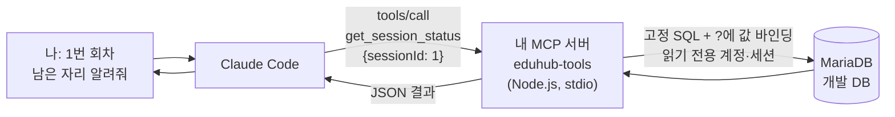
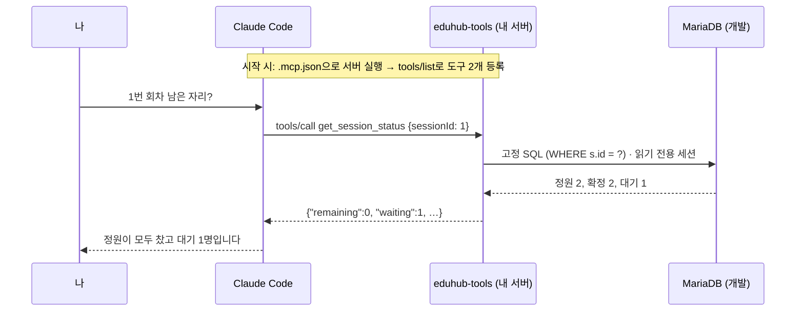

# 예제: 나만의 MCP 서버 만들기 — MariaDB에서 데이터를 가져오는 도구를 만들고 Claude Code에 등록하기

> 관련 모듈: 13 (커넥터와 MCP) · 관련 회차: [5회차 훅과 MCP](../sessions/session-05-hooks-and-mcp.md)
> **시나리오**: EduHub 개발 DB(MariaDB)에서 "회차 현황"과 "사원별 수강 신청 내역"을 가져오는 도구 2개를 직접 만들고, 내 MCP 서버(`eduhub-tools`)로 Claude Code에 등록해 대화에서 쓴다.
>
> ✅ **검증**: 이 문서의 코드는 Node.js 22, `@modelcontextprotocol/sdk` 1.32.2, `mariadb` 커넥터 3.5.5, `zod` 4.6.7로 빌드했습니다. 그리고 MariaDB 10.11에 EduHub 예제 스키마와 읽기 전용 계정을 만들어 실제로 실행했습니다 (2026년 11월). MCP 클라이언트로 도구 목록과 도구 호출을 확인했고, Claude Code 화면에서 등록하는 과정은 직접 확인하지 못했습니다.

---

## 1. 왜 직접 만드나: 범용 SQL 서버 vs 전용 도구

5회차에서 쓴 `mcp-server-mysql`, `postgres-mcp`는 **SQL을 아무거나 받아 실행하는 범용 서버**입니다. 직접 만들면 **정해진 질문만 할 수 있는 도구**를 줄 수 있습니다.

| 구분 | 범용 SQL 서버 (예: `mysql_query`) | 직접 만든 전용 도구 (이 문서) |
|---|---|---|
| Claude가 보내는 것 | **SQL 문장 전체** | `sessionId: 1` 같은 **값만** |
| 실행되는 SQL | Claude가 만든 SQL | **내가 코드에 고정한 SQL** |
| 잘못된 SQL·무거운 쿼리 위험 | 있음 (서버 설정·계정 권한으로 막아야 함) | 거의 없음 (SQL을 바꿀 수 없음) |
| 결과 크기 | 쿼리에 따라 큼 | 필요한 열, 최대 건수를 코드로 제한 → **토큰 절약** |
| 업무 용어 | 테이블 구조를 Claude가 알아내야 함 | "회차 현황", "남은 자리"처럼 **업무 단위**로 제공 |
| 만드는 비용 | 설치만 하면 됨 | 코드 작성·관리 필요 |

> 💡 탐색 단계(스키마 파악, 일회성 조회)는 범용 서버, **반복해서 쓰는 업무 조회**는 전용 도구가 어울립니다. 둘 다 **읽기 전용 계정**으로 연결하는 원칙은 같습니다.

---

## 2. 전체 구조



| 구성 요소 | 파일 | 역할 |
|---|---|---|
| DB 연결 | `src/db.ts` | 환경 변수로 접속, 읽기 전용 세션, 값 바인딩만 허용하는 `select()` |
| 도구 정의 | `src/index.ts` | 도구 이름·설명·입력 스키마·실행 함수 등록, stdio로 서버 시작 |
| 등록 | `.mcp.json` | Claude Code가 이 서버를 어떻게 실행할지 |
| 권한 | `.claude/settings.json` | 이 도구를 묻지 않고 써도 되는지 |

---

## 3. 준비

**① 읽기 전용 계정** ([5회차 MariaDB 버전](../sessions/session-05-hooks-and-mcp.md#개발-db가-mariadb인-팀-step-78의-mariadb-버전)과 같음, 사람이 직접)

```sql
CREATE USER 'eduhub_readonly'@'%' IDENTIFIED BY '각자-정한-비밀번호';
GRANT SELECT, SHOW VIEW ON eduhub.* TO 'eduhub_readonly'@'%';
```

```bash
# 셸 프로필 또는 Windows 사용자 환경 변수 (Claude Code를 실행하는 셸에 있어야 함)
export EDUHUB_DB_RO_USER="eduhub_readonly"
export EDUHUB_DB_RO_PASSWORD="각자-정한-비밀번호"
```

**② 폴더 만들기** (EduHub 저장소 안에 둡니다)

```text
eduhub/
├── .mcp.json                      # 5. 등록
└── tools/
    └── eduhub-mcp/
        ├── package.json
        ├── tsconfig.json
        ├── src/
        │   ├── db.ts                # DB 연결
        │   └── index.ts             # 도구 정의 + 서버 시작
        └── scripts/
            └── smoke-test.mjs       # 도구 호출 확인용
```

```bash
mkdir -p tools/eduhub-mcp/src tools/eduhub-mcp/scripts && cd tools/eduhub-mcp
npm init -y
npm install @modelcontextprotocol/sdk zod mariadb
npm install -D typescript @types/node
```

**③ `package.json`과 `tsconfig.json`**

```json
{
  "name": "eduhub-mcp",
  "version": "1.0.0",
  "private": true,
  "type": "module",
  "bin": { "eduhub-mcp": "dist/index.js" },
  "scripts": {
    "build": "tsc",
    "start": "node dist/index.js",
    "inspect": "npx @modelcontextprotocol/inspector node dist/index.js"
  },
  "dependencies": {
    "@modelcontextprotocol/sdk": "^1.32.2",
    "mariadb": "^3.5.5",
    "zod": "^4.6.7"
  },
  "devDependencies": {
    "@types/node": "^22.0.0",
    "typescript": "^5.6.0"
  }
}
```

```json
{
  "compilerOptions": {
    "target": "ES2022",
    "module": "Node16",
    "moduleResolution": "Node16",
    "outDir": "dist",
    "rootDir": "src",
    "strict": true,
    "esModuleInterop": true,
    "skipLibCheck": true
  },
  "include": ["src"]
}
```

> `"type": "module"`(ES 모듈)이라 import 경로에 `.js`를 붙입니다(`./db.js`). TypeScript 소스는 `.ts`지만 빌드 결과가 `.js`이기 때문입니다.

---

## 4. 도구 만들기

### 4-1. DB 연결: `src/db.ts`

```ts
import mariadb from "mariadb";

// 접속 정보는 환경 변수로만 받는다 (.mcp.json과 코드에 비밀번호를 쓰지 않는다)
function required(name: string): string {
  const value = process.env[name];
  if (!value) throw new Error(`환경 변수 ${name}이(가) 없습니다`);
  return value;
}

export const pool = mariadb.createPool({
  host: process.env.EDUHUB_DB_HOST ?? "127.0.0.1",
  port: Number(process.env.EDUHUB_DB_PORT ?? 3306),
  database: process.env.EDUHUB_DB_NAME ?? "eduhub",
  user: required("EDUHUB_DB_RO_USER"),       // 5회차 Step 7에서 만든 읽기 전용 계정
  password: required("EDUHUB_DB_RO_PASSWORD"),
  connectionLimit: 2,
  bigIntAsNumber: true,                       // COUNT(*) 결과(BigInt)를 JSON으로 바꿀 수 있게
  initSql: "SET SESSION TRANSACTION READ ONLY", // 계정 권한에 더해 세션도 읽기 전용으로
});

/** 고정된 SQL만 실행한다. 값은 반드시 ? 자리에 넣는다 (문자열 이어 붙이기 금지) */
export async function select<T>(sql: string, params: unknown[]): Promise<T[]> {
  const conn = await pool.getConnection();
  try {
    return (await conn.query(sql, params)) as T[];
  } finally {
    conn.release();
  }
}
```

| 줄 | 왜 |
|---|---|
| `required(...)` | 비밀번호가 없으면 바로 실패해 원인을 알 수 있게. 코드나 `.mcp.json`에 비밀번호를 쓰지 않는다 |
| `connectionLimit: 2` | Claude 한 명이 쓰는 개발용 서버이므로 연결은 적게 |
| `bigIntAsNumber: true` | MariaDB 커넥터는 `COUNT`, `SUM` 결과를 `BigInt`로 돌려줄 수 있는데, `BigInt`는 `JSON.stringify`가 처리하지 못해 오류가 난다 |
| `initSql: "SET SESSION TRANSACTION READ ONLY"` | 연결할 때마다 세션을 읽기 전용으로. **계정 권한에 더한 두 번째 방어선**. 이 설정이면 쓰기 권한이 있는 계정이라도 `INSERT`가 `Cannot execute statement in a READ ONLY transaction`으로 거부되는 것을 확인했다 |
| `select(sql, params)` | SQL은 코드에 고정하고, 값은 `?` 자리에만 넣는다. **문자열 이어 붙이기(SQL 인젝션 위험) 금지** |

### 4-2. 도구 정의: `src/index.ts`

```ts
#!/usr/bin/env node
import { McpServer } from "@modelcontextprotocol/sdk/server/mcp.js";
import { StdioServerTransport } from "@modelcontextprotocol/sdk/server/stdio.js";
import { z } from "zod";
import { pool, select } from "./db.js";

const server = new McpServer(
  { name: "eduhub-tools", version: "1.0.0" },
  { instructions: "EduHub 개발 DB(MariaDB)의 교육 회차 현황과 사원별 수강 신청 내역을 읽기 전용으로 조회한다." },
);

// ── 도구 ① 회차 현황 ──────────────────────────────────────────
server.registerTool(
  "get_session_status",
  {
    title: "교육 회차 현황",
    description:
      "교육 회차 하나의 정원, 확정 인원, 대기 인원, 남은 자리를 조회한다. " +
      "회차 ID를 알고 있을 때 사용한다. 읽기 전용.",
    inputSchema: {
      sessionId: z.number().int().positive().describe("course_session.id"),
    },
    annotations: { readOnlyHint: true, openWorldHint: false },
  },
  async ({ sessionId }) => {
    const rows = await select<{
      sessionId: number; courseTitle: string; startDate: Date; capacity: number;
      confirmed: number; waiting: number;
    }>(
      `SELECT s.id AS sessionId, c.title AS courseTitle, s.start_date AS startDate, s.capacity,
              SUM(e.status = 'CONFIRMED') AS confirmed,
              SUM(e.status = 'WAITING')   AS waiting
         FROM course_session s
         JOIN course c ON c.id = s.course_id
         LEFT JOIN enrollment e ON e.session_id = s.id
        WHERE s.id = ?
        GROUP BY s.id, c.title, s.start_date, s.capacity`,
      [sessionId],
    );

    if (rows.length === 0) {
      return { isError: true, content: [{ type: "text", text: `회차 ${sessionId}을(를) 찾을 수 없습니다.` }] };
    }
    const r = rows[0];
    const confirmed = Number(r.confirmed ?? 0);
    const result = { ...r, confirmed, waiting: Number(r.waiting ?? 0), remaining: r.capacity - confirmed };
    return { content: [{ type: "text", text: JSON.stringify(result) }] };
  },
);

// ── 도구 ② 사원별 수강 신청 내역 (FR-07) ─────────────────────
server.registerTool(
  "find_enrollments_by_employee",
  {
    title: "사원별 수강 신청 내역",
    description:
      "사원 한 명의 수강 신청 내역(과정명, 회차 시작일, 상태, 대기 순번)을 최신순으로 조회한다. " +
      "status로 걸러낼 수 있고, 최대 limit건만 돌려준다. 읽기 전용.",
    inputSchema: {
      employeeId: z.number().int().positive().describe("employee.id"),
      status: z.enum(["CONFIRMED", "WAITING", "CANCELED", "COMPLETED"]).optional()
        .describe("이 상태만 조회. 생략하면 전체"),
      limit: z.number().int().min(1).max(50).default(10).describe("최대 건수 (1~50, 기본 10)"),
    },
    annotations: { readOnlyHint: true, openWorldHint: false },
  },
  async ({ employeeId, status, limit }) => {
    const rows = await select(
      `SELECT e.id AS enrollmentId, c.title AS courseTitle, s.start_date AS startDate,
              e.status, e.waiting_no AS waitingNo, e.applied_at AS appliedAt
         FROM enrollment e
         JOIN course_session s ON s.id = e.session_id
         JOIN course c ON c.id = s.course_id
        WHERE e.employee_id = ?
          AND (? IS NULL OR e.status = ?)
        ORDER BY e.applied_at DESC
        LIMIT ?`,
      [employeeId, status ?? null, status ?? null, limit],
    );
    return { content: [{ type: "text", text: JSON.stringify({ count: rows.length, items: rows }) }] };
  },
);

// stdio 서버는 stdout으로 MCP 메시지를 주고받는다 → 로그는 반드시 stderr(console.error)로
const transport = new StdioServerTransport();
await server.connect(transport);
console.error("eduhub-tools MCP 서버 시작 (stdio)");

// 종료 시 DB 연결 정리
for (const signal of ["SIGINT", "SIGTERM"] as const) {
  process.on(signal, async () => {
    await pool.end();
    process.exit(0);
  });
}
```

**도구 하나를 이루는 5가지**

| 요소 | 위 코드에서 | 누가 보나 | 작성 요령 |
|---|---|---|---|
| **이름** | `"get_session_status"` | Claude, 권한 규칙 | 동사_대상, 영문 소문자와 `_`. Claude Code에서는 `mcp__eduhub-tools__get_session_status`가 된다 |
| **설명** (`description`) | "교육 회차 하나의 정원, …" | **Claude가 도구를 고르는 근거** | 무엇을 돌려주는지, **언제 쓰는지**, 읽기 전용인지 |
| **입력 스키마** (`inputSchema`) | `z.number().int().positive()` | Claude(무엇을 보낼지), SDK(검증) | 타입·범위·기본값·`describe()`로 의미. 잘못된 값은 **SDK가 실행 전에 거부** |
| **힌트** (`annotations`) | `readOnlyHint: true` | 클라이언트 | 조회 도구임을 알려 준다. 힌트일 뿐 강제는 아니다 (강제는 DB 계정·세션) |
| **실행 함수** | `async ({ sessionId }) => { … }` | 서버 | 결과는 `{ content: [{ type: "text", text }] }`. 실패를 알릴 때는 `isError: true` |

> ⚠️ **stdio 서버에서 `console.log` 금지.** stdio 방식은 표준 출력(stdout)으로 MCP 메시지를 주고받으므로, `console.log`를 찍으면 메시지가 깨져 연결이 끊깁니다. 로그는 `console.error`(stderr)로 씁니다.

> 💡 예전 예시에 나오는 `server.tool(이름, 설명, 스키마, 함수)`는 현재 SDK에서 **사용 중단(deprecated)** 표시가 있고, `server.registerTool(이름, { 설정 }, 함수)`를 쓰라고 안내합니다 (SDK 1.32 타입 정의 기준).

---

## 5. 빌드하고 Claude 없이 먼저 테스트

```bash
cd tools/eduhub-mcp
npm run build            # src/*.ts → dist/*.js
```

**방법 ① MCP Inspector** (브라우저 화면에서 도구 목록을 보고 직접 호출)

```bash
EDUHUB_DB_RO_USER=eduhub_readonly EDUHUB_DB_RO_PASSWORD=... npm run inspect
```

**방법 ② 스모크 테스트 스크립트** (SDK 클라이언트로 서버를 띄워 도구를 호출. CI에도 쓸 수 있다)

```js
// tools/eduhub-mcp/scripts/smoke-test.mjs
import { Client } from "@modelcontextprotocol/sdk/client/index.js";
import { StdioClientTransport } from "@modelcontextprotocol/sdk/client/stdio.js";

const transport = new StdioClientTransport({ command: "node", args: ["dist/index.js"], env: process.env });
const client = new Client({ name: "smoke-test", version: "1.0.0" });
await client.connect(transport);

const { tools } = await client.listTools();
console.log("도구:", tools.map((t) => t.name).join(", "));

const show = async (name, args) => {
  const r = await client.callTool({ name, arguments: args });
  console.log(name, JSON.stringify(args), r.isError ? "→ 오류" : "→ 성공", "\n ", r.content[0].text);
};
await show("get_session_status", { sessionId: 1 });
await show("find_enrollments_by_employee", { employeeId: 1, limit: 5 });
await client.close();
```

```bash
node scripts/smoke-test.mjs
```

**실제 실행 결과** (예제 데이터: 1번 회차 정원 2명, 확정 2명, 대기 1명)

```text
도구: get_session_status, find_enrollments_by_employee
get_session_status {"sessionId":1} → 성공
  {"sessionId":1,"courseTitle":"Spring Boot 입문","startDate":"2026-11-16T00:00:00.000Z","capacity":2,"confirmed":2,"waiting":1,"remaining":0}
find_enrollments_by_employee {"employeeId":1,"limit":5} → 성공
  {"count":2,"items":[{"enrollmentId":4,"courseTitle":"JPA 실전", … ,"status":"CONFIRMED", …}, …]}
```

**오류 상황도 확인했습니다**

| 상황 | 결과 |
|---|---|
| 없는 회차 (`sessionId: 99`) | `isError: true`, "회차 99을(를) 찾을 수 없습니다." |
| 잘못된 입력 (`employeeId: -1`) | 실행 전에 SDK가 거부: `Input validation error … expected number to be >0` |
| DB에 연결할 수 없음 | 서버는 죽지 않고 `isError: true`로 커넥터 오류 메시지를 돌려줌 → Claude가 원인을 사용자에게 설명할 수 있다 |
| 읽기 전용 계정으로 `DELETE` | `DELETE command denied` (DB가 거부) |

---

## 6. 내 MCP 서버를 Claude Code에 등록하기

### 6-1. 팀 공유: 프로젝트 루트 `.mcp.json`

```json
{
  "mcpServers": {
    "eduhub-tools": {
      "type": "stdio",
      "command": "node",
      "args": ["tools/eduhub-mcp/dist/index.js"],
      "env": {
        "EDUHUB_DB_HOST": "127.0.0.1",
        "EDUHUB_DB_PORT": "3306",
        "EDUHUB_DB_NAME": "eduhub",
        "EDUHUB_DB_RO_USER": "${EDUHUB_DB_RO_USER}",
        "EDUHUB_DB_RO_PASSWORD": "${EDUHUB_DB_RO_PASSWORD}"
      }
    }
  }
}
```

| 항목 | 의미 |
|---|---|
| `"eduhub-tools"` | **서버 이름** = 도구 이름의 가운데 부분 (`mcp__eduhub-tools__…`) |
| `"command": "node"`, `"args"` | 빌드된 `dist/index.js`를 Node로 실행. 경로는 **프로젝트 루트 기준**으로 적었다 (Claude Code를 저장소 루트에서 실행한다고 가정. 서버가 실행되지 않으면 절대 경로로 바꿔 확인) |
| `"env"` | 서버 프로세스에 넘길 환경 변수. 비밀번호는 `${…}`로 내 셸의 값을 넣고, **파일에는 쓰지 않는다** |

> 💡 `dist/`는 빌드 결과라 커밋하지 않습니다(`.gitignore`). 팀원은 처음 한 번 `npm --prefix tools/eduhub-mcp ci && npm --prefix tools/eduhub-mcp run build`를 실행합니다. README나 CLAUDE.md에 이 한 줄을 적어 둡니다.

### 6-2. 나만 쓰기: `claude mcp add` (local 범위)

```bash
claude mcp add --transport stdio \
  --env EDUHUB_DB_RO_USER="$EDUHUB_DB_RO_USER" \
  --env EDUHUB_DB_RO_PASSWORD="$EDUHUB_DB_RO_PASSWORD" \
  eduhub-tools -- node "$PWD/tools/eduhub-mcp/dist/index.js"
```

> local 범위는 내 설정 파일(`~/.claude.json`)에 저장되며, 셸이 `$…`를 실제 값으로 바꿔 저장합니다. 팀과 공유하려면 6-1의 `.mcp.json`을 씁니다.

### 6-3. 권한: 조회 도구는 묻지 않게

```json
{
  "permissions": {
    "allow": [
      "mcp__eduhub-tools__get_session_status",
      "mcp__eduhub-tools__find_enrollments_by_employee"
    ]
  }
}
```

`.claude/settings.json`(팀 공유) 또는 `.claude/settings.local.json`(나만)에 넣습니다. **`permissions`(s), 밑줄 2개**에 주의합니다.

### 6-4. 확인과 사용

1. Claude Code를 저장소 루트에서 다시 시작 → `.mcp.json`의 서버 사용 승인 질문에 승인
2. `/mcp` → `eduhub-tools`가 **connected** → 선택해서 도구 2개가 보이는지 확인
3. 대화에서 그냥 요청합니다. Claude가 도구 설명을 보고 골라 호출합니다

```text
1번 회차에 남은 자리가 있어? 대기자는 몇 명이야?
```

```text
사원 1번의 수강 신청 내역을 보여줘. 대기 중인 것만.
```

> ✅ **확인**: 첫 질문에 Claude가 `get_session_status`를 `{"sessionId": 1}`로 호출하고 "정원 2명이 모두 찼고 대기 1명"이라고 답하면 성공입니다.



---

## 7. 도구 하나 더 추가하기 (반복 패턴)

새 조회가 필요하면 `registerTool`을 하나 더 쓰고 다시 빌드하면 됩니다. 예: "회차별 대기자 명단 (FR-08)"

```ts
server.registerTool(
  "list_waiting_by_session",
  {
    title: "회차 대기자 명단",
    description: "교육 회차 하나의 대기자를 대기 순번 순서로 조회한다. 읽기 전용.",
    inputSchema: { sessionId: z.number().int().positive().describe("course_session.id") },
    annotations: { readOnlyHint: true, openWorldHint: false },
  },
  async ({ sessionId }) => {
    const rows = await select(
      `SELECT e.waiting_no AS waitingNo, m.name, m.department, e.applied_at AS appliedAt
         FROM enrollment e JOIN employee m ON m.id = e.employee_id
        WHERE e.session_id = ? AND e.status = 'WAITING'
        ORDER BY e.waiting_no
        LIMIT 50`,
      [sessionId],
    );
    return { content: [{ type: "text", text: JSON.stringify(rows) }] };
  },
);
```

1. `npm run build` → 2. `/mcp`에서 `eduhub-tools` 다시 연결(reconnect) → 3. 권한 규칙에 `mcp__eduhub-tools__list_waiting_by_session` 추가

> 💡 Claude에게 맡길 때의 지시 예:
> ```text
> [목표] tools/eduhub-mcp에 FR-08용 "회차 대기자 명단" 도구 list_waiting_by_session을 추가해줘
> [제약] 기존 select() 사용, SQL은 고정하고 값은 ? 바인딩, LIMIT 50, readOnlyHint: true, console.log 금지
> [완료 기준] npm run build 성공, scripts/smoke-test.mjs에 호출 1개 추가해서 실행 결과를 보여줘
> ```

---

## 8. 설계·보안 체크리스트

- [ ] **읽기 전용 계정**으로 접속하는가? (가장 확실한 보증)
- [ ] 세션도 `SET SESSION TRANSACTION READ ONLY`인가? (두 번째 방어선)
- [ ] SQL은 **코드에 고정**하고, 값은 **`?` 바인딩**만 하는가? (문자열 이어 붙이기 금지)
- [ ] 결과 **건수 상한**(`LIMIT`)과 **필요한 열만** 돌려주는가? (토큰, 개인정보)
- [ ] 개인정보(이름·연락처 등)를 꼭 필요한 만큼만 돌려주는가? 개발 DB는 가짜 데이터인가?
- [ ] 입력 스키마에 **타입·범위**가 있는가? (`positive()`, `max(50)`)
- [ ] 오류는 `isError: true`로 돌려주고, 비밀번호 같은 정보가 메시지에 섞이지 않는가?
- [ ] 로그는 `console.error`만 쓰는가?
- [ ] 비밀번호는 환경 변수로만 받는가? `.mcp.json`·코드·커밋에 없는가?
- [ ] 운영 DB 주소가 어디에도 없는가?

---

## 9. 자주 겪는 문제

| 증상 | 원인과 해결 |
|---|---|
| `/mcp`에서 failed | `dist/index.js`가 없음(`npm run build`), 경로가 틀림(절대 경로로 확인), 환경 변수 없음(`환경 변수 … 이(가) 없습니다` 오류). 터미널에서 `node tools/eduhub-mcp/dist/index.js`를 직접 실행해 stderr 확인 |
| 연결은 되는데 바로 끊김 | 코드 어딘가의 `console.log`가 stdout을 오염. `console.error`로 바꾼다 |
| `Do not know how to serialize a BigInt` | `COUNT`/`SUM` 결과가 BigInt. 풀 옵션 `bigIntAsNumber: true` |
| 한글이 깨져서 나옴 | DB·테이블 문자셋이 `utf8mb4`가 아님. 데이터를 넣을 때의 클라이언트 문자셋도 확인 (`mariadb --default-character-set=utf8mb4`) |
| 도구를 고쳤는데 그대로 | 다시 빌드하고 `/mcp`에서 재연결. 서버는 시작할 때 한 번 도구 목록을 보낸다 |
| Claude가 내 도구 대신 다른 방법(범용 SQL, Bash)을 씀 | 도구 `description`에 **언제 쓰는지**를 더 분명히. 서버 `instructions`에 용도 한 줄 |
| `Cannot find module './db'` | ES 모듈에서는 import 경로에 `.js`를 붙인다 (`./db.js`) |

---

## 참고

- [MCP 서버 가이드](./19-mcp-server-guide.md) (6장: 직접 만들기의 개념, Python·Java 선택지)
- [MCP와 훅의 개념](./12-mcp-and-hooks-concepts.md)
- [5회차: 훅과 MCP](../sessions/session-05-hooks-and-mcp.md) (Step 7~8: 읽기 전용 계정, MariaDB 버전)
