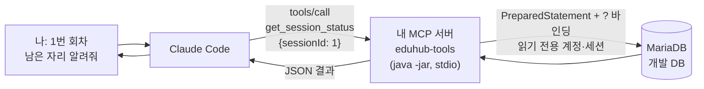

# 예제: 나만의 MCP 서버 만들기 (Java 버전) — MariaDB 조회 도구를 만들고 Claude Code에 등록하기

> 관련 모듈: 13 (커넥터와 MCP) · 관련 회차: [5회차 훅과 MCP](../sessions/session-05-hooks-and-mcp.md)
> [TypeScript 버전](./32-custom-mcp-server-mariadb.md)과 **같은 도구 2개**(`get_session_status`, `find_enrollments_by_employee`)를 Java 21 + **MCP Java SDK**로 만듭니다. 왜 직접 만드는지, 보안 원칙, 범용 SQL 서버와의 비교는 TypeScript 버전 1장을 봅니다.
>
> ✅ **검증**: JDK 21, Gradle, `io.modelcontextprotocol.sdk:mcp` **2.1.0**, `org.mariadb.jdbc:mariadb-java-client` **3.5.11**로 빌드했습니다. MariaDB 10.11에 EduHub 예제 스키마와 읽기 전용 계정을 만들어 실행했고, MCP 클라이언트(Java SDK, TypeScript SDK 각각)로 도구 목록과 도구 호출을 확인했습니다 (2026년 11월). Claude Code 화면에서 등록하는 과정은 직접 확인하지 못했습니다.

---

## 1. TypeScript 버전과 무엇이 대응되나

| 개념 | TypeScript 버전 | Java 버전 (이 문서) |
|---|---|---|
| MCP 라이브러리 | `@modelcontextprotocol/sdk` | `io.modelcontextprotocol.sdk:mcp` (MCP Java SDK) |
| 서버 만들기 | `new McpServer({ name, version })` | `McpServer.sync(transport).serverInfo(…)` |
| 도구 하나 | `server.registerTool(이름, { … }, 함수)` | `Tool.builder(이름, json, 스키마)` + `SyncToolSpecification` |
| 입력 스키마 | zod (`z.number().int().positive()`) | **JSON Schema 문자열** (`"type": "integer", "minimum": 1`) |
| 입력 검증 | SDK가 zod로 자동 검증 | **SDK 2.1이 JSON Schema로 자동 검증** + 코드에서 한 번 더 |
| DB 연결 | `mariadb` npm 커넥터 | MariaDB JDBC 드라이버 (`PreparedStatement`) |
| 읽기 전용 세션 | 풀 옵션 `initSql` | 연결 직후 `SET SESSION TRANSACTION READ ONLY` |
| stdio 통신 | stdin/stdout | 같음 → **`System.out` 금지**, 로그는 `System.err` |
| 실행 파일 | `node dist/index.js` | `java -jar build/libs/eduhub-mcp.jar` |

---

## 2. 전체 구조



```text
eduhub/
├── .mcp.json                                   # 6. 등록
└── tools/
    └── eduhub-mcp/
        ├── settings.gradle.kts
        ├── build.gradle.kts                    # 의존성 + 실행 JAR
        ├── scripts/
        │   └── SmokeTest.java                  # 도구 호출 확인용 (Java 클라이언트)
        └── src/main/java/com/example/eduhub/mcp/
            ├── Db.java                         # DB 연결, 읽기 전용 조회
            ├── EduhubTools.java                # 도구 정의
            └── EduhubMcpServer.java            # 서버 시작 (main)
```

> TypeScript 버전과 **서버 이름(`eduhub-tools`)과 도구 이름이 같습니다.** 팀에서 둘 중 하나만 골라 등록합니다.

---

## 3. 준비

**① 읽기 전용 계정과 환경 변수**는 TypeScript 버전 3장과 같습니다 ([5회차 MariaDB 버전](../sessions/session-05-hooks-and-mcp.md#개발-db가-mariadb인-팀-step-78의-mariadb-버전)).

```bash
export EDUHUB_DB_RO_USER="eduhub_readonly"
export EDUHUB_DB_RO_PASSWORD="각자-정한-비밀번호"
```

**② JDK 21**과 Gradle (또는 `gradle wrapper`로 만든 `./gradlew`)

**③ `settings.gradle.kts`, `build.gradle.kts`**

```kotlin
rootProject.name = "eduhub-mcp"
```

```kotlin
plugins {
    java
}

java { toolchain { languageVersion = JavaLanguageVersion.of(21) } }

repositories {
    mavenCentral()
}

dependencies {
    implementation("io.modelcontextprotocol.sdk:mcp:2.1.0")              // MCP Java SDK (Jackson 3 포함)
    implementation("org.mariadb.jdbc:mariadb-java-client:3.5.11")       // MariaDB JDBC 드라이버
}

// java -jar 로 실행할 수 있도록 의존성을 모두 담은 실행 JAR (build/libs/eduhub-mcp.jar)
tasks.jar {
    archiveFileName = "eduhub-mcp.jar"
    manifest { attributes["Main-Class"] = "com.example.eduhub.mcp.EduhubMcpServer" }
    from(configurations.runtimeClasspath.get().map { if (it.isDirectory) it else zipTree(it) })
    exclude("META-INF/*.SF", "META-INF/*.DSA", "META-INF/*.RSA")
    duplicatesStrategy = DuplicatesStrategy.EXCLUDE
}
```

| 설정 | 왜 |
|---|---|
| `io.modelcontextprotocol.sdk:mcp:2.1.0` | MCP Java SDK. JSON 처리용 Jackson 3, 비동기 처리용 Reactor가 함께 들어온다 |
| `mariadb-java-client:3.5.11` | MariaDB JDBC 드라이버. JDBC URL은 `jdbc:mariadb://…` |
| `tasks.jar { … }` | 의존성을 모두 담은 **실행 JAR** 하나를 만든다. Claude Code가 `java -jar`로 바로 실행할 수 있게 |

---

## 4. 도구 만들기

### 4-1. DB 연결: `Db.java`

```java
package com.example.eduhub.mcp;

import java.sql.Connection;
import java.sql.DriverManager;
import java.sql.PreparedStatement;
import java.sql.ResultSet;
import java.sql.ResultSetMetaData;
import java.sql.SQLException;
import java.sql.Statement;
import java.util.ArrayList;
import java.util.LinkedHashMap;
import java.util.List;
import java.util.Map;

/** MariaDB 접속과 읽기 전용 조회. 접속 정보는 환경 변수로만 받는다. */
final class Db {

    private final String url;
    private final String user;
    private final String password;

    Db() {
        String host = env("EDUHUB_DB_HOST", "127.0.0.1");
        String port = env("EDUHUB_DB_PORT", "3306");
        String name = env("EDUHUB_DB_NAME", "eduhub");
        this.url = "jdbc:mariadb://" + host + ":" + port + "/" + name;
        this.user = required("EDUHUB_DB_RO_USER");          // 5회차 Step 7에서 만든 읽기 전용 계정
        this.password = required("EDUHUB_DB_RO_PASSWORD");
    }

    /** 고정된 SQL만 실행한다. 값은 반드시 ? 자리에 바인딩한다 (문자열 이어 붙이기 금지). */
    List<Map<String, Object>> select(String sql, Object... params) throws SQLException {
        try (Connection conn = DriverManager.getConnection(url, user, password)) {
            try (Statement st = conn.createStatement()) {
                st.execute("SET SESSION TRANSACTION READ ONLY");  // 계정 권한에 더해 세션도 읽기 전용으로
            }
            try (PreparedStatement ps = conn.prepareStatement(sql)) {
                for (int i = 0; i < params.length; i++) {
                    ps.setObject(i + 1, params[i]);
                }
                try (ResultSet rs = ps.executeQuery()) {
                    return toRows(rs);
                }
            }
        }
    }

    /** 결과를 JSON으로 바꾸기 쉬운 형태(열 이름 → 값)로. 날짜·시간은 문자열로 바꾼다. */
    private static List<Map<String, Object>> toRows(ResultSet rs) throws SQLException {
        ResultSetMetaData meta = rs.getMetaData();
        List<Map<String, Object>> rows = new ArrayList<>();
        while (rs.next()) {
            Map<String, Object> row = new LinkedHashMap<>();
            for (int c = 1; c <= meta.getColumnCount(); c++) {
                Object value = rs.getObject(c);
                if (value instanceof java.sql.Date d) value = d.toLocalDate().toString();
                else if (value instanceof java.sql.Timestamp t) value = t.toLocalDateTime().toString();
                else if (value instanceof java.time.temporal.Temporal t) value = t.toString();
                row.put(meta.getColumnLabel(c), value);
            }
            rows.add(row);
        }
        return rows;
    }

    private static String env(String name, String defaultValue) {
        String value = System.getenv(name);
        return (value == null || value.isBlank()) ? defaultValue : value;
    }

    private static String required(String name) {
        String value = System.getenv(name);
        if (value == null || value.isBlank()) {
            throw new IllegalStateException("환경 변수 " + name + "이(가) 없습니다");
        }
        return value;
    }
}
```

| 부분 | 왜 |
|---|---|
| `required(...)` | 비밀번호가 없으면 시작하자마자 실패해 원인을 바로 알 수 있게 |
| `SET SESSION TRANSACTION READ ONLY` | **계정 권한에 더한 두 번째 방어선.** 이 세션에서는 쓰기 권한이 있는 계정이라도 `INSERT`가 `Cannot execute statement in a READ ONLY transaction`으로 거부된다 (확인함) |
| `PreparedStatement` + `setObject` | SQL은 고정, 값은 `?`에만. **문자열 이어 붙이기(SQL 인젝션) 금지** |
| `toRows(...)` | 날짜·시간을 `"2026-11-16"` 같은 문자열로 바꿔 JSON으로 그대로 보낼 수 있게 |
| 호출마다 연결을 열고 닫음 | Claude 한 명이 쓰는 개발용 서버라 단순하게. 호출이 많아지면 커넥션 풀(HikariCP 등)로 바꾼다 |

### 4-2. 도구 정의: `EduhubTools.java`

```java
package com.example.eduhub.mcp;

import io.modelcontextprotocol.json.McpJsonMapper;
import io.modelcontextprotocol.server.McpServerFeatures.SyncToolSpecification;
import io.modelcontextprotocol.spec.McpSchema.CallToolRequest;
import io.modelcontextprotocol.spec.McpSchema.CallToolResult;
import io.modelcontextprotocol.spec.McpSchema.Tool;
import io.modelcontextprotocol.spec.McpSchema.ToolAnnotations;
import java.util.LinkedHashMap;
import java.util.List;
import java.util.Map;
import java.util.Set;

/** EduHub 조회 도구 정의. 도구 하나 = Tool(이름·설명·입력 스키마·힌트) + 실행 함수. */
final class EduhubTools {

    private static final Set<String> STATUSES = Set.of("CONFIRMED", "WAITING", "CANCELED", "COMPLETED");
    private static final ToolAnnotations READ_ONLY =
            ToolAnnotations.builder().readOnlyHint(true).openWorldHint(false).build();

    private final Db db;
    private final McpJsonMapper json;

    EduhubTools(Db db, McpJsonMapper json) {
        this.db = db;
        this.json = json;
    }

    List<SyncToolSpecification> all() {
        return List.of(getSessionStatus(), findEnrollmentsByEmployee());
    }

    // ── 도구 ① 회차 현황 ──────────────────────────────────────────
    private SyncToolSpecification getSessionStatus() {
        Tool tool = Tool.builder("get_session_status", json, """
                        {
                          "type": "object",
                          "properties": {
                            "sessionId": { "type": "integer", "minimum": 1, "description": "course_session.id" }
                          },
                          "required": ["sessionId"]
                        }
                        """)
                .title("교육 회차 현황")
                .description("교육 회차 하나의 정원, 확정 인원, 대기 인원, 남은 자리를 조회한다. "
                        + "회차 ID를 알고 있을 때 사용한다. 읽기 전용.")
                .annotations(READ_ONLY)
                .build();

        return SyncToolSpecification.builder()
                .tool(tool)
                .callHandler((exchange, request) -> handle(() -> {
                    long sessionId = positiveLong(request, "sessionId");
                    var rows = db.select("""
                            SELECT s.id AS sessionId, c.title AS courseTitle, s.start_date AS startDate, s.capacity,
                                   COALESCE(SUM(e.status = 'CONFIRMED'), 0) AS confirmed,
                                   COALESCE(SUM(e.status = 'WAITING'), 0)   AS waiting
                              FROM course_session s
                              JOIN course c ON c.id = s.course_id
                              LEFT JOIN enrollment e ON e.session_id = s.id
                             WHERE s.id = ?
                             GROUP BY s.id, c.title, s.start_date, s.capacity
                            """, sessionId);
                    if (rows.isEmpty()) {
                        return error("회차 " + sessionId + "을(를) 찾을 수 없습니다.");
                    }
                    Map<String, Object> r = new LinkedHashMap<>(rows.get(0));
                    long capacity = ((Number) r.get("capacity")).longValue();
                    long confirmed = ((Number) r.get("confirmed")).longValue();
                    r.put("confirmed", confirmed);
                    r.put("waiting", ((Number) r.get("waiting")).longValue());
                    r.put("remaining", capacity - confirmed);
                    return ok(r);
                }))
                .build();
    }

    // ── 도구 ② 사원별 수강 신청 내역 (FR-07) ─────────────────────
    private SyncToolSpecification findEnrollmentsByEmployee() {
        Tool tool = Tool.builder("find_enrollments_by_employee", json, """
                        {
                          "type": "object",
                          "properties": {
                            "employeeId": { "type": "integer", "minimum": 1, "description": "employee.id" },
                            "status": { "type": "string", "enum": ["CONFIRMED", "WAITING", "CANCELED", "COMPLETED"],
                                        "description": "이 상태만 조회. 생략하면 전체" },
                            "limit": { "type": "integer", "minimum": 1, "maximum": 50, "default": 10,
                                       "description": "최대 건수 (1~50, 기본 10)" }
                          },
                          "required": ["employeeId"]
                        }
                        """)
                .title("사원별 수강 신청 내역")
                .description("사원 한 명의 수강 신청 내역(과정명, 회차 시작일, 상태, 대기 순번)을 최신순으로 조회한다. "
                        + "status로 걸러낼 수 있고, 최대 limit건만 돌려준다. 읽기 전용.")
                .annotations(READ_ONLY)
                .build();

        return SyncToolSpecification.builder()
                .tool(tool)
                .callHandler((exchange, request) -> handle(() -> {
                    long employeeId = positiveLong(request, "employeeId");
                    String status = (String) args(request).get("status");
                    if (status != null && !STATUSES.contains(status)) {
                        return error("status는 " + STATUSES + " 중 하나여야 합니다.");
                    }
                    long limit = args(request).get("limit") == null ? 10 : positiveLong(request, "limit");
                    if (limit > 50) {
                        return error("limit은 50 이하여야 합니다.");
                    }
                    var rows = db.select("""
                            SELECT e.id AS enrollmentId, c.title AS courseTitle, s.start_date AS startDate,
                                   e.status, e.waiting_no AS waitingNo, e.applied_at AS appliedAt
                              FROM enrollment e
                              JOIN course_session s ON s.id = e.session_id
                              JOIN course c ON c.id = s.course_id
                             WHERE e.employee_id = ?
                               AND (? IS NULL OR e.status = ?)
                             ORDER BY e.applied_at DESC
                             LIMIT ?
                            """, employeeId, status, status, limit);
                    Map<String, Object> result = new LinkedHashMap<>();
                    result.put("count", rows.size());
                    result.put("items", rows);
                    return ok(result);
                }))
                .build();
    }

    // ── 공통 도우미 ──────────────────────────────────────────────

    /** 예외가 나도 서버가 죽지 않고 isError 결과로 돌려준다 (Claude가 원인을 설명할 수 있게). */
    private CallToolResult handle(ToolBody body) {
        try {
            return body.run();
        } catch (IllegalArgumentException e) {
            return error(e.getMessage());
        } catch (Exception e) {
            System.err.println("[eduhub-tools] 도구 실행 오류: " + e);   // 로그는 stderr로
            return error("조회 중 오류가 발생했습니다: " + e.getMessage());
        }
    }

    private CallToolResult ok(Object result) throws Exception {
        return CallToolResult.builder().addTextContent(json.writeValueAsString(result)).build();
    }

    private static CallToolResult error(String message) {
        return CallToolResult.builder().addTextContent(message).isError(true).build();
    }

    private static Map<String, Object> args(CallToolRequest request) {
        return request.arguments() == null ? Map.of() : request.arguments();
    }

    /** Claude가 보낸 값도 반드시 서버에서 검증한다. */
    private static long positiveLong(CallToolRequest request, String name) {
        Object value = args(request).get(name);
        if (!(value instanceof Number n) || n.doubleValue() != Math.floor(n.doubleValue()) || n.longValue() < 1) {
            throw new IllegalArgumentException(name + "은(는) 1 이상의 정수여야 합니다: " + value);
        }
        return n.longValue();
    }

    @FunctionalInterface
    private interface ToolBody {
        CallToolResult run() throws Exception;
    }
}
```

**도구 하나를 이루는 5가지 (Java)**

| 요소 | 위 코드에서 | 작성 요령 |
|---|---|---|
| **이름** | `Tool.builder("get_session_status", …)` | 동사_대상. Claude Code에서는 `mcp__eduhub-tools__get_session_status` |
| **입력 스키마** | `Tool.builder(이름, json, """{ JSON Schema }""")` | `type`, `minimum`/`maximum`, `enum`, `required`, `description`. **SDK가 이 스키마로 인자를 자동 검증** |
| **설명** | `.description("…")` | Claude가 도구를 고르는 근거. 무엇을, **언제** 쓰는지, 읽기 전용인지 |
| **힌트** | `.annotations(READ_ONLY)` | `readOnlyHint(true)`. 힌트일 뿐 강제는 아니다 (강제는 DB 계정·세션) |
| **실행 함수** | `.callHandler((exchange, request) -> …)` | `request.arguments()`에서 값을 꺼내 조회, `CallToolResult`로 돌려준다. 실패는 `isError(true)` |

> 💡 **SDK 2.1의 사용 중단(deprecated) API**: `Tool.builder()`(인자 없음)와 `new CallToolRequest(이름, 인자)`는 사용 중단 표시가 있습니다. 위처럼 `Tool.builder(이름, json, 스키마)`, `CallToolRequest.builder(이름).arguments(…).build()`를 씁니다. 인터넷의 예전 예제(`new Tool(…)`, `StdioServerTransportProvider(new ObjectMapper())` 등)는 SDK 버전에 따라 그대로 동작하지 않을 수 있습니다.

### 4-3. 서버 시작: `EduhubMcpServer.java`

```java
package com.example.eduhub.mcp;

import io.modelcontextprotocol.json.McpJsonDefaults;
import io.modelcontextprotocol.json.McpJsonMapper;
import io.modelcontextprotocol.server.McpServer;
import io.modelcontextprotocol.server.McpSyncServer;
import io.modelcontextprotocol.server.transport.StdioServerTransportProvider;
import io.modelcontextprotocol.spec.McpSchema.ServerCapabilities;

/** EduHub 조회 도구를 제공하는 MCP 서버 (stdio). */
public final class EduhubMcpServer {

    public static void main(String[] args) {
        McpJsonMapper json = McpJsonDefaults.getMapper();
        EduhubTools tools = new EduhubTools(new Db(), json);

        // stdio 서버는 표준 출력(System.out)으로 MCP 메시지를 주고받는다
        // → System.out.println 금지, 로그는 System.err로
        McpSyncServer server = McpServer.sync(new StdioServerTransportProvider(json))
                .serverInfo("eduhub-tools", "1.0.0")
                .instructions("EduHub 개발 DB(MariaDB)의 교육 회차 현황과 사원별 수강 신청 내역을 읽기 전용으로 조회한다.")
                .capabilities(ServerCapabilities.builder().tools(true).build())
                .tools(tools.all())
                .build();

        System.err.println("eduhub-tools MCP 서버 시작 (stdio)");
        Runtime.getRuntime().addShutdownHook(new Thread(server::closeGracefully));
    }
}
```

> ⚠️ **`System.out.println` 금지.** stdio 서버는 표준 출력으로 MCP 메시지를 주고받으므로, 무언가를 찍으면 메시지가 깨져 연결이 끊깁니다. 로그는 `System.err`로 씁니다. 로깅 라이브러리를 쓴다면 **콘솔 출력이 stdout으로 가지 않게**(stderr 또는 파일) 설정합니다.

> 💡 시작할 때 stderr에 `SLF4J(W): No SLF4J providers were found`가 보일 수 있습니다. SDK가 쓰는 로깅 API(SLF4J)의 구현체가 없다는 안내이고, stderr로 나오므로 동작에는 영향이 없습니다. 로그가 필요하면 `org.slf4j:slf4j-simple`(기본 출력이 stderr)을 추가합니다.

---

## 5. 빌드하고 Claude 없이 먼저 테스트

```bash
cd tools/eduhub-mcp
gradle jar                       # 또는 ./gradlew jar → build/libs/eduhub-mcp.jar
```

**스모크 테스트** (MCP Java SDK의 클라이언트로 서버를 띄워 도구를 호출. Java 21은 소스 파일 하나를 컴파일 없이 바로 실행할 수 있다)

```java
// scripts/SmokeTest.java — MCP Java SDK 클라이언트로 서버를 띄워 도구를 호출해 본다
// 실행: java -cp build/libs/eduhub-mcp.jar scripts/SmokeTest.java
import io.modelcontextprotocol.client.McpClient;
import io.modelcontextprotocol.client.McpSyncClient;
import io.modelcontextprotocol.client.transport.ServerParameters;
import io.modelcontextprotocol.client.transport.StdioClientTransport;
import io.modelcontextprotocol.json.McpJsonDefaults;
import io.modelcontextprotocol.spec.McpSchema.CallToolRequest;
import io.modelcontextprotocol.spec.McpSchema.CallToolResult;
import io.modelcontextprotocol.spec.McpSchema.TextContent;
import java.util.Map;

public class SmokeTest {
    public static void main(String[] args) {
        ServerParameters server = ServerParameters.builder("java")
                .args("-Dstderr.encoding=UTF-8", "-jar", "build/libs/eduhub-mcp.jar")
                .env(System.getenv())                       // EDUHUB_DB_RO_USER 등을 그대로 넘긴다
                .build();
        McpSyncClient client = McpClient.sync(new StdioClientTransport(server, McpJsonDefaults.getMapper())).build();
        try {
            client.initialize();
            System.out.println("도구: " + client.listTools().tools().stream().map(t -> t.name()).toList());
            call(client, "get_session_status", Map.of("sessionId", 1));
            call(client, "find_enrollments_by_employee", Map.of("employeeId", 1, "limit", 5));
        } finally {
            client.closeGracefully();
        }
    }

    private static void call(McpSyncClient client, String name, Map<String, Object> arguments) {
        CallToolResult r = client.callTool(CallToolRequest.builder(name).arguments(arguments).build());
        String text = ((TextContent) r.content().get(0)).text();
        System.out.println(name + " " + arguments + (Boolean.TRUE.equals(r.isError()) ? " → 오류" : " → 성공") + "\n  " + text);
    }
}
```

```bash
java -cp build/libs/eduhub-mcp.jar scripts/SmokeTest.java
```

**실제 실행 결과** (예제 데이터: 1번 회차 정원 2명, 확정 2명, 대기 1명)

```text
도구: [get_session_status, find_enrollments_by_employee]
get_session_status {sessionId=1} → 성공
  {"sessionId":1,"courseTitle":"Spring Boot 입문","startDate":"2026-11-16","capacity":2,"confirmed":2,"waiting":1,"remaining":0}
find_enrollments_by_employee {employeeId=1, limit=5} → 성공
  {"count":2,"items":[{"enrollmentId":4,"courseTitle":"JPA 실전","startDate":"2026-11-23","status":"CONFIRMED", … }, …]}
```

> 💡 Node.js가 있다면 화면으로 보는 **MCP Inspector**도 쓸 수 있습니다: `npx @modelcontextprotocol/inspector java -jar build/libs/eduhub-mcp.jar`

**오류 상황도 확인했습니다**

| 상황 | 결과 |
|---|---|
| 없는 회차 (`sessionId: 99`) | `isError: true`, "회차 99을(를) 찾을 수 없습니다." |
| 잘못된 입력 (`employeeId: -1`) | 도구 코드 실행 전에 SDK가 거부: `input validation failed … /employeeId: must have a minimum value of 1` |
| 목록에 없는 상태 (`status: "DONE"`) | SDK가 거부: `/status: does not have a value in the enumeration [...]` |
| DB에 연결할 수 없음 | 서버는 살아 있고 `isError: true`, "조회 중 오류가 발생했습니다: Socket fail to connect …" |
| 환경 변수 `EDUHUB_DB_RO_USER` 없음 | 시작 직후 `IllegalStateException`으로 종료 → `/mcp`에서 failed |

---

## 6. 내 MCP 서버를 Claude Code에 등록하기

### 6-1. 팀 공유: 프로젝트 루트 `.mcp.json`

```json
{
  "mcpServers": {
    "eduhub-tools": {
      "type": "stdio",
      "command": "java",
      "args": ["-Dstderr.encoding=UTF-8", "-jar", "tools/eduhub-mcp/build/libs/eduhub-mcp.jar"],
      "env": {
        "EDUHUB_DB_HOST": "127.0.0.1",
        "EDUHUB_DB_PORT": "3306",
        "EDUHUB_DB_NAME": "eduhub",
        "EDUHUB_DB_RO_USER": "${EDUHUB_DB_RO_USER}",
        "EDUHUB_DB_RO_PASSWORD": "${EDUHUB_DB_RO_PASSWORD}"
      }
    }
  }
}
```

| 항목 | 의미 |
|---|---|
| `"command": "java"` | `PATH`의 `java`(JDK 21 이상)로 실행. 여러 JDK가 있으면 절대 경로(`…/jdk-21/bin/java`)를 쓴다 |
| `-Dstderr.encoding=UTF-8` | stderr로 나가는 한글 오류 메시지가 `???`로 깨지지 않게 (JDK 19 이상의 옵션. 로케일이 UTF-8이 아닌 환경에서 깨지는 것을 확인했고, Windows 기본 콘솔 인코딩에서도 같은 문제가 생길 수 있음). MCP 메시지(stdout)는 SDK가 UTF-8로 보내므로 영향 없음 |
| `-jar tools/eduhub-mcp/…jar` | 경로는 **프로젝트 루트 기준** (Claude Code를 저장소 루트에서 실행한다고 가정. 안 되면 절대 경로로 확인) |
| `"env"` | 비밀번호는 `${…}`로 내 셸의 값을 넣고, **파일에는 쓰지 않는다** |

> 💡 `build/`는 커밋하지 않습니다. 팀원은 처음 한 번 `gradle -p tools/eduhub-mcp jar`(또는 래퍼)를 실행합니다. README나 CLAUDE.md에 한 줄 적어 둡니다.

### 6-2. 나만 쓰기: `claude mcp add` (local 범위)

```bash
claude mcp add --transport stdio \
  --env EDUHUB_DB_RO_USER="$EDUHUB_DB_RO_USER" \
  --env EDUHUB_DB_RO_PASSWORD="$EDUHUB_DB_RO_PASSWORD" \
  eduhub-tools -- java -Dstderr.encoding=UTF-8 -jar "$PWD/tools/eduhub-mcp/build/libs/eduhub-mcp.jar"
```

### 6-3. 권한과 사용

권한 설정, `/mcp` 확인, 대화 예시는 TypeScript 버전 [6-3, 6-4](./32-custom-mcp-server-mariadb.md#6-3-권한-조회-도구는-묻지-않게)와 **완전히 같습니다** (서버 이름과 도구 이름이 같기 때문).

```json
{
  "permissions": {
    "allow": [
      "mcp__eduhub-tools__get_session_status",
      "mcp__eduhub-tools__find_enrollments_by_employee"
    ]
  }
}
```

```text
1번 회차에 남은 자리가 있어? 대기자는 몇 명이야?
```

---

## 7. 도구 하나 더 추가하기

예: "회차별 대기자 명단 (FR-08)". `EduhubTools`에 메서드를 하나 추가하고 `all()` 목록에 넣습니다.

```java
    // ── 도구 ③ 회차 대기자 명단 (FR-08) ──────────────────────────
    private SyncToolSpecification listWaitingBySession() {
        Tool tool = Tool.builder("list_waiting_by_session", json, """
                        {
                          "type": "object",
                          "properties": {
                            "sessionId": { "type": "integer", "minimum": 1, "description": "course_session.id" }
                          },
                          "required": ["sessionId"]
                        }
                        """)
                .title("회차 대기자 명단")
                .description("교육 회차 하나의 대기자를 대기 순번 순서로 조회한다. 읽기 전용.")
                .annotations(READ_ONLY)
                .build();

        return SyncToolSpecification.builder()
                .tool(tool)
                .callHandler((exchange, request) -> handle(() -> {
                    long sessionId = positiveLong(request, "sessionId");
                    var rows = db.select("""
                            SELECT e.waiting_no AS waitingNo, m.name, m.department, e.applied_at AS appliedAt
                              FROM enrollment e JOIN employee m ON m.id = e.employee_id
                             WHERE e.session_id = ? AND e.status = 'WAITING'
                             ORDER BY e.waiting_no
                             LIMIT 50
                            """, sessionId);
                    return ok(rows);
                }))
                .build();
    }
```

```java
List<SyncToolSpecification> all() {
    return List.of(getSessionStatus(), findEnrollmentsByEmployee(), listWaitingBySession());
}
```

1. `gradle jar` → 2. `/mcp`에서 `eduhub-tools` 다시 연결 → 3. 권한 규칙에 `mcp__eduhub-tools__list_waiting_by_session` 추가

실제 결과 (1번 회차): `[{"waitingNo":1,"name":"이영희","department":"개발1팀","appliedAt":"2026-11-01T09:10"}]`

> 💡 Claude에게 맡길 때의 지시 예:
> ```text
> [목표] tools/eduhub-mcp의 EduhubTools에 FR-08용 "회차 대기자 명단" 도구 list_waiting_by_session을 추가해줘
> [제약] 기존 db.select() 사용, SQL은 고정하고 값은 ? 바인딩, LIMIT 50, READ_ONLY 힌트, System.out 금지,
>        Tool.builder(이름, json, 스키마) 형태 사용 (인자 없는 builder()는 사용 중단)
> [완료 기준] gradle jar 성공, scripts/SmokeTest.java에 호출 1개 추가해서 실행 결과를 보여줘
> ```

---

## 8. Spring Boot 팀이라면: Spring AI MCP 서버

EduHub 백엔드처럼 Spring Boot를 쓰는 팀은 **Spring AI의 MCP 서버 스타터**(`org.springframework.ai:spring-ai-starter-mcp-server`, 2026년 11월 기준 안정 버전 2.0.x)로 같은 일을 할 수 있습니다. 메서드에 어노테이션을 붙여 도구로 노출하고, 기존 `JdbcTemplate`·리포지토리를 그대로 쓸 수 있는 것이 장점입니다.

| 비교 | MCP Java SDK 직접 (이 문서) | Spring AI MCP 서버 |
|---|---|---|
| 의존성 | 작음 (SDK + JDBC) | Spring Boot 전체 |
| 시작 시간 | 빠름 | Spring 컨텍스트 로딩만큼 |
| 도구 정의 | `Tool` + `SyncToolSpecification` 직접 작성 | 메서드 + 어노테이션 |
| 어울리는 경우 | 작은 전용 도구 서버 | 기존 Spring 서비스·DB 설정을 재사용할 때 |

> ⚠️ Spring AI는 버전마다 어노테이션과 설정 이름이 바뀌어 왔습니다. 이 교재에서는 Spring AI 방식을 검증하지 않았으므로 **사용하는 버전의 공식 문서(Spring AI Reference의 MCP Server 절)**를 따르세요. stdio로 쓸 때는 **Spring Boot 배너와 콘솔 로그가 stdout으로 나가지 않게** 꺼야 한다는 점은 이 문서의 `System.out` 주의와 같습니다.

---

## 9. 자주 겪는 문제 (Java)

| 증상 | 원인과 해결 |
|---|---|
| `/mcp`에서 failed | JAR이 없음(`gradle jar`), 경로가 틀림(절대 경로로 확인), `java`가 21 미만(`java -version`), 환경 변수 없음. 터미널에서 `java -jar tools/eduhub-mcp/build/libs/eduhub-mcp.jar`를 직접 실행해 stderr 확인 (정상이면 "서버 시작" 출력 후 입력 대기) |
| 연결은 되는데 바로 끊김 | `System.out` 출력, 또는 로깅 설정이 stdout으로 출력. stderr로 바꾼다 |
| 오류 메시지 한글이 `???` | `-Dstderr.encoding=UTF-8` 추가 (6-1) |
| `NoClassDefFoundError` | 일반 JAR을 실행함. `tasks.jar`의 의존성 포함 설정 확인 |
| `Could not resolve io.modelcontextprotocol.sdk:mcp` | 사내 프록시·저장소 설정. 사내 Nexus/Artifactory 미러를 `repositories`에 추가 |
| 예제 코드가 컴파일되지 않음 | SDK 버전 차이. 이 문서는 2.1.0 기준. 사용 중단 경고는 `-Xlint:deprecation`으로 확인 |
| 도구를 고쳤는데 그대로 | 다시 빌드하고 `/mcp`에서 재연결 |
| 그 밖의 항목 | TypeScript 버전 [9장](./32-custom-mcp-server-mariadb.md#9-자주-겪는-문제) |

---

## 참고

- [나만의 MCP 서버 만들기 (TypeScript 버전)](./32-custom-mcp-server-mariadb.md): 왜 만드나, 보안 체크리스트
- [MCP 서버 가이드](./19-mcp-server-guide.md)
- [5회차: 훅과 MCP](../sessions/session-05-hooks-and-mcp.md)
- MCP Java SDK: GitHub `modelcontextprotocol/java-sdk`
