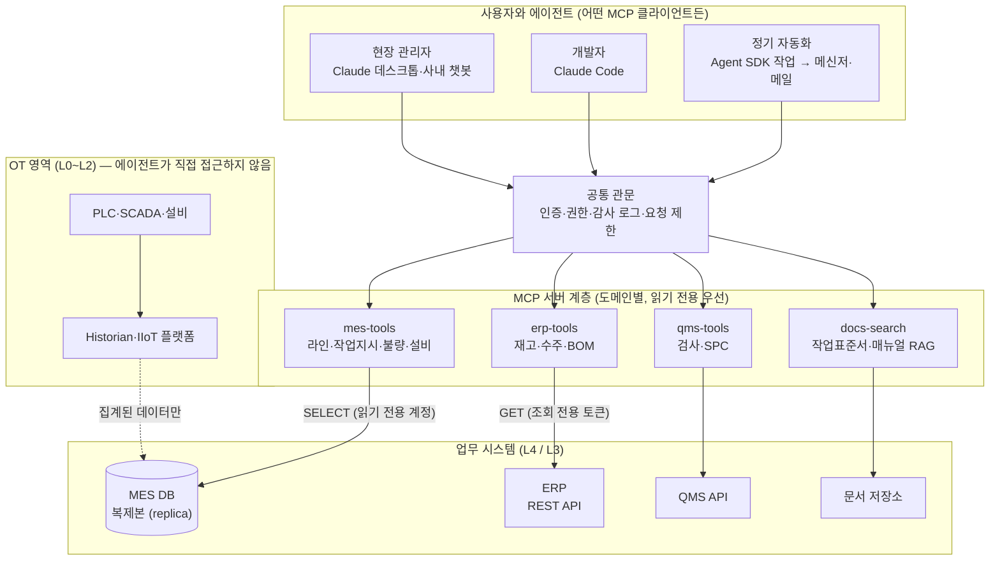
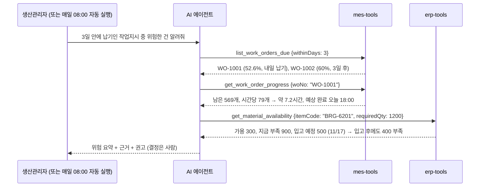

# 예제: 제조 현장의 AI 에이전트와 MCP — MES·ERP 생산 정보를 가져오는 도구와 서비스 (Java)

> 관련 모듈: 13 (커넥터와 MCP), 18 (Agent SDK) · 관련 회차: [5회차 훅과 MCP](../sessions/session-05-hooks-and-mcp.md)
> **목표**: 제조 현장에서 AI 에이전트가 MCP로 MES·ERP 등의 생산 정보를 가져와 어떤 서비스를 만들 수 있는지, 그것을 가능하게 하는 아키텍처, 그리고 **도구를 Java로 구현하는 방법**을 이해합니다.
> MCP는 공개 표준이므로 여기서 만드는 도구는 Claude뿐 아니라 **MCP를 지원하는 다른 에이전트 도구·프레임워크에서도 그대로 재사용**할 수 있습니다.
>
> ✅ **검증**: 6장의 Java 코드(MCP Java SDK 2.1.0, MariaDB JDBC 3.5.11, JDK 21)는 빌드한 뒤 MariaDB 10.11에 만든 **가상의 MES 데이터**와 **가짜 ERP REST API**에 연결해 도구 5개와 오류 상황을 실제로 호출해 확인했습니다 (2026년 11월). 회사 이름, 라인, 품목, 수치는 모두 교육용으로 만든 것입니다. 1~5장의 서비스·아키텍처는 일반적인 설계 안내이며 특정 제품의 기능이 아닙니다.

---

## 1. 왜 제조 현장에 "AI 에이전트 + MCP"인가

제조 현장의 정보는 여러 시스템에 흩어져 있습니다.

| 시스템 | 가진 정보 | 현장의 질문 예 |
|---|---|---|
| **MES** (제조 실행 시스템) | 작업지시, 생산 실적, 불량, 설비 상태, LOT 이력 | "지금 1라인 몇 개 만들었어?", "불량이 왜 늘었지?" |
| **ERP** | 수주, 자재 재고, 구매·입고 예정, BOM, 원가 | "이 작업지시 자재 충분해?", "입고 언제 돼?" |
| **QMS** (품질 관리) | 검사 결과, SPC, 부적합·클레임 | "어제 검사에서 걸린 항목은?" |
| **CMMS·설비 이력** | 정비 이력, 고장 코드, 예비품 | "이 설비 지난달에도 같은 고장 났어?" |
| **설비 데이터** (SCADA·Historian·IIoT) | 온도·압력·토크 같은 시계열 | "어제 오후 토크 값이 이상했어?" |
| **문서** | 작업표준서, 설비 매뉴얼, 품질 기준 | "이 알람 나오면 어떻게 조치해?" |

관리자는 질문 하나에 답하려고 화면 서너 개를 오가며 숫자를 모읍니다. AI 에이전트가 **각 시스템을 도구로 호출**할 수 있으면 이 일을 대신하고, 결과를 엮어 판단 근거와 함께 설명할 수 있습니다.

| 연동 방식 | 문제 |
|---|---|
| 에이전트·챗봇마다 시스템 연동을 따로 개발 | 같은 연동을 도구마다 다시 만들고, 보안 검토도 매번 |
| **MCP 서버로 한 번 만들기** | MES 도구 서버 하나를 Claude, 사내 챗봇, 자동화 작업이 **함께 사용**. 권한·감사·읽기 전용 원칙을 서버 한 곳에서 관리 |

---

## 2. MCP로 만들 수 있는 서비스

| 서비스 | 사용자 | 쓰는 도구 (시스템) | 결과물 | 자동화 수준 |
|---|---|---|---|---|
| **생산 현황 질의 비서** | 반장, 생산관리 | 라인 현황, 작업지시 진척 (MES) | "1라인은 WO-1001 진행 중, 양품 631개, 불량률 3.1%, 오늘 비가동 40분" | 조회 |
| **납기 위험 조기 경보** | 생산관리, 영업 | 납기 임박 작업지시, 진척·예상 완료 (MES) + 자재 가용 (ERP) | 매일 아침 "위험 작업지시와 원인(속도·자재) 목록" 메신저 발송 | 조회 + 정기 실행 |
| **불량 원인 분석 보조** | 품질, 공정 엔지니어 | 불량 파레토, 설비 상태·비가동 (MES), 검사 결과 (QMS) | "나사 체결 불량 75%, 같은 시간대 체결기 토크 센서 이상 40분" 같은 연관 관찰 | 조회 + 분석 (판단은 사람) |
| **교대 인수인계 리포트** | 교대 반장 | 라인 현황, 불량, 설비 이벤트 (MES) | 교대 종료 시 요약 리포트 초안 | 조회 + 문서 작성 |
| **자재 결품 예측** | 자재·구매 | 작업지시 계획 (MES), BOM·재고·입고 (ERP) | "3일 안에 부족해지는 자재와 영향받는 작업지시" | 조회 + 정기 실행 |
| **설비 이상 대응 가이드** | 설비 보전 | 설비 이력 (CMMS), 매뉴얼 검색 (문서 RAG) | 알람 코드별 과거 조치 이력과 매뉴얼 절차 요약 | 조회 + 검색 |
| **생산계획 변경 영향 분석** | 생산계획 | 작업지시·라인 부하 (MES), 수주 납기 (ERP) | "긴급 수주를 2라인에 넣으면 밀리는 작업지시" **제안** | 제안 (변경은 사람이 기존 시스템에서) |

> 💡 **처음에는 "조회와 요약"부터.** 위 서비스 대부분은 **읽기 전용 도구만으로** 만들 수 있습니다. 작업지시 변경, 설비 정지 같은 **쓰기·제어는 에이전트에게 맡기지 않고**, 에이전트는 "제안"까지만 하고 사람이 기존 시스템의 결재 흐름으로 실행합니다.

---

## 3. 아키텍처



| 계층 | 원칙 |
|---|---|
| **사용자·에이전트** | 대화형(관리자의 질문)과 자동화(매일 아침 리포트)를 같은 도구로. MCP 클라이언트라면 어떤 제품이든 연결 가능 |
| **공통 관문** | 누가, 언제, 어떤 도구로, 무엇을 조회했는지 **감사 로그**. 사용자별 권한(자기 공장·라인만), 요청 횟수 제한 |
| **MCP 서버** | 시스템(도메인)별로 나눈다. **업무 단위 도구**(원시 테이블이 아니라 "라인 현황"), 결과는 **요약·집계**해서 작게 |
| **업무 시스템** | MES는 운영 DB가 아니라 **복제본**과 읽기 전용 계정, ERP는 DB가 아니라 **공식 API**와 조회 전용 토큰 |
| **OT 영역** | 에이전트가 PLC·SCADA에 **직접 접근하지 않는다**. 설비 데이터는 Historian·IIoT 플랫폼이 집계한 값을 MES·데이터 플랫폼을 거쳐 조회. **제어 명령은 MCP로 열지 않는다** |

> ⚠️ **망 분리와 안전**: 제조 현장은 IT(사무)망과 OT(제어)망을 나누는 경우가 많습니다. MCP 서버는 IT 영역(또는 DMZ)에 두고, OT 데이터는 이미 승인된 경로(Historian 복제, 데이터 플랫폼)로만 가져옵니다. 에이전트가 설비를 멈추거나 설정값을 바꾸는 도구는 만들지 않습니다.

**처음에는 stdio, 운영에서는 원격 서버**

| 단계 | 형태 | 특징 |
|---|---|---|
| 개념 검증 (이 예제) | 개발자 PC에서 **stdio** 서버 (`java -jar`) | 빠르게 만들고 시험. 실행한 사람의 권한·네트워크로 접속 |
| 팀·공장 확산 | 중앙에 배포한 **원격 MCP 서버** (Streamable HTTP) + OAuth 인증 | 접속 정보가 사용자 PC에 없음. 사용자별 권한, 감사 로그, 모니터링을 서버에서 일괄 관리 |

---

## 4. 도구 설계: MES·ERP에서 생산 정보를 가져오는 도구

**도구 카탈로그** (⭐는 6장에서 Java로 구현한 것)

| 시스템 | 도구 | 입력 | 돌려주는 것 |
|---|---|---|---|
| MES | ⭐ `get_line_status` | 라인 ID | 진행 중 작업지시, 오늘 양품·불량·불량률, 설비 현재 상태, 오늘 비가동 분 |
| MES | ⭐ `get_work_order_progress` | 작업지시 번호 | 계획·양품·불량, 진척률, 최근 시간당 생산량, 남은 수량, 예상 완료, **납기 위험 여부** |
| MES | ⭐ `get_defect_pareto` | 라인 ID, 최근 N일, 상위 N개 | 불량 유형별 수량과 비율 (많은 순) |
| MES | ⭐ `list_work_orders_due` | N일 이내, 라인(선택) | 미완료 작업지시 중 납기 임박 목록과 진척률 |
| ERP | ⭐ `get_material_availability` | 자재 코드, 필요 수량 | 현재고, 할당, 가용, 부족분, 입고 예정, 입고 후 부족분 |
| MES | `get_lot_genealogy` | LOT 번호 | 투입 자재 LOT, 공정 이력 (품질 추적) |
| MES | `get_equipment_downtime` | 설비 ID, 기간 | 비가동 이력과 사유 |
| ERP | `get_bom` | 품목 코드 | 자재 목록과 소요량 |
| ERP | `get_sales_order_due` | 기간 | 납기 임박 수주와 연결된 작업지시 |
| QMS | `get_inspection_results` | 품목·기간 | 검사 항목별 합격률, 부적합 |
| CMMS | `get_maintenance_history` | 설비 ID | 정비·고장 이력 |
| 문서 | `search_work_instructions` | 질의 | 작업표준서·매뉴얼의 관련 부분 |

**좋은 제조 도구의 조건**

| 조건 | 왜 | 이 예제에서 |
|---|---|---|
| **업무 단위**로 | AI가 테이블 구조를 몰라도 된다. 현장 용어로 질문하면 맞는 도구를 고른다 | "라인 현황", "납기 위험" |
| **계산은 서버에서** | 진척률, 불량률, 예상 완료 시각을 AI가 추측하지 않게 | `progressPct`, `estimatedFinish`, `atRisk` |
| **결과는 작게** | 원시 실적·센서값을 통째로 주면 토큰 낭비와 오해 | 집계값, `LIMIT 50`, 상위 N개 |
| **단위·기준을 명시** | "오늘"은 몇 시 기준? 수량 단위는? | 설명에 "오늘", "시간당", "분" 명시 |
| **설명에 언제 쓰는지** | AI가 도구를 고르는 근거 | "납기를 맞출 수 있는지 물을 때 사용" |
| **도구끼리 이어지게** | 목록 → 상세 순서로 조사 | `list_work_orders_due` 설명에 "자세히는 `get_work_order_progress`" |
| **읽기 전용** | 현장 데이터 오염·설비 사고 방지 | 읽기 전용 계정·세션, 조회 전용 토큰, `readOnlyHint` |
| **입력 검증** | 경로 조작·과도한 조회 방지 | 정규식 `pattern`, `minimum`/`maximum` |

---

## 5. 서비스 동작 예: 납기 위험 조기 경보



**에이전트의 답 예시** (도구 결과를 바탕으로 이런 형태의 답을 기대할 수 있다는 예)

```text
3일 안에 납기인 작업지시 2건을 점검했습니다.

1) WO-1001 (조립 1라인, 구동 모터 200W, 내일 납기)
   - 진척 52.6% (631/1,200), 최근 시간당 79개 → 남은 569개에 약 7.2시간
   - 생산 속도만 보면 오늘 안에 완료 가능 (예상 18:00)
   - 다만 오늘 체결기 토크 센서 이상으로 40분 비가동이 있었고, 나사 체결 불량이 불량의 75%입니다
2) WO-1002 (조립 2라인, 60%, 3일 후 납기): 현재 속도로 여유 있음

자재: 베어링 BRG-6201은 1,200개 필요 대비 가용 300개, 11/17 입고 500개를 더해도 400개 부족합니다.
→ 이 자재를 쓰는 작업지시를 확인하고 구매 담당과 입고 일정 조정을 검토하세요. (작업지시·발주 변경은 ERP·MES에서 직접)
```

> 💡 같은 도구로 **대화형**(관리자가 물어볼 때)과 **자동화**(매일 아침 Agent SDK 작업이 실행해 메신저로 보냄, 8회차)를 모두 만들 수 있습니다. 자동화에서는 도구 호출 결과를 **로그로 남기고**, 사람이 결과를 확인하는 단계를 둡니다.

---

## 6. Java로 구현하기: `mes-tools` MCP 서버

[나만의 MCP 서버 (Java 버전)](./33-custom-mcp-server-mariadb-java.md)과 같은 방식(MCP Java SDK 2.1)입니다. 여기서는 **MES는 DB로, ERP는 REST API로** 가져오는 두 가지 연동 방식을 함께 보여 줍니다.

```text
tools/mes-mcp/
├── settings.gradle.kts
├── build.gradle.kts
├── db/mes-sample.sql                       # 교육용 MES 스키마·데이터 (6-8)
├── erp-stub/erp_stub.py                    # 교육용 가짜 ERP API (6-8)
├── scripts/SmokeTest.java                  # 도구 호출 확인
└── src/main/java/com/example/mes/mcp/
    ├── MesMcpServer.java                   # 서버 시작 (main)
    ├── MesTools.java                       # MES 도구 4개
    ├── ErpTools.java                       # ERP 도구 1개
    ├── MesDb.java                          # MES DB 읽기 전용 조회 (JDBC)
    ├── ErpClient.java                      # ERP REST 읽기 전용 클라이언트
    ├── ToolSupport.java                    # 공통 도우미 (결과·오류·인자)
    └── Env.java                            # 환경 변수
```

### 6-1. 빌드 설정

```kotlin
rootProject.name = "mes-mcp"
```

```kotlin
plugins {
    java
}

java { toolchain { languageVersion = JavaLanguageVersion.of(21) } }

repositories {
    mavenCentral()
}

dependencies {
    implementation("io.modelcontextprotocol.sdk:mcp:2.1.0")              // MCP Java SDK
    implementation("org.mariadb.jdbc:mariadb-java-client:3.5.11")       // MES DB 드라이버 (MES가 Oracle·MSSQL이면 해당 드라이버로)
}

// java -jar 로 바로 실행되는 실행 JAR (build/libs/mes-mcp.jar)
tasks.jar {
    archiveFileName = "mes-mcp.jar"
    manifest { attributes["Main-Class"] = "com.example.mes.mcp.MesMcpServer" }
    from(configurations.runtimeClasspath.get().map { if (it.isDirectory) it else zipTree(it) })
    exclude("META-INF/*.SF", "META-INF/*.DSA", "META-INF/*.RSA")
    duplicatesStrategy = DuplicatesStrategy.EXCLUDE
}
```

> MES DB가 Oracle·SQL Server·PostgreSQL이면 JDBC 드라이버만 바꾸고 `MES_DB_URL`을 그 DB 형식으로 씁니다. SQL 문법(날짜 함수 `CURDATE()`, `INTERVAL` 등)은 DB에 맞게 고쳐야 합니다.

### 6-2. 접속 정보: `Env.java`

```java
package com.example.mes.mcp;

/** 접속 정보는 환경 변수로만 받는다 (.mcp.json과 코드에 비밀번호를 쓰지 않는다). */
final class Env {
    private Env() { }

    static String get(String name, String defaultValue) {
        String v = System.getenv(name);
        return v == null ? defaultValue : v;
    }

    static String required(String name) {
        String v = System.getenv(name);
        if (v == null || v.isBlank()) {
            throw new IllegalStateException("환경 변수 " + name + "이(가) 없습니다");
        }
        return v;
    }
}
```

### 6-3. MES 연동 (DB): `MesDb.java`

```java
package com.example.mes.mcp;

import java.sql.Connection;
import java.sql.DriverManager;
import java.sql.PreparedStatement;
import java.sql.ResultSet;
import java.sql.ResultSetMetaData;
import java.sql.SQLException;
import java.sql.Statement;
import java.util.ArrayList;
import java.util.LinkedHashMap;
import java.util.List;
import java.util.Map;

/** MES DB 읽기 전용 조회. 운영 MES가 아니라 복제본(replica)과 읽기 전용 계정에 연결한다. */
final class MesDb {

    private final String url;
    private final String user;
    private final String password;
    private final String sessionInitSql;

    MesDb() {
        this.url = Env.required("MES_DB_URL");               // 예: jdbc:mariadb://mes-replica:3306/mes
        this.user = Env.required("MES_DB_USER");
        this.password = Env.required("MES_DB_PASSWORD");
        // DB마다 문법이 다르다. MariaDB·MySQL 기본값, 다른 DB는 환경 변수로 바꾸거나 비운다
        this.sessionInitSql = Env.get("MES_DB_SESSION_INIT_SQL", "SET SESSION TRANSACTION READ ONLY");
    }

    /** 고정된 SQL만 실행한다. 값은 ? 에만 바인딩한다. */
    List<Map<String, Object>> select(String sql, Object... params) throws SQLException {
        try (Connection conn = DriverManager.getConnection(url, user, password)) {
            conn.setReadOnly(true);
            if (!sessionInitSql.isBlank()) {
                try (Statement st = conn.createStatement()) {
                    st.execute(sessionInitSql);
                }
            }
            try (PreparedStatement ps = conn.prepareStatement(sql)) {
                ps.setQueryTimeout(10);                       // 무거운 조회가 MES DB를 붙잡지 않게
                for (int i = 0; i < params.length; i++) {
                    ps.setObject(i + 1, params[i]);
                }
                try (ResultSet rs = ps.executeQuery()) {
                    return toRows(rs);
                }
            }
        }
    }

    private static List<Map<String, Object>> toRows(ResultSet rs) throws SQLException {
        ResultSetMetaData meta = rs.getMetaData();
        List<Map<String, Object>> rows = new ArrayList<>();
        while (rs.next()) {
            Map<String, Object> row = new LinkedHashMap<>();
            for (int c = 1; c <= meta.getColumnCount(); c++) {
                Object v = rs.getObject(c);
                if (v instanceof java.sql.Date d) v = d.toLocalDate().toString();
                else if (v instanceof java.sql.Timestamp t) v = t.toLocalDateTime().toString();
                else if (v instanceof java.time.temporal.Temporal t) v = t.toString();
                else if (v instanceof java.math.BigDecimal b) v = b.doubleValue();
                row.put(meta.getColumnLabel(c), v);
            }
            rows.add(row);
        }
        return rows;
    }
}
```

| 부분 | 왜 |
|---|---|
| `MES_DB_URL` (JDBC URL) | DB 종류에 관계없이 같은 코드. **운영 MES가 아니라 복제본** 주소를 넣는다 |
| `setReadOnly(true)` + `SET SESSION TRANSACTION READ ONLY` | 읽기 전용 계정에 더한 두 번째 방어선 (MariaDB 기준. 다른 DB는 `MES_DB_SESSION_INIT_SQL`로 바꾸거나 비움) |
| `setQueryTimeout(10)` | 무거운 조회가 MES DB를 오래 붙잡지 않게 |
| `?` 바인딩만 | SQL 인젝션 방지 |

### 6-4. ERP 연동 (REST API): `ErpClient.java`

```java
package com.example.mes.mcp;

import io.modelcontextprotocol.json.McpJsonMapper;
import io.modelcontextprotocol.json.TypeRef;
import java.net.URI;
import java.net.URLEncoder;
import java.net.http.HttpClient;
import java.net.http.HttpRequest;
import java.net.http.HttpResponse;
import java.nio.charset.StandardCharsets;
import java.time.Duration;
import java.util.Map;

/** ERP REST API 읽기 전용 클라이언트. ERP DB에 직접 붙지 않고 ERP가 제공하는 API를 쓴다. */
final class ErpClient {

    private final HttpClient http = HttpClient.newBuilder().connectTimeout(Duration.ofSeconds(3)).build();
    private final String baseUrl;
    private final String token;
    private final McpJsonMapper json;

    ErpClient(McpJsonMapper json) {
        this.baseUrl = Env.required("ERP_BASE_URL");          // 예: https://erp-api.example.local
        this.token = Env.required("ERP_API_TOKEN");           // 조회 전용 권한의 API 토큰
        this.json = json;
    }

    /** GET {baseUrl}/api/inventory/{itemCode} → {"itemCode","onHand","allocated","inboundQty","inboundDate"} */
    Map<String, Object> inventory(String itemCode) throws Exception {
        String path = "/api/inventory/" + URLEncoder.encode(itemCode, StandardCharsets.UTF_8);
        HttpRequest request = HttpRequest.newBuilder(URI.create(baseUrl + path))
                .timeout(Duration.ofSeconds(5))
                .header("Authorization", "Bearer " + token)
                .header("Accept", "application/json")
                .GET()
                .build();
        HttpResponse<String> response = http.send(request, HttpResponse.BodyHandlers.ofString());
        if (response.statusCode() == 404) {
            throw new IllegalArgumentException("ERP에 품목 " + itemCode + "이(가) 없습니다.");
        }
        if (response.statusCode() != 200) {
            throw new IllegalStateException("ERP 응답 오류: HTTP " + response.statusCode());
        }
        return json.readValue(response.body(), new TypeRef<Map<String, Object>>() { });
    }
}
```

| 부분 | 왜 |
|---|---|
| ERP **DB가 아니라 API** | ERP 데이터는 업무 규칙(할당, 단위 환산)이 얽혀 있어 테이블을 직접 읽으면 틀리기 쉽다. 공식 API가 정답 |
| 조회 전용 토큰 | 토큰이 새도 조회만 가능 |
| 타임아웃 3초·5초 | ERP가 느려도 에이전트가 멈추지 않게 |
| `URLEncoder` + 입력 `pattern` | 경로 조작 방지 (`../admin` 같은 값은 실행 전에 거부됨, 6-9) |

### 6-5. 공통 도우미: `ToolSupport.java`

```java
package com.example.mes.mcp;

import io.modelcontextprotocol.json.McpJsonMapper;
import io.modelcontextprotocol.spec.McpSchema.CallToolRequest;
import io.modelcontextprotocol.spec.McpSchema.CallToolResult;
import io.modelcontextprotocol.spec.McpSchema.ToolAnnotations;
import java.util.Map;

/** 도구 구현에 공통으로 쓰는 도우미: 결과·오류 만들기, 인자 꺼내기, 예외 처리. */
abstract class ToolSupport {

    static final ToolAnnotations READ_ONLY =
            ToolAnnotations.builder().readOnlyHint(true).openWorldHint(false).build();

    protected final McpJsonMapper json;

    protected ToolSupport(McpJsonMapper json) {
        this.json = json;
    }

    @FunctionalInterface
    protected interface Body {
        CallToolResult run() throws Exception;
    }

    /** 예외가 나도 서버는 살아 있고, Claude가 원인을 설명할 수 있게 isError로 돌려준다. */
    protected CallToolResult handle(Body body) {
        try {
            return body.run();
        } catch (IllegalArgumentException e) {
            return error(e.getMessage());
        } catch (Exception e) {
            System.err.println("[mes-tools] 도구 실행 오류: " + e);      // 로그는 stderr로 (stdout은 MCP 통신용)
            return error("조회 중 오류가 발생했습니다: " + e.getMessage());
        }
    }

    protected CallToolResult ok(Object result) throws Exception {
        return CallToolResult.builder().addTextContent(json.writeValueAsString(result)).build();
    }

    protected static CallToolResult error(String message) {
        return CallToolResult.builder().addTextContent(message).isError(true).build();
    }

    protected static String str(CallToolRequest req, String name) {
        Object v = args(req).get(name);
        return v == null ? null : v.toString();
    }

    protected static int intArg(CallToolRequest req, String name, int defaultValue) {
        Object v = args(req).get(name);
        return v instanceof Number n ? n.intValue() : defaultValue;
    }

    protected static double num(Object v) {
        return v instanceof Number n ? n.doubleValue() : 0;
    }

    private static Map<String, Object> args(CallToolRequest req) {
        return req.arguments() == null ? Map.of() : req.arguments();
    }
}
```

### 6-6. MES 도구 4개: `MesTools.java`

```java
package com.example.mes.mcp;

import io.modelcontextprotocol.json.McpJsonMapper;
import io.modelcontextprotocol.server.McpServerFeatures.SyncToolSpecification;
import io.modelcontextprotocol.spec.McpSchema.Tool;
import java.time.Duration;
import java.time.LocalDate;
import java.time.LocalDateTime;
import java.time.temporal.ChronoUnit;
import java.util.LinkedHashMap;
import java.util.List;
import java.util.Map;

/** MES에서 생산 정보를 가져오는 도구 4개 (모두 읽기 전용). */
final class MesTools extends ToolSupport {

    private final MesDb db;

    MesTools(MesDb db, McpJsonMapper json) {
        super(json);
        this.db = db;
    }

    List<SyncToolSpecification> all() {
        return List.of(lineStatus(), workOrderProgress(), defectPareto(), workOrdersDue());
    }

    // ── ① 라인 현황 ─────────────────────────────────────────────
    private SyncToolSpecification lineStatus() {
        Tool tool = Tool.builder("get_line_status", json, """
                {"type":"object",
                 "properties":{"lineId":{"type":"string","pattern":"^[A-Za-z0-9_-]{1,20}$","description":"라인 ID (예: L1)"}},
                 "required":["lineId"]}
                """)
                .title("생산 라인 현황")
                .description("생산 라인 하나의 지금 상태를 조회한다: 진행 중 작업지시, 오늘 양품·불량 수량과 불량률, "
                        + "설비별 현재 상태(RUN/DOWN/IDLE), 오늘 비가동 시간(분). '지금 1라인 어때?' 같은 질문에 사용. 읽기 전용.")
                .annotations(READ_ONLY)
                .build();

        return SyncToolSpecification.builder().tool(tool).callHandler((ex, req) -> handle(() -> {
            String lineId = str(req, "lineId");
            var line = db.select("SELECT line_id AS lineId, line_name AS lineName, plant FROM production_line WHERE line_id = ?", lineId);
            if (line.isEmpty()) return error("라인 " + lineId + "을(를) 찾을 수 없습니다.");

            var running = db.select("""
                    SELECT wo_no AS woNo, item_code AS itemCode, item_name AS itemName, planned_qty AS plannedQty, due_date AS dueDate
                      FROM work_order WHERE line_id = ? AND status = 'RUNNING'
                    """, lineId);
            var today = db.select("""
                    SELECT COALESCE(SUM(good_qty), 0) AS goodQty, COALESCE(SUM(defect_qty), 0) AS defectQty
                      FROM production_result
                     WHERE line_id = ? AND result_time >= CURDATE() AND result_time < CURDATE() + INTERVAL 1 DAY
                    """, lineId).get(0);
            var equipment = db.select("""
                    SELECT equipment_id AS equipmentId, state, reason, start_time AS since
                      FROM equipment_event WHERE line_id = ? AND end_time IS NULL ORDER BY equipment_id
                    """, lineId);
            var downtime = db.select("""
                    SELECT COALESCE(SUM(TIMESTAMPDIFF(MINUTE, GREATEST(start_time, CURDATE()), COALESCE(end_time, NOW()))), 0) AS minutes
                      FROM equipment_event
                     WHERE line_id = ? AND state = 'DOWN' AND COALESCE(end_time, NOW()) > CURDATE()
                    """, lineId).get(0);

            double good = num(today.get("goodQty")), defect = num(today.get("defectQty"));
            Map<String, Object> result = new LinkedHashMap<>(line.get(0));
            result.put("runningWorkOrders", running);
            result.put("todayGoodQty", (long) good);
            result.put("todayDefectQty", (long) defect);
            result.put("todayDefectRatePct", good + defect == 0 ? 0 : round1(defect * 100 / (good + defect)));
            result.put("equipmentNow", equipment);
            result.put("todayDowntimeMinutes", (long) num(downtime.get("minutes")));
            return ok(result);
        })).build();
    }

    // ── ② 작업지시 진척과 납기 위험 ────────────────────────────
    private SyncToolSpecification workOrderProgress() {
        Tool tool = Tool.builder("get_work_order_progress", json, """
                {"type":"object",
                 "properties":{"woNo":{"type":"string","pattern":"^[A-Za-z0-9_-]{1,30}$","description":"작업지시 번호 (예: WO-1001)"}},
                 "required":["woNo"]}
                """)
                .title("작업지시 진척")
                .description("작업지시 하나의 계획 수량, 양품·불량 누계, 진척률, 최근 시간당 생산량, 남은 수량, "
                        + "예상 완료 시각과 납기 위험 여부를 조회한다. 납기를 맞출 수 있는지 물을 때 사용. 읽기 전용.")
                .annotations(READ_ONLY)
                .build();

        return SyncToolSpecification.builder().tool(tool).callHandler((ex, req) -> handle(() -> {
            String woNo = str(req, "woNo");
            var wo = db.select("""
                    SELECT w.wo_no AS woNo, w.line_id AS lineId, w.item_code AS itemCode, w.item_name AS itemName,
                           w.planned_qty AS plannedQty, w.due_date AS dueDate, w.status,
                           COALESCE(SUM(r.good_qty), 0) AS goodQty, COALESCE(SUM(r.defect_qty), 0) AS defectQty
                      FROM work_order w LEFT JOIN production_result r ON r.wo_no = w.wo_no
                     WHERE w.wo_no = ?
                     GROUP BY w.wo_no, w.line_id, w.item_code, w.item_name, w.planned_qty, w.due_date, w.status
                    """, woNo);
            if (wo.isEmpty()) return error("작업지시 " + woNo + "을(를) 찾을 수 없습니다.");

            // 최근 4개 시간대의 평균 양품 수 = 현재 생산 속도
            var rate = db.select("""
                    SELECT COALESCE(AVG(good_qty), 0) AS perHour FROM (
                        SELECT good_qty FROM production_result WHERE wo_no = ? ORDER BY result_time DESC LIMIT 4) recent
                    """, woNo).get(0);

            Map<String, Object> r = new LinkedHashMap<>(wo.get(0));
            double planned = num(r.get("plannedQty")), good = num(r.get("goodQty")), perHour = num(rate.get("perHour"));
            double remaining = Math.max(0, planned - good);
            r.put("goodQty", (long) good);
            r.put("defectQty", (long) num(r.get("defectQty")));
            r.put("progressPct", planned == 0 ? 0 : round1(good * 100 / planned));
            r.put("recentGoodPerHour", round1(perHour));
            r.put("remainingQty", (long) remaining);
            if (remaining == 0) {
                r.put("estimatedFinish", "완료");
                r.put("atRisk", false);
            } else if (perHour <= 0) {
                r.put("estimatedFinish", "실적 없음 (예측 불가)");
                r.put("atRisk", true);
            } else {
                LocalDateTime eta = LocalDateTime.now().plus(Duration.ofMinutes((long) Math.ceil(remaining / perHour * 60)));
                LocalDateTime dueEnd = LocalDate.parse(r.get("dueDate").toString()).plusDays(1).atStartOfDay();
                r.put("hoursOfWorkLeft", round1(remaining / perHour));
                r.put("estimatedFinish", eta.truncatedTo(ChronoUnit.MINUTES).toString()); // 쉬지 않고 생산한다고 가정
                r.put("atRisk", eta.isAfter(dueEnd));
            }
            return ok(r);
        })).build();
    }

    // ── ③ 불량 파레토 ──────────────────────────────────────────
    private SyncToolSpecification defectPareto() {
        Tool tool = Tool.builder("get_defect_pareto", json, """
                {"type":"object",
                 "properties":{
                   "lineId":{"type":"string","pattern":"^[A-Za-z0-9_-]{1,20}$","description":"라인 ID"},
                   "days":{"type":"integer","minimum":1,"maximum":30,"default":1,"description":"최근 며칠 (오늘 포함, 기본 1)"},
                   "top":{"type":"integer","minimum":1,"maximum":10,"default":5,"description":"상위 몇 개 (기본 5)"}},
                 "required":["lineId"]}
                """)
                .title("불량 파레토")
                .description("라인의 최근 N일 불량을 유형별로 집계해 많은 순서로 수량과 비율(%)을 돌려준다. "
                        + "'불량이 왜 늘었지?', '가장 많은 불량은?' 같은 질문에 사용. 읽기 전용.")
                .annotations(READ_ONLY)
                .build();

        return SyncToolSpecification.builder().tool(tool).callHandler((ex, req) -> handle(() -> {
            String lineId = str(req, "lineId");
            int days = intArg(req, "days", 1), top = intArg(req, "top", 5);
            var rows = db.select("""
                    SELECT defect_code AS defectCode, defect_name AS defectName, SUM(qty) AS qty
                      FROM defect_record
                     WHERE line_id = ? AND occurred_at >= CURDATE() - INTERVAL ? DAY
                     GROUP BY defect_code, defect_name
                     ORDER BY qty DESC
                     LIMIT ?
                    """, lineId, days - 1, top);
            double total = rows.stream().mapToDouble(x -> num(x.get("qty"))).sum();
            for (var row : rows) {
                row.put("qty", (long) num(row.get("qty")));
                row.put("sharePct", total == 0 ? 0 : round1(num(row.get("qty")) * 100 / total));
            }
            Map<String, Object> result = new LinkedHashMap<>();
            result.put("lineId", lineId);
            result.put("days", days);
            result.put("totalDefects", (long) total);
            result.put("items", rows);
            return ok(result);
        })).build();
    }

    // ── ④ 납기 임박 작업지시 ───────────────────────────────────
    private SyncToolSpecification workOrdersDue() {
        Tool tool = Tool.builder("list_work_orders_due", json, """
                {"type":"object",
                 "properties":{
                   "withinDays":{"type":"integer","minimum":0,"maximum":14,"default":3,"description":"오늘부터 며칠 안에 납기 (기본 3)"},
                   "lineId":{"type":"string","pattern":"^[A-Za-z0-9_-]{1,20}$","description":"라인 ID (생략하면 전체)"}}}
                """)
                .title("납기 임박 작업지시")
                .description("완료되지 않은 작업지시 중 납기가 N일 이내인 것을 납기 순으로 조회한다 (진척률 포함, 최대 50건). "
                        + "납기 위험을 점검할 때 먼저 사용하고, 위험해 보이는 건은 get_work_order_progress로 자세히 본다. 읽기 전용.")
                .annotations(READ_ONLY)
                .build();

        return SyncToolSpecification.builder().tool(tool).callHandler((ex, req) -> handle(() -> {
            int within = intArg(req, "withinDays", 3);
            String lineId = str(req, "lineId");
            var rows = db.select("""
                    SELECT w.wo_no AS woNo, w.line_id AS lineId, w.item_code AS itemCode, w.item_name AS itemName,
                           w.planned_qty AS plannedQty, w.due_date AS dueDate, w.status,
                           COALESCE(SUM(r.good_qty), 0) AS goodQty
                      FROM work_order w LEFT JOIN production_result r ON r.wo_no = w.wo_no
                     WHERE w.status <> 'DONE'
                       AND w.due_date <= CURDATE() + INTERVAL ? DAY
                       AND (? IS NULL OR w.line_id = ?)
                     GROUP BY w.wo_no, w.line_id, w.item_code, w.item_name, w.planned_qty, w.due_date, w.status
                     ORDER BY w.due_date, w.wo_no
                     LIMIT 50
                    """, within, lineId, lineId);
            for (var row : rows) {
                double planned = num(row.get("plannedQty")), good = num(row.get("goodQty"));
                row.put("goodQty", (long) good);
                row.put("progressPct", planned == 0 ? 0 : round1(good * 100 / planned));
            }
            return ok(Map.of("withinDays", within, "count", rows.size(), "items", rows));
        })).build();
    }

    private static double round1(double v) {
        return Math.round(v * 10) / 10.0;
    }
}
```

| 도구 | 서버에서 계산하는 것 (AI가 추측하지 않게) |
|---|---|
| `get_line_status` | 불량률(%), 오늘 비가동 분(진행 중인 비가동은 지금까지) |
| `get_work_order_progress` | 진척률, 최근 4개 시간대 평균 생산 속도, 남은 시간, 예상 완료 시각, 납기 위험 (예상 완료가 납기일 자정을 넘으면 위험) |
| `get_defect_pareto` | 유형별 합계와 비율 |
| `list_work_orders_due` | 진척률 |

> ⚠️ `get_work_order_progress`의 예상 완료는 "지금부터 쉬지 않고 같은 속도로 생산한다"는 **단순 가정**입니다. 실제로는 근무 시간표(교대, 휴식), 라인 캘린더를 반영해야 합니다. 도구 결과에 가정을 함께 돌려주거나 설명에 적어 두면 AI가 결과를 과신하지 않습니다.

### 6-7. ERP 도구와 서버 시작: `ErpTools.java`, `MesMcpServer.java`

```java
package com.example.mes.mcp;

import io.modelcontextprotocol.json.McpJsonMapper;
import io.modelcontextprotocol.server.McpServerFeatures.SyncToolSpecification;
import io.modelcontextprotocol.spec.McpSchema.Tool;
import java.util.LinkedHashMap;
import java.util.List;
import java.util.Map;

/** ERP에서 자재 정보를 가져오는 도구 (읽기 전용, ERP REST API 사용). */
final class ErpTools extends ToolSupport {

    private final ErpClient erp;

    ErpTools(ErpClient erp, McpJsonMapper json) {
        super(json);
        this.erp = erp;
    }

    List<SyncToolSpecification> all() {
        return List.of(materialAvailability());
    }

    private SyncToolSpecification materialAvailability() {
        Tool tool = Tool.builder("get_material_availability", json, """
                {"type":"object",
                 "properties":{
                   "itemCode":{"type":"string","pattern":"^[A-Za-z0-9_-]{1,30}$","description":"자재(품목) 코드"},
                   "requiredQty":{"type":"integer","minimum":1,"description":"필요 수량"}},
                 "required":["itemCode","requiredQty"]}
                """)
                .title("자재 가용 수량")
                .description("ERP 재고에서 자재의 현재고, 할당량, 가용 수량, 입고 예정을 조회하고 필요 수량 대비 부족분을 계산한다. "
                        + "작업지시를 시작·완료할 자재가 충분한지 확인할 때 사용. 읽기 전용.")
                .annotations(READ_ONLY)
                .build();

        return SyncToolSpecification.builder().tool(tool).callHandler((ex, req) -> handle(() -> {
            String itemCode = str(req, "itemCode");
            long required = intArg(req, "requiredQty", 0);
            Map<String, Object> inv = erp.inventory(itemCode);

            long onHand = (long) num(inv.get("onHand")), allocated = (long) num(inv.get("allocated"));
            long inbound = (long) num(inv.get("inboundQty"));
            long available = Math.max(0, onHand - allocated);
            Map<String, Object> r = new LinkedHashMap<>();
            r.put("itemCode", itemCode);
            r.put("requiredQty", required);
            r.put("onHand", onHand);
            r.put("allocated", allocated);
            r.put("available", available);
            r.put("shortageNow", Math.max(0, required - available));
            r.put("inboundQty", inbound);
            r.put("inboundDate", inv.get("inboundDate"));
            r.put("shortageAfterInbound", Math.max(0, required - available - inbound));
            return ok(r);
        })).build();
    }
}
```

```java
package com.example.mes.mcp;

import io.modelcontextprotocol.json.McpJsonDefaults;
import io.modelcontextprotocol.json.McpJsonMapper;
import io.modelcontextprotocol.server.McpServer;
import io.modelcontextprotocol.server.McpServerFeatures.SyncToolSpecification;
import io.modelcontextprotocol.server.McpSyncServer;
import io.modelcontextprotocol.server.transport.StdioServerTransportProvider;
import io.modelcontextprotocol.spec.McpSchema.ServerCapabilities;
import java.util.ArrayList;
import java.util.List;

/** 제조 현장 생산 정보 MCP 서버: MES(DB) + ERP(REST) 조회 도구를 제공한다 (stdio). */
public final class MesMcpServer {

    public static void main(String[] args) {
        McpJsonMapper json = McpJsonDefaults.getMapper();
        List<SyncToolSpecification> tools = new ArrayList<>();
        tools.addAll(new MesTools(new MesDb(), json).all());
        tools.addAll(new ErpTools(new ErpClient(json), json).all());

        // stdout은 MCP 메시지 전용 → System.out 금지, 로그는 System.err
        McpSyncServer server = McpServer.sync(new StdioServerTransportProvider(json))
                .serverInfo("mes-tools", "1.0.0")
                .instructions("평택공장 MES(생산 실적·작업지시·불량·설비 상태)와 ERP(자재 재고)를 읽기 전용으로 조회한다. "
                        + "생산 현황, 납기 위험, 불량 분석, 자재 부족 확인에 사용한다. 데이터를 변경하는 기능은 없다.")
                .capabilities(ServerCapabilities.builder().tools(true).build())
                .tools(tools)
                .build();

        System.err.println("mes-tools MCP 서버 시작 (도구 " + tools.size() + "개)");
        Runtime.getRuntime().addShutdownHook(new Thread(server::closeGracefully));
    }
}
```

### 6-8. 교육용 MES 데이터와 가짜 ERP API

<details>
<summary>db/mes-sample.sql — MES 스키마와 데이터 (가상의 데이터, 날짜는 실행한 날 기준)</summary>

```sql
-- MES 예제 스키마와 데이터 (교육용, 가상의 데이터)
CREATE DATABASE IF NOT EXISTS mes DEFAULT CHARACTER SET utf8mb4 COLLATE utf8mb4_unicode_ci;
USE mes;

CREATE TABLE production_line (
  line_id   VARCHAR(20) PRIMARY KEY,
  line_name VARCHAR(100) NOT NULL,
  plant     VARCHAR(50)  NOT NULL
);

CREATE TABLE work_order (
  wo_no        VARCHAR(30) PRIMARY KEY,
  line_id      VARCHAR(20) NOT NULL,
  item_code    VARCHAR(30) NOT NULL,
  item_name    VARCHAR(100) NOT NULL,
  planned_qty  INT NOT NULL,
  due_date     DATE NOT NULL,
  status       VARCHAR(20) NOT NULL,           -- RELEASED, RUNNING, HOLD, DONE
  INDEX idx_wo_line_status (line_id, status),
  INDEX idx_wo_due (due_date)
);

CREATE TABLE production_result (                -- 시간 단위 실적
  id          BIGINT PRIMARY KEY AUTO_INCREMENT,
  wo_no       VARCHAR(30) NOT NULL,
  line_id     VARCHAR(20) NOT NULL,
  result_time DATETIME NOT NULL,
  good_qty    INT NOT NULL,
  defect_qty  INT NOT NULL,
  INDEX idx_result_wo (wo_no),
  INDEX idx_result_line_time (line_id, result_time)
);

CREATE TABLE defect_record (
  id          BIGINT PRIMARY KEY AUTO_INCREMENT,
  wo_no       VARCHAR(30) NOT NULL,
  line_id     VARCHAR(20) NOT NULL,
  defect_code VARCHAR(20) NOT NULL,
  defect_name VARCHAR(100) NOT NULL,
  qty         INT NOT NULL,
  occurred_at DATETIME NOT NULL,
  INDEX idx_defect_line_time (line_id, occurred_at)
);

CREATE TABLE equipment_event (                  -- 설비 상태 이력 (RUN, DOWN, IDLE)
  id           BIGINT PRIMARY KEY AUTO_INCREMENT,
  line_id      VARCHAR(20) NOT NULL,
  equipment_id VARCHAR(30) NOT NULL,
  state        VARCHAR(10) NOT NULL,
  reason       VARCHAR(100),
  start_time   DATETIME NOT NULL,
  end_time     DATETIME NULL,                   -- NULL이면 현재 진행 중
  INDEX idx_eq_line_time (line_id, start_time)
);

INSERT INTO production_line VALUES
 ('L1', '조립 1라인', '평택공장'), ('L2', '조립 2라인', '평택공장');

INSERT INTO work_order VALUES
 ('WO-1001', 'L1', 'MTR-200', '구동 모터 200W', 1200, CURDATE() + INTERVAL 1 DAY, 'RUNNING'),
 ('WO-1002', 'L2', 'MTR-400', '구동 모터 400W',  800, CURDATE() + INTERVAL 3 DAY, 'RUNNING'),
 ('WO-1003', 'L1', 'MTR-200', '구동 모터 200W',  600, CURDATE() + INTERVAL 5 DAY, 'RELEASED'),
 ('WO-0998', 'L1', 'CTL-10',  '제어 보드 C10',    500, CURDATE() - INTERVAL 1 DAY, 'DONE');

-- 오늘 실적: WO-1001은 8시간 동안 시간당 약 80개 (계획 대비 느림), WO-1002는 시간당 60개
INSERT INTO production_result (wo_no, line_id, result_time, good_qty, defect_qty)
SELECT 'WO-1001', 'L1', CURDATE() + INTERVAL (8 + seq) HOUR, 78 + (seq MOD 3), 2 + (seq MOD 2)
  FROM (SELECT 0 seq UNION SELECT 1 UNION SELECT 2 UNION SELECT 3 UNION SELECT 4 UNION SELECT 5 UNION SELECT 6 UNION SELECT 7) t;
INSERT INTO production_result (wo_no, line_id, result_time, good_qty, defect_qty)
SELECT 'WO-1002', 'L2', CURDATE() + INTERVAL (8 + seq) HOUR, 60, 1
  FROM (SELECT 0 seq UNION SELECT 1 UNION SELECT 2 UNION SELECT 3 UNION SELECT 4 UNION SELECT 5 UNION SELECT 6 UNION SELECT 7) t;

INSERT INTO defect_record (wo_no, line_id, defect_code, defect_name, qty, occurred_at) VALUES
 ('WO-1001', 'L1', 'D-SCR', '나사 체결 불량', 9,  CURDATE() + INTERVAL 9 HOUR),
 ('WO-1001', 'L1', 'D-SCR', '나사 체결 불량', 6,  CURDATE() + INTERVAL 13 HOUR),
 ('WO-1001', 'L1', 'D-WIR', '배선 누락',      3,  CURDATE() + INTERVAL 10 HOUR),
 ('WO-1001', 'L1', 'D-NOI', '소음 기준 초과', 2,  CURDATE() + INTERVAL 14 HOUR),
 ('WO-1002', 'L2', 'D-WIR', '배선 누락',      5,  CURDATE() + INTERVAL 11 HOUR),
 ('WO-1002', 'L2', 'D-SCR', '나사 체결 불량', 3,  CURDATE() + INTERVAL 12 HOUR);

INSERT INTO equipment_event (line_id, equipment_id, state, reason, start_time, end_time) VALUES
 ('L1', 'L1-SCREW-01', 'RUN',  NULL,              CURDATE() + INTERVAL 8 HOUR,                 CURDATE() + INTERVAL 11 HOUR),
 ('L1', 'L1-SCREW-01', 'DOWN', '토크 센서 이상',  CURDATE() + INTERVAL 11 HOUR,                CURDATE() + INTERVAL 11 HOUR + INTERVAL 40 MINUTE),
 ('L1', 'L1-SCREW-01', 'RUN',  NULL,              CURDATE() + INTERVAL 11 HOUR + INTERVAL 40 MINUTE, NULL),
 ('L2', 'L2-PRESS-01', 'RUN',  NULL,              CURDATE() + INTERVAL 8 HOUR,                 NULL);

-- MCP 서버 전용 읽기 전용 계정 (실제 운영에서는 MES 복제본(replica)에 연결)
CREATE USER IF NOT EXISTS 'mcp_reader'@'%' IDENTIFIED BY 'reader-pass';
CREATE USER IF NOT EXISTS 'mcp_reader'@'localhost' IDENTIFIED BY 'reader-pass';
GRANT SELECT ON mes.* TO 'mcp_reader'@'%';
GRANT SELECT ON mes.* TO 'mcp_reader'@'localhost';
```

</details>

<details>
<summary>erp-stub/erp_stub.py — 가짜 ERP 재고 API (Python 표준 라이브러리만 사용)</summary>

```python
# 교육용 가짜 ERP 재고 API: GET /api/inventory/{itemCode} (Bearer 토큰 필요)
import json, sys
from http.server import BaseHTTPRequestHandler, HTTPServer

INVENTORY = {
    "BRG-6201": {"itemCode": "BRG-6201", "onHand": 900, "allocated": 600, "inboundQty": 500, "inboundDate": "2026-11-17"},
    "PCB-C10":  {"itemCode": "PCB-C10",  "onHand": 120, "allocated": 20,  "inboundQty": 0,   "inboundDate": None},
}
TOKEN = sys.argv[2] if len(sys.argv) > 2 else "erp-read-token"

class Handler(BaseHTTPRequestHandler):
    def do_GET(self):
        if self.headers.get("Authorization") != f"Bearer {TOKEN}":
            return self._send(401, {"error": "unauthorized"})
        prefix = "/api/inventory/"
        if not self.path.startswith(prefix):
            return self._send(404, {"error": "not found"})
        item = INVENTORY.get(self.path[len(prefix):])
        return self._send(200, item) if item else self._send(404, {"error": "no such item"})

    def _send(self, status, body):
        data = json.dumps(body).encode()
        self.send_response(status)
        self.send_header("Content-Type", "application/json")
        self.send_header("Content-Length", str(len(data)))
        self.end_headers()
        self.wfile.write(data)

    def log_message(self, *args):
        pass

HTTPServer(("127.0.0.1", int(sys.argv[1])), Handler).serve_forever()
```

</details>

```bash
# 1) MES 데이터 (개발용 MariaDB에서)
mariadb -u root -p --default-character-set=utf8mb4 < db/mes-sample.sql

# 2) 가짜 ERP API (포트 8099, 토큰 erp-read-token)
python3 erp-stub/erp_stub.py 8099 erp-read-token
```

### 6-9. 빌드와 테스트

```bash
gradle jar                                   # build/libs/mes-mcp.jar
export MES_DB_URL="jdbc:mariadb://127.0.0.1:3306/mes" MES_DB_USER=mcp_reader MES_DB_PASSWORD=reader-pass
export ERP_BASE_URL=http://127.0.0.1:8099 ERP_API_TOKEN=erp-read-token
java -cp build/libs/mes-mcp.jar scripts/SmokeTest.java
```

```powershell
# Windows PowerShell
$env:MES_DB_URL = "jdbc:mariadb://127.0.0.1:3306/mes"; $env:MES_DB_USER = "mcp_reader"; $env:MES_DB_PASSWORD = "reader-pass"
$env:ERP_BASE_URL = "http://127.0.0.1:8099"; $env:ERP_API_TOKEN = "erp-read-token"
java -cp build/libs/mes-mcp.jar scripts/SmokeTest.java
```

<details>
<summary>scripts/SmokeTest.java</summary>

```java
// scripts/SmokeTest.java — MCP Java SDK 클라이언트로 mes-tools 서버를 띄워 도구를 호출해 본다
// 실행: java -cp build/libs/mes-mcp.jar scripts/SmokeTest.java
import io.modelcontextprotocol.client.McpClient;
import io.modelcontextprotocol.client.McpSyncClient;
import io.modelcontextprotocol.client.transport.ServerParameters;
import io.modelcontextprotocol.client.transport.StdioClientTransport;
import io.modelcontextprotocol.json.McpJsonDefaults;
import io.modelcontextprotocol.spec.McpSchema.CallToolRequest;
import io.modelcontextprotocol.spec.McpSchema.CallToolResult;
import io.modelcontextprotocol.spec.McpSchema.TextContent;
import java.util.Map;

public class SmokeTest {
    public static void main(String[] args) {
        ServerParameters server = ServerParameters.builder("java")
                .args("-Dstderr.encoding=UTF-8", "-jar", "build/libs/mes-mcp.jar")
                .env(System.getenv())                      // MES_DB_*, ERP_* 를 그대로 넘긴다
                .build();
        McpSyncClient client = McpClient.sync(new StdioClientTransport(server, McpJsonDefaults.getMapper())).build();
        try {
            client.initialize();
            System.out.println("도구: " + client.listTools().tools().stream().map(t -> t.name()).toList());
            call(client, "get_line_status", Map.of("lineId", "L1"));
            call(client, "list_work_orders_due", Map.of("withinDays", 3));
            call(client, "get_work_order_progress", Map.of("woNo", "WO-1001"));
            call(client, "get_defect_pareto", Map.of("lineId", "L1", "days", 1, "top", 3));
            call(client, "get_material_availability", Map.of("itemCode", "BRG-6201", "requiredQty", 1200));
        } finally {
            client.closeGracefully();
        }
    }

    private static void call(McpSyncClient client, String name, Map<String, Object> arguments) {
        CallToolResult r = client.callTool(CallToolRequest.builder(name).arguments(arguments).build());
        String text = ((TextContent) r.content().get(0)).text();
        System.out.println("\n▶ " + name + " " + arguments + (Boolean.TRUE.equals(r.isError()) ? " → 오류" : " → 성공") + "\n  " + text);
    }
}
```

</details>

**실제 실행 결과** (2026-11-15 10:47 실행, 예제 데이터 기준)

```text
도구: [get_line_status, get_work_order_progress, get_defect_pareto, list_work_orders_due, get_material_availability]

▶ get_line_status {lineId=L1} → 성공
  {"lineId":"L1","lineName":"조립 1라인","plant":"평택공장","runningWorkOrders":[{"woNo":"WO-1001", …}],
   "todayGoodQty":631,"todayDefectQty":20,"todayDefectRatePct":3.1,
   "equipmentNow":[{"equipmentId":"L1-SCREW-01","state":"RUN", …}],"todayDowntimeMinutes":40}

▶ list_work_orders_due {withinDays=3} → 성공
  {"items":[{"woNo":"WO-1001", …,"dueDate":"2026-11-16","progressPct":52.6},{"woNo":"WO-1002", …,"progressPct":60.0}],"count":2,"withinDays":3}

▶ get_work_order_progress {woNo=WO-1001} → 성공
  {"woNo":"WO-1001", …,"plannedQty":1200,"goodQty":631,"defectQty":20,"progressPct":52.6,"recentGoodPerHour":79.0,
   "remainingQty":569,"hoursOfWorkLeft":7.2,"estimatedFinish":"2026-11-15T18:00","atRisk":false}

▶ get_defect_pareto {lineId=L1, days=1, top=3} → 성공
  {"lineId":"L1","days":1,"totalDefects":20,"items":[{"defectCode":"D-SCR","defectName":"나사 체결 불량","qty":15,"sharePct":75.0}, …]}

▶ get_material_availability {itemCode=BRG-6201, requiredQty=1200} → 성공
  {"itemCode":"BRG-6201","requiredQty":1200,"onHand":900,"allocated":600,"available":300,"shortageNow":900,
   "inboundQty":500,"inboundDate":"2026-11-17","shortageAfterInbound":400}
```

**오류 상황도 확인했습니다**

| 상황 | 결과 |
|---|---|
| 없는 라인 (`L9`), 없는 작업지시 (`WO-9999`) | `isError: true`, "라인 L9을(를) 찾을 수 없습니다." 등 |
| ERP에 없는 품목 | `isError: true`, "ERP에 품목 NO-ITEM이(가) 없습니다." |
| 경로 조작 시도 (`itemCode: "../admin"`) | 실행 전에 SDK가 거부: `does not match the regex pattern` |
| 범위 밖 값 (`days: 99`) | 실행 전에 SDK가 거부: `must have a maximum value of 30` |
| ERP 토큰이 틀림 | `isError: true`, "조회 중 오류가 발생했습니다: ERP 응답 오류: HTTP 401" |
| 읽기 전용 계정으로 `UPDATE` | DB가 거부: `UPDATE command denied` |

---

## 7. Claude Code(또는 다른 MCP 클라이언트)에 등록하기

```json
{
  "mcpServers": {
    "mes-tools": {
      "type": "stdio",
      "command": "java",
      "args": ["-Dstderr.encoding=UTF-8", "-jar", "tools/mes-mcp/build/libs/mes-mcp.jar"],
      "env": {
        "MES_DB_URL": "${MES_DB_URL}",
        "MES_DB_USER": "${MES_DB_USER}",
        "MES_DB_PASSWORD": "${MES_DB_PASSWORD}",
        "ERP_BASE_URL": "${ERP_BASE_URL}",
        "ERP_API_TOKEN": "${ERP_API_TOKEN}"
      }
    }
  }
}
```

```json
{
  "permissions": {
    "allow": [
      "mcp__mes-tools__get_line_status",
      "mcp__mes-tools__get_work_order_progress",
      "mcp__mes-tools__get_defect_pareto",
      "mcp__mes-tools__list_work_orders_due",
      "mcp__mes-tools__get_material_availability"
    ]
  }
}
```

**서비스별 질문 예**

| 서비스 | 질문 |
|---|---|
| 생산 현황 질의 | `1라인 지금 상황 요약해줘` |
| 납기 위험 조기 경보 | `3일 안에 납기인 작업지시 중 위험한 건과 이유를 알려줘. 자재도 확인해줘` |
| 불량 원인 분석 보조 | `1라인 오늘 불량 파레토를 보고, 설비 상태와 연관 있어 보이는 점을 정리해줘. 단정하지 말고 확인할 항목으로` |
| 교대 인수인계 | `1, 2라인 오늘 실적·불량·비가동을 교대 인수인계 양식으로 정리해줘` |

> 💡 다른 MCP 클라이언트(사내 챗봇, 다른 회사의 에이전트 도구)에서도 같은 JAR을 같은 방식(stdio, 또는 원격 서버로 배포)으로 연결합니다. 등록 방법은 각 도구의 MCP 설정 문서를 따릅니다.

---

## 8. 운영으로 가기 전에 점검할 것

| 영역 | 점검 항목 |
|---|---|
| **데이터 접근** | MES는 복제본·읽기 전용 계정, ERP는 조회 전용 API 토큰, OT 설비에는 직접 접근하지 않음 |
| **사용자별 권한** | stdio 서버는 "실행한 사람"의 접속 정보로 동작한다. 여러 사람이 쓰면 원격 서버 + 사용자 인증으로 **공장·라인별 조회 권한**을 서버에서 판단 |
| **감사 로그** | 누가 어떤 도구로 무엇을 조회했는지 기록 (stderr가 아니라 별도 로그·저장소) |
| **성능·부하** | 쿼리 타임아웃, 결과 건수 제한, 자주 쓰는 집계는 캐시·요약 테이블. 운영 MES에 부하를 주지 않기 |
| **정확성** | 서버에서 계산한 값과 MES 화면 값이 같은지 대조 테스트. 근무 캘린더·단위·시간대 반영 |
| **용어** | 현장 약어·코드(불량 코드, 설비 ID)의 의미를 도구 결과나 설명에 포함 |
| **쓰기 기능** | 처음에는 만들지 않는다. 필요하면 "정비 요청 초안 만들기"처럼 **사람이 승인하는 흐름**으로만 |
| **보안 검토** | MCP 서버도 사내 애플리케이션. 의존성 점검, 비밀 관리, 코드 리뷰 (`.claude/`와 마찬가지로 담당자 리뷰) |

---

## 참고

- [나만의 MCP 서버 만들기 (Java 버전)](./33-custom-mcp-server-mariadb-java.md): MCP Java SDK 기본, 등록·권한
- [MCP 서버 가이드](./19-mcp-server-guide.md): 원격 서버, 인증, 범위
- [5회차: 훅과 MCP](../sessions/session-05-hooks-and-mcp.md) · [8회차: 자동화·Agent SDK·거버넌스](../sessions/session-08-automation-sdk-governance.md) — 여러 팀이 도구를 만들 때의 조직 표준(제조 도구 개발 키트)은 [8회차 2-4](../sessions/session-08-automation-sdk-governance.md#2-4-조직의-도구-표준-제조-도구-개발-키트를-만들어-그-위에서-개발한다)
- [RAG 구축 (Ollama)](./26-rag-with-ollama.md): 작업표준서·매뉴얼 검색 도구의 바탕
