# 1회차: Claude Code 개발자 교육과정 오리엔테이션 & 핵심 개념

> **대상**: Claude Code를 처음 접하거나 막 써 보기 시작한 개발자
> **시간**: 120분 (60분 단축 진행 시 ⏱ 표시 항목 위주로 진행)
> **목표**: 과정 전체 그림을 이해하고, AI 에이전트와 Claude Code의 핵심 개념을 **"왜 그렇게 동작하는지"** 수준에서 설명할 수 있다
> **형식**: 개념 강의 + 짧은 시연 + 토론 (실습은 2회차부터)
> 슬라이드로 옮기기 쉽도록 `---` 구분선 단위로 구성했습니다.
> 🖥️ **슬라이드 덱(32장, 발표자 노트 포함)**: https://claude.ai/artifact/Ajs3a9NrTvwytEX8xVRAAi — 처음에는 만든 사람만 볼 수 있으며, 다른 사람에게 보여주려면 덱의 공유 메뉴에서 공유해야 합니다. PowerPoint(.pptx)·PDF로 내려받을 수 있습니다.

---

## 진행 순서

| 시간 | 내용 | 60분 버전 |
|---|---|---|
| 0:00 – 0:10 | 1. 과정 소개 | ⏱ 5분 |
| 0:10 – 0:30 | 2. AI 에이전트란 무엇인가 | ⏱ 13분 |
| 0:30 – 0:45 | 3. 도구(Tools)와 권한 | ⏱ 8분 |
| 0:45 – 0:55 | 4. Claude Code 사용 환경, IDE·터미널 도구 | ⏱ 5분 |
| 0:55 – 1:05 | ☕ 휴식 | — |
| 1:05 – 1:28 | 5. 확장 생태계: CLAUDE.md, 스킬, 서브에이전트, 훅, MCP, 플러그인, 아티팩트 | ⏱ 12분 |
| 1:28 – 1:42 | 6. 컨텍스트와 토큰, **모델 선택**, **토큰을 줄이는 실무 방법**, 잘 일을 시키는 법 | ⏱ 6분 (6-2 "어느 경우에 어떤 모델" 표, 6-3 표) |
| 1:42 – 1:52 | 7. ⭐ 바이브 코딩 시대, 개발자의 책임 (직접 고칠까, AI에게 맡길까 포함) | ⏱ 8분 (**생략 금지**) |
| 1:52 – 1:55 | 8. 토론: "CLAUDE.md? 스킬? 에이전트?" | ⏱ 생략 (질문만) |
| 1:55 – 2:00 | 9. 정리, 퀴즈, 다음 회차 안내 | ⏱ 3분 |

---

# 1. 과정 소개

---

## 1-1. 이 과정을 마치면

1. **AI 에이전트의 동작 원리**를 이해하고, 그 원리에 맞게 일을 맡길 수 있다
2. 터미널·IDE·데스크톱·클라우드 등 **상황에 맞는 환경**에서 Claude Code로 개발한다
3. CLAUDE.md, 권한, 스킬, 서브에이전트, 훅, MCP로 **팀에 맞는 개발 환경**을 만든다
4. **사내 프레임워크** 환경에서도 Claude가 올바른 코드를 쓰게 한다
5. 토큰 비용을 관리하고, CI/CD와 Agent SDK로 **조직 단위로 활용**한다

> 💬 **강사 노트:** 수강생에게 "지금 AI 코딩 도구를 어떻게 쓰고 있나요?"를 물어 수준을 파악합니다. (자동완성만 / 채팅으로 질문 / 에이전트로 작업 위임)

---

## 1-2. 과정 로드맵

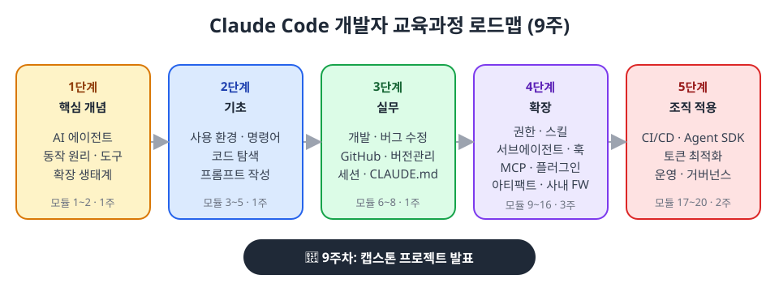

| 단계 | 핵심 질문 |
|---|---|
| 1. 핵심 개념 | AI 에이전트는 어떻게 일하는가? |
| 2. 기초 | 어디서, 어떻게 일을 시키는가? |
| 3. 실무 | 매일의 개발을 어떻게 함께 하는가? |
| 4. 확장 | 우리 팀에 맞게 어떻게 키우는가? |
| 5. 조직 적용 | 팀과 회사 전체로 어떻게 넓히는가? |

---

## 1-3. 실습 프로젝트: EduHub

모든 실습은 하나의 예제 프로젝트로 진행합니다.

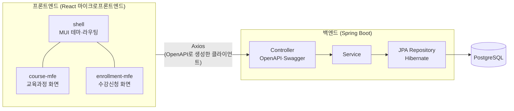

- **사내 교육 신청 시스템**: 과정 조회, 수강 신청·취소, 대기자 관리
- **기술 스택**: Java 21, Spring Boot 3, JPA/Hibernate, OpenAPI/Swagger, React, Module Federation, MUI, Axios
- N+1 쿼리, LazyInitializationException, 동시성 문제 등 **실습용 문제를 일부러 심어 둠**

---

# 2. AI 에이전트란 무엇인가

---

## 2-1. AI 코딩 도구의 세 단계

| 단계 | 형태 | 하는 일 | 사람의 역할 |
|---|---|---|---|
| 1세대 | **자동완성** | 다음 줄을 추천 | 모든 것을 직접 |
| 2세대 | **채팅** | 질문에 답하고 코드를 제안 | 복사·붙여넣기, 실행, 확인 |
| 3세대 | **에이전트** | 스스로 파일을 읽고, 고치고, 테스트를 돌리며 **일을 끝냄** | 목표 제시, 검토, 판단 |

> **"답을 말하는 AI"에서 "일을 해내는 AI"로**

---

## 2-2. 에이전트의 구성 요소

| 구성 요소 | 비유 | Claude Code에서 |
|---|---|---|
| **모델** | 두뇌 | Claude (판단과 계획) |
| **도구** | 손과 발 | 파일 읽기·수정, 명령 실행, 검색, 외부 연동 |
| **컨텍스트** | 작업 기억 | 대화, 읽은 파일, 명령 결과 |
| **지시** | 목표 | 사용자의 요청, CLAUDE.md |
| **하네스** | 신경계·안전장치 | Claude Code 프로그램 (도구 실행, 권한 확인) |

---

## 2-3. 에이전트 루프 ⭐

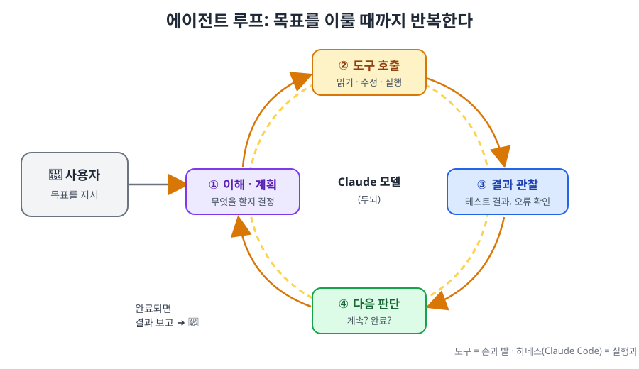

**예시: "수강 신청 시 정원이 찼으면 예외를 던지게 해줘"**

1. **이해·계획**: 관련 코드를 찾아 읽어야겠다
2. **도구 호출**: `EnrollmentService.java` 검색 → 읽기 → 수정 → 테스트 실행
3. **결과 관찰**: 테스트 1개 실패
4. **다음 판단**: 실패 원인을 고치고 다시 실행 → 통과 → 완료 보고

> 💡 **핵심 메시지:** Claude는 처음부터 우리 코드를 알지 못합니다. **도구로 읽어서** 알게 되고, **검증 수단(테스트)이 있을 때** 스스로 고쳐 나갑니다.

---

## 2-4. 이 원리에서 나오는 실무 원칙

| 원리 | 그래서 우리는 |
|---|---|
| 도구로 읽어서 안다 | 관련 파일 위치를 알려주면 빠르고 정확하다 |
| 결과를 보고 판단한다 | **테스트·빌드 같은 검증 수단**을 제공한다 |
| 컨텍스트에 쌓인 것만 기억한다 | 작업이 바뀌면 대화를 비운다 (`/clear`) |
| 매 세션 처음 온 동료와 같다 | 반복되는 설명은 **CLAUDE.md**에 적어 둔다 |

> 💬 **강사 노트:** 이 표가 1회차에서 가장 중요한 내용입니다. 이후 모든 회차의 기법이 여기서 나온다고 강조합니다.

---

# 3. 도구(Tools)와 권한

---

## 3-1. 도구는 어떻게 동작하나

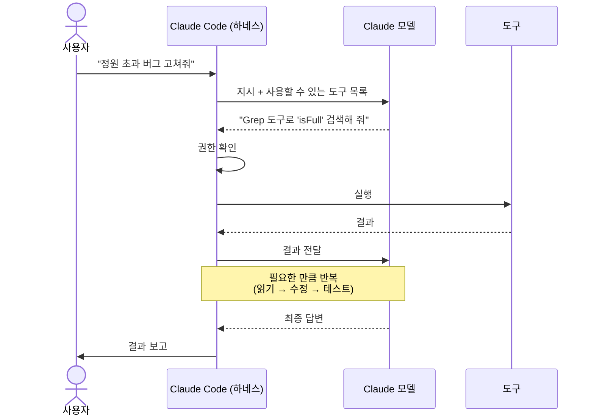

- 모델은 **실행을 요청**만 하고, 실제 실행은 **Claude Code가** 한다
- 그래서 모든 실행 앞에 **권한 확인**이라는 관문을 둘 수 있다

---

## 3-2. 대표 도구

| 분류 | 도구 | 하는 일 |
|---|---|---|
| 읽기·탐색 | Read, Glob, Grep | 파일 읽기, 파일 찾기, 내용 검색 |
| 수정 | Edit, Write | 부분 수정, 새로 쓰기 |
| 실행 | Bash | 테스트, 빌드, git |
| 웹 | WebFetch, WebSearch | 문서 확인, 검색 |
| 위임 | Agent | 서브에이전트에게 작업 맡기기 |
| 외부 연동 | MCP 도구 | GitHub, DB, Jira 등 |

---

## 3-3. 권한: 사용자가 Claude에게 주는 권한

| 규칙 | 의미 | 예 |
|---|---|---|
| **allow** | 묻지 않고 실행 | 테스트, 린트 |
| **ask** | 매번 확인 | `git push` |
| **deny** | 절대 금지 | `.env` 읽기, 강제 푸시 |

**권한 모드** (`Shift + Tab`으로 전환)

| 모드 | 한 줄 설명 |
|---|---|
| Manual (기본) | 처음 쓰는 도구마다 확인 |
| acceptEdits | 파일 수정은 자동 승인 |
| plan | 읽기만 하고 계획 세우기 |
| auto | 분류기가 위험도를 판단 |
| bypassPermissions | 확인 생략 — **격리 환경에서만** |

> 💡 **목표:** 안전한 일은 자동으로, 위험한 일은 확인 후, 금지된 일은 절대 못 하게

---

# 4. Claude Code 사용 환경

---

## 4-1. 같은 에이전트, 여러 화면

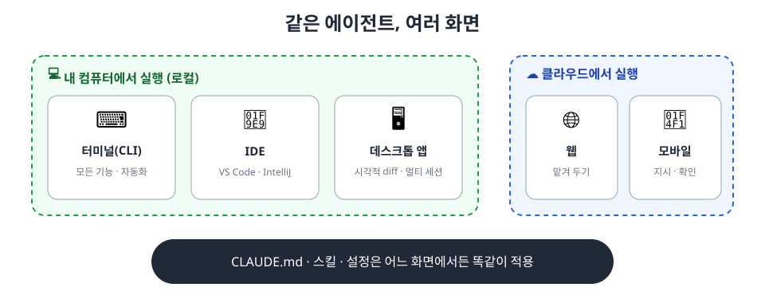

| 상황 | 추천 환경 |
|---|---|
| 처음 배울 때, 터미널이 낯설 때 | 데스크톱 앱, IDE |
| 매일의 코딩 | IDE (IntelliJ, VS Code) 또는 터미널 |
| 오래 걸리는 작업을 맡겨 두기 | 웹(클라우드) |
| 이동 중 확인·승인 | 모바일 |
| 반복 업무 자동화 | 터미널(헤드리스), CI |

---

## 4-2. 터미널 vs 데스크톱 앱

| 구분 | 터미널(CLI) | 데스크톱 앱 |
|---|---|---|
| 진입 장벽 | 터미널 사용에 익숙해야 함 | 일반 앱처럼 설치·실행 |
| 변경 내용 검토 | 텍스트 diff | 시각적 diff 화면 |
| 병렬 작업 | 창 여러 개, 또는 백그라운드 세션 | 한 창에서 여러 세션, 워크트리 자동 관리 |
| 자동화 | 스크립트, 파이프, CI에 강함 | 앱 안의 예약 작업 위주 |
| 실행 환경 | Linux 서버 등 어디서나 | Mac, Windows (Linux 베타) |

> 💬 **강사 노트:** "둘 중 하나를 고르는 것이 아니라 섞어 쓴다"를 강조합니다. 설정은 어느 화면에서든 똑같이 적용됩니다.

---

## 4-3. IDE 연결과 터미널 도구

| IDE | 연결 방법 |
|---|---|
| **VS Code** (Cursor 등 계열 포함) | 공식 확장 설치 → 채팅 패널, 선택 영역 공유, 인라인 diff |
| **IntelliJ 등 JetBrains** | CLI + 공식 플러그인 → IDE 터미널에서 `claude`, 외부 터미널은 `/ide` |
| **Eclipse** | 공식 플러그인 없음 → Eclipse 터미널에서 CLI 사용 |

| 터미널 도구 | 한 줄 소개 |
|---|---|
| **Windows Terminal** | 윈도우 기본 추천. 탭, 화면 분할, WSL·PowerShell 통합 |
| **tmux** | Linux·WSL·Mac. 세션 유지, 화면 분할, SSH 끊김 대비 |
| **wmux** | 윈도우용 AI 에이전트 멀티플렉서 (커뮤니티 오픈소스, 보안 검토 후) |

> 💡 **참고:** 여러 모델을 골라 쓰는 오픈소스 에이전트도 있습니다. 코딩 특화인 **OpenCode**, 범용 비서형인 **Hermes Agent**, **OpenClaw** 등이 있으며, 로컬 모델만 써야 하거나 모델을 비교할 때 검토해 볼 만합니다.

---

## ☕ 휴식 (10분)

---

# 5. 확장 생태계

---

## 5-1. 한눈에 보기: "누가 호출하는가"

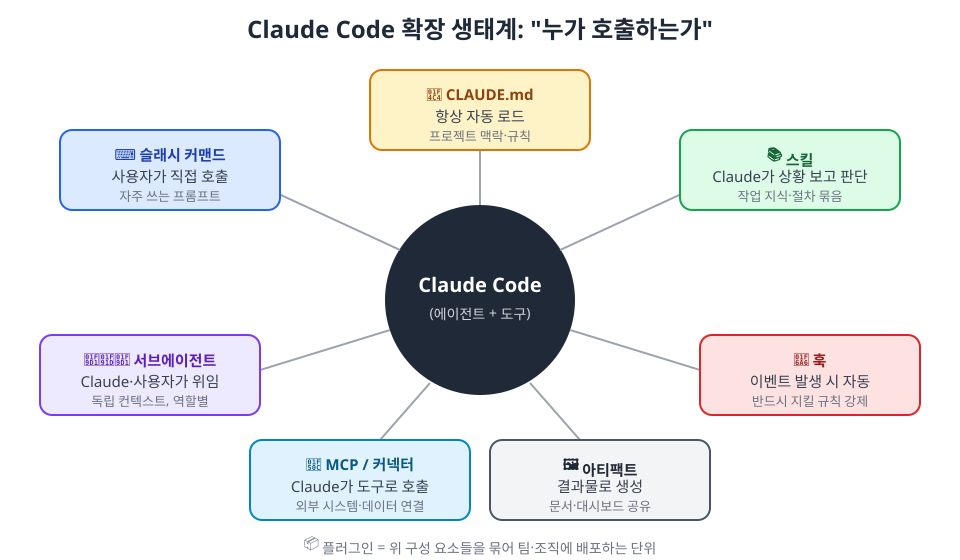

| 기능 | 누가 호출하나 | 주 용도 |
|---|---|---|
| **CLAUDE.md** | 항상 자동 로드 | 프로젝트의 기본 맥락과 규칙 |
| **슬래시 커맨드** | 사용자가 직접 | 자주 쓰는 프롬프트 저장 |
| **스킬** | Claude가 상황을 보고 판단 | 특정 작업의 전문 지식·절차 묶음 |
| **서브에이전트** | Claude 또는 사용자가 위임 | 독립된 컨텍스트에서 역할별 작업 |
| **훅** | 이벤트 발생 시 자동 | 반드시 실행돼야 하는 규칙 강제 |
| **MCP / 커넥터** | Claude가 도구로 호출 | 외부 시스템·데이터 연결 |
| **플러그인** | 설치하는 묶음 | 위 기능들을 팀·조직에 배포 |
| **아티팩트** | 결과물로 생성 | 문서·대시보드를 보고 공유 |

---

## 5-2. CLAUDE.md: 신입 온보딩 문서

- 세션을 시작할 때마다 **자동으로 읽히는** 지침 파일
- **넣을 것**: 빌드·테스트 명령, 팀 컨벤션, 주요 디렉터리, 주의 사항
- **넣지 말 것**: 비밀정보, 긴 문서, 린터가 이미 강제하는 규칙, 막연한 조언

```markdown
# EduHub
- 백엔드 테스트: `./gradlew test --tests "*XxxTest"`
- 엔티티를 컨트롤러에서 직접 반환하지 않는다 (DTO로 변환)
- 생성된 API 클라이언트(generated/)는 직접 수정하지 않는다
```

> ⚠️ **제약:** 항상 컨텍스트를 차지하므로 **짧게**. 그리고 **강제력이 없는 "부탁"**이다.

---

## 5-3. 스킬과 서브에이전트

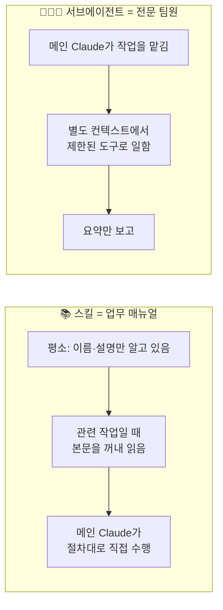

| | 스킬 | 서브에이전트 |
|---|---|---|
| 본질 | "어떻게" (절차·지식) | "누가" (역할) |
| 일하는 주체 | 메인 Claude | 별도 에이전트 |
| 예 | API 추가 절차, JPA 성능 진단 절차 | 코드 탐색가, JPA 리뷰어, 테스트 작성자 |

---

## 5-4. 훅: 부탁이 아닌 강제

| 지침 (CLAUDE.md, 스킬) | 훅 |
|---|---|
| Claude에게 **부탁** | Claude Code가 **강제** |
| 대부분 지키지만 놓칠 수 있다 | 매번 반드시 실행 |

**예시**
- 파일을 수정하면 → 포매터 자동 실행
- 생성 코드를 수정하려 하면 → 차단하고 "재생성 명령을 쓰세요" 안내
- 작업을 마치면 → 테스트 실행

---

## 5-5. MCP: 에이전트용 USB-C

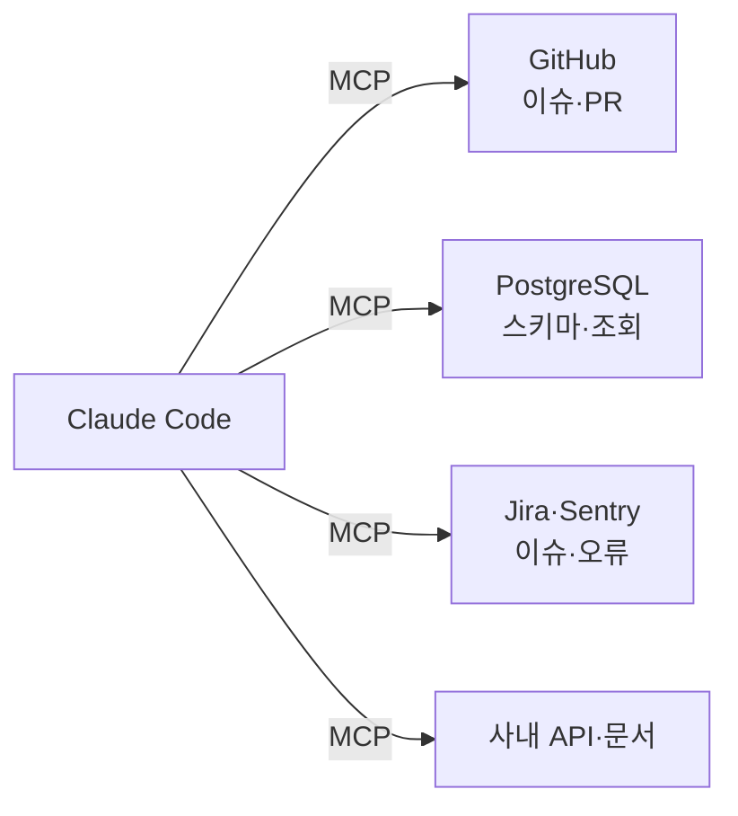

- AI 도구와 외부 시스템을 잇는 **개방형 표준**
- 할 수 있는 것: 최신·사내 데이터 **조회**, 이슈 생성 같은 **실제 행동**
- 주의: 신뢰할 수 있는 서버만, 최소 권한, 외부 데이터 속 숨은 지시(프롬프트 인젝션)

---

## 5-6. 플러그인과 아티팩트

**📦 플러그인**: 스킬·에이전트·훅·MCP 설정을 묶어 **한 번에 설치·배포**
- 예: 사내 프레임워크 팀이 "프레임워크 개발 키트" 플러그인을 전사에 배포

**🖼️ 아티팩트**: 결과물을 대화 밖 **독립된 화면**으로 보고 공유
- 예: 설계 리뷰 문서, 성능 개선 리포트, 데이터 대시보드, 화면 프로토타입
- 대화로 고치고 링크로 공유

---

# 6. 컨텍스트와 토큰, 모델 선택, 토큰 줄이기, 잘 일을 시키는 법

---

## 6-1. 컨텍스트 = 에이전트의 작업 기억

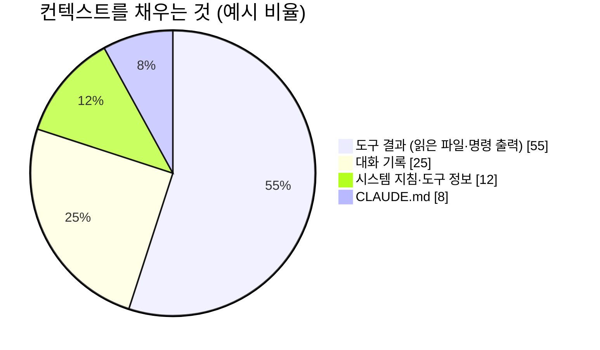

- 매 턴마다 **지금까지의 컨텍스트 전체**가 모델에 전달된다 → 대화가 길수록 비싸고 느려진다
- 관련 없는 내용이 많으면 **중요한 지시가 묻혀** 품질도 떨어진다
- 관리 도구: `/context`(사용량 확인), `/clear`(비우기), `/compact`(요약)

> 비율은 이해를 돕기 위한 예시이며 작업에 따라 크게 다릅니다.

---

## 6-2. Claude Code에서 쓸 수 있는 모델과 선택 기준

> 출처: Claude Code 공식 문서 Model configuration, Anthropic 가격표 (2026년 10월 확인). 가격은 Anthropic API 정가(100만 토큰당)이며 바뀔 수 있습니다. 자세한 내용은 [모델 가이드](../examples/29-models-guide.md).

**Claude 모델 (Claude Code가 직접 사용하는 모델)**

| 별칭 (`/model`) | 모델 | 특징 | 입력 / 출력 가격 | Sonnet 대비 | 기본 추론 수준 |
|---|---|---|---|---|---|
| `fable` | Fable 5.1 | 가장 고성능. 장시간 자율 작업, 원인 불명 장애 분석, 아키텍처 결정 같은 모호하고 어려운 문제. **직접 선택해야만** 쓰이며 사용량 크레딧으로 과금될 수 있음 | $10 / $50 | 5배 | high |
| `opus` | Opus 5.5 | **대부분 요금제의 기본 모델**. 복잡한 설계, 여러 단계를 거치는 추론 | $4 / $20 | 2배 | medium |
| `sonnet` | Sonnet 5.5 | 속도와 성능의 균형. **대부분의 일상 코딩** | $2 / $10 | 1배 (기준) | medium |
| `haiku` | Haiku 5.5 | 빠르고 매우 저렴. 탐색, 요약, 단순 반복 | $0.10 / $0.50 | 약 1/20 | medium |
| `opusplan` | Opus + Sonnet | **Plan 모드에서는 Opus, 실행은 Sonnet**으로 자동 전환 | — | — | — |

- 네 모델 모두 기본 **100만 토큰 컨텍스트**를 지원합니다 (Haiku는 10만 토큰을 넘는 요청부터 단가가 높아짐)
- 구독 요금제에서는 비싼 모델일수록 같은 작업에서 **사용 한도를 더 빨리 소모**합니다
- 토큰 사용량 = **모델 단가 × 토큰 수**. 추론 수준(effort)이 높을수록 생각 토큰(출력으로 과금)과 도구 호출이 늘어납니다

**ChatGPT(OpenAI) 진영 모델은?**

- Claude Code 자체는 **Claude 모델만** 실행합니다
- GPT 모델은 **Codex CLI**로 쓰거나, Claude Code 안에서 **OpenAI 공식 플러그인(codex-plugin-cc)**으로 Codex를 불러 교차 리뷰·작업 위임에 씁니다 ([Codex와 함께 쓰기](../examples/24-codex-with-claude-code.md))
- 2026년 10월 기준 Codex는 주력(GPT-6.1 Sol 등)·경량(Luna 등)·코딩 특화(codex 계열) 모델로 나뉘어 있다는 보도가 있으나, 이름과 가격이 자주 바뀌므로 **Codex의 모델 선택 화면과 OpenAI 공식 문서로 확인**합니다

**어느 경우에 어떤 모델? (토큰을 줄이면서 품질 유지)**

| 작업 | 추천 모델 | 추론 수준 |
|---|---|---|
| 원인 불명 장애, 큰 아키텍처 결정, 장시간 자율 작업 | Fable 5.1 (필요할 때만) 또는 Opus | high |
| 설계명세, 구현계획, 복잡한 리팩터링 설계 | **Opus** (또는 `opusplan`) | medium~high |
| 보안·DB 마이그레이션·동시성 같은 위험 영역 검토 | **Opus** | high |
| 일반 구현, 원인이 분명한 버그 수정, 테스트 작성, 일반 리뷰 | **Sonnet** | medium |
| 코드 탐색, 로그·문서 요약, PR 본문, 단순 반복 | **Haiku** (서브에이전트) | low~medium |
| CI 자동화 (PR 요약, 실패 원인 분석) | Haiku 또는 Sonnet | low~medium |
| 설계·코드 교차 리뷰 | Claude + **Codex(GPT)** 플러그인 | — |

**모범 사례 6가지**
1. **기본값을 알고 시작**: 대부분 요금제의 기본은 Opus입니다. 일상 작업은 `sonnet`이나 `opusplan`으로 바꾸고, 어려울 때만 올립니다 (공식 문서: 예상보다 비용이 큰 경우는 대개 "정리 안 한 긴 세션"과 "기본 모델을 Opus로 둔 것")
2. **메인은 똑똑하게, 일꾼은 저렴하게**: 설계·판단은 Opus 메인, 구현·탐색은 서브에이전트 정의에 `model: sonnet` / `haiku` 명시
3. **모델보다 추론 수준을 먼저 조절**: 같은 모델에서 `/effort`를 낮추는 것이 첫 번째 절약 수단. 공식 문서는 Opus 5.5 `medium`이 이전 세대 Opus 5 `high`와 같거나 낫다고 설명합니다. 한 번만 깊게 생각시키려면 프롬프트에 `ultrathink`
4. **세션 중간에 모델을 자주 바꾸지 않기**: 프롬프트 캐시는 모델별로 따로라서, 바꾸는 순간 지금까지의 대화를 다시 처리합니다. 바꿀 거라면 작업 단위(`/clear` 직후)에 바꿉니다
5. **"요청당"이 아니라 "작업 완료당" 비용으로 판단**: 싼 모델이 재작업을 늘리면 오히려 비쌉니다
6. **우리 작업으로 측정**: 대표 작업 5~10개로 모델 조합을 비교해(테스트 통과율, 사람 리뷰에서 추가로 나온 문제, 완료당 사용량) 팀 기준을 정합니다

**설정 방법 한눈에**: 세션 중 `/model sonnet`, 시작할 때 `claude --model opusplan`, 추론 수준 `/effort medium`, 서브에이전트는 정의 파일 `model: haiku`

> 💬 **강사 노트:** "가장 좋은 모델을 항상 쓰는 것"이 아니라 **"작업에 맞는 모델을 쓰는 것"**이 품질과 비용을 함께 지키는 방법이라는 점을 강조합니다. 가격은 수시로 바뀌므로 비율(Sonnet 대비 몇 배)로 기억하게 합니다.

---

## 6-3. 토큰을 줄이는 실무 방법

> 출처: Claude Code 공식 문서 "Manage costs effectively"(2026년 10월 확인)를 중심으로 정리했습니다. 수치는 문서에 적힌 값이며 버전에 따라 바뀔 수 있습니다.

**왜 길어진 세션이 비싼가**: Claude Code는 요청마다 **대화 전체**를 보내고, 도구를 쓸 때마다 그 결과를 담아 또 요청합니다. 프롬프트 캐싱으로 반복 부분은 싸게 처리되지만, 하루 종일 열어 둔 세션에서는 한 줄짜리 질문도 전체 대화만큼 사용량을 씁니다.

| # | 방법 | 실무 요령 |
|---|---|---|
| 1 | **작업이 바뀌면 `/clear`** | 관련 없는 이전 맥락이 매 턴 비용을 키운다. 나중에 돌아올 세션은 `/rename`으로 이름 붙인 뒤 `/clear` → 필요하면 `/resume` |
| 2 | **`/compact`에 남길 내용 지정** | `/compact 설계 결정과 실패한 테스트만 남겨줘`. CLAUDE.md에 "Compact instructions" 절을 두면 매번 적용. 단, 압축 자체도 큰 요청이므로 새 출발이면 `/clear`(비용 없음)가 낫다 |
| 3 | **구체적으로 지시** | "코드베이스 개선해줘"는 넓은 탐색을 부른다. "auth.ts의 login 함수에 입력 검증 추가"처럼 위치를 주면 읽는 파일이 줄어든다 |
| 4 | **작업에 맞는 모델·노력 수준** | 대부분의 코딩은 Sonnet, 복잡한 설계만 Opus. 단순 작업은 `/effort`로 추론 수준을 낮춘다 (생각 토큰은 출력 토큰으로 과금). 자세한 기준은 6-2 |
| 5 | **CLAUDE.md는 200줄 이내** | 세션 시작마다 로드된다. PR 리뷰·마이그레이션 같은 특정 절차는 **스킬**로 옮기면 필요할 때만 로드 |
| 6 | **시끄러운 작업은 서브에이전트에게** | 테스트 실행, 문서 조회, 로그 분석의 긴 출력은 서브에이전트 컨텍스트에 두고 **요약만** 받는다. 단순 서브에이전트는 `model: haiku` |
| 7 | **출력을 훅으로 미리 걸러내기** | 1만 줄 로그를 읽히는 대신 훅이 `ERROR` 줄만 넘기게 → 수만 토큰을 수백 토큰으로. 테스트 출력은 실패 부분만 |
| 8 | **MCP보다 CLI, 안 쓰는 서버는 끄기** | `gh`, `aws` 같은 CLI는 도구 목록을 추가하지 않아 더 효율적. 쓰지 않는 MCP 서버는 `/mcp`에서 끄기 |
| 9 | **잘못 가면 일찍 멈추기** | 큰 작업은 Plan 모드로 먼저 합의, 방향이 틀리면 `Esc`로 즉시 중단하고 `/rewind`. 재작업이 가장 큰 낭비 |
| 10 | **검증 기준을 주고 조금씩 테스트** | 테스트·기대 출력을 주면 Claude가 스스로 확인해 수정 요청 왕복이 줄어든다 |
| 11 | **간단한 코드는 직접 고치기** | 오타·상수·한두 줄 수정은 IDE에서 직접 → **0토큰**, 더 빠르다. 이렇게 하려면 **평소 코드를 이해하고 있어야** 한다 (→ 7-5) |

**측정하고 관리하기**
- `/usage`: 세션 토큰 사용량, 캐시 적중률, 요금제 사용량과 **스킬·서브에이전트·MCP별 사용 비중**
- `/context`: 지금 컨텍스트를 무엇이 차지하는지 확인
- 상태 줄(status line)에 컨텍스트 사용량을 항상 표시할 수 있다

**사용량이 몰래 늘어나는 경우**
- **긴 휴식 뒤 첫 요청**: 캐시 유효 시간(구독 1시간, API 기본 5분)이 지나면 전체 컨텍스트를 다시 처리한다 → 오래 쉬었다면 `/clear` 후 새로 시작하는 것도 방법
- **반복 작업·예약 작업**(`/loop` 등): 세션이 놀고 있어도 실행될 때마다 전체 컨텍스트를 보낸다
- **서브에이전트·에이전트 팀**: 각자 별도로 요청한다. 에이전트 팀은 일반 세션보다 수 배(문서 기준 Plan 모드에서 약 7배) 많이 쓸 수 있다

> 💬 **강사 노트:** 실무에서 효과가 가장 큰 두 가지는 **"작업이 바뀌면 `/clear`"**와 **"작업에 맞는 모델 선택"**입니다. 공식 문서도 예상보다 사용량이 많은 경우 대부분이 "정리하지 않은 긴 세션"과 "기본 모델을 Opus로 둔 것"에서 나온다고 설명합니다. 자세한 실습은 모듈 19에서 합니다.

---

## 6-4. 일을 잘 시키는 5가지 원칙

| 원칙 | ❌ | ✅ |
|---|---|---|
| **목표와 이유** | "락 걸어줘" | "동시에 신청하면 정원을 넘는 문제가 있어. 정원 초과가 없도록 고쳐줘" |
| **위치·참고 코드** | "수강 신청 고쳐줘" | "`EnrollmentService.enroll()`을 `CourseService`와 같은 방식으로" |
| **완료 기준·검증** | "테스트도 해줘" | "`./gradlew test --tests "*Enrollment*"` 통과까지" |
| **큰 일은 계획부터** | 바로 구현 | "먼저 계획을 보여줘" (Plan 모드) |
| **반복은 자산으로** | 매번 같은 설명 | CLAUDE.md, 스킬, 에이전트로 |

> **"유능한 신입 동료에게 일을 맡기듯"**

---

## 6-5. Claude Code만의 이야기일까?

| 개념 | Claude Code | OpenAI Codex | Google (Antigravity 등) | 오픈소스 (OpenCode 등) |
|---|---|---|---|---|
| 지침 파일 | `CLAUDE.md` | `AGENTS.md` | `GEMINI.md` 등 | 도구별 |
| 스킬 | ○ | ○ | ○ | 대부분 ○ |
| MCP | ○ | ○ | ○ | 대부분 ○ |
| 모델 | Claude | OpenAI | Gemini 중심 | 여러 모델·로컬 모델 |

- 코딩 에이전트들은 **구조가 비슷해지는 중**
- 함께 쓰기도 한다: 예) Claude Code로 구현하고 **Codex로 교차 리뷰** (OpenAI 공식 플러그인)
- 오늘 배우는 원리(에이전트 루프, 컨텍스트, 검증, 최소 권한)는 **도구가 바뀌어도 그대로 통한다**

---

# 7. ⭐ 바이브 코딩 시대, 개발자의 책임

---

## 7-1. AI가 코드를 쓰면, 개발자는 무엇을 하나?

> **"AI가 코드를 쓰더라도, 시스템의 주인은 개발자다."**

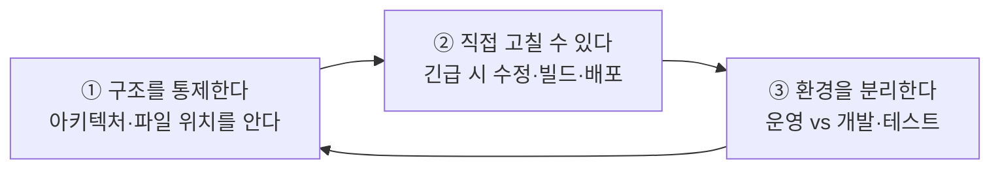

| 예전 | 바이브 코딩 시대 |
|---|---|
| 코드를 직접 **작성**하는 사람 | 구조를 **설계·통제**하고 AI 결과를 **검증·판단**하는 사람 |
| 모든 줄을 직접 씀 | 직접 쓰지 않아도 **모든 변경을 이해함** |

> 💬 **강사 노트:** 이 섹션은 60분 단축 진행에서도 **생략하지 않습니다.** 이후 모든 회차에서 반복해서 강조합니다.

---

## 7-2. 원칙 ① 구조와 아키텍처는 개발자가 통제한다

- AI는 **요청한 일을 끝내는 데** 집중한다 → 전체 구조의 일관성은 사람이 지켜야 한다
- 구조를 모르면 AI의 변경이 **맞는지 판단할 수 없다** → 리뷰가 형식이 되고, 장애 시 손을 쓸 수 없다

**최소한 알고 있어야 할 것**
- 시스템 **아키텍처** (무엇이 어떻게 연결되는가)
- 어떤 기능이 **어느 모듈·파일**에 있는가
- 요청 하나의 **데이터 흐름** (화면 → API → 서비스 → DB)
- 환경별 **설정 파일**과 **빌드·배포 방법**

**통제하는 방법**: 설계는 사람이 승인(Plan 모드) · 구조를 문서와 CLAUDE.md "지도"로 고정 · ArchUnit·ESLint·훅으로 구조 규칙 강제 · **이해하지 못한 코드는 머지하지 않는다**

---

## 7-3. 원칙 ② 긴급 상황에는 직접 수정·빌드·배포할 수 있어야 한다

- AI 서비스가 느리거나, 한도에 걸리거나, 보안 사고로 사용이 제한될 수 있다
- **"AI 없이는 고칠 수 없는 시스템"은 운영할 수 없는 시스템이다**

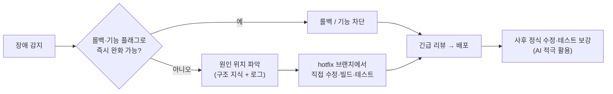

**준비해 둘 것**: 런북(장애 대응·배포·롤백 절차) · 사람이 그대로 실행할 수 있는 빌드·배포 스크립트 · 기능 플래그 · 정기적인 "AI 없이 핫픽스" 훈련

> 💡 빌드·배포 파이프라인도 Claude Code와 함께 만들 수 있습니다. 단, **운영 배포는 AI가 아니라 파이프라인과 사람의 승인으로만** 진행합니다 (모듈 17).

---

## 7-4. 원칙 ③ AI로 유지보수할 때는 운영과 개발·테스트 환경을 분리한다

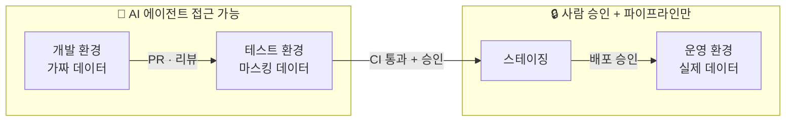

| | 개발·테스트 | 운영 |
|---|---|---|
| AI 에이전트 접근 | 허용 | **금지** |
| 데이터 | 가짜·마스킹 | 실제 (개인정보) |
| 자격 증명 | 개발용 | AI 도구에 **절대 노출 금지** |
| 배포 | 자유롭게 실험 | 파이프라인 + **사람의 승인** |

**Claude Code에서 지키는 법**: 운영 설정·비밀 읽기 `deny` · 운영 접속 명령 차단(권한 + 훅) · MCP는 개발 DB 읽기 전용 계정만 · 운영 키는 개발 PC·저장소에 두지 않기 · 배포는 파이프라인으로만

> ❌ "운영 DB에 접속해서 데이터 고쳐줘"  ❌ 운영 서버에서 Claude Code 실행  ❌ 검토 없이 AI가 만든 마이그레이션을 운영에 적용

---

## 7-5. 언제 직접 고치고, 언제 AI에게 맡길까?

> **"간단한 코드는 직접 고친다."** 이 습관이 가능하려면 **항상 코드를 이해하고 있어야** 합니다. 반대로, 직접 고치는 습관이 코드를 계속 이해하게 만듭니다.

**왜 중요한가**

| 관점 | 직접 고치면 |
|---|---|
| **시간** | 상수 하나, 오타 하나는 IDE에서 10초. AI에게 맡기면 지시 작성 → 탐색·수정 대기 → diff 검토로 몇 분이 걸린다 |
| **토큰** | 작은 수정에도 AI는 파일을 찾고 읽으며 컨텍스트를 쓴다. 직접 고치면 **0토큰** |
| **이해 유지** | 코드를 직접 만지는 개발자는 구조와 파일 위치를 잊지 않는다 → 원칙 ①, ②의 바탕 |
| **긴급 대응력** | 평소 직접 고쳐 본 코드여야 장애 때도 직접 고칠 수 있다 |

**판단 기준: 4가지 질문**

| 질문 | 직접 고치기 쪽 | AI에게 맡기기 쪽 |
|---|---|---|
| ① 무엇을, 어디를 고칠지 **이미 아는가?** | 정확히 안다 | 원인·위치부터 찾아야 한다 |
| ② 변경 **범위**는? | 한두 줄, 파일 하나 | 여러 파일, 계층을 가로지름 |
| ③ **반복**되는 작업인가? | 한 번뿐 | 같은 패턴을 여러 곳에 (테스트, 어노테이션, 마이그레이션) |
| ④ **설명하는 비용** vs 고치는 비용 | 설명이 더 오래 걸린다 | 고치는 것이 훨씬 오래 걸린다 |

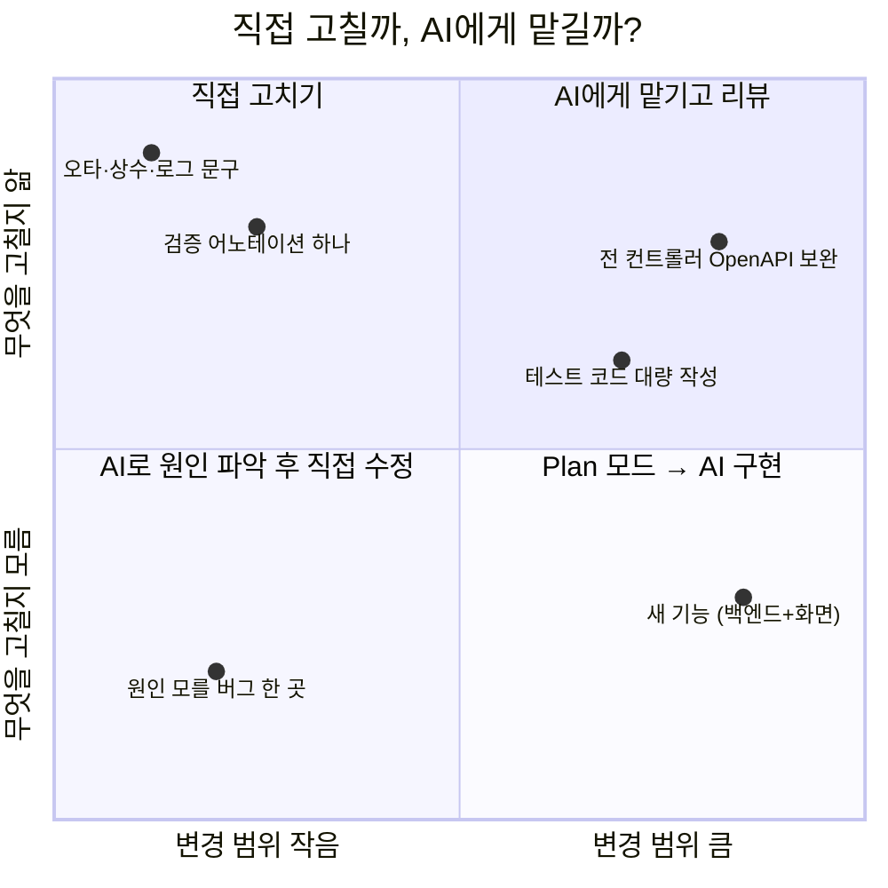

| 영역 | 예 (EduHub) | 권장 방식 |
|---|---|---|
| **직접 고치기** | 오타, 상수·설정값 변경, 로그 문구, `@NotNull` 하나 추가, 조건문 하나 수정, 긴급 핫픽스 | IDE에서 바로 수정 → 테스트 실행 |
| **AI에게 맡기고 리뷰** | 모든 컨트롤러에 OpenAPI 어노테이션 보완, 테스트 대량 작성, 반복 리팩터링 | 지시 + 검증 기준 → diff 리뷰 |
| **AI로 원인 파악 → 직접 수정** | 원인을 모르는 버그, 낯선 코드의 동작 이해 | "원인과 위치만 찾아줘, 수정은 하지 마" → 직접 수정 |
| **Plan 모드 → AI 구현** | 새 기능, 여러 계층에 걸친 변경 | 계획 검토·승인 → 구현 → 리뷰 |

**함께 쓰는 패턴**
- **AI가 찾고, 사람이 고친다**: 탐색·설명은 AI, 핵심 로직 수정은 직접
- **사람이 핵심을, AI가 주변을**: 비즈니스 규칙은 직접 쓰고, 테스트·문서·반복 코드는 AI
- **AI가 초안, 사람이 마무리**: 큰 변경은 AI 초안 후 세부 조정은 IDE에서 직접

**주의할 점**
- ❌ 변수 이름 하나 바꾸려고 AI에게 지시하고 기다리기 → 시간·토큰 낭비 (IDE의 이름 바꾸기 기능이 더 정확)
- ❌ 수십 개 파일의 기계적인 반복 수정을 손으로 하기 → AI나 IDE 일괄 기능을 쓴다
- ❌ **이해하지 못한 코드**를 AI에게 맡기고 리뷰도 형식적으로 → 원칙 ① 위반
- 💡 세션 중에 직접 고쳤다면 Claude에게 "방금 X를 직접 수정했어"라고 알려 주면 이후 작업의 맥락이 맞는다
- 💡 보안·결제·권한처럼 **위험이 큰 코드**는 AI가 쓰더라도 사람이 한 줄씩 이해하고 검토한다

> 💬 **강사 노트:** "AI를 많이 쓰는 것"이 목표가 아니라 **"가장 빠르고 안전하게 끝내는 것"**이 목표입니다. 직접 고치는 능력이 있어야 AI에게 맡길 일과 맡기지 않을 일을 고를 수 있다는 점을 강조합니다.

---

# 8. 토론: "CLAUDE.md에 쓸까, 스킬로 만들까, 에이전트로 만들까?"

---

## 8-1. 판단 흐름

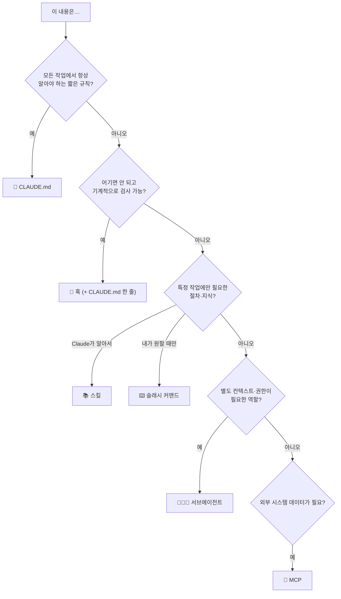

---

## 8-2. 토론 과제 (7분)

**요구사항:** "새 API를 추가할 때 OpenAPI 문서(`@Operation`)가 빠지지 않게 하고 싶다"

| 방식 | 어떻게 | 토론 질문 |
|---|---|---|
| A. CLAUDE.md | 규칙 한 줄 추가 | 항상 지켜질까? |
| B. 슬래시 커맨드 | `/check-openapi` | 사람이 잊으면? |
| C. 스킬 | 작성 규칙과 예시 제공 | 품질까지 좋아질까? |
| D. 서브에이전트 | 문서 품질 리뷰어 | 비용과 효과는? |
| E. 훅 | 수정할 때마다 누락 검사 | "존재"와 "품질"의 차이는? |

**생각해 볼 점:** 정답은 하나가 아닙니다. 흔한 모범 답안은 **A + C + E 조합**입니다. 규칙은 알려주고(CLAUDE.md), 잘 쓰는 법은 제공하고(스킬), 빠지면 잡는다(훅).

> 💬 **강사 노트:** 3~4명씩 조를 나눠 5분 토론 후 조별로 1분 발표. 모듈 12(훅)까지 배운 뒤 같은 토론을 다시 합니다.

---

# 9. 정리

---

## 9-1. 오늘의 핵심 6가지

1. **에이전트 = 모델 + 도구 + 컨텍스트 + 지시**, 목표를 이룰 때까지 루프를 돈다
2. 모델은 실행을 **요청**하고 Claude Code가 **실행**한다 → 그 사이에 **권한**이라는 관문이 있다
3. 같은 에이전트를 **터미널·IDE·데스크톱·웹·모바일**에서 쓸 수 있고, 설정은 공통이다
4. 확장 기능은 **"누가 호출하는가"**로 구분한다 (자동 로드 / 사용자 / Claude 판단 / 위임 / 이벤트)
5. 잘 시키는 법: **목표와 이유, 위치, 검증 수단, 계획부터, 반복은 자산으로**. 모델은 **작업에 맞게**: 설계는 Opus, 구현은 Sonnet, 탐색은 Haiku
6. ⭐ **시스템의 주인은 개발자다**: 구조와 파일 위치를 알고, 긴급 시 직접 수정·빌드·배포할 수 있어야 하며, AI 유지보수 시 **운영과 개발·테스트 환경을 분리**한다. **간단한 코드는 직접 고치고**, 크고 반복적인 일은 AI에게 맡긴다

---

## 9-2. 확인 퀴즈

1. Claude가 처음부터 우리 코드를 알고 있지 않은데도 버그를 고칠 수 있는 이유는?
2. "`.env` 파일은 절대 읽지 마"를 CLAUDE.md에만 적으면 부족한 이유는? 대신 무엇을 써야 할까?
3. 스킬과 서브에이전트의 가장 큰 차이는?
4. 대화가 길어지고 답변 품질이 떨어질 때 쓸 수 있는 명령 두 가지는? 토큰을 줄이는 데 효과가 가장 큰 습관 두 가지는?
5. "Java 파일을 수정하면 항상 포맷을 맞춘다"는 어떤 기능으로 구현하는 것이 적절할까?
6. AI로 유지보수를 하더라도 개발자가 직접 할 수 있어야 하는 일과, 반드시 지켜야 할 환경 원칙은?
7. "로그 문구 하나 바꾸기"와 "모든 컨트롤러에 OpenAPI 어노테이션 보완"은 각각 어떻게 처리하는 것이 좋을까?
8. 설계명세 작성, 일반 구현, 코드 탐색에는 각각 어떤 모델이 적합할까? 비용을 줄이려 할 때 모델을 바꾸기 전에 먼저 해 볼 것은?

<details>
<summary>정답 보기</summary>

1. 도구로 파일을 찾아 읽고, 테스트를 실행해 결과를 보며 고치는 **에이전트 루프** 덕분
2. CLAUDE.md는 강제력이 없는 지침. **권한 설정(deny)**과 필요하면 **훅**으로 강제
3. 스킬은 메인 Claude가 따르는 **절차·지식**, 서브에이전트는 **별도 컨텍스트에서 일하는 역할**
4. `/compact` (같은 작업 계속), `/clear` (작업이 바뀌었을 때). 사용량 확인은 `/context`, `/usage`. 효과가 큰 습관: 작업이 바뀌면 `/clear`, 작업에 맞는 모델 선택
5. **훅** (`PostToolUse`에서 포매터 실행)
6. 소스 구조·파일 위치 파악, 긴급 시 직접 수정·빌드·배포·롤백. AI는 **개발·테스트 환경에서만**, 운영은 사람의 승인과 파이프라인으로
7. 로그 문구는 위치를 알고 범위가 작으니 **직접 수정**(빠르고 0토큰). OpenAPI 보완은 여러 파일에 걸친 반복 작업이니 **AI에게 맡기고 리뷰**
8. 설계명세는 Opus, 일반 구현은 Sonnet, 코드 탐색은 Haiku. 모델을 바꾸기 전에 먼저 **추론 수준(`/effort`)을 낮춰** 보고, 판단은 "작업 완료당 비용"으로

</details>

---

## 9-3. 다음 회차 준비

**2회차: 기초 — 사용 환경, 명령어, 코드 탐색, 프롬프트 작성 (실습 중심)**

준비물 체크리스트
- [ ] Claude 계정 (유료 구독 또는 Console 계정)
- [ ] Claude Code 설치 (터미널 `claude -v`로 확인) 또는 데스크톱 앱
- [ ] 사용하는 IDE에 확장 설치 (VS Code 확장 또는 IntelliJ 플러그인)
- [ ] Git, JDK 21, Node.js LTS 설치
- [ ] (윈도우) Windows Terminal 설치, 가능하면 WSL2(Ubuntu)
- [ ] EduHub 실습 저장소 클론

**미리 읽어 오면 좋은 자료**
- [사용 환경과 터미널 도구](../examples/14-environments-and-terminals.md)
- [주요 명령어](../examples/16-commands.md)
- [프롬프트 모범 사례](../examples/11-prompting-best-practices.md)

---

## 부록: 시연 스크립트 (강사용, 5~10분)

> 섹션 2-3(에이전트 루프) 또는 섹션 5 직후에 진행합니다. 실습 저장소가 준비되지 않았다면 아무 오픈소스 저장소로 대체할 수 있습니다.

| 순서 | 강사 입력 | 보여줄 포인트 |
|---|---|---|
| 1 | `claude` 실행 → "이 프로젝트 구조를 설명해줘" | Claude가 **도구로 파일을 찾아 읽는 과정** |
| 2 | "과정 목록 API를 호출하면 쿼리가 몇 번 실행되는지 분석해줘" | 탐색 → 분석 → 근거 제시 |
| 3 | `Shift + Tab`으로 Plan 모드 → "N+1 문제 해결 계획을 세워줘" | 수정 없이 계획만 |
| 4 | 계획 승인 → 구현 → 테스트 실행 | 승인 요청(권한), 테스트 실패 → 수정 → 통과 (**루프**) |
| 5 | `/context` | 지금까지 컨텍스트가 얼마나 쌓였는지 |
| 6 | `/rewind` | 변경을 되돌릴 수 있음 |

---

## 참고 자료

- 과정 전체 커리큘럼: [CURRICULUM.md](../CURRICULUM.md)
- ⭐ [바이브 코딩 시대, 개발자가 놓치면 안 되는 것](../examples/27-developer-responsibility.md)
- 모델: [모델 가이드](../examples/29-models-guide.md) · [공식 문서: Model configuration](https://code.claude.com/docs/en/model-config)
- 토큰: [토큰 사용량 최적화](../examples/08-token-optimization.md) · [공식 문서: Manage costs effectively](https://code.claude.com/docs/en/costs)
- 환경·도구: [사용 환경과 터미널 도구](../examples/14-environments-and-terminals.md) · [IDE 연결](../examples/25-ide-integration.md) · [Codex와 함께 쓰기](../examples/24-codex-with-claude-code.md) · [빌드·배포 파이프라인](../examples/28-build-deploy-pipeline.md)
- 개념 심화: [도구](../examples/21-tools-concept.md) · [권한](../examples/23-permissions.md) · [MCP와 훅](../examples/12-mcp-and-hooks-concepts.md) · [CLAUDE.md vs 스킬 vs 에이전트](../examples/13-choosing-the-right-tool.md) · [에이전트](../examples/10-agents.md) · [토큰 최적화](../examples/08-token-optimization.md) · [다른 도구와 비교](../examples/22-claude-code-vs-codex-vs-google.md)
- Claude Code 공식 문서: https://code.claude.com/docs
