# 2회차: 환경 준비부터 첫 요구사항까지 + Toy 프로젝트(EduHub) 킥오프

> **대상**: 1회차 오리엔테이션을 들은 개발자
> **시간**: 120분 (따라하기 중심)
> **목표**
> 1. 1회차에서 시간이 부족했던 **토큰 절약 습관**을 실제 화면에서 확인한다
> 2. "코딩은 Claude가 해도 **아키텍처 지식과 환경 분리는 개발자 몫**"인 이유를 EduHub 예시로 이해한다
> 3. 7주 동안 진행할 **Toy 프로젝트 EduHub**의 요구사항, 아키텍처, 주차별 계획을 이해한다
> 4. 데스크톱 앱 설치 → 로그인 → GitHub 저장소 생성 → Claude에게 첫 요구사항 전달 → 커밋·푸시까지 **직접 따라 한다**
> 5. `/context`, `/compact`, `/clear`, `/rewind` 같은 주요 명령을 **직접 써 보고 차이를 느낀다**
>
> **관련 모듈**: 3(사용 환경), 4(코드베이스 탐색), 5(프롬프트)
> **사전 준비**: 아래 [준비물 체크리스트](#4-0-준비물-체크리스트)를 수업 전에 확인합니다. 설치에 시간을 쓰면 따라하기가 밀립니다.

---

## 진행 순서

| 시간 | 내용 | 형식 |
|---|---|---|
| 0:00 – 0:05 | 오프닝, 1회차 핵심 3문장 복습 | 강의 |
| 0:05 – 0:20 | 1. 1회차 보강: 토큰을 아끼는 경험적 방법 | 강의 + 시연 |
| 0:20 – 0:35 | 2. 코딩은 Claude가, 아키텍처와 환경 분리는 개발자가 | 강의 + 토론 |
| 0:35 – 1:00 | 3. Toy 프로젝트 EduHub 소개와 7주 진행 계획 (Git 2단계 커밋, 브랜치 → 개발 → 병합 포함) | 강의 |
| 1:00 – 1:08 | ☕ 휴식 (설치가 덜 된 사람은 이 시간에 마무리) | — |
| 1:08 – 1:42 | 4. 따라하기 ①: 설치 → 로그인 → GitHub → 프로젝트 생성 → 브랜치 → 첫 요구사항 → PR | 실습 |
| 1:42 – 1:57 | 5. 따라하기 ②: 주요 명령어 체험 | 실습 |
| 1:57 – 2:00 | 7. 정리, 과제 안내 | 강의 |

> 6장(토큰 절약 체험, 환경 분리 맛보기)은 시간이 남으면 수업 중에, 아니면 **과제**로 진행합니다.

---

## 오프닝: 1회차 핵심 3문장

1. 에이전트는 **도구를 쓰며 루프를 도는** 모델이다 → 그래서 **검증 수단**(테스트, 빌드)을 주면 스스로 고친다
2. 매 턴마다 **컨텍스트 전체**가 다시 전달된다 → 그래서 **컨텍스트 관리가 곧 비용과 품질 관리**다
3. **AI가 코드를 쓰더라도, 시스템의 주인은 개발자다**

> 💬 **강사 노트:** 오늘은 이 세 문장을 "실제 화면"으로 확인하는 날이라고 소개합니다. 2번은 1장과 5장, 3번은 2장과 3장에서 다시 나옵니다.

---

# 1. 1회차 보강: 토큰을 아끼는 경험적 방법

> 1회차 [6-3. 토큰을 줄이는 실무 방법](./session-01-introduction.md#6-3-토큰을-줄이는-실무-방법)의 11가지 방법을 **현장에서 실제로 쓰는 습관** 위주로 다시 정리합니다. 자세한 근거는 [토큰 사용량 최적화](../examples/08-token-optimization.md)를 봅니다.

---

## 1-1. 왜 "습관"이 중요한가

토큰은 한 번의 큰 실수보다 **작은 습관이 매일 쌓여서** 새어 나갑니다.

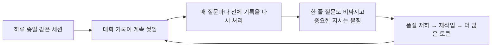

> 토큰 절약은 비용 문제만이 아닙니다. 컨텍스트가 깨끗하면 **답변 품질도 좋아집니다.**

---

## 1-2. 현장에서 효과가 컸던 습관 10가지

| # | 습관 | 이렇게 한다 | 왜 효과가 있나 |
|---|---|---|---|
| 1 | **"한 세션 = 한 작업"** | 작업이 끝나면 커밋하고 `/clear`. 다른 작업은 새 세션에서 | 지난 작업의 파일 내용과 대화가 매 턴 따라오지 않는다 |
| 2 | **작업 시작 전에 위치를 알려 준다** | "수강 신청 고쳐줘" 대신 `@backend/.../EnrollmentService.java`의 `enroll()` | 넓은 탐색(파일 수십 개 읽기)이 사라진다 |
| 3 | **큰 일은 Plan 모드로 먼저 합의** | 계획을 보고 "2번은 빼고, 3번은 기존 `CourseService` 방식으로" | 잘못된 방향으로 구현한 뒤 되돌리는 것이 가장 큰 낭비다 |
| 4 | **이상하면 바로 멈춘다** | `Esc`로 중단 → 방향 수정 지시. 이미 꼬였으면 `/rewind` | 틀린 방향으로 10분 더 가면 그만큼 토큰과 시간이 버려진다 |
| 5 | **에러는 원문 그대로, 필요한 부분만** | 스택트레이스 전체 대신 `Caused by` 앞뒤 20줄 | 1만 줄 로그는 그대로 컨텍스트를 채운다 |
| 6 | **완료 기준을 명령어로 준다** | "`./gradlew test --tests "*Enrollment*"` 통과까지" | Claude가 스스로 확인해 "다시 해줘" 왕복이 준다 |
| 7 | **같은 설명을 세 번 하면 CLAUDE.md로** | "우리는 Lombok `@Data` 안 써" 같은 규칙 | 매번 설명하는 토큰과 실수가 사라진다. 단, CLAUDE.md는 짧게 |
| 8 | **간단한 건 직접 고친다** | 오타, 상수, 로그 문구는 IDE에서 직접. 고친 뒤 "방금 X를 직접 고쳤어"라고 한 줄 알림 | 0토큰, 10초. 코드 이해도 유지된다 |
| 9 | **긴 휴식 뒤에는 새로 시작** | 점심 뒤에는 `/clear`하고 "지난번 작업 요약"을 짧게 붙여 시작 | 캐시가 만료되면 긴 대화 전체를 비싸게 다시 처리한다 |
| 10 | **모델은 작업에 맞게, 먼저 effort부터** | 일상 구현은 Sonnet, 설계만 Opus. 비용이 걱정되면 `/effort`부터 낮춘다 | 비싼 모델을 모든 일에 쓰는 것이 가장 흔한 낭비다 |

> 💬 **강사 노트:** 표를 다 읽지 말고 1·2·3·8번을 강조합니다. "한 세션 = 한 작업"만 지켜도 체감이 크다고 말해 줍니다.

---

## 1-3. 세션 위생 루틴 (작업 하나의 생애)

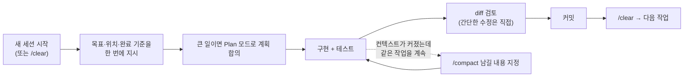

**나만의 시작 템플릿** (메모장에 두고 복사해 쓰기)

```text
[목표] 무엇을, 왜
[위치] @파일 또는 패키지
[참고] 비슷하게 만든 기존 코드
[제약] 바꾸면 안 되는 것 (API 계약, DB 스키마 등)
[완료 기준] 실행할 테스트·빌드 명령
[진행 방식] 먼저 계획만 보여줘 / 바로 구현해도 돼
```

---

## 1-4. 시연: 같은 질문, 다른 사용량 (강사 시연 5분)

| 순서 | 지시 | 확인할 것 |
|---|---|---|
| A | (새 세션) "이 프로젝트에서 수강 신청 로직 설명해줘" | `/context`에서 도구 결과(읽은 파일)가 얼마나 늘었나 |
| B | `/clear` 후 "`@backend/.../EnrollmentService.java`의 `enroll()` 흐름만 설명해줘" | A보다 읽은 파일 수와 컨텍스트 사용량이 얼마나 적은가 |

> 수강생은 5장 따라하기와 6장 과제에서 직접 비교해 봅니다.

---

# 2. 코딩은 Claude가, 아키텍처와 환경 분리는 개발자가

---

## 2-1. 왜 IT 지식이 더 중요해졌나

Claude는 코드를 빠르게 씁니다. 하지만 **그 코드가 우리 시스템에 맞는지**는 개발자가 판단해야 합니다.

| 개발자가 하는 일 | 필요한 지식 |
|---|---|
| **좋은 지시를 준다** | 무엇을 물어야 하는지 알아야 정확히 지시할 수 있다 ("락 걸어줘"가 아니라 "비관적 락 vs 낙관적 락 중 정원 초과를 막을 방법") |
| **결과를 검증한다** | 테스트가 통과해도 구조·성능·보안 문제는 지식이 있어야 보인다 |
| **선택지를 고른다** | Claude가 세 가지 방법을 제시하면 우리 상황에 맞는 것을 고르는 것은 사람이다 |
| **장애에 대응한다** | 운영 장애 때 AI가 느리거나 쓸 수 없어도 원인을 찾고 고칠 수 있어야 한다 |

> **AI가 잘하는 것은 "어떻게 만들지(How)"이고, 개발자가 책임지는 것은 "무엇을, 왜, 어디에 만들지(What·Why·Where)"입니다.**

---

## 2-2. 개발자가 갖춰야 할 아키텍처 지식 지도

| 영역 | 최소한 알아야 할 것 | EduHub에서 AI 결과를 검증할 때 보는 것 |
|---|---|---|
| **아키텍처·설계** | 계층 구조, 모듈 경계, 의존 방향, API 계약 | Controller가 Repository를 직접 부르지 않는가? 도메인 간 경계가 지켜지는가? |
| **HTTP·웹** | 상태 코드, REST 설계, CORS, 인증·세션·토큰 | 중복 신청에 409, 정원 초과에 409/422를 쓰는가? MFE에서 CORS 설정이 맞는가? |
| **데이터베이스** | 트랜잭션, 격리 수준, 인덱스, 실행 계획, 마이그레이션 | `@Transactional` 범위, N+1 쿼리, 인덱스 누락, Flyway 스크립트가 되돌릴 수 있는가? |
| **JPA·Hibernate** | 지연 로딩, 영속성 컨텍스트, fetch join | `LazyInitializationException`, 엔티티를 API 응답으로 그대로 노출하지 않는가? |
| **동시성** | 경쟁 조건, 락, 멱등성 | 동시에 신청하면 정원을 넘지 않는가? 버튼 두 번 클릭에 중복 신청되지 않는가? |
| **보안** | 입력 검증, 인증·인가, 비밀 관리, OWASP Top 10 | 비밀번호·키가 코드에 들어가지 않는가? 다른 사람의 신청을 취소할 수 없는가? |
| **프론트엔드** | 상태 관리, 번들, 마이크로프론트엔드 공유 의존성 | MUI·React가 shell과 remote에 중복 번들되지 않는가? |
| **빌드·배포·운영** | CI/CD, 환경 설정, 로그·모니터링, 롤백 | 빌드 스크립트를 사람이 직접 돌릴 수 있는가? 롤백 방법이 있는가? |

> 💬 **강사 노트:** "이걸 다 알아야 하나?"라는 질문이 나옵니다. 깊이 알 필요는 없지만 **"이런 문제가 있을 수 있다"는 것을 알아야 Claude에게 물어볼 수 있다**고 답합니다. 모르는 영역은 Claude에게 **설명을 요청해 배우는 데** 쓰라고 권합니다.

---

## 2-3. 사례: 테스트는 통과했지만 문제가 있는 코드

Claude에게 "수강 신청 API 만들어줘"라고만 했을 때 흔히 나오는 코드입니다.

```java
@PostMapping("/enrollments")
public Enrollment enroll(@RequestBody EnrollRequest req) {           // ① 엔티티를 그대로 반환
    CourseSession session = sessionRepository.findById(req.sessionId()).get();  // ② 없으면 500
    if (session.getEnrollments().size() < session.getCapacity()) {   // ③ 동시 요청 시 정원 초과
        return enrollmentRepository.save(new Enrollment(session, req.userId())); // ④ 사용자 ID를 요청에서 받음
    }
    throw new RuntimeException("full");                              // ⑤ 의미 없는 예외
}
```

| 번호 | 문제 | 필요한 지식 |
|---|---|---|
| ① | 엔티티 직접 노출 → 순환 참조, 지연 로딩 예외, 내부 구조 노출 | JPA, API 설계 |
| ② | `Optional.get()` → 없는 회차면 500 에러 | 예외 처리, HTTP 상태 코드 |
| ③ | 두 사람이 동시에 마지막 자리를 신청하면 정원 초과 | 동시성, 트랜잭션, 락 |
| ④ | 다른 사람 이름으로 신청 가능 | 인증·인가 |
| ⑤ | 클라이언트가 이유를 알 수 없음 | 예외 처리 표준, API 계약 |

> 테스트가 "정상 신청" 하나뿐이면 **모두 통과**합니다. 이 문제들을 찾아내는 것이 개발자의 지식입니다. 그리고 이 지식을 **CLAUDE.md, 스킬, 리뷰 체크리스트**로 옮겨 두면 다음부터는 Claude가 처음부터 맞게 씁니다.

---

## 2-4. 개발·테스트·운영 환경 분리

> 자세한 내용: [개발자 책임 원칙 3](../examples/27-developer-responsibility.md#원칙-3-ai로-유지보수할-때는-운영-환경과-개발테스트-환경을-반드시-분리한다), [빌드·배포 파이프라인](../examples/28-build-deploy-pipeline.md)

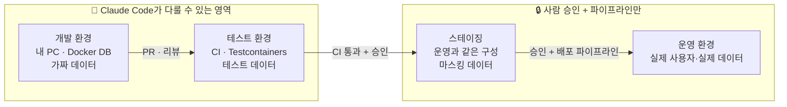

| 구분 | 개발 | 테스트 | 스테이징 | 운영 |
|---|---|---|---|---|
| 목적 | 기능 개발, 실험 | 자동 테스트, 통합 검증 | 배포 전 최종 확인 | 실제 서비스 |
| 데이터 | 가짜 데이터 | 테스트용 데이터 | 운영 구조 + 마스킹 데이터 | **실제 데이터** |
| Claude Code 접근 | ○ | ○ (CI에서) | ✕ (읽기 전용 조회 정도) | **✕** |
| 변경 방법 | 자유롭게 | PR·CI | 파이프라인 | **승인된 파이프라인만** |
| 설정·비밀 | `application-dev.yml`, 로컬 `.env` | CI 비밀 변수 | 비밀 저장소 | 비밀 저장소 (개발자 PC에 두지 않음) |

**왜 AI 시대에 더 중요한가**
- 에이전트는 **명령을 실행**합니다. 운영 DB에 닿을 수 있으면 잘못된 `DELETE` 한 번이 장애가 됩니다
- 외부 문서·이슈 본문에 숨은 지시(프롬프트 인젝션)로 **의도하지 않은 명령**이 실행될 수 있습니다
- 운영 데이터의 개인정보가 AI 도구로 전송되면 **보안·개인정보 정책 위반**이 될 수 있습니다
- 운영 장애 시 "AI 없이도" 직접 고치고 배포·롤백할 수 있어야 합니다 (1회차 원칙 ②)

**EduHub에서는 이렇게 지킨다 (7주 동안 단계적으로 완성)**

| 장치 | 내용 | 주차 |
|---|---|---|
| Spring 프로필 | `application-dev.yml`(로컬 Docker DB), `application-test.yml`(Testcontainers), `application-prod.yml`(값은 환경 변수로만) | 1주차 뼈대, 6주차 완성 |
| 비밀 관리 | `.env`는 `.gitignore`, 저장소에는 `.env.example`만 | 1주차 |
| Claude Code 권한 | `.env`, `application-prod.yml` 읽기 금지, 운영 접속 명령 금지 | 3주차 |
| 훅 | 운영 호스트·운영 DB 접속 명령 차단 | 4주차 |
| CI/CD | 테스트 통과 + 사람 승인 후에만 스테이징·운영 배포 | 6주차 |

> 💬 **강사 노트:** "우리 회사는 운영에 바로 붙어서 개발하는데요?"라는 반응이 있을 수 있습니다. AI 에이전트를 쓰는 순간 그 방식의 위험이 몇 배가 된다는 점, 최소한 **운영 비밀을 개발 PC에 두지 않는 것**부터 시작하라고 안내합니다.

---

# 3. Toy 프로젝트 EduHub 소개와 7주 진행 계획

> 1회차 [1-3. 실습 프로젝트: EduHub](./session-01-introduction.md#1-3-실습-프로젝트-eduhub)의 시스템 구성을 바탕으로, 이번 회차에는 **무엇을 만들지**와 **어떻게 진행할지**를 구체적으로 정합니다. 기술 상세는 [샘플 프로젝트 문서](../examples/00-sample-project.md)를 봅니다.

---

## 3-1. EduHub 한 장 요약

> **"임직원이 사내 교육과정을 찾아보고, 신청하고, 자기 수강 현황을 확인하는 시스템"**

| 항목 | 내용 |
|---|---|
| **배경** | 지금은 교육 신청을 메일과 엑셀로 받아 담당자가 정원과 대기자를 손으로 관리한다. 신청 마감 직후 정원 초과, 중복 신청, 누락이 자주 생긴다 |
| **사용자** | 임직원(수강생), 교육 담당자(관리자) |
| **핵심 가치** | 신청과 정원 관리를 자동화하고, 정원이 차면 대기자로 받아 취소 시 자동으로 승급한다 |
| **왜 실습에 좋은가** | CRUD부터 동시성, JPA 성능, 마이크로프론트엔드, CI/CD까지 실무 문제를 작은 규모로 모두 경험할 수 있다 |

---

## 3-2. 사용자와 주요 시나리오

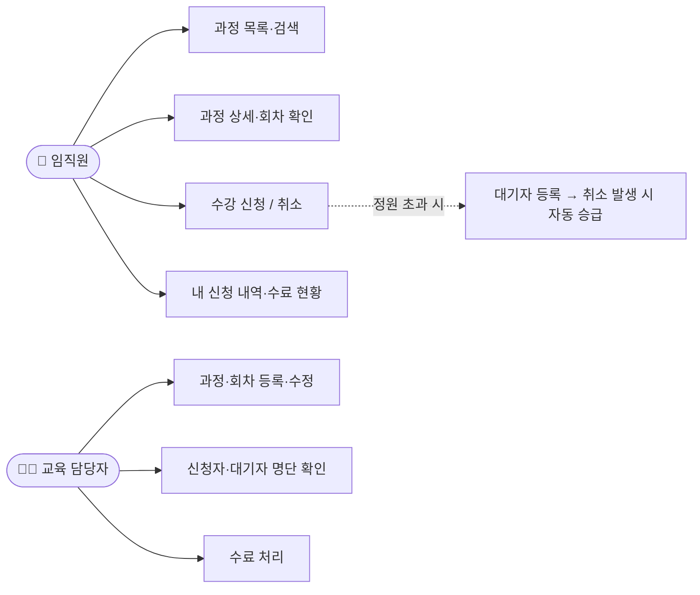

---

## 3-3. 기능 요구사항 (개략)

| ID | 요구사항 | 사용자 | 우선순위 | 주차 |
|---|---|---|---|---|
| FR-01 | 교육과정 목록을 조회하고 제목·분류로 검색한다 (페이지 단위) | 임직원 | 필수 | 2 |
| FR-02 | 과정 상세와 회차(일정, 장소, 정원, 남은 자리)를 조회한다 | 임직원 | 필수 | 2 |
| FR-03 | 관리자는 과정과 회차를 등록·수정·종료한다 | 관리자 | 필수 | 2 |
| FR-04 | 회차에 수강 신청한다. 같은 회차에 중복 신청할 수 없다 | 임직원 | 필수 | 3 |
| FR-05 | 정원이 차면 대기자로 등록되고 대기 순번을 알려 준다 | 임직원 | 필수 | 3 |
| FR-06 | 신청을 취소하면 대기 1순위가 자동으로 신청 확정된다 | 임직원 | 필수 | 3 |
| FR-07 | 내 신청 내역(확정, 대기, 취소, 수료)을 조회한다 | 임직원 | 필수 | 4 |
| FR-08 | 관리자는 회차별 신청자·대기자 명단을 보고 수료 처리한다 | 관리자 | 보통 | 4 |
| FR-09 | 신청 확정·대기 승급 시 알림을 남긴다 (처음에는 로그·DB 기록) | 임직원 | 선택 | 5 |

---

## 3-4. 비기능 요구사항 (개략)

| ID | 분류 | 요구사항 | 확인 방법 |
|---|---|---|---|
| NFR-01 | **정합성** | 동시에 100명이 마지막 1자리에 신청해도 정원을 넘지 않는다 | 동시성 테스트 |
| NFR-02 | **성능** | 과정 목록 API는 데이터 1만 건에서 응답 300ms 이내, N+1 쿼리 없음 | 쿼리 로그, 성능 테스트 |
| NFR-03 | **보안** | 로그인한 사용자만 신청 가능, 본인 신청만 취소 가능, 비밀 정보는 저장소에 두지 않음 | 테스트, 비밀 검사 |
| NFR-04 | **API 계약** | 모든 API는 OpenAPI 문서가 있고, 프론트 클라이언트는 스펙에서 생성한다 | Swagger UI, 생성 스크립트 |
| NFR-05 | **품질** | 서비스 계층 테스트 커버리지 70% 이상, CI에서 빌드·테스트·포맷 검사 | CI 결과 |
| NFR-06 | **운영성** | 개발·테스트·운영 설정 분리, 사람이 직접 실행할 수 있는 빌드·배포·롤백 절차 문서 | 런북, 핫픽스 훈련 |
| NFR-07 | **유지보수성** | 도메인별 패키지(course, enrollment), 계층 규칙 준수, 화면은 MFE로 분리 | 리뷰, 아키텍처 테스트 |
| NFR-08 | **이해도** | 팀원 누구나 AI 없이 구조와 핵심 파일의 역할을 설명할 수 있다 | 발표 시 확인 |

> 💡 NFR-08은 일반 프로젝트에는 없는 이 과정만의 요구사항입니다. 1회차의 **"시스템의 주인은 개발자"** 원칙을 평가 항목으로 만든 것입니다.

---

## 3-5. 기술과 아키텍처

| 영역 | 기술 |
|---|---|
| 백엔드 | Java 21, Spring Boot 3, Spring Data JPA, Hibernate 6, Flyway, springdoc-openapi(Swagger UI) |
| DB | PostgreSQL (개발: Docker, 테스트: Testcontainers) |
| 프론트엔드 | React 18 + TypeScript, Webpack 5 Module Federation, MUI, Axios(OpenAPI로 생성) |
| 빌드·품질 | Gradle(Kotlin DSL), Spotless, JUnit 5, Mockito / Jest, React Testing Library |
| 협업·배포 | GitHub(브랜치·PR), GitHub Actions(CI), 스테이징 배포는 컨테이너 이미지 |

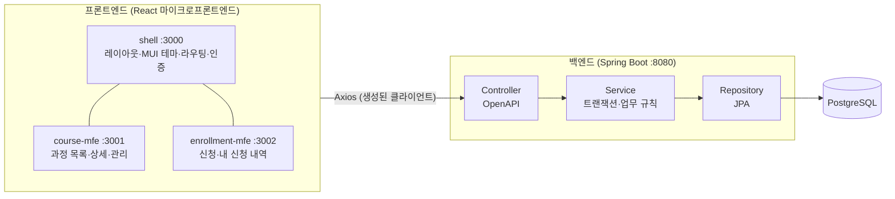

**도메인 모델**

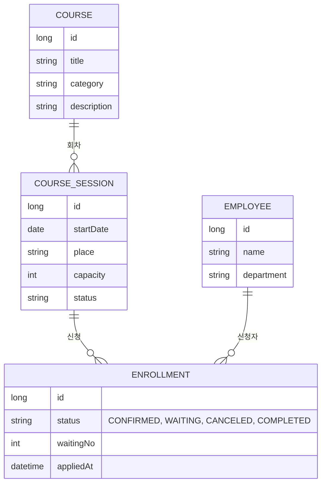

**화면 목록 (개략)**

| 화면 | MFE | 주요 기능 |
|---|---|---|
| 과정 목록 | course-mfe | 검색, 분류 필터, 남은 자리 표시 |
| 과정 상세 | course-mfe | 회차 목록, 신청 버튼 |
| 과정 관리 (관리자) | course-mfe | 과정·회차 등록·수정 |
| 내 신청 내역 | enrollment-mfe | 상태별 목록, 취소 |
| 신청자 명단 (관리자) | enrollment-mfe | 확정·대기 명단, 수료 처리 |

---

## 3-6. 7주 진행 계획

> 2주차(오늘)부터 8주차까지 7주 동안 진행하고, 9주차 캡스톤 발표에서 결과를 보여 줍니다. 매주 배우는 Claude Code 기능을 **그 주의 EduHub 작업에 바로 적용**하는 방식입니다.

| 주 | 주차 | EduHub 목표 | 함께 배우는 Claude Code 기능 (모듈) | 주요 산출물 |
|---|---|---|---|---|
| **1주** | 2주차 (오늘) | 저장소 생성, 요구사항 문서, 백엔드·프론트 뼈대, 첫 CLAUDE.md | 사용 환경, 코드 탐색, 프롬프트 (3, 4, 5) | GitHub 저장소, `docs/requirements.md`, 실행되는 뼈대 |
| **2주** | 3주차 | 과정 조회·관리 API(FR-01~03), 과정 목록 화면 | 기능 개발, GitHub 브랜치·PR, 세션·CLAUDE.md 관리 (6, 7, 8) | 첫 PR, OpenAPI 문서, 테스트 |
| **3주** | 4주차 | 수강 신청·대기자·취소(FR-04~06), 동시성 처리(NFR-01) | 권한 설정, 스킬, 서브에이전트(구현 → 리뷰) (9, 10, 11) | `.claude/settings.json`, 스킬 1개, 리뷰 에이전트 |
| **4주** | 5주차 | 내 신청 내역·명단·수료(FR-07~08), 품질 자동화 | 훅(포맷·테스트·위험 명령 차단), MCP(개발 DB 읽기 전용, GitHub) (12, 13) | 훅 2개, `.mcp.json` |
| **5주** | 6주차 | 마이크로프론트엔드 분리 완성, 알림(FR-09) | 플러그인, 아티팩트(진행 리포트) (14, 15) | 팀 플러그인, 진행 현황 아티팩트 |
| **6주** | 7주차 | CI/CD, 스테이징 배포, 환경 분리 완성(NFR-06) | 사내 프레임워크 적용, 토큰 최적화 측정 (16, 19) | GitHub Actions, 런북, 사용량 리포트 |
| **7주** | 8주차 | 성능 개선(NFR-02), 보안 점검, **AI 없이 핫픽스 훈련** | 헤드리스·CI 자동 리뷰, Agent SDK, 거버넌스 (17, 18, 20) | 성능 리포트, 핫픽스 훈련 기록 |
| — | 9주차 | **캡스톤 발표** | — | 데모, 구조 설명, 직접 수정·빌드 시연 |

---

## 3-7. 어떻게 진행하나

**팀 구성**: 3~4명이 한 팀, 팀마다 저장소 하나. 백엔드·프론트를 나누지 말고 **기능 단위로** 나눠 맡습니다 (모두가 전체 구조를 알도록).

**매주 작업 사이클**

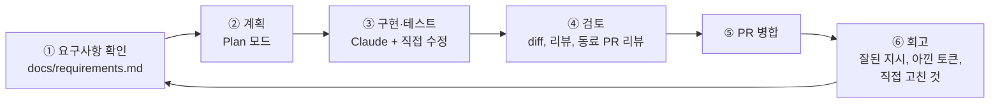

**매주 지키는 규칙**

| 규칙 | 이유 |
|---|---|
| 모든 변경은 **브랜치 → PR → 동료 리뷰** 후 병합 | 실무 협업 방식 연습, AI 결과를 사람이 확인 |
| PR 본문에 "Claude에게 맡긴 것 / 직접 한 것" 한 줄씩 | 직접 할 일과 맡길 일을 의식하는 습관 |
| 주 1회 **"AI 없이 설명하기"**: 이번 주 변경의 구조를 팀원에게 설명 | NFR-08, 시스템의 주인은 개발자 |
| 주간 회고에 `/usage` 결과와 토큰을 아낀 방법 1개 기록 | 토큰 절약 습관을 숫자로 확인 |
| 운영 비밀·운영 접속 정보는 어떤 경우에도 저장소와 대화에 넣지 않음 | 환경 분리 |

**평가 (9주차 캡스톤과 함께)**

| 항목 | 비중 | 보는 것 |
|---|---|---|
| 기능 완성도 | 25% | FR 구현 정도, 동작 데모 |
| 비기능 품질 | 20% | 동시성, 성능, 보안, 테스트 |
| Claude Code 활용 | 20% | CLAUDE.md, 스킬, 훅, 에이전트, MCP의 적절한 사용 |
| 구조 이해도 | 20% | AI 없이 구조 설명, 직접 수정·빌드 시연 |
| 토큰 효율·협업 | 15% | 사용량 기록, PR·리뷰 품질 |

> 💬 **강사 노트:** 요구사항은 "개략"입니다. 세부 규칙(예: 취소 마감 시간, 대기 승급 알림 방식)은 팀이 정하게 합니다. **애매한 요구사항을 Claude에게 질문받으며 구체화하는 경험**도 실습의 일부입니다.

---

## 3-8. 7주 동안 쓰는 Git 작업 방식: 2단계 커밋과 브랜치 → 개발 → 병합

> 7주 동안 모든 변경은 **브랜치에서 개발하고 PR로 병합**합니다. Claude Code가 커밋과 푸시를 대신해 줄 수 있지만, **무엇이 어디에 기록되는지**는 개발자가 알아야 AI의 실수를 잡고 직접 되돌릴 수 있습니다. 자세한 모범 사례는 [GitHub 연결과 버전관리](../examples/06-github-version-control.md)를 봅니다.

---

### 3-8-1. Git의 4개 영역과 "2단계 커밋"

Git에서 변경이 기록되기까지는 **두 단계**를 거칩니다. 먼저 커밋할 변경을 **골라 담고(`git add`, 스테이징)**, 그다음 담은 것을 **한 번에 기록(`git commit`)**합니다. 이것을 흔히 "2단계 커밋"이라고 부릅니다. 그리고 기록은 아직 내 PC에만 있으므로, **`git push`로 GitHub에 올려야** 팀이 볼 수 있습니다.

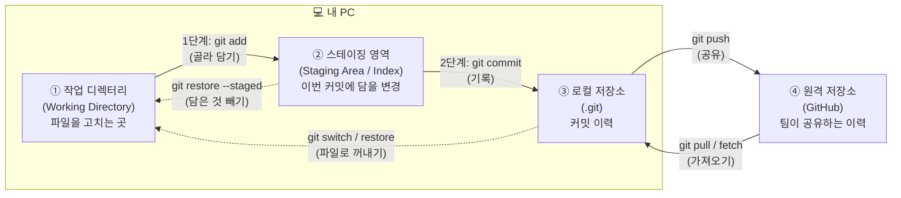

> 💡 **용어 주의**: 데이터베이스·분산 시스템의 **2PC(Two-Phase Commit, 분산 트랜잭션 합의 프로토콜)**와는 다른 개념입니다. Git에서는 "스테이징 → 커밋"의 두 단계를 가리키며, 공식 용어라기보다 설명을 위한 표현입니다.

**왜 굳이 두 단계로 나눌까?**

| 이유 | 설명 | 예 (EduHub) |
|---|---|---|
| **골라 담기** | 고친 파일 중 일부만, 한 파일 안에서도 일부만 커밋할 수 있다 | 기능 코드와 오타 수정이 섞였으면 따로 커밋 (`git add -p`) |
| **커밋 전 검토** | 담은 내용을 `git diff --staged`로 마지막으로 확인할 수 있다 | `.env`나 디버깅용 코드가 들어가지 않았는지 확인 |
| **의미 있는 이력** | 커밋 하나 = 의미 하나. 리뷰와 되돌리기가 쉬워진다 | "백엔드 API"와 "화면"을 별도 커밋 |
| **로컬 기록과 공유 분리** | 커밋은 내 PC 기록이라 푸시 전까지는 정리할 수 있다 | 푸시 전에 커밋 메시지 수정 (`git commit --amend`) |

**파일 상태와 확인 명령**

| `git status`에 보이는 상태 | 뜻 | 다음 할 일 |
|---|---|---|
| Untracked files | Git이 아직 모르는 새 파일 | 커밋할 파일이면 `git add`, 아니면 `.gitignore`에 추가 |
| Changes not staged for commit | 고쳤지만 아직 담지 않음 | `git diff`로 확인 후 `git add` |
| Changes to be committed | 담겨서 커밋을 기다림 | `git diff --staged`로 확인 후 `git commit` |
| Your branch is ahead of 'origin/…' by N commits | 커밋했지만 아직 푸시하지 않음 | `git push` |
| nothing to commit, working tree clean | 모든 변경이 커밋됨 | 다음 작업 |

```bash
# 2단계 커밋의 기본 흐름
git status                  # 무엇이 바뀌었나
git diff                    # 아직 담지 않은 변경 보기
git add backend/src/...     # 1단계: 커밋할 것만 골라 담기 (모르면 git add -p 로 조각 단위)
git diff --staged           # 담은 내용 최종 확인
git commit -m "feat(course): 과정 목록 조회 API 추가"   # 2단계: 기록
git push                    # 공유
```

> ⚠️ **AI와 함께 쓸 때 주의**: Claude에게 "커밋해줘"라고 하면 `git add .`처럼 **전부 담을 수 있습니다.** 처음 몇 주는 커밋 전에 `git status`, `git diff --staged`를 직접 보거나 "커밋 전에 담을 파일 목록을 먼저 보여줘"라고 지시합니다. `.env` 같은 비밀 파일은 `.gitignore`와 권한 설정으로 이중으로 막습니다.

---

### 3-8-2. 브랜치 → 개발 → 병합: GitHub Flow

EduHub는 가장 보편적이고 단순한 **GitHub Flow**를 씁니다. 규칙은 하나입니다: **`main`은 항상 동작하는 상태로 두고, 모든 작업은 브랜치에서 한 뒤 PR로 병합한다.**

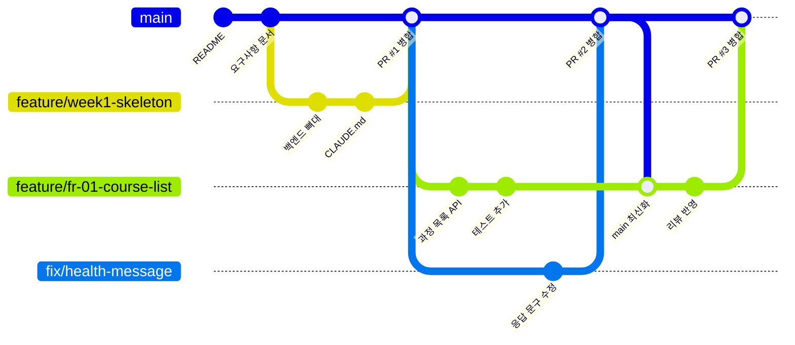

> 그림 읽는 법: 가로선 하나가 브랜치입니다. `main`에서 갈라져 나간 브랜치에서 커밋을 쌓고, PR이 승인되면 다시 `main`으로 합쳐집니다. 작업 중에 `main`이 바뀌었으면 `main`을 내 브랜치로 가져와(최신화) 충돌을 미리 해결합니다.

**작업 하나의 생애 (이슈부터 브랜치 삭제까지)**

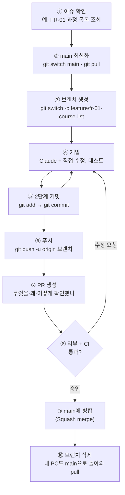

| 단계 | 명령 / 화면 | Claude에게 맡길 때 지시 예 |
|---|---|---|
| ② main 최신화 | `git switch main` → `git pull` | — (직접 하는 편이 빠름) |
| ③ 브랜치 생성 | `git switch -c feature/fr-01-course-list` | "작업 시작 전에 feature/fr-01-course-list 브랜치를 만들어줘" |
| ④ 개발 | 편집기, 테스트 | Plan 모드로 계획 → 구현 |
| ⑤ 커밋 | `git add …` → `git diff --staged` → `git commit` | "백엔드와 테스트를 따로 커밋해줘. 담을 파일 목록을 먼저 보여줘" |
| ⑥ 푸시 | `git push -u origin feature/fr-01-course-list` | "이 브랜치를 푸시해줘" |
| ⑦ PR | GitHub의 **Compare & pull request**, 데스크톱 앱 **Create PR** | "PR 템플릿에 맞춰 PR 본문을 써줘" |
| ⑧ 리뷰·CI | GitHub PR 화면 | "리뷰 코멘트 3개를 반영해줘" |
| ⑨ 병합 | GitHub의 **Squash and merge** 버튼 | **사람이 직접** 누른다 |
| ⑩ 정리 | `git switch main` → `git pull` → `git branch -d …` | — |

---

### 3-8-3. 충돌(conflict)이 나면

두 브랜치가 **같은 파일의 같은 부분**을 다르게 고치면 병합할 때 충돌이 납니다.

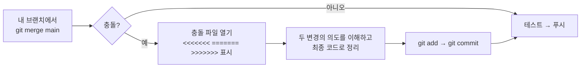

- 충돌은 **오래 떨어져 있던 브랜치**에서 많이 납니다 → 브랜치는 짧게(며칠 이내), 자주 `main`을 가져온다
- Claude에게 "충돌을 해결해줘"라고 맡길 수 있지만, **두 변경의 의도를 아는 사람이 결과를 확인**해야 합니다. 어느 한쪽 변경이 조용히 사라지는 것이 가장 흔한 사고입니다

---

### 3-8-4. 병합 방식 비교

| 방식 | GitHub 버튼 | 결과 | 장점 | 단점 |
|---|---|---|---|---|
| **Merge commit** | Create a merge commit | 브랜치의 커밋이 모두 남고 병합 커밋이 추가됨 | 이력이 그대로 보존 | `main` 이력이 복잡해짐 |
| **Squash merge** | Squash and merge | 브랜치의 커밋을 **하나로 합쳐** `main`에 추가 | `main` 이력이 "PR 하나 = 커밋 하나"로 깔끔. 되돌리기 쉬움 | 브랜치 안의 세부 커밋은 `main`에 남지 않음 |
| **Rebase merge** | Rebase and merge | 브랜치의 커밋을 `main` 끝에 다시 쌓음 | 병합 커밋 없이 일직선 이력 | 이력을 다시 쓰므로 이해하고 써야 함 |

> **EduHub 규칙: Squash merge.** AI와 작업하면 "테스트 수정", "리뷰 반영" 같은 작은 커밋이 많아지는데, `main`에는 PR 단위로 하나씩만 남기는 편이 읽고 되돌리기 쉽습니다.

---

### 3-8-5. 이름 규칙과 보호 설정 (EduHub)

| 항목 | 규칙 | 예 |
|---|---|---|
| 브랜치 | `종류/요구사항ID-짧은-설명` | `feature/fr-04-enroll`, `fix/n-plus-one-course-list`, `chore/gradle-update` |
| 커밋 메시지 | Conventional Commits: `종류(범위): 설명` | `feat(enrollment): 대기자 자동 승급`, `fix(course): 목록 N+1 쿼리 제거`, `test(enrollment): 동시 신청 테스트` |
| PR 제목 | 커밋 메시지와 같은 형식 (Squash 시 그대로 커밋 메시지가 됨) | `feat(course): 과정 목록 조회 API (FR-01)` |
| PR 본문 | 변경 내용, 확인 방법, **Claude에게 맡긴 것 / 직접 한 것** | — |
| `main` 보호 | 직접 푸시·강제 푸시 금지, 리뷰 1명 이상, CI 통과 필수 | GitHub → Settings → Branches(또는 Rules) |

> 💡 **브랜치 보호는 AI 시대의 안전장치입니다.** Claude가 실수로 `main`에 푸시하거나 강제 푸시(`--force`)를 시도해도 GitHub가 막아 줍니다. 보호 설정은 3주차에 함께 켭니다.

---

### 3-8-6. 다른 브랜치 전략과 비교

| 전략 | 구조 | 어울리는 곳 |
|---|---|---|
| **GitHub Flow** ⭐ (EduHub) | `main` + 짧은 작업 브랜치 | 자주 배포하는 웹 서비스, 작은 팀. 가장 단순 |
| **Git Flow** | `main`, `develop`, `feature/*`, `release/*`, `hotfix/*` | 정해진 주기로 버전을 출시하는 제품 (패키지, 설치형 소프트웨어) |
| **Trunk-based** | 모두 `main`(trunk)에 아주 짧은 브랜치로 자주 병합, 미완성 기능은 기능 플래그로 숨김 | CI/CD와 테스트 자동화가 성숙한 팀 |

> 회사 프로젝트가 Git Flow를 쓰더라도 **"브랜치에서 개발 → 검증 → 병합"**이라는 원리는 같습니다. 1회차 원칙 ②의 **긴급 핫픽스**는 `main`(또는 운영 태그)에서 `hotfix/…` 브랜치를 따서 고친 뒤 병합합니다.

---

### 3-8-7. 되돌리기 한눈에

| 상황 | 방법 |
|---|---|
| Claude가 방금 한 수정이 마음에 들지 않음 (커밋 전) | `/rewind` 또는 `git restore 파일` |
| 담은(add) 것을 빼고 싶음 | `git restore --staged 파일` |
| 커밋했지만 아직 푸시 전 | `git commit --amend`(메시지 수정), `git reset --soft HEAD~1`(커밋 취소, 변경은 유지) |
| 이미 푸시해서 공유됨 | `git revert 커밋` → 되돌리는 새 커밋. **공유된 이력은 다시 쓰지 않는다** |
| `main`에 병합된 PR을 되돌려야 함 | GitHub PR 화면의 **Revert** 버튼 → 되돌리는 PR 생성 |

> 💬 **강사 노트:** 3-8-1의 4개 영역 그림과 3-8-2의 gitGraph 그림 두 장만 확실히 이해시키면 됩니다. Git이 처음인 수강생이 있으면 따라하기 ①의 Step 8(브랜치 만들기)과 Step 11(커밋·푸시)에서 이 그림을 다시 띄워 "지금 어느 영역에 있는지" 짚어 줍니다.

---

## ☕ 휴식 (8분)

> 설치가 덜 끝난 사람은 이 시간에 [4-0. 준비물 체크리스트](#4-0-준비물-체크리스트)를 마무리합니다.

---

# 4. 따라하기 ①: 설치부터 첫 요구사항까지

> **목표**: 아무것도 없는 상태에서 시작해 **GitHub 저장소에 EduHub 뼈대를 푸시**합니다.
> 화면 이름과 메뉴 위치는 2026년 10월 Claude Code 공식 문서(Desktop quickstart, Desktop) 기준입니다. 앱 업데이트로 위치가 조금 바뀔 수 있습니다.

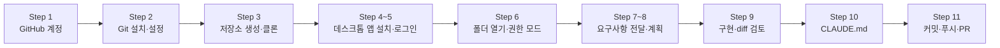

---

## 4-0. 준비물 체크리스트

- [ ] **Claude 유료 요금제 계정**: Pro, Max, Team, Enterprise 중 하나 (Claude Code는 무료 요금제에서 쓸 수 없습니다)
- [ ] **Git** (윈도우는 Git for Windows)
- [ ] **JDK 21**, **Node.js LTS** (EduHub 빌드용)
- [ ] **Docker Desktop** (개발용 PostgreSQL. 3주차부터 필요)
- [ ] (선택) IDE: IntelliJ IDEA 또는 VS Code
- [ ] (선택) GitHub CLI `gh`: 데스크톱 앱에서 PR을 만들거나 PR 상태를 볼 때 필요. 없으면 처음 쓸 때 설치를 안내합니다

```bash
# 설치 확인 (터미널 또는 PowerShell)
git --version
java -version      # 21.x
node -v            # LTS (예: v22.x)
docker --version
```

---

## Step 1. GitHub 계정 만들기

1. https://github.com/signup 에 접속합니다
2. 이메일, 비밀번호, 사용자 이름(username)을 입력하고 이메일 인증을 마칩니다
   - 회사 업무용이면 **회사 정책에 맞는 이메일**을 씁니다 (사내 GitHub Enterprise가 있으면 그 계정을 씁니다)
3. **2단계 인증(2FA)을 켭니다**: Settings → Password and authentication → Two-factor authentication
   - AI 도구에 저장소 권한을 주게 되므로 계정 보안이 더 중요합니다

> ✅ **확인**: 오른쪽 위 프로필 사진을 눌러 내 사용자 이름이 보이면 됩니다.

---

## Step 2. Git 설치와 기본 설정

1. https://git-scm.com/downloads 에서 설치합니다 (윈도우는 Git for Windows, 기본 옵션 그대로)
2. 내 이름과 이메일을 설정합니다. 커밋 작성자로 기록됩니다

```bash
git config --global user.name "홍길동"
git config --global user.email "gildong@example.com"   # GitHub 계정 이메일
git config --global init.defaultBranch main
```

> 💡 데스크톱 앱은 Claude Code를 내장하고 있어 Node.js나 CLI를 따로 설치하지 않아도 됩니다. 하지만 **Git은 필요합니다**. 워크트리(병렬 작업 격리)에 Git을 쓰고, 없으면 "Git is required" 오류가 납니다.

---

## Step 3. GitHub에 저장소를 만들고 내 PC로 가져오기

1. GitHub 오른쪽 위 **+** → **New repository**
2. 다음처럼 입력합니다

| 항목 | 값 |
|---|---|
| Repository name | `eduhub` (팀이면 `eduhub-team1`) |
| Visibility | **Private** |
| Add a README file | **체크** (빈 저장소보다 클론이 쉽습니다) |
| .gitignore | 비워 둠 (나중에 Claude와 함께 만듭니다) |

3. **Create repository** → 초록색 **Code** 버튼 → HTTPS 주소 복사
4. 작업 폴더에서 클론합니다

```bash
mkdir -p ~/workspace && cd ~/workspace
git clone https://github.com/<내-아이디>/eduhub.git
cd eduhub
```

- 처음 클론·푸시할 때 로그인 창이 뜨면 브라우저로 GitHub에 로그인합니다 (윈도우는 Git Credential Manager가 처리)
- `gh`를 설치했다면 `gh auth login`으로 미리 로그인해 두면 편합니다

> ✅ **확인**: `eduhub` 폴더 안에 `README.md`와 숨김 폴더 `.git`이 있으면 됩니다.

---

## Step 4. Claude 데스크톱 앱 설치

1. Claude 공식 다운로드 페이지(https://claude.com/download)에서 내 운영체제용 앱을 받습니다
   - macOS: Intel과 Apple Silicon 공용 DMG
   - Windows: x64용 설치 파일 (ARM64는 별도 설치 파일)
   - Linux: 베타
2. 설치 후 실행합니다

> 💡 터미널이 익숙한 사람은 CLI(`claude`)로 같은 과정을 진행해도 됩니다. CLAUDE.md, 설정, 스킬은 데스크톱 앱과 CLI에 똑같이 적용됩니다. ([사용 환경과 터미널 도구](../examples/14-environments-and-terminals.md))

---

## Step 5. 로그인하고 Code 탭 열기

1. 앱을 실행하고 **Anthropic 계정으로 로그인**합니다
2. 사이드바 위쪽의 **Code** 탭을 누릅니다
3. 요금제 업그레이드 안내가 나오면 Claude Code를 쓸 수 있는 요금제(Pro, Max, Team, Enterprise)인지 확인합니다

| 증상 | 확인할 것 |
|---|---|
| 업그레이드 안내가 뜬다 | 무료 요금제 계정으로 로그인했는지 확인 |
| 로그인 오류, 403 | 회사 계정(Team/Enterprise)이면 관리자가 Claude Code 사용을 허용했는지 확인 |
| 회사 계정과 개인 계정이 섞임 | 로그아웃 후 교육에 쓸 계정으로 다시 로그인 |

---

## Step 6. 프로젝트 폴더 열기와 권한 모드 고르기

1. 입력창 아래 줄의 **환경 선택**에서 **Local**을 고릅니다
   - Local: 내 PC에서 실행 (내 파일, 내 Docker, 사내망 접근 가능)
   - Cloud: Anthropic 클라우드에서 실행 (앱을 닫아도 계속, GitHub 연결 필요). 오늘은 쓰지 않습니다
2. 그 옆의 **폴더 선택** → **Open folder…** → Step 3에서 클론한 `eduhub` 폴더를 고릅니다
3. 같은 줄의 **권한 모드**를 고릅니다

| 모드 | 동작 | 오늘의 사용 |
|---|---|---|
| **Manual** | 파일 수정·명령 실행마다 승인 요청 | ⭐ 처음에는 이것으로 시작 (무엇을 하려는지 보면서 배우기) |
| **Plan** | 읽기와 계획만, 수정하지 않음 | Step 7~8 요구사항 분석과 계획 |
| **Accept edits** | 파일 수정은 자동 승인, 명령은 확인 | 계획에 합의한 뒤 구현할 때 |
| Auto, Bypass | 더 적게 묻거나 묻지 않음 | 오늘은 쓰지 않음 (Bypass는 격리된 환경에서만) |

> ✅ **확인**: 입력창에 `이 폴더에 어떤 파일이 있어?`라고 물어 `README.md`가 보이면 연결이 끝난 것입니다.

---

## 잠깐: 마크다운 기본 (5분)

Step 7부터 쓰는 요구사항 문서, CLAUDE.md, PR 본문은 모두 **마크다운(.md)**입니다. 제목·목록·표로 구조를 나누면 사람도 읽기 쉽고 **Claude도 지시와 규칙을 정확히 구분**합니다. 오늘은 가장 자주 쓰는 문법만 익히고, 자세한 내용은 [마크다운 작성 가이드](../examples/30-markdown-guide.md)를 봅니다.

| 쓰임 | 이렇게 쓴다 | 이렇게 보인다 / 요령 |
|---|---|---|
| **제목** | `# 문서 제목`, `## 절`, `### 소절` | `#` 뒤에 한 칸 띄우기. `#`은 문서에 하나 |
| **글머리 목록** | `- 항목`, 하위는 두 칸 들여쓰고 `- 하위` | 순서 없는 나열 (규칙, 특징). 기호는 `-`로 통일 |
| **번호 목록** | `1. 첫째`, `2. 둘째` | 순서가 있는 절차 |
| **체크리스트** | `- [ ] 할 일`, `- [x] 한 일` | GitHub에서 클릭해 체크 가능. 과제·PR 확인 항목 |
| **강조** | `**굵게**` | 핵심 단어만 |
| **인라인 코드** | `` `./gradlew test` `` | 파일명, 명령, 클래스명은 항상 백틱으로 |
| **코드 블록** | ```` ```bash ```` … ```` ``` ```` | 여는 백틱 뒤에 언어 이름 (`java`, `bash`, `yaml`) |
| **링크** | `[1회차 자료](./session-01-introduction.md)` | 저장소 안 문서는 **상대 경로** |
| **인용(참고 문단)** | `> 💡 참고할 내용` | 주의·참고를 눈에 띄게 |
| **구분선** | `---` (앞뒤 빈 줄) | 큰 주제 나누기 |

**표 쓰는 법** (요구사항 정리에 가장 많이 씁니다)

```markdown
| ID | 요구사항 | 우선순위 |
|---|---|:---:|
| FR-01 | 과정 목록을 조회하고 검색한다 | 필수 |
| FR-02 | 과정 상세와 회차를 조회한다 | 필수 |
```

| ID | 요구사항 | 우선순위 |
|---|---|:---:|
| FR-01 | 과정 목록을 조회하고 검색한다 | 필수 |
| FR-02 | 과정 상세와 회차를 조회한다 | 필수 |

- 첫 줄은 머리글, **둘째 줄 `|---|`은 꼭 있어야** 표가 됩니다. `:---:`은 가운데 정렬
- 표 **위아래에 빈 줄**을 둡니다. 칸 안에서 줄을 바꾸려면 `<br>`
- 줄마다 `|` 개수(칸 수)를 맞춥니다

**자주 하는 실수 3가지**: `#제목`(공백 없음), 표 앞에 빈 줄 없음, 코드 블록을 닫지 않음

> 💡 **미리보기로 확인하는 습관**: VS Code `Ctrl+Shift+V`(Mac `Cmd+Shift+V`), IntelliJ는 편집기 옆 미리보기, GitHub는 **Preview** 탭. Claude에게 "표로 정리해줘", "체크리스트로 만들어줘"처럼 **형식을 지정**하면 원하는 모양으로 받을 수 있습니다.

---

## Step 7. 요구사항 문서를 저장소에 넣기

Claude에게 요구사항을 줄 때 **대화창에 길게 붙여넣기보다 파일로 저장**하는 것이 좋습니다. 다음 세션에서도 다시 쓸 수 있고, 팀원과 공유되고, 필요한 부분만 `@`로 참조할 수 있기 때문입니다.

1. `eduhub/docs/requirements.md` 파일을 만들고 (바로 위 [마크다운 기본](#잠깐-마크다운-기본-5분)의 제목·표 문법으로) [3-3. 기능 요구사항](#3-3-기능-요구사항-개략)과 [3-4. 비기능 요구사항](#3-4-비기능-요구사항-개략) 표를 복사해 넣습니다
2. 맨 위에 프로젝트 개요와 기술 스택을 몇 줄 적습니다

```markdown
# EduHub 요구사항

## 개요
임직원이 사내 교육과정을 조회·신청하고, 정원이 차면 대기자로 등록되는 시스템.

## 기술 스택
- 백엔드: Java 21, Spring Boot 3, Spring Data JPA, Flyway, springdoc-openapi, PostgreSQL
- 프론트엔드: React 18 + TypeScript, Module Federation(shell, course-mfe, enrollment-mfe), MUI, Axios
- 빌드: Gradle(Kotlin DSL), npm workspaces

## 기능 요구사항
(3-3 표 붙여넣기)

## 비기능 요구사항
(3-4 표 붙여넣기)
```

> 💡 이 파일은 **직접 만드는 것**을 권합니다. 표를 복사하는 일은 Claude에게 설명하는 것보다 빠릅니다 (토큰 습관 8번).

---

## Step 8. 첫 요구사항 전달: Plan 모드로 계획부터

**먼저 작업 브랜치를 만듭니다** ([3-8-2](#3-8-2-브랜치--개발--병합-github-flow)의 ③). `main`에서 바로 작업하지 않는 습관을 첫날부터 들입니다.

```bash
git switch -c feature/week1-skeleton
git branch --show-current     # feature/week1-skeleton 이 보이면 OK
```

> 💡 Claude에게 "작업 전에 feature/week1-skeleton 브랜치를 만들어줘"라고 맡겨도 됩니다. 데스크톱 앱 화면이나 `git branch --show-current`로 지금 브랜치를 꼭 확인합니다.

그다음 권한 모드를 **Plan**으로 바꾸고 다음처럼 지시합니다.

```text
@docs/requirements.md 를 읽고 EduHub 프로젝트의 1주차 작업을 계획해줘.

[이번 범위]
- backend: Spring Boot 프로젝트 뼈대 (Gradle Kotlin DSL, Java 21)
  - 패키지: com.example.eduhub, 도메인 패키지 course, enrollment, common
  - GET /api/health 하나와 그 테스트
  - 프로필: application.yml, application-dev.yml(로컬 PostgreSQL), application-test.yml
- 루트 .gitignore (Java, Node, IDE, .env)와 .env.example

[이번에 하지 않는 것]
- 프론트엔드, 엔티티, 실제 API (다음 주에 한다)

[완료 기준]
- backend 폴더에서 ./gradlew test 통과

[진행 방식]
- 먼저 만들 파일 목록과 각 파일의 역할을 보여줘. 요구사항에서 애매한 점이 있으면 질문해줘.
```

**이 지시에서 볼 점**

| 요소 | 왜 넣었나 |
|---|---|
| `@docs/requirements.md` | 요구사항 전체를 붙여넣지 않고 파일로 참조 |
| 이번 범위 / 하지 않는 것 | 범위를 좁혀야 결과를 검토할 수 있다. "다 만들어줘"는 검토 불가능한 거대한 diff가 된다 |
| 완료 기준 | Claude가 스스로 테스트를 돌려 확인한다 |
| 질문해줘 | 애매한 부분을 Claude가 마음대로 정하지 않게 한다 |

**계획을 받으면 이렇게 검토합니다**
- 패키지 구조가 내가 생각한 것과 같은가? (원칙 ① 구조는 개발자가 통제)
- 필요 없는 라이브러리를 넣지 않았는가?
- 바꾸고 싶은 점은 그대로 말합니다: `Lombok은 쓰지 말고, 테스트는 JUnit 5만 써줘`

> 💬 **강사 노트:** 수강생마다 계획이 조금씩 다르게 나옵니다. 두세 명의 계획을 화면에 띄워 비교하며 "어느 쪽이 우리 요구사항에 맞나"를 짧게 토론합니다.

---

## Step 9. 구현하고 diff 검토하기

1. 계획에 합의했으면 권한 모드를 **Accept edits**로 바꾸고 `좋아, 이 계획대로 구현해줘`라고 지시합니다
   - Manual 모드를 유지하면 수정마다 승인 창이 뜹니다. 무엇을 하는지 보고 싶으면 Manual도 좋습니다
2. Claude가 `./gradlew test`를 실행하려 하면 명령 내용을 확인하고 허용합니다
3. 작업이 끝나면 **Changes 카드**의 `+12 -1` 같은 변경 줄 수를 눌러 diff를 엽니다
4. 고칠 곳이 있으면 해당 줄을 눌러 코멘트를 달고, 여러 코멘트를 모아 **Cmd+Enter(macOS) / Ctrl+Enter(Windows)**로 한 번에 보냅니다

**diff 검토 체크리스트 (1주차용)**

- [ ] 요청하지 않은 파일이나 기능이 추가되지 않았는가?
- [ ] `application-dev.yml`에 실제 비밀번호가 들어가지 않았는가? (`${DB_PASSWORD}`처럼 환경 변수로)
- [ ] `.gitignore`에 `.env`가 들어 있는가?
- [ ] 테스트가 실제로 실행되어 통과했는가? (Claude의 "통과했습니다" 말이 아니라 실행 결과로 확인)

5. **직접 고쳐 보기**: `HealthController`의 응답 문구 하나를 IDE나 편집기에서 직접 바꾸고, Claude에게 `방금 HealthController 응답 문구를 직접 바꿨어. 테스트만 다시 돌려줘`라고 알립니다

> ✅ **확인**: `cd backend && ./gradlew test`를 **내 터미널에서 직접** 실행해 통과하는지 봅니다. 빌드를 사람이 직접 돌릴 수 있어야 합니다 (원칙 ②).

---

## Step 10. CLAUDE.md 만들기

뼈대가 생겼으니 Claude가 프로젝트를 분석할 수 있습니다. 입력창에 `/init`을 입력합니다.

- Claude가 코드를 분석해 `CLAUDE.md` 초안을 만듭니다 (이미 있으면 덮어쓰지 않고 개선점을 제안)
- 초안을 그대로 두지 말고 **우리 팀 규칙을 짧게 추가**합니다

```markdown
## 팀 규칙
- 요구사항은 docs/requirements.md를 기준으로 한다
- 백엔드 빌드·테스트: cd backend && ./gradlew test
- 계층 규칙: Controller → Service → Repository. Controller에서 Repository 직접 호출 금지
- 엔티티를 API 응답으로 그대로 반환하지 않는다 (DTO 사용)
- 비밀 정보는 코드와 설정 파일에 쓰지 않는다. 환경 변수와 .env(커밋 금지)만 사용
```

> 💡 CLAUDE.md는 **매 세션 시작마다 읽히므로** 짧게 유지합니다 (200줄 이내). "Claude가 코드만 보고 알 수 있는 것"은 쓰지 않습니다.

---

## Step 11. 커밋, 푸시, 그리고 PR

**방법 A: Claude에게 맡기기**

```text
지금까지 변경을 커밋하고 푸시해줘.
- 커밋 전에 담을 파일 목록을 먼저 보여줘 (.env가 없는지 확인할게)
- 요구사항 문서와 백엔드 뼈대는 별도 커밋으로 나눠줘
- 커밋 메시지는 Conventional Commits 형식으로
```

- 데스크톱 앱의 **Create PR** 기능으로 PR을 만들 수 있습니다. `gh`가 없으면 처음 쓸 때 설치를 안내합니다

**방법 B: 직접 하기** (한 번은 꼭 직접 해 봅니다. [3-8-1의 2단계 커밋](#3-8-1-git의-4개-영역과-2단계-커밋)을 떠올리며)

```bash
git branch --show-current          # feature/week1-skeleton 인지 확인
git status                         # 무엇이 바뀌었는지 직접 확인

# 커밋 1: 요구사항 문서
git add docs/requirements.md       # 1단계: 골라 담기
git diff --staged                  # 담은 내용 확인
git commit -m "docs: EduHub 요구사항 문서 추가"   # 2단계: 기록

# 커밋 2: 백엔드 뼈대와 설정
git add backend CLAUDE.md .gitignore .env.example
git status                         # .env 가 담기지 않았는지 확인
git commit -m "feat(backend): Spring Boot 뼈대와 health API 추가"

git log --oneline                  # 커밋 이력 확인
git push -u origin feature/week1-skeleton          # 공유
```

그다음 GitHub 저장소 화면의 **Compare & pull request** 버튼으로 PR을 만들고, 팀원(또는 강사)의 리뷰를 받은 뒤 **Squash and merge**로 병합합니다. 병합 후에는 내 PC도 정리합니다.

```bash
git switch main
git pull                           # 병합된 main 가져오기
git branch -d feature/week1-skeleton
```

> ✅ **최종 확인**: GitHub에 PR이 생기고, 파일 목록에 `docs/requirements.md`, `backend/`, `CLAUDE.md`, `.gitignore`가 보이면 따라하기 ①이 끝난 것입니다. `.env`가 올라가지 않았는지 꼭 확인합니다.

---

## 4-11. 자주 겪는 문제

| 증상 | 원인과 해결 |
|---|---|
| "Git is required" | Git 미설치. Git(윈도우는 Git for Windows)을 설치하고 앱을 다시 시작 |
| 푸시할 때 인증 실패 | 브라우저 로그인 창이 떴는지 확인. `gh auth login` 또는 Git Credential Manager로 다시 로그인 |
| `./gradlew` 권한 오류 (Mac/Linux) | `chmod +x gradlew` (Claude에게 맡겨도 되지만 직접 하는 편이 빠르다) |
| `java -version`이 21이 아님 | JDK 21 설치 후 `JAVA_HOME` 확인 |
| Claude가 범위 밖 작업까지 함 | `Esc`로 멈추고 "이번 범위는 X까지만"이라고 다시 지시. 이미 진행됐으면 `/rewind` |
| 회사 프록시 때문에 Gradle 다운로드 실패 | 사내 프록시·미러 설정 필요. 강사나 사내 담당자에게 문의 |

---

# 5. 따라하기 ②: 주요 명령어 체험

> **목표**: 명령어를 "읽어서 아는 것"이 아니라 **써 보고 차이를 느끼는 것**. 각 실습의 "관찰할 점"을 아래 [체험 기록표](#5-9-체험-기록표)에 적습니다.
> 데스크톱 앱의 Code 탭에서는 입력창에 `/`를 입력하거나 **+ → Slash commands**로 명령 목록을 볼 수 있습니다. 전체 설명은 [주요 명령어](../examples/16-commands.md)를 봅니다.

| 명령 | 한 줄 설명 |
|---|---|
| `/context` | 지금 컨텍스트를 무엇이 얼마나 차지하는지 |
| `/usage` | 세션 사용량과 요금제 한도 (`/cost`는 별칭) |
| `/compact [남길 내용]` | 대화를 요약해 공간 확보 |
| `/clear` | 새 대화로 시작 (CLAUDE.md 같은 프로젝트 지침은 그대로) |
| `/rewind` 또는 `Esc` 두 번 | 이전 시점으로 코드·대화 되돌리기 |
| `/btw 질문` | 작업 흐름에 기록을 남기지 않는 곁가지 질문 |
| `/model`, `/effort` | 모델과 추론 수준 바꾸기 |
| `/plan [설명]` | Plan 모드로 들어가 계획부터 |
| `/diff` | 지금까지의 변경 확인 |
| `/memory` | CLAUDE.md 열어 수정하기 |
| `@파일` | 파일을 지정해 참조 |
| `!명령` | 셸 명령을 직접 실행하고 결과를 대화에 넣기 |

---

## 5-1. `/context`: 컨텍스트 들여다보기 (3분)

1. `/context`를 입력하고 지금 사용량을 봅니다
2. `backend 폴더의 모든 파일을 읽고 구조를 설명해줘`라고 지시합니다
3. 다시 `/context`를 입력합니다

**관찰할 점**: 어느 항목이 가장 많이 늘었나? (보통 도구 결과, 즉 읽은 파일 내용) → 1회차의 "컨텍스트 = 작업 기억"이 실제로 이렇게 채워진다는 것을 확인합니다.

---

## 5-2. `/compact`: 요약해서 이어가기 (3분)

1. 5-1에 이어서 `/compact 패키지 구조와 health API 설명만 남겨줘`를 입력합니다
2. `/context`로 사용량이 얼마나 줄었는지 봅니다
3. `health API는 어떤 클래스에 있었지?`라고 물어 핵심이 남아 있는지 확인합니다

**관찰할 점**: 사용량이 얼마나 줄었나? 남기라고 한 내용은 기억하는가? 남기라고 하지 않은 세부 내용은 어떻게 되었나?

> 💡 `/compact`는 **같은 작업을 계속할 때** 씁니다. 요약하는 것도 사용량을 쓰므로, 작업이 바뀌면 `/clear`가 더 낫습니다.

---

## 5-3. `/clear`: 깨끗하게 새로 시작 (2분)

1. `/clear`를 입력합니다
2. `방금 우리가 무슨 이야기를 했지?`라고 묻습니다
3. `이 프로젝트의 빌드 명령이 뭐야?`라고 묻습니다

**관찰할 점**: 대화 내용은 기억하지 못하지만 **CLAUDE.md에 적은 빌드 명령은 알고 있다** → 오래 남아야 하는 정보는 대화가 아니라 CLAUDE.md에 둬야 하는 이유입니다.

---

## 5-4. `/rewind`: 되돌리기 (3분)

1. `HealthController 응답에 version 필드를 추가해줘`라고 지시하고 수정이 끝날 때까지 기다립니다
2. `Esc`를 두 번 누르거나(입력창이 비어 있을 때) `/rewind`를 입력합니다
3. 방금 지시하기 전 시점을 고르고 **코드와 대화 모두 복원**을 선택합니다
4. 파일이 원래대로 돌아왔는지 확인합니다

**관찰할 점**: 코드와 대화가 함께 돌아왔는가?

> ⚠️ **체크포인트의 한계**: Claude의 파일 편집 도구로 바꾼 내용만 되돌립니다. `rm`, `mv`나 빌드 스크립트처럼 **셸 명령으로 바뀐 파일은 추적하지 않습니다.** 체크포인트는 Git을 대신하지 않으므로 의미 있는 단위마다 커밋합니다.

---

## 5-5. `@`와 `!`: 정확히 가리키고, 직접 실행하기 (2분)

1. `@`를 입력하고 파일 이름 일부를 타이핑해 자동 완성으로 `HealthController.java`를 고른 뒤 `이 파일의 테스트가 무엇을 검증하는지 설명해줘`라고 묻습니다
2. `!git status`를 입력합니다 → 명령이 바로 실행되고 결과가 대화에 들어갑니다

**관찰할 점**: `@`로 위치를 알려 주면 Claude가 파일을 찾는 과정이 생략된다. `!`는 Claude에게 "실행해줘"라고 부탁하는 것보다 빠르다.

---

## 5-6. `/btw`: 흐름을 깨지 않는 곁가지 질문 (1분)

1. `/btw Spring의 @Transactional readOnly 옵션이 뭐야?`라고 묻습니다

**관찰할 점**: 답은 받았지만 작업 대화 기록에는 남지 않는다 → 작업과 관계없는 질문으로 컨텍스트를 더럽히지 않는 방법입니다.

---

## 5-7. `/model`과 `/effort`: 모델과 추론 수준 (2분)

1. `/model`을 입력해 지금 모델과 고를 수 있는 모델을 봅니다
2. `/effort`로 추론 수준을 확인합니다
3. 바꿔 보는 것은 **`/clear` 직후**에 합니다 (세션 중간에 모델을 바꾸면 프롬프트 캐시를 처음부터 다시 쌓습니다)

**관찰할 점**: 내 기본 모델은 무엇인가? 1회차 [6-2](./session-01-introduction.md#6-2-claude-code에서-쓸-수-있는-모델과-선택-기준) 기준으로 오늘 같은 뼈대 작업에는 어떤 모델이 적당했을까?

---

## 5-8. `/usage`: 오늘 쓴 양 확인 (1분)

1. `/usage`를 입력해 이번 세션 사용량과 요금제 한도를 봅니다

**관찰할 점**: 오늘 실습에서 가장 많이 쓴 단계는 어디였을까? (보통 넓은 탐색과 구현)

> 💡 그 밖에 `/diff`(변경 확인), `/memory`(CLAUDE.md 수정), `/plan`(계획부터 시작)도 시간이 남으면 써 봅니다. 이전 대화로 돌아가는 `/resume`과 대화 이름을 붙이는 `/rename`은 터미널(CLI)에서 주로 씁니다. 데스크톱 앱에서는 사이드바의 세션 목록에서 이전 세션을 엽니다.

---

## 5-9. 체험 기록표

| 명령 | 해 본 것 | 관찰한 것 (숫자나 한 줄) | 언제 쓰면 좋을까 |
|---|---|---|---|
| `/context` | | 예: 파일 읽기 후 ○○% → ○○% | |
| `/compact` | | | |
| `/clear` | | | |
| `/rewind` | | | |
| `@`, `!` | | | |
| `/btw` | | | |
| `/model`, `/effort` | | | |
| `/usage` | | | |

> 💬 **강사 노트:** 2~3명에게 "가장 의외였던 것"을 묻습니다. 보통 "`/clear` 뒤에도 CLAUDE.md 내용은 안다", "파일 몇 개 읽었을 뿐인데 컨텍스트가 많이 늘었다"가 나옵니다.

---

# 6. 더 해 보기 (시간이 남으면 수업 중, 아니면 과제)

---

## 6-1. 토큰 절약 체험: 막연한 지시 vs 구체적인 지시

같은 일을 두 방식으로 시키고 사용량을 비교합니다. 각 시도 전에 `/clear`합니다.

| 시도 | 지시 | 기록 |
|---|---|---|
| A (막연하게) | `프로젝트에 로깅 좀 추가해줘` | `/context` 사용량, 바뀐 파일 수, 내 마음에 들었나 |
| B (구체적으로) | `@backend/.../HealthController.java 에 요청이 오면 INFO 로그 한 줄을 남겨줘. SLF4J를 쓰고, 다른 파일은 건드리지 마. 완료 기준: ./gradlew test 통과` | 같은 항목 |
| C (직접) | IDE에서 직접 로그 한 줄 추가 | 걸린 시간 |

**정리 질문**: 어느 쪽이 빠르고, 싸고, 결과가 정확했나? C가 가장 나은 작업은 어떤 작업인가?

> 끝나면 `/rewind`나 `git restore`로 원래대로 돌립니다.

---

## 6-2. 환경 분리 맛보기

1. Plan 모드에서 다음처럼 지시합니다

```text
개발·테스트·운영 환경 설정을 분리하려고 해.
- application-dev.yml: 로컬 Docker PostgreSQL (접속 정보는 .env의 환경 변수)
- application-test.yml: Testcontainers
- application-prod.yml: 모든 접속 정보는 환경 변수로만, 기본값 없이
- .env.example에 필요한 변수 이름만 (값 없이)
현재 설정을 보고 무엇을 바꿔야 하는지 계획만 보여줘.
```

2. 계획을 검토하고 구현하게 한 뒤 diff를 확인합니다
3. 프로젝트 설정 파일 `.claude/settings.json`에 비밀 파일 읽기 금지 규칙을 넣어 봅니다

```json
{
  "permissions": {
    "deny": [
      "Read(./.env)",
      "Read(./.env.*)",
      "Read(./backend/src/main/resources/application-prod.yml)"
    ]
  }
}
```

4. 새 세션에서 `.env 파일 내용을 보여줘`라고 해 보고, 거부되는지 확인합니다

> 💡 권한 규칙은 3주차(모듈 9)에서 자세히 다룹니다. 오늘은 **"CLAUDE.md에 쓰는 부탁"과 "권한으로 막는 강제"의 차이**를 체감하는 것이 목표입니다. ([권한](../examples/23-permissions.md))

---

## 6-3. 코드베이스 탐색 연습 (모듈 4 맛보기)

뼈대가 작아도 질문하는 연습은 할 수 있습니다.

```text
1. 이 프로젝트를 처음 보는 사람에게 5줄로 설명해줘
2. /api/health 요청이 들어오면 어떤 클래스를 거쳐 응답하는지 순서대로 알려줘
3. 내가 docs/requirements.md의 FR-01을 구현하려면 어떤 파일을 새로 만들어야 할까? 코드는 쓰지 말고 목록만
```

**관찰할 점**: 3번처럼 **"코드는 쓰지 말고"**를 붙이면 탐색과 설명만 하게 할 수 있습니다. 1회차 7-5의 "AI로 원인·위치 파악 → 직접 수정" 패턴의 기본입니다.

---

# 7. 정리

---

## 7-1. 오늘의 핵심

1. **토큰 습관**: 한 세션 = 한 작업, 위치를 알려 주기, 계획부터, 이상하면 바로 멈추기, 간단한 건 직접
2. **AI는 How, 개발자는 What·Why·Where**: 테스트가 통과해도 아키텍처 지식이 있어야 문제가 보인다
3. **환경 분리**: Claude Code는 개발·테스트까지. 운영은 사람 승인과 파이프라인으로만
4. **EduHub 7주**: 매주 배운 기능을 바로 적용, 모든 변경은 PR, 매주 "AI 없이 설명하기"
5. **요구사항은 파일로, 지시는 범위·완료 기준과 함께, 결과는 diff와 직접 실행으로 확인**
6. **Git은 2단계 커밋(add → commit) 후 push**, 작업은 **브랜치 → 개발 → PR → 병합**. `main`은 항상 동작하는 상태로

---

## 7-2. 확인 퀴즈

1. 하루 종일 같은 세션에서 여러 작업을 하면 왜 비용과 품질이 모두 나빠질까?
2. `/compact`와 `/clear`는 각각 언제 쓰는가?
3. `/clear` 뒤에도 Claude가 빌드 명령을 알고 있었던 이유는?
4. 2-3의 수강 신청 코드에서 테스트가 통과해도 남아 있는 문제 두 가지와, 그것을 찾는 데 필요한 지식은?
5. Claude Code가 운영 DB에 접근하면 안 되는 이유 세 가지는?
6. 요구사항을 대화창에 붙여넣지 않고 `docs/requirements.md` 파일로 두는 장점은?
7. `/rewind`로 되돌릴 수 없는 변경은? 그래서 무엇을 함께 써야 하나?
8. Git의 "2단계 커밋"에서 두 단계는 무엇이고, 나눠 두면 무엇이 좋은가? 커밋만 하고 푸시하지 않으면 팀원에게 보일까?
9. EduHub에서 기능 하나를 개발해 `main`에 반영하기까지의 순서는?

<details>
<summary>정답 보기</summary>

1. 매 턴마다 대화 전체가 다시 전달되어 비용이 커지고, 관련 없는 내용이 쌓여 중요한 지시가 묻히기 때문
2. `/compact`: 같은 작업을 계속하는데 컨텍스트가 커졌을 때(남길 내용 지정). `/clear`: 작업이 바뀌었을 때
3. CLAUDE.md는 대화가 아니라 세션이 시작될 때마다 읽히는 프로젝트 지침이기 때문
4. 예: 동시 신청 시 정원 초과(동시성·트랜잭션·락), 다른 사람 이름으로 신청 가능(인증·인가), 엔티티 직접 노출(JPA·API 설계), `Optional.get()`으로 500 에러(예외 처리·HTTP)
5. 잘못된 명령 하나가 장애·데이터 손실로 이어짐, 프롬프트 인젝션으로 의도하지 않은 명령이 실행될 수 있음, 운영 데이터(개인정보)가 AI 도구로 전송되어 정책 위반이 될 수 있음
6. 다음 세션과 팀원이 다시 쓸 수 있고, `@`로 필요할 때만 참조해 토큰을 아끼며, 변경 이력이 Git에 남는다
7. 셸 명령(`rm`, `mv`, 빌드 스크립트 등)으로 바뀐 파일, 외부에서 바꾼 파일. 그래서 의미 있는 단위마다 **Git 커밋**을 함께 쓴다
8. 1단계 `git add`(스테이징에 골라 담기), 2단계 `git commit`(로컬 저장소에 기록). 일부만 골라 의미 있는 단위로 커밋하고, `git diff --staged`로 커밋 전에 검토할 수 있다. 커밋은 내 PC에만 있으므로 `git push` 전에는 팀원에게 보이지 않는다
9. main 최신화 → 브랜치 생성 → 개발·테스트 → 2단계 커밋(반복) → 푸시 → PR → 리뷰·CI → Squash merge → 브랜치 삭제와 main pull

</details>

---

## 7-3. 과제 (다음 회차 전까지)

- [ ] 따라하기 ①을 끝내지 못했다면 **PR 생성까지** 완료
- [ ] 6-1 토큰 절약 체험과 6-2 환경 분리 맛보기를 하고 결과를 PR 본문이나 팀 채널에 공유
- [ ] 팀원 PR 하나를 리뷰하고 코멘트 1개 이상 남기기
- [ ] 팀에서 요구사항의 애매한 점 3가지를 골라 결정하고 `docs/requirements.md`에 반영 (예: 취소 마감 시점, 대기 인원 상한, 수료 기준)
- [ ] [마크다운 작성 가이드](../examples/30-markdown-guide.md)의 실습 1~2로 `docs/requirements.md`와 CLAUDE.md 다듬기
- [ ] 1주차 회고 한 줄: Claude에게 맡긴 것 / 직접 한 것 / 아낀 토큰 방법

## 7-4. 다음 회차 예고

**3주차: 기능 개발과 GitHub 협업 (모듈 6, 7, 8)**
- EduHub 과정 조회·관리 API(FR-01~03)와 과정 목록 화면
- 브랜치 전략, PR 리뷰, 충돌 해결을 Claude와 함께
- 세션 관리와 CLAUDE.md 다듬기

**미리 읽어 오면 좋은 자료**
- [GitHub 연결과 버전관리 모범사례](../examples/06-github-version-control.md)
- [프로젝트·디렉토리·세션](../examples/15-project-directory-session.md)
- [CLAUDE.md 작성](../examples/02-claude-md.md)

---

## 참고 자료

- Claude Code 공식 문서 (2026년 10월 확인): Desktop quickstart, Desktop, Commands, Interactive mode, Checkpointing, Memory, Permission modes — https://code.claude.com/docs
- 교육 저장소: [1회차 자료](./session-01-introduction.md), [마크다운 작성 가이드](../examples/30-markdown-guide.md), [샘플 프로젝트 EduHub](../examples/00-sample-project.md), [토큰 최적화](../examples/08-token-optimization.md), [개발자의 책임](../examples/27-developer-responsibility.md), [주요 명령어](../examples/16-commands.md), [사용 환경과 터미널 도구](../examples/14-environments-and-terminals.md), [권한](../examples/23-permissions.md)
