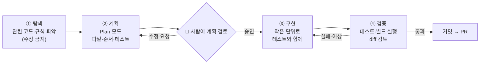
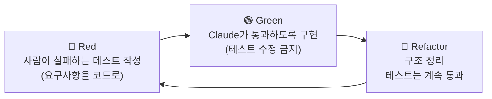
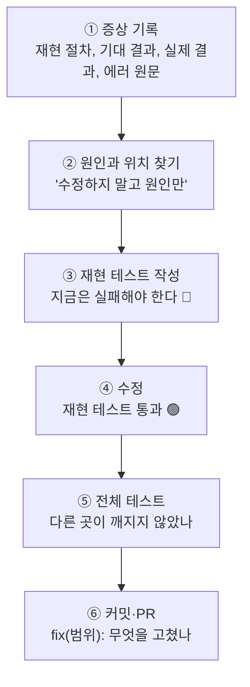
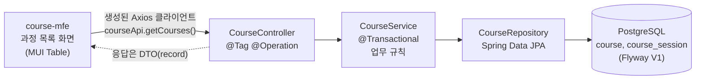
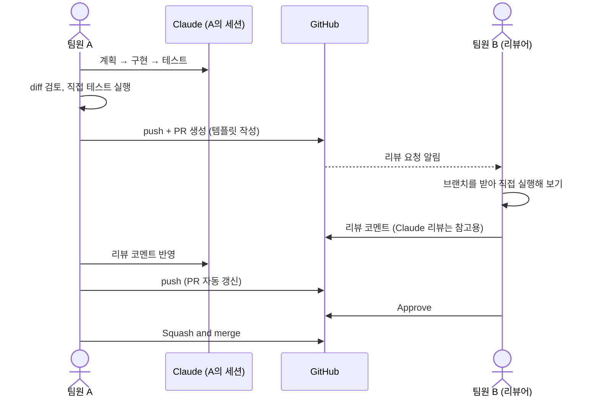
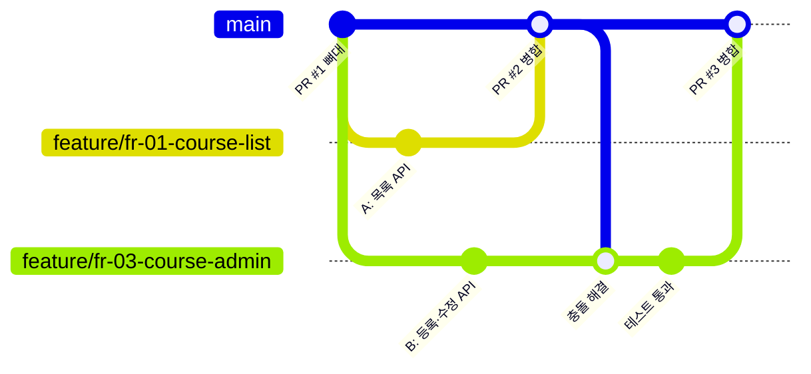
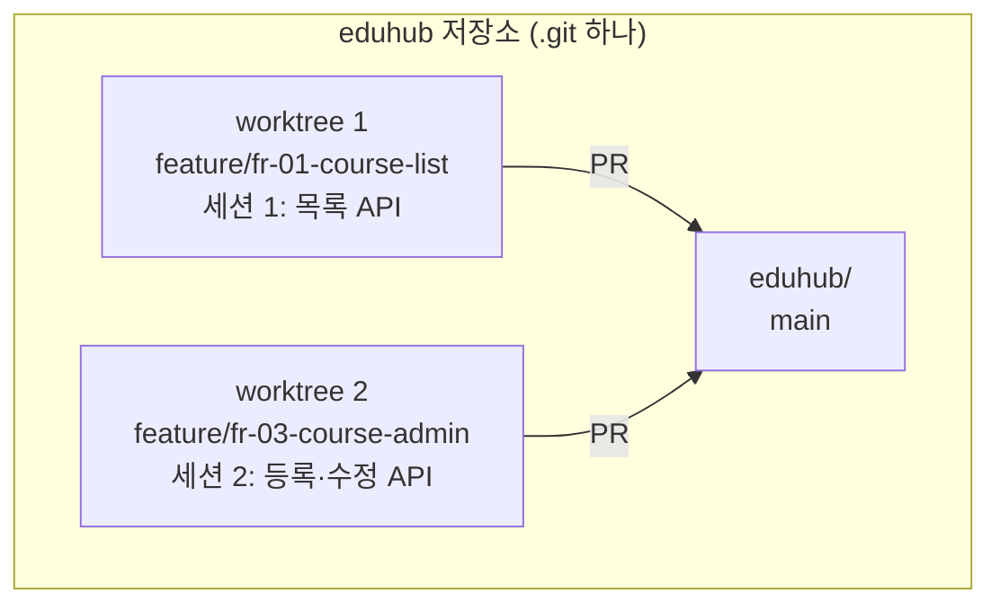
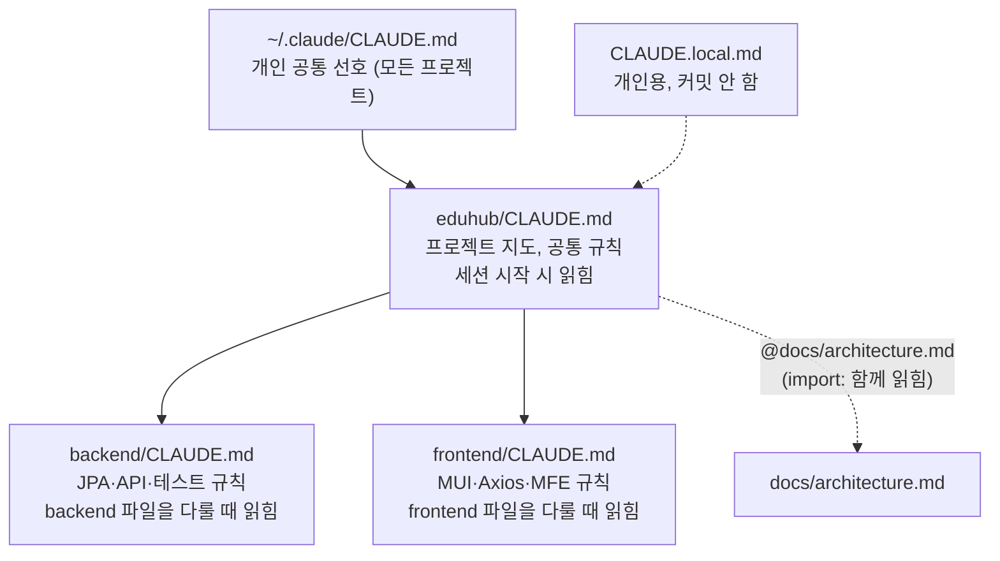
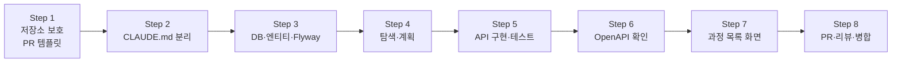

# 3회차: 기능 개발과 GitHub 협업 — 과정 조회·관리 API(FR-01~03)

🧭 ⬅️ 이전: [2회차: 환경 준비부터 첫 요구사항까지 + Toy 프로젝트(EduHub) 킥오프](./session-02-hands-on-kickoff.md) · ➡️ 다음: [4회차: 권한·스킬·서브에이전트 — 수강 신청과 동시성 (FR-04~06, NFR-01)](./session-04-permissions-skills-subagents.md) · 📚 [전체 커리큘럼](../CURRICULUM.md#-회차별-강의-자료)

> **대상**: 2회차에서 EduHub 저장소와 백엔드 뼈대를 만든 수강생
> **시간**: 120분 (강의 약 40%, 따라하기 약 60%)
> **목표**
> 1. 기능 하나를 **탐색 → 계획 → 구현 → 검증** 순서로 Claude와 함께 끝까지 개발한다
> 2. 버그는 **재현 테스트부터** 만들고 고치는 습관을 들인다
> 3. `main` 보호, PR 템플릿, 동료 리뷰, 충돌 해결로 **팀 단위 GitHub 협업**을 시작한다
> 4. 세션을 작업 단위로 나누고, CLAUDE.md를 **루트·백엔드·프론트로 나눠 짧게** 다듬는다
> 5. EduHub의 **과정 조회·관리 API(FR-01~03)와 과정 목록 화면**을 PR로 병합한다
>
> **관련 모듈**: 6(기능 개발 & 버그 수정), 7(GitHub 연결과 버전관리), 8(프로젝트·세션·컨텍스트 관리 & CLAUDE.md)
> **사전 준비**: 2회차 PR 병합 완료, Docker Desktop 실행 확인(`docker --version`), 팀 저장소에 팀원 전원을 Collaborator로 초대, (선택) GitHub CLI `gh` 로그인(`gh auth login`)

---

## 진행 순서

| 시간 | 내용 | 형식 |
|---|---|---|
| 0:00 – 0:08 | 지난 회차 복습 & 과제 리뷰 | 강의 + 공유 |
| 0:08 – 0:23 | 1. 기능 개발 워크플로우: 탐색 → 계획 → 구현 → 검증, 버그는 재현 테스트부터 | 강의 + 시연 |
| 0:23 – 0:35 | 2. GitHub 협업: main 보호, PR 템플릿, 리뷰, 충돌 | 강의 |
| 0:35 – 0:47 | 3. 세션과 CLAUDE.md 관리 | 강의 + 시연 |
| 0:47 – 0:55 | ☕ 휴식 | — |
| 0:55 – 1:37 | 4. 따라하기 ①: 저장소 보호 → FR-01~03 백엔드 → 과정 목록 화면 → PR | 실습 |
| 1:37 – 1:52 | 5. 따라하기 ②: 버그 수정(재현 테스트부터)과 충돌 해결 | 실습 |
| 1:52 – 2:00 | 7. 정리, 퀴즈, 과제 안내 | 강의 |

> 6장(더 해 보기)은 시간이 남으면 수업 중에, 아니면 과제로 진행합니다.

---

## 지난 회차 복습 & 과제 리뷰

**2회차 핵심 3문장**
1. **한 세션 = 한 작업**, 위치를 알려 주고, 큰 일은 Plan 모드로 계획부터
2. **AI는 How, 개발자는 What·Why·Where**: 테스트가 통과해도 아키텍처 지식이 있어야 문제가 보인다
3. Git은 **2단계 커밋(add → commit) 후 push**, 작업은 **브랜치 → 개발 → PR → 병합**

**과제 리뷰 (5분)**

| 확인 항목 | 확인 방법 |
|---|---|
| 2회차 PR이 `main`에 병합되었는가 | GitHub 저장소 → Pull requests → Closed |
| `.env`가 저장소에 올라가지 않았는가 | GitHub에서 파일 목록 확인, `git log --all -- .env`가 비어 있는지 |
| 요구사항의 애매한 점 3가지를 결정했는가 | `docs/requirements.md`의 "결정 사항" |
| 1주차 회고 | "Claude에게 맡긴 것 / 직접 한 것 / 아낀 토큰 방법" 한 팀씩 한 줄 공유 |

> 💬 **강사 노트:** 회고에서 "`/clear` 뒤에도 CLAUDE.md는 기억했다", "범위를 좁히니 diff가 작아 검토가 쉬웠다" 같은 경험이 나오면 오늘 주제(작업 단위로 나누기)와 연결합니다.

---

# 1. 기능 개발 워크플로우: 탐색 → 계획 → 구현 → 검증

> 자세한 프롬프트 예시: [프롬프트 모범 사례](../examples/11-prompting-best-practices.md), [기본 워크플로우와 기능 개발 예제](../examples/01-basics-and-workflow.md#모듈-6-기능-개발--버그-수정)

---

## 1-1. 왜 단계를 나누나

"과정 관리 기능 만들어줘" 한 번으로 끝내면 **검토할 수 없는 큰 diff**가 나오고, 잘못된 방향을 늦게 발견합니다. 단계를 나누면 **각 단계 끝에서 사람이 방향을 확인**할 수 있습니다.



| 단계 | Claude에게 시키는 것 | 개발자가 확인하는 것 | 토큰 습관 |
|---|---|---|---|
| ① 탐색 | "관련 파일과 기존 패턴을 찾아 설명만 해줘. 수정하지 마" | 내가 아는 구조와 같은가? | `@`로 시작 위치 지정, 넓은 탐색은 서브에이전트에 |
| ② 계획 | Plan 모드에서 만들 파일, 순서, 테스트 목록 | 패키지 위치, 계층 규칙, 범위 | 계획 단계에서 틀린 것을 잡는 것이 가장 싸다 |
| ③ 구현 | 계획의 한 덩어리씩, 테스트와 함께 | 진행 방향이 이상하면 `Esc` | 이상하면 바로 멈추기 |
| ④ 검증 | 테스트·빌드 명령 실행 | **내 터미널에서 직접** 테스트, diff 검토 | 완료 기준을 명령어로 |

---

## 1-2. 테스트로 완료 기준을 준다 (TDD 맛보기)

에이전트는 **검증 수단이 있을 때 가장 잘 일합니다** (1회차 에이전트 루프). 가장 확실한 검증 수단은 **사람이 먼저 쓴 실패하는 테스트**입니다.



```text
CourseServiceTest에 "종료된 과정은 수정할 수 없다" 테스트를 추가해 두었어.
이 테스트가 통과하도록 CourseService를 구현해줘.
- 테스트 코드는 수정하지 마
- 완료 기준: cd backend && ./gradlew test --tests "*CourseServiceTest" 통과
```

> 💡 테스트를 사람이 쓰면 **요구사항을 정확히 이해했는지** 스스로 확인하게 되고, Claude는 "테스트를 통과하도록 테스트를 고치는" 꼼수를 쓸 수 없습니다. 모든 테스트를 사람이 쓸 필요는 없습니다. **핵심 업무 규칙의 테스트만큼은 사람이** 씁니다.

---

## 1-3. 버그 수정: 재현 테스트부터

버그를 고칠 때 바로 "고쳐줘"라고 하면 Claude는 **증상만 가리는 수정**을 할 수 있습니다. 순서를 지킵니다.



| 단계 | 지시 예 | 왜 |
|---|---|---|
| ② 원인 찾기 | "과정 목록 첫 페이지에 1~10번이 안 나오고 11번부터 나와. 원인과 위치만 찾아줘. 수정하지 마" | 원인을 사람이 이해해야 수정 방향을 판단할 수 있다 (1회차 7-5 "AI로 원인 파악 → 직접 수정") |
| ③ 재현 테스트 | "이 버그를 재현하는 테스트를 먼저 써줘. 지금은 실패해야 해" | 테스트가 실패하는 것을 봐야 버그를 정말 잡았는지 알 수 있다 |
| ④ 수정 | "재현 테스트가 통과하도록 고쳐줘. 원인이 프론트면 프론트만" | 범위를 좁혀 엉뚱한 곳을 고치지 않게 |

> 💡 원인이 한 줄이면(예: `page - 1` 누락) **직접 고칩니다.** 재현 테스트는 Claude가, 한 줄 수정은 사람이. 1회차 원칙 "간단한 코드는 직접 고친다"입니다.

---

## 1-4. 오늘 만들 기능: FR-01~03

| ID | 요구사항 | 오늘 만들 API·화면 |
|---|---|---|
| FR-01 | 과정 목록 조회, 제목·분류 검색 (페이지 단위) | `GET /api/v1/courses?keyword=&category=&page=0&size=10` + 과정 목록 화면 |
| FR-02 | 과정 상세와 회차(일정, 장소, 정원, 남은 자리) | `GET /api/v1/courses/{id}` |
| FR-03 | 관리자의 과정·회차 등록·수정·종료 | `POST /api/v1/courses`, `PUT /api/v1/courses/{id}`, `POST /api/v1/courses/{id}/sessions`, `POST /api/v1/courses/{id}/close` |



> 💬 **강사 노트:** 인증은 아직 없으므로 FR-03의 "관리자" 구분은 하지 않고 API만 만듭니다. 권한 구분은 4주차 이후 보안 작업에서 다룹니다. 이런 **"이번에 하지 않는 것"을 지시에 명시**하는 것도 범위 관리입니다.

---

# 2. GitHub 협업: main 보호, PR 템플릿, 리뷰, 충돌

> 2회차 [3-8. Git 작업 방식](./session-02-hands-on-kickoff.md#3-8-7주-동안-쓰는-git-작업-방식-2단계-커밋과-브랜치--개발--병합)의 규칙을 오늘부터 GitHub 설정으로 강제합니다. 자세한 내용: [GitHub 연결과 버전관리](../examples/06-github-version-control.md)

---

## 2-1. 팀 협업 흐름 한눈에



---

## 2-2. main 보호: AI 시대의 안전장치

| 설정 | 효과 | 왜 필요한가 |
|---|---|---|
| **PR 없이 `main`에 직접 푸시 금지** | 모든 변경이 PR을 거친다 | Claude가 실수로 `main`에 푸시해도 막힌다 |
| **승인 1명 이상 필요** | 사람 리뷰 없이 병합 불가 | AI가 만든 코드도 사람이 확인 |
| **강제 푸시(force push) 금지, 삭제 금지** | 이력을 다시 쓸 수 없다 | 공유 이력 보호 |
| **상태 검사 통과 필요** (CI) | 빌드·테스트 실패 시 병합 불가 | 6주차에 CI를 만든 뒤 켠다 |
| **Squash merge만 허용** | `main` 이력 = PR 하나에 커밋 하나 | 읽고 되돌리기 쉽다 |

- 설정 위치: 저장소 **Settings → Branches**(브랜치 보호 규칙) 또는 **Settings → Rules → Rulesets**. 화면 구성은 GitHub 업데이트에 따라 바뀔 수 있습니다
- 병합 방식: **Settings → General → Pull Requests**에서 "Allow squash merging"만 남깁니다
- 개인 무료 계정의 **비공개(Private) 저장소에서는 브랜치 보호 기능이 제한**될 수 있습니다. 이 경우 Organization을 만들거나 공개 저장소로 하거나, 팀 규칙으로 대신합니다 (공식 문서 확인 필요)

---

## 2-3. PR 템플릿: 리뷰어가 알아야 할 것을 빠뜨리지 않게

`.github/pull_request_template.md`를 두면 PR을 만들 때 본문에 자동으로 채워지고, **Claude도 이 형식에 맞춰 PR 본문을 씁니다.**

````markdown
## 관련 요구사항
- FR-

## 변경 내용
-

## API 변경 (Swagger 경로)
-

## 확인 방법
```bash
cd backend && ./gradlew test
```

## Claude에게 맡긴 것 / 직접 한 것
| 맡긴 것 | 직접 한 것 |
|---|---|
|  |  |

## 체크리스트
- [ ] 내 터미널에서 `./gradlew test` 통과
- [ ] 요청하지 않은 파일·기능이 없다
- [ ] `.env` 등 비밀 정보 없음
- [ ] 이 변경의 구조를 AI 없이 설명할 수 있다
````

> 바깥의 백틱 네 개 줄은 표시용입니다. 파일에는 안쪽 내용만 넣습니다 ([마크다운 가이드 8-3](../examples/30-markdown-guide.md#8-3-코드-블록-안에-코드-블록-넣기)).

---

## 2-4. 리뷰: 사람 리뷰가 기본, Claude 리뷰는 보조

| 누가 | 무엇을 본다 | 방법 |
|---|---|---|
| **작성자 (PR 올리기 전)** | 요청하지 않은 변경, 비밀 정보, 테스트 실제 실행 | diff 직접 검토, 내 터미널에서 테스트 |
| **Claude (보조 리뷰)** | 규칙 위반, 빠진 예외 처리, 테스트 누락 같은 기계적인 것 | 새 세션에서 "이 브랜치의 main 대비 변경을 리뷰해줘. 수정하지 말고 문제만 목록으로" |
| **동료 (필수 리뷰)** | 요구사항과 맞는지, 구조가 맞는지, 이해할 수 있는지 | 브랜치를 받아 **직접 실행**, 코멘트 |

**좋은 리뷰 코멘트**

| ❌ | ✅ |
|---|---|
| "이상해요" | "`CourseController`가 `CourseRepository`를 직접 호출해요. CLAUDE.md의 계층 규칙에 따라 Service를 거치도록 바꿔 주세요" |
| "테스트 더 필요" | "종료된 과정을 수정하는 경우의 테스트가 없어요. FR-03의 '종료' 규칙 테스트를 추가해 주세요" |

> 💡 Claude에게 리뷰를 시킬 때는 **구현한 세션과 다른 새 세션**에서 합니다. 구현 과정의 대화가 남아 있으면 자기 결정을 그대로 옳다고 보는 경향이 있습니다. 리뷰를 맡을 서브에이전트는 4주차에 만듭니다.

> 💬 **강사 노트:** 동료 리뷰의 핵심은 "AI 없이 설명하기"와 연결됩니다. 리뷰어가 "이 메서드는 왜 이렇게 했어요?"라고 물었을 때 작성자가 답하지 못하면, 그 코드는 아직 작성자의 것이 아닙니다.

---

## 2-5. 충돌 해결: 의도를 아는 사람이 확인한다



- 두 팀원이 **같은 파일**(`CourseController`, `CourseService`)을 동시에 고치면 나중에 병합하는 쪽에서 충돌이 납니다
- 해결 순서: `git switch 내-브랜치` → `git merge main` → 충돌 파일 확인 → **두 변경의 의도를 모두 살려** 정리 → 테스트 → `git add` → `git commit` → `git push`
- Claude에게 맡길 수 있습니다: "main을 병합하면서 생긴 충돌을 해결해줘. 양쪽 변경의 의도를 설명하고, 둘 다 살리는 방향으로. 끝나면 테스트를 돌려줘"
- **반드시 확인**: 어느 한쪽 변경이 조용히 사라지지 않았는가? 상대 팀원에게 결과를 보여 주고 확인받습니다

---

# 3. 세션과 CLAUDE.md 관리

> 자세한 내용: [프로젝트·디렉터리·세션](../examples/15-project-directory-session.md), [CLAUDE.md 예제](../examples/02-claude-md.md), [저장소 구조](../examples/20-repository-structure.md)

---

## 3-1. 세션은 작업 단위로

| 상황 | 할 일 | 터미널(CLI) | 데스크톱 앱 |
|---|---|---|---|
| 작업 하나가 끝남 | 커밋 후 새 대화 | `/clear` | `/clear` 또는 새 세션 |
| 나중에 돌아올 작업 | 이름 붙여 두기 | `/rename fr-03-course-admin` | 사이드바 세션 목록에서 관리 |
| 어제 작업 이어가기 | 이전 세션 열기 | `claude --continue`(최근), `claude --resume`(목록), 대화 중 `/resume` | 사이드바에서 세션 선택 |
| 같은 작업인데 컨텍스트가 큼 | 요약하고 계속 | `/compact 남길 내용` | 같음 |
| 두 작업을 동시에 | 작업 디렉터리를 나눈다 | `claude --worktree fr-03` | 폴더 선택에서 **Worktree** 켜기 |

**세션 사이에 맥락 넘기기**: 큰 기능은 `docs/progress/fr-03.md`에 "결정 사항 / 완료 / 남은 일"을 남기게 하고, 다음 세션은 `@docs/progress/fr-03.md 를 읽고 남은 일부터 이어서 해줘`로 시작합니다. 대화를 통째로 이어가는 것보다 싸고 정확합니다.

---

## 3-2. 병렬 작업은 worktree로

같은 폴더에서 세션 두 개가 동시에 파일을 고치면 서로의 변경을 덮어씁니다. **git worktree**는 같은 저장소를 브랜치별로 다른 폴더에 꺼내 놓는 기능입니다.



```bash
# CLI: Claude Code가 worktree를 만들고 그 안에서 세션 시작 (저장소에 커밋이 하나 이상 있어야 함)
claude --worktree fr-01
claude --worktree fr-03     # 다른 터미널에서

# 직접 만들 수도 있다
git worktree add ../eduhub-fr-03 -b feature/fr-03-course-admin
git worktree list
git worktree remove ../eduhub-fr-03   # 끝나면 정리
```

> ⚠️ 병렬 세션 수는 **내가 리뷰할 수 있는 만큼만**. 혼자서 세 개를 돌리면 diff 세 개를 검토해야 합니다. 오늘은 두 개까지만 해 봅니다. 데스크톱 앱에서 worktree 세션을 보관(archive)하면 커밋하지 않은 변경이 사라질 수 있으니 먼저 커밋합니다.

---

## 3-3. CLAUDE.md는 나눠서, 짧게



| 파일 | 언제 읽히나 | 무엇을 쓰나 |
|---|---|---|
| 루트 `CLAUDE.md` | 세션 시작 시 항상 | 프로젝트 한 줄 소개, 디렉터리 지도, 실행·테스트 명령, 공통 규칙, 금지 사항 |
| `backend/CLAUDE.md`, `frontend/CLAUDE.md` | Claude가 그 폴더의 파일을 읽거나 고칠 때 | 영역별 규칙. 프론트 작업에 백엔드 규칙이 섞이지 않는다 |
| `@경로` import | import한 CLAUDE.md와 **함께** 읽힘 | 길어진 내용을 파일로 정리. **토큰은 줄지 않는다** |
| `.claude/rules/*.md` (`paths:` 지정) | 지정한 경로의 파일을 다룰 때 | 특정 파일 종류에만 필요한 규칙 (예: `**/db/migration/*.sql`) |
| `CLAUDE.local.md` | 루트 CLAUDE.md와 함께 | 내 로컬 환경 메모. `.gitignore`에 추가 |

**CLAUDE.md 다듬기 기준**

| 남길 것 | 뺄 것 |
|---|---|
| Claude가 코드만 보고 알 수 없는 것 (빌드 명령, 팀 규칙, 금지 사항) | 코드를 보면 알 수 있는 것 (사용 라이브러리 목록 등) |
| 실제로 Claude가 틀렸던 것 (예: "엔티티를 응답으로 반환하지 않는다") | 포매터가 강제하는 것 (들여쓰기 등) |
| 구체적인 명령과 경로 (백틱으로) | "깔끔하게", "잘" 같은 막연한 말 |
| 짧은 규칙 (파일당 200줄 이내 목표) | 긴 절차 → 스킬로 (4주차) |

- `/memory`: CLAUDE.md를 열어 바로 고칠 수 있고, Claude가 스스로 메모하는 **자동 메모리(auto memory)** 켜기·끄기도 여기서 합니다
- CLAUDE.md는 **부탁**입니다. 반드시 지켜야 하는 것은 권한(4주차)과 훅(5주차)으로 강제합니다

> 💬 **강사 노트:** "규칙은 많을수록 좋다"는 오해를 바로잡습니다. 공식 문서도 파일당 200줄 이내를 권하고, 길수록 규칙을 덜 지킨다고 설명합니다. 서로 모순되는 규칙이 있으면 Claude가 아무거나 고를 수 있다는 점도 짚습니다.

---

## ☕ 휴식 (8분)

> Docker Desktop이 켜져 있는지, 2회차 PR이 병합된 `main`을 받았는지(`git switch main && git pull`) 확인합니다.

---

# 4. 따라하기 ①: FR-01~03을 PR로

> **목표**: 저장소 보호를 켜고, 과정 조회·관리 API와 과정 목록 화면을 **팀원 둘이 나눠** 개발해 PR로 병합합니다.
> 팀 역할 예: **A = FR-01·02(조회 API + 목록 화면)**, **B = FR-03(등록·수정·종료 API)**. 혼자라면 순서대로 모두 합니다.



---

## Step 1. 저장소 보호와 PR 템플릿 (팀장 1명)

1. GitHub 저장소 → **Settings → Branches**(또는 **Rules → Rulesets**)에서 `main` 보호 규칙을 만듭니다
   - PR 필수, 승인 1명 이상, 강제 푸시·삭제 금지 (상태 검사는 6주차에 추가)
2. **Settings → General → Pull Requests**에서 Squash merging만 허용, "Automatically delete head branches" 켜기
3. PR 템플릿을 브랜치에서 추가하고 PR로 병합합니다 (이제 `main`에 직접 푸시할 수 없으므로)

```bash
git switch main && git pull
git switch -c chore/pr-template
mkdir -p .github
# .github/pull_request_template.md 작성 (2-3의 내용을 직접 붙여넣기 — 복사는 직접 하는 편이 빠르다)
git add .github/pull_request_template.md
git commit -m "chore: PR 템플릿 추가"
git push -u origin chore/pr-template
```

4. **보호가 동작하는지 확인**: `main`에서 아무 파일이나 고쳐 커밋한 뒤 `git push`를 시도합니다

> ✅ **확인**: `main`으로의 푸시가 거부되면 성공입니다 (거부되지 않으면 2-2의 저장소 공개 범위 안내를 확인). 확인 후 `git reset --hard origin/main`으로 로컬 `main`을 되돌립니다.

---

## Step 2. CLAUDE.md를 루트·백엔드·프론트로 나누기

새 브랜치에서 진행합니다: `git switch main && git pull && git switch -c chore/claude-md-split`

```text
[목표] CLAUDE.md를 루트, backend/, frontend/로 나눠 정리하고 싶어.
[위치] @CLAUDE.md
[범위]
- 루트: 프로젝트 소개 2줄, 디렉터리 지도, 실행 명령, 공통 규칙(커밋 형식, 비밀 정보 금지, 브랜치 규칙)
- backend/CLAUDE.md: 테스트 명령, 계층 규칙, JPA 규칙(LAZY, DTO 반환, open-in-view=false, Flyway로만 스키마 변경), OpenAPI 규칙
- frontend/CLAUDE.md: 아직 코드가 없으니 MUI·Axios 생성 클라이언트 사용 규칙만 5줄 이내
[하지 않는 것] 코드 수정, 새 규칙 발명 (애매하면 나에게 물어봐)
[완료 기준] 각 파일 60줄 이내, 명령과 경로는 백틱
[진행 방식] 바뀐 세 파일의 diff를 보여줘
```

- 결과를 [CLAUDE.md 예제](../examples/02-claude-md.md)와 비교해 **우리 팀에 필요 없는 규칙은 빼고**, 지난주 Claude가 실제로 틀렸던 것은 넣습니다
- `/memory`로 열어 한두 줄은 **직접** 고쳐 봅니다
- 커밋·푸시 후 PR → 팀원 승인 → Squash and merge

> ✅ **확인**: 새 세션에서 `@backend/build.gradle.kts 를 보고 의존성을 설명해줘`라고 한 뒤 `/context`를 보면 backend/CLAUDE.md가 함께 읽힌 것을 볼 수 있습니다 (표시 방식은 버전에 따라 다를 수 있음).

---

## Step 3. 개발 DB와 엔티티, Flyway 마이그레이션 (A·B 공통 기반 — 한 명이 먼저)

공통 기반은 **한 명이 먼저 PR로 병합**하고, 나머지는 그 위에서 시작합니다. 그래야 충돌이 줄어듭니다.

```text
[목표] FR-01~03의 공통 기반: 개발 DB, Course·CourseSession 엔티티, Flyway V1 마이그레이션
[위치] @docs/requirements.md, backend/
[범위]
- docker-compose.yml: postgres:16, 접속 정보는 .env의 POSTGRES_USER/POSTGRES_PASSWORD/POSTGRES_DB
- application-dev.yml: 위 환경 변수 사용, ddl-auto=validate, open-in-view=false
- Flyway V1__create_course.sql: course(id, title, category, description, status), course_session(id, course_id, start_date, place, capacity, status)
- 엔티티 Course, CourseSession (N:1은 LAZY, @Setter 금지, 상태 변경은 close() 같은 메서드)
- CourseRepository + @DataJpaTest(Testcontainers) 저장·조회 테스트 1개
[하지 않는 것] Service, Controller, 화면
[완료 기준] cd backend && ./gradlew test 통과
[진행 방식] 먼저 계획을 보여줘
```

**완성되면 대략 이런 모양입니다** (Claude의 결과와 비교용)

```sql
-- backend/src/main/resources/db/migration/V1__create_course.sql
CREATE TABLE course (
    id          BIGSERIAL PRIMARY KEY,
    title       VARCHAR(200) NOT NULL,
    category    VARCHAR(50)  NOT NULL,
    description TEXT,
    status      VARCHAR(20)  NOT NULL DEFAULT 'OPEN'
);

CREATE TABLE course_session (
    id         BIGSERIAL PRIMARY KEY,
    course_id  BIGINT       NOT NULL REFERENCES course (id),
    start_date DATE         NOT NULL,
    place      VARCHAR(100) NOT NULL,
    capacity   INT          NOT NULL CHECK (capacity > 0),
    status     VARCHAR(20)  NOT NULL DEFAULT 'OPEN'
);

CREATE INDEX idx_course_session_course_id ON course_session (course_id);
```

```java
@Entity
@Getter
@NoArgsConstructor(access = AccessLevel.PROTECTED)
public class Course {

    @Id
    @GeneratedValue(strategy = GenerationType.IDENTITY)
    private Long id;

    private String title;
    private String category;
    private String description;

    @Enumerated(EnumType.STRING)
    private CourseStatus status = CourseStatus.OPEN;

    @OneToMany(mappedBy = "course")
    private List<CourseSession> sessions = new ArrayList<>();

    public void update(String title, String category, String description) {
        if (status == CourseStatus.CLOSED) {
            throw new CourseClosedException(id);   // 종료된 과정은 수정 불가 (FR-03)
        }
        this.title = title;
        this.category = category;
        this.description = description;
    }

    public void close() {
        this.status = CourseStatus.CLOSED;
    }
}
```

```bash
cp .env.example .env        # 값은 각자 로컬용으로 채운다 (커밋 금지)
docker compose up -d postgres
cd backend && ./gradlew test
```

**diff 검토 체크리스트**
- [ ] 마이그레이션 파일 이름이 `V1__설명.sql` 형식인가? 기존 마이그레이션을 고치지 않았는가?
- [ ] `@ManyToOne(fetch = FetchType.LAZY)`인가?
- [ ] `application-dev.yml`에 비밀번호가 직접 쓰여 있지 않은가?
- [ ] `docker-compose.yml`의 비밀번호도 `.env` 변수인가?

> ✅ **확인**: 내 터미널에서 `./gradlew test` 통과 → 커밋(`feat(course): 과정·회차 엔티티와 V1 마이그레이션`) → PR → 병합. 다른 팀원은 병합 후 `git switch main && git pull`.

---

## Step 4. 탐색과 계획 (A: FR-01·02, B: FR-03 — 각자 새 세션)

각자 브랜치를 만들고 **새 세션**에서 시작합니다. 같은 PC에서 둘 다 해 본다면 3-2의 worktree를 씁니다.

```bash
git switch main && git pull
git switch -c feature/fr-01-course-list      # B는 feature/fr-03-course-admin
```

**① 탐색 (수정 금지)**

```text
@docs/requirements.md 의 FR-01, FR-02를 구현하려고 해.
지금 backend의 course 패키지 구조와 기존 패턴(엔티티, 리포지토리, 테스트)을 설명해줘.
코드는 수정하지 마.
```

**② 계획 (Plan 모드)**

```text
[목표] FR-01 과정 목록 조회(제목 keyword, category 필터, 페이지), FR-02 과정 상세(회차 목록, 남은 자리)
[위치] backend/src/main/java/com/example/eduhub/course/
[범위]
- CourseQueryService, CourseController (GET /api/v1/courses, GET /api/v1/courses/{id})
- 응답 DTO는 record: CourseSummaryResponse, CourseDetailResponse, SessionResponse
- 페이지는 Spring Data Pageable (0부터 시작), 응답은 PageResponse<T>(content, page, size, totalElements)
- 없는 id는 404 (GlobalExceptionHandler, ErrorResponse)
- OpenAPI: @Tag, @Operation(summary), 404 @ApiResponse
- 테스트: @WebMvcTest(CourseController), @DataJpaTest(검색 조건)
[하지 않는 것] 등록·수정 API(B가 함), 수강 신청 관련 계산(남은 자리는 지금은 capacity 그대로), 화면
[완료 기준] cd backend && ./gradlew test 통과
[진행 방식] 만들 파일, 순서, 테스트 케이스 목록을 먼저 보여줘
```

**계획 검토 포인트**: 패키지 위치, Controller → Service → Repository 계층, DTO 사용, 테스트 케이스가 요구사항(검색, 페이지, 404)을 덮는지. 고칠 점은 바로 말합니다: `검색은 Specification 말고 @Query 하나로 단순하게 해줘`

---

## Step 5. 구현과 테스트

계획을 승인하고 권한 모드를 **Accept edits**로 바꿔 구현을 맡깁니다. 이상한 방향으로 가면 `Esc`.

**완성되면 대략 이런 모양입니다**

```java
@Tag(name = "Course", description = "교육과정 조회·관리")
@RestController
@RequestMapping("/api/v1/courses")
@RequiredArgsConstructor
public class CourseController {

    private final CourseQueryService courseQueryService;

    @Operation(summary = "과정 목록 조회", description = "제목·분류로 검색하고 페이지 단위로 조회한다 (page는 0부터)")
    @GetMapping
    public PageResponse<CourseSummaryResponse> getCourses(
            @RequestParam(required = false) String keyword,
            @RequestParam(required = false) String category,
            @ParameterObject @PageableDefault(size = 10, sort = "id") Pageable pageable) {
        return courseQueryService.search(keyword, category, pageable);
    }

    @Operation(summary = "과정 상세 조회")
    @ApiResponse(responseCode = "404", description = "과정이 없음",
            content = @Content(schema = @Schema(implementation = ErrorResponse.class)))
    @GetMapping("/{id}")
    public CourseDetailResponse getCourse(@PathVariable Long id) {
        return courseQueryService.get(id);
    }
}
```

```java
public record CourseSummaryResponse(Long id, String title, String category, String status, int sessionCount) {
}
```

```java
@WebMvcTest(CourseController.class)
class CourseControllerTest {

    @Autowired MockMvc mockMvc;
    @MockitoBean CourseQueryService courseQueryService;

    @Test
    @DisplayName("없는 과정을 조회하면 404와 에러 코드를 돌려준다")
    void getCourse_notFound_returns404() throws Exception {
        given(courseQueryService.get(99L)).willThrow(new CourseNotFoundException(99L));

        mockMvc.perform(get("/api/v1/courses/99"))
                .andExpect(status().isNotFound())
                .andExpect(jsonPath("$.code").value("COURSE_NOT_FOUND"));
    }
}
```

> 💡 Spring Boot 버전에 따라 `@MockitoBean`(3.4 이상) 대신 `@MockBean`을 씁니다. Claude가 프로젝트 버전에 맞게 고르는지 확인해 보세요.

**B (FR-03)의 지시 핵심**: `POST /api/v1/courses`(등록, 입력 검증 `@Valid`), `PUT /{id}`(수정, 종료된 과정은 409), `POST /{id}/sessions`(회차 추가, 정원 1 이상), `POST /{id}/close`(종료). **"종료된 과정 수정 시 예외" 테스트는 B가 먼저 직접 작성**하고 Claude에게 통과시키게 합니다 (1-2 TDD).

**diff 검토 체크리스트**
- [ ] Controller가 Repository를 직접 부르지 않는가?
- [ ] 엔티티가 응답으로 그대로 나가지 않는가? (DTO record)
- [ ] 목록 조회에서 회차를 지연 로딩하며 쿼리가 여러 번 나가지 않는가? (`sessionCount` 계산 방식 확인 → 5장 버그와 연결)
- [ ] 404·409 응답이 `ErrorResponse` 형식인가?
- [ ] 계획에 없던 파일이 생기지 않았는가?

> ✅ **확인**: 내 터미널에서 `cd backend && ./gradlew test` 통과.

---

## Step 6. OpenAPI 문서 확인 (직접)

```bash
cd backend && ./gradlew bootRun --args='--spring.profiles.active=dev'
```

- 브라우저에서 http://localhost:8080/swagger-ui.html 을 열고 **Try it out**으로 목록·상세 API를 직접 호출합니다
- 데이터가 없으면 B의 등록 API로 넣거나, 개발용 데이터 스크립트를 Claude에게 만들게 합니다 (`dev` 프로필에서만 실행되게)
- `/v3/api-docs`의 JSON이 다음 Step의 프론트 클라이언트 생성 원본입니다

> ✅ **확인**: Swagger UI에 `Course` 태그와 API 설명, 404 응답 예시가 보이면 됩니다. **이 확인은 직접** 합니다. 문서가 실제로 사람이 읽기 좋은지는 사람만 판단할 수 있습니다.

---

## Step 7. 과정 목록 화면 (A)

이번 주는 **단독 실행되는 React 앱**으로 만들고, Module Federation 연결은 6주차에 합니다.

```text
[목표] 과정 목록 화면 (FR-01): 검색어 입력, 분류 선택, MUI Table, 페이지 이동
[위치] frontend/apps/course-mfe (없으면 새로 만든다), frontend/packages/api-client
[범위]
- api-client: openapi-generator(typescript-axios)로 http://localhost:8080/v3/api-docs 에서 생성하는 npm 스크립트 generate:api
- course-mfe: React 18 + TypeScript + MUI, 단독 실행(npm run dev, 포트 3001)
- 생성된 courseApi만 사용 (Axios 인스턴스 직접 생성 금지)
- 로딩은 CircularProgress, 에러는 Alert
- 테스트: React Testing Library로 목록 렌더링 1개 (API는 mock)
[하지 않는 것] Module Federation 설정, shell, 상세·관리 화면, 인증
[완료 기준] npm test -w apps/course-mfe 통과, 화면에서 목록이 보임
[진행 방식] 폴더 구조와 package.json 스크립트 계획을 먼저 보여줘
```

**완성되면 대략 이런 모양입니다**

```tsx
export function CourseListPage() {
  const [keyword, setKeyword] = useState('');
  const [page, setPage] = useState(0);   // MUI TablePagination도 0부터 시작
  const { data, loading, error } = useCourses({ keyword, page, size: 10 });

  if (error) return <Alert severity="error">과정 목록을 불러오지 못했습니다.</Alert>;

  return (
    <Stack spacing={2}>
      <TextField label="과정명 검색" value={keyword} onChange={(e) => setKeyword(e.target.value)} />
      {loading ? (
        <CircularProgress />
      ) : (
        <Table>
          <TableHead>
            <TableRow><TableCell>과정명</TableCell><TableCell>분류</TableCell><TableCell>회차 수</TableCell></TableRow>
          </TableHead>
          <TableBody>
            {data?.content.map((c) => (
              <TableRow key={c.id}><TableCell>{c.title}</TableCell><TableCell>{c.category}</TableCell><TableCell>{c.sessionCount}</TableCell></TableRow>
            ))}
          </TableBody>
        </Table>
      )}
      <TablePagination component="div" count={data?.totalElements ?? 0} page={page}
        rowsPerPage={10} rowsPerPageOptions={[10]} onPageChange={(_, p) => setPage(p)} />
    </Stack>
  );
}
```

> 💡 개발 서버(3001)에서 백엔드(8080)를 부르면 **CORS** 오류가 날 수 있습니다. 해결 방법(개발 서버 프록시 vs 백엔드 CORS 설정)을 Claude에게 **장단점과 함께** 묻고, 어느 쪽을 쓸지는 직접 결정합니다. 2회차 2-2의 "HTTP·웹" 지식이 필요한 지점입니다.

> ✅ **확인**: 백엔드와 프론트를 함께 띄우고 http://localhost:3001 에서 목록과 검색이 동작하는지 **직접** 봅니다. 데스크톱 앱에서는 미리보기(Browser 창)로 확인할 수도 있습니다.

---

## Step 8. PR, 리뷰, 병합

1. 커밋을 나눕니다: 백엔드(`feat(course): 과정 목록·상세 조회 API (FR-01, FR-02)`)와 프론트(`feat(course-mfe): 과정 목록 화면`)
2. 푸시하고 PR을 만듭니다. 본문은 **템플릿에 맞춰** Claude에게 초안을 맡기고, "Claude에게 맡긴 것 / 직접 한 것"은 **직접** 씁니다
3. **Claude 보조 리뷰**: `/clear` 후 새 세션에서

```text
이 브랜치의 main 대비 변경을 리뷰해줘. 수정하지 말고 문제만 목록으로.
기준: @CLAUDE.md, @backend/CLAUDE.md 의 규칙, docs/requirements.md 의 FR-01~03
심각도(높음/중간/낮음)를 붙여줘.
```

4. **동료 리뷰**: 상대 팀원의 브랜치를 받아(`git fetch && git switch feature/fr-03-course-admin`) 직접 테스트를 돌리고, 2-4의 "좋은 리뷰 코멘트" 형식으로 코멘트 1개 이상
5. 리뷰 반영 → 승인 → **Squash and merge** → 브랜치 정리

```bash
git switch main && git pull
git branch -d feature/fr-01-course-list
```

> ✅ **최종 확인**: `main`에 PR 3개 이상(엔티티 기반, FR-01·02, FR-03)이 병합되고, `main`에서 `./gradlew test`가 통과하면 따라하기 ①이 끝난 것입니다.

---

## 4-9. 자주 겪는 문제

| 증상 | 원인과 해결 |
|---|---|
| `main` 푸시가 거부됨 | 정상입니다 (보호 규칙). 브랜치를 만들어 PR로 |
| Flyway `checksum mismatch` | 이미 적용된 마이그레이션 파일을 고쳤다. 원래대로 되돌리고 새 버전(`V2__...`)으로 추가. 로컬 DB는 `docker compose down -v`로 초기화 가능 (**개발 DB에서만**) |
| `Schema-validation: missing column` | 엔티티와 마이그레이션이 다르다. 엔티티를 고칠지 마이그레이션을 추가할지 **직접 판단** |
| Testcontainers가 Docker를 못 찾음 | Docker Desktop 실행 여부 확인 |
| 프론트에서 CORS 오류 | Step 7의 💡 참고 |
| 생성된 api-client가 옛날 API | 백엔드를 띄운 상태에서 `npm run generate:api` 다시 실행 |
| 두 사람이 같은 파일을 고쳐 충돌 | 5장 따라하기 ②의 Step 3 |
| Claude가 범위 밖 파일까지 고침 | `Esc` → "이번 범위는 X까지만" → 이미 진행됐으면 `/rewind` |

---

# 5. 따라하기 ②: 버그 수정과 충돌 해결

---

## Step 1. 심어 둔 버그: "첫 페이지가 안 보여요" (강사가 제공)

강사가 다음 변경을 각 팀 저장소에 PR로 넣습니다 (또는 수강생이 직접 넣습니다).

```ts
// frontend/apps/course-mfe/src/hooks/useCourses.ts (버그가 있는 버전)
// "화면의 페이지는 1부터 보여 주자"며 누군가 바꾼 코드
const response = await courseApi.getCourses(keyword, category, page + 1, size);
```

**증상**: 과정 목록 첫 화면에 1~10번 과정이 아니라 11번부터 나온다. 과정이 10개 이하면 목록이 비어 보인다.

---

## Step 2. 재현 테스트부터 고치기까지

새 브랜치와 새 세션에서 1-3의 순서를 그대로 따릅니다.

```bash
git switch main && git pull
git switch -c fix/course-list-first-page
```

**② 원인 찾기 (수정 금지)**

```text
과정 목록 화면 첫 페이지에 1~10번 과정이 안 나오고 11번부터 나와.
과정이 10개 이하면 목록이 비어 보여.
@frontend/apps/course-mfe/src 와 백엔드 페이지 처리를 보고 원인과 위치만 찾아줘. 수정하지 마.
```

**③ 재현 테스트**

```text
이 버그를 재현하는 테스트를 useCourses 테스트에 추가해줘.
"화면 페이지 0을 요청하면 API에 page=0을 보낸다"를 검증하고, 지금은 실패해야 해.
테스트를 실행해서 실패하는 것을 보여줘.
```

**④ 수정은 직접**: 원인이 `page + 1` 한 줄이므로 IDE에서 **직접** 고치고 Claude에게 알립니다.

```text
방금 useCourses.ts 의 page + 1 을 page 로 직접 고쳤어. 재현 테스트와 전체 프론트 테스트를 실행해줘.
```

**⑤⑥** 전체 테스트 통과 확인 → `fix(course-mfe): 과정 목록 첫 페이지 누락 수정` 커밋 → PR → 병합

> 💡 재발을 막으려면 규칙도 남깁니다: `frontend/CLAUDE.md`에 "페이지 번호는 API와 화면 모두 0부터. 화면 표시만 +1" 한 줄. **실제로 틀렸던 것만 CLAUDE.md에 쓴다**는 원칙의 예입니다.

---

## Step 3. 충돌 해결 연습 (2인 1조)

| 순서 | 팀원 A | 팀원 B |
|---|---|---|
| 1 | `main`에서 `chore/error-code-a` 브랜치 | `main`에서 `chore/error-code-b` 브랜치 |
| 2 | `ErrorCode`에 `COURSE_ALREADY_CLOSED` 추가, 메시지 "이미 종료된 과정입니다" | 같은 위치에 `SESSION_CAPACITY_INVALID` 추가, `COURSE_NOT_FOUND` 메시지도 "과정을 찾을 수 없습니다"로 수정 |
| 3 | 커밋·푸시·PR → **먼저 병합** | 커밋·푸시·PR (아직 병합 안 함) |
| 4 | — | GitHub에 "This branch has conflicts" 표시 확인 |
| 5 | — | `git switch chore/error-code-b` → `git merge main` → 충돌 |

```text
main을 병합하면서 ErrorCode.java 에 충돌이 생겼어.
양쪽 변경의 의도를 먼저 설명해주고, 둘 다 살리는 방향으로 해결해줘.
해결 후 backend 테스트를 실행해줘. 커밋은 내가 할게.
```

6. B는 결과를 **A에게 보여 주고** "A의 변경이 그대로 살아 있는지" 확인받습니다
7. `git add` → `git commit`(병합 커밋) → `git push` → PR 승인 → 병합

> ✅ **확인**: 병합된 `main`의 `ErrorCode`에 A와 B의 코드가 모두 있고 테스트가 통과합니다.

> 💬 **강사 노트:** 충돌을 Claude가 해결하면 빠르지만, "B의 코드만 남기고 A의 것을 지운" 결과가 가끔 나옵니다. 그래서 6번(상대에게 확인받기)을 꼭 합니다. 충돌은 **기술 문제이기 전에 소통 문제**라는 점을 강조합니다.

---

# 6. 더 해 보기 (시간이 남으면 수업 중, 아니면 과제)

---

## 6-1. worktree로 두 작업 동시에

혼자서 FR-02 상세 화면과 FR-03 관리 화면 초안을 동시에 진행해 봅니다.

```bash
claude --worktree fr-02-detail-ui      # 터미널 1
claude --worktree fr-03-admin-ui       # 터미널 2
```

**관찰할 점**: 두 세션이 서로의 파일을 건드리지 않는가? 두 diff를 모두 검토하는 데 얼마나 걸렸나? → "병렬 수는 리뷰 가능한 만큼"을 체감합니다. ([병렬 작업 비교](../examples/17-parallel-work-terminal-vs-desktop.md))

## 6-2. 작업 기록 파일로 세션 넘기기

1. FR-03 작업 중에 `지금까지의 결정 사항, 완료한 것, 남은 일을 docs/progress/fr-03.md 에 정리해줘`
2. `/clear`
3. `@docs/progress/fr-03.md 를 읽고 남은 일부터 이어서 해줘`
4. `/context`로 대화를 이어갈 때와 사용량을 비교

## 6-3. 경로별 규칙 (`.claude/rules/`)

마이그레이션 파일을 다룰 때만 읽히는 규칙을 만들어 봅니다.

```markdown
---
paths:
  - "backend/src/main/resources/db/migration/**/*.sql"
---

# 마이그레이션 규칙
- 이미 병합된 마이그레이션 파일은 수정하지 않는다. 새 버전으로 추가한다
- 컬럼 삭제는 두 단계(사용 중지 → 다음 배포에서 삭제)로 나눈다
- 새 외래 키에는 인덱스를 함께 만든다
```

파일 위치: `.claude/rules/db-migration.md`. CLAUDE.md를 짧게 유지하면서 필요한 순간에만 규칙을 읽게 하는 방법입니다.

---

# 7. 정리

---

## 7-1. 오늘의 핵심

1. 기능은 **탐색 → 계획 → 구현 → 검증**. 각 단계 끝에서 사람이 방향을 확인한다
2. **핵심 업무 규칙의 테스트는 사람이** 쓰고, Claude가 통과시킨다
3. 버그는 **원인 파악 → 재현 테스트 → 수정**. 한 줄 수정은 직접
4. `main` 보호, PR 템플릿, 사람 리뷰가 기본이고 Claude 리뷰는 보조. 충돌 해결 결과는 **상대에게 확인**받는다
5. 세션은 작업 단위로(`/clear`, `/rename`, `--resume`, worktree), CLAUDE.md는 **나눠서 짧게**, 실제로 틀렸던 것만 적는다

---

## 7-2. 확인 퀴즈

1. 기능 개발을 탐색·계획·구현·검증으로 나누면 좋은 점은? 어느 단계에서 틀린 것을 잡는 것이 가장 쌀까?
2. Claude에게 구현을 맡길 때 "테스트 코드는 수정하지 마"라고 말하는 이유는?
3. 버그를 고칠 때 재현 테스트를 수정보다 먼저 만드는 이유는?
4. `main` 브랜치 보호가 AI 에이전트와 일할 때 특히 중요한 이유는?
5. Claude에게 PR 리뷰를 시킬 때 구현한 세션이 아니라 새 세션에서 하는 이유는?
6. `backend/CLAUDE.md`는 언제 읽히나? `@docs/architecture.md`로 import하면 토큰이 줄어드나?
7. 같은 저장소에서 두 작업을 동시에 Claude에게 맡기려면 어떻게 해야 하나? 주의할 점은?
8. 충돌을 Claude가 해결했을 때 반드시 확인할 것은?

<details>
<summary>정답 보기</summary>

1. 각 단계 끝에서 사람이 방향을 확인해 큰 재작업을 막고, 검토 가능한 크기의 diff가 나온다. **계획 단계**에서 잡는 것이 가장 싸다
2. 테스트가 요구사항을 표현하는 완료 기준이기 때문. 테스트를 고쳐 통과시키는 꼼수를 막는다
3. 테스트가 실패하는 것을 봐야 버그를 정확히 재현했는지 알 수 있고, 수정 후 통과로 해결을 증명하며, 재발을 막는다
4. 에이전트가 실수로 `main`에 푸시하거나 강제 푸시해도 GitHub가 막고, 모든 변경이 사람 리뷰를 거치게 된다
5. 구현 과정의 대화가 남아 있으면 자기 결정을 옳다고 보는 경향이 있다. 새 컨텍스트에서 규칙과 diff만 보고 판단하게 한다
6. Claude가 `backend/` 안의 파일을 읽거나 고칠 때 읽힌다. import한 파일은 CLAUDE.md와 함께 읽히므로 **토큰은 줄지 않는다** (정리용)
7. git worktree(`claude --worktree 이름` 또는 데스크톱 앱의 Worktree)로 작업 디렉터리를 나눈다. 병렬 수는 내가 리뷰할 수 있는 만큼, 보관·삭제 전 커밋
8. 양쪽 변경이 모두 살아 있는지(한쪽이 조용히 사라지지 않았는지), 테스트 통과 여부, 상대 팀원의 확인

</details>

---

## 7-3. 과제 (다음 회차 전까지)

- [ ] FR-01~03 PR을 모두 병합 (못 한 부분은 다음 주 첫 작업으로 `docs/progress/`에 기록)
- [ ] 팀원 PR 리뷰 2개 이상, 코멘트는 "위치 + 규칙/요구사항 + 제안" 형식
- [ ] CLAUDE.md에 **이번 주 Claude가 실제로 틀린 것** 1~2줄 추가, 필요 없는 줄 1줄 이상 삭제
- [ ] 6장 더 해 보기 중 하나
- [ ] **AI 없이 설명하기**: 팀원에게 "과정 목록 요청이 화면에서 DB까지 가는 경로"를 화이트보드나 말로 설명
- [ ] 2주차 회고: Claude에게 맡긴 것 / 직접 한 것 / `/usage`로 본 이번 주 사용량과 아낀 방법 1개

## 7-4. 다음 회차 예고

**4주차: 수강 신청 핵심 기능과 Claude Code 맞춤 설정 (모듈 9, 10, 11)**
- 수강 신청·대기자·취소(FR-04~06)와 동시성(NFR-01)
- 권한 설정(`.claude/settings.json`), 반복 작업을 스킬로, 구현 → 리뷰 서브에이전트

**미리 읽어 오면 좋은 자료**
- [권한](../examples/23-permissions.md)
- [설정·스킬·에이전트·훅 예제](../examples/03-settings-skills-agents-hooks.md)
- [서브에이전트](../examples/10-agents.md)

---

## 참고 자료

- Claude Code 공식 문서 (2026년 10월 확인): Common workflows(재개, worktree, Plan 모드), Memory(CLAUDE.md 로딩·import·rules) — https://code.claude.com/docs
- 교육 저장소: [2회차 자료](./session-02-hands-on-kickoff.md), [샘플 프로젝트 EduHub](../examples/00-sample-project.md), [기본 워크플로우](../examples/01-basics-and-workflow.md), [CLAUDE.md 예제](../examples/02-claude-md.md), [GitHub와 버전관리](../examples/06-github-version-control.md), [프롬프트 모범 사례](../examples/11-prompting-best-practices.md), [프로젝트·디렉터리·세션](../examples/15-project-directory-session.md), [저장소 구조](../examples/20-repository-structure.md), [마크다운 작성 가이드](../examples/30-markdown-guide.md)
