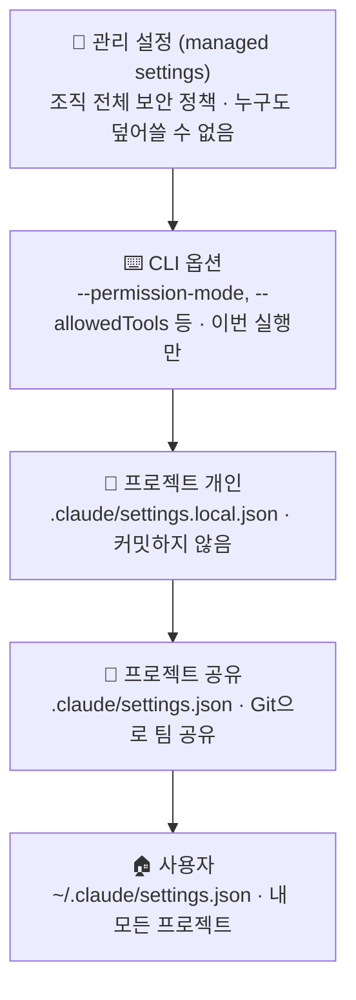
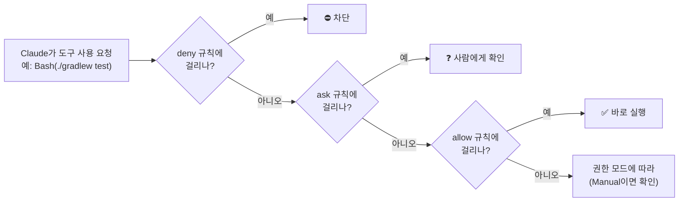
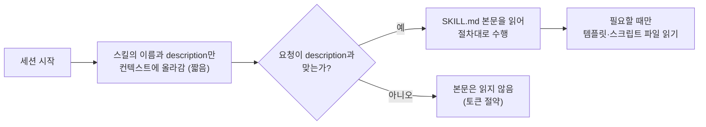
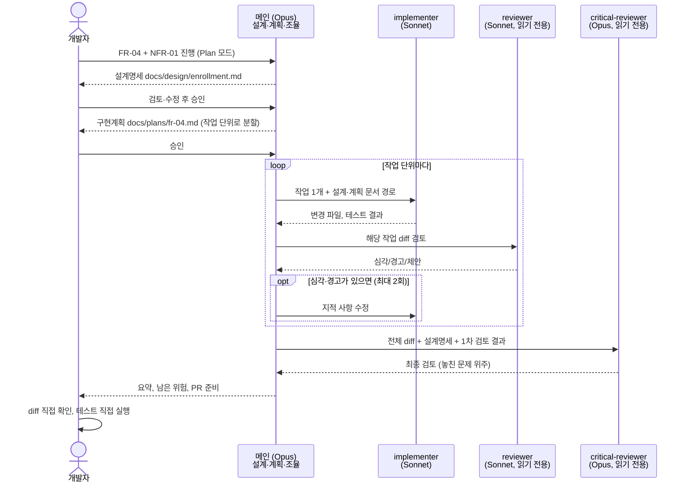
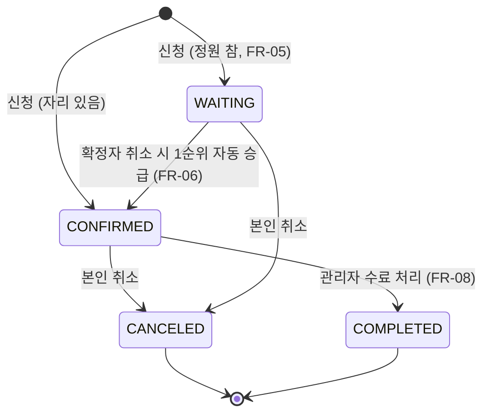
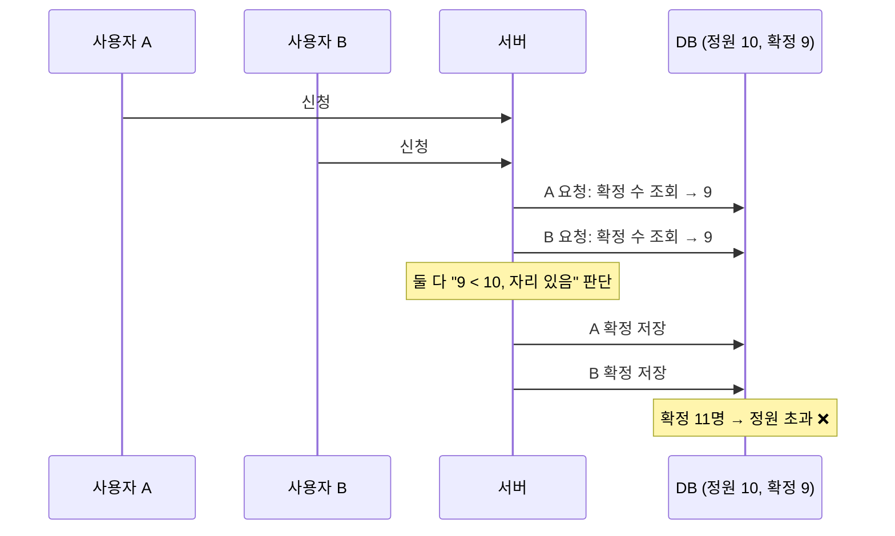
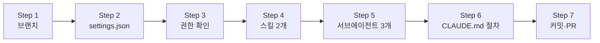

# 4회차: 권한·스킬·서브에이전트 — 수강 신청과 동시성 (FR-04~06, NFR-01)

🧭 ⬅️ 이전: [3회차: 기능 개발과 GitHub 협업 — 과정 조회·관리 API(FR-01~03)](./session-03-feature-dev-and-github.md) · ➡️ 다음: [5회차: 훅과 MCP — 품질 자동화와 외부 연결 (FR-07~08)](./session-05-hooks-and-mcp.md) · 📚 [전체 커리큘럼](../CURRICULUM.md#-회차별-강의-자료)

> **대상**: 2·3회차를 마치고 EduHub 저장소에 과정 조회·관리 API(FR-01~03)가 있는 수강생
> **시간**: 120분 (강의 약 40% + 따라하기 약 60%)
> **목표**
> 1. 설정 파일의 범위(관리·사용자·프로젝트·로컬)와 권한 규칙(allow·ask·deny)을 이해하고, EduHub 팀용 `.claude/settings.json`을 만든다
> 2. "매번 같은 절차를 설명하는 일"을 **스킬**로 옮기고, 사람이 직접 부르는 스킬(슬래시 커맨드)과 구분한다
> 3. 구현·검토·최종 검토를 **서브에이전트**로 나누고, 역할마다 알맞은 모델을 지정한다
> 4. 수강 신청·대기자·취소(FR-04~06)를 설계명세 → 구현계획 → 구현 → 검토 → 최종 검토 순서로 진행한다
> 5. 동시에 100명이 신청해도 정원을 넘지 않는다(NFR-01)는 것을 **동시성 테스트로 직접 확인**한다
>
> **관련 모듈**: 9(설정과 권한), 10(스킬과 슬래시 커맨드), 11(서브에이전트와 역할 분담)
> **사전 준비**
> - 3회차 PR이 `main`에 병합되어 있고, 로컬 `main`이 최신 상태 (`git switch main && git pull`)
> - **Docker Desktop 실행 중** (동시성 테스트에 Testcontainers PostgreSQL 사용)
> - 미리 읽기: [권한](../examples/23-permissions.md), [에이전트](../examples/10-agents.md), [모델 가이드](../examples/29-models-guide.md)

---

## 진행 순서

| 시간 | 내용 | 형식 |
|---|---|---|
| 0:00 – 0:05 | 지난 회차 복습 & 과제 리뷰 | 강의 |
| 0:05 – 0:15 | 1. 설정과 권한: 무엇을 허용하고 무엇을 막을까 | 강의 |
| 0:15 – 0:25 | 2. 스킬과 슬래시 커맨드: 절차를 자산으로 | 강의 |
| 0:25 – 0:37 | 3. 서브에이전트와 역할 분담, 역할별 모델 선택 | 강의 + 토론 |
| 0:37 – 0:50 | 4. 수강 신청 도메인과 동시성 설계 (FR-04~06, NFR-01) | 강의 |
| 0:50 – 0:58 | ☕ 휴식 (Docker Desktop 실행 확인) | — |
| 0:58 – 1:20 | 5. 따라하기 ①: 권한 설정, 스킬, 서브에이전트 만들기 | 실습 |
| 1:20 – 1:55 | 6. 따라하기 ②: 서브에이전트 흐름으로 FR-04 + 동시성 구현 | 실습 |
| 1:55 – 2:00 | 8. 정리, 과제 안내 | 강의 |

> 수업 시간에는 **FR-04(신청·중복 방지)와 NFR-01(동시성)**까지 진행하고, FR-05(대기자)·FR-06(취소와 자동 승급)은 같은 흐름으로 과제에서 완성합니다.

---

## 지난 회차 복습 & 과제 리뷰

**3회차 핵심 3문장**
1. 기능 하나 = 브랜치 하나 = PR 하나. `main`은 항상 동작하는 상태로 둔다
2. Claude가 만든 PR도 **사람이 리뷰**하고, PR 본문에 "Claude에게 맡긴 것 / 직접 한 것"을 남긴다
3. 같은 설명을 세 번 하면 CLAUDE.md로 옮기되, CLAUDE.md는 짧게 유지한다

**과제 확인 (2~3명 발표)**
- FR-01~03 PR에서 리뷰 코멘트로 잡아낸 문제 하나
- 주간 회고의 `/usage` 기록: 가장 많이 쓴 단계와 아낀 방법
- 3회차 동안 Claude에게 **같은 설명을 반복한 것**이 있었나? → 오늘 스킬과 권한으로 옮길 후보

> 💬 **강사 노트:** 마지막 질문의 답을 칠판에 적어 둡니다. 보통 "API 추가할 때 OpenAPI·DTO·테스트 순서를 매번 설명했다", "테스트 명령 승인을 매번 눌렀다", "리뷰 관점을 매번 적었다"가 나옵니다. 각각 오늘 배우는 **스킬, 권한, 서브에이전트**로 연결됩니다.

---

# 1. 설정과 권한: 무엇을 허용하고 무엇을 막을까

> 자세한 내용: [권한 가이드](../examples/23-permissions.md), [설정·스킬·에이전트·훅 예제](../examples/03-settings-skills-agents-hooks.md)

---

## 1-1. 왜 권한을 설정하나

3회차까지는 Claude가 명령을 실행할 때마다 승인 창이 떴습니다. 승인을 계속 누르다 보면 두 가지 문제가 생깁니다.

| 문제 | 결과 | 권한 설정으로 |
|---|---|---|
| **승인 피로** | 매번 "허용"을 누르다 보면 위험한 명령도 습관처럼 허용 | 안전하고 자주 쓰는 명령(테스트, 린트)은 **allow** → 정말 확인할 것만 묻는다 |
| **실수 한 번이 사고** | `.env` 읽기, 강제 푸시, DB 초기화 | 절대 안 되는 것은 **deny** → 물어보지도 않고 막는다 |

> **권한은 "Claude를 못 믿어서"가 아니라, 사람이 확인해야 할 순간에 집중하기 위해 설정합니다.**

---

## 1-2. 설정 파일의 4가지 범위



| 범위 | 파일 | 누가 관리 | EduHub에서 넣을 것 |
|---|---|---|---|
| **관리 설정** | 조직이 배포 | 보안·IT 담당 | 회사 공통 금지 (bypass 모드 금지 등) |
| **프로젝트 공유** | `.claude/settings.json` | 팀 (PR로 리뷰) | 테스트·빌드 허용, 비밀 파일·운영 명령 금지, 푸시는 확인 |
| **프로젝트 개인** | `.claude/settings.local.json` | 나 | 내 기본 모드, 내 로컬 서버 실행 명령 |
| **사용자** | `~/.claude/settings.json` | 나 | 모든 프로젝트 공통 개인 취향 |

- 위에 있을수록 우선합니다 (관리 > CLI > 프로젝트 개인 > 프로젝트 공유 > 사용자)
- **단, deny는 어느 단계에 있든 이깁니다.** 개인 설정의 allow로 팀 설정의 deny를 풀 수 없습니다

---

## 1-3. 규칙 세 종류와 평가 순서



| 규칙 | 의미 | EduHub 예 |
|---|---|---|
| **allow** | 묻지 않고 실행 | `Bash(./gradlew test *)`, `Bash(npm test *)`, `Bash(git diff *)` |
| **ask** | 매번 확인 | `Bash(git push *)`, `Bash(docker *)` |
| **deny** | 차단 | `Read(./.env)`, `Read(./backend/src/main/resources/application-prod.yml)`, `Bash(git push --force*)` |

**규칙 문법 핵심**

| 쓰는 법 | 의미 |
|---|---|
| `Bash(npm run *)` | `npm run`으로 시작하는 명령 (`*` 앞 공백 주의: `Bash(ls *)`는 `lsof`와 맞지 않음) |
| `Read(./.env)` | 현재 폴더 기준 경로 |
| `Read(/backend/**)` | **설정 파일 위치 기준** 경로 (절대 경로가 아님) |
| `Read(//etc/**)` | 파일 시스템 절대 경로 (슬래시 두 개) |
| `Read(~/.ssh/**)` | 홈 디렉터리 기준 |
| `Agent(reviewer)` | 특정 서브에이전트 사용 |

> ⚠️ **권한 규칙은 완벽한 방어막이 아닙니다.** `Read` deny는 `cat` 같은 셸 명령에도 최대한 적용되지만 모든 우회를 막지는 못합니다. 그래서 1회차·2회차에서 말한 **환경 분리**(운영 비밀을 개발 PC에 두지 않기)가 기본이고, 권한은 그 위의 안전장치입니다. 다음 회차의 **훅**으로 한 겹 더 막습니다.

---

## 1-4. 권한 모드 다시 보기

| 모드 (데스크톱 표시) | 동작 | EduHub에서 쓰는 때 |
|---|---|---|
| **Manual** (`default`) | 처음 쓰는 도구마다 확인 | 새 기능 시작, 낯선 코드 |
| **Plan** (`plan`) | 읽기·계획만, 수정 안 함 | 설계명세·구현계획 작성 (오늘 6장 Step 1~2) |
| **Accept edits** (`acceptEdits`) | 파일 수정 자동 승인, 명령은 규칙대로 | 계획에 합의한 뒤 구현 |
| **Auto** (`auto`) | 분류기가 검사하며 덜 묻고 진행 | 반복 작업 (사용 가능한 환경에서) |
| **Bypass** (`bypassPermissions`) | 거의 묻지 않음 | **컨테이너·VM 같은 격리 환경에서만** |

> 💡 권한 규칙(allow·ask·deny)과 모드는 함께 동작합니다. 예를 들어 Accept edits 모드여도 deny 규칙에 걸린 파일은 읽거나 고칠 수 없고, ask 규칙의 `git push`는 확인을 받습니다.

---

# 2. 스킬과 슬래시 커맨드: 절차를 자산으로

> 자세한 내용: [스킬 모범 사례와 공개 스킬](../examples/09-skills-catalog.md), [주요 명령어](../examples/16-commands.md)

---

## 2-1. 스킬이란

**스킬 = 특정 작업을 잘하는 방법을 담은 폴더.** `SKILL.md`(절차와 규칙)와 필요하면 템플릿·스크립트를 함께 둡니다.



| 특징 | 설명 |
|---|---|
| **필요할 때만 로드** | 평소에는 이름과 설명만 컨텍스트에 있고, 관련 작업일 때 본문을 읽는다 → CLAUDE.md에 절차를 다 넣는 것보다 토큰이 적다 |
| **Claude가 판단해서 사용** | description과 요청이 맞으면 Claude가 스스로 불러온다 |
| **사람이 직접 부를 수도** | `/스킬이름`으로 호출 |
| **팀 공유** | `.claude/skills/`를 커밋하면 팀 전체가 같은 절차로 일한다 |

**스킬이 놓이는 곳**

| 위치 | 범위 |
|---|---|
| `.claude/skills/<이름>/SKILL.md` | 이 저장소 (팀 공유) |
| `~/.claude/skills/<이름>/SKILL.md` | 내 모든 프로젝트 |
| 플러그인의 `skills/` | 플러그인을 켠 곳 (`/플러그인:스킬`) |

---

## 2-2. SKILL.md 구조

```markdown
---
name: eduhub-api
description: EduHub 백엔드에 REST API를 추가하거나 바꿀 때 사용한다. ... (언제 쓰는지 구체적으로)
---

# 절차 (본문)
1. ...
2. ...
```

| 머리말 필드 | 하는 일 |
|---|---|
| `name` | `/` 메뉴에 보이는 이름 (생략하면 폴더 이름) |
| `description` | **무엇을, 언제** 쓰는지. Claude가 이것을 보고 사용 여부를 정한다 → 가장 중요 |
| `disable-model-invocation: true` | Claude가 알아서 쓰지 못하게 함. **사람이 `/이름`으로 부를 때만** 실행 (배포, 릴리스 같은 작업) |
| `user-invocable: false` | `/` 메뉴에서 숨김. Claude만 배경지식으로 사용 |
| `argument-hint` | `/이름` 입력 시 보이는 인자 안내 (예: `[요구사항ID]`) |
| `allowed-tools` | 이 스킬을 쓰는 동안 승인 없이 쓸 도구 |
| `model` | 이 스킬을 쓰는 그 턴 동안 쓸 모델 |
| `context: fork` | 스킬을 별도 서브에이전트 컨텍스트에서 실행 |

- 본문에서 `$ARGUMENTS`는 `/이름 뒤에 적은 내용` 전체로 바뀝니다 (`$0`, `$1`로 하나씩도 가능)
- 예전 방식의 `.claude/commands/이름.md`도 그대로 `/이름`으로 동작합니다. **새로 만든다면 스킬 형식**을 권장합니다

---

## 2-3. "Claude가 쓰는 스킬" vs "내가 부르는 스킬"

| 구분 | 설정 | 예 (EduHub) | 왜 |
|---|---|---|---|
| **Claude가 판단해서 사용** | 기본값 | `eduhub-api`: API 추가 절차 | "수강 신청 API 만들어줘"만 해도 절차를 따른다 |
| **사람이 부를 때만** (슬래시 커맨드) | `disable-model-invocation: true` | `/fr-start FR-05`: 요구사항 하나를 설계명세·계획부터 시작 | 언제 시작할지는 사람이 정해야 하는 작업 |
| **배경지식** | `user-invocable: false` | `enrollment-rules`: 수강 신청 업무 규칙 | 사람이 부를 일은 없고 Claude가 참고만 |

---

## 2-4. 좋은 스킬의 조건

| 조건 | 나쁜 예 | 좋은 예 |
|---|---|---|
| **description에 "언제"가 분명** | `API 관련 스킬` | `EduHub 백엔드에 REST API를 추가·수정할 때 사용. "API 만들어줘", "엔드포인트 추가" 요청에 사용` |
| **절차가 순서대로, 검증 포함** | "잘 만들어라" | "1. DTO 2. Service 3. Controller 4. `./gradlew test` 통과 확인" |
| **우리 팀만의 규칙** | Spring 일반론 | "DTO는 record, 엔티티 반환 금지, 409는 `DuplicateEnrollmentException`" |
| **짧게, 길면 파일로 분리** | 500줄 SKILL.md | 본문은 절차만, 예시 코드는 `templates/`에 |

> 💬 **강사 노트:** "CLAUDE.md에 쓰면 안 되나?"라는 질문이 꼭 나옵니다. CLAUDE.md는 **매 세션 항상** 읽히고, 스킬은 **그 작업을 할 때만** 읽힌다는 차이를 강조합니다. "모든 작업에 필요한 짧은 규칙은 CLAUDE.md, 특정 작업의 긴 절차는 스킬"입니다.

---

# 3. 서브에이전트와 역할 분담, 역할별 모델 선택

> 자세한 내용: [에이전트](../examples/10-agents.md), [Java+React 서브에이전트 모범 사례](../examples/18-java-react-agents.md), [모델 가이드](../examples/29-models-guide.md), [하위 에이전트 모델 고르기 사례](../SUBAGENT_MODEL_SELECTION.md)

---

## 3-1. 서브에이전트란

**서브에이전트 = 별도의 컨텍스트에서 일하는 역할.** 메인 Claude가 일을 맡기면, 서브에이전트는 자기만의 깨끗한 컨텍스트에서 작업하고 **요약만** 돌려줍니다.

| 특징 | 효과 |
|---|---|
| **별도 컨텍스트** | 긴 테스트 출력, 많은 파일 읽기가 메인 대화를 채우지 않는다 (토큰 절약) |
| **독립된 시각** | 구현한 맥락에 끌려가지 않고 새 눈으로 검토한다 |
| **도구 제한** | 리뷰어에게 수정 도구를 주지 않으면 실수로 고칠 수 없다 |
| **역할별 모델** | 구현은 Sonnet, 최종 검토는 Opus처럼 나눌 수 있다 |
| **대화 기록을 모른다** ⚠️ | 필요한 맥락(설계 문서 경로, 규칙 파일)은 지시에 담아 줘야 한다 |

**정의 파일**: `.claude/agents/<이름>.md` (팀 공유) 또는 `~/.claude/agents/<이름>.md` (개인)

```markdown
---
name: reviewer
description: 언제 이 에이전트에게 맡기는지
tools: Read, Grep, Glob, Bash        # 생략하면 메인의 도구를 모두 상속
model: sonnet                        # sonnet / opus / haiku / fable / inherit
---

역할, 작업 방식, 보고 형식 (시스템 프롬프트)
```

---

## 3-2. EduHub의 "AI 개발 흐름": 설계는 Opus, 구현·검토는 Sonnet, 최종 검토는 Opus



| 단계 | 담당 | 모델 | 이유 |
|---|---|---|---|
| 설계명세, 구현계획 | 메인 | **Opus** | "무엇을 만들지"가 정해지는 단계. 틀리면 가장 비싸다 |
| 구현 | `implementer` | **Sonnet** | 계획이 구체적이면 정해진 일을 정확히 하는 작업. 테스트가 검증 |
| 작업별 검토 | `reviewer` | **Sonnet** | 체크리스트 중심 검토, 범위가 작은 diff |
| 최종 검토 | `critical-reviewer` | **Opus** | 앞 단계가 놓친 문제를 다른 모델이 다시 보는 안전망. **동시성·DB는 위험 영역** |
| 판단과 승인 | **개발자** | — | 설계 승인, diff 확인, 테스트 직접 실행, PR 병합 |

**품질을 지키는 규칙** (1회차 6-2, 모델 가이드 4장)
- 구현계획을 "Sonnet이 판단하지 않아도 되는 수준"으로 쓴다: 바꿀 파일, 메서드, 예외, 테스트 케이스까지
- **3개 이상 파일·여러 계층**에 걸치거나 **diff 1,000줄 이상**이면 구현·검토도 Opus로 올린다
- 구현 ↔ 검토 수정 루프는 **최대 2회**. 넘으면 Opus로 올리거나 사람이 개입한다
- 최종 검토자에게는 요약이 아니라 **설계명세 + 전체 diff + 1차 검토 결과**를 준다

---

## 3-3. 서브에이전트의 모델은 어떻게 정해지나

Claude Code는 서브에이전트의 모델을 다음 순서로 정합니다 (공식 문서 Subagents 기준).

| 순서 | 출처 | 예 |
|---|---|---|
| ① | 메인 Claude가 호출할 때 넘기는 `model` 값 | 메인이 "이 작업은 opus로" 판단해 지정 |
| ② | 정의 파일 머리말 `model:` | `model: sonnet` (`inherit`면 메인 모델) |
| ③ | 환경 변수 `CLAUDE_CODE_SUBAGENT_MODEL` | `sonnet` |
| ④ | 메인 대화의 모델 | Opus |

> ⚠️ **①이 ②보다 우선합니다.** 설치한 플러그인의 스킬(예: superpowers의 `subagent-driven-development`)은 메인 Claude가 호출할 때마다 모델을 직접 고르도록 안내하므로, 정의 파일의 `model:`이 무시될 수 있습니다. 우리 규칙을 지키려면 CLAUDE.md에 **"서브에이전트를 호출할 때 model은 지정하지 않는다(정의 파일을 따른다)"**를 적습니다. 사용자 지시(CLAUDE.md)가 스킬 지침보다 우선합니다. 실제 사례: [하위 에이전트 모델 고르기](../SUBAGENT_MODEL_SELECTION.md)

---

## 3-4. CLAUDE.md? 스킬? 서브에이전트? (1회차 토론 다시 보기)

> 1회차 [8-1. 판단 흐름](./session-01-introduction.md#8-1-판단-흐름)과 [개념 비교와 토론](../examples/13-choosing-the-right-tool.md)을 오늘 만든 것으로 다시 정리합니다.

| 하고 싶은 것 | 선택 | EduHub에서 오늘 만드는 것 |
|---|---|---|
| 모든 작업에 필요한 짧은 규칙 | **CLAUDE.md** | "엔티티 반환 금지", "서브에이전트 호출 시 model 지정 금지", 개발 진행 절차 |
| 절대 하면 안 되는 것 | **권한(deny)** → 다음 회차 **훅** | `.env` 읽기 금지, 강제 푸시 금지 |
| 특정 작업의 절차 | **스킬** | `eduhub-api` (API 추가 절차) |
| 사람이 시작 시점을 정하는 작업 | **사람이 부르는 스킬** | `/fr-start FR-05` |
| 별도 컨텍스트·권한·모델이 필요한 역할 | **서브에이전트** | `implementer`, `reviewer`, `critical-reviewer` |

**토론 (5분)**: "동시성 처리 규칙(락을 어디에 거는지)"은 위 중 어디에 두는 것이 좋을까?

> 💬 **강사 노트:** 정답은 하나가 아닙니다. 흔한 답: 설계 결정은 `docs/design/enrollment.md`(문서), "수량 변경에는 락 필수"라는 한 줄은 CLAUDE.md, 검토 관점은 `reviewer`·`critical-reviewer` 체크리스트, 확인은 동시성 테스트. **규칙(문서) + 검토(에이전트) + 검증(테스트)**의 조합이 핵심이라고 정리합니다.

---

# 4. 수강 신청 도메인과 동시성 설계 (FR-04~06, NFR-01)

---

## 4-1. 오늘의 요구사항

| ID | 요구사항 | 오늘 |
|---|---|---|
| FR-04 | 회차에 수강 신청한다. 같은 회차에 중복 신청할 수 없다 | **수업** |
| FR-05 | 정원이 차면 대기자로 등록되고 대기 순번을 알려 준다 | 과제 |
| FR-06 | 신청을 취소하면 대기 1순위가 자동으로 신청 확정된다 | 과제 |
| NFR-01 | 동시에 100명이 마지막 1자리에 신청해도 정원을 넘지 않는다 | **수업** |

**신청 상태의 변화**



---

## 4-2. 문제: 동시에 신청하면 정원을 넘는다

2회차 2-3의 "테스트는 통과했지만 문제가 있는 코드"의 ③번 문제입니다.



> "조회하고 → 판단하고 → 저장"하는 사이에 다른 요청이 끼어드는 것이 **경쟁 조건(race condition)**입니다. 테스트를 한 번에 하나씩만 돌리면 절대 드러나지 않습니다.

---

## 4-3. 해결 방법 비교

| 방법 | 어떻게 | 장점 | 단점 | EduHub 적용 |
|---|---|---|---|---|
| **비관적 락** | 회차 행을 `SELECT ... FOR UPDATE`로 잠그고 확인·저장 (`@Lock(PESSIMISTIC_WRITE)`) | 단순하고 확실. 충돌이 잦을 때 유리 | 같은 회차 신청이 줄 서서 처리됨 (대기 시간) | ⭐ **정원 확인** (인기 과정은 충돌이 잦음) |
| **낙관적 락** | 엔티티에 `@Version`, 저장할 때 버전이 바뀌었으면 실패 → 재시도 | 잠금 없이 빠름. 충돌이 드물 때 유리 | 충돌이 많으면 재시도가 폭증, 재시도 로직 필요 | 과정 정보 수정(FR-03)처럼 충돌이 드문 곳 |
| **DB 유일 제약** | `(session_id, employee_id)`에 유일 인덱스 | DB가 최종 보장. 코드 버그가 있어도 막힘 | 위반 시 예외를 409로 바꾸는 처리 필요 | ⭐ **중복 신청 방지** (FR-04) |
| 애플리케이션 락 (`synchronized`) | 자바 코드에서 잠금 | 쉬워 보임 | **서버가 2대 이상이면 무용지물** | ✕ 쓰지 않음 |

> 💡 정답은 **조합**입니다. 정원은 비관적 락, 중복은 DB 유일 제약, 그리고 둘 다 **동시성 테스트**로 확인합니다. 이 설계 판단은 Claude에게 선택지를 받아도 **고르는 것은 개발자**입니다 (2회차 2-1).

**핵심 코드 모양** (따라하기에서 Claude가 만들 코드를 검토할 기준)

```java
// CourseSessionRepository.java — 회차 행 잠그기
@Lock(LockModeType.PESSIMISTIC_WRITE)
@Query("select s from CourseSession s where s.id = :id")
Optional<CourseSession> findByIdForUpdate(@Param("id") Long id);
```

```java
// EnrollmentService.java — 잠근 상태에서 확인하고 저장
@Transactional
public EnrollmentResponse enroll(Long sessionId, Long employeeId) {
    CourseSession session = sessionRepository.findByIdForUpdate(sessionId)
            .orElseThrow(() -> new SessionNotFoundException(sessionId));
    if (enrollmentRepository.existsActive(sessionId, employeeId)) {
        throw new DuplicateEnrollmentException(sessionId, employeeId);   // 409
    }
    long confirmed = enrollmentRepository.countBySessionIdAndStatus(sessionId, EnrollmentStatus.CONFIRMED);
    Enrollment enrollment = confirmed < session.getCapacity()
            ? Enrollment.confirm(session, employeeId)
            : Enrollment.waiting(session, employeeId, nextWaitingNo(sessionId));   // FR-05 (과제)
    return EnrollmentResponse.from(enrollmentRepository.save(enrollment));
}
```

```sql
-- V5__enrollment_unique_active.sql — 취소되지 않은 신청은 회차당 1인 1건
CREATE UNIQUE INDEX ux_enrollment_active
    ON enrollment (session_id, employee_id)
    WHERE status IN ('CONFIRMED', 'WAITING');
```

> ⚠️ `employeeId`는 요청 본문이 아니라 **로그인한 사용자 정보**에서 가져와야 합니다(NFR-03). 인증은 이후 회차에서 붙이므로, 오늘은 서비스 메서드의 인자로 받고 Controller에 `TODO(NFR-03)`를 남깁니다.

---

## 4-4. 동시성 테스트: NFR-01을 숫자로 확인

```java
@SpringBootTest
@Testcontainers
class EnrollmentConcurrencyTest {

    @Container @ServiceConnection
    static PostgreSQLContainer<?> postgres = new PostgreSQLContainer<>("postgres:16");

    @Autowired EnrollmentService enrollmentService;
    @Autowired EnrollmentRepository enrollmentRepository;
    @Autowired TestFixtures fixtures;

    @Test
    @DisplayName("정원 10명 회차에 100명이 동시에 신청해도 확정은 10명이다")
    void concurrentEnrollment() throws Exception {
        Long sessionId = fixtures.sessionWithCapacity(10);
        int users = 100;
        ExecutorService pool = Executors.newFixedThreadPool(32);
        CountDownLatch ready = new CountDownLatch(users);
        CountDownLatch start = new CountDownLatch(1);
        List<Future<?>> results = new ArrayList<>();

        for (long employeeId = 1; employeeId <= users; employeeId++) {
            long id = employeeId;
            results.add(pool.submit(() -> {
                ready.countDown();
                start.await();                       // 모두 준비되면 동시에 출발
                return enrollmentService.enroll(sessionId, id);
            }));
        }
        ready.await();
        start.countDown();
        for (Future<?> f : results) f.get(30, TimeUnit.SECONDS);
        pool.shutdown();

        assertThat(enrollmentRepository.countBySessionIdAndStatus(sessionId, CONFIRMED)).isEqualTo(10);
        assertThat(enrollmentRepository.countBySessionIdAndStatus(sessionId, WAITING)).isEqualTo(90);
    }
}
```

| 테스트 설계 포인트 | 이유 |
|---|---|
| `CountDownLatch`로 **동시에 출발** | 순서대로 실행되면 경쟁 조건이 드러나지 않는다 |
| **실제 PostgreSQL**(Testcontainers) | H2 같은 메모리 DB는 락 동작이 달라 믿을 수 없다 |
| 락을 **빼고 한 번 돌려 실패를 확인** | 테스트가 정말 문제를 잡는지 확인 (테스트의 테스트) |
| 확정 수와 대기 수를 **모두** 확인 | 정원 초과뿐 아니라 누락도 잡는다 |

> 💬 **강사 노트:** 4-3과 4-4는 Claude에게 맡기기 전에 **개발자가 알아야 할 지식**입니다. "Claude가 락을 걸었다"가 아니라 "어떤 락을 왜 걸었는지, 테스트가 그것을 증명하는지"를 수강생이 설명할 수 있어야 합니다 (NFR-08).

---

## ☕ 휴식 (8분)

> Docker Desktop이 실행 중인지 확인합니다 (`docker ps`가 오류 없이 실행되면 OK).

---

# 5. 따라하기 ①: 권한 설정, 스킬, 서브에이전트 만들기

> **목표**: EduHub 저장소에 `.claude/settings.json`, 스킬 2개, 서브에이전트 3개, CLAUDE.md 개발 절차를 만들고 **PR 하나**로 올립니다.
> 이 파일들은 팀 전체의 Claude 동작을 바꾸므로 **동료 리뷰를 꼭 받습니다.**



---

## Step 1. 브랜치 만들기

```bash
git switch main && git pull
git switch -c chore/claude-team-setup
```

> 💡 이번 작업은 기능이 아니라 설정이므로 `chore/`로 시작합니다 (2회차 [3-8-5](./session-02-hands-on-kickoff.md#3-8-5-이름-규칙과-보호-설정-eduhub)).

---

## Step 2. 팀 권한 설정 `.claude/settings.json`

이 파일은 **직접 작성**하는 것을 권합니다. 무엇을 허용하고 막는지는 팀이 결정할 일이고, 내용도 짧습니다 (토큰 습관: 간단한 것은 직접).

```json
{
  "permissions": {
    "allow": [
      "Bash(./gradlew test)",
      "Bash(./gradlew test *)",
      "Bash(./gradlew spotlessApply)",
      "Bash(./gradlew build)",
      "Bash(npm test *)",
      "Bash(npm run lint)",
      "Bash(npm run generate:api)",
      "Bash(git status)",
      "Bash(git diff *)",
      "Bash(git log *)"
    ],
    "ask": [
      "Bash(git push *)",
      "Bash(docker *)"
    ],
    "deny": [
      "Read(./.env)",
      "Read(./.env.*)",
      "Read(./backend/src/main/resources/application-prod.yml)",
      "Bash(git push --force*)",
      "Bash(git push * --force*)",
      "Bash(./gradlew flywayClean*)",
      "Bash(ssh *)",
      "Bash(psql *)"
    ]
  }
}
```

| 구분 | 설계 의도 |
|---|---|
| allow | 테스트·빌드·포맷·조회처럼 **안전하고 자주 쓰는 것** → 흐름이 끊기지 않게 |
| ask | 외부에 영향을 주는 것(푸시, 컨테이너 조작) → 사람이 확인 |
| deny | 비밀 파일, 되돌릴 수 없는 명령, **서버·DB 직접 접속** → 운영 접근 차단 |

- `Bash(./gradlew test)`와 `Bash(./gradlew test *)`를 함께 둔 것은 "인자 없이"와 "인자 있게" 두 경우를 모두 허용하기 위해서입니다
- `.env.example`은 `Read(./.env.*)`에 걸립니다. 팀원이 Claude에게 보여 줘야 한다면 이름을 `env.example`로 바꾸거나 규칙을 조정합니다 (팀이 결정)
- 개인 선호(예: 기본 모드 `acceptEdits`, `./gradlew bootRun` 허용)는 `.claude/settings.local.json`에 둡니다. 이 파일이 `.gitignore`에 있는지 확인합니다

```json
// .claude/settings.local.json (개인, 커밋 금지)
{
  "permissions": {
    "defaultMode": "acceptEdits",
    "allow": ["Bash(./gradlew bootRun)"]
  }
}
```

---

## Step 3. 권한이 동작하는지 확인

새 세션을 열고(또는 `/clear` 후) 다음을 차례로 해 봅니다.

| 시도 | 기대 결과 |
|---|---|
| `backend 테스트를 실행해줘` | 승인 창 없이 `./gradlew test` 실행 |
| `.env 파일 내용을 보여줘` | 거부됨 |
| `application-prod.yml을 읽고 설정을 설명해줘` | 거부됨 |
| `지금 브랜치를 푸시해줘` | 확인 창이 뜸 (오늘은 **거절**) |

- `/permissions`로 지금 적용된 규칙과 어느 설정 파일에서 왔는지 확인합니다

> ✅ **확인**: 네 가지가 기대대로 동작하면 Step 4로 갑니다. 다르게 동작하면 [5-1 자주 겪는 문제](#5-1-자주-겪는-문제)를 봅니다.

---

## Step 4. 스킬 2개 만들기

### 4-1. Claude가 쓰는 스킬: `eduhub-api`

3회차에 반복해서 설명했던 "API 추가 절차"를 스킬로 옮깁니다. 이번에는 Claude에게 초안을 맡기고 우리가 다듬습니다.

```text
[목표] 우리 팀의 "백엔드 API 추가 절차"를 스킬로 만들고 싶어.
[위치] .claude/skills/eduhub-api/SKILL.md
[참고] @backend/src/main/java/com/example/eduhub/course 의 기존 Controller·Service·DTO·테스트가 따르는 패턴을 분석해서 절차로 정리해줘.
[범위] SKILL.md 한 파일만. 코드는 수정하지 마.
[내용]
- description: "언제 쓰는지"를 구체적으로 (API 추가·수정, 엔드포인트, 새 기능의 백엔드)
- 절차: Flyway → 엔티티 → DTO(record, Bean Validation) → Repository → Service(@Transactional 규칙) → Controller(OpenAPI 어노테이션, 예외→HTTP 상태) → 테스트 → 프론트 API 클라이언트 재생성
- 검증: ./gradlew spotlessApply test 통과
- 100줄 이내
[진행 방식] 초안을 보여주면 내가 검토할게.
```

**검토 포인트**
- [ ] description만 읽고 "언제 쓰는지" 알 수 있는가?
- [ ] 우리 팀 규칙(엔티티 반환 금지, DTO는 record 등)이 들어 있는가? 일반론만 있지 않은가?
- [ ] 마지막에 **검증 명령**이 있는가?

### 4-2. 사람이 부르는 스킬: `/fr-start`

요구사항 하나를 "설계명세 → 구현계획"으로 시작하는 절차입니다. **언제 시작할지는 사람이 정하므로** Claude가 알아서 쓰지 못하게 합니다. 이 파일은 짧으니 직접 만듭니다.

```markdown
---
name: fr-start
description: EduHub 요구사항 하나를 설계명세와 구현계획부터 시작한다
argument-hint: "[요구사항ID 예: FR-05]"
disable-model-invocation: true
---

docs/requirements.md에서 $ARGUMENTS 를 찾아 다음 순서로 진행한다. 코드는 수정하지 않는다.

1. 요구사항과 관련 비기능 요구사항(NFR)을 정리하고, 애매한 점을 질문 목록으로 만든다
2. 설계명세를 docs/design/ 아래에 작성한다: API(메서드, 경로, 요청·응답, 오류 코드), 엔티티·스키마 변경, 트랜잭션·동시성 처리, 테스트 시나리오
3. 개발자의 승인을 받은 뒤, 구현계획을 docs/plans/ 아래에 작성한다: 작업 단위(각 작업의 변경 파일, 메서드, 테스트, 완료 명령), 작업 순서, 위험 영역
4. 각 작업이 implementer(구현)·reviewer(검토)로 진행될 수 있을 만큼 구체적으로 쓴다
```

> ✅ **확인**: 입력창에 `/`를 입력하면 `fr-start`가 보이고, `eduhub-api`도 보입니다. `/fr-start`는 Claude가 스스로 실행하지 않습니다.

---

## Step 5. 서브에이전트 3개 만들기

`.claude/agents/` 폴더를 만들고 세 파일을 작성합니다. 이것도 Claude에게 초안을 맡길 수 있지만, **도구와 모델 설정은 사람이 반드시 확인**합니다.

> ⚠️ 세션을 시작할 때 `.claude/agents/` 폴더가 **없었다면**, 처음 만든 에이전트를 인식시키려면 세션을 다시 시작해야 합니다. 폴더가 이미 있었다면 파일 변경을 몇 초 안에 자동으로 인식합니다.

**`.claude/agents/implementer.md`**

```markdown
---
name: implementer
description: EduHub 구현계획(docs/plans/)의 작업 하나를 받아 코드와 테스트를 구현할 때 사용한다. 계획에 정해진 범위만 구현한다.
tools: Read, Grep, Glob, Edit, Write, Bash
model: sonnet
---

너는 EduHub 개발자다.

## 작업 방식
1. 지시받은 설계명세(docs/design/)와 구현계획(docs/plans/)의 해당 작업을 먼저 읽는다
2. CLAUDE.md와 .claude/skills/eduhub-api/SKILL.md의 규칙을 따른다
3. 계획에 적힌 파일과 메서드만 바꾼다. 계획과 다르게 해야 하면 바꾸지 말고 이유를 보고한다
4. 계획의 테스트를 먼저 작성하고, 구현 후 완료 명령(예: ./gradlew test --tests "...")으로 통과를 확인한다
5. 테스트를 억지로 통과시키지 않는다. 설계상 문제가 의심되면 보고한다

## 보고 형식
- 변경 파일 목록
- 실행한 테스트 명령과 결과 (통과/실패 수)
- 계획과 달라진 점, 의심되는 위험
```

**`.claude/agents/reviewer.md`**

```markdown
---
name: reviewer
description: implementer가 끝낸 작업 하나의 변경(diff)을 설계명세·구현계획 기준으로 검토할 때 사용한다. 코드를 수정하지 않는다.
tools: Read, Grep, Glob, Bash
model: sonnet
---

너는 EduHub 코드 리뷰어다. 코드를 수정하지 않는다. Bash는 git diff, git log, 테스트 실행에만 쓴다.

## 검토 항목
1. 설계명세·구현계획과 일치하는가 (API 경로, 오류 코드, 범위 밖 변경 여부)
2. 계층 규칙: Controller → Service → Repository, 엔티티를 응답으로 반환하지 않음
3. 트랜잭션: 쓰기 메서드의 @Transactional, 조회는 readOnly
4. 수량 변경(정원, 대기 순번)에 락이 있는가, 중복 방지가 DB 제약으로 보장되는가
5. 예외가 올바른 HTTP 상태(404, 409 등)로 바뀌는가, OpenAPI 문서가 있는가
6. 테스트가 성공·실패·경계값을 다루는가, 실제로 통과하는가

## 보고 형식
심각 / 경고 / 제안으로 나누고, 파일 경로·줄 번호·수정 방향을 적는다. 문제가 없으면 "통과"와 확인한 항목을 적는다.
```

**`.claude/agents/critical-reviewer.md`**

```markdown
---
name: critical-reviewer
description: 기능 하나의 모든 작업이 끝난 뒤 PR 전에 최종 검토할 때 사용한다. 동시성, 트랜잭션, 데이터 정합성, 보안 같은 위험 영역을 깊게 본다. 코드를 수정하지 않는다.
tools: Read, Grep, Glob, Bash
model: opus
---

너는 EduHub의 시니어 리뷰어다. 코드를 수정하지 않는다.
설계명세, 전체 diff(git diff main...HEAD), 1차 검토 결과를 함께 받는다.

## 집중할 것
- 1차 검토가 놓쳤을 만한 문제를 찾는다. 1차 검토가 "통과"라고 한 부분도 의심한다
- 동시성: 경쟁 조건, 락 범위와 순서(교착 가능성), 트랜잭션 경계
- 정합성: 상태 전이(CONFIRMED/WAITING/CANCELED/COMPLETED)의 누락, 대기 순번 중복·누락
- 보안: 다른 사람의 신청을 조작할 수 있는가, 입력 검증
- 테스트가 위 위험을 실제로 증명하는가 (예: 락을 빼면 동시성 테스트가 실패하는가)

## 보고 형식
심각 / 경고 / 제안, 각 항목에 근거(코드 위치)와 재현 시나리오. 마지막에 "PR 가능 / 수정 후 재검토 필요" 판정.
```

| 확인 | 이유 |
|---|---|
| `reviewer`, `critical-reviewer`에 `Edit`, `Write`가 **없다** | 검토자가 고치기 시작하면 역할이 섞이고 검토가 아니게 된다 |
| `model`이 역할에 맞다 | 구현·검토는 Sonnet, 최종 검토는 Opus |
| description에 "언제"가 분명하다 | 메인이 맡길지 판단하는 근거 |

---

## Step 6. CLAUDE.md에 개발 진행 절차 추가

```markdown
## 개발 진행 절차 (기능 단위)
1. 시작: /fr-start <요구사항ID> → 설계명세(docs/design/) → 개발자 승인 → 구현계획(docs/plans/) → 개발자 승인
2. 구현: 계획의 작업마다 implementer에게 맡기고, 끝나면 reviewer로 검토한다
   - 심각·경고는 implementer에게 수정시킨다. 수정·재검토는 최대 2회, 넘으면 개발자에게 보고한다
3. 최종 검토: 모든 작업이 끝나면 critical-reviewer에게 설계명세 + 전체 diff + 1차 검토 결과를 넘긴다
4. 서브에이전트를 호출할 때 model은 지정하지 않는다 (정의 파일의 model을 따른다)
5. 3개 이상 파일·여러 계층에 걸친 작업이나 diff 1,000줄 이상은 개발자에게 알리고 지시를 받는다
6. 수량 변경(정원, 대기 순번)에는 반드시 락, 중복 방지는 DB 유일 제약으로 보장한다
```

> 💡 4번 줄이 [3-3](#3-3-서브에이전트의-모델은-어떻게-정해지나)에서 말한 "정의 파일의 `model:`을 지키게 하는 방법"입니다. 5번은 일부러 사람에게 판단을 넘기는 규칙입니다.

---

## Step 7. 커밋하고 PR 올리기

```bash
git status                                   # settings.local.json이 목록에 없어야 한다
git add .claude/settings.json .claude/skills .claude/agents CLAUDE.md
git diff --staged
git commit -m "chore(claude): 팀 권한 설정, 스킬, 서브에이전트, 개발 절차 추가"
git push -u origin chore/claude-team-setup   # ask 규칙 → 직접 실행하거나 확인 후 허용
```

PR 본문에는 **"왜 이 명령은 allow, 이 파일은 deny인지"**를 적습니다. 리뷰어는 "너무 넓게 허용한 것은 없는가", "막아야 할 것이 빠지지 않았는가"를 봅니다.

> ✅ **확인**: PR이 올라가고 팀원 한 명 이상이 리뷰했으면 **Squash and merge**로 병합한 뒤, 모두 `git switch main && git pull`로 최신화합니다.

---

## 5-1. 자주 겪는 문제

| 증상 | 원인과 해결 |
|---|---|
| allow에 넣었는데도 확인 창이 뜸 | 명령 문자열이 규칙과 다름 (예: `cd backend && ./gradlew test`). 명령 형태에 맞게 규칙을 추가하거나, `backend`에서 실행하도록 CLAUDE.md에 명시. `/permissions`로 확인 |
| 개인 설정의 allow가 적용 안 됨 | 다른 설정의 deny가 우선. deny는 allow로 풀 수 없다 |
| `/`에 스킬이 안 보임 | 경로가 `.claude/skills/<이름>/SKILL.md`인지, 파일 이름 대소문자 확인 |
| 스킬을 Claude가 안 씀 | description이 막연함. "언제 쓰는지"와 요청 예시 문구를 넣는다 |
| 에이전트를 못 찾음 | 세션 시작 때 `.claude/agents/` 폴더가 없었음 → 세션 다시 시작 |
| 서브에이전트가 정의와 다른 모델로 실행됨 | 메인이 호출할 때 `model`을 넘김 (플러그인 스킬 지침 등). CLAUDE.md에 "model 지정하지 않는다" 추가, `/usage`로 확인 |

---

# 6. 따라하기 ②: 서브에이전트 흐름으로 FR-04 + 동시성 구현

> **목표**: 오늘 만든 스킬과 서브에이전트로 FR-04(신청·중복 방지)와 NFR-01(동시성)을 구현하고, **동시성 테스트를 내 손으로 실행**해 확인합니다.
> 메인 세션 모델은 **Opus**(설계·계획·조율), 서브에이전트는 정의 파일대로 Sonnet·Opus로 실행됩니다.

---

## Step 1. 새 세션, 새 브랜치

```bash
git switch main && git pull
git switch -c feature/fr-04-enroll
```

- 데스크톱 앱에서 **새 세션**을 엽니다 (토큰 습관: 한 세션 = 한 작업)
- 권한 모드는 **Plan**, `/model`로 메인이 Opus인지 확인합니다

---

## Step 2. 설계명세와 구현계획

```text
/fr-start FR-04
```

이어서 범위를 분명히 합니다.

```text
[목표] FR-04(수강 신청, 중복 방지)와 NFR-01(동시 신청 시 정원 초과 금지)을 설계해줘.
[위치] backend/src/main/java/com/example/eduhub/enrollment, course 패키지의 CourseSession
[범위] 신청 API와 동시성 처리까지. 대기자 순번 부여(FR-05)와 취소·승급(FR-06)은 이번에 하지 않지만,
       정원이 차면 WAITING으로 저장할 자리는 설계에 남겨줘.
[제약] 정원 확인은 회차 행 비관적 락, 중복 방지는 (session_id, employee_id) 부분 유일 인덱스.
       employeeId는 지금은 서비스 인자로 받고 Controller에 TODO(NFR-03)를 남긴다.
[완료 기준] 설계명세에 API·오류 코드·스키마 변경·트랜잭션 경계·테스트 시나리오(동시성 테스트 포함)가 있다.
[진행 방식] 애매한 점은 질문해줘.
```

**설계명세 검토 포인트 (개발자가 직접)**
- [ ] 중복 신청 시 응답 코드가 정해져 있는가? (예: 409)
- [ ] 락을 거는 대상과 트랜잭션 경계가 적혀 있는가?
- [ ] Flyway 마이그레이션 번호가 기존 것과 겹치지 않는가?
- [ ] 동시성 테스트 시나리오(정원 10, 100명 동시)가 있는가?

승인하면 구현계획을 받습니다. 계획의 작업이 **"Sonnet이 판단하지 않아도 되는 수준"**인지 봅니다.

| 작업 예 | 변경 파일 | 완료 명령 |
|---|---|---|
| T1. 마이그레이션 + 엔티티 | `V5__...sql`, `Enrollment.java`, `EnrollmentStatus.java` | `./gradlew test` |
| T2. Repository (락 조회, 존재 확인, 개수) | `CourseSessionRepository`, `EnrollmentRepository` | `./gradlew test --tests "*Repository*"` |
| T3. Service + 단위 테스트 | `EnrollmentService`, `EnrollmentServiceTest` | `./gradlew test --tests "*EnrollmentService*"` |
| T4. Controller + OpenAPI + 예외 처리 | `EnrollmentController`, `GlobalExceptionHandler` | `./gradlew test --tests "*EnrollmentController*"` |
| T5. 동시성 테스트 | `EnrollmentConcurrencyTest` | `./gradlew test --tests "*Concurrency*"` |

> 💡 설계명세와 계획은 `docs/design/enrollment.md`, `docs/plans/fr-04.md` **파일**로 남습니다. 서브에이전트는 대화를 모르므로, 이 파일 경로가 서브에이전트에게 맥락을 전달하는 통로입니다.

---

## Step 3. 구현과 작업별 검토 위임

권한 모드를 **Accept edits**로 바꾸고 지시합니다.

```text
docs/plans/fr-04.md 의 작업 T1~T5를 CLAUDE.md의 "개발 진행 절차"대로 진행해줘.
- 작업마다 implementer에게 맡기고, 끝나면 reviewer로 검토해줘
- 작업이 하나 끝날 때마다 "작업 / 변경 파일 / 테스트 결과 / 검토 판정"을 한 줄로 알려줘
- T5(동시성 테스트)를 만들면 실행하기 전에 나에게 알려줘. 내가 직접 실행할게
```

**지켜볼 것**
- 진행 중 표시에서 각 서브에이전트가 어떤 모델로 실행되는지 확인합니다 (끝난 뒤 `/usage`에서 서브에이전트별 사용 비중도 볼 수 있습니다)
- reviewer가 "심각"을 내면 implementer가 고치는지, 2회를 넘기면 멈추고 보고하는지 봅니다
- 이상하면 `Esc`로 멈추고 방향을 바로잡습니다

---

## Step 4. 동시성 테스트를 직접 실행

T5가 만들어지면 **내 터미널에서 직접** 실행합니다.

```bash
cd backend
./gradlew test --tests "*EnrollmentConcurrencyTest*"
```

그다음 **테스트의 테스트**를 해 봅니다: `CourseSessionRepository`의 `@Lock(...)` 한 줄을 **IDE에서 직접** 주석 처리하고 다시 실행합니다.

| 상태 | 기대 결과 |
|---|---|
| 락 있음 | 통과 (확정 10, 대기 90) |
| 락 주석 처리 | **실패** (확정이 10을 넘음) → 테스트가 경쟁 조건을 실제로 잡는다는 증거 |

확인이 끝나면 주석을 되돌리고, Claude에게 한 줄 알립니다: `방금 @Lock을 직접 주석 처리했다가 되돌렸어. 코드는 원래대로야.`

> ✅ **확인**: 락을 빼면 실패하고 넣으면 통과합니다. 실패하지 않는다면 테스트가 동시에 출발하지 않거나 정원·사용자 수 설정이 잘못된 것입니다. 이것이 **"테스트가 통과했다"와 "테스트가 문제를 증명한다"의 차이**입니다.

---

## Step 5. 최종 검토 (Opus)

```text
T1~T5가 모두 끝났으면 critical-reviewer로 최종 검토해줘.
docs/design/enrollment.md, git diff main...HEAD 전체, 그리고 작업별 reviewer 결과를 함께 넘겨줘.
지적 사항은 고치기 전에 나에게 먼저 보여줘.
```

- "심각"은 implementer에게 고치게 하고, 고친 뒤 해당 부분만 reviewer로 재검토합니다
- "제안"은 이번 PR에 넣을지 **개발자가 결정**합니다

---

## Step 6. diff 검토 체크리스트 (개발자가 직접)

- [ ] `findByIdForUpdate`처럼 **락 조회**를 쓰는 곳이 신청 처리 경로에 있는가?
- [ ] 락 조회와 확정 수 확인, 저장이 **같은 트랜잭션** 안에 있는가?
- [ ] 부분 유일 인덱스 마이그레이션이 있고, 위반 예외가 **409**로 바뀌는가?
- [ ] 엔티티가 아니라 **DTO**를 응답하는가?
- [ ] `Optional.get()`이 없는가? 없는 회차는 **404**인가?
- [ ] OpenAPI 어노테이션(`@Operation`, 응답 코드)이 있는가?
- [ ] 요청 본문에서 `employeeId`를 받지 않고 `TODO(NFR-03)`가 있는가?
- [ ] 범위 밖(FR-05 순번 부여, FR-06 취소) 코드가 섞이지 않았는가?
- [ ] `./gradlew test` 전체가 **내 터미널에서** 통과하는가?

---

## Step 7. 커밋, PR, "AI 없이 설명하기"

```bash
git status
git add backend docs
git diff --staged --stat
git commit -m "feat(enrollment): 수강 신청과 동시 신청 정원 보장 (FR-04, NFR-01)"
git push -u origin feature/fr-04-enroll
```

**PR 본문 예**

```markdown
## 변경 내용
- 수강 신청 API `POST /api/sessions/{sessionId}/enrollments` (FR-04)
- 회차 행 비관적 락으로 정원 보장, 부분 유일 인덱스로 중복 신청 방지 (NFR-01)

## 확인 방법
- `./gradlew test --tests "*EnrollmentConcurrencyTest*"` (정원 10 / 100명 동시 → 확정 10, 대기 90)
- 락을 빼면 이 테스트가 실패하는 것을 확인함

## Claude에게 맡긴 것 / 직접 한 것
| 맡긴 것 | 직접 한 것 |
|---|---|
| 설계명세·계획 초안, T1~T5 구현, 작업별·최종 검토 | 락 방식 결정, 설계 승인, 동시성 테스트 실행과 락 제거 실험, diff 검토 |

## 남은 일
- FR-05 대기 순번, FR-06 취소·자동 승급 (다음 PR)
- NFR-03 인증 연결 (TODO)
```

> 💬 **강사 노트:** 시간이 남으면 두세 팀에게 **"AI 없이 설명하기"**를 시킵니다. 화면에 코드를 띄우지 말고 "신청 요청이 들어오면 어떤 클래스를 거쳐, 어디서 락이 걸리고, 왜 정원을 넘지 않는지" 말로 설명하게 합니다 (NFR-08).

---

## 6-1. 자주 겪는 문제

| 증상 | 원인과 해결 |
|---|---|
| Testcontainers가 시작되지 않음 | Docker Desktop 미실행. `docker ps` 확인. 회사 PC는 Docker 사용 정책 확인 |
| 동시성 테스트가 가끔 실패 | 락 범위 밖에서 확정 수를 세거나, 트랜잭션이 Service가 아니라 Repository 단위로 끝남. critical-reviewer와 함께 트랜잭션 경계 확인 |
| 교착 상태(deadlock) 오류 | 여러 행을 서로 다른 순서로 잠금. 회차 행 하나만 잠그는지 확인 |
| 중복 신청 시 500 | 유일 제약 위반 예외(`DataIntegrityViolationException`)를 409로 바꾸는 처리 누락 |
| implementer가 계획 밖 파일까지 수정 | 계획이 막연함. 작업에 "변경 파일"을 명시하고, 범위 밖 변경은 보고하라고 정의 파일에 적혀 있는지 확인 |
| 구현·검토가 계속 반복됨 | 계획 자체가 모호하거나 작업이 큼. 멈추고 계획을 쪼개거나 해당 작업을 Opus로 올린다 |
| 사용량이 예상보다 큼 | 에이전트마다 같은 파일을 반복해서 읽음. 작은 작업은 메인 혼자 처리, `/usage`로 서브에이전트 비중 확인 |

---

# 7. 더 해 보기 (시간이 남으면 수업 중, 아니면 과제)

---

## 7-1. FR-05·FR-06을 같은 흐름으로

```text
/fr-start FR-05
```

FR-05가 병합되면 FR-06도 같은 방식으로 진행합니다. 추가로 확인할 것:

| 요구사항 | 꼭 들어가야 할 테스트 |
|---|---|
| FR-05 대기 순번 | 동시에 신청해도 대기 순번이 **중복·누락 없이** 1, 2, 3… |
| FR-06 취소와 자동 승급 | 확정자가 취소하면 대기 1순위가 CONFIRMED, 나머지 순번 유지(또는 당김: 팀이 결정). 취소와 신규 신청이 동시에 일어나도 정원 유지 |

## 7-2. 모델 조합 비교 (작은 실험)

같은 작업(예: FR-05의 T3) 하나를 두 방식으로 해 보고 비교합니다.

| 방식 | 구현 | 검토 | 기록 |
|---|---|---|---|
| A | implementer (Sonnet) | reviewer (Sonnet) | 테스트 첫 통과 여부, 검토 지적 수, `/usage` |
| B | 메인이 직접 (Opus) | critical-reviewer (Opus) | 같은 항목 |

> [모델 가이드](../examples/29-models-guide.md)의 "완료당 비용으로 판단" 원칙을 우리 작업으로 확인합니다.

## 7-3. 권한 모드 체험

같은 작은 작업을 Manual, Accept edits, (가능하면) Auto로 각각 해 보고 "몇 번 물었나, 어떤 것을 물었나"를 기록합니다. 우리 팀의 기본 모드를 정하는 근거가 됩니다.

---

# 8. 정리

---

## 8-1. 오늘의 핵심

1. **권한은 확인할 순간에 집중하기 위한 장치**: 안전하고 잦은 것은 allow, 외부 영향은 ask, 비밀·되돌릴 수 없는 것은 deny. deny는 어디서든 이긴다
2. **팀 설정은 `.claude/settings.json`(커밋), 개인은 `settings.local.json`(커밋 금지)**. 권한은 환경 분리를 대신하지 않는다
3. **스킬 = 필요할 때만 읽히는 절차**. description이 "언제"를 말해야 한다. 시작 시점을 사람이 정할 작업은 `disable-model-invocation: true`
4. **서브에이전트 = 별도 컨텍스트의 역할**. 설계는 Opus, 구현·검토는 Sonnet, 최종 검토는 Opus. 모델은 정의 파일에, CLAUDE.md에 "호출 시 model 지정 금지"
5. **동시성은 지식 + 테스트로**: 정원은 비관적 락, 중복은 DB 유일 제약. 락을 빼면 실패하는 테스트가 진짜 테스트다
6. **시스템의 주인은 개발자**: 락 방식 결정, 설계 승인, 테스트 직접 실행, "AI 없이 설명하기"는 사람이 한다

---

## 8-2. 확인 퀴즈

1. 팀 설정에 `"deny": ["Read(./.env)"]`가 있을 때, 내 `settings.local.json`의 `"allow": ["Read(./.env)"]`로 풀 수 있을까? 이유는?
2. `git push`를 allow가 아니라 ask에 둔 이유는?
3. 같은 "API 추가 절차"를 CLAUDE.md에 쓰는 것과 스킬로 만드는 것의 차이는 (토큰 관점과 동작 관점)?
4. `/fr-start`에 `disable-model-invocation: true`를 넣은 이유는?
5. `reviewer`에 `Edit`, `Write` 도구를 주지 않은 이유는?
6. 정의 파일에 `model: sonnet`이라고 썼는데 서브에이전트가 Opus로 실행됐다. 가능한 원인과 대처는?
7. 정원 확인에 비관적 락을, 중복 방지에 DB 유일 제약을 고른 이유는? `synchronized`는 왜 안 되나?
8. 동시성 테스트가 통과했다. 이 테스트를 믿어도 되는지 확인하는 방법은?

<details>
<summary>정답 보기</summary>

1. 풀 수 없다. 평가 순서가 deny → ask → allow이고, 어느 설정 파일이든 deny가 하나라도 있으면 다른 곳의 allow로 풀 수 없다
2. 푸시는 저장소 밖(GitHub)에 영향을 주고 팀원에게 공유되므로 사람이 확인해야 한다. 강제 푸시는 아예 deny
3. CLAUDE.md는 매 세션 항상 읽혀 모든 작업에 토큰을 쓰고, 스킬은 이름·설명만 올라가 있다가 관련 작업일 때만 본문을 읽는다. 동작으로는 스킬은 Claude가 description을 보고 스스로 불러오거나 `/이름`으로 호출한다
4. 요구사항 작업을 언제 시작할지는 사람이 정해야 하므로, Claude가 대화 흐름에서 알아서 실행하지 못하게 하기 위해
5. 검토자가 직접 고치면 구현과 검토의 역할이 섞이고, 검토되지 않은 수정이 생긴다. 최소 권한 원칙
6. 메인 Claude가 호출할 때 `model` 값을 넘겼기 때문(호출 시 값이 정의 파일보다 우선). 플러그인 스킬 지침이 원인일 수 있다. CLAUDE.md에 "서브에이전트 호출 시 model은 지정하지 않는다"를 적고 `/usage`로 확인
7. 인기 회차는 충돌이 잦아 낙관적 락은 재시도가 많아지므로 비관적 락이 단순하고 확실하다. 중복은 DB 제약이 코드 버그가 있어도 최종적으로 막아 준다. `synchronized`는 서버(JVM) 한 대 안에서만 동작해 서버가 여러 대면 소용없다
8. 락을 일부러 빼고 실행해 테스트가 실패하는지 본다. 실패하지 않으면 테스트가 경쟁 조건을 재현하지 못하는 것이다

</details>

---

## 8-3. 과제 (다음 회차 전까지)

- [ ] 5장 PR(`chore/claude-team-setup`)과 6장 PR(`feature/fr-04-enroll`)을 리뷰받고 병합
- [ ] FR-05(대기 순번)와 FR-06(취소·자동 승급)을 같은 흐름(`/fr-start` → implementer → reviewer → critical-reviewer)으로 완성하고 PR
- [ ] 동시성 테스트 2개 이상 추가: 대기 순번 동시 부여, 취소와 신규 신청 동시 발생
- [ ] 7-2 모델 조합 비교를 한 번 해 보고 결과를 주간 회고에 기록
- [ ] 주간 회고: Claude에게 맡긴 것 / 직접 한 것 / `/usage`에서 서브에이전트가 차지한 비중 / 아낀 토큰 방법
- [ ] "AI 없이 설명하기": 팀원에게 신청 → 락 → 저장 흐름을 말로 설명

## 8-4. 다음 회차 예고

**5회차 (5주차): 훅과 MCP — 품질 자동화와 외부 연결 (모듈 12, 13)**
- EduHub 내 신청 내역·명단·수료 (FR-07~08)
- 훅: 파일을 고치면 자동 포맷, 운영 접속·위험 명령 차단 (오늘의 deny를 한 겹 더)
- MCP: 개발 DB 읽기 전용 연결, GitHub 연결

**미리 읽어 오면 좋은 자료**
- [MCP와 훅 개념](../examples/12-mcp-and-hooks-concepts.md)
- [MCP 서버 가이드](../examples/19-mcp-server-guide.md)
- [설정·스킬·에이전트·훅 예제의 훅 부분](../examples/03-settings-skills-agents-hooks.md)

---

## 참고 자료

- Claude Code 공식 문서 (2026년 10월 확인): Settings, Permissions, Skills, Subagents, Model configuration — https://code.claude.com/docs
- 교육 저장소
  - [1회차 자료](./session-01-introduction.md), [2회차 자료](./session-02-hands-on-kickoff.md)
  - [권한](../examples/23-permissions.md), [설정·스킬·에이전트·훅 예제](../examples/03-settings-skills-agents-hooks.md)
  - [스킬 모범 사례와 공개 스킬](../examples/09-skills-catalog.md), [주요 명령어](../examples/16-commands.md)
  - [에이전트](../examples/10-agents.md), [Java+React 서브에이전트 모범 사례](../examples/18-java-react-agents.md)
  - [CLAUDE.md·스킬·에이전트 선택 토론](../examples/13-choosing-the-right-tool.md)
  - [모델 가이드](../examples/29-models-guide.md), [하위 에이전트 모델 고르기 사례](../SUBAGENT_MODEL_SELECTION.md)
  - [개발자의 책임](../examples/27-developer-responsibility.md), [샘플 프로젝트 EduHub](../examples/00-sample-project.md)
