# 6회차: 플러그인·아티팩트 — 마이크로프론트엔드 완성과 알림(FR-09)

🧭 ⬅️ 이전: [5회차: 훅과 MCP — 품질 자동화와 외부 연결 (FR-07~08, 로그인과 화면)](./session-05-hooks-and-mcp.md) · ➡️ 다음: [7회차: CI/CD·환경 분리 완성·사내 프레임워크·토큰 최적화 (NFR-05, NFR-06)](./session-07-cicd-framework-tokens.md) · 📚 [전체 커리큘럼](../CURRICULUM.md#-회차별-강의-자료)

> **대상**: 5회차까지 EduHub에 훅과 MCP를 적용한 수강생
> **시간**: 120분 (강의 약 40% + 따라하기 약 60%)
> **목표**
> 1. 5회차에 완성한 **하나의 React 앱**을 **shell + course-mfe + enrollment-mfe**로 쪼개고, 마이크로프론트엔드에서 **개발자가 통제해야 할 경계**(공유 의존성, 테마, API 클라이언트, 라우팅, remote끼리 import 금지)를 설명할 수 있다
> 2. 서로 간섭하지 않는 작업을 **워크트리와 병렬 세션**으로 나눠 진행하고, 병렬 수를 "리뷰할 수 있는 양"으로 정할 수 있다
> 3. FR-09 알림을 **트랜잭션 커밋 이후 이벤트**로 구현하고, 그 이유를 설명할 수 있다
> 4. 3~5주차에 만든 `.claude/` 자산(스킬, 에이전트, 훅)을 **팀 플러그인**으로 묶고, 마켓플레이스로 배포·설치할 수 있다. 남이 만든 플러그인은 **설치 전에 검토**한다
> 5. 이번 주 진행 상황을 **아티팩트(진행 현황 리포트)**로 만들어 공유하되, 비밀 정보와 실제 개인정보를 넣지 않는다
>
> **관련 모듈**: 14(플러그인), 15(아티팩트)
> **사전 준비**
> - 5회차 PR이 `main`에 병합되어 있고, `git switch main && git pull`로 최신 상태. 특히 **5회차 6장(로그인과 화면 완성)**까지 끝나 [6-2 확인 표](./session-05-hooks-and-mcp.md#6-2-데모-흐름으로-확인하기)가 `http://localhost:3001`에서 동작해야 합니다 (오늘은 이 앱을 쪼갭니다)
> - Node.js LTS, `frontend/` 의존성 설치(`npm install`) 완료
> - 플러그인 실습용 **터미널 CLI**(`claude -v`로 확인). 데스크톱 앱만 쓰는 사람은 [6장 Step 4](#step-4-팀원-pc에-설치하고-확인하기)의 안내를 봅니다
> - 팀별 GitHub에 빈 저장소 `eduhub-<팀이름>-plugins`(Private) 하나
>
> 🖥️ **슬라이드 덱(42장, 발표자 노트 포함)**: https://claude.ai/artifact/BXjy2hwcueRHy9zpXNXzCH — 처음에는 만든 사람만 볼 수 있으며, 다른 사람에게 보여주려면 덱의 공유 메뉴에서 공유해야 합니다. PowerPoint(.pptx)·PDF로 내려받을 수 있습니다.

---

## 진행 순서

| 시간 | 내용 | 형식 |
|---|---|---|
| 0:00 – 0:05 | 지난 회차 복습 & 과제 리뷰 | 강의 |
| 0:05 – 0:20 | 1. 마이크로프론트엔드: 개념(lazy loading과의 차이, Module Federation vs Web Components)과 개발자가 통제할 경계 | 강의 |
| 0:20 – 0:35 | 2. 플러그인: 팀의 `.claude/`를 한 번에 배포하기 | 강의 + 시연 |
| 0:35 – 0:45 | 3. 아티팩트: 결과물을 화면으로 공유하기 | 강의 |
| 0:45 – 0:53 | ☕ 휴식 | — |
| 0:53 – 1:33 | 4. 따라하기 ①: 5회차 앱을 MFE로 쪼개기 (워크트리 병렬 세션) | 실습 |
| 1:33 – 1:45 | 5. 따라하기 ②: FR-09 알림 (커밋 이후 이벤트) | 실습 |
| 1:45 – 1:57 | 6. 따라하기 ③: 팀 플러그인 만들기·배포·설치 | 실습 |
| — | 4. 따라하기 ① Step 4: 한 주소로 배포 (운영 구성 이해 + `run\web` 실습, 선택: nginx로 80번도) | **과제** (시간이 남으면 수업 중, 7회차 전 필수) |
| — | 7. 따라하기 ④: 주간 진행 현황 아티팩트 | **과제** (시간이 남으면 수업 중) |
| 1:57 – 2:00 | 9. 정리, 과제 안내 | 강의 |

> 8장(더 해 보기)은 시간이 남으면 수업 중에, 아니면 과제로 진행합니다.

---

## 지난 회차 복습 & 과제 리뷰

**5회차 핵심 3문장**
1. **훅은 부탁이 아니라 강제**다. 포맷·테스트·위험 명령 차단처럼 "항상 지켜야 하는 것"은 훅으로 둔다
2. **MCP는 최소 권한**으로 연결한다. 개발 DB는 읽기 전용 계정, 운영 DB는 연결하지 않는다
3. 연결한 MCP 서버와 훅도 **매 턴 컨텍스트·실행 비용**이 있다. 안 쓰는 서버는 끈다

**과제 리뷰 (팀별 1분)**

| 확인 항목 | 질문 |
|---|---|
| 훅 2개 | 훅이 실제로 막았거나 고친 사례가 있었나? 오탐(괜히 막은 것)은? |
| `.mcp.json` | 접속 정보가 파일에 직접 들어가지 않고 환경 변수로 되어 있나? |
| PR 본문 | "Claude에게 맡긴 것 / 직접 한 것"이 적혀 있나? |
| AI 없이 설명하기 | 이번 주 변경을 팀원에게 설명할 때 막힌 부분은? |
| `/usage` 기록 | 지난주보다 사용량이 늘었나 줄었나? 이유는? |

> 💬 **강사 노트:** 오늘은 지금까지 프로젝트 안(`.claude/`)에 만든 자산을 **팀과 다른 프로젝트로 퍼뜨리는 방법**(플러그인)과, 결과를 **사람에게 보여 주는 방법**(아티팩트)을 배우는 날이라고 소개합니다. 동시에 EduHub 프론트엔드 구조를 완성하므로, "구조는 개발자가 통제한다"는 원칙이 가장 많이 시험받는 회차입니다.

---

# 1. 마이크로프론트엔드 완성: 개발자가 통제할 경계

> ⭐ **이 회차의 실습은 Vite 기준입니다** ([1-4. Vite로 Module Federation 구성하기](#1-4-vite로-module-federation-구성하기-실습-기준)). Webpack 5 방식은 비교용으로 함께 보여 줍니다. 기술 상세는 [샘플 프로젝트의 Module Federation 설정](../examples/00-sample-project.md#5-4-module-federation-설정)을 봅니다. 2회차 [3-5. 기술과 아키텍처](./session-02-hands-on-kickoff.md#3-5-기술과-아키텍처)의 구조를 이번 주에 완성합니다.

---

## 1-0. 개념 먼저: 마이크로프론트엔드와 lazy loading

오늘은 5회차의 **하나의 React 앱**을 세 앱으로 쪼갭니다. 쪼개기 전에 "마이크로프론트엔드가 무엇인지", 그리고 화면을 나중에 불러오는 **lazy loading과 무엇이 다른지** 분명히 해 둡니다. 둘 다 `React.lazy(() => import(…))`라는 같은 문법을 쓰기 때문에 자주 헷갈립니다.

### ① 마이크로프론트엔드(MFE)란

**마이크로프론트엔드 = 하나의 웹 화면을 업무 영역별 작은 프론트엔드 앱 여러 개로 나누고, 각 앱을 따로 개발·빌드·배포한 뒤, 브라우저에서 실행할 때 하나의 화면으로 합치는 구조**입니다. 백엔드의 마이크로서비스(서비스를 업무별로 나눠 따로 배포)를 프론트엔드에 적용한 것입니다.

| 용어 | 뜻 | EduHub |
|---|---|---|
| **host (shell)** | 브라우저가 처음 여는 앱. 레이아웃·라우팅·로그인을 맡고 다른 앱의 화면을 불러와 배치한다 | `shell` (3000) |
| **remote** | 화면(모듈)을 내보내는(expose) 앱. 자기 서버에서 따로 배포된다 | `course-mfe` (3001), `enrollment-mfe` (3002) |
| **통합 (composition)** | 여러 앱의 화면을 한 페이지로 합치는 것 | 실행 중에 shell이 remote의 `remoteEntry.js`를 받아 합친다 |
| **공유 의존성 (shared)** | React·MUI처럼 모든 앱이 쓰는 라이브러리를 **한 벌만** 쓰도록 맞추는 것 | `shared`의 `singleton` (1-4) |

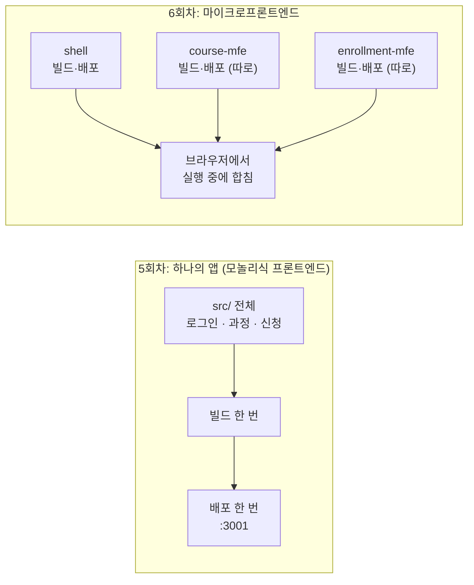

**여러 앱을 합치는 방법** (EduHub는 ⭐)

| 방법 | 언제 합치나 | 특징 |
|---|---|---|
| npm 패키지로 묶기 | **빌드할 때** | 단순하지만 화면 하나를 고쳐도 shell까지 다시 빌드·배포해야 한다 (배포가 묶임) |
| ⭐ **Module Federation** (Webpack 5, `@module-federation/vite`) | **실행할 때** | remote를 따로 배포하면 shell은 다시 배포하지 않아도 새 버전을 받는다. 공유 의존성 협상 기능이 있다 |
| iframe | 실행할 때 | 격리는 강하지만 화면 간 상태 공유·디자인 통일·주소(라우팅) 처리가 어렵다 |
| Web Components, single-spa 같은 프레임워크 | 실행할 때 | 서로 다른 프레임워크(React와 Vue 등)를 섞어야 할 때 검토 |

**좋은 점과 비용**

| 좋은 점 | 비용 |
|---|---|
| 팀이 맡은 화면을 **다른 팀을 기다리지 않고** 배포한다 | 설정이 복잡하다 (federation, shared, 타입 선언, 포트 3개) |
| 화면 하나의 장애·실수가 다른 화면 배포를 막지 않는다 | 공유 의존성 버전을 계속 맞춰야 한다 (1-2) |
| 큰 코드베이스를 업무 경계대로 나눠 이해하기 쉽다 | 전체 흐름 테스트가 어렵고, remote가 꺼지면 화면 일부가 빈다 |

> 💡 **언제 쓰나**: 여러 팀이 한 제품의 서로 다른 화면을 맡고, **배포 주기가 달라서 서로를 기다리는 것이 문제일 때** 검토합니다. 한 팀이 만드는 작은 앱이라면 대개 **하나의 앱 + lazy loading**이 더 낫습니다. EduHub는 실무 규모로는 쪼갤 필요가 없지만, 구조와 경계를 직접 겪어 보려고 쪼갭니다.

### ② lazy loading이란

**lazy loading(지연 로딩) = 처음에 모든 코드를 내려받지 않고, 그 코드가 필요해지는 순간 내려받는 것**입니다. 번들러(Vite)는 `import('./파일')` 같은 **동적 import**를 만나면 그 모듈을 **별도 파일(청크, chunk)**로 나눕니다(코드 분할, code splitting). React에서는 `React.lazy`와 `Suspense`로 씁니다.

```tsx
// 5회차 앱(apps/course-mfe)의 App.tsx에 적용해 본다면 — 관리자만 쓰는 화면은 필요할 때 받는다
import { lazy, Suspense } from 'react';
const CourseFormPage = lazy(() => import('./pages/CourseFormPage'));   // 같은 앱 안의 파일

// …
<Suspense fallback={<CircularProgress />}>
  <Routes>{/* /admin/courses/new → <CourseFormPage /> */}</Routes>
</Suspense>
```

| 확인한 것 | 결과 |
|---|---|
| `npm run build` 결과물 | `dist/assets/index-….js`(약 496 kB, 나머지 전부)와 `dist/assets/CourseFormPage-….js`(약 6.7 kB)로 **같은 빌드 폴더 안에서** 나뉜다 |
| 브라우저에서 `/courses`를 열 때 | `index-….js`만 받는다 |
| 관리자가 **과정 등록**을 누를 때 | 그 순간 `CourseFormPage-….js`를 같은 서버(3001)에서 받는다 |

> 💡 5회차 교재의 앱은 화면이 적어 lazy loading을 쓰지 않았습니다. 위 표는 비교를 위해 5회차 앱에 적용해 본 결과입니다.

### ③ 둘은 무엇이 다른가: "React.lazy를 쓰면 MFE인가?" → 아니다

| 비교 | lazy loading (하나의 앱) | 마이크로프론트엔드 (Module Federation) |
|---|---|---|
| 나누는 단위 | **파일**(청크) | **앱**(업무 영역, 보통 팀 단위) |
| 소스와 빌드 | 하나의 프로젝트, **한 번** 빌드 | 앱마다 **따로** 빌드 |
| 배포 | **함께** (청크도 같은 `dist`에) | 앱마다 **독립** 배포 |
| 코드를 받는 곳 | 같은 서버 (`/assets/…`) | **다른 서버** (3001·3002의 `remoteEntry.js`) |
| 버전이 정해지는 때 | 빌드할 때 모든 청크가 함께 정해짐 | 실행할 때 remote의 **지금 배포된 버전**을 받음 |
| React·MUI | 번들러가 알아서 한 벌 | `shared` singleton을 **직접 맞춰야** 한 벌 (1-4) |
| 실패 | 함께 배포되므로 드묾 | remote 서버가 꺼지면 그 화면만 실패 → 오류 경계 필요 |
| 목적 | **첫 화면을 빠르게** (성능) | **팀과 배포를 독립적으로** (조직·운영) |
| import 모양 | `import('./pages/CourseFormPage')` | `import('courseMfe/CourseFormPage')` |

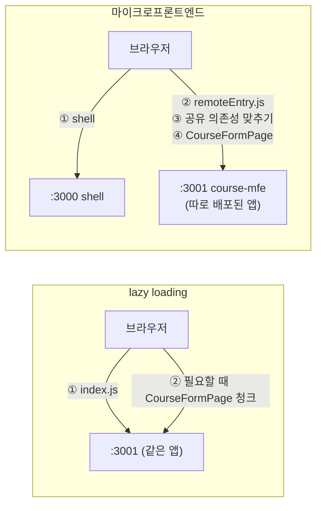

**관계 정리**: 마이크로프론트엔드는 lazy loading을 **수단으로 씁니다.** 6회차 shell의 `lazy(() => import('courseMfe/CourseFormPage'))`는 문법이 같지만, import 대상이 **다른 서버에 따로 배포된 앱**입니다. Module Federation이 이 import를 "remote의 `remoteEntry.js`를 받고 → 공유 의존성(React 등)을 맞추고 → 모듈을 가져오기"로 바꿔 줍니다. 반대로 lazy loading만 쓴 앱은 여전히 **하나의 앱**이고 마이크로프론트엔드가 아닙니다.

| 문제 | 먼저 검토할 것 |
|---|---|
| "첫 화면이 느리다", "관리자 화면 코드까지 모두 받는다" | **lazy loading** (코드 분할). 구조는 그대로 |
| "한 팀의 배포를 다른 팀이 기다린다", "화면 하나 고치는데 전체를 다시 배포한다" | **마이크로프론트엔드** (비용을 감수할 만한지 먼저 따진다) |

> ✅ 이 교재 환경(Vite 8.3, React 18.3)에서 5회차 앱에 위 `React.lazy`를 적용해 빌드 결과물이 두 파일로 나뉘는 것, 브라우저(Chromium)가 `/courses`에서는 `index-….js`만 받고 **과정 등록**을 누를 때 `CourseFormPage-….js`를 받는 것을 확인했습니다. 6회차 course-mfe의 빌드 결과물에는 별도로 `remoteEntry.js`가 생깁니다.


### ④ MFE를 합치는 또 하나의 방법: Web Components

Module Federation은 **JavaScript 모듈(React 컴포넌트)** 단위로 다른 앱의 코드를 가져옵니다. 다른 방법으로 **Web Components**가 있습니다. 다른 팀의 화면을 **HTML 태그 하나**(`<eduhub-enroll-button>`)로 만들어, 어떤 페이지에서든 태그를 쓰는 것만으로 붙이는 방식입니다.

**Web Components란**: 프레임워크가 아니라 **브라우저에 들어 있는 표준 기술**의 묶음입니다. React·Vue·Angular가 없어도, 서로 달라도 동작합니다.

| 표준 기술 | 하는 일 | 예 |
|---|---|---|
| **Custom Elements** | 나만의 HTML 태그를 정의한다. 이름에 **하이픈(-)이 꼭** 있어야 한다 | `customElements.define('eduhub-enroll-button', EduhubEnrollButton)` |
| **Shadow DOM** | 태그 안쪽을 **격리된 DOM**으로. 바깥 페이지의 CSS가 들어오지 않고, 안쪽 CSS도 나가지 않는다 | `this.attachShadow({ mode: 'open' })` |
| **HTML template·slot** | 재사용할 HTML 조각, 바깥에서 내용을 끼워 넣을 자리 | `<template>`, `<slot name="title">` |
| (ES Modules) | 태그를 정의한 JavaScript 파일을 불러온다 | `<script type="module" src=".../eduhub-enroll-button.js">` |

**Custom Element의 생명주기와 입출력**

| 메서드·규칙 | 언제·무엇 |
|---|---|
| `connectedCallback()` | 태그가 페이지에 붙을 때 → 화면을 그린다 |
| `static observedAttributes` + `attributeChangedCallback()` | 지켜볼 속성 목록, 그 속성이 바뀔 때 → 다시 그린다 |
| `disconnectedCallback()` | 태그가 페이지에서 떨어질 때 → 정리 (React root `unmount` 등) |
| **입력** | 속성(attribute, **문자열만**: `session-id="1"`). 객체를 넘기려면 JavaScript 프로퍼티(`el.course = {...}`) |
| **출력** | 이벤트: `dispatchEvent(new CustomEvent('enroll-requested', { detail, bubbles: true, composed: true }))`. `composed: true`가 없으면 Shadow DOM 밖으로 나가지 않는다 |

**예시: 5회차의 신청 버튼을 Web Component로**

enrollment 팀이 React로 만든 컴포넌트를 `<eduhub-enroll-button>` 태그로 감싸 **파일 하나**로 배포하고, 다른 페이지는 그 파일을 불러와 태그만 씁니다.

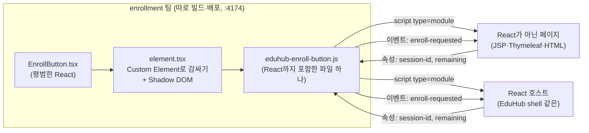

<details>
<summary>① 컴포넌트와 Custom Element: <code>enroll-button/src/EnrollButton.tsx</code>, <code>element.tsx</code>, <code>vite.config.ts</code></summary>

```tsx
// 평범한 React 컴포넌트 (5회차의 EnrollButton을 단순화). Web Component인지 모른다
type Props = { sessionId: string; remaining: number; onEnroll: () => void };

export function EnrollButton({ sessionId, remaining, onEnroll }: Props) {
  const full = remaining <= 0;
  return (
    <div className="box">
      <span className="info">회차 {sessionId} · 남은 자리 {remaining}</span>
      <button className="enroll" disabled={full} onClick={onEnroll}>
        {full ? '마감' : '신청'}
      </button>
    </div>
  );
}
```

```tsx
// <eduhub-enroll-button session-id="1" remaining="3"> — React 컴포넌트를 Web Component(Custom Element)로 감싼다
import { createRoot, type Root } from 'react-dom/client';
import { EnrollButton } from './EnrollButton';

// Shadow DOM 안에만 적용되는 스타일: 바깥 페이지의 CSS가 들어오지도, 이 CSS가 나가지도 않는다
const css = `
  .box { display: inline-flex; gap: 8px; align-items: center; font: 14px sans-serif; }
  .enroll { background: #2f5f9e; color: #fff; border: 0; border-radius: 6px; padding: 6px 14px; cursor: pointer; }
  .enroll:disabled { background: #9aa3af; cursor: default; }
`;

class EduhubEnrollButton extends HTMLElement {
  // 이 속성(attribute)이 바뀌면 attributeChangedCallback이 불린다 = 바깥에서 들어오는 입력
  static observedAttributes = ['session-id', 'remaining'];
  private root?: Root;

  connectedCallback() {                       // 페이지에 붙을 때
    const shadow = this.shadowRoot ?? this.attachShadow({ mode: 'open' });
    shadow.innerHTML = `<style>${css}</style><span></span>`;
    this.root = createRoot(shadow.querySelector('span')!);
    this.render();
  }

  attributeChangedCallback() {               // 속성이 바뀔 때
    this.render();
  }

  disconnectedCallback() {                    // 페이지에서 떨어질 때 (정리)
    this.root?.unmount();
    this.root = undefined;
  }

  private render() {
    if (!this.root) return;
    const sessionId = this.getAttribute('session-id') ?? '';
    const remaining = Number(this.getAttribute('remaining') ?? 0);
    this.root.render(
      <EnrollButton
        sessionId={sessionId}
        remaining={remaining}
        // 바깥으로 나가는 출력 = 이벤트. composed: true여야 Shadow DOM 밖까지 전달된다
        onEnroll={() =>
          this.dispatchEvent(new CustomEvent('enroll-requested', { detail: { sessionId }, bubbles: true, composed: true }))
        }
      />,
    );
  }
}

// 같은 이름을 두 번 등록하면 오류 → 한 번만
if (!customElements.get('eduhub-enroll-button')) {
  customElements.define('eduhub-enroll-button', EduhubEnrollButton);
}
```

```ts
// enroll-button/vite.config.ts — Custom Element를 파일 하나(ES 모듈)로 빌드. React도 이 파일 안에 함께 들어간다
import { defineConfig } from 'vite';
import react from '@vitejs/plugin-react';

export default defineConfig({
  plugins: [react()],
  define: { 'process.env.NODE_ENV': '"production"' },
  build: {
    lib: { entry: 'src/element.tsx', formats: ['es'], fileName: () => 'eduhub-enroll-button.js' },
    outDir: 'dist',
  },
});
```

</details>

<details>
<summary>② React가 아닌 페이지에서 쓰기: <code>host-html/index.html</code></summary>

```html
<!doctype html>
<html lang="ko">
<head>
  <meta charset="utf-8">
  <title>JSP·Thymeleaf 같은 다른 화면에서도 쓸 수 있다</title>
  <style>
    /* 페이지 전체 CSS: 이 페이지의 모든 button을 빨갛게 → Shadow DOM 안의 버튼에는 적용되지 않는다 */
    button { background: red; }
  </style>
  <!-- 별도로 배포된 파일 하나만 불러오면 된다 (React를 몰라도 됨) -->
  <script type="module" src="http://localhost:4174/eduhub-enroll-button.js"></script>
</head>
<body>
  <h1>과정 상세 (React가 아닌 페이지)</h1>
  <button id="page-btn">이 페이지의 버튼</button>
  <eduhub-enroll-button id="enroll" session-id="1" remaining="2"></eduhub-enroll-button>
  <p id="log"></p>
  <script>
    const el = document.getElementById('enroll');
    // 출력: 이벤트를 듣는다
    el.addEventListener('enroll-requested', (e) => {
      document.getElementById('log').textContent = '신청 요청: 회차 ' + e.detail.sessionId;
      // 입력: 속성을 바꾸면 컴포넌트가 다시 그린다 (실제로는 API 호출 후)
      el.setAttribute('remaining', String(Number(el.getAttribute('remaining')) - 1));
    });
  </script>
</body>
</html>
```

</details>

<details>
<summary>③ React 18 호스트에서 쓰기: <code>host-react/src/main.tsx</code></summary>

```tsx
// React 18 호스트에서 Custom Element 쓰기: 속성은 문자열로, 이벤트는 ref로 addEventListener
import { useEffect, useRef, useState } from 'react';
import { createRoot } from 'react-dom/client';

// TypeScript가 <eduhub-enroll-button>을 알게 한다
declare module 'react' {
  namespace JSX {
    interface IntrinsicElements {
      'eduhub-enroll-button': React.DetailedHTMLProps<React.HTMLAttributes<HTMLElement>, HTMLElement> & {
        'session-id'?: string;
        remaining?: number | string;
      };
    }
  }
}

function CourseDetail() {
  const [remaining, setRemaining] = useState(2);
  const [log, setLog] = useState('');
  const ref = useRef<HTMLElement>(null);

  useEffect(() => {
    const el = ref.current;
    if (!el) return;
    // React 18은 Custom Element의 사용자 정의 이벤트를 onXxx로 연결하지 못한다 → 직접 등록
    const onEnroll = (e: Event) => {
      const { sessionId } = (e as CustomEvent<{ sessionId: string }>).detail;
      setLog(`신청 요청: 회차 ${sessionId}`);
      setRemaining((r) => r - 1);
    };
    el.addEventListener('enroll-requested', onEnroll);
    return () => el.removeEventListener('enroll-requested', onEnroll);
  }, []);

  return (
    <div>
      <h1>과정 상세 (React 호스트)</h1>
      <eduhub-enroll-button ref={ref} session-id="1" remaining={String(remaining)} />
      <p id="log">{log}</p>
    </div>
  );
}

createRoot(document.getElementById('root')!).render(<CourseDetail />);
```

</details>

| 확인 (브라우저, 두 호스트 모두) | 결과 |
|---|---|
| 태그만 쓰고 파일 하나 불러오기 | `회차 1 · 남은 자리 2`가 그려진다 (호스트는 React가 아니어도 됨) |
| 스타일 격리 | 페이지 CSS `button { background: red }` → 페이지 버튼은 빨강, **컴포넌트 안 버튼은 파랑 그대로**. 바깥 `document`에서 `.enroll`을 찾을 수 없다 |
| 출력 (이벤트) | 신청 클릭 → 호스트가 `enroll-requested`를 받아 `신청 요청: 회차 1` |
| 입력 (속성) | 호스트가 `remaining`을 2 → 1 → 0으로 바꾸면 다시 그려지고, 0이면 `마감`·비활성 |
| 크기 | `eduhub-enroll-button.js` 193 kB (gzip 52 kB): **React가 이 파일 안에 한 벌 더** 들어 있다 |

> ✅ 이 교재 환경(Vite 8.3, React 18.3, Chromium)에서 위 코드를 빌드해, 컴포넌트 파일을 다른 포트(4174)에서 제공하고 HTML 호스트·React 호스트 두 곳에서 위 표대로 동작하는 것을 확인했습니다 (콘솔 오류 없음, TypeScript 검사 통과).

**Web Component는 어디로 배포되나: 정적 JS 파일 하나**

빌드 결과는 **JavaScript 파일**(위 예에서는 `eduhub-enroll-button.js` 하나)입니다. 정적 파일을 내줄 수 있는 곳이면 어디든 올릴 수 있고, 쓰는 쪽은 **그 파일의 주소만** 알면 됩니다.

| 배포 위치 | 예 |
|---|---|
| EduHub 구성 그대로 | `run\web\wc\enroll-button\eduhub-enroll-button.js` → `/wc/enroll-button/eduhub-enroll-button.js` (아래 설정 한 줄씩) |
| 웹 서버·CDN | nginx 폴더, 오브젝트 스토리지(S3 등) + CDN, 사내 정적 파일 서버 |
| 쓰는 페이지와 **다른 서버** | 가능. 단 `<script type="module">`은 다른 출처의 파일을 받을 때 **CORS 허용 헤더**(`Access-Control-Allow-Origin`)가 필요하다 (위 예는 4174 포트에서 이 헤더를 붙여 제공) |

```text
run\web\
  shell\                       ← /
  mfe\course\, mfe\enrollment\ ← /mfe/…        (Module Federation remote)
  wc\enroll-button\            ← /wc/enroll-button/…   (Web Component)
```

```java
// Step 4-4의 FrontendResourceConfig.addResourceHandlers()에 한 줄 추가 (8080)
registry.addResourceHandler("/wc/**").addResourceLocations(root + "wc/").setCacheControl(NO_CACHE);
```

```nginx
# Step 4-7의 nginx.conf server 블록에 추가 (80)
location /wc/ {
    root  "C:/work/eduhub/run/web";
    add_header Cache-Control "no-cache";
}
```

- Module Federation의 `remoteEntry.js`와 같은 자리입니다. 차이는 MF의 진입 파일이 "공유 의존성을 맞추고 모듈을 넘겨주는" 파일이라면, Web Component의 파일은 "**태그를 등록하는**" 스크립트라는 점입니다
- 배포·롤백은 Step 4-5와 같은 방식(폴더 통째로 교체, 직전 버전 보관)입니다. 진입 파일 이름이 바뀌지 않으므로 `no-cache`로 둡니다. 쓰는 쪽이 버전을 고정해야 하면 주소에 버전을 넣습니다 (`/wc/enroll-button/1.2.0/eduhub-enroll-button.js`)

> ✅ 위 두 설정을 교재 환경의 백엔드(8080)와 Linux nginx(80)에 넣어, 두 주소 모두 `/wc/enroll-button/eduhub-enroll-button.js`를 200·`no-cache`로 주고 같은 주소의 페이지에서 태그가 그려지는 것(CORS 없이)을 브라우저로 확인했습니다. 교재의 기본 구성(Step 4-4, 4-7)에는 이 줄이 없으며, Web Component를 함께 배포할 때만 추가합니다.

**브라우저에서는 어떻게 연결되나: 태그 이름표와 "업그레이드"**

핵심은 페이지마다 하나씩 있는 **태그 이름표**(`CustomElementRegistry`)입니다. 브라우저는 처음 보는 태그도 일단 만들어 두었다가, 스크립트가 이름표에 클래스를 등록하는 순간 **이미 있던 태그를 그 클래스로 바꿉니다**(업그레이드).

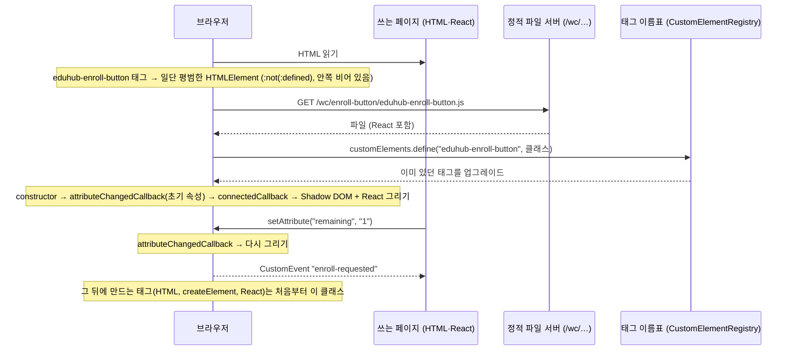

<details>
<summary>확인용 페이지: 컴포넌트 파일을 0.5초 늦게 불러와 업그레이드와 콜백 순서를 기록</summary>

```html
<!doctype html><html><head><meta charset="utf-8">
<style> eduhub-enroll-button:not(:defined) { visibility: hidden; } </style></head>
<body>
<eduhub-enroll-button id="a" session-id="1" remaining="2"></eduhub-enroll-button>
<x-trace id="t" foo="1"></x-trace>
<script>
  window.log = [];
  const a = document.getElementById('a');
  log.push('정의 전: ' + JSON.stringify({ 클래스: a.constructor.name, defined: a.matches(':defined'), shadowRoot: !!a.shadowRoot, 등록: !!customElements.get('eduhub-enroll-button') }));
  // 콜백 순서를 보기 위한 작은 요소
  class XTrace extends HTMLElement {
    static observedAttributes = ['foo'];
    constructor() { super(); log.push('x-trace: constructor'); }
    connectedCallback() { log.push('x-trace: connectedCallback'); }
    attributeChangedCallback(n, o, v) { log.push(`x-trace: attributeChangedCallback(${n}: ${o} → ${v})`); }
    disconnectedCallback() { log.push('x-trace: disconnectedCallback'); }
  }
  customElements.define('x-trace', XTrace);
  document.getElementById('t').setAttribute('foo', '2');
  document.getElementById('t').remove();
  // 0.5초 뒤에야 컴포넌트 파일을 불러온다 (느린 네트워크·나중 로드 흉내)
  setTimeout(async () => {
    customElements.whenDefined('eduhub-enroll-button').then(() => log.push('whenDefined 완료'));
    await import('http://localhost:4174/eduhub-enroll-button.js');
    await new Promise(r => setTimeout(r, 100));
    log.push('정의 후: ' + JSON.stringify({ 클래스: a.constructor.name, defined: a.matches(':defined'), shadowRoot: !!a.shadowRoot, 내용: a.shadowRoot && a.shadowRoot.querySelector('.info')?.textContent }));
    const b = document.createElement('eduhub-enroll-button'); b.setAttribute('session-id', '9'); b.setAttribute('remaining', '5'); document.body.append(b);
    await new Promise(r => setTimeout(r, 100));
    log.push('나중에 만든 태그: ' + b.shadowRoot.querySelector('.info').textContent);
    window.done = true;
  }, 500);
</script></body></html>
```

</details>

**실제 실행 결과** (Chromium)

```text
정의 전: {"클래스":"HTMLElement","defined":false,"shadowRoot":false,"등록":false}
x-trace: constructor
x-trace: attributeChangedCallback(foo: null → 1)
x-trace: connectedCallback
x-trace: attributeChangedCallback(foo: 1 → 2)
x-trace: disconnectedCallback
whenDefined 완료
정의 후: {"클래스":"m","defined":true,"shadowRoot":true,"내용":"회차 1 · 남은 자리 2"}
나중에 만든 태그: 회차 9 · 남은 자리 5
```

- 스크립트보다 태그가 **먼저** 있어도 됩니다. 정의되는 순간 이미 있던 태그가 업그레이드됩니다 (`"m"`은 빌드 때 줄여진 클래스 이름)
- 초기 속성의 `attributeChangedCallback`이 `connectedCallback`보다 **먼저** 불립니다. 그래서 위 예의 `render()`는 React root가 아직 없으면 아무것도 하지 않게 막아 두었습니다

| 알아 둘 점 | 이렇게 |
|---|---|
| 업그레이드 전에는 태그가 **비어 있다** (깜빡임) | `eduhub-enroll-button:not(:defined) { visibility: hidden; }` 또는 자리 표시. 스크립트가 끝내 안 오면 빈 채로 남으므로 안내 문구를 준비 |
| 태그를 조작하는 코드가 정의보다 먼저 돌 수 있다 | `await customElements.whenDefined('eduhub-enroll-button')` 후에 조작 |
| 태그 이름은 **페이지 전체에서 하나** | 같은 이름을 두 번 `define`하면 오류 → 예처럼 `customElements.get()`으로 확인. 한 페이지에 두 버전을 함께 쓰려면 이름에 버전을 넣는다 (`eduhub-enroll-button-v2`) |

**Module Federation과 Web Components 비교**

| 비교 | Module Federation (EduHub 6회차) | Web Components |
|---|---|---|
| 합치는 단위 | JavaScript 모듈 (React 컴포넌트·함수) | **HTML 태그** (DOM 요소) |
| 기술 | 빌드 도구 플러그인 (`@module-federation/vite`, Webpack) | **브라우저 표준** (빌드 도구와 무관) |
| 프레임워크 섞기 | 사실상 같은 프레임워크 (React 끼리) | **자유롭게** (React·Vue·Angular·JSP 페이지 어디에나) |
| 공유 의존성 | `shared` singleton으로 **React·MUI 한 벌** | 보통 **컴포넌트마다 각자 번들** → React 여러 벌, 파일이 커진다 |
| 버전 독립 | 공유 라이브러리 버전 범위를 **맞춰야** 함 (안 맞으면 두 벌·오류) | **완전히 독립** (각자 자기 React 버전) |
| 스타일 | 격리 없음 → shell 테마를 **함께 쓰기 쉽다** (MUI 테마 공유) | Shadow DOM으로 **격리** → 섞이지 않지만 공통 테마를 넘기기 어렵다 (CSS 변수 등으로) |
| 데이터 주고받기 | props·함수·Context 그대로 (`renderSessionAction` 슬롯처럼) | 속성(문자열)·프로퍼티·이벤트 → 객체·콜백을 넘기기 번거롭다 |
| 라우팅·로그인 상태 | shell의 라우터·`tokenStore`를 공유 (singleton) | 각자 따로. 토큰·사용자 정보는 속성·이벤트·전역 저장소로 직접 전달 |
| 타입 | `remotes.d.ts`로 import 타입 선언 | 태그 이름·속성 타입을 따로 선언 (`IntrinsicElements`) |
| 실패 | remote 서버가 꺼지면 `lazy` + 오류 경계로 그 화면만 | 스크립트가 안 오면 태그가 **빈 채로** 남음 (대체 내용을 직접 준비) |
| 주의점 | 공유 설정 실수 → `Invalid hook call` 등 (4-4) | MUI·emotion 같은 CSS-in-JS는 Shadow DOM 안에 스타일을 넣도록 **따로 설정** 필요, 폼·접근성(라벨 연결) 확인 필요 |

**어느 쪽을 고를까**

| 상황 | 추천 |
|---|---|
| 모든 앱이 **같은 프레임워크**(React), 테마·로그인·라우터를 **함께** 쓰고, 화면끼리 **긴밀하게** 주고받는다 | **Module Federation** ← EduHub |
| **다른 프레임워크·레거시 화면**(JSP, Angular, 사내 포털)에 위젯을 넣어야 한다 | **Web Components** |
| 다른 팀·외부 회사가 만든 위젯을 **격리해서** 붙인다 (스타일·버전 충돌을 막고 싶다) | **Web Components** |
| 둘 다 필요 | 함께 쓴다: MFE 안의 화면 하나를 Custom Element로 감싸 레거시 페이지에도 내보내기 |

> 💡 **EduHub가 Module Federation을 쓰는 이유**: shell과 두 remote가 모두 React 18 + MUI이고, 테마·`tokenStore`·라우터를 **한 벌로 공유**해야 하며, 상세 화면의 신청 버튼처럼 **함수(슬롯)로 긴밀하게** 연결됩니다. Web Components로 만들면 앱마다 React가 한 벌씩 들어가고(위 예에서 버튼 하나에 193 kB), 테마·로그인 정보를 속성·이벤트로 일일이 넘겨야 합니다. 반대로 사내 포털(JSP)에 "내 신청 내역" 위젯을 넣어 달라는 요청이 오면, 그 화면 하나를 위 예처럼 Web Component로 감싸 내보내는 것이 좋은 선택입니다.

---

## 1-1. EduHub 프론트엔드 최종 구조

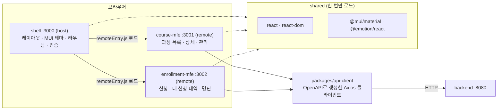

| 구성 요소 | 책임 | 하지 않는 것 |
|---|---|---|
| **shell (host)** | 공통 레이아웃, MUI 테마(`ThemeProvider`), 최상위 라우팅, 로그인 상태 | 업무 화면 직접 구현 |
| **course-mfe** | 과정 목록·상세·관리 화면 (FR-01~03) | 신청 로직, 다른 remote 직접 import |
| **enrollment-mfe** | 신청·취소, 내 신청 내역, 명단 (FR-04~08) | 과정 관리 화면 |
| **packages/api-client** | OpenAPI 스펙으로 **생성**한 API 호출 코드(`generated/`) + 손으로 쓴 토큰 처리(`auth.ts`)와 인스턴스(`index.ts`) | `generated/` 손으로 고치기 (다시 생성하면 사라진다) |

---

## 1-2. 개발자가 반드시 통제할 4가지 경계

마이크로프론트엔드는 Claude에게 "화면 만들어줘"만 반복하면 **각 remote가 제멋대로 커지기 쉬운 구조**입니다. 아래 네 가지는 개발자가 정하고, CLAUDE.md·스킬·리뷰 에이전트로 지키게 합니다.

| 경계 | 규칙 | 어기면 생기는 문제 |
|---|---|---|
| **공유 의존성** | `react`, `react-dom`, `@mui/material`, `@emotion/react`는 `shared`에 `singleton: true`, **같은 버전 범위** | React가 두 번 로드되어 Hook 오류, 번들 크기 증가 |
| **테마** | 테마는 shell 한 곳에서만 정의. remote는 `ThemeProvider`를 새로 만들지 않는다 | 화면마다 색·글꼴이 다름 (샘플 프로젝트 문제 P5) |
| **API 계약** | 모든 API 호출은 `packages/api-client`로. URL을 코드에 직접 쓰지 않는다 | 백엔드 변경 시 일부 화면만 깨짐, 환경별 주소 하드코딩 |
| **모듈 경계** | remote끼리 직접 import 금지. 공통 UI는 shell이 노출하거나 공통 패키지로 | 배포 단위가 서로 묶여 "따로 배포"라는 MFE의 장점이 사라짐 |

```ts
// apps/shell/vite.config.ts 의 federation({ … shared }) (요지) — Webpack의 ModuleFederationPlugin도 shared 모양은 같다
shared: {
  react: { singleton: true, requiredVersion: "^18.0.0" },
  "react-dom": { singleton: true, requiredVersion: "^18.0.0" },
  "@mui/material": { singleton: true },
  "@emotion/react": { singleton: true },
}
// remote(course-mfe, enrollment-mfe)도 같은 shared 설정을 쓴다
```

> 💡 이 네 가지를 **CLAUDE.md(`frontend/CLAUDE.md`)에 짧게** 적고, 3주차에 만든 리뷰 에이전트(예: `mfe-integration-checker`)가 검사하게 하면 Claude가 처음부터 규칙대로 씁니다. ([서브에이전트 예제](../examples/03-settings-skills-agents-hooks.md#모듈-11-서브에이전트))

---

## 1-3. 병렬로 나눠도 되는 일, 순서대로 해야 하는 일

이번 주 프론트엔드 작업(5회차 앱 쪼개기)은 **나눌 수 있는 일**과 **먼저 끝내야 하는 일**이 섞여 있습니다.

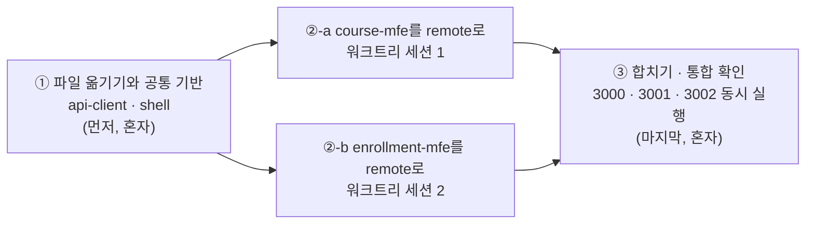

| 구분 | 작업 | 이유 |
|---|---|---|
| **먼저, 혼자** | 파일 옮기기(`git mv`), api-client에 토큰 처리·인스턴스, shell(로그인·레이아웃·라우팅·shared) | 모든 앱이 쓰는 **공통 파일**과 여러 앱에 걸친 이동. 동시에 고치면 충돌 |
| **병렬** | course-mfe, enrollment-mfe를 각각 remote로 | 디렉터리가 분리되어 서로 건드리지 않음 |
| **마지막, 혼자** | 병합, 세 앱 동시 실행, 5회차와 같은 확인 표로 비교 | 두 remote의 결과가 모두 있어야 가능 |

**병렬 방식 고르기** ([병렬 작업 비교](../examples/17-parallel-work-terminal-vs-desktop.md))

| 방식 | 시작 방법 | 오늘 추천 |
|---|---|---|
| 데스크톱 앱 멀티 세션 | **+ New**(Ctrl/Cmd+N), 폴더 컨트롤에서 **Worktree** 켜기 | ⭐ 데스크톱 사용자 |
| 터미널 멀티 세션 | `claude -w course-mfe`, 다른 창에서 `claude -w enrollment-mfe` | ⭐ 터미널 사용자 |
| 한 세션 안의 서브에이전트 | "두 remote를 서브에이전트로 나눠 진행해줘" | 결과 검토가 어려워 오늘은 비추천 |

> ⚠️ **병렬 수 = 내가 리뷰할 수 있는 양**입니다. 오늘은 2개까지만. 세션마다 사용량이 따로 쌓이므로 `/usage`로 확인합니다. 워크트리에는 `.env`처럼 Git에서 제외된 파일이 없다는 점도 기억합니다. ([공통 주의 사항](../examples/17-parallel-work-terminal-vs-desktop.md#4-병렬-작업의-공통-주의-사항))

> 💬 **강사 노트:** "다 병렬로 돌리면 빠르지 않나요?"라는 질문에는 **공통 파일 충돌**과 **리뷰 병목**을 예로 듭니다. 병렬화의 설계(무엇을 먼저, 무엇을 나눌지)는 사람이 하는 아키텍처 판단입니다.

---

## 1-4. Vite로 Module Federation 구성하기 (실습 기준)

> 📌 **이 절의 위치**: 1-4는 Module Federation **설정 방법을 익히는 작은 데모**입니다 (shell 하나 + remote 두 개, remote마다 화면 하나만 노출). 5회차 EduHub 앱을 쪼개는 작업이 아니므로, 직접 해 볼 때는 EduHub의 `frontend/`가 아닌 **빈 연습 폴더**(예: `mf-demo/`)에서 합니다 (EduHub `frontend/apps/course-mfe`에는 5회차 앱이 있어 덮어쓰게 된다).
> EduHub를 실제로 나누는 순서는 **1-5**(무엇이 어디로 가나) → **따라하기 ① Step 1**(shell과 공통 기반을 먼저, 혼자) → **Step 2**(course-mfe와 enrollment-mfe를 병렬 세션으로 **동시에**) → **Step 3**(합치고 쪼개기 전과 비교)입니다. shell → course → enrollment 순으로 하나씩 떼어 내는 방식이 아닙니다.

**왜 Vite인가?** 새로 시작하는 React 프로젝트는 대부분 Vite를 씁니다 (개발 서버 시작과 화면 갱신이 빠르고 설정이 짧다. React 공식 문서도 Create React App 대신 Vite 같은 빌드 도구를 안내한다). Module Federation은 원래 Webpack 5의 기능이지만, 지금은 **Module Federation 공식 조직이 만든 Vite 플러그인 `@module-federation/vite`**로 같은 구조를 만들 수 있습니다.

| 선택지 | 특징 | EduHub |
|---|---|---|
| **`@module-federation/vite`** | Module Federation 공식 조직(module-federation)이 관리. Webpack·Rspack과 같은 런타임(MF 2.0)을 쓰고, **remote도 개발 서버(`vite`)로 바로 실행** 가능 | ⭐ **실습 기준** |
| `@originjs/vite-plugin-federation` | 예전부터 많이 쓰인 커뮤니티 플러그인. 검색하면 예제가 많이 나온다 | 쓰지 않음 (예제를 따라 하다 섞이지 않게 주의) |
| Webpack 5 `ModuleFederationPlugin` | 원조. 기존 Webpack 프로젝트라면 그대로 | 비교용 (샘플 프로젝트 5-4) |

**Webpack 설정과 무엇이 대응하나**

| 개념 | Webpack 5 (`webpack.config.js`) | Vite (`vite.config.ts`) |
|---|---|---|
| 플러그인 | `new ModuleFederationPlugin({ … })` | `federation({ … })` (`@module-federation/vite`) |
| remote 이름·진입 파일·노출 모듈 | `name`, `filename: "remoteEntry.js"`, `exposes` | **같다** |
| host가 remote를 가리키는 법 | `remotes: { courseMfe: "courseMfe@http://localhost:3001/remoteEntry.js" }` | `remotes: { courseMfe: { type: "module", name: "courseMfe", entry: "http://localhost:3001/remoteEntry.js" } }` |
| 공유 의존성 | `shared: { react: { singleton: true, … } }` | **같다** |
| 개발 서버 포트 | `devServer: { port: 3001 }` | `server: { port: 3001, strictPort: true }` (+ `preview`도 같은 포트) |
| 원격 모듈의 타입 | 직접 선언 | 직접 선언 (`remotes.d.ts`), 플러그인의 타입 생성은 `dts: false`로 끈다 |

**설치** (연습 폴더의 npm workspaces 기준, shell과 각 remote에 같은 버전으로)

```bash
cd mf-demo      # package.json: { "private": true, "workspaces": ["apps/*"] }
npm install --workspace apps/shell --workspace apps/course-mfe --workspace apps/enrollment-mfe react@18 react-dom@18 @mui/material @emotion/react @emotion/styled
npm install -D --workspace apps/shell --workspace apps/course-mfe --workspace apps/enrollment-mfe vite @vitejs/plugin-react @module-federation/vite typescript @types/react@18 @types/react-dom@18
```

각 앱의 `package.json` 스크립트는 `"dev": "vite"`, `"build": "vite build"`, `"preview": "vite preview"`입니다.

**remote: `apps/course-mfe/vite.config.ts`**

```ts
// apps/course-mfe/vite.config.ts (remote)
import { defineConfig } from "vite";
import react from "@vitejs/plugin-react";
import { federation } from "@module-federation/vite";

export default defineConfig({
  server: { port: 3001, strictPort: true },
  preview: { port: 3001, strictPort: true },
  plugins: [
    react(),
    federation({
      name: "courseMfe",                         // shell의 remotes 키와 같아야 한다
      filename: "remoteEntry.js",                // shell이 처음 읽는 진입 파일
      exposes: { "./CourseApp": "./src/CourseApp.tsx" },
      shared: {
        react: { singleton: true, requiredVersion: "^18.0.0" },
        "react-dom": { singleton: true, requiredVersion: "^18.0.0" },
        "@mui/material": { singleton: true },
        "@emotion/react": { singleton: true },
      },
      dts: false,
    }),
  ],
});
```

**remote가 노출하는 화면: `apps/course-mfe/src/CourseApp.tsx`** (예시. 실제로는 과정 목록 라우트를 둔다)

```tsx
import { useState } from "react";
import { Button, Stack, Typography, useTheme } from "@mui/material";

// shell이 불러가는 remote 화면. ThemeProvider를 새로 만들지 않고 shell의 테마를 그대로 쓴다
export default function CourseApp() {
  const [count, setCount] = useState(0);
  const theme = useTheme();
  return (
    <Stack spacing={1}>
      <Typography variant="h5" id="course-title">과정 목록 (course-mfe)</Typography>
      <Typography id="theme-color">테마 색: {theme.palette.primary.main}</Typography>
      <Button variant="contained" id="btn" onClick={() => setCount(count + 1)}>클릭 {count}</Button>
    </Stack>
  );
}
```

**두 번째 remote: `apps/enrollment-mfe/vite.config.ts`, `apps/enrollment-mfe/src/EnrollmentApp.tsx`** (course-mfe와 같은 모양. 다른 것은 `name`·포트·`exposes`뿐)

```ts
// apps/enrollment-mfe/vite.config.ts (remote) — course-mfe와 같은 모양, 다른 것은 이름·포트·노출 모듈
import { defineConfig } from "vite";
import react from "@vitejs/plugin-react";
import { federation } from "@module-federation/vite";

export default defineConfig({
  server: { port: 3002, strictPort: true },
  preview: { port: 3002, strictPort: true },
  plugins: [
    react(),
    federation({
      name: "enrollmentMfe",                     // shell의 remotes 키와 같아야 한다
      filename: "remoteEntry.js",
      exposes: { "./EnrollmentApp": "./src/EnrollmentApp.tsx" },
      shared: {
        react: { singleton: true, requiredVersion: "^18.0.0" },
        "react-dom": { singleton: true, requiredVersion: "^18.0.0" },
        "@mui/material": { singleton: true },
        "@emotion/react": { singleton: true },
      },
      dts: false,
    }),
  ],
});
```

```tsx
import { useState } from "react";
import { Button, Stack, Typography, useTheme } from "@mui/material";

// shell이 불러가는 두 번째 remote 화면. course-mfe와 마찬가지로 shell의 테마를 그대로 쓴다
export default function EnrollmentApp() {
  const [count, setCount] = useState(0);
  const theme = useTheme();
  return (
    <Stack spacing={1}>
      <Typography variant="h5" id="enrollment-title">내 신청 내역 (enrollment-mfe)</Typography>
      <Typography id="enrollment-theme-color">테마 색: {theme.palette.primary.main}</Typography>
      <Button variant="outlined" id="enrollment-btn" onClick={() => setCount(count + 1)}>클릭 {count}</Button>
    </Stack>
  );
}
```

각 remote의 `src/main.tsx`는 단독 실행용(개발 편의)이며 shell에서 불러갈 때는 쓰이지 않습니다.

**host: `apps/shell/vite.config.ts`** (remote 두 개: course-mfe 3001, enrollment-mfe 3002)

```ts
// apps/shell/vite.config.ts (host)
import { defineConfig } from "vite";
import react from "@vitejs/plugin-react";
import { federation } from "@module-federation/vite";

export default defineConfig({
  server: { port: 3000, strictPort: true },
  preview: { port: 3000, strictPort: true },
  plugins: [
    react(),
    federation({
      name: "shell",
      remotes: {
        courseMfe: {
          type: "module",                        // Vite remote는 ES 모듈
          name: "courseMfe",
          entry: "http://localhost:3001/remoteEntry.js",
        },
        enrollmentMfe: {
          type: "module",
          name: "enrollmentMfe",                 // enrollment-mfe의 federation name과 같아야 한다
          entry: "http://localhost:3002/remoteEntry.js",
        },
      },
      shared: {
        react: { singleton: true, requiredVersion: "^18.0.0" },
        "react-dom": { singleton: true, requiredVersion: "^18.0.0" },
        "@mui/material": { singleton: true },
        "@emotion/react": { singleton: true },
      },
      dts: false,
    }),
  ],
});
```

**host에서 remote 불러오기: `apps/shell/src/remotes.d.ts`, `apps/shell/src/main.tsx`**

```ts
// remote 모듈의 타입 선언 (TypeScript가 'courseMfe/CourseApp', 'enrollmentMfe/EnrollmentApp'을 알게 한다)
declare module "courseMfe/CourseApp" {
  const CourseApp: React.ComponentType;
  export default CourseApp;
}
declare module "enrollmentMfe/EnrollmentApp" {
  const EnrollmentApp: React.ComponentType;
  export default EnrollmentApp;
}
```

```tsx
import { Component, lazy, Suspense, type ReactNode } from "react";
import { createRoot } from "react-dom/client";
import { Alert, CircularProgress, Container, createTheme, Stack, ThemeProvider } from "@mui/material";

// 테마는 shell 한 곳에서만 정의한다
const theme = createTheme({ palette: { primary: { main: "#B5591C" } } });

// remote는 실행 중에 네트워크로 불러온다 → lazy + Suspense
const CourseApp = lazy(() => import("courseMfe/CourseApp"));
const EnrollmentApp = lazy(() => import("enrollmentMfe/EnrollmentApp"));

// remote를 못 불러와도 shell 전체가 깨지지 않게. remote마다 따로 감싸서 하나가 죽어도 다른 하나는 보인다
class RemoteBoundary extends Component<{ name: string; children: ReactNode }, { failed: boolean }> {
  state = { failed: false };
  static getDerivedStateFromError() { return { failed: true }; }
  render() {
    return this.state.failed
      ? <Alert severity="error" className="remote-error">{this.props.name} 화면을 불러오지 못했습니다. 해당 remote가 실행 중인지 확인하세요.</Alert>
      : this.props.children;
  }
}

createRoot(document.getElementById("root")!).render(
  <ThemeProvider theme={theme}>
    <Container>
      <Stack spacing={4}>
        <RemoteBoundary name="course-mfe(3001)">
          <Suspense fallback={<CircularProgress />}>
            <CourseApp />
          </Suspense>
        </RemoteBoundary>
        <RemoteBoundary name="enrollment-mfe(3002)">
          <Suspense fallback={<CircularProgress />}>
            <EnrollmentApp />
          </Suspense>
        </RemoteBoundary>
      </Stack>
    </Container>
  </ThemeProvider>,
);
```

**실행**

```bash
cd mf-demo
npm run dev --workspace apps/course-mfe       # 3001 (먼저)
npm run dev --workspace apps/enrollment-mfe   # 3002 (다른 창)
npm run dev --workspace apps/shell            # 3000 (다른 창) → http://localhost:3000

# 배포와 같은 결과물로 확인할 때
npm run build --workspace apps/course-mfe && npm run build --workspace apps/enrollment-mfe && npm run build --workspace apps/shell
npm run preview --workspace apps/course-mfe       # 3001
npm run preview --workspace apps/enrollment-mfe   # 3002 (다른 창)
npm run preview --workspace apps/shell            # 3000 (다른 창)
```

| 확인할 것 | 정상 | 의미 |
|---|---|---|
| 화면 | shell 안에 "과정 목록 (course-mfe)"과 "내 신청 내역 (enrollment-mfe)"이 함께 보인다 | remote 두 개를 실행 중에 각각 불러왔다 |
| 테마 색 | 두 remote 화면 모두 shell 테마 색(`#B5591C`)이 나온다 | `@mui/material`·`@emotion/react`를 **같은 인스턴스**로 공유한다 (remote가 테마를 만들지 않아도 된다) |
| 버튼 클릭 | 두 버튼 모두 숫자가 올라간다 | remote의 React Hook이 shell의 React로 동작한다 (**React 한 벌**) |
| Network 탭 | 3001·3002에서 각각 `remoteEntry.js`와 remote 코드만 받는다 | 개발 서버 모드에서는 이름에 `loadShare`가 들어간 작은 모듈이 3001·3002에서 보이는데, React 자체가 아니라 **공유 React를 가리키는 연결 모듈**이다. 빌드 모드에서는 3001·3002에서 React·MUI 파일을 받지 않는다 |
| enrollment-mfe(또는 course-mfe)를 끈 상태 | shell은 뜨고 **끈 remote 자리에만** MUI `Alert`가 나오며, 다른 remote 화면은 그대로 보인다 | remote마다 `RemoteBoundary`로 따로 감쌌기 때문에 하나가 죽어도 shell과 다른 remote는 깨지지 않는다 |

> ✅ 이 교재 환경에서 위 설정 그대로 shell + course-mfe를 만들어 브라우저(Chromium)로 확인했습니다 (Vite 8.3, `@module-federation/vite` 1.24, `@vitejs/plugin-react` 6.3, React 18.3, MUI 6.5): 개발 서버 모드와 빌드·미리보기 모드 모두 위 표대로 동작했고, TypeScript 타입 검사도 통과했습니다. remote의 `shared`를 일부러 빼면 `Cannot read properties of null (reading 'useState')`로 화면이 실패하는 것도 확인했습니다 (React가 두 벌 로드됨). enrollment-mfe(3002)를 추가한 세 앱 구성도 위 코드 그대로 개발 서버 모드·빌드 모드에서 확인했습니다 (두 remote 화면·테마 색·버튼 동작, 3002에서 React·MUI 파일을 받지 않음, enrollment-mfe만 끄면 그 자리에만 `Alert`가 나오고 과정 화면은 그대로).

> 💡 플러그인 버전이 오르면서 설정이 바뀌기도 합니다. Claude에게 설정을 맡길 때는 **"`@module-federation/vite`로, 설치된 버전의 README 기준으로"**라고 지정하고, 인터넷의 `@originjs/vite-plugin-federation` 예제(옵션 이름과 동작이 다르다)가 섞이지 않았는지 diff에서 확인합니다.

---

## 1-5. 하나의 앱을 쪼개기: 무엇이 어디로 가나

5회차 [6장](./session-05-hooks-and-mcp.md#6-따라하기-③-로그인과-화면-완성-하나의-react-앱)에서 `apps/course-mfe` 하나에 로그인과 모든 화면을 만들었습니다. 오늘은 **코드를 새로 쓰지 않고 옮겨서** 세 앱으로 나눕니다. 5회차에 폴더를 갈 곳별로 나눠 둔 이유가 여기서 드러납니다.

| 5회차 위치 (`apps/course-mfe/src/`) | 6회차 위치 | 바뀌는 것 |
|---|---|---|
| `api/http.ts` (+ 테스트) | `packages/api-client/src/auth.ts` (+ 테스트) | import 한 줄. **모든 앱이 같은 토큰 처리를 쓰도록** 패키지로 |
| `api/clients.ts`, `api/courseApi.ts`의 인스턴스 생성 | `packages/api-client/src/index.ts` | 인스턴스를 패키지가 만든다. `courseApi.ts`는 다시 내보내기만 (3회차 import 경로 유지) |
| `auth/AuthContext.tsx`, `auth/RequireAuth.tsx` | `apps/shell/src/auth/` | import 경로만 (`@eduhub/api-client`) |
| `auth/LoginPage.tsx`, `main.tsx`, `theme.ts`, `App.tsx` | `apps/shell/src/` | `App.tsx`: 일반 import → **remote를 `React.lazy`로** 불러오기 |
| `pages/`, `hooks/` | 그대로 (`apps/course-mfe`) | `CourseDetailPage`: 신청 버튼을 직접 import하지 않고 **슬롯(`renderSessionAction`)**으로, 관리자 확인은 `useAuth` 대신 `tokenStore` |
| `enrollment/EnrollButton.tsx` | `apps/enrollment-mfe/src/components/` | `useAuth` 대신 `tokenStore` |
| `enrollment/MyEnrollmentsPage.tsx`, `RosterPage.tsx` | `apps/enrollment-mfe/src/pages/` | import 경로만 |

**쪼갤 때 반드시 바뀌는 다섯 가지** (나머지는 옮기기만 한다)

| # | 하나의 앱에서는 | 쪼개면 | 이유 |
|---|---|---|---|
| ① | 화면이 `src/api/http.ts`를 import | **api-client 패키지**의 `http`·`tokenStore`, 패키지를 `shared` singleton으로 | 앱마다 `http`가 따로 있으면 토큰 처리·401 이벤트가 여러 벌이 된다 |
| ② | 화면이 `useAuth()`로 로그인 사용자를 안다 | remote는 `tokenStore.user()`·`tokenStore.get()` (화면 표시용) | `AuthContext`는 shell 것이다. **remote는 shell을 import할 수 없다** (1-2) |
| ③ | `CourseDetailPage`가 `EnrollButton`을 직접 import | 상세는 슬롯을 열어 두고 **shell이 두 remote를 조합** | **remote끼리 직접 import 금지** (1-2). 서로 배포가 묶인다 |
| ④ | `App.tsx`가 화면을 일반 import | `React.lazy(() => import('courseMfe/…'))` + `Suspense` + 오류 경계 | remote는 실행 중에 다른 서버(3001·3002)에서 받는다. 꺼져 있어도 shell은 떠야 한다 |
| ⑤ | 테마·라우터·React가 하나 | shell만 `ThemeProvider`·`BrowserRouter`. 모든 앱의 `shared`에 react·react-dom·react-router-dom·MUI·emotion·api-client를 singleton | 두 벌이면 Hook 오류, 라우터 오류, 색이 다른 화면 (1-4) |

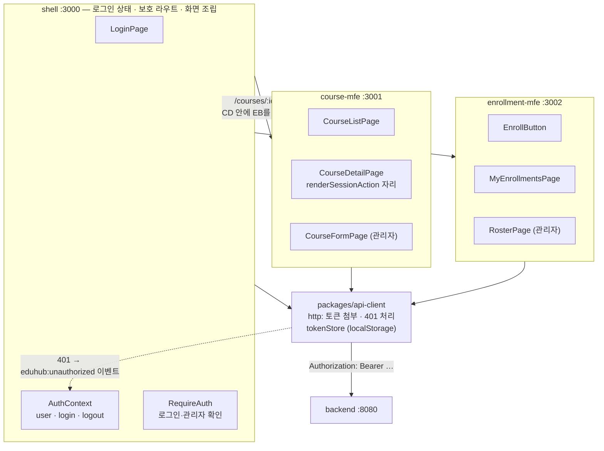

| 책임 | 어디서 | 왜 그곳인가 |
|---|---|---|
| 로그인 화면, 로그인 상태(`user`), 로그아웃 | **shell** (`AuthContext`, `LoginPage`) | 레이아웃·라우팅과 함께 모든 화면에 걸친 관심사 |
| 로그인 필요·관리자 전용 라우트 | **shell** (`RequireAuth`) | 라우트는 shell이 가진다 |
| 요청마다 토큰 붙이기, 401이면 토큰 지우기 | **api-client** (`http` 인터셉터) | 모든 remote가 이 클라이언트로만 API를 부르므로 한 곳에서 처리 |
| 토큰 보관 | **api-client** (`tokenStore`, localStorage) | shell과 remote는 **같은 페이지(origin 3000)**에서 실행되므로 함께 읽는다 |
| 과정 목록·상세·등록·수정 | **course-mfe** | FR-01~03. 신청은 모른다 |
| 신청 버튼, 내 신청 내역, 명단·수료 | **enrollment-mfe** | FR-04~08 |
| 상세 화면 안에 신청 버튼 넣기 | **shell**이 `renderSessionAction`으로 조립 | remote끼리 직접 import하지 않으면서 한 화면에 두 remote를 함께 보여 준다 |
| 401을 shell에 알리기 | api-client가 `eduhub:unauthorized` **이벤트**를 보냄 | remote·api-client가 shell을 import하지 않게 |

> ⚠️ 화면의 권한 확인은 편의일 뿐이고, 토큰을 localStorage에 두는 것의 위험도 그대로입니다. 쪼갠 뒤에도 5회차 [Step 14](./session-05-hooks-and-mcp.md#step-14-로그인-토큰-처리-로그인-상태-보호-라우트)의 ⚠️·🔐 내용은 같습니다.

---

# 2. 플러그인: 팀의 `.claude/`를 한 번에 배포하기

> 기준: Claude Code 공식 문서 Plugins, Create a marketplace, Plugin security and trust (2026년 10월 확인). 예제: [플러그인 eduhub-dev-kit](../examples/04-mcp-plugins-artifacts.md#모듈-14-플러그인-eduhub-dev-kit)

---

## 2-1. 플러그인이란

**플러그인 = 스킬, 서브에이전트, 훅, MCP 서버 등을 하나로 묶어 한 번에 설치·업데이트하는 단위**입니다. 대부분 **마켓플레이스**(플러그인 목록을 담은 저장소)를 통해 설치합니다.

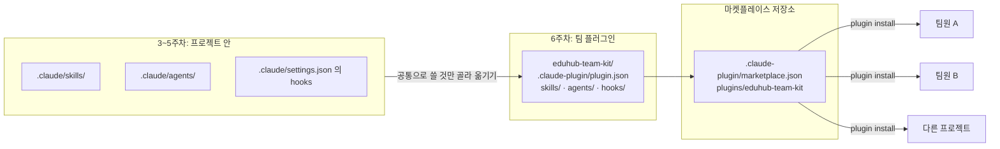

| 구성 요소 | 플러그인 안 위치 | 세션에서 |
|---|---|---|
| 매니페스트 | `.claude-plugin/plugin.json` | 플러그인 이름(스킬 앞에 붙는 접두사), 버전, 설명 |
| 스킬 | `skills/<이름>/SKILL.md` | `/eduhub-team-kit:add-api-endpoint`처럼 **플러그인 이름이 접두사** |
| 서브에이전트 | `agents/<이름>.md` | Claude가 위임할 수 있는 에이전트 |
| 훅 | `hooks/hooks.json` | 플러그인이 켜져 있으면 해당 이벤트에 실행 |
| MCP 서버 | `.mcp.json` | 플러그인이 켜져 있는 동안 연결 |

---

## 2-2. 프로젝트 `.claude/` vs 플러그인: 무엇을 어디에

| 질문 | 프로젝트 `.claude/` | 팀 플러그인 |
|---|---|---|
| 이 저장소에만 해당하나? | ✅ (EduHub 도메인 규칙, 이 저장소의 경로) | |
| 여러 프로젝트에서 공통인가? | | ✅ (Spring API 추가 절차, JPA 리뷰어, 포맷 훅) |
| 버전을 붙여 배포·업데이트하고 싶은가? | | ✅ |
| 저장소를 클론하면 바로 적용되어야 하나? | ✅ | 설치가 한 번 필요 (프로젝트 설정으로 권장 가능) |

> 💡 **같은 스킬을 양쪽에 두지 않습니다.** 플러그인으로 옮긴 것은 프로젝트에서 지워야 두 버전이 동시에 로드되어 헷갈리는 일이 없습니다.

---

## 2-3. 플러그인도 "공짜"가 아니다: 토큰과 보안

**토큰**: 켜진 플러그인은 **쓰지 않는 세션에도** 들어옵니다. Claude가 스스로 부를 수 있는 스킬·에이전트·커맨드의 **이름과 설명이 매 턴 컨텍스트에 포함**되고, MCP 서버는 세션과 함께 실행됩니다. 안 쓰는 플러그인은 끕니다(`/plugin` 또는 `claude plugin disable`).

**보안**: 공식 문서는 "설치한 플러그인은 **내 사용자 권한으로 임의의 코드를 실행**할 수 있다"고 경고합니다.

| 플러그인이 할 수 있는 것 | 위험 |
|---|---|
| 훅 | 셸 명령으로 실행. **권한 규칙·샌드박스 밖**에서 내 권한으로 실행 |
| MCP 서버 | 내 PC에서 프로세스로 실행 |
| `bin/` 실행 파일 | Bash 도구의 `PATH`에 추가됨 |
| 스킬·에이전트·커맨드 | Claude의 지시로 들어감 → 행동에 영향 |
| 자동 업데이트 | 검토한 파일이 나중에 바뀔 수 있음 |

**설치 전 검토 4단계** (공식 문서 기준)

1. `claude plugin marketplace list`로 마켓플레이스 **출처** 확인
2. `/plugin`에서 플러그인을 골라 **Will install** 목록(커맨드, 에이전트, 스킬, 훅, MCP) 확인
3. 소스에서 **`hooks/hooks.json`, `.mcp.json`, `bin/`**을 직접 읽기 (Will install에는 훅이 "있다"는 것만 보이고 무엇을 실행하는지는 안 보임)
4. `claude --plugin-dir <플러그인 폴더> plugin details <이름>`으로 구성 목록 확인

> ⚠️ 마켓플레이스 이름이 그럴듯해도 **팀·동료·사내 마켓플레이스는 모두 "서드파티"**입니다. 출처보다 **내용**을 봅니다. 회사에서는 관리자가 관리형 설정으로 허용 마켓플레이스를 제한할 수 있습니다.

> 💬 **강사 노트:** 실제 오픈소스 플러그인 하나를 골라 `hooks/hooks.json`을 함께 읽어 봅니다. "이 훅은 언제, 어떤 명령을 실행하는가?"를 수강생이 답하게 합니다.

---

## 2-4. 버전과 배포 흐름

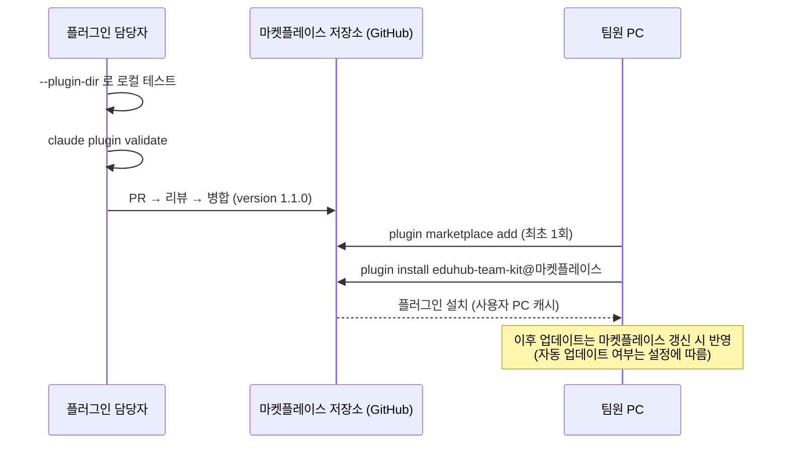

| 규칙 | 이유 |
|---|---|
| `plugin.json`의 `version`을 **유의적 버전**(1.0.0 → 1.1.0 → 2.0.0)으로 | 무엇이 바뀌었는지 팀원이 판단 |
| 마켓플레이스 저장소도 **PR + 리뷰** | 플러그인은 팀원 PC에서 코드를 실행한다. 리뷰 없는 변경 금지 |
| `CHANGELOG.md` 유지 | 훅이 바뀌면 동작이 달라진다. 팀에 알림 |
| 마켓플레이스 항목 이름 = `plugin.json`의 `name` | 다르면 설치 오류의 가장 흔한 원인 |

> 💡 자동 업데이트를 켜 두면 검토한 파일이 바뀔 수 있습니다. 팀 마켓플레이스는 **병합 권한을 좁히고 리뷰를 필수로** 합니다. 업데이트 반영 시점의 정확한 규칙은 공식 문서 "Host and maintain a marketplace"를 확인합니다 (공식 문서 확인 필요).

---

# 3. 아티팩트: 결과물을 화면으로 공유하기

> 예제: [아티팩트 활용 예](../examples/04-mcp-plugins-artifacts.md#모듈-15-아티팩트)

---

## 3-1. 아티팩트란

**아티팩트 = Claude가 만든 결과물을 대화 밖의 독립된 화면(웹 페이지, 문서, 다이어그램, 대시보드)으로 보여 주고, 대화로 고치고, 링크로 공유하는 것**입니다.

| 언제 쓰나 | EduHub 예 | 보는 사람 |
|---|---|---|
| **진행 현황 리포트** | 주간 PR·테스트·요구사항 진척, 다음 주 계획 | 팀, 강사 |
| **아키텍처 설명 페이지** | MFE 구조, 이벤트 흐름, 패키지 구조를 그림과 함께 | 신규 팀원, 리뷰어 |
| **회고 대시보드** | 주차별 `/usage`, 직접 고친 건수, 재작업 횟수 | 팀 |
| **화면 프로토타입** | 수강 취소 확인 Dialog 시안 | 기획자 |

**마크다운 문서와 무엇이 다른가**

| | 저장소의 `.md` | 아티팩트 |
|---|---|---|
| 목적 | 코드와 함께 **버전 관리**되는 기준 문서 | **보여 주기·공유**용 결과물 |
| 형태 | 텍스트 + Mermaid | 레이아웃, 차트, 상호작용 가능한 화면 |
| 변경 이력 | Git | 아티팩트 버전 |
| 예 | 요구사항, 런북, CLAUDE.md | 주간 리포트, 발표용 설명 페이지 |

> 💡 **기준 정보는 저장소에, 보여 주는 화면은 아티팩트로.** 아티팩트에만 있는 결정 사항은 저장소의 `docs/`에도 남깁니다.

---

## 3-2. 공유와 보안 원칙

| 원칙 | 내용 |
|---|---|
| **기본은 비공개** | 만든 사람만 볼 수 있고, 공유하려면 공유 메뉴에서 대상을 정한다 (사용 환경에 따라 화면이 다를 수 있음) |
| **비밀 정보 금지** | 접속 정보, 토큰, 키, `.env` 내용, 운영 서버 주소를 넣지 않는다 |
| **실제 개인정보 금지** | 임직원 이름·사번·연락처 대신 가짜 데이터나 집계값 |
| **운영 데이터 금지** | 개발·테스트 환경의 데이터만. 운영 DB 조회 결과로 만들지 않는다 (환경 분리 원칙) |
| **수치는 출처와 함께** | "테스트 112개 통과(`./gradlew test`, 10/25 기준)"처럼 근거를 적는다. AI가 숫자를 지어내지 않았는지 확인 |

> 💬 **강사 노트:** 아티팩트는 쉽게 링크로 퍼집니다. "이 화면이 회사 밖으로 나가도 괜찮은가?"를 공유 전 체크 질문으로 습관화시킵니다.

---

## ☕ 휴식 (8분)

> 휴식 중에 `git switch main && git pull`, `cd frontend && npm install`을 끝내 둡니다.

---

# 4. 따라하기 ①: 5회차 앱을 MFE로 쪼개기 (워크트리 병렬 세션)

> **목표**: 5회차에 완성한 `apps/course-mfe` 하나를 shell(3000) + course-mfe(3001) + enrollment-mfe(3002)로 나누고, **쪼개기 전과 같은 기능**이 그대로 동작하는지 같은 확인 표로 비교합니다. 공통 작업은 혼자, remote 작업은 병렬로 진행합니다.

> 💡 **먼저 "정답"을 확인해 둡니다.** 시작 전에 `main`에서 5회차 앱을 띄워 [5회차 6-2 확인 표](./session-05-hooks-and-mcp.md#6-2-데모-흐름으로-확인하기)가 동작하는지 봅니다. 쪼갠 뒤 같은 표로 비교합니다.

---

## Step 1. 브랜치, 파일 옮기기, 공통 기반 (혼자, 먼저)

```bash
git switch main && git pull
git switch -c feature/mfe-split
```

**① 파일 옮기기는 사람이 `git mv`로** (Claude에게 맡겨도 되지만, 무엇이 어디로 가는지는 1-5 표로 사람이 정한다). `git mv`로 옮기면 Git이 "이름 바뀜"으로 기록해 이력이 이어집니다.

먼저 옮겨 넣을 하위 폴더 4개를 만듭니다. `git mv`는 대상 폴더를 만들어 주지 않으므로(여러 파일을 한 폴더로 옮길 때 폴더가 없으면 오류) **반드시 `git mv`보다 먼저** 합니다.

```bash
cd frontend
mkdir -p apps/shell/src/auth apps/shell/src/pages apps/enrollment-mfe/src/components apps/enrollment-mfe/src/pages
```

```powershell
# Windows PowerShell (-Force: 이미 있어도 오류 없음, 중간 폴더도 함께 생성 = mkdir -p)
cd frontend
New-Item -ItemType Directory -Force apps/shell/src/auth, apps/shell/src/pages, apps/enrollment-mfe/src/components, apps/enrollment-mfe/src/pages
```

그다음 파일을 옮깁니다 (`frontend/`에서 계속).

```bash
# 토큰 처리 → api-client 패키지
git mv apps/course-mfe/src/api/http.ts      packages/api-client/src/auth.ts
git mv apps/course-mfe/src/api/http.test.ts packages/api-client/src/auth.test.ts
git rm apps/course-mfe/src/api/clients.ts   # 인스턴스는 packages/api-client/src/index.ts가 만든다
# 로그인·레이아웃·라우팅·테마 → shell (2회차 뼈대)
git mv apps/course-mfe/src/auth/AuthContext.tsx apps/course-mfe/src/auth/AuthContext.test.tsx \
       apps/course-mfe/src/auth/RequireAuth.tsx apps/shell/src/auth/
cp apps/course-mfe/src/setupTests.ts apps/shell/src/     # 테스트 설정은 course-mfe도 쓰므로 복사
git mv apps/course-mfe/src/auth/LoginPage.tsx apps/shell/src/pages/
git mv -f apps/course-mfe/src/main.tsx apps/course-mfe/src/App.tsx apps/course-mfe/src/theme.ts apps/shell/src/   # -f: 뼈대 파일 덮어쓰기
# 신청 화면 → enrollment-mfe (2회차 뼈대)
git mv apps/course-mfe/src/enrollment/EnrollButton.tsx apps/course-mfe/src/enrollment/EnrollButton.test.tsx apps/enrollment-mfe/src/components/
git mv apps/course-mfe/src/enrollment/MyEnrollmentsPage.tsx apps/course-mfe/src/enrollment/RosterPage.tsx \
       apps/course-mfe/src/enrollment/RosterPage.test.tsx apps/enrollment-mfe/src/pages/
git status        # renamed: 로 보이는지 확인
```

> Windows PowerShell에서도 위 명령을 그대로 씁니다. 줄 끝에 `\`가 있는 두 명령만 `\`를 지우고 한 줄로 이어 씁니다 (`git mv`, `git rm`, `cp`는 PowerShell에서도 동작).

이 상태에서는 세 앱 모두 빌드되지 않습니다(옮긴 파일의 import가 깨짐). Step 1에서 **api-client와 shell**을, Step 2에서 두 remote를 고칩니다.

**② 공통 기반 지시** (새 세션, Plan 모드)

```text
[목표] 옮긴 파일로 api-client와 shell을 완성한다 (1-5의 바뀌는 다섯 가지 중 ①④⑤)
[위치] @frontend/packages/api-client, @frontend/apps/shell
[범위]
- api-client: src/auth.ts(옮겨 온 http.ts)의 CurrentUser import를 ./generated/api로.
  src/index.ts에서 generated와 auth를 내보내고, authApi·courseApi·enrollmentApi·adminEnrollmentApi를 new XxxApi(config, undefined, http)로 만든다.
  auth.test.ts가 패키지에서 돌도록 vitest(jsdom) 설정
- shell 테스트: vite.config.ts에 test(jsdom, setupTests), AuthContext.test.tsx의 import·mock을 @eduhub/api-client 기준으로
- shell: auth/·pages/LoginPage의 import를 @eduhub/api-client로. App.tsx의 화면 import를 remote React.lazy로
  (courseMfe: CourseListPage(이름 있는 export), CourseDetailPage, CourseFormPage / enrollmentMfe: EnrollButton, MyEnrollmentsPage, RosterPage),
  Suspense + 오류 경계(remote가 꺼져 있으면 MUI Alert). /courses/:courseId에서 CourseDetailPage의 renderSessionAction으로 EnrollButton 조립
- shell vite.config.ts: federation() 호스트(@module-federation/vite), remotes 2개(3001·3002의 remoteEntry.js),
  shared: react, react-dom, react-router-dom, @mui/material, @emotion/react, @eduhub/api-client 모두 singleton. 포트 3000 strictPort, /api 프록시(server·preview)
- src/remotes.d.ts에 remote 모듈 6개 타입 선언, 플러그인 옵션 dts: false
[하지 않는 것] course-mfe, enrollment-mfe 수정 (Step 2에서 병렬로), generated/ 수정, 백엔드 수정
[완료 기준] npm test --workspace packages/api-client·apps/shell 통과, npm run build --workspace apps/shell 성공
[진행 방식] 바꿀 파일 목록과 이유를 먼저 보여줘
```

**계획 검토 포인트**
- shell에 **업무 화면 코드**(과정·신청 화면)가 남거나 새로 생기면 거절합니다 (shell은 조립만)
- remote별로 다른 버전의 React·MUI를 쓰는 계획이 있으면 맞추게 합니다
- `@originjs/vite-plugin-federation`이나 Webpack 설정이 섞여 있으면 `@module-federation/vite`로 통일하게 합니다 ([1-4](#1-4-vite로-module-federation-구성하기-실습-기준))
- 토큰 처리 코드를 `generated/` **안에** 넣는 계획이면 거절합니다

**기대하는 결과 (핵심 코드)** — 아래 코드는 실제로 5회차 앱을 이 순서대로 쪼개 빌드·테스트하고 브라우저로 확인한 것입니다 (Step 3의 확인)

```ts
// frontend/packages/api-client/src/index.ts — 5회차에 앱 안(src/api)에 있던 인스턴스 생성을 패키지로 옮긴다
import { AdminEnrollmentApi, AuthApi, Configuration, CourseApi, EnrollmentApi } from './generated/api';
import { http } from './auth';

export * from './generated/api';
export { http, tokenStore, UNAUTHORIZED_EVENT } from './auth';

// 생성된 클라이언트 인스턴스는 여기 한 곳에서만 만든다. 세 번째 인자 http = 토큰을 붙이는 Axios 인스턴스
// shell과 remote가 이 패키지를 singleton으로 공유하므로 http(토큰 처리)도 한 벌만 있다
const config = new Configuration({ basePath: '' }); // 같은 origin의 /api → Vite 프록시가 백엔드로 전달
export const authApi = new AuthApi(config, undefined, http);
export const courseApi = new CourseApi(config, undefined, http);
export const enrollmentApi = new EnrollmentApi(config, undefined, http);
export const adminEnrollmentApi = new AdminEnrollmentApi(config, undefined, http);
```

```ts
// packages/api-client/src/auth.ts — 5회차 http.ts에서 바뀐 곳은 import 한 줄과 주석뿐
import type { CurrentUser } from './generated/api';     // ★ 전: from '@eduhub/api-client'
```

```tsx
// apps/shell/src/auth/AuthContext.tsx — 바뀐 곳은 import뿐 (RequireAuth·LoginPage도 경로만)
import { authApi, tokenStore, UNAUTHORIZED_EVENT, type CurrentUser } from '@eduhub/api-client';   // ★ 패키지에서
```

```tsx
// frontend/apps/shell/src/App.tsx — 5회차 App.tsx에서 import만 remote로 바꾼 것 (★). 업무 화면은 remote가, 로그인·권한은 shell이
import { Component, lazy, Suspense, type ReactNode } from 'react';
import { Link as RouterLink, Navigate, Route, Routes } from 'react-router-dom';
import { Alert, AppBar, Button, CircularProgress, Container, Toolbar, Typography } from '@mui/material';
import { useAuth } from './auth/AuthContext';
import { RequireAuth } from './auth/RequireAuth';
import LoginPage from './pages/LoginPage';

// ★ 일반 import → 실행 중에 remote에서 불러오기 (React.lazy). CourseListPage는 이름 있는 export라 default로 바꿔 준다
const CourseListPage = lazy(() => import('courseMfe/CourseListPage').then((m) => ({ default: m.CourseListPage })));
const CourseDetailPage = lazy(() => import('courseMfe/CourseDetailPage'));
const CourseFormPage = lazy(() => import('courseMfe/CourseFormPage'));
const EnrollButton = lazy(() => import('enrollmentMfe/EnrollButton'));
const MyEnrollmentsPage = lazy(() => import('enrollmentMfe/MyEnrollmentsPage'));
const RosterPage = lazy(() => import('enrollmentMfe/RosterPage'));

// ★ remote 서버가 꺼져 있어도 shell 전체가 깨지지 않게
class RemoteBoundary extends Component<{ children: ReactNode }, { failed: boolean }> {
  state = { failed: false };
  static getDerivedStateFromError() { return { failed: true }; }
  render() {
    return this.state.failed ? <Alert severity="error">화면을 불러오지 못했습니다. 잠시 후 다시 시도하세요.</Alert> : this.props.children;
  }
}
const Remote = ({ children }: { children: ReactNode }) => (
  <RemoteBoundary><Suspense fallback={<CircularProgress />}>{children}</Suspense></RemoteBoundary>
);

export default function App() {
  const { user, logout } = useAuth();
  const isAdmin = user?.role === 'ADMIN';
  return (
    <>
      <AppBar position="static">
        <Toolbar sx={{ gap: 1 }}>
          <Typography variant="h6" sx={{ flexGrow: 1 }}>EduHub</Typography>
          <Button color="inherit" component={RouterLink} to="/courses">교육과정</Button>
          {user && <Button color="inherit" component={RouterLink} to="/my/enrollments">내 신청 내역</Button>}
          {isAdmin && <Button color="inherit" component={RouterLink} to="/admin/courses/new">과정 등록</Button>}
          {user
            ? <><Typography variant="body2">{user.name}{isAdmin ? ' (관리자)' : ''}</Typography><Button color="inherit" onClick={logout}>로그아웃</Button></>
            : <Button color="inherit" component={RouterLink} to="/login">로그인</Button>}
        </Toolbar>
      </AppBar>
      <Container sx={{ mt: 3 }}>
        <Routes>
          <Route path="/" element={<Navigate to="/courses" replace />} />
          <Route path="/login" element={<LoginPage />} />
          <Route path="/courses" element={<Remote><CourseListPage /></Remote>} />
          {/* ★ 상세는 course-mfe, 회차 행의 신청 버튼은 enrollment-mfe. 두 remote를 조합하는 것은 shell */}
          <Route path="/courses/:courseId" element={
            <Remote><CourseDetailPage renderSessionAction={(s) => <EnrollButton sessionId={s.id} />} /></Remote>} />
          <Route path="/my/enrollments" element={<RequireAuth><Remote><MyEnrollmentsPage /></Remote></RequireAuth>} />
          <Route path="/admin/courses/new" element={<RequireAuth admin><Remote><CourseFormPage /></Remote></RequireAuth>} />
          <Route path="/admin/courses/:courseId/edit" element={<RequireAuth admin><Remote><CourseFormPage /></Remote></RequireAuth>} />
          <Route path="/admin/sessions/:sessionId/roster" element={<RequireAuth admin><Remote><RosterPage /></Remote></RequireAuth>} />
        </Routes>
      </Container>
    </>
  );
}
```

<details>
<summary>shell: vite.config.ts, remotes.d.ts</summary>

```ts
/// <reference types="vitest/config" />
// frontend/apps/shell/vite.config.ts — 6회차: host
import { defineConfig } from "vite";
import react from "@vitejs/plugin-react";
import { federation } from "@module-federation/vite";

export default defineConfig({
  // /api 요청은 백엔드로 (같은 origin이 되어 CORS가 필요 없다). preview도 같게
  server: { port: 3000, strictPort: true, proxy: { "/api": "http://localhost:8080" } },
  preview: { port: 3000, strictPort: true, proxy: { "/api": "http://localhost:8080" } },
  plugins: [
    react(),
    federation({
      name: "shell",
      remotes: {
        courseMfe: { type: "module", name: "courseMfe", entry: "http://localhost:3001/remoteEntry.js" },
        enrollmentMfe: { type: "module", name: "enrollmentMfe", entry: "http://localhost:3002/remoteEntry.js" },
      },
      shared: {
        react: { singleton: true, requiredVersion: "^18.0.0" },
        "react-dom": { singleton: true, requiredVersion: "^18.0.0" },
        "react-router-dom": { singleton: true },   // 라우터 상태를 shell과 remote가 함께 쓴다
        "@mui/material": { singleton: true },
        "@emotion/react": { singleton: true },
        "@eduhub/api-client": { singleton: true }, // 토큰 처리(http 인터셉터)를 한 벌만
      },
      dts: false,
    }),
  ],
  test: { environment: "jsdom", setupFiles: ["./src/setupTests.ts"] },
});
```

```ts
// frontend/apps/shell/src/remotes.d.ts — remote 모듈의 타입 선언 (federation dts: false이므로 직접)
declare module 'courseMfe/CourseListPage' { export const CourseListPage: React.ComponentType; }   // 3회차부터 이름 있는 export
declare module 'courseMfe/CourseDetailPage' {
  import type { ReactNode } from 'react';
  import type { SessionResponse } from '@eduhub/api-client';
  const C: React.ComponentType<{ renderSessionAction?: (s: SessionResponse) => ReactNode }>;
  export default C;
}
declare module 'courseMfe/CourseFormPage' { const C: React.ComponentType; export default C; }
declare module 'enrollmentMfe/EnrollButton' { const C: React.ComponentType<{ sessionId: number }>; export default C; }
declare module 'enrollmentMfe/MyEnrollmentsPage' { const C: React.ComponentType; export default C; }
declare module 'enrollmentMfe/RosterPage' { const C: React.ComponentType; export default C; }
```

</details>

> ✅ **확인**: `npm test --workspace packages/api-client`(5회차의 토큰 테스트 4개가 패키지에서 통과), `npm test --workspace apps/shell`(옮긴 AuthContext 테스트 2개), `npm run build --workspace apps/shell`. shell에 업무 화면이 없는지 `git diff --staged --stat`으로 봅니다 → 커밋 `refactor(frontend): 토큰 처리를 api-client로, 로그인·레이아웃을 shell로 옮김`. 이 커밋이 있어야 Step 2의 워크트리가 이를 바탕으로 만들어집니다.

---

## Step 2. remote 두 개를 병렬 세션으로

**데스크톱 앱**: **+ New**로 세션을 두 개 열고, 각각 폴더 컨트롤에서 **Worktree**를 켭니다.
**터미널**: 창을 두 개 열고 각각 실행합니다.

```bash
# 창 1
claude -w course-mfe
# 창 2
claude -w enrollment-mfe
```

> 워크트리는 Step 1의 커밋을 바탕으로 만들어지므로 **Step 1을 먼저 커밋**해야 합니다.

**세션 1 (course-mfe) 지시**

```text
[목표] course-mfe(5회차 앱에서 과정 화면만 남은 것)를 Module Federation remote로 만든다 (1-5의 ②③)
[위치] @frontend/apps/course-mfe
[범위]
- vite.config.ts에 federation() (@module-federation/vite): name courseMfe, filename remoteEntry.js,
  exposes ./CourseListPage, ./CourseDetailPage, ./CourseFormPage. shared는 shell과 동일. 포트 3001 strictPort, /api 프록시 유지
- src/api/courseApi.ts는 @eduhub/api-client의 courseApi를 다시 내보내기만 (3회차 훅·테스트의 import 경로 유지)
- CourseDetailPage: EnrollButton import를 없애고 prop renderSessionAction?: (session) => ReactNode 로 회차 행 끝을 비워 둔다.
  관리자 확인은 useAuth 대신 tokenStore.user()
- src/main.tsx는 단독 실행용(BrowserRouter + 목록·상세)으로만. ThemeProvider는 만들지 않는다
[하지 않는 것] shell, enrollment-mfe, api-client 수정
[완료 기준] npm run build --workspace apps/course-mfe 성공, npm test --workspace apps/course-mfe 통과 (3회차 테스트 4개)
[진행 방식] 계획 먼저. 범위 밖 파일을 고쳐야 하면 멈추고 알려줘
```

**세션 2 (enrollment-mfe) 지시**

```text
[목표] enrollment-mfe(옮겨 온 신청 화면)를 Module Federation remote로 만든다 (1-5의 ②)
[위치] @frontend/apps/enrollment-mfe
[범위]
- package.json 의존성(react, react-dom, react-router-dom, @mui/material, @emotion/*, axios, @eduhub/api-client)과
  테스트 도구(vitest, jsdom, @testing-library/*), setupTests.ts — course-mfe와 같은 버전
- vite.config.ts federation(): name enrollmentMfe, filename remoteEntry.js, 포트 3002 strictPort, shared·프록시는 shell과 동일
  exposes ./EnrollButton, ./MyEnrollmentsPage, ./RosterPage
- 옮긴 파일의 import: ../api/clients → @eduhub/api-client. EnrollButton은 useAuth 대신 tokenStore.get()
- 테스트의 mock도 @eduhub/api-client 기준으로 (EnrollButton은 useAuth mock 대신 tokenStore.save로 로그인 상태)
- src/main.tsx는 단독 실행용(BrowserRouter + 내 신청 내역·명단)으로만
[하지 않는 것] shell, course-mfe, api-client 수정. ThemeProvider 새로 만들기. 로그인 화면(shell 담당)
[완료 기준] npm run build --workspace apps/enrollment-mfe 성공, npm test --workspace apps/enrollment-mfe 통과 (EnrollButton 3, RosterPage 3)
[진행 방식] 계획 먼저. 범위 밖 파일을 고쳐야 하면 멈추고 알려줘
```

**기대하는 결과 (핵심 코드)**

```tsx
// frontend/apps/course-mfe/src/pages/CourseDetailPage.tsx — 6회차: 신청 버튼은 슬롯으로, 관리자 확인은 api-client로 (★)
import { useEffect, useState, type ReactNode } from 'react';
import { Link as RouterLink, useParams } from 'react-router-dom';
import { Alert, Button, Chip, CircularProgress, Stack, Table, TableBody, TableCell, TableHead, TableRow, Typography } from '@mui/material';
import { tokenStore, type CourseDetailResponse, type SessionResponse } from '@eduhub/api-client';
import { courseApi } from '../api/courseApi';

export interface CourseDetailPageProps {
  /** ★ 회차 행 끝에 붙일 동작(신청 버튼). course-mfe는 신청을 모른다 → shell이 enrollment-mfe의 버튼을 넣어 준다 */
  renderSessionAction?: (session: SessionResponse) => ReactNode;
}

export default function CourseDetailPage({ renderSessionAction }: CourseDetailPageProps) {
  const { courseId } = useParams();
  const isAdmin = tokenStore.user()?.role === 'ADMIN';   // ★ shell의 useAuth 대신 (버튼 표시용, 최종 판단은 백엔드)
  const [course, setCourse] = useState<CourseDetailResponse>();
  const [error, setError] = useState(false);

  useEffect(() => {
    courseApi.getCourse(Number(courseId)).then((r) => setCourse(r.data)).catch(() => setError(true));
  }, [courseId]);

  if (error) return <Alert severity="error">과정 정보를 불러오지 못했습니다.</Alert>;
  if (!course) return <CircularProgress />;
  const closed = course.status === 'CLOSED';
  return (
    <Stack spacing={2}>
      <Stack direction="row" spacing={2} alignItems="center">
        <Typography variant="h5">{course.title}</Typography>
        {closed && <Chip label="종료" size="small" />}
        {isAdmin && <Button component={RouterLink} to={`/admin/courses/${course.id}/edit`} size="small">과정 수정</Button>}
      </Stack>
      <Typography color="text.secondary">{course.description}</Typography>
      <Table>
        <TableHead>
          <TableRow><TableCell>시작일</TableCell><TableCell>장소</TableCell><TableCell>남은 자리</TableCell><TableCell /></TableRow>
        </TableHead>
        <TableBody>
          {course.sessions.map((s) => (
            <TableRow key={s.id}>
              <TableCell>{s.startDate}</TableCell>
              <TableCell>{s.place}</TableCell>
              <TableCell>{s.remaining} / {s.capacity}</TableCell>
              <TableCell>
                <Stack direction="row" spacing={1} alignItems="center">
                  {!closed && renderSessionAction?.(s)}
                  {isAdmin && <Button component={RouterLink} to={`/admin/sessions/${s.id}/roster`} size="small">명단</Button>}
                </Stack>
              </TableCell>
            </TableRow>
          ))}
        </TableBody>
      </Table>
    </Stack>
  );
}
```

```ts
// frontend/apps/course-mfe/src/api/courseApi.ts — 6회차: 인스턴스는 api-client 패키지가 만든다. 기존 import 경로는 유지
export { courseApi } from '@eduhub/api-client';
```

```tsx
// frontend/apps/enrollment-mfe/src/components/EnrollButton.tsx — FR-04·05 신청 버튼 (shell이 course-mfe 상세의 회차 행에 넣어 준다)
import { useState } from 'react';
import { Link as RouterLink } from 'react-router-dom';
import { Alert, Button, Stack } from '@mui/material';
import axios from 'axios';
import { enrollmentApi, tokenStore, type EnrollmentResult } from '@eduhub/api-client';   // ★ shell의 useAuth 대신 api-client

export default function EnrollButton({ sessionId }: { sessionId: number }) {
  const [result, setResult] = useState<EnrollmentResult>();
  const [error, setError] = useState<string>();
  const [busy, setBusy] = useState(false);

  // 로그인하지 않았으면 신청 대신 로그인으로 (화면 안내일 뿐, 최종 판단은 백엔드가 401로 한다)
  if (!tokenStore.get()) {   // ★ remote는 shell의 AuthContext를 import할 수 없다
    return <Button component={RouterLink} to="/login" size="small">로그인 후 신청</Button>;
  }
  if (result) {
    return result.status === 'CONFIRMED'
      ? <Alert severity="success">신청이 확정되었습니다.</Alert>
      : <Alert severity="info">대기 {result.waitingNo}번으로 등록되었습니다.</Alert>;
  }

  const enroll = async () => {
    setBusy(true);
    setError(undefined);
    try {
      setResult((await enrollmentApi.enroll(sessionId)).data);
    } catch (e) {
      setError(axios.isAxiosError(e) && e.response?.status === 409 ? '이미 신청한 회차입니다.' : '신청하지 못했습니다.');
    } finally {
      setBusy(false);
    }
  };

  return (
    <Stack direction="row" spacing={1} alignItems="center">
      <Button variant="contained" size="small" disabled={busy} onClick={enroll}>신청</Button>
      {error && <Alert severity="warning">{error}</Alert>}
    </Stack>
  );
}
```

```tsx
// apps/enrollment-mfe/src/pages/MyEnrollmentsPage.tsx, RosterPage.tsx — 바뀐 곳은 import 한 줄씩
import { enrollmentApi, type EnrollmentStatus, type MyEnrollmentResponse } from '@eduhub/api-client';   // ★
import { adminEnrollmentApi, type CompletionResult, type RosterResponse } from '@eduhub/api-client';   // ★
```

<details>
<summary>course-mfe·enrollment-mfe: vite.config.ts, main.tsx</summary>

```ts
/// <reference types="vitest/config" />
// frontend/apps/course-mfe/vite.config.ts — 6회차: remote (5회차 설정 + federation)
import { defineConfig } from "vite";
import react from "@vitejs/plugin-react";
import { federation } from "@module-federation/vite";

export default defineConfig({
  server: { port: 3001, strictPort: true, proxy: { "/api": "http://localhost:8080" } },
  preview: { port: 3001, strictPort: true, proxy: { "/api": "http://localhost:8080" } },
  plugins: [
    react(),
    federation({
      name: "courseMfe",                 // shell의 remotes 키와 같아야 한다
      filename: "remoteEntry.js",        // shell이 처음 읽는 진입 파일
      exposes: {
        "./CourseListPage": "./src/pages/CourseListPage.tsx",
        "./CourseDetailPage": "./src/pages/CourseDetailPage.tsx",
        "./CourseFormPage": "./src/pages/CourseFormPage.tsx",
      },
      shared: {
        react: { singleton: true, requiredVersion: "^18.0.0" },
        "react-dom": { singleton: true, requiredVersion: "^18.0.0" },
        "react-router-dom": { singleton: true },   // 라우터 상태를 shell과 remote가 함께 쓴다
        "@mui/material": { singleton: true },
        "@emotion/react": { singleton: true },
        "@eduhub/api-client": { singleton: true }, // 토큰 처리(http 인터셉터)를 한 벌만
      },
      dts: false,
    }),
  ],
  test: { environment: "jsdom", setupFiles: ["./src/setupTests.ts"] },
});
```

```ts
/// <reference types="vitest/config" />
// frontend/apps/enrollment-mfe/vite.config.ts — 6회차: remote
import { defineConfig } from "vite";
import react from "@vitejs/plugin-react";
import { federation } from "@module-federation/vite";

export default defineConfig({
  server: { port: 3002, strictPort: true, proxy: { "/api": "http://localhost:8080" } },
  preview: { port: 3002, strictPort: true, proxy: { "/api": "http://localhost:8080" } },
  plugins: [
    react(),
    federation({
      name: "enrollmentMfe",
      filename: "remoteEntry.js",
      exposes: {
        "./EnrollButton": "./src/components/EnrollButton.tsx",
        "./MyEnrollmentsPage": "./src/pages/MyEnrollmentsPage.tsx",
        "./RosterPage": "./src/pages/RosterPage.tsx",
      },
      shared: {
        react: { singleton: true, requiredVersion: "^18.0.0" },
        "react-dom": { singleton: true, requiredVersion: "^18.0.0" },
        "react-router-dom": { singleton: true },   // 라우터 상태를 shell과 remote가 함께 쓴다
        "@mui/material": { singleton: true },
        "@emotion/react": { singleton: true },
        "@eduhub/api-client": { singleton: true }, // 토큰 처리(http 인터셉터)를 한 벌만
      },
      dts: false,
    }),
  ],
  test: { environment: "jsdom", setupFiles: ["./src/setupTests.ts"] },
});
```

```tsx
// frontend/apps/course-mfe/src/main.tsx — 6회차: remote 단독 실행용 (개발 편의). 로그인·테마·레이아웃은 shell이 맡는다
import { createRoot } from 'react-dom/client';
import { BrowserRouter, Route, Routes } from 'react-router-dom';
import { CourseListPage } from './pages/CourseListPage';
import CourseDetailPage from './pages/CourseDetailPage';

createRoot(document.getElementById('root')!).render(
  <BrowserRouter>
    <Routes>
      <Route path="/" element={<CourseListPage />} />
      <Route path="/courses/:courseId" element={<CourseDetailPage />} />
    </Routes>
  </BrowserRouter>,
);
```

```tsx
// frontend/apps/enrollment-mfe/src/main.tsx — remote 단독 실행용 (개발 편의)
import { createRoot } from 'react-dom/client';
import { BrowserRouter, Route, Routes } from 'react-router-dom';
import MyEnrollmentsPage from './pages/MyEnrollmentsPage';
import RosterPage from './pages/RosterPage';

createRoot(document.getElementById('root')!).render(
  <BrowserRouter>
    <Routes>
      <Route path="/" element={<MyEnrollmentsPage />} />
      <Route path="/admin/sessions/:sessionId/roster" element={<RosterPage />} />
    </Routes>
  </BrowserRouter>,
);
```

</details>

<details>
<summary>테스트: EnrollButton.test.tsx (tokenStore로 로그인 상태), RosterPage.test.tsx의 mock 부분</summary>

```tsx
// frontend/apps/enrollment-mfe/src/components/EnrollButton.test.tsx (5회차 테스트에서 useAuth mock 대신 tokenStore 사용)
import { render, screen } from '@testing-library/react';
import userEvent from '@testing-library/user-event';
import { MemoryRouter } from 'react-router-dom';
import { expect, test, vi } from 'vitest';
import { enrollmentApi, tokenStore } from '@eduhub/api-client';
import EnrollButton from './EnrollButton';

vi.mock('@eduhub/api-client', async (importOriginal) => ({
  ...(await importOriginal<typeof import('@eduhub/api-client')>()),
  enrollmentApi: { enroll: vi.fn() },
}));
const enroll = vi.mocked(enrollmentApi.enroll);

const renderButton = () => render(<MemoryRouter><EnrollButton sessionId={7} /></MemoryRouter>);

test('로그인하지 않았으면 신청 대신 로그인으로 안내한다', () => {
  renderButton();
  expect(screen.getByRole('link', { name: '로그인 후 신청' })).toHaveAttribute('href', '/login');
});

test('정원이 차 있으면 대기 순번을 보여 준다', async () => {
  tokenStore.save('token', { employeeId: 1, name: '김사원', role: 'EMPLOYEE' });
  enroll.mockResolvedValue({ data: { enrollmentId: 3, status: 'WAITING', waitingNo: 2 } } as never);

  renderButton();
  await userEvent.click(screen.getByRole('button', { name: '신청' }));

  expect(enroll).toHaveBeenCalledWith(7);
  expect(await screen.findByText('대기 2번으로 등록되었습니다.')).toBeInTheDocument();
});

test('이미 신청했으면(409) 그 이유를 보여 준다', async () => {
  tokenStore.save('token', { employeeId: 1, name: '김사원', role: 'EMPLOYEE' });
  enroll.mockRejectedValue(Object.assign(new Error('409'), { isAxiosError: true, response: { status: 409 } }));

  renderButton();
  await userEvent.click(screen.getByRole('button', { name: '신청' }));

  expect(await screen.findByText('이미 신청한 회차입니다.')).toBeInTheDocument();
});
```

```tsx
// apps/enrollment-mfe/src/pages/RosterPage.test.tsx — 바뀐 곳: mock 대상이 ../api/clients → @eduhub/api-client
vi.mock('@eduhub/api-client', async (importOriginal) => ({
  ...(await importOriginal<typeof import('@eduhub/api-client')>()),
  adminEnrollmentApi: { getRoster: vi.fn(), complete: vi.fn() },
}));
```

</details>

**diff 검토 체크리스트** (원칙 ③: 위험한 경계는 사람이 본다)
- [ ] 자기 remote 폴더 밖의 변경이 없는가?
- [ ] `shared`가 shell과 같은가? (singleton, react-router-dom·@eduhub/api-client 포함)
- [ ] remote에 `ThemeProvider`·`AuthProvider`가 없는가? remote가 shell 파일(`AuthContext`)을 import하지 않는가?
- [ ] course-mfe가 enrollment-mfe를 import하지 않는가? (슬롯으로만 연결)
- [ ] `localhost:8080`을 직접 쓰지 않는가?

각 워크트리에서 커밋합니다 (예: `refactor(course-mfe): Module Federation remote로 전환, 신청 버튼은 슬롯으로`). 두 세션의 `/usage`도 비교합니다. 병렬 세션은 사용량이 **각각** 쌓입니다.

---

## Step 3. 합치고 쪼개기 전과 비교 (혼자)

두 워크트리의 커밋을 작업 브랜치로 가져옵니다. 워크트리 브랜치 이름은 `git branch`로 확인합니다.

```bash
git switch feature/mfe-split
git branch                                   # 워크트리 브랜치 이름 확인
git merge <course-mfe 워크트리 브랜치>
git merge <enrollment-mfe 워크트리 브랜치>
```

> 💡 데스크톱 앱이나 Claude에게 "두 워크트리의 변경을 feature/mfe-split에 병합해줘"라고 맡길 수도 있습니다. 충돌이 나면 2회차 [3-8-3](./session-02-hands-on-kickoff.md#3-8-3-충돌conflict이-나면)대로 **두 변경의 의도를 확인**하고 정리합니다.

**직접 확인** (원칙 ②: 사람이 직접 실행할 수 있어야 한다)

```bash
cd frontend
npm run dev --workspace apps/course-mfe        # 3001
npm run dev --workspace apps/enrollment-mfe    # 3002 (다른 창)
npm run dev --workspace apps/shell             # 3000 (다른 창)
# 백엔드: 5회차 Step 9-1의 dev 프로필 (EDUHUB_JWT_SECRET 설정 후) → http://localhost:3000
```

**쪼개기 전과 같은 표로 비교**: [5회차 6-2 확인 표](./session-05-hooks-and-mcp.md#6-2-데모-흐름으로-확인하기)의 12개를 이번에는 **http://localhost:3000**(shell)에서 똑같이 해 봅니다. 결과가 같아야 "기능을 바꾸지 않고 구조만 바꾼" 것입니다. MFE에서만 볼 것은 아래 셋입니다.

| # | 할 일 | 기대 결과 |
|---|---|---|
| M1 | 개발자 도구 Network 탭 | `remoteEntry.js`가 3001·3002에서 로드된다. 개발 서버 모드에서 보이는 `loadShare` 모듈은 정상 ([1-4의 확인 표](#1-4-vite로-module-federation-구성하기-실습-기준)) |
| M2 | remote 화면의 버튼 색 | shell 테마 색(`#B5591C`). React·MUI가 한 벌 |
| M3 | course-mfe(3001)를 끄고 `/courses` | shell은 뜨고 그 자리에 "화면을 불러오지 못했습니다" (오류 경계) |

> ✅ 이 교재 환경에서 5회차 앱을 위 순서대로 쪼갠 코드(shell + course-mfe + enrollment-mfe + api-client)를 5회차 Step 9-1~11 백엔드(Spring Boot 3.5 + PostgreSQL 16)와 함께 실행하고, 브라우저(Chromium, Playwright)로 **5회차와 같은 확인 흐름(세분화한 20단계)**을 개발 서버 모드와 빌드·미리보기 모드 모두에서 확인했습니다 (테마 색 포함). 타입 검사, 세 앱 빌드, 테스트 16개(api-client 4, shell 2, course-mfe 4, enrollment-mfe 6)도 통과했습니다 (Vite 8.3, `@module-federation/vite` 1.24, React 18.3, React Router 7.18, MUI 6.5, Vitest 5.1). course-mfe를 끄고 shell과 enrollment-mfe만 띄운 상태(M3)에서도 상단 바·로그인 화면은 그대로이고 목록 자리에 오류 안내가 나오는 것을 확인했습니다. Step 1의 `git mv` 명령도 그대로 실행해, 옮긴 파일 배치가 검증한 코드와 같은지(지시문에서 새로 만드는 `remotes.d.ts`, remote의 `main.tsx`·`setupTests.ts` 제외) 확인했습니다. api-client는 openapi-generator가 만드는 것과 같은 모양의 스텁으로 대신했습니다.

```bash
git push -u origin feature/mfe-split
```

PR 본문에 "옮긴 것 / 바꾼 것(1-5의 다섯 가지) / 병렬로 나눈 작업 / 쪼개기 전과 비교한 결과"를 적습니다.

---

## Step 4. 한 주소로 배포하기: 운영 구성과 실습 구성

> ⏱ 시간이 모자라면 **과제**로 합니다. 7회차 [Step 7-3](./session-07-cicd-framework-tokens.md#7-3-프론트엔드를-스테이징-pc에-자동-배포-self-hosted-runner)이 이 구성에 CI/CD로 자동 배포하므로 **7회차 전까지 반드시** 끝냅니다.

지금까지는 개발 서버 3개(3000·3001·3002)를 띄워 확인했습니다. 실제 사용자는 **주소 하나**로 들어옵니다. 세 앱의 빌드 결과(정적 파일)를 한 주소 아래 **경로별 폴더**로 내주고, `/api`는 백엔드로 넘기는 구성이 필요합니다.

### Step 4-1. 운영에서는 이렇게 구성한다

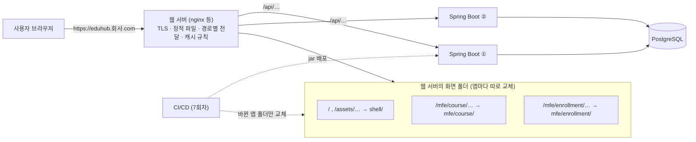

| 구성 요소 | 맡는 일 |
|---|---|
| **웹 서버** (nginx, Apache, IIS, 사내 표준 웹 서버 등) | HTTPS 처리, 화면 파일 제공, `/api`를 백엔드로 전달(여러 대면 나눠 보냄), 캐시 규칙, `/courses/1` 같은 화면 주소로 새로고침해도 shell을 주기 |
| **화면 폴더** | 앱마다 따로: `shell/`, `mfe/course/`, `mfe/enrollment/`. 바뀐 앱 폴더만 교체한다 (**독립 배포**) |
| **백엔드** (Spring Boot 여러 대) | API만. 화면 파일은 갖지 않는다 |
| **CI/CD** (7회차) | 바뀐 앱만 빌드해 그 폴더를 교체, 백엔드는 jar로 따로 배포 |

> 💡 정적 파일을 **오브젝트 스토리지(S3 등) + CDN**에 두고 웹 서버나 게이트웨이가 `/api`만 넘기는 구성도 흔합니다. 이때도 "앱별 폴더, 한 주소의 경로 규칙, 캐시 규칙, 폴더 교체로 배포"라는 핵심은 같습니다.

<details>
<summary>운영 웹 서버 설정 예 (nginx): 경로별 폴더, /api 전달, 새로고침, 캐시 규칙</summary>

```nginx
# nginx.conf (운영 서버 예) — EduHub: 화면(shell·remote)과 API를 한 주소로
worker_processes  1;

events {
    worker_connections  1024;
}

http {
    include       mime.types;
    default_type  application/octet-stream;
    sendfile      on;

    server {
        listen       8088;          # 운영에서는 443 + TLS 인증서 (ssl_certificate …)
        server_name  localhost;

        # shell: <nginx 설치 경로>/html/eduhub/shell (상대 경로는 nginx 설치 경로 기준)
        root   html/eduhub/shell;
        index  index.html;

        # remote: /mfe/course/… → html/eduhub/mfe/course/…
        location /mfe/ {
            root  html/eduhub;
            # 진입 파일은 매번 확인 → 새 배포가 바로 보인다
            location ~ /remoteEntry\.js$ { add_header Cache-Control "no-cache"; }
            # 이름에 해시가 붙은 파일은 내용이 바뀌면 이름도 바뀌므로 오래 캐시
            location ~ /assets/          { add_header Cache-Control "public, max-age=31536000, immutable"; }
        }

        location /assets/ {
            add_header Cache-Control "public, max-age=31536000, immutable";
        }

        # API는 백엔드(Spring Boot)로. 여러 대면 upstream으로 묶어 나눠 보낸다
        location /api/ {
            proxy_pass         http://127.0.0.1:8080;
            proxy_set_header   Host $host;
            proxy_set_header   X-Forwarded-For $proxy_add_x_forwarded_for;
            proxy_set_header   X-Forwarded-Proto $scheme;
        }

        # 화면 주소(/courses/1 등)는 shell의 index.html로 (새로고침·직접 접속 대비)
        location / {
            add_header Cache-Control "no-cache";
            try_files  $uri $uri/ /index.html;
        }
    }
}
```

| 설정 | 하는 일 |
|---|---|
| `root html/eduhub/shell` | `/`와 `/assets/…`를 shell 폴더에서 |
| `location /mfe/` + `root html/eduhub` | `/mfe/course/x` → `html/eduhub/mfe/course/x` |
| `location /api/` + `proxy_pass` | API를 백엔드로. 같은 주소라 **CORS가 필요 없다** |
| `try_files … /index.html` | `/courses/1`로 새로고침·직접 접속해도 shell |
| `Cache-Control: no-cache` (화면 주소, `remoteEntry.js`) | 새 배포가 **바로** 보인다 |
| `max-age=31536000, immutable` (`assets/`) | 이름에 해시가 붙은 파일은 오래 캐시 (내용이 바뀌면 이름도 바뀐다) |

> ✅ 이 설정은 이 교재 환경의 **Linux nginx 1.24**로 실행해, 5회차와 같은 브라우저 20단계 4회 연속 통과, 새로고침, 캐시 헤더, 재시작 없는 앱 교체·롤백까지 확인했습니다(주석만 운영 서버 기준으로 다듬음).

</details>

### Step 4-2. 실습은 이렇게 한다: 백엔드가 `run\web` 폴더를 서비스

운영의 웹 서버 자리를 실습에서는 **이미 실행하고 있는 Spring Boot(8080)**가 대신합니다. 화면 파일은 **프로젝트 루트의 `run\web\`**(설정하지 않아도 자동으로 이 폴더)에 운영과 **같은 폴더 구성**으로 둡니다.

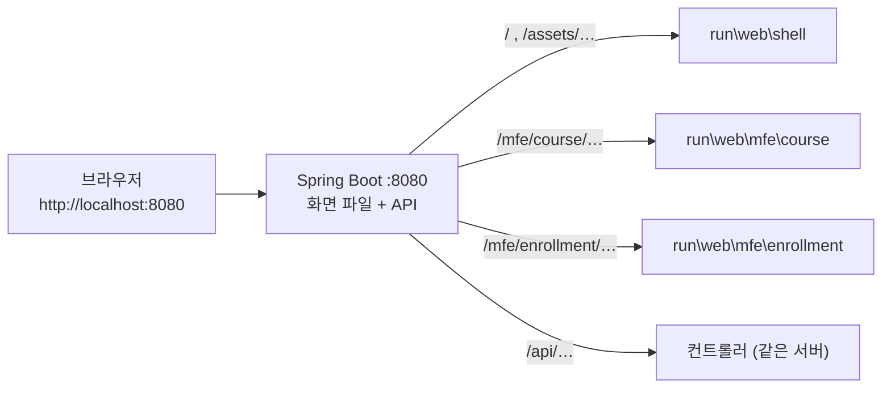

**왜 실습에서는 nginx를 쓰지 않나**

| 이유 | 내용 |
|---|---|
| **Windows용 nginx의 호환 문제** | nginx 공식 문서는 Windows 버전을 성능·기능 제한이 있는 **베타 수준**으로 안내합니다. 실제로 회사 PC에서 **보안 프로그램이 서명 없는 `nginx.exe`의 실행을 붙잡아** `nginx -v`조차 멈추고, 끌 수 없는 프로세스가 쌓이는 일을 겪었습니다(아래 사례). 사용자가 풀 수 없고 IT 허용이 필요합니다 |
| **Docker는 실습 환경을 복잡하게** | 설치·권한·자원 부담이 크고, 회사 PC 정책에 따라 쓸 수 없는 경우도 많습니다 |
| **새 프로그램 없이 같은 것을 배운다** | 이미 실행하는 Java(Spring Boot)라 막히지 않고, 아래 표처럼 운영과 **같은 구조**를 그대로 연습합니다 |

| | 운영 (Step 4-1) | 실습 (Step 4-2~4-6) |
|---|---|---|
| 화면을 주는 것 | 웹 서버(nginx 등) | Spring Boot의 `FrontendResourceConfig` (Step 4-4) |
| 주소 | https://eduhub.회사.com | http://localhost:8080 |
| 화면 폴더 | 웹 서버의 폴더 | 프로젝트 루트 `run\web\` (바꾸려면 환경 변수 `EDUHUB_WEB_ROOT`) |
| 폴더 구성·경로 규칙 | `shell/`, `mfe/course/`, `mfe/enrollment/` | **같음** |
| `/api` | 웹 서버가 백엔드로 전달 | 같은 서버가 바로 처리 |
| 새로고침 | `try_files … /index.html` | `SpaForwardController` |
| 캐시 규칙 | 웹 서버 설정 | **같은 규칙**을 Spring 설정으로 |
| 빌드 | `npm run build:deploy` | **같음** |
| 배포·롤백 | `deploy-frontend.ps1 -WebRoot <웹 서버 폴더>` | **같은 스크립트** (기본 `run\web`) |
| 7회차 자동 배포 | 웹 서버 폴더를 교체 | 스테이징 PC의 화면 폴더를 교체 (워크플로우 같음) |

> 💡 그래서 이 실습으로 익히는 것(앱별 폴더, 한 주소의 경로 규칙, 캐시 규칙, 폴더 교체·롤백)은 운영에서 **웹 서버만 바뀌고 그대로** 쓰입니다. IT 허용으로 `nginx.exe`가 동작하는 PC라면, 같은 `run\web`을 nginx로도 서비스해 80(nginx)과 8080(백엔드)을 함께 쓸 수 있습니다 → [Step 4-7](#step-4-7-선택-nginx도-함께-같은-runweb을-80번-포트로).

<details>
<summary>사례: 회사 PC에서 <code>nginx.exe</code>가 실행되지 않았던 일 (증상, 판단 방법, IT 요청)</summary>


| 보이는 증상 | 실제 의미 |
|---|---|
| 더블클릭하면 작업관리자에 `nginx.exe`가 생기고, 다시 실행할 때마다 늘어남 | 실행할 때마다 프로세스가 생기지만 **시작하지 못하고 붙잡혀** 남음 |
| 브라우저가 응답하지 않음, `netstat -ano \| findstr LISTENING \| findstr ":80"`에 아무것도 없음 | 시작하지 못했으니 포트가 열리지 않음 |
| `logs` 폴더에 `error.log`조차 생기지 않음 | nginx 코드가 실행되기도 전에 멈춤 |
| `taskkill /f /im nginx.exe` → "실행 중인 작업 인스턴스가 없습니다" | 다른 프로그램이 그 프로세스를 붙잡고 있어 끝낼 수 없음 |
| `nginx -v`조차 아무 출력 없이 멈춤 | **실행 자체가 바깥에서 붙잡힘** |

**판단 방법** (PowerShell)

```powershell
Get-AuthenticodeSignature C:\nginx\nginx.exe | Select-Object Status   # NotSigned: nginx.org의 Windows 버전은 코드 서명이 없다
Get-Item C:\nginx\nginx.exe -Stream * | Select-Object Stream          # 낯선 표시가 실행 파일에만 붙어 있는지 (설정 파일과 비교)
Get-Item C:\nginx\conf\nginx.conf -Stream * | Select-Object Stream
```

- `Zone.Identifier`가 있으면 "인터넷에서 받은 파일" 표시입니다. 파일 속성의 **차단 해제**(또는 `Unblock-File`)로 지운 뒤 `nginx -v`를 다시 해 봅니다
- 그런 표시가 없고, Windows가 기본으로 붙이지 않는 표시(이 사례에서는 `RVContext`)가 **실행 파일에만** 붙어 있으며 서명이 없다면, PC의 **보안 프로그램(백신·EDR 등)이 서명 없는 낯선 실행 파일을 붙잡고 있는 것**으로 봅니다. 사용자가 풀 문제가 아닙니다

**하지 말 것**: 같은 실행 반복(붙잡힌 프로세스만 늘어남), 그 표시를 지우거나 보안 프로그램을 끄거나 직접 만든 인증서로 서명하기(회사 보안 정책 위반이 될 수 있음).

**할 것: IT 담당자에게 허용 요청.** nginx.org는 Windows용 zip의 **PGP 서명(.asc)**을 함께 제공합니다. PGP 서명은 보안 프로그램의 차단을 풀어 주지는 않지만(보안 프로그램은 PGP를 보지 않는다), "공식 파일이고 바뀌지 않았다"는 **근거**가 됩니다.

```bash
# Git Bash(Git for Windows에 gpg가 들어 있다). 같은 버전의 zip과 zip.asc, 그리고
# https://nginx.org/en/pgp_keys.html 의 서명 키 파일을 받은 폴더에서
gpg --import <받은 키 파일>.key
gpg --verify nginx-1.x.y.zip.asc nginx-1.x.y.zip
#  → "Good signature from …" 이고, 출력의 Primary key fingerprint가 pgp_keys.html의 지문과 같으면 공식 파일
#    ("This key is not certified with a trusted signature" 경고는 정상)
```

```powershell
Get-FileHash .\nginx-1.x.y.zip -Algorithm SHA256
Get-FileHash C:\nginx\nginx.exe -Algorithm SHA256
```

> IT 담당자에게: 교육 실습용 웹 서버 `nginx.exe`(nginx.org 공식 Windows 버전)를 실행하면 `nginx -v`조차 응답 없이 멈추고 프로세스가 종료되지 않으며 로그도 생기지 않습니다. 코드 서명은 없고(NotSigned), 실행 파일에만 보안 프로그램의 표시로 보이는 대체 데이터 스트림이 붙습니다. nginx.org의 PGP 서명으로 zip을 검증했습니다(Good signature, 키 지문 일치). zip과 `nginx.exe`의 SHA256은 아래와 같습니다. 이 파일(또는 실습 폴더)의 실행 허용을 요청드립니다.

이 교재의 실습은 처음부터 이 상황을 피하는 구성(아래)으로 합니다. 이미 붙잡힌 nginx 프로세스는 해가 없고 다음 로그아웃·재부팅 때 정리됩니다.

> ⚠️ 위 판단 명령과 증상은 실제 회사 PC에서 확인한 것입니다. PGP 검증 절차는 gpg의 표준 사용법이며, 이 교재 환경에서는 nginx.org에 접속할 수 없어 실제 파일로 실행해 보지 못했습니다.


</details>

### Step 4-3. 한 주소용 빌드 (`build:deploy`)

개발 서버에서는 remote가 `http://localhost:3001/remoteEntry.js`에 있지만, 한 주소로 배포하면 같은 서버의 `/mfe/course/remoteEntry.js`에 있습니다. remote 파일들도 자기 서브 폴더(`/mfe/course/`) 기준으로 서로를 찾아야 합니다(Vite의 `base`). **빌드 모드**로 나눠, 개발 서버·미리보기는 그대로 두고 `npm run build:deploy`일 때만 바꿉니다. 운영에서도 같은 빌드를 씁니다.

```json
// apps/shell, apps/course-mfe, apps/enrollment-mfe 의 package.json scripts에 추가
"build:deploy": "tsc --noEmit && vite build --mode deploy"
```

```ts
/// <reference types="vitest/config" />
// frontend/apps/shell/vite.config.ts — 6회차: host. --mode deploy로 빌드하면 remote를 같은 서버의 /mfe/… 에서 받는다 (Step 4)
import { defineConfig } from "vite";
import react from "@vitejs/plugin-react";
import { federation } from "@module-federation/vite";

export default defineConfig(({ mode }) => {
  const deploy = mode === "deploy";   // npm run build:deploy (한 주소로 배포할 때)
  const entry = (port: number, path: string) =>
    deploy ? `/mfe/${path}/remoteEntry.js` : `http://localhost:${port}/remoteEntry.js`;
  return {
    // /api 요청은 백엔드로 (같은 origin이 되어 CORS가 필요 없다). preview도 같게
    server: { port: 3000, strictPort: true, proxy: { "/api": "http://localhost:8080" } },
    preview: { port: 3000, strictPort: true, proxy: { "/api": "http://localhost:8080" } },
    plugins: [
      react(),
      federation({
        name: "shell",
        remotes: {
          courseMfe: { type: "module", name: "courseMfe", entry: entry(3001, "course") },
          enrollmentMfe: { type: "module", name: "enrollmentMfe", entry: entry(3002, "enrollment") },
        },
        shared: {
          react: { singleton: true, requiredVersion: "^18.0.0" },
          "react-dom": { singleton: true, requiredVersion: "^18.0.0" },
          "react-router-dom": { singleton: true },   // 라우터 상태를 shell과 remote가 함께 쓴다
          "@mui/material": { singleton: true },
          "@emotion/react": { singleton: true },
          "@eduhub/api-client": { singleton: true }, // 토큰 처리(http 인터셉터)를 한 벌만
        },
        dts: false,
      }),
    ],
    test: { environment: "jsdom", setupFiles: ["./src/setupTests.ts"] },
  };
});
```

```ts
// frontend/apps/course-mfe/vite.config.ts — 바뀐 곳 (enrollment-mfe는 "/mfe/enrollment/")
export default defineConfig(({ mode }) => ({
  base: mode === "deploy" ? "/mfe/course/" : "/",   // 한 주소로 배포: /mfe/course/ 아래에서 서비스 (Step 4)
  // … 나머지(server, preview, plugins, test)는 그대로 …
}));
```

### Step 4-4. 백엔드가 `run\web`을 서비스하게 하기

화면 파일은 **jar에 넣지 않습니다.** `src/main/resources/static`에 넣으면 화면 하나를 고쳐도 백엔드를 다시 빌드·배포해야 해서 독립 배포가 사라집니다. 폴더는 **실행할 때** 정해지고(기본 `../run/web`, 즉 `backend` 폴더에서 실행할 때 프로젝트 루트의 `run\web`), 같은 jar를 PC·서버마다 다른 폴더로 씁니다.

```yaml
# backend/src/main/resources/application.yml (eduhub 아래에 추가)
eduhub:
  # 화면 파일 폴더 (jar 밖). 기본은 프로젝트 루트의 run/web (backend 폴더에서 실행할 때 ../run/web).
  # 다른 곳을 쓰려면 환경 변수 EDUHUB_WEB_ROOT, 화면 서비스를 끄려면 EDUHUB_WEB_ROOT를 빈 값으로
  web-root: ${EDUHUB_WEB_ROOT:../run/web}
```

```java
// web/FrontendResourceConfig.java — 경로별로 폴더와 캐시 규칙을 정한다 (운영 웹 서버 설정과 같은 규칙)
package com.example.eduhub.web;

import java.nio.file.Path;
import java.util.concurrent.TimeUnit;
import org.springframework.beans.factory.annotation.Value;
import org.springframework.boot.autoconfigure.condition.ConditionalOnExpression;
import org.springframework.context.annotation.Configuration;
import org.springframework.http.CacheControl;
import org.springframework.web.servlet.config.annotation.ResourceHandlerRegistry;
import org.springframework.web.servlet.config.annotation.WebMvcConfigurer;

/**
 * 화면 파일을 jar 밖 폴더(eduhub.web-root, 기본 run/web)에서 서비스한다. 값이 비어 있으면 이 설정은 동작하지 않는다.
 * 폴더 구성은 운영의 웹 서버(nginx 등)와 같다: <web-root>/shell/, <web-root>/mfe/course/, <web-root>/mfe/enrollment/
 */
@Configuration
@ConditionalOnExpression("!'${eduhub.web-root:}'.isBlank()")
class FrontendResourceConfig implements WebMvcConfigurer {
    private static final CacheControl NO_CACHE = CacheControl.noCache();                        // 매번 바뀌었는지 확인
    private static final CacheControl LONG = CacheControl.maxAge(365, TimeUnit.DAYS).cachePublic().immutable(); // 해시 이름 파일

    private final String root;   // 끝이 /인 file: 주소

    FrontendResourceConfig(@Value("${eduhub.web-root}") String webRoot) {
        // Path.toUri(): Windows의 C:\eduhub-web 도 file:///C:/eduhub-web/ 로 올바르게 바꿔 준다
        String uri = Path.of(webRoot).toAbsolutePath().normalize().toUri().toString();
        this.root = uri.endsWith("/") ? uri : uri + "/";   // 폴더가 아직 없으면 끝에 /가 붙지 않으므로
    }

    @Override
    public void addResourceHandlers(ResourceHandlerRegistry registry) {
        String shell = root + "shell/";
        String mfe = root + "mfe/";
        registry.addResourceHandler("/index.html", "/*.js").addResourceLocations(shell).setCacheControl(NO_CACHE);
        registry.addResourceHandler("/assets/**").addResourceLocations(shell + "assets/").setCacheControl(LONG);
        registry.addResourceHandler("/mfe/*/remoteEntry.js").addResourceLocations(mfe).setCacheControl(NO_CACHE);
        registry.addResourceHandler("/mfe/*/assets/**").addResourceLocations(mfe).setCacheControl(LONG);
    }
}
```

```java
// web/SpaForwardController.java — 새로고침해도 shell (운영의 try_files 역할)
package com.example.eduhub.web;

import org.springframework.boot.autoconfigure.condition.ConditionalOnExpression;
import org.springframework.stereotype.Controller;
import org.springframework.web.bind.annotation.GetMapping;

/** 첫 화면과 화면 주소(/courses/1 등)는 shell의 index.html로. /api, /assets, /mfe는 해당 없음 */
@Controller
@ConditionalOnExpression("!'${eduhub.web-root:}'.isBlank()")
class SpaForwardController {
    @GetMapping({"/", "/login", "/courses", "/courses/**", "/my/**", "/admin/**"})
    String shell() { return "forward:/index.html"; }
}
```

```java
// auth/SecurityConfig.java (5회차 Step 9-1) — 한 줄 추가: /api 밖(화면 파일)은 로그인 없이
            .authorizeHttpRequests(auth -> auth
                .requestMatchers(HttpMethod.POST, "/api/auth/login").permitAll()
                .requestMatchers(r -> !r.getRequestURI().startsWith("/api/")).permitAll()   // 화면 파일(shell·remote)은 누구나. 보호는 /api에서
                // … 나머지 규칙은 그대로 …
```

```gitignore
# .gitignore (프로젝트 루트) — 배포된 화면 파일은 저장소에 넣지 않는다
run/
```

```kotlin
// backend/build.gradle.kts — 실수로 화면 파일이 jar에 들어가지 않게 (선택)
tasks.processResources { exclude("static/**", "public/**") }
```

- `SecurityConfig` 한 줄이 없으면 `anyRequest().authenticated()` 때문에 화면 파일까지 로그인을 요구해 첫 화면이 401이 됩니다. API 보호 규칙은 바뀌지 않습니다
- `Path.toUri()`가 Windows 경로(`C:\eduhub-web`)도 `file:///C:/eduhub-web/`로 바꿔 주므로 환경 변수에 일반 Windows 경로를 그대로 씁니다

### Step 4-5. 배포 스크립트: 복사해서 이름만 바꿔 교체

빌드 결과를 폴더에 **바로 덮어쓰면** 복사하는 몇 초 동안 옛 파일과 새 파일이 섞여 화면이 깨질 수 있습니다. 옆 폴더(`.new`)에 다 복사한 뒤 **이름만 바꿔** 교체하고, 직전 버전은 `.prev`로 남겨 **롤백**에 씁니다. 운영 웹 서버 폴더에도, 7회차 자동 배포에도 이 스크립트를 그대로 씁니다(`-WebRoot`만 다름).

```powershell
# scripts/deploy-frontend.ps1 — 빌드한 MFE 하나를 화면 폴더(기본: 프로젝트 루트의 run\web)에 배포(교체)하거나 직전 버전으로 되돌린다
# 사용: .\scripts\deploy-frontend.ps1 -App course-mfe [-Source <빌드 폴더>] [-WebRoot <화면 폴더>] [-Rollback]   (Windows PowerShell 5.1 이상)
param(
    [Parameter(Mandatory = $true)][ValidateSet('shell', 'course-mfe', 'enrollment-mfe')][string]$App,
    [string]$Source,                                   # 기본: frontend\apps\<App>\dist
    [string]$WebRoot = (Join-Path $PSScriptRoot '..\run\web'),   # 운영에서는 웹 서버(nginx 등)의 폴더
    [switch]$Rollback
)
$ErrorActionPreference = 'Stop'

$target = @{ 'shell' = 'shell'; 'course-mfe' = 'mfe\course'; 'enrollment-mfe' = 'mfe\enrollment' }[$App]
$dest = Join-Path $WebRoot $target
$prev = "$dest.prev"; $new = "$dest.new"; $broken = "$dest.broken"

# 폴더 이름 바꾸기. 서버가 마침 그 폴더의 파일을 읽는 중이면 Windows가 잠시 거부할 수 있어 몇 번 다시 시도한다
function Rename-Retry([string]$Path, [string]$NewPath) {
    for ($i = 1; $i -le 5; $i++) {
        try { Rename-Item -LiteralPath $Path -NewName (Split-Path $NewPath -Leaf) -ErrorAction Stop; return }
        catch { if ($i -eq 5) { throw }; Start-Sleep -Milliseconds 500 }
    }
}

if ($Rollback) {
    if (-not (Test-Path $prev)) { throw "되돌릴 이전 버전이 없습니다: $prev" }
    if (Test-Path $broken) { Remove-Item $broken -Recurse -Force }
    if (Test-Path $dest) { Rename-Retry $dest $broken }
    Rename-Retry $prev $dest
    Write-Host "롤백 완료: $App <- 이전 버전 ($dest). 문제가 된 버전은 $broken"
    exit 0
}

if (-not $Source) { $Source = Join-Path $PSScriptRoot "..\frontend\apps\$App\dist" }
$entry = if ($App -eq 'shell') { 'index.html' } else { 'remoteEntry.js' }
if (-not (Test-Path (Join-Path $Source $entry))) { throw "빌드 결과가 없습니다: $Source\$entry (npm run build:deploy 먼저)" }

# 1) 새 버전을 옆 폴더(.new)에 모두 복사해 둔다 — 복사 도중의 반쪽 상태가 사용자에게 보이지 않게
if (Test-Path $new) { Remove-Item $new -Recurse -Force }
New-Item -ItemType Directory -Force -Path (Split-Path $dest) | Out-Null
Copy-Item -Path $Source -Destination $new -Recurse
# 2) 이름만 바꿔 교체: 현재 → .prev(롤백용으로 한 단계 보관), .new → 현재
if (Test-Path $prev) { Remove-Item $prev -Recurse -Force }
if (Test-Path $dest) { Rename-Retry $dest $prev }
try { Rename-Retry $new $dest }
catch { if (Test-Path $prev) { Rename-Retry $prev $dest }; throw }   # 실패하면 이전 버전을 제자리로
Write-Host "배포 완료: $App -> $dest"
```

```powershell
# 저장소 루트에서 (빌드 → 배포, 기본 폴더 run\web)
cd frontend
npm run build:deploy --workspace apps/course-mfe
npm run build:deploy --workspace apps/enrollment-mfe
npm run build:deploy --workspace apps/shell
cd ..
.\scripts\deploy-frontend.ps1 -App course-mfe
.\scripts\deploy-frontend.ps1 -App enrollment-mfe
.\scripts\deploy-frontend.ps1 -App shell
# 문제가 생기면 직전 버전으로
.\scripts\deploy-frontend.ps1 -App course-mfe -Rollback
```

> 💡 "이 시스템에서 스크립트를 실행할 수 없으므로…"가 나오면 PowerShell 실행 정책 때문입니다. 저장소에서 받은 스크립트만 허용하도록 `Set-ExecutionPolicy -Scope CurrentUser RemoteSigned`를 **사람이** 판단해 실행합니다 (회사 정책이 있으면 그것을 따른다).

<details>
<summary>macOS·Linux용 같은 스크립트 (deploy-frontend.sh)</summary>

```bash
#!/usr/bin/env bash
# scripts/deploy-frontend.sh — deploy-frontend.ps1과 같은 동작 (macOS·Linux)
# 사용: deploy-frontend.sh <shell|course-mfe|enrollment-mfe> [빌드 폴더] [--rollback]   (WEB_ROOT 기본: 프로젝트 루트의 run/web)
set -euo pipefail
APP="${1:?앱 이름}"; SRC="${2:-}"; ROLLBACK=false
[[ "${2:-}" == "--rollback" || "${3:-}" == "--rollback" ]] && ROLLBACK=true && [[ "$SRC" == "--rollback" ]] && SRC=""
ROOT="${WEB_ROOT:-$(cd "$(dirname "$0")/.." && pwd)/run/web}"
case "$APP" in
  shell) TARGET=shell; ENTRY=index.html ;;
  course-mfe) TARGET=mfe/course; ENTRY=remoteEntry.js ;;
  enrollment-mfe) TARGET=mfe/enrollment; ENTRY=remoteEntry.js ;;
  *) echo "알 수 없는 앱: $APP" >&2; exit 1 ;;
esac
DEST="$ROOT/$TARGET"; PREV="$DEST.prev"; NEW="$DEST.new"
if $ROLLBACK; then
  [[ -d "$PREV" ]] || { echo "되돌릴 이전 버전이 없습니다: $PREV" >&2; exit 1; }
  rm -rf "$DEST.broken"; [[ -d "$DEST" ]] && mv "$DEST" "$DEST.broken"
  mv "$PREV" "$DEST"; echo "롤백 완료: $APP ← 이전 버전 ($DEST). 문제가 된 버전은 $DEST.broken"; exit 0
fi
SRC="${SRC:-$(dirname "$0")/../frontend/apps/$APP/dist}"
[[ -f "$SRC/$ENTRY" ]] || { echo "빌드 결과가 없습니다: $SRC/$ENTRY (npm run build:deploy 먼저)" >&2; exit 1; }
rm -rf "$NEW"; mkdir -p "$(dirname "$DEST")"; cp -r "$SRC" "$NEW"
rm -rf "$PREV"; [[ -d "$DEST" ]] && mv "$DEST" "$PREV"
mv "$NEW" "$DEST" || { [[ -d "$PREV" ]] && mv "$PREV" "$DEST"; exit 1; }
echo "배포 완료: $APP → $DEST"
```

</details>

### Step 4-6. 확인

```powershell
cd backend
$env:EDUHUB_JWT_SECRET = "<5회차 Step 9-1의 값>"
.\gradlew bootRun --args='--spring.profiles.active=dev'      # 또는 java -jar build\libs\…jar --spring.profiles.active=dev
```

백엔드를 `backend` 폴더에서 실행하면 `..\run\web`을 서비스합니다. **개발 서버(3000~3002)는 모두 끈 상태**에서 http://localhost:8080 으로 확인합니다.

| # | 할 일 | 기대 결과 |
|---|---|---|
| N1 | [5회차 6-2 확인 표](./session-05-hooks-and-mcp.md#6-2-데모-흐름으로-확인하기) 12개를 8080에서 | 개발 서버에서와 같은 결과 |
| N2 | `/courses/1`에서 새로고침 | 상세 화면 그대로 (404 아님) |
| N3 | 개발자 도구 Network 탭 | 모든 파일이 8080에서. remote 파일은 `/mfe/course/…`, `/mfe/enrollment/…` |
| N4 | `(Invoke-WebRequest -UseBasicParsing http://localhost:8080/mfe/course/remoteEntry.js).Headers['Cache-Control']` | `no-cache` (해시 이름의 `assets/` 파일은 `max-age=31536000, public, immutable`) |
| N5 | course-mfe 검색창 이름을 잠깐 바꿔 `build:deploy` → `deploy-frontend.ps1 -App course-mfe` → 브라우저 새로고침 | **백엔드를 다시 시작하지 않아도** 바뀐 화면 (독립 배포) |
| N6 | `deploy-frontend.ps1 -App course-mfe -Rollback` → 새로고침 | 바꾸기 전 화면. `run\web\mfe\course.broken`에 문제 버전이 남음 |

> ✅ 이 교재 환경에서 위 코드로 확인했습니다: 환경 변수 없이 `backend` 폴더에서 실행하면 `../run/web`을 서비스, 5회차와 같은 브라우저 20단계 통과, 캐시 헤더(N4), **백엔드 재시작 없이** 교체와 롤백(N5·N6, 배포 스크립트의 bash 버전), `EDUHUB_WEB_ROOT`를 빈 값으로 두면 화면 서비스만 꺼지고 API는 정상, jar 안에 화면 파일 0건, 세 앱 단위 테스트 16개. Windows 경로와 PowerShell 스크립트는 이 환경에서 실행해 보지 못했습니다(같은 논리의 bash로 확인).

```bash
git switch -c chore/web-deploy
git add .gitignore frontend/apps/*/vite.config.ts frontend/apps/*/package.json \
        backend/src/main/java/com/example/eduhub/web backend/src/main/java/com/example/eduhub/auth/SecurityConfig.java \
        backend/src/main/resources/application.yml scripts/deploy-frontend.ps1 scripts/deploy-frontend.sh
git commit -m "chore: 한 주소 배포 구성(run/web 서비스, build:deploy, 배포·롤백 스크립트)"
```

### Step 4-7. (선택) nginx도 함께: 같은 `run\web`을 80번 포트로

Step 4-2의 사례처럼 회사 PC에서는 보안 프로그램 때문에 `nginx.exe`가 실행되지 않을 수 있습니다. **IT가 `nginx.exe`를 허용(예외 등록)해 nginx가 동작하는 PC**라면, 지금까지 만든 것을 **하나도 바꾸지 않고** nginx를 앞에 둘 수 있습니다. nginx가 **같은 `run\web` 폴더**를 읽기 때문에, 빌드(`build:deploy`)와 배포 스크립트(`deploy-frontend.ps1`)도 그대로입니다.

> ⚠️ **보안 프로그램(백신·EDR)을 끄고 실습하지 않습니다.** 잠깐 꺼서 동작을 확인하는 것과, 꺼 둔 채 쓰는 것은 다릅니다. 회사 보안 정책 위반이고, 그 사이 PC가 보호받지 못합니다. nginx가 막히면 Step 4-2의 사례처럼 `nginx.exe`의 경로·SHA256 해시·PGP 서명 검증 결과를 근거로 **IT에 예외 등록을 요청**하고, 허용되기 전까지는 Step 4-2~4-6의 방식(8080)으로 실습합니다.

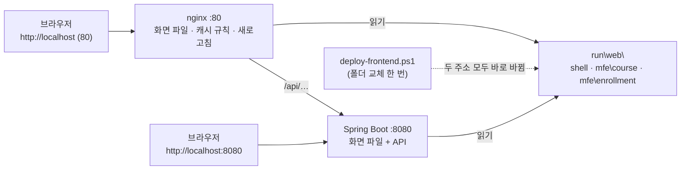

| 주소 | 화면을 주는 것 | `/api` | 쓰임 |
|---|---|---|---|
| **http://localhost** (80) | **nginx** (Step 4-1의 운영 설정과 같은 규칙) | nginx가 8080으로 전달 | **운영과 같은 구성**을 그대로 체험 |
| http://localhost:8080 | Spring Boot (`FrontendResourceConfig`) | 같은 서버 | 지금까지처럼. nginx가 없어도 동작 |

두 주소가 **같은 폴더**를 보므로, 배포·롤백을 한 번 하면 두 주소 모두 바뀝니다. 백엔드의 화면 서비스까지 끄고 nginx만 화면을 주게 하려면(운영과 완전히 같은 모양) 백엔드를 `EDUHUB_WEB_ROOT`를 빈 값으로 두고 실행합니다(Step 4-4). 그러면 8080은 API만 응답하고 화면은 404입니다.

**① nginx 준비**

1. nginx 공식 사이트의 Windows 배포판(zip)을 받아 `C:\nginx`에 풉니다 (받은 zip의 PGP 서명 확인은 Step 4-2의 사례)
2. `C:\nginx\conf\nginx.conf`를 아래 내용으로 바꿉니다. **저장소 위치가 다르면 `C:/work/eduhub` 두 곳만** 내 경로로 바꿉니다 (nginx 설정에서는 Windows 경로도 `/`로 씁니다)

```nginx
# C:\nginx\conf\nginx.conf — EduHub 실습: run\web을 80번으로, /api는 8080 백엔드로 (규칙은 Step 4-1의 운영 설정과 같다)
worker_processes  1;

events {
    worker_connections  1024;
}

http {
    include       mime.types;
    default_type  application/octet-stream;
    sendfile      on;

    server {
        listen       80;            # 80이 이미 쓰이고 있으면 8088 등으로 (아래 ③)
        server_name  localhost;

        # shell: 저장소의 run\web\shell (저장소 위치에 맞게)
        root   "C:/work/eduhub/run/web/shell";
        index  index.html;

        # remote: /mfe/course/… → run\web\mfe\course\…
        location /mfe/ {
            root  "C:/work/eduhub/run/web";
            location ~ /remoteEntry\.js$ { add_header Cache-Control "no-cache"; }
            location ~ /assets/          { add_header Cache-Control "public, max-age=31536000, immutable"; }
        }

        location /assets/ {
            add_header Cache-Control "public, max-age=31536000, immutable";
        }

        # API는 8080의 백엔드로 (같은 주소라 CORS가 필요 없다)
        location /api/ {
            proxy_pass         http://127.0.0.1:8080;
            proxy_set_header   Host $host;
            proxy_set_header   X-Forwarded-For $proxy_add_x_forwarded_for;
            proxy_set_header   X-Forwarded-Proto $scheme;
        }

        # 화면 주소(/courses/1 등)는 shell의 index.html로 (새로고침 대비)
        location / {
            add_header Cache-Control "no-cache";
            try_files  $uri $uri/ /index.html;
        }
    }
}
```

**② 실행과 중지** (PowerShell, `C:\nginx`에서)

```powershell
cd C:\nginx
.\nginx.exe -t                        # 설정 검사: "syntax is ok", "test is successful"
start .\nginx.exe                     # 시작 (창이 뜨지 않고 백그라운드에서 돈다)
.\nginx.exe -s reload                 # 설정을 바꾼 뒤 다시 읽기 (화면 배포에는 필요 없음)
.\nginx.exe -s stop                   # 중지
tasklist /fi "imagename eq nginx.exe" # 실행 중인지 (보통 2개: 관리 + 작업 프로세스)
Get-Content .\logs\error.log -Tail 20 # 문제가 있을 때
```

- 백엔드는 지금처럼 `backend` 폴더에서 실행합니다 (Step 4-6). nginx는 백엔드보다 먼저 켜도 됩니다. 백엔드가 꺼져 있으면 화면은 뜨고 `/api`만 `502 Bad Gateway`입니다
- 처음 실행할 때 **Windows 방화벽** 창이 뜨면, 실습용 PC라면 "개인 네트워크"만 허용합니다 (다른 PC에서 접속할 필요가 없으면 허용하지 않아도 localhost는 동작)

**③ 80번 포트가 이미 쓰이고 있을 때**

```powershell
netstat -ano | findstr ":80 " | findstr LISTENING     # 마지막 숫자가 PID
tasklist /fi "pid eq <PID>"
```

- PID `4`(System)이면 IIS나 Windows의 HTTP 서비스가 80을 쓰는 중입니다. 끄지 말고 nginx의 `listen`을 `8088` 같은 다른 포트로 바꾸고 `http://localhost:8088`로 확인합니다
- 1024보다 작은 포트라도 Windows에서는 관리자 권한 없이 열 수 있지만, 회사 정책상 막혀 있으면 8088을 씁니다

**④ 확인** (Step 4-6의 N1~N6을 `http://localhost`에서 한 번 더)

| # | 할 일 | 기대 결과 |
|---|---|---|
| G1 | http://localhost 에서 5회차 6-2 확인 표 | 8080에서와 같은 결과 |
| G2 | `/courses/1`에서 새로고침 | 상세 화면 그대로 (nginx의 `try_files`) |
| G3 | `(Invoke-WebRequest -UseBasicParsing http://localhost/mfe/course/remoteEntry.js).Headers['Cache-Control']` | `no-cache` (해시 이름의 `assets/` 파일은 `public, max-age=31536000, immutable`) |
| G4 | `deploy-frontend.ps1 -App course-mfe` (Step 4-5 그대로) → 두 주소 새로고침 | **nginx도 백엔드도 다시 시작하지 않고** 80과 8080 모두 바뀐 화면 |
| G5 | `deploy-frontend.ps1 -App course-mfe -Rollback` | 두 주소 모두 이전 화면 |
| G6 | 백엔드를 끄고 http://localhost/courses | 화면은 뜨고 데이터만 실패 (`/api` 502). 화면과 API가 분리된 것을 눈으로 확인 |

> 💡 **7회차 자동 배포와의 관계**: 7-3의 워크플로우는 `FRONTEND_WEB_ROOT`(= `run\web`) 폴더를 교체하므로 nginx를 써도 **바꿀 것이 없습니다.** 스모크 테스트를 nginx 주소로 하고 싶으면 staging 환경 변수 `APP_URL`만 `http://localhost`로 바꿉니다.

> ✅ 이 교재 환경(Linux, nginx 1.24)에서 위와 같은 규칙의 설정(경로만 Linux 형식)으로 확인했습니다: 80과 8080이 같은 `run/web`을 서비스, 두 주소 모두 브라우저 20단계 통과, 캐시 헤더(80·8080 같음), 배포 스크립트로 course-mfe 교체 → **두 주소 모두 즉시 새 버전, 롤백도 두 주소 동시에**(nginx·백엔드 재시작 없음), 백엔드 중지 시 80의 화면 200·`/api` 502, `EDUHUB_WEB_ROOT`를 빈 값으로 두면 8080 화면 404·API 200이고 80은 정상. ⚠️ Windows용 nginx로 이 설정 파일을 실행해 보지는 못했습니다 (Windows 경로를 `/`로 쓰는 것과 `start nginx`는 nginx Windows 문서의 방식).

---

## 4-4. 자주 겪는 문제

| 증상 | 원인과 해결 |
|---|---|
| `Invalid hook call`, 또는 `Cannot read properties of null (reading 'useState')` | React가 두 번 로드됨. 모든 앱의 `shared`에 `singleton: true`와 같은 버전 범위 (두 번째 메시지는 빌드 결과물에서 같은 원인으로 나오는 오류) |
| `useNavigate() may be used only in the context of a <Router> component` (remote 화면만 실패) | remote의 `shared`에 `react-router-dom`이 빠져 라우터가 두 벌. shell과 모든 remote에 `"react-router-dom": { singleton: true }` |
| 로그인했는데 remote의 API가 401 | remote가 자기 `http`나 다른 Axios 인스턴스를 씀, 또는 `@eduhub/api-client`가 shared가 아니라 두 벌. 모든 *Api는 api-client의 인스턴스로, api-client도 singleton |
| `AuthProvider 안에서만 쓸 수 있습니다` 또는 remote 빌드에서 `../auth/AuthContext`를 못 찾음 | remote에 `useAuth`가 남음. remote는 `tokenStore`를 쓴다 (1-5의 ②) |
| 상세 화면에 신청 버튼이 안 보임 | shell이 `renderSessionAction`을 넘기지 않음, 또는 course-mfe에 `EnrollButton` 직접 import가 남아 빌드 실패 |
| remote 화면의 색·글꼴이 다름 | remote가 자체 테마를 만듦(옮기며 `main.tsx`의 `ThemeProvider`가 남은 경우 등). shell의 테마만 쓰게 수정 |
| `Loading script failed ... remoteEntry.js`, `ERR_CONNECTION_REFUSED` | remote 개발 서버가 안 켜졌거나 포트가 다름. 3001·3002 확인. Vite는 포트가 사용 중이면 다른 포트로 옮겨 가므로 `strictPort: true`로 고정 |
| TypeScript: `Cannot find module 'courseMfe/CourseListPage'` | `src/remotes.d.ts`에 `declare module` 선언이 없음 |
| 목록 화면만 비어 있고 콘솔에 `Element type is invalid` | `CourseListPage`는 3회차부터 **이름 있는 export**. `lazy(() => import(…).then((m) => ({ default: m.CourseListPage })))` |
| 인터넷 예제를 따라 했더니 옵션 이름이 다름 (`remotes: { x: "http://…" }` 문자열만 등) | `@originjs/vite-plugin-federation` 예제가 섞임. `@module-federation/vite` 형식(`type`, `name`, `entry`)으로 통일 |
| `git status`에 renamed가 아니라 deleted + new file | `git mv` 대신 파일을 지우고 새로 만듦. 이력이 끊기므로 `git mv`로 다시 하거나, 내용이 많이 바뀌기 전에 커밋 |
| (배포) http://localhost:8080 첫 화면이 404 | `run\web\shell\index.html`이 없음(배포 전), 또는 백엔드를 `backend` 폴더가 아닌 곳에서 실행해 `../run/web`이 다른 곳을 가리킴 → `EDUHUB_WEB_ROOT`에 절대 경로 |
| (배포) 첫 화면이 401 | `SecurityConfig`의 "`/api` 밖은 `permitAll`" 줄 빠짐 (Step 4-4) |
| (배포) 화면은 뜨는데 "화면을 불러오지 못했습니다" | remote를 `build:deploy`가 아니라 `build`로 빌드함(`base`가 `/`), 또는 `run\web\mfe\course`가 없음 → Network 탭에서 404인 주소 확인 |
| (배포) `/courses/1`에서 새로고침하면 404 | `SpaForwardController`의 경로 목록에 그 화면 주소가 없음 |
| (배포) 배포했는데 예전 화면 | 브라우저 캐시 → N4의 `no-cache` 확인, 강력 새로고침(Ctrl+F5) |
| (배포) 화면 하나만 고쳤는데 백엔드를 다시 빌드해야 함, jar가 커짐 | 화면 파일을 `src/main/resources/static`에 넣음 → jar 밖 `run\web`으로 |
| (참고) 회사 PC에서 `nginx.exe`가 `nginx -v`조차 멈춤 | 보안 프로그램이 서명 없는 실행 파일을 붙잡음 → Step 4-2의 사례. **보안 프로그램을 끄지 말고** IT에 예외 등록 요청, 허용 전까지는 8080으로 실습 |
| (nginx) http://localhost 가 `403 Forbidden` 또는 `404` | `root` 경로가 실제 `run\web\shell`과 다름(저장소 위치 확인, `/`로 썼는지), 또는 아직 배포 전 → `logs\error.log`에 찾으려 한 경로가 나온다 |
| (nginx) 화면은 뜨는데 데이터가 안 나오고 `/api`가 `502 Bad Gateway` | 백엔드(8080)가 꺼져 있음 → Step 4-6처럼 실행 |
| (nginx) `bind() to 0.0.0.0:80 failed` | 80을 다른 프로그램이 사용 중 → Step 4-7 ③, `listen 8088`로 |
| (nginx) 설정을 바꿨는데 그대로 | `.\nginx.exe -s reload`를 안 함 (화면 배포에는 필요 없고, nginx.conf를 바꿨을 때만) |
| 워크트리에서 백엔드 연결 실패 | 워크트리에 `.env`가 없음. 필요한 파일을 복사하거나 `.worktreeinclude` 설정 확인 |
| 두 세션이 같은 파일을 고쳐 병합 충돌 | 공통 파일 작업을 Step 1에서 먼저 끝내지 않음. 충돌 해결 후 다음부터 순서 지키기 |
| 사용량이 평소보다 빨리 소진 | 병렬 세션은 각자 사용. 끝난 세션은 정리하고 병렬 수를 줄인다 |

---

# 5. 따라하기 ②: FR-09 알림 (커밋 이후 이벤트)

> **목표**: 수강 신청이 **확정**되거나 대기자가 **승급**되면 알림 기록을 남깁니다. 처음에는 DB 테이블과 로그로 기록하고, 메일·메신저 발송은 나중에 연결할 수 있게 설계합니다.

---

## 5-1. 왜 "커밋 이후"인가

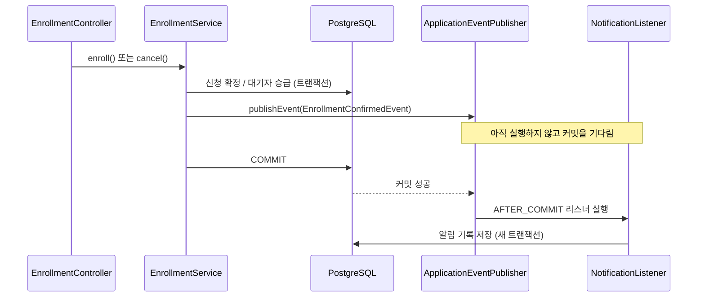

| 방식 | 문제 |
|---|---|
| 서비스 안에서 바로 알림 저장·발송 | 뒤에서 예외가 나 **신청이 롤백되어도 알림은 이미 나감** ("확정됐다"는 알림을 받았는데 실제로는 신청 안 됨) |
| `@EventListener` (일반) | 같은 트랜잭션 안에서 실행 → 위와 같은 문제, 알림 실패가 신청까지 실패시킴 |
| **`@TransactionalEventListener(phase = AFTER_COMMIT)`** | 신청이 **실제로 커밋된 뒤에만** 알림. 알림 실패가 신청에 영향을 주지 않음 |

> 💬 **강사 노트:** 이 판단은 Claude가 먼저 제안하지 않을 수 있습니다. **트랜잭션 지식이 있어야 요구할 수 있는 설계**라는 점(2회차 2-2의 "아키텍처 지식 지도")을 다시 강조합니다.

---

## 5-2. 브랜치와 지시

```bash
git switch main && git pull
git switch -c feature/fr-09-notification
```

```text
[목표] FR-09: 신청 확정·대기자 승급 시 알림 기록을 남긴다
[위치] @backend/src/main/java/com/example/eduhub/enrollment/EnrollmentService.java, 새 패키지 notification
[범위]
- 이벤트: EnrollmentConfirmedEvent(enrollmentId, employeeId, sessionId, reason: APPLIED | PROMOTED)
- EnrollmentService에서 확정·승급 시 ApplicationEventPublisher로 발행
- NotificationListener: @TransactionalEventListener(phase = AFTER_COMMIT) + 새 트랜잭션(REQUIRES_NEW)으로 notification 테이블에 저장, INFO 로그
- Flyway 마이그레이션으로 notification 테이블 추가 (id, employee_id, type, message, created_at)
[하지 않는 것] 메일·메신저 실제 발송, 프론트 화면
[완료 기준]
- 신청 확정 시 알림 1건 저장 테스트
- 신청 트랜잭션이 롤백되면 알림이 저장되지 않는 테스트
- ./gradlew test 통과
[진행 방식] 계획 먼저. 이벤트를 쓰지 않는 더 단순한 방법이 낫다고 생각하면 이유와 함께 제안해줘
```

**예상 코드의 핵심** (Claude 결과와 비교용)

```java
// notification/NotificationListener.java
@Component
@RequiredArgsConstructor
class NotificationListener {

    private final NotificationRepository notificationRepository;

    @TransactionalEventListener(phase = TransactionPhase.AFTER_COMMIT)
    @Transactional(propagation = Propagation.REQUIRES_NEW)   // 커밋 이후라 새 트랜잭션 필요
    public void on(EnrollmentConfirmedEvent event) {
        notificationRepository.save(Notification.confirmed(event));
        log.info("enrollment confirmed: enrollmentId={}, reason={}", event.enrollmentId(), event.reason());
    }
}
```

> 💡 로그에 **이름·연락처 같은 개인정보를 남기지 않고 ID만** 남깁니다.

**diff 검토 체크리스트**

- [ ] 리스너가 `AFTER_COMMIT`인가? 커밋 이후 DB 저장에 새 트랜잭션(`REQUIRES_NEW`)을 쓰는가?
- [ ] "롤백되면 알림 없음" 테스트가 **실제로 롤백 상황을 만드는가**? (이름만 그런 테스트가 아닌지)
- [ ] 이벤트 발행이 확정·승급 **두 곳 모두**에 있는가? (대기자 승급은 취소 로직 안에 있다)
- [ ] Flyway 버전 번호가 기존 마이그레이션과 겹치지 않는가?
- [ ] 로그에 개인정보가 없는가?

```bash
cd backend && ./gradlew test     # 직접 실행해 확인
cd .. && git add backend
git commit -m "feat(notification): 신청 확정·대기 승급 알림 기록 (FR-09)"
git push -u origin feature/fr-09-notification
```

> ✅ **확인**: 직접 고치기 연습. 알림 메시지 문구(예: "수강 신청이 확정되었습니다")는 IDE에서 **직접** 다듬고, Claude에게 "알림 문구를 직접 바꿨어, 테스트만 다시 돌려줘"라고 알립니다.

---

# 6. 따라하기 ③: 팀 플러그인 만들기·배포·설치

> **목표**: 3~5주차의 `.claude/` 자산 중 **다른 프로젝트에도 쓸 것**을 골라 `eduhub-team-kit` 플러그인으로 묶고, 팀 마켓플레이스 저장소로 배포해 팀원 PC에 설치합니다.
> 명령은 터미널 CLI 기준입니다. 공식 문서 Plugins, Create a marketplace(2026년 10월 확인)를 따랐습니다.

---

## Step 1. 무엇을 옮길지 고르기 (직접 판단)

| 자산 (예) | 옮길까? | 이유 |
|---|---|---|
| `skills/add-api-endpoint` | ✅ 플러그인 | Spring + OpenAPI 팀 공통 절차 |
| `agents/jpa-reviewer.md` | ✅ 플러그인 | 다른 JPA 프로젝트에도 유용 |
| `agents/mfe-integration-checker.md` | ✅ 플러그인 | MFE 공통 규칙 |
| 포맷 훅 (`format.sh`) | ✅ 플러그인 | 공통 |
| 수정 금지 파일 보호 훅 | ❌ 프로젝트 | EduHub 경로(`application-prod.yml` 등)에 묶여 있음 |
| `.mcp.json`의 개발 DB | ❌ 프로젝트 | 프로젝트별 접속 정보 (환경 변수) |
| EduHub 도메인 규칙 | ❌ 프로젝트 CLAUDE.md | 이 저장소에만 해당 |

> 💬 **강사 노트:** 이 표를 Claude가 아니라 **팀이 직접** 채우게 합니다. "무엇이 공통이고 무엇이 이 프로젝트 것인가"는 구조를 아는 사람만 정할 수 있습니다.

---

## Step 2. 마켓플레이스 저장소에 플러그인 만들기

```bash
git clone https://github.com/<팀-계정>/eduhub-<팀이름>-plugins.git
cd eduhub-<팀이름>-plugins
mkdir -p .claude-plugin plugins/eduhub-team-kit/.claude-plugin
```

이 저장소에서 Claude에게 지시합니다.

```text
[목표] EduHub의 공통 .claude 자산을 eduhub-team-kit 플러그인으로 만든다
[위치] 원본: ../eduhub/.claude/ (skills/add-api-endpoint, agents/jpa-reviewer.md, agents/mfe-integration-checker.md, 포맷 훅)
       대상: plugins/eduhub-team-kit/
[범위]
- plugins/eduhub-team-kit/.claude-plugin/plugin.json (name, version 1.0.0, description)
- skills/, agents/ 로 복사
- 포맷 훅은 hooks/hooks.json 과 scripts/format.sh 로. 스크립트 경로는 플러그인 루트 기준
- 마켓플레이스 루트 .claude-plugin/marketplace.json
- README.md (무엇이 들어 있고, 각 훅이 언제 무엇을 실행하는지)
[하지 않는 것] EduHub 저장소 수정, 프로젝트 전용 훅·MCP 설정 포함
[완료 기준] claude plugin validate ./plugins/eduhub-team-kit 와 claude plugin validate . 통과
[진행 방식] 만들 파일 목록 먼저
```

**결과 구조**

```text
eduhub-<팀이름>-plugins/
├── .claude-plugin/
│   └── marketplace.json
└── plugins/
    └── eduhub-team-kit/
        ├── .claude-plugin/
        │   └── plugin.json
        ├── skills/
        │   └── add-api-endpoint/SKILL.md
        ├── agents/
        │   ├── jpa-reviewer.md
        │   └── mfe-integration-checker.md
        ├── hooks/
        │   └── hooks.json
        ├── scripts/
        │   └── format.sh
        └── README.md
```

```json
// plugins/eduhub-team-kit/.claude-plugin/plugin.json
{
  "name": "eduhub-team-kit",
  "version": "1.0.0",
  "description": "Spring Boot + React MFE 팀 공통 키트: API 추가 스킬, JPA·MFE 리뷰 에이전트, 자동 포맷 훅"
}
```

```json
// .claude-plugin/marketplace.json (마켓플레이스 루트)
{
  "name": "eduhub-team1",
  "description": "EduHub 1팀 공통 플러그인",
  "owner": { "name": "EduHub 1팀" },
  "plugins": [
    {
      "name": "eduhub-team-kit",
      "source": "./plugins/eduhub-team-kit",
      "description": "API 추가 스킬, JPA·MFE 리뷰어, 포맷 훅"
    }
  ]
}
```

```json
// plugins/eduhub-team-kit/hooks/hooks.json (요지)
{
  "hooks": {
    "PostToolUse": [
      {
        "matcher": "Write|Edit",
        "hooks": [
          { "type": "command", "command": "${CLAUDE_PLUGIN_ROOT}/scripts/format.sh" }
        ]
      }
    ]
  }
}
```

> 플러그인 훅 파일의 정확한 형식과 `${CLAUDE_PLUGIN_ROOT}` 변수는 공식 문서 Plugin components의 Hooks 절로 한 번 더 확인합니다 (공식 문서 확인 필요).

**diff 검토 체크리스트**

- [ ] 마켓플레이스 항목 `name`과 `plugin.json`의 `name`이 같은가? (`eduhub-team-kit`)
- [ ] `source`가 마켓플레이스 루트 기준 상대 경로이고 `..`가 없는가?
- [ ] 훅 스크립트가 무엇을 실행하는지 README에 적혀 있는가?
- [ ] 접속 정보, 토큰, 사내 서버 주소가 들어가지 않았는가?
- [ ] 프로젝트 전용 자산(EduHub 경로, 개발 DB)이 섞이지 않았는가?

---

## Step 3. 로컬에서 시험하고 검증하기

```bash
# 마켓플레이스 없이 폴더에서 바로 불러와 시험
claude --plugin-dir ./plugins/eduhub-team-kit

# (세션 안에서) 스킬이 플러그인 이름 접두사로 보이는지 확인
# /eduhub-team-kit:add-api-endpoint

# 형식 검사
claude plugin validate ./plugins/eduhub-team-kit
claude plugin validate .
```

> ✅ **확인**: 두 검사 모두 마지막 줄이 `✔ Validation passed`이고, 세션에서 `/eduhub-team-kit:`로 시작하는 스킬이 보이면 됩니다.

검증이 끝나면 2단계 커밋 후 PR로 올리고, 팀원 리뷰를 받아 병합합니다.

```bash
git switch -c feature/team-kit-1.0.0
git add .claude-plugin plugins
git commit -m "feat(plugin): eduhub-team-kit 1.0.0 (API 추가 스킬, 리뷰 에이전트, 포맷 훅)"
git push -u origin feature/team-kit-1.0.0
```

---

## Step 4. 팀원 PC에 설치하고 확인하기

**팀원 각자** (마켓플레이스 PR 병합 후)

```bash
claude plugin marketplace add <팀-계정>/eduhub-<팀이름>-plugins
claude plugin install eduhub-team-kit@eduhub-team1
claude plugin list                       # Status: ✔ enabled 확인
claude plugin details eduhub-team-kit    # 구성 목록(Component inventory) 확인
```

세션 안에서는 `/plugin`으로 같은 일을 할 수 있습니다. 저장소가 Private이면 각 팀원이 그 저장소를 읽을 권한이 있어야 합니다.

**EduHub 저장소에 "이 플러그인을 쓰자"고 권장하기** (`eduhub/.claude/settings.json`에 추가)

```json
{
  "extraKnownMarketplaces": {
    "eduhub-team1": {
      "source": { "source": "github", "repo": "<팀-계정>/eduhub-<팀이름>-plugins" }
    }
  },
  "enabledPlugins": {
    "eduhub-team-kit@eduhub-team1": true
  }
}
```

- 이 설정은 팀원이 그 폴더를 **신뢰(workspace trust)한 뒤** 적용됩니다
- 플러그인으로 옮긴 스킬·에이전트·훅은 EduHub의 `.claude/`에서 **삭제**하는 PR을 함께 올립니다 (중복 로드 방지)

> 💡 **데스크톱 앱 사용자**: 터미널·데스크톱 로컬 세션·VS Code 확장은 같은 설정 파일을 읽으므로, 터미널에서 사용자 범위로 설치한 플러그인은 데스크톱 로컬 세션에서도 쓸 수 있습니다. 클라우드 세션은 로컬에 설치한 플러그인을 불러오지 않습니다. 데스크톱 앱 안에서 설치하는 화면은 공식 문서 Install plugins의 Desktop 안내를 따릅니다.

---

## 6-5. 자주 겪는 문제

| 증상 | 원인과 해결 |
|---|---|
| `Plugin "..." not found in marketplace "..."` | 마켓플레이스 항목 이름과 `plugin.json` 이름이 다름. 같게 맞추기 |
| `Path contains ".."` | `source` 경로를 `.claude-plugin/` 기준으로 씀. **마켓플레이스 루트 기준** `./plugins/...` |
| `Source path does not exist` | `source` 폴더가 실제로 없음. 경로 오타 확인 |
| 마켓플레이스 추가 시 인증 오류 | Private 저장소 읽기 권한, Git 인증 상태 확인 |
| 훅이 실행되지 않음 | 스크립트 실행 권한(`chmod +x`), 경로가 플러그인 루트 기준인지 확인 |
| 같은 스킬이 두 개 보임 | 프로젝트 `.claude/skills/`에 원본이 남아 있음. 삭제 |
| 프로젝트 설정의 마켓플레이스가 등록되지 않음 | 폴더 신뢰 대화상자를 아직 수락하지 않음 |

---

# 7. 따라하기 ④: 주간 진행 현황 아티팩트

> **목표**: 이번 주 EduHub 진행 상황을 한 페이지 리포트로 만들어 팀·강사와 공유합니다. 숫자는 **직접 모은 근거**로만 만듭니다.

---

## Step 1. 근거 자료를 직접 모으기

```bash
git log --since="7 days ago" --oneline --no-merges > docs/retro/week-06-gitlog.txt
cd backend && ./gradlew test; cd ..        # 결과 요약은 build/reports/tests 에서 확인
```

`docs/retro/week-06.md`에 팀이 직접 적습니다.

```markdown
# 6주차 회고 메모

## 사용량 (/usage에서 확인)
| 팀원 | 이번 주 | 지난주 | 비고 |
|---|---|---|---|
| A | | | 병렬 세션 2개 사용 |

## 직접 고친 것 / Claude에게 맡긴 것
- 

## 이번 주 결정 사항
- 

## 다음 주 계획
- 
```

> ⚠️ 팀원 이름 대신 A, B, C처럼 적어도 충분합니다. 리포트가 퍼질 수 있으므로 **실명·사번은 넣지 않습니다.**

---

## Step 2. 아티팩트로 만들기

아티팩트를 만들 수 있는 환경(Claude 앱의 채팅, 아티팩트를 지원하는 Claude Code 환경)에서 지시합니다. 아티팩트를 쓸 수 없는 환경이면 같은 지시로 `docs/reports/week-06.html` 파일을 만들어 브라우저로 엽니다.

```text
[목표] EduHub 6주차 진행 현황 리포트를 한 페이지 아티팩트로 만든다
[자료] @docs/retro/week-06-gitlog.txt, @docs/retro/week-06.md, @docs/requirements.md, 테스트 결과 요약(아래 붙임)
[내용]
- 맨 위: 핵심 수치 3개 (완료된 FR 수 / 전체, 이번 주 병합 PR 수, 테스트 통과 수)
- FR-01~09 진척표 (완료, 진행 중, 미착수)
- 이번 주 주요 변경: MFE 분리, FR-09 알림, 팀 플러그인 1.0.0
- 사용량 추이와 토큰을 아낀 방법
- 다음 주 계획
[제약]
- 자료에 없는 숫자는 만들지 말고 "자료 없음"으로 표시
- 개인정보, 접속 정보, 사내 서버 주소 금지
[진행 방식] 먼저 페이지 구성(섹션 목록)만 보여줘
```

**공유 전 체크리스트**

- [ ] 모든 숫자가 git log, 테스트 결과, 회고 메모와 **일치**하는가? (직접 2~3개 대조)
- [ ] 실명, 사번, 이메일, 접속 정보가 없는가?
- [ ] 운영 데이터가 아니라 개발·테스트 결과만 썼는가?
- [ ] 공유 대상을 팀·강사로만 정했는가?

> ✅ **확인**: 리포트 링크(또는 HTML 파일)를 팀 채널에 올리고, PR 본문이나 `docs/retro/week-06.md`에 링크를 남깁니다. 기준 정보는 저장소에, 보여 주는 화면은 아티팩트로.

---

# 8. 더 해 보기 (시간이 남으면 수업 중, 아니면 과제)

---

## 8-1. 아키텍처 설명 페이지 아티팩트

```text
@frontend 와 @backend/src/main/java/com/example/eduhub 를 읽고, 신규 팀원을 위한 아키텍처 설명 페이지를 만들어줘.
- MFE 구조(shell, remote 두 개, shared, api-client), 이벤트 흐름(신청 확정 → AFTER_COMMIT → 알림)
- 각 폴더가 무엇을 하는지 표로
- 코드는 바꾸지 마
```

**관찰할 점**: 페이지 내용 중 **틀린 곳**을 찾아 고치게 합니다. 틀린 곳을 찾을 수 있다면 구조를 이해하고 있다는 뜻입니다 (NFR-08).

## 8-2. 플러그인 1.1.0 배포

- `mfe-integration-checker`에 "remote에서 ThemeProvider 생성 금지" 검사 항목을 추가하고 `version`을 `1.1.0`으로 올린 뒤, `CHANGELOG.md`와 함께 PR → 병합
- 팀원 PC에서 업데이트가 반영되는 과정을 확인하고 기록합니다

## 8-3. 공개 플러그인 하나 검토하기

- 공식 마켓플레이스나 공개 저장소의 플러그인 하나를 골라 [2-3의 검토 4단계](#2-3-플러그인도-공짜가-아니다-토큰과-보안)를 수행하고, "설치해도 된다 / 안 된다"와 이유를 팀 채널에 공유합니다. **설치는 검토가 끝난 뒤**에만 합니다

---

# 9. 정리

---

## 9-1. 오늘의 핵심

1. **MFE의 경계는 개발자가 정한다**: 공유 의존성(singleton), 테마는 shell 한 곳, API는 생성된 클라이언트로, remote끼리 직접 import 금지
2. **병렬화는 설계다**: 공통 파일은 먼저 혼자, 독립 영역만 병렬로, 병렬 수는 리뷰할 수 있는 만큼
3. **알림은 커밋 이후에**: `@TransactionalEventListener(AFTER_COMMIT)`로 롤백된 신청에 알림이 나가지 않게
4. **플러그인 = 팀 자산의 배포 단위**: 공통인 것만 옮기고, 버전·리뷰·CHANGELOG로 관리. 남의 플러그인은 설치 전에 훅·MCP·`bin/`을 읽는다
5. **아티팩트 = 보여 주는 화면**: 기준 정보는 저장소에, 숫자는 근거와 함께, 비밀·실제 개인정보·운영 데이터는 넣지 않는다

---

## 9-2. 확인 퀴즈

1. Module Federation에서 `react`를 `singleton`으로 공유하지 않으면 어떤 문제가 생길 수 있나?
2. 이번 주 작업 중 병렬로 나누면 안 되는 작업 두 가지와 그 이유는?
3. 알림 리스너를 `AFTER_COMMIT`으로 실행하는 이유와, 리스너에서 DB에 저장할 때 새 트랜잭션이 필요한 이유는?
4. 프로젝트 `.claude/`에 남겨야 할 것과 팀 플러그인으로 옮길 것을 가르는 기준은?
5. 켜진 플러그인이 쓰지 않는 세션에서도 사용량에 영향을 주는 이유는?
6. 처음 보는 플러그인을 설치하기 전에 반드시 읽어야 할 파일 세 가지는?
7. 진행 현황 아티팩트를 공유하기 전에 확인할 것 세 가지는?
8. 5회차 앱의 관리자 화면을 `React.lazy`로 나중에 불러오게 바꾸면 마이크로프론트엔드가 된 것인가? 아니라면 무엇이 다른가?
9. 사내 포털(JSP)에 EduHub의 "내 신청 내역"을 넣어 달라는 요청이 왔다. Module Federation과 Web Components 중 무엇이 맞고, 그 이유는? EduHub 안에서는 왜 Module Federation을 쓰나?

<details>
<summary>정답 보기</summary>

1. React가 shell과 remote에서 각각 로드되어 Hook 오류(`Invalid hook call`)가 나거나, 번들이 커지고 상태·컨텍스트(테마 등)가 공유되지 않는다
2. 파일 옮기기(`git mv`)와 api-client·shell 공통 기반, 그리고 합치기·비교 중 두 가지. 여러 앱에 걸친 이동과 공통 파일은 동시에 고치면 충돌하고, 합치기·비교는 두 remote 결과가 있어야 가능하다
3. 신청이 실제로 커밋된 뒤에만 알림을 남겨 롤백된 신청에 알림이 나가지 않게 하고, 알림 실패가 신청을 실패시키지 않게 하려고. 커밋 이후 시점에는 원래 트랜잭션이 끝났으므로 저장하려면 새 트랜잭션(`REQUIRES_NEW`)이 필요하다
4. 이 저장소에만 해당하는 것(도메인 규칙, 이 저장소 경로에 묶인 훅, 프로젝트 MCP 접속 설정)은 프로젝트에, 여러 프로젝트에서 공통으로 쓰고 버전을 붙여 배포할 것은 플러그인에
5. Claude가 스스로 부를 수 있는 스킬·에이전트·커맨드의 이름과 설명이 매 턴 컨텍스트에 들어가고, MCP 서버와 훅도 세션과 함께 동작하기 때문
6. `hooks/hooks.json`, `.mcp.json`, `bin/` 안의 파일 (내 권한으로 코드를 실행하는 부분)
7. 숫자가 근거 자료와 일치하는지, 실명·사번·접속 정보 같은 개인정보·비밀이 없는지, 운영 데이터가 아닌지 (그리고 공유 대상이 맞는지)
8. 아니다. lazy loading은 **하나의 앱**을 파일(청크)로 나눠 필요할 때 받는 것이라 빌드·배포는 여전히 한 번이다. 마이크로프론트엔드는 **앱 자체**를 나눠 따로 빌드·배포하고 실행 중에 다른 서버에서 받아 합친다 (1-0의 비교 표). MFE는 lazy loading을 수단으로 쓸 뿐이다
9. Web Components. 포털은 React 앱이 아니므로, 화면을 Custom Element로 감싸 파일 하나로 내보내면 `<script>`와 태그만으로 붙일 수 있고 Shadow DOM으로 스타일도 섞이지 않는다. EduHub 안에서는 shell과 remote가 모두 React·MUI라 테마·로그인 상태·라우터를 한 벌로 공유하고 함수(슬롯)로 긴밀하게 연결해야 하므로 Module Federation이 낫다 (Web Components로 하면 앱마다 React가 한 벌씩 들어가고 데이터를 속성·이벤트로만 넘겨야 한다)

</details>

---

## 9-3. 과제 (다음 회차 전까지)

- [ ] MFE 분리 PR, FR-09 알림 PR을 **리뷰 → Squash merge**까지 완료
- [ ] ⭐ **4장 Step 4**: `build:deploy`, 백엔드의 `run\web` 서비스 설정, `deploy-frontend.ps1`로 배포하고 Step 4-6 확인 표(N1~N6) 직접 확인 → `chore/web-deploy` PR. 7회차 자동 배포가 이 구성을 씁니다
- [ ] 팀 마켓플레이스에 `eduhub-team-kit` 1.0.0 병합, 팀원 전원 설치 확인 (`claude plugin list` 캡처)
- [ ] EduHub `.claude/`에서 플러그인으로 옮긴 자산 삭제 + `.claude/settings.json`에 마켓플레이스 권장 설정 추가 PR
- [ ] 6주차 진행 현황 아티팩트(또는 HTML 리포트) 공유, 링크를 `docs/retro/week-06.md`에 기록
- [ ] **AI 없이 설명하기**: shell이 remote를 불러오는 과정과 알림이 저장되기까지의 흐름을 화이트보드나 종이로 팀원에게 설명
- [ ] 회고 한 줄: Claude에게 맡긴 것 / 직접 한 것 / 아낀 토큰 방법 + `/usage` 기록

---

## 9-4. 다음 회차 예고

**7주차: CI/CD와 환경 분리 완성 (모듈 16, 19)**
- GitHub Actions로 빌드·테스트·포맷 검사, 사람 승인 후 스테이징 배포
- 오늘 만든 **화면 폴더에 바뀐 앱만 자동 배포**(self-hosted runner, 승인 후 교체, 롤백)
- 개발·테스트·운영 설정 분리 완성(NFR-06), 사람이 직접 실행할 수 있는 빌드·배포·롤백 런북
- 사내 프레임워크 적용, 토큰 사용량 측정과 최적화

**미리 읽어 오면 좋은 자료**
- [빌드·배포 파이프라인 모범 사례](../examples/28-build-deploy-pipeline.md)
- [개발자 책임: 원칙 ② 긴급 상황 직접 대응](../examples/27-developer-responsibility.md#원칙-2-긴급-상황에서는-직접-수정빌드배포할-수-있어야-한다)
- [토큰 사용량 최적화](../examples/08-token-optimization.md)
- [사내 커스텀 프레임워크 적용](../examples/07-custom-framework.md)

---

## 참고 자료

- Claude Code 공식 문서 (2026년 10월 확인): Plugins, Create a marketplace, Manage plugins for your organization, Plugin security and trust — https://code.claude.com/docs
- 교육 저장소: [2회차 자료](./session-02-hands-on-kickoff.md), [MCP·플러그인·아티팩트 예제](../examples/04-mcp-plugins-artifacts.md), [설정·스킬·에이전트·훅 예제](../examples/03-settings-skills-agents-hooks.md), [스킬 카탈로그](../examples/09-skills-catalog.md), [병렬 작업 비교](../examples/17-parallel-work-terminal-vs-desktop.md), [Java + React 에이전트 모범 사례](../examples/18-java-react-agents.md), [샘플 프로젝트 EduHub](../examples/00-sample-project.md)
