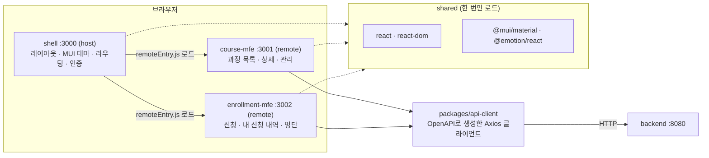
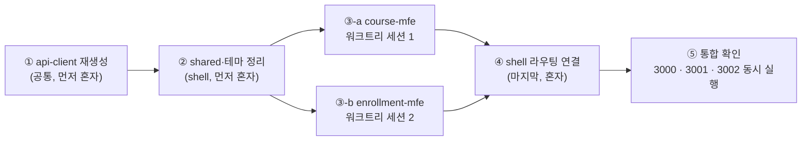
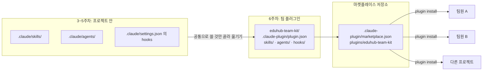
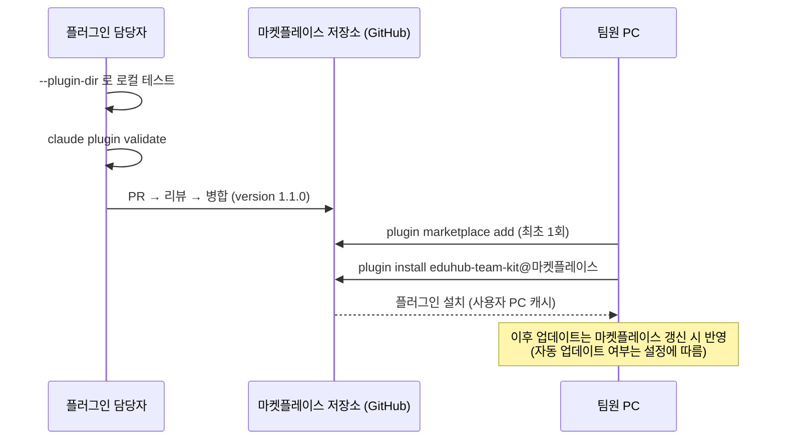
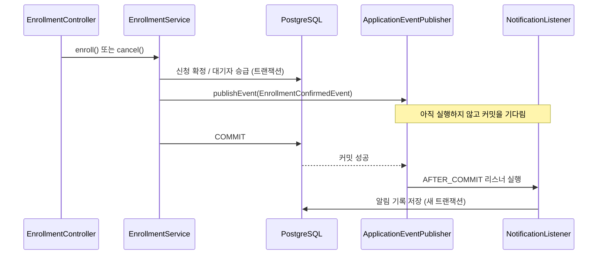

# 6회차: 플러그인·아티팩트 — 마이크로프론트엔드 완성과 알림(FR-09)

🧭 ⬅️ 이전: [5회차: 훅과 MCP — 품질 자동화와 외부 연결 (FR-07~08)](./session-05-hooks-and-mcp.md) · ➡️ 다음: [7회차: CI/CD·환경 분리 완성·사내 프레임워크·토큰 최적화 (NFR-05, NFR-06)](./session-07-cicd-framework-tokens.md) · 📚 [전체 커리큘럼](../CURRICULUM.md#-회차별-강의-자료)

> **대상**: 5회차까지 EduHub에 훅과 MCP를 적용한 수강생
> **시간**: 120분 (강의 약 40% + 따라하기 약 60%)
> **목표**
> 1. EduHub 프론트엔드를 **shell + course-mfe + enrollment-mfe** 구조로 완성하고, 마이크로프론트엔드에서 **개발자가 통제해야 할 경계**(공유 의존성, 테마, API 클라이언트, 라우팅)를 설명할 수 있다
> 2. 서로 간섭하지 않는 작업을 **워크트리와 병렬 세션**으로 나눠 진행하고, 병렬 수를 "리뷰할 수 있는 양"으로 정할 수 있다
> 3. FR-09 알림을 **트랜잭션 커밋 이후 이벤트**로 구현하고, 그 이유를 설명할 수 있다
> 4. 3~5주차에 만든 `.claude/` 자산(스킬, 에이전트, 훅)을 **팀 플러그인**으로 묶고, 마켓플레이스로 배포·설치할 수 있다. 남이 만든 플러그인은 **설치 전에 검토**한다
> 5. 이번 주 진행 상황을 **아티팩트(진행 현황 리포트)**로 만들어 공유하되, 비밀 정보와 실제 개인정보를 넣지 않는다
>
> **관련 모듈**: 14(플러그인), 15(아티팩트)
> **사전 준비**
> - 5회차 PR이 `main`에 병합되어 있고, `git switch main && git pull`로 최신 상태
> - Node.js LTS, `frontend/` 의존성 설치(`npm install`) 완료
> - 플러그인 실습용 **터미널 CLI**(`claude -v`로 확인). 데스크톱 앱만 쓰는 사람은 [6장 Step 4](#step-4-팀원-pc에-설치하고-확인하기)의 안내를 봅니다
> - 팀별 GitHub에 빈 저장소 `eduhub-<팀이름>-plugins`(Private) 하나

---

## 진행 순서

| 시간 | 내용 | 형식 |
|---|---|---|
| 0:00 – 0:05 | 지난 회차 복습 & 과제 리뷰 | 강의 |
| 0:05 – 0:20 | 1. 마이크로프론트엔드 완성: 개발자가 통제할 경계 | 강의 |
| 0:20 – 0:35 | 2. 플러그인: 팀의 `.claude/`를 한 번에 배포하기 | 강의 + 시연 |
| 0:35 – 0:45 | 3. 아티팩트: 결과물을 화면으로 공유하기 | 강의 |
| 0:45 – 0:53 | ☕ 휴식 | — |
| 0:53 – 1:20 | 4. 따라하기 ①: MFE 분리 완성 (워크트리 병렬 세션) | 실습 |
| 1:20 – 1:35 | 5. 따라하기 ②: FR-09 알림 (커밋 이후 이벤트) | 실습 |
| 1:35 – 1:48 | 6. 따라하기 ③: 팀 플러그인 만들기·배포·설치 | 실습 |
| 1:48 – 1:57 | 7. 따라하기 ④: 주간 진행 현황 아티팩트 | 실습 |
| 1:57 – 2:00 | 9. 정리, 과제 안내 | 강의 |

> 8장(더 해 보기)은 시간이 남으면 수업 중에, 아니면 과제로 진행합니다.

---

## 지난 회차 복습 & 과제 리뷰

**5회차 핵심 3문장**
1. **훅은 부탁이 아니라 강제**다. 포맷·테스트·위험 명령 차단처럼 "항상 지켜야 하는 것"은 훅으로 둔다
2. **MCP는 최소 권한**으로 연결한다. 개발 DB는 읽기 전용 계정, 운영 DB는 연결하지 않는다
3. 연결한 MCP 서버와 훅도 **매 턴 컨텍스트·실행 비용**이 있다. 안 쓰는 서버는 끈다

**과제 리뷰 (팀별 1분)**

| 확인 항목 | 질문 |
|---|---|
| 훅 2개 | 훅이 실제로 막았거나 고친 사례가 있었나? 오탐(괜히 막은 것)은? |
| `.mcp.json` | 접속 정보가 파일에 직접 들어가지 않고 환경 변수로 되어 있나? |
| PR 본문 | "Claude에게 맡긴 것 / 직접 한 것"이 적혀 있나? |
| AI 없이 설명하기 | 이번 주 변경을 팀원에게 설명할 때 막힌 부분은? |
| `/usage` 기록 | 지난주보다 사용량이 늘었나 줄었나? 이유는? |

> 💬 **강사 노트:** 오늘은 지금까지 프로젝트 안(`.claude/`)에 만든 자산을 **팀과 다른 프로젝트로 퍼뜨리는 방법**(플러그인)과, 결과를 **사람에게 보여 주는 방법**(아티팩트)을 배우는 날이라고 소개합니다. 동시에 EduHub 프론트엔드 구조를 완성하므로, "구조는 개발자가 통제한다"는 원칙이 가장 많이 시험받는 회차입니다.

---

# 1. 마이크로프론트엔드 완성: 개발자가 통제할 경계

> 기술 상세는 [샘플 프로젝트의 Module Federation 설정](../examples/00-sample-project.md#5-4-module-federation-설정)을 봅니다. 2회차 [3-5. 기술과 아키텍처](./session-02-hands-on-kickoff.md#3-5-기술과-아키텍처)의 구조를 이번 주에 완성합니다.

---

## 1-1. EduHub 프론트엔드 최종 구조



| 구성 요소 | 책임 | 하지 않는 것 |
|---|---|---|
| **shell (host)** | 공통 레이아웃, MUI 테마(`ThemeProvider`), 최상위 라우팅, 로그인 상태 | 업무 화면 직접 구현 |
| **course-mfe** | 과정 목록·상세·관리 화면 (FR-01~03) | 신청 로직, 다른 remote 직접 import |
| **enrollment-mfe** | 신청·취소, 내 신청 내역, 명단 (FR-04~08) | 과정 관리 화면 |
| **packages/api-client** | OpenAPI 스펙으로 **생성**한 API 호출 코드 | 손으로 고치기 (다시 생성하면 사라진다) |

---

## 1-2. 개발자가 반드시 통제할 4가지 경계

마이크로프론트엔드는 Claude에게 "화면 만들어줘"만 반복하면 **각 remote가 제멋대로 커지기 쉬운 구조**입니다. 아래 네 가지는 개발자가 정하고, CLAUDE.md·스킬·리뷰 에이전트로 지키게 합니다.

| 경계 | 규칙 | 어기면 생기는 문제 |
|---|---|---|
| **공유 의존성** | `react`, `react-dom`, `@mui/material`, `@emotion/react`는 `shared`에 `singleton: true`, **같은 버전 범위** | React가 두 번 로드되어 Hook 오류, 번들 크기 증가 |
| **테마** | 테마는 shell 한 곳에서만 정의. remote는 `ThemeProvider`를 새로 만들지 않는다 | 화면마다 색·글꼴이 다름 (샘플 프로젝트 문제 P5) |
| **API 계약** | 모든 API 호출은 `packages/api-client`로. URL을 코드에 직접 쓰지 않는다 | 백엔드 변경 시 일부 화면만 깨짐, 환경별 주소 하드코딩 |
| **모듈 경계** | remote끼리 직접 import 금지. 공통 UI는 shell이 노출하거나 공통 패키지로 | 배포 단위가 서로 묶여 "따로 배포"라는 MFE의 장점이 사라짐 |

```js
// apps/shell/webpack.config.js 의 shared (요지)
shared: {
  react: { singleton: true, requiredVersion: "^18.0.0" },
  "react-dom": { singleton: true, requiredVersion: "^18.0.0" },
  "@mui/material": { singleton: true },
  "@emotion/react": { singleton: true },
}
// remote(course-mfe, enrollment-mfe)도 같은 shared 설정을 쓴다
```

> 💡 이 네 가지를 **CLAUDE.md(`frontend/CLAUDE.md`)에 짧게** 적고, 3주차에 만든 리뷰 에이전트(예: `mfe-integration-checker`)가 검사하게 하면 Claude가 처음부터 규칙대로 씁니다. ([서브에이전트 예제](../examples/03-settings-skills-agents-hooks.md#모듈-11-서브에이전트))

---

## 1-3. 병렬로 나눠도 되는 일, 순서대로 해야 하는 일

이번 주 프론트엔드 작업은 **나눌 수 있는 일**과 **먼저 끝내야 하는 일**이 섞여 있습니다.



| 구분 | 작업 | 이유 |
|---|---|---|
| **먼저, 혼자** | api-client 재생성, shared·테마 | 모든 remote가 쓰는 **공통 파일**. 동시에 고치면 충돌 |
| **병렬** | course-mfe, enrollment-mfe | 디렉터리가 분리되어 서로 건드리지 않음 |
| **마지막, 혼자** | shell 라우팅 연결, 통합 확인 | 두 remote의 결과가 모두 있어야 가능 |

**병렬 방식 고르기** ([병렬 작업 비교](../examples/17-parallel-work-terminal-vs-desktop.md))

| 방식 | 시작 방법 | 오늘 추천 |
|---|---|---|
| 데스크톱 앱 멀티 세션 | **+ New**(Ctrl/Cmd+N), 폴더 컨트롤에서 **Worktree** 켜기 | ⭐ 데스크톱 사용자 |
| 터미널 멀티 세션 | `claude -w course-mfe`, 다른 창에서 `claude -w enrollment-mfe` | ⭐ 터미널 사용자 |
| 한 세션 안의 서브에이전트 | "두 remote를 서브에이전트로 나눠 진행해줘" | 결과 검토가 어려워 오늘은 비추천 |

> ⚠️ **병렬 수 = 내가 리뷰할 수 있는 양**입니다. 오늘은 2개까지만. 세션마다 사용량이 따로 쌓이므로 `/usage`로 확인합니다. 워크트리에는 `.env`처럼 Git에서 제외된 파일이 없다는 점도 기억합니다. ([공통 주의 사항](../examples/17-parallel-work-terminal-vs-desktop.md#4-병렬-작업의-공통-주의-사항))

> 💬 **강사 노트:** "다 병렬로 돌리면 빠르지 않나요?"라는 질문에는 **공통 파일 충돌**과 **리뷰 병목**을 예로 듭니다. 병렬화의 설계(무엇을 먼저, 무엇을 나눌지)는 사람이 하는 아키텍처 판단입니다.

---

# 2. 플러그인: 팀의 `.claude/`를 한 번에 배포하기

> 기준: Claude Code 공식 문서 Plugins, Create a marketplace, Plugin security and trust (2026년 10월 확인). 예제: [플러그인 eduhub-dev-kit](../examples/04-mcp-plugins-artifacts.md#모듈-14-플러그인-eduhub-dev-kit)

---

## 2-1. 플러그인이란

**플러그인 = 스킬, 서브에이전트, 훅, MCP 서버 등을 하나로 묶어 한 번에 설치·업데이트하는 단위**입니다. 대부분 **마켓플레이스**(플러그인 목록을 담은 저장소)를 통해 설치합니다.



| 구성 요소 | 플러그인 안 위치 | 세션에서 |
|---|---|---|
| 매니페스트 | `.claude-plugin/plugin.json` | 플러그인 이름(스킬 앞에 붙는 접두사), 버전, 설명 |
| 스킬 | `skills/<이름>/SKILL.md` | `/eduhub-team-kit:add-api-endpoint`처럼 **플러그인 이름이 접두사** |
| 서브에이전트 | `agents/<이름>.md` | Claude가 위임할 수 있는 에이전트 |
| 훅 | `hooks/hooks.json` | 플러그인이 켜져 있으면 해당 이벤트에 실행 |
| MCP 서버 | `.mcp.json` | 플러그인이 켜져 있는 동안 연결 |

---

## 2-2. 프로젝트 `.claude/` vs 플러그인: 무엇을 어디에

| 질문 | 프로젝트 `.claude/` | 팀 플러그인 |
|---|---|---|
| 이 저장소에만 해당하나? | ✅ (EduHub 도메인 규칙, 이 저장소의 경로) | |
| 여러 프로젝트에서 공통인가? | | ✅ (Spring API 추가 절차, JPA 리뷰어, 포맷 훅) |
| 버전을 붙여 배포·업데이트하고 싶은가? | | ✅ |
| 저장소를 클론하면 바로 적용되어야 하나? | ✅ | 설치가 한 번 필요 (프로젝트 설정으로 권장 가능) |

> 💡 **같은 스킬을 양쪽에 두지 않습니다.** 플러그인으로 옮긴 것은 프로젝트에서 지워야 두 버전이 동시에 로드되어 헷갈리는 일이 없습니다.

---

## 2-3. 플러그인도 "공짜"가 아니다: 토큰과 보안

**토큰**: 켜진 플러그인은 **쓰지 않는 세션에도** 들어옵니다. Claude가 스스로 부를 수 있는 스킬·에이전트·커맨드의 **이름과 설명이 매 턴 컨텍스트에 포함**되고, MCP 서버는 세션과 함께 실행됩니다. 안 쓰는 플러그인은 끕니다(`/plugin` 또는 `claude plugin disable`).

**보안**: 공식 문서는 "설치한 플러그인은 **내 사용자 권한으로 임의의 코드를 실행**할 수 있다"고 경고합니다.

| 플러그인이 할 수 있는 것 | 위험 |
|---|---|
| 훅 | 셸 명령으로 실행. **권한 규칙·샌드박스 밖**에서 내 권한으로 실행 |
| MCP 서버 | 내 PC에서 프로세스로 실행 |
| `bin/` 실행 파일 | Bash 도구의 `PATH`에 추가됨 |
| 스킬·에이전트·커맨드 | Claude의 지시로 들어감 → 행동에 영향 |
| 자동 업데이트 | 검토한 파일이 나중에 바뀔 수 있음 |

**설치 전 검토 4단계** (공식 문서 기준)

1. `claude plugin marketplace list`로 마켓플레이스 **출처** 확인
2. `/plugin`에서 플러그인을 골라 **Will install** 목록(커맨드, 에이전트, 스킬, 훅, MCP) 확인
3. 소스에서 **`hooks/hooks.json`, `.mcp.json`, `bin/`**을 직접 읽기 (Will install에는 훅이 "있다"는 것만 보이고 무엇을 실행하는지는 안 보임)
4. `claude --plugin-dir <플러그인 폴더> plugin details <이름>`으로 구성 목록 확인

> ⚠️ 마켓플레이스 이름이 그럴듯해도 **팀·동료·사내 마켓플레이스는 모두 "서드파티"**입니다. 출처보다 **내용**을 봅니다. 회사에서는 관리자가 관리형 설정으로 허용 마켓플레이스를 제한할 수 있습니다.

> 💬 **강사 노트:** 실제 오픈소스 플러그인 하나를 골라 `hooks/hooks.json`을 함께 읽어 봅니다. "이 훅은 언제, 어떤 명령을 실행하는가?"를 수강생이 답하게 합니다.

---

## 2-4. 버전과 배포 흐름



| 규칙 | 이유 |
|---|---|
| `plugin.json`의 `version`을 **유의적 버전**(1.0.0 → 1.1.0 → 2.0.0)으로 | 무엇이 바뀌었는지 팀원이 판단 |
| 마켓플레이스 저장소도 **PR + 리뷰** | 플러그인은 팀원 PC에서 코드를 실행한다. 리뷰 없는 변경 금지 |
| `CHANGELOG.md` 유지 | 훅이 바뀌면 동작이 달라진다. 팀에 알림 |
| 마켓플레이스 항목 이름 = `plugin.json`의 `name` | 다르면 설치 오류의 가장 흔한 원인 |

> 💡 자동 업데이트를 켜 두면 검토한 파일이 바뀔 수 있습니다. 팀 마켓플레이스는 **병합 권한을 좁히고 리뷰를 필수로** 합니다. 업데이트 반영 시점의 정확한 규칙은 공식 문서 "Host and maintain a marketplace"를 확인합니다 (공식 문서 확인 필요).

---

# 3. 아티팩트: 결과물을 화면으로 공유하기

> 예제: [아티팩트 활용 예](../examples/04-mcp-plugins-artifacts.md#모듈-15-아티팩트)

---

## 3-1. 아티팩트란

**아티팩트 = Claude가 만든 결과물을 대화 밖의 독립된 화면(웹 페이지, 문서, 다이어그램, 대시보드)으로 보여 주고, 대화로 고치고, 링크로 공유하는 것**입니다.

| 언제 쓰나 | EduHub 예 | 보는 사람 |
|---|---|---|
| **진행 현황 리포트** | 주간 PR·테스트·요구사항 진척, 다음 주 계획 | 팀, 강사 |
| **아키텍처 설명 페이지** | MFE 구조, 이벤트 흐름, 패키지 구조를 그림과 함께 | 신규 팀원, 리뷰어 |
| **회고 대시보드** | 주차별 `/usage`, 직접 고친 건수, 재작업 횟수 | 팀 |
| **화면 프로토타입** | 수강 취소 확인 Dialog 시안 | 기획자 |

**마크다운 문서와 무엇이 다른가**

| | 저장소의 `.md` | 아티팩트 |
|---|---|---|
| 목적 | 코드와 함께 **버전 관리**되는 기준 문서 | **보여 주기·공유**용 결과물 |
| 형태 | 텍스트 + Mermaid | 레이아웃, 차트, 상호작용 가능한 화면 |
| 변경 이력 | Git | 아티팩트 버전 |
| 예 | 요구사항, 런북, CLAUDE.md | 주간 리포트, 발표용 설명 페이지 |

> 💡 **기준 정보는 저장소에, 보여 주는 화면은 아티팩트로.** 아티팩트에만 있는 결정 사항은 저장소의 `docs/`에도 남깁니다.

---

## 3-2. 공유와 보안 원칙

| 원칙 | 내용 |
|---|---|
| **기본은 비공개** | 만든 사람만 볼 수 있고, 공유하려면 공유 메뉴에서 대상을 정한다 (사용 환경에 따라 화면이 다를 수 있음) |
| **비밀 정보 금지** | 접속 정보, 토큰, 키, `.env` 내용, 운영 서버 주소를 넣지 않는다 |
| **실제 개인정보 금지** | 임직원 이름·사번·연락처 대신 가짜 데이터나 집계값 |
| **운영 데이터 금지** | 개발·테스트 환경의 데이터만. 운영 DB 조회 결과로 만들지 않는다 (환경 분리 원칙) |
| **수치는 출처와 함께** | "테스트 112개 통과(`./gradlew test`, 10/25 기준)"처럼 근거를 적는다. AI가 숫자를 지어내지 않았는지 확인 |

> 💬 **강사 노트:** 아티팩트는 쉽게 링크로 퍼집니다. "이 화면이 회사 밖으로 나가도 괜찮은가?"를 공유 전 체크 질문으로 습관화시킵니다.

---

## ☕ 휴식 (8분)

> 휴식 중에 `git switch main && git pull`, `cd frontend && npm install`을 끝내 둡니다.

---

# 4. 따라하기 ①: MFE 분리 완성 (워크트리 병렬 세션)

> **목표**: shell(3000)에서 course-mfe(3001)와 enrollment-mfe(3002)를 불러와 하나의 앱처럼 동작하게 합니다. 공통 작업은 혼자, remote 작업은 병렬로 진행합니다.

---

## Step 1. 브랜치와 공통 작업 (혼자)

```bash
git switch main && git pull
git switch -c feature/fr-07-mfe-split
```

새 세션(또는 `/clear`)에서 Plan 모드로 지시합니다.

```text
[목표] 마이크로프론트엔드 분리를 위한 공통 기반을 정리한다
[위치] @frontend/apps/shell/webpack.config.js, @frontend/packages/api-client
[범위]
- 백엔드 OpenAPI 스펙(/v3/api-docs)으로 packages/api-client를 다시 생성
- shell의 shared 설정: react, react-dom, @mui/material, @emotion/react를 singleton, 같은 버전 범위
- MUI 테마를 shell의 theme.ts 한 곳에 정의
[하지 않는 것] course-mfe, enrollment-mfe 화면 수정 (다음 단계에서 병렬로)
[완료 기준] npm run build --workspace apps/shell 성공, api-client 생성 스크립트가 package.json에 있음
[진행 방식] 바꿀 파일 목록과 이유를 먼저 보여줘
```

**계획 검토 포인트**
- api-client를 **손으로 고치는 계획**이 있으면 거절합니다 (생성 스크립트로만)
- remote별로 다른 버전의 React·MUI를 쓰는 계획이 있으면 맞추게 합니다

구현 후 직접 확인하고 커밋합니다.

```bash
cd frontend && npm run build --workspace apps/shell
git add frontend/packages/api-client frontend/apps/shell frontend/package.json
git diff --staged --stat
git commit -m "chore(frontend): api-client 재생성과 shell 공유 의존성·테마 정리"
```

> ✅ **확인**: `packages/api-client`의 변경이 **생성 스크립트의 결과**뿐인지, shell에 업무 화면 코드가 추가되지 않았는지 봅니다.

---

## Step 2. remote 두 개를 병렬 세션으로

**데스크톱 앱**: **+ New**로 세션을 두 개 열고, 각각 폴더 컨트롤에서 **Worktree**를 켭니다.
**터미널**: 창을 두 개 열고 각각 실행합니다.

```bash
# 창 1
claude -w course-mfe
# 창 2
claude -w enrollment-mfe
```

> 워크트리는 Step 1의 커밋을 바탕으로 만들어지므로 **Step 1을 먼저 커밋**해야 합니다.

**세션 1 (course-mfe) 지시**

```text
[목표] course-mfe를 Module Federation remote로 완성한다
[위치] @frontend/apps/course-mfe
[범위]
- webpack ModuleFederationPlugin: name courseMfe, filename remoteEntry.js, exposes ./CourseApp
- shared는 shell과 동일 (singleton)
- 과정 목록·상세 화면은 packages/api-client의 courseApi만 사용
- 개발 서버 포트 3001
[하지 않는 것] shell, enrollment-mfe, api-client 수정. ThemeProvider 새로 만들기
[완료 기준] npm run build --workspace apps/course-mfe 성공, npm test --workspace apps/course-mfe 통과
[진행 방식] 계획 먼저. 범위 밖 파일을 고쳐야 하면 멈추고 알려줘
```

**세션 2 (enrollment-mfe) 지시**: 위 지시에서 `course-mfe` → `enrollment-mfe`, `courseMfe` → `enrollmentMfe`, `./CourseApp` → `./EnrollmentApp`, `courseApi` → `enrollmentApi`, 포트 `3002`로 바꿉니다.

**각 세션에서 diff 검토 체크리스트**

- [ ] 자기 remote 폴더 밖의 파일이 바뀌지 않았는가?
- [ ] `shared` 설정이 shell과 같은가? (`singleton: true`)
- [ ] `ThemeProvider`, `createTheme`가 remote에 새로 생기지 않았는가?
- [ ] API 주소(`http://localhost:8080`)가 코드에 직접 들어가지 않았는가?
- [ ] 다른 remote를 직접 import하지 않았는가?

각 워크트리에서 커밋합니다 (워크트리마다 자기 브랜치가 있습니다).

```bash
git add frontend/apps/course-mfe
git commit -m "feat(course-mfe): Module Federation remote 구성과 과정 화면 연결"
```

> ✅ **확인**: 두 세션의 `/usage`를 비교합니다. 병렬 세션은 사용량이 **각각** 쌓입니다.

---

## Step 3. 합치고 shell 라우팅 연결 (혼자)

두 워크트리의 커밋을 작업 브랜치로 가져옵니다. 워크트리 브랜치 이름은 `git branch`로 확인합니다.

```bash
git switch feature/fr-07-mfe-split
git branch                                   # 워크트리 브랜치 이름 확인
git merge <course-mfe 워크트리 브랜치>
git merge <enrollment-mfe 워크트리 브랜치>
```

> 💡 데스크톱 앱이나 Claude에게 "두 워크트리의 변경을 feature/fr-07-mfe-split에 병합해줘"라고 맡길 수도 있습니다. 충돌이 나면 2회차 [3-8-3](./session-02-hands-on-kickoff.md#3-8-3-충돌conflict이-나면)대로 **두 변경의 의도를 확인**하고 정리합니다.

이어서 shell 라우팅을 연결합니다.

```text
[목표] shell에서 두 remote를 라우트로 연결한다
[위치] @frontend/apps/shell/src
[범위] /courses/* → courseMfe/CourseApp, /my/* 와 /admin/enrollments/* → enrollmentMfe/EnrollmentApp. React.lazy + Suspense, remote 로드 실패 시 MUI Alert로 안내
[완료 기준] 세 앱을 동시에 실행했을 때 두 화면이 shell 레이아웃·테마 안에서 보임
```

**직접 확인** (원칙 ②: 사람이 직접 실행할 수 있어야 한다)

```bash
cd frontend
npm run dev --workspace apps/course-mfe        # 3001
npm run dev --workspace apps/enrollment-mfe    # 3002 (다른 창)
npm run dev --workspace apps/shell             # 3000 (다른 창)
```

> ✅ **확인**: 브라우저 개발자 도구 Network 탭에서 `remoteEntry.js`가 3001·3002에서 로드되고, `react`가 **한 번만** 로드되는지 봅니다. 데스크톱 앱은 미리보기(Browser 패널)로도 볼 수 있습니다.

```bash
git push -u origin feature/fr-07-mfe-split
```

PR 본문에 "병렬로 나눈 작업 / 혼자 한 작업 / 직접 확인한 것"을 적습니다.

---

## 4-4. 자주 겪는 문제

| 증상 | 원인과 해결 |
|---|---|
| `Invalid hook call` | React가 두 번 로드됨. 모든 앱의 `shared`에 `singleton: true`와 같은 버전 범위 |
| remote 화면의 색·글꼴이 다름 | remote가 자체 테마를 만듦. shell의 테마만 쓰게 수정 |
| `Loading script failed ... remoteEntry.js` | remote 개발 서버가 안 켜졌거나 포트가 다름. 3001·3002 확인 |
| 워크트리에서 백엔드 연결 실패 | 워크트리에 `.env`가 없음. 필요한 파일을 복사하거나 `.worktreeinclude` 설정 확인 |
| 두 세션이 같은 파일을 고쳐 병합 충돌 | 공통 파일 작업을 Step 1에서 먼저 끝내지 않음. 충돌 해결 후 다음부터 순서 지키기 |
| 사용량이 평소보다 빨리 소진 | 병렬 세션은 각자 사용. 끝난 세션은 정리하고 병렬 수를 줄인다 |

---

# 5. 따라하기 ②: FR-09 알림 (커밋 이후 이벤트)

> **목표**: 수강 신청이 **확정**되거나 대기자가 **승급**되면 알림 기록을 남깁니다. 처음에는 DB 테이블과 로그로 기록하고, 메일·메신저 발송은 나중에 연결할 수 있게 설계합니다.

---

## 5-1. 왜 "커밋 이후"인가



| 방식 | 문제 |
|---|---|
| 서비스 안에서 바로 알림 저장·발송 | 뒤에서 예외가 나 **신청이 롤백되어도 알림은 이미 나감** ("확정됐다"는 알림을 받았는데 실제로는 신청 안 됨) |
| `@EventListener` (일반) | 같은 트랜잭션 안에서 실행 → 위와 같은 문제, 알림 실패가 신청까지 실패시킴 |
| **`@TransactionalEventListener(phase = AFTER_COMMIT)`** | 신청이 **실제로 커밋된 뒤에만** 알림. 알림 실패가 신청에 영향을 주지 않음 |

> 💬 **강사 노트:** 이 판단은 Claude가 먼저 제안하지 않을 수 있습니다. **트랜잭션 지식이 있어야 요구할 수 있는 설계**라는 점(2회차 2-2의 "아키텍처 지식 지도")을 다시 강조합니다.

---

## 5-2. 브랜치와 지시

```bash
git switch main && git pull
git switch -c feature/fr-09-notification
```

```text
[목표] FR-09: 신청 확정·대기자 승급 시 알림 기록을 남긴다
[위치] @backend/src/main/java/com/example/eduhub/enrollment/EnrollmentService.java, 새 패키지 notification
[범위]
- 이벤트: EnrollmentConfirmedEvent(enrollmentId, employeeId, sessionId, reason: APPLIED | PROMOTED)
- EnrollmentService에서 확정·승급 시 ApplicationEventPublisher로 발행
- NotificationListener: @TransactionalEventListener(phase = AFTER_COMMIT) + 새 트랜잭션(REQUIRES_NEW)으로 notification 테이블에 저장, INFO 로그
- Flyway 마이그레이션으로 notification 테이블 추가 (id, employee_id, type, message, created_at)
[하지 않는 것] 메일·메신저 실제 발송, 프론트 화면
[완료 기준]
- 신청 확정 시 알림 1건 저장 테스트
- 신청 트랜잭션이 롤백되면 알림이 저장되지 않는 테스트
- ./gradlew test 통과
[진행 방식] 계획 먼저. 이벤트를 쓰지 않는 더 단순한 방법이 낫다고 생각하면 이유와 함께 제안해줘
```

**예상 코드의 핵심** (Claude 결과와 비교용)

```java
// notification/NotificationListener.java
@Component
@RequiredArgsConstructor
class NotificationListener {

    private final NotificationRepository notificationRepository;

    @TransactionalEventListener(phase = TransactionPhase.AFTER_COMMIT)
    @Transactional(propagation = Propagation.REQUIRES_NEW)   // 커밋 이후라 새 트랜잭션 필요
    public void on(EnrollmentConfirmedEvent event) {
        notificationRepository.save(Notification.confirmed(event));
        log.info("enrollment confirmed: enrollmentId={}, reason={}", event.enrollmentId(), event.reason());
    }
}
```

> 💡 로그에 **이름·연락처 같은 개인정보를 남기지 않고 ID만** 남깁니다.

**diff 검토 체크리스트**

- [ ] 리스너가 `AFTER_COMMIT`인가? 커밋 이후 DB 저장에 새 트랜잭션(`REQUIRES_NEW`)을 쓰는가?
- [ ] "롤백되면 알림 없음" 테스트가 **실제로 롤백 상황을 만드는가**? (이름만 그런 테스트가 아닌지)
- [ ] 이벤트 발행이 확정·승급 **두 곳 모두**에 있는가? (대기자 승급은 취소 로직 안에 있다)
- [ ] Flyway 버전 번호가 기존 마이그레이션과 겹치지 않는가?
- [ ] 로그에 개인정보가 없는가?

```bash
cd backend && ./gradlew test     # 직접 실행해 확인
cd .. && git add backend
git commit -m "feat(notification): 신청 확정·대기 승급 알림 기록 (FR-09)"
git push -u origin feature/fr-09-notification
```

> ✅ **확인**: 직접 고치기 연습. 알림 메시지 문구(예: "수강 신청이 확정되었습니다")는 IDE에서 **직접** 다듬고, Claude에게 "알림 문구를 직접 바꿨어, 테스트만 다시 돌려줘"라고 알립니다.

---

# 6. 따라하기 ③: 팀 플러그인 만들기·배포·설치

> **목표**: 3~5주차의 `.claude/` 자산 중 **다른 프로젝트에도 쓸 것**을 골라 `eduhub-team-kit` 플러그인으로 묶고, 팀 마켓플레이스 저장소로 배포해 팀원 PC에 설치합니다.
> 명령은 터미널 CLI 기준입니다. 공식 문서 Plugins, Create a marketplace(2026년 10월 확인)를 따랐습니다.

---

## Step 1. 무엇을 옮길지 고르기 (직접 판단)

| 자산 (예) | 옮길까? | 이유 |
|---|---|---|
| `skills/add-api-endpoint` | ✅ 플러그인 | Spring + OpenAPI 팀 공통 절차 |
| `agents/jpa-reviewer.md` | ✅ 플러그인 | 다른 JPA 프로젝트에도 유용 |
| `agents/mfe-integration-checker.md` | ✅ 플러그인 | MFE 공통 규칙 |
| 포맷 훅 (`format.sh`) | ✅ 플러그인 | 공통 |
| 수정 금지 파일 보호 훅 | ❌ 프로젝트 | EduHub 경로(`application-prod.yml` 등)에 묶여 있음 |
| `.mcp.json`의 개발 DB | ❌ 프로젝트 | 프로젝트별 접속 정보 (환경 변수) |
| EduHub 도메인 규칙 | ❌ 프로젝트 CLAUDE.md | 이 저장소에만 해당 |

> 💬 **강사 노트:** 이 표를 Claude가 아니라 **팀이 직접** 채우게 합니다. "무엇이 공통이고 무엇이 이 프로젝트 것인가"는 구조를 아는 사람만 정할 수 있습니다.

---

## Step 2. 마켓플레이스 저장소에 플러그인 만들기

```bash
git clone https://github.com/<팀-계정>/eduhub-<팀이름>-plugins.git
cd eduhub-<팀이름>-plugins
mkdir -p .claude-plugin plugins/eduhub-team-kit/.claude-plugin
```

이 저장소에서 Claude에게 지시합니다.

```text
[목표] EduHub의 공통 .claude 자산을 eduhub-team-kit 플러그인으로 만든다
[위치] 원본: ../eduhub/.claude/ (skills/add-api-endpoint, agents/jpa-reviewer.md, agents/mfe-integration-checker.md, 포맷 훅)
       대상: plugins/eduhub-team-kit/
[범위]
- plugins/eduhub-team-kit/.claude-plugin/plugin.json (name, version 1.0.0, description)
- skills/, agents/ 로 복사
- 포맷 훅은 hooks/hooks.json 과 scripts/format.sh 로. 스크립트 경로는 플러그인 루트 기준
- 마켓플레이스 루트 .claude-plugin/marketplace.json
- README.md (무엇이 들어 있고, 각 훅이 언제 무엇을 실행하는지)
[하지 않는 것] EduHub 저장소 수정, 프로젝트 전용 훅·MCP 설정 포함
[완료 기준] claude plugin validate ./plugins/eduhub-team-kit 와 claude plugin validate . 통과
[진행 방식] 만들 파일 목록 먼저
```

**결과 구조**

```text
eduhub-<팀이름>-plugins/
├── .claude-plugin/
│   └── marketplace.json
└── plugins/
    └── eduhub-team-kit/
        ├── .claude-plugin/
        │   └── plugin.json
        ├── skills/
        │   └── add-api-endpoint/SKILL.md
        ├── agents/
        │   ├── jpa-reviewer.md
        │   └── mfe-integration-checker.md
        ├── hooks/
        │   └── hooks.json
        ├── scripts/
        │   └── format.sh
        └── README.md
```

```json
// plugins/eduhub-team-kit/.claude-plugin/plugin.json
{
  "name": "eduhub-team-kit",
  "version": "1.0.0",
  "description": "Spring Boot + React MFE 팀 공통 키트: API 추가 스킬, JPA·MFE 리뷰 에이전트, 자동 포맷 훅"
}
```

```json
// .claude-plugin/marketplace.json (마켓플레이스 루트)
{
  "name": "eduhub-team1",
  "description": "EduHub 1팀 공통 플러그인",
  "owner": { "name": "EduHub 1팀" },
  "plugins": [
    {
      "name": "eduhub-team-kit",
      "source": "./plugins/eduhub-team-kit",
      "description": "API 추가 스킬, JPA·MFE 리뷰어, 포맷 훅"
    }
  ]
}
```

```json
// plugins/eduhub-team-kit/hooks/hooks.json (요지)
{
  "hooks": {
    "PostToolUse": [
      {
        "matcher": "Write|Edit",
        "hooks": [
          { "type": "command", "command": "${CLAUDE_PLUGIN_ROOT}/scripts/format.sh" }
        ]
      }
    ]
  }
}
```

> 플러그인 훅 파일의 정확한 형식과 `${CLAUDE_PLUGIN_ROOT}` 변수는 공식 문서 Plugin components의 Hooks 절로 한 번 더 확인합니다 (공식 문서 확인 필요).

**diff 검토 체크리스트**

- [ ] 마켓플레이스 항목 `name`과 `plugin.json`의 `name`이 같은가? (`eduhub-team-kit`)
- [ ] `source`가 마켓플레이스 루트 기준 상대 경로이고 `..`가 없는가?
- [ ] 훅 스크립트가 무엇을 실행하는지 README에 적혀 있는가?
- [ ] 접속 정보, 토큰, 사내 서버 주소가 들어가지 않았는가?
- [ ] 프로젝트 전용 자산(EduHub 경로, 개발 DB)이 섞이지 않았는가?

---

## Step 3. 로컬에서 시험하고 검증하기

```bash
# 마켓플레이스 없이 폴더에서 바로 불러와 시험
claude --plugin-dir ./plugins/eduhub-team-kit

# (세션 안에서) 스킬이 플러그인 이름 접두사로 보이는지 확인
# /eduhub-team-kit:add-api-endpoint

# 형식 검사
claude plugin validate ./plugins/eduhub-team-kit
claude plugin validate .
```

> ✅ **확인**: 두 검사 모두 마지막 줄이 `✔ Validation passed`이고, 세션에서 `/eduhub-team-kit:`로 시작하는 스킬이 보이면 됩니다.

검증이 끝나면 2단계 커밋 후 PR로 올리고, 팀원 리뷰를 받아 병합합니다.

```bash
git switch -c feature/team-kit-1.0.0
git add .claude-plugin plugins
git commit -m "feat(plugin): eduhub-team-kit 1.0.0 (API 추가 스킬, 리뷰 에이전트, 포맷 훅)"
git push -u origin feature/team-kit-1.0.0
```

---

## Step 4. 팀원 PC에 설치하고 확인하기

**팀원 각자** (마켓플레이스 PR 병합 후)

```bash
claude plugin marketplace add <팀-계정>/eduhub-<팀이름>-plugins
claude plugin install eduhub-team-kit@eduhub-team1
claude plugin list                       # Status: ✔ enabled 확인
claude plugin details eduhub-team-kit    # 구성 목록(Component inventory) 확인
```

세션 안에서는 `/plugin`으로 같은 일을 할 수 있습니다. 저장소가 Private이면 각 팀원이 그 저장소를 읽을 권한이 있어야 합니다.

**EduHub 저장소에 "이 플러그인을 쓰자"고 권장하기** (`eduhub/.claude/settings.json`에 추가)

```json
{
  "extraKnownMarketplaces": {
    "eduhub-team1": {
      "source": { "source": "github", "repo": "<팀-계정>/eduhub-<팀이름>-plugins" }
    }
  },
  "enabledPlugins": {
    "eduhub-team-kit@eduhub-team1": true
  }
}
```

- 이 설정은 팀원이 그 폴더를 **신뢰(workspace trust)한 뒤** 적용됩니다
- 플러그인으로 옮긴 스킬·에이전트·훅은 EduHub의 `.claude/`에서 **삭제**하는 PR을 함께 올립니다 (중복 로드 방지)

> 💡 **데스크톱 앱 사용자**: 터미널·데스크톱 로컬 세션·VS Code 확장은 같은 설정 파일을 읽으므로, 터미널에서 사용자 범위로 설치한 플러그인은 데스크톱 로컬 세션에서도 쓸 수 있습니다. 클라우드 세션은 로컬에 설치한 플러그인을 불러오지 않습니다. 데스크톱 앱 안에서 설치하는 화면은 공식 문서 Install plugins의 Desktop 안내를 따릅니다.

---

## 6-5. 자주 겪는 문제

| 증상 | 원인과 해결 |
|---|---|
| `Plugin "..." not found in marketplace "..."` | 마켓플레이스 항목 이름과 `plugin.json` 이름이 다름. 같게 맞추기 |
| `Path contains ".."` | `source` 경로를 `.claude-plugin/` 기준으로 씀. **마켓플레이스 루트 기준** `./plugins/...` |
| `Source path does not exist` | `source` 폴더가 실제로 없음. 경로 오타 확인 |
| 마켓플레이스 추가 시 인증 오류 | Private 저장소 읽기 권한, Git 인증 상태 확인 |
| 훅이 실행되지 않음 | 스크립트 실행 권한(`chmod +x`), 경로가 플러그인 루트 기준인지 확인 |
| 같은 스킬이 두 개 보임 | 프로젝트 `.claude/skills/`에 원본이 남아 있음. 삭제 |
| 프로젝트 설정의 마켓플레이스가 등록되지 않음 | 폴더 신뢰 대화상자를 아직 수락하지 않음 |

---

# 7. 따라하기 ④: 주간 진행 현황 아티팩트

> **목표**: 이번 주 EduHub 진행 상황을 한 페이지 리포트로 만들어 팀·강사와 공유합니다. 숫자는 **직접 모은 근거**로만 만듭니다.

---

## Step 1. 근거 자료를 직접 모으기

```bash
git log --since="7 days ago" --oneline --no-merges > docs/retro/week-06-gitlog.txt
cd backend && ./gradlew test; cd ..        # 결과 요약은 build/reports/tests 에서 확인
```

`docs/retro/week-06.md`에 팀이 직접 적습니다.

```markdown
# 6주차 회고 메모

## 사용량 (/usage에서 확인)
| 팀원 | 이번 주 | 지난주 | 비고 |
|---|---|---|---|
| A | | | 병렬 세션 2개 사용 |

## 직접 고친 것 / Claude에게 맡긴 것
- 

## 이번 주 결정 사항
- 

## 다음 주 계획
- 
```

> ⚠️ 팀원 이름 대신 A, B, C처럼 적어도 충분합니다. 리포트가 퍼질 수 있으므로 **실명·사번은 넣지 않습니다.**

---

## Step 2. 아티팩트로 만들기

아티팩트를 만들 수 있는 환경(Claude 앱의 채팅, 아티팩트를 지원하는 Claude Code 환경)에서 지시합니다. 아티팩트를 쓸 수 없는 환경이면 같은 지시로 `docs/reports/week-06.html` 파일을 만들어 브라우저로 엽니다.

```text
[목표] EduHub 6주차 진행 현황 리포트를 한 페이지 아티팩트로 만든다
[자료] @docs/retro/week-06-gitlog.txt, @docs/retro/week-06.md, @docs/requirements.md, 테스트 결과 요약(아래 붙임)
[내용]
- 맨 위: 핵심 수치 3개 (완료된 FR 수 / 전체, 이번 주 병합 PR 수, 테스트 통과 수)
- FR-01~09 진척표 (완료, 진행 중, 미착수)
- 이번 주 주요 변경: MFE 분리, FR-09 알림, 팀 플러그인 1.0.0
- 사용량 추이와 토큰을 아낀 방법
- 다음 주 계획
[제약]
- 자료에 없는 숫자는 만들지 말고 "자료 없음"으로 표시
- 개인정보, 접속 정보, 사내 서버 주소 금지
[진행 방식] 먼저 페이지 구성(섹션 목록)만 보여줘
```

**공유 전 체크리스트**

- [ ] 모든 숫자가 git log, 테스트 결과, 회고 메모와 **일치**하는가? (직접 2~3개 대조)
- [ ] 실명, 사번, 이메일, 접속 정보가 없는가?
- [ ] 운영 데이터가 아니라 개발·테스트 결과만 썼는가?
- [ ] 공유 대상을 팀·강사로만 정했는가?

> ✅ **확인**: 리포트 링크(또는 HTML 파일)를 팀 채널에 올리고, PR 본문이나 `docs/retro/week-06.md`에 링크를 남깁니다. 기준 정보는 저장소에, 보여 주는 화면은 아티팩트로.

---

# 8. 더 해 보기 (시간이 남으면 수업 중, 아니면 과제)

---

## 8-1. 아키텍처 설명 페이지 아티팩트

```text
@frontend 와 @backend/src/main/java/com/example/eduhub 를 읽고, 신규 팀원을 위한 아키텍처 설명 페이지를 만들어줘.
- MFE 구조(shell, remote 두 개, shared, api-client), 이벤트 흐름(신청 확정 → AFTER_COMMIT → 알림)
- 각 폴더가 무엇을 하는지 표로
- 코드는 바꾸지 마
```

**관찰할 점**: 페이지 내용 중 **틀린 곳**을 찾아 고치게 합니다. 틀린 곳을 찾을 수 있다면 구조를 이해하고 있다는 뜻입니다 (NFR-08).

## 8-2. 플러그인 1.1.0 배포

- `mfe-integration-checker`에 "remote에서 ThemeProvider 생성 금지" 검사 항목을 추가하고 `version`을 `1.1.0`으로 올린 뒤, `CHANGELOG.md`와 함께 PR → 병합
- 팀원 PC에서 업데이트가 반영되는 과정을 확인하고 기록합니다

## 8-3. 공개 플러그인 하나 검토하기

- 공식 마켓플레이스나 공개 저장소의 플러그인 하나를 골라 [2-3의 검토 4단계](#2-3-플러그인도-공짜가-아니다-토큰과-보안)를 수행하고, "설치해도 된다 / 안 된다"와 이유를 팀 채널에 공유합니다. **설치는 검토가 끝난 뒤**에만 합니다

---

# 9. 정리

---

## 9-1. 오늘의 핵심

1. **MFE의 경계는 개발자가 정한다**: 공유 의존성(singleton), 테마는 shell 한 곳, API는 생성된 클라이언트로, remote끼리 직접 import 금지
2. **병렬화는 설계다**: 공통 파일은 먼저 혼자, 독립 영역만 병렬로, 병렬 수는 리뷰할 수 있는 만큼
3. **알림은 커밋 이후에**: `@TransactionalEventListener(AFTER_COMMIT)`로 롤백된 신청에 알림이 나가지 않게
4. **플러그인 = 팀 자산의 배포 단위**: 공통인 것만 옮기고, 버전·리뷰·CHANGELOG로 관리. 남의 플러그인은 설치 전에 훅·MCP·`bin/`을 읽는다
5. **아티팩트 = 보여 주는 화면**: 기준 정보는 저장소에, 숫자는 근거와 함께, 비밀·실제 개인정보·운영 데이터는 넣지 않는다

---

## 9-2. 확인 퀴즈

1. Module Federation에서 `react`를 `singleton`으로 공유하지 않으면 어떤 문제가 생길 수 있나?
2. 이번 주 작업 중 병렬로 나누면 안 되는 작업 두 가지와 그 이유는?
3. 알림 리스너를 `AFTER_COMMIT`으로 실행하는 이유와, 리스너에서 DB에 저장할 때 새 트랜잭션이 필요한 이유는?
4. 프로젝트 `.claude/`에 남겨야 할 것과 팀 플러그인으로 옮길 것을 가르는 기준은?
5. 켜진 플러그인이 쓰지 않는 세션에서도 사용량에 영향을 주는 이유는?
6. 처음 보는 플러그인을 설치하기 전에 반드시 읽어야 할 파일 세 가지는?
7. 진행 현황 아티팩트를 공유하기 전에 확인할 것 세 가지는?

<details>
<summary>정답 보기</summary>

1. React가 shell과 remote에서 각각 로드되어 Hook 오류(`Invalid hook call`)가 나거나, 번들이 커지고 상태·컨텍스트(테마 등)가 공유되지 않는다
2. api-client 재생성, shared·테마 정리, shell 라우팅 연결 중 두 가지. 모든 remote가 쓰는 공통 파일이라 동시에 고치면 충돌하고, 라우팅은 두 remote 결과가 있어야 가능하다
3. 신청이 실제로 커밋된 뒤에만 알림을 남겨 롤백된 신청에 알림이 나가지 않게 하고, 알림 실패가 신청을 실패시키지 않게 하려고. 커밋 이후 시점에는 원래 트랜잭션이 끝났으므로 저장하려면 새 트랜잭션(`REQUIRES_NEW`)이 필요하다
4. 이 저장소에만 해당하는 것(도메인 규칙, 이 저장소 경로에 묶인 훅, 프로젝트 MCP 접속 설정)은 프로젝트에, 여러 프로젝트에서 공통으로 쓰고 버전을 붙여 배포할 것은 플러그인에
5. Claude가 스스로 부를 수 있는 스킬·에이전트·커맨드의 이름과 설명이 매 턴 컨텍스트에 들어가고, MCP 서버와 훅도 세션과 함께 동작하기 때문
6. `hooks/hooks.json`, `.mcp.json`, `bin/` 안의 파일 (내 권한으로 코드를 실행하는 부분)
7. 숫자가 근거 자료와 일치하는지, 실명·사번·접속 정보 같은 개인정보·비밀이 없는지, 운영 데이터가 아닌지 (그리고 공유 대상이 맞는지)

</details>

---

## 9-3. 과제 (다음 회차 전까지)

- [ ] MFE 분리 PR, FR-09 알림 PR을 **리뷰 → Squash merge**까지 완료
- [ ] 팀 마켓플레이스에 `eduhub-team-kit` 1.0.0 병합, 팀원 전원 설치 확인 (`claude plugin list` 캡처)
- [ ] EduHub `.claude/`에서 플러그인으로 옮긴 자산 삭제 + `.claude/settings.json`에 마켓플레이스 권장 설정 추가 PR
- [ ] 6주차 진행 현황 아티팩트(또는 HTML 리포트) 공유, 링크를 `docs/retro/week-06.md`에 기록
- [ ] **AI 없이 설명하기**: shell이 remote를 불러오는 과정과 알림이 저장되기까지의 흐름을 화이트보드나 종이로 팀원에게 설명
- [ ] 회고 한 줄: Claude에게 맡긴 것 / 직접 한 것 / 아낀 토큰 방법 + `/usage` 기록

---

## 9-4. 다음 회차 예고

**7주차: CI/CD와 환경 분리 완성 (모듈 16, 19)**
- GitHub Actions로 빌드·테스트·포맷 검사, 사람 승인 후 스테이징 배포
- 개발·테스트·운영 설정 분리 완성(NFR-06), 사람이 직접 실행할 수 있는 빌드·배포·롤백 런북
- 사내 프레임워크 적용, 토큰 사용량 측정과 최적화

**미리 읽어 오면 좋은 자료**
- [빌드·배포 파이프라인 모범 사례](../examples/28-build-deploy-pipeline.md)
- [개발자 책임: 원칙 ② 긴급 상황 직접 대응](../examples/27-developer-responsibility.md#원칙-2-긴급-상황에서는-직접-수정빌드배포할-수-있어야-한다)
- [토큰 사용량 최적화](../examples/08-token-optimization.md)
- [사내 커스텀 프레임워크 적용](../examples/07-custom-framework.md)

---

## 참고 자료

- Claude Code 공식 문서 (2026년 10월 확인): Plugins, Create a marketplace, Manage plugins for your organization, Plugin security and trust — https://code.claude.com/docs
- 교육 저장소: [2회차 자료](./session-02-hands-on-kickoff.md), [MCP·플러그인·아티팩트 예제](../examples/04-mcp-plugins-artifacts.md), [설정·스킬·에이전트·훅 예제](../examples/03-settings-skills-agents-hooks.md), [스킬 카탈로그](../examples/09-skills-catalog.md), [병렬 작업 비교](../examples/17-parallel-work-terminal-vs-desktop.md), [Java + React 에이전트 모범 사례](../examples/18-java-react-agents.md), [샘플 프로젝트 EduHub](../examples/00-sample-project.md)
