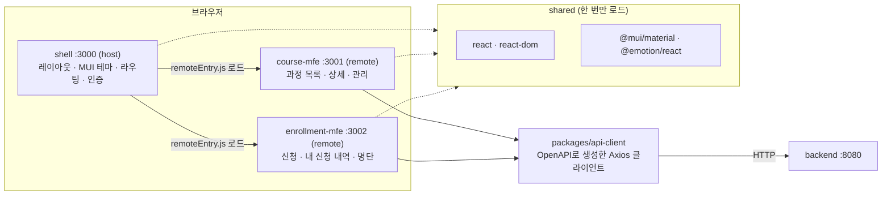
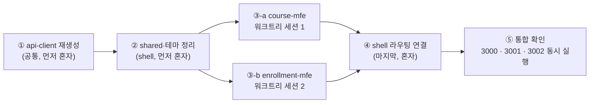
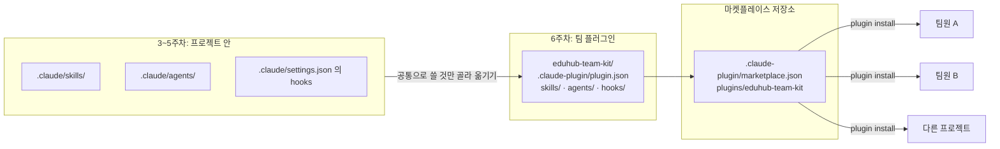
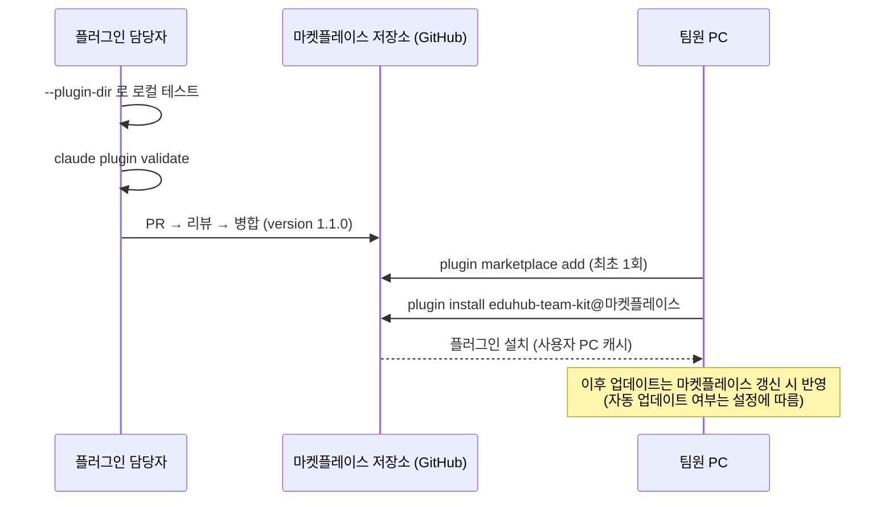
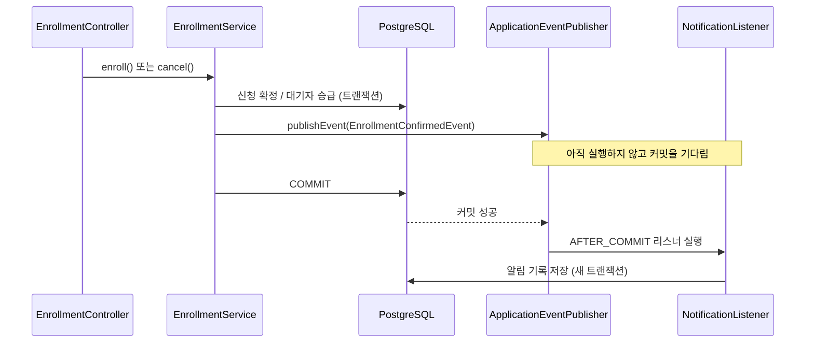

# 6회차: 플러그인·아티팩트 — 마이크로프론트엔드 완성과 알림(FR-09)

🧭 ⬅️ 이전: [5회차: 훅과 MCP — 품질 자동화와 외부 연결 (FR-07~08)](./session-05-hooks-and-mcp.md) · ➡️ 다음: [7회차: CI/CD·환경 분리 완성·사내 프레임워크·토큰 최적화 (NFR-05, NFR-06)](./session-07-cicd-framework-tokens.md) · 📚 [전체 커리큘럼](../CURRICULUM.md#-회차별-강의-자료)

> **대상**: 5회차까지 EduHub에 훅과 MCP를 적용한 수강생
> **시간**: 120분 (강의 약 40% + 따라하기 약 60%)
> **목표**
> 1. EduHub 프론트엔드를 **shell + course-mfe + enrollment-mfe** 구조로 완성하고, 마이크로프론트엔드에서 **개발자가 통제해야 할 경계**(공유 의존성, 테마, API 클라이언트, 라우팅)를 설명할 수 있다
> 2. 서로 간섭하지 않는 작업을 **워크트리와 병렬 세션**으로 나눠 진행하고, 병렬 수를 "리뷰할 수 있는 양"으로 정할 수 있다
> 3. FR-09 알림을 **트랜잭션 커밋 이후 이벤트**로 구현하고, 그 이유를 설명할 수 있다
> 4. 3~5주차에 만든 `.claude/` 자산(스킬, 에이전트, 훅)을 **팀 플러그인**으로 묶고, 마켓플레이스로 배포·설치할 수 있다. 남이 만든 플러그인은 **설치 전에 검토**한다
> 5. 이번 주 진행 상황을 **아티팩트(진행 현황 리포트)**로 만들어 공유하되, 비밀 정보와 실제 개인정보를 넣지 않는다
>
> **관련 모듈**: 14(플러그인), 15(아티팩트)
> **사전 준비**
> - 5회차 PR이 `main`에 병합되어 있고, `git switch main && git pull`로 최신 상태
> - Node.js LTS, `frontend/` 의존성 설치(`npm install`) 완료
> - 플러그인 실습용 **터미널 CLI**(`claude -v`로 확인). 데스크톱 앱만 쓰는 사람은 [6장 Step 4](#step-4-팀원-pc에-설치하고-확인하기)의 안내를 봅니다
> - 팀별 GitHub에 빈 저장소 `eduhub-<팀이름>-plugins`(Private) 하나
>
> 🖥️ **슬라이드 덱(32장, 발표자 노트 포함)**: https://claude.ai/artifact/BXjy2hwcueRHy9zpXNXzCH — 처음에는 만든 사람만 볼 수 있으며, 다른 사람에게 보여주려면 덱의 공유 메뉴에서 공유해야 합니다. PowerPoint(.pptx)·PDF로 내려받을 수 있습니다.

---

## 진행 순서

| 시간 | 내용 | 형식 |
|---|---|---|
| 0:00 – 0:05 | 지난 회차 복습 & 과제 리뷰 | 강의 |
| 0:05 – 0:20 | 1. 마이크로프론트엔드 완성: 개발자가 통제할 경계 | 강의 |
| 0:20 – 0:35 | 2. 플러그인: 팀의 `.claude/`를 한 번에 배포하기 | 강의 + 시연 |
| 0:35 – 0:45 | 3. 아티팩트: 결과물을 화면으로 공유하기 | 강의 |
| 0:45 – 0:53 | ☕ 휴식 | — |
| 0:53 – 1:33 | 4. 따라하기 ①: MFE 분리 완성 + **로그인·신청 화면** (워크트리 병렬 세션) | 실습 |
| 1:33 – 1:45 | 5. 따라하기 ②: FR-09 알림 (커밋 이후 이벤트) | 실습 |
| 1:45 – 1:57 | 6. 따라하기 ③: 팀 플러그인 만들기·배포·설치 | 실습 |
| — | 7. 따라하기 ④: 주간 진행 현황 아티팩트 | **과제** (시간이 남으면 수업 중) |
| 1:57 – 2:00 | 9. 정리, 과제 안내 | 강의 |

> 8장(더 해 보기)은 시간이 남으면 수업 중에, 아니면 과제로 진행합니다.

---

## 지난 회차 복습 & 과제 리뷰

**5회차 핵심 3문장**
1. **훅은 부탁이 아니라 강제**다. 포맷·테스트·위험 명령 차단처럼 "항상 지켜야 하는 것"은 훅으로 둔다
2. **MCP는 최소 권한**으로 연결한다. 개발 DB는 읽기 전용 계정, 운영 DB는 연결하지 않는다
3. 연결한 MCP 서버와 훅도 **매 턴 컨텍스트·실행 비용**이 있다. 안 쓰는 서버는 끈다

**과제 리뷰 (팀별 1분)**

| 확인 항목 | 질문 |
|---|---|
| 훅 2개 | 훅이 실제로 막았거나 고친 사례가 있었나? 오탐(괜히 막은 것)은? |
| `.mcp.json` | 접속 정보가 파일에 직접 들어가지 않고 환경 변수로 되어 있나? |
| PR 본문 | "Claude에게 맡긴 것 / 직접 한 것"이 적혀 있나? |
| AI 없이 설명하기 | 이번 주 변경을 팀원에게 설명할 때 막힌 부분은? |
| `/usage` 기록 | 지난주보다 사용량이 늘었나 줄었나? 이유는? |

> 💬 **강사 노트:** 오늘은 지금까지 프로젝트 안(`.claude/`)에 만든 자산을 **팀과 다른 프로젝트로 퍼뜨리는 방법**(플러그인)과, 결과를 **사람에게 보여 주는 방법**(아티팩트)을 배우는 날이라고 소개합니다. 동시에 EduHub 프론트엔드 구조를 완성하므로, "구조는 개발자가 통제한다"는 원칙이 가장 많이 시험받는 회차입니다.

---

# 1. 마이크로프론트엔드 완성: 개발자가 통제할 경계

> ⭐ **이 회차의 실습은 Vite 기준입니다** ([1-4. Vite로 Module Federation 구성하기](#1-4-vite로-module-federation-구성하기-실습-기준)). Webpack 5 방식은 비교용으로 함께 보여 줍니다. 기술 상세는 [샘플 프로젝트의 Module Federation 설정](../examples/00-sample-project.md#5-4-module-federation-설정)을 봅니다. 2회차 [3-5. 기술과 아키텍처](./session-02-hands-on-kickoff.md#3-5-기술과-아키텍처)의 구조를 이번 주에 완성합니다.

---

## 1-1. EduHub 프론트엔드 최종 구조



| 구성 요소 | 책임 | 하지 않는 것 |
|---|---|---|
| **shell (host)** | 공통 레이아웃, MUI 테마(`ThemeProvider`), 최상위 라우팅, 로그인 상태 | 업무 화면 직접 구현 |
| **course-mfe** | 과정 목록·상세·관리 화면 (FR-01~03) | 신청 로직, 다른 remote 직접 import |
| **enrollment-mfe** | 신청·취소, 내 신청 내역, 명단 (FR-04~08) | 과정 관리 화면 |
| **packages/api-client** | OpenAPI 스펙으로 **생성**한 API 호출 코드 | 손으로 고치기 (다시 생성하면 사라진다) |

---

## 1-2. 개발자가 반드시 통제할 4가지 경계

마이크로프론트엔드는 Claude에게 "화면 만들어줘"만 반복하면 **각 remote가 제멋대로 커지기 쉬운 구조**입니다. 아래 네 가지는 개발자가 정하고, CLAUDE.md·스킬·리뷰 에이전트로 지키게 합니다.

| 경계 | 규칙 | 어기면 생기는 문제 |
|---|---|---|
| **공유 의존성** | `react`, `react-dom`, `@mui/material`, `@emotion/react`는 `shared`에 `singleton: true`, **같은 버전 범위** | React가 두 번 로드되어 Hook 오류, 번들 크기 증가 |
| **테마** | 테마는 shell 한 곳에서만 정의. remote는 `ThemeProvider`를 새로 만들지 않는다 | 화면마다 색·글꼴이 다름 (샘플 프로젝트 문제 P5) |
| **API 계약** | 모든 API 호출은 `packages/api-client`로. URL을 코드에 직접 쓰지 않는다 | 백엔드 변경 시 일부 화면만 깨짐, 환경별 주소 하드코딩 |
| **모듈 경계** | remote끼리 직접 import 금지. 공통 UI는 shell이 노출하거나 공통 패키지로 | 배포 단위가 서로 묶여 "따로 배포"라는 MFE의 장점이 사라짐 |

```ts
// apps/shell/vite.config.ts 의 federation({ … shared }) (요지) — Webpack의 ModuleFederationPlugin도 shared 모양은 같다
shared: {
  react: { singleton: true, requiredVersion: "^18.0.0" },
  "react-dom": { singleton: true, requiredVersion: "^18.0.0" },
  "@mui/material": { singleton: true },
  "@emotion/react": { singleton: true },
}
// remote(course-mfe, enrollment-mfe)도 같은 shared 설정을 쓴다
```

> 💡 이 네 가지를 **CLAUDE.md(`frontend/CLAUDE.md`)에 짧게** 적고, 3주차에 만든 리뷰 에이전트(예: `mfe-integration-checker`)가 검사하게 하면 Claude가 처음부터 규칙대로 씁니다. ([서브에이전트 예제](../examples/03-settings-skills-agents-hooks.md#모듈-11-서브에이전트))

---

## 1-3. 병렬로 나눠도 되는 일, 순서대로 해야 하는 일

이번 주 프론트엔드 작업은 **나눌 수 있는 일**과 **먼저 끝내야 하는 일**이 섞여 있습니다.



| 구분 | 작업 | 이유 |
|---|---|---|
| **먼저, 혼자** | api-client 재생성, shared·테마 | 모든 remote가 쓰는 **공통 파일**. 동시에 고치면 충돌 |
| **병렬** | course-mfe, enrollment-mfe | 디렉터리가 분리되어 서로 건드리지 않음 |
| **마지막, 혼자** | shell 라우팅 연결, 통합 확인 | 두 remote의 결과가 모두 있어야 가능 |

**병렬 방식 고르기** ([병렬 작업 비교](../examples/17-parallel-work-terminal-vs-desktop.md))

| 방식 | 시작 방법 | 오늘 추천 |
|---|---|---|
| 데스크톱 앱 멀티 세션 | **+ New**(Ctrl/Cmd+N), 폴더 컨트롤에서 **Worktree** 켜기 | ⭐ 데스크톱 사용자 |
| 터미널 멀티 세션 | `claude -w course-mfe`, 다른 창에서 `claude -w enrollment-mfe` | ⭐ 터미널 사용자 |
| 한 세션 안의 서브에이전트 | "두 remote를 서브에이전트로 나눠 진행해줘" | 결과 검토가 어려워 오늘은 비추천 |

> ⚠️ **병렬 수 = 내가 리뷰할 수 있는 양**입니다. 오늘은 2개까지만. 세션마다 사용량이 따로 쌓이므로 `/usage`로 확인합니다. 워크트리에는 `.env`처럼 Git에서 제외된 파일이 없다는 점도 기억합니다. ([공통 주의 사항](../examples/17-parallel-work-terminal-vs-desktop.md#4-병렬-작업의-공통-주의-사항))

> 💬 **강사 노트:** "다 병렬로 돌리면 빠르지 않나요?"라는 질문에는 **공통 파일 충돌**과 **리뷰 병목**을 예로 듭니다. 병렬화의 설계(무엇을 먼저, 무엇을 나눌지)는 사람이 하는 아키텍처 판단입니다.

---

## 1-4. Vite로 Module Federation 구성하기 (실습 기준)

**왜 Vite인가?** 새로 시작하는 React 프로젝트는 대부분 Vite를 씁니다 (개발 서버 시작과 화면 갱신이 빠르고 설정이 짧다. React 공식 문서도 Create React App 대신 Vite 같은 빌드 도구를 안내한다). Module Federation은 원래 Webpack 5의 기능이지만, 지금은 **Module Federation 공식 조직이 만든 Vite 플러그인 `@module-federation/vite`**로 같은 구조를 만들 수 있습니다.

| 선택지 | 특징 | EduHub |
|---|---|---|
| **`@module-federation/vite`** | Module Federation 공식 조직(module-federation)이 관리. Webpack·Rspack과 같은 런타임(MF 2.0)을 쓰고, **remote도 개발 서버(`vite`)로 바로 실행** 가능 | ⭐ **실습 기준** |
| `@originjs/vite-plugin-federation` | 예전부터 많이 쓰인 커뮤니티 플러그인. 검색하면 예제가 많이 나온다 | 쓰지 않음 (예제를 따라 하다 섞이지 않게 주의) |
| Webpack 5 `ModuleFederationPlugin` | 원조. 기존 Webpack 프로젝트라면 그대로 | 비교용 (샘플 프로젝트 5-4) |

**Webpack 설정과 무엇이 대응하나**

| 개념 | Webpack 5 (`webpack.config.js`) | Vite (`vite.config.ts`) |
|---|---|---|
| 플러그인 | `new ModuleFederationPlugin({ … })` | `federation({ … })` (`@module-federation/vite`) |
| remote 이름·진입 파일·노출 모듈 | `name`, `filename: "remoteEntry.js"`, `exposes` | **같다** |
| host가 remote를 가리키는 법 | `remotes: { courseMfe: "courseMfe@http://localhost:3001/remoteEntry.js" }` | `remotes: { courseMfe: { type: "module", name: "courseMfe", entry: "http://localhost:3001/remoteEntry.js" } }` |
| 공유 의존성 | `shared: { react: { singleton: true, … } }` | **같다** |
| 개발 서버 포트 | `devServer: { port: 3001 }` | `server: { port: 3001, strictPort: true }` (+ `preview`도 같은 포트) |
| 원격 모듈의 타입 | 직접 선언 | 직접 선언 (`remotes.d.ts`), 플러그인의 타입 생성은 `dts: false`로 끈다 |

**설치** (`frontend/`의 npm workspaces 기준, shell과 각 remote에 같은 버전으로)

```bash
cd frontend
npm install --workspace apps/shell --workspace apps/course-mfe --workspace apps/enrollment-mfe react@18 react-dom@18 @mui/material @emotion/react @emotion/styled
npm install -D --workspace apps/shell --workspace apps/course-mfe --workspace apps/enrollment-mfe vite @vitejs/plugin-react @module-federation/vite typescript @types/react@18 @types/react-dom@18
```

각 앱의 `package.json` 스크립트는 `"dev": "vite"`, `"build": "vite build"`, `"preview": "vite preview"`입니다.

**remote: `apps/course-mfe/vite.config.ts`**

```ts
// apps/course-mfe/vite.config.ts (remote)
import { defineConfig } from "vite";
import react from "@vitejs/plugin-react";
import { federation } from "@module-federation/vite";

export default defineConfig({
  server: { port: 3001, strictPort: true },
  preview: { port: 3001, strictPort: true },
  plugins: [
    react(),
    federation({
      name: "courseMfe",                         // shell의 remotes 키와 같아야 한다
      filename: "remoteEntry.js",                // shell이 처음 읽는 진입 파일
      exposes: { "./CourseApp": "./src/CourseApp.tsx" },
      shared: {
        react: { singleton: true, requiredVersion: "^18.0.0" },
        "react-dom": { singleton: true, requiredVersion: "^18.0.0" },
        "@mui/material": { singleton: true },
        "@emotion/react": { singleton: true },
      },
      dts: false,
    }),
  ],
});
```

**remote가 노출하는 화면: `apps/course-mfe/src/CourseApp.tsx`** (예시. 실제로는 과정 목록 라우트를 둔다)

```tsx
import { useState } from "react";
import { Button, Stack, Typography, useTheme } from "@mui/material";

// shell이 불러가는 remote 화면. ThemeProvider를 새로 만들지 않고 shell의 테마를 그대로 쓴다
export default function CourseApp() {
  const [count, setCount] = useState(0);
  const theme = useTheme();
  return (
    <Stack spacing={1}>
      <Typography variant="h5" id="course-title">과정 목록 (course-mfe)</Typography>
      <Typography id="theme-color">테마 색: {theme.palette.primary.main}</Typography>
      <Button variant="contained" id="btn" onClick={() => setCount(count + 1)}>클릭 {count}</Button>
    </Stack>
  );
}
```

**host: `apps/shell/vite.config.ts`** (enrollment-mfe는 `remotes`에 같은 모양으로 3002를 추가)

```ts
// apps/shell/vite.config.ts (host)
import { defineConfig } from "vite";
import react from "@vitejs/plugin-react";
import { federation } from "@module-federation/vite";

export default defineConfig({
  server: { port: 3000, strictPort: true },
  preview: { port: 3000, strictPort: true },
  plugins: [
    react(),
    federation({
      name: "shell",
      remotes: {
        courseMfe: {
          type: "module",                        // Vite remote는 ES 모듈
          name: "courseMfe",
          entry: "http://localhost:3001/remoteEntry.js",
        },
      },
      shared: {
        react: { singleton: true, requiredVersion: "^18.0.0" },
        "react-dom": { singleton: true, requiredVersion: "^18.0.0" },
        "@mui/material": { singleton: true },
        "@emotion/react": { singleton: true },
      },
      dts: false,
    }),
  ],
});
```

**host에서 remote 불러오기: `apps/shell/src/remotes.d.ts`, `apps/shell/src/main.tsx`**

```ts
// remote 모듈의 타입 선언 (TypeScript가 'courseMfe/CourseApp'을 알게 한다)
declare module "courseMfe/CourseApp" {
  const CourseApp: React.ComponentType;
  export default CourseApp;
}
```

```tsx
import { Component, lazy, Suspense, type ReactNode } from "react";
import { createRoot } from "react-dom/client";
import { Alert, CircularProgress, Container, createTheme, ThemeProvider } from "@mui/material";

// 테마는 shell 한 곳에서만 정의한다
const theme = createTheme({ palette: { primary: { main: "#B5591C" } } });

// remote는 실행 중에 네트워크로 불러온다 → lazy + Suspense
const CourseApp = lazy(() => import("courseMfe/CourseApp"));

// remote를 못 불러와도 shell 전체가 깨지지 않게
class RemoteBoundary extends Component<{ children: ReactNode }, { failed: boolean }> {
  state = { failed: false };
  static getDerivedStateFromError() { return { failed: true }; }
  render() {
    return this.state.failed
      ? <Alert severity="error" id="remote-error">과정 화면을 불러오지 못했습니다. course-mfe(3001)가 실행 중인지 확인하세요.</Alert>
      : this.props.children;
  }
}

createRoot(document.getElementById("root")!).render(
  <ThemeProvider theme={theme}>
    <Container>
      <RemoteBoundary>
        <Suspense fallback={<CircularProgress />}>
          <CourseApp />
        </Suspense>
      </RemoteBoundary>
    </Container>
  </ThemeProvider>,
);
```

**실행**

```bash
cd frontend
npm run dev --workspace apps/course-mfe     # 3001 (먼저)
npm run dev --workspace apps/shell          # 3000 (다른 창) → http://localhost:3000

# 배포와 같은 결과물로 확인할 때
npm run build --workspace apps/course-mfe && npm run build --workspace apps/shell
npm run preview --workspace apps/course-mfe   # 3001
npm run preview --workspace apps/shell        # 3000 (다른 창)
```

| 확인할 것 | 정상 | 의미 |
|---|---|---|
| 화면 | shell 안에 "과정 목록 (course-mfe)"이 보인다 | remote를 실행 중에 불러왔다 |
| 테마 색 | remote 화면에 shell 테마 색(`#B5591C`)이 나온다 | `@mui/material`·`@emotion/react`를 **같은 인스턴스**로 공유한다 (remote가 테마를 만들지 않아도 된다) |
| 버튼 클릭 | 숫자가 올라간다 | remote의 React Hook이 shell의 React로 동작한다 (**React 한 벌**) |
| Network 탭 | 3001에서 `remoteEntry.js`와 remote 코드만 받는다 | 개발 서버 모드에서는 이름에 `loadShare`가 들어간 작은 모듈이 3001에서 보이는데, React 자체가 아니라 **공유 React를 가리키는 연결 모듈**이다. 빌드 모드에서는 3001에서 React·MUI 파일을 받지 않는다 |
| course-mfe를 끈 상태 | shell은 뜨고 그 자리에 MUI `Alert`가 나온다 | remote 하나가 죽어도 shell 전체가 깨지지 않는다 (`RemoteBoundary`) |

> ✅ 이 교재 환경에서 위 설정 그대로 shell + course-mfe를 만들어 브라우저(Chromium)로 확인했습니다 (Vite 8.3, `@module-federation/vite` 1.24, `@vitejs/plugin-react` 6.3, React 18.3, MUI 6.5): 개발 서버 모드와 빌드·미리보기 모드 모두 위 표대로 동작했고, TypeScript 타입 검사도 통과했습니다. remote의 `shared`를 일부러 빼면 `Cannot read properties of null (reading 'useState')`로 화면이 실패하는 것도 확인했습니다 (React가 두 벌 로드됨). enrollment-mfe(3002)는 같은 방식이라 따로 만들어 보지는 않았습니다.

> 💡 플러그인 버전이 오르면서 설정이 바뀌기도 합니다. Claude에게 설정을 맡길 때는 **"`@module-federation/vite`로, 설치된 버전의 README 기준으로"**라고 지정하고, 인터넷의 `@originjs/vite-plugin-federation` 예제(옵션 이름과 동작이 다르다)가 섞이지 않았는지 diff에서 확인합니다.

---

## 1-5. 로그인과 화면 조립: 누가 무엇을 책임지나

5회차 [Step 9-1](./session-05-hooks-and-mcp.md#step-9-1-인증-기반-만들기-nfr-03--fr-07-전에)에서 백엔드는 JWT로 사용자를 확인합니다. 이번 주에는 **로그인 화면**과 **신청·내 신청 내역·명단 화면**을 만들어, 10회차 데모 흐름(로그인 → 검색 → 상세에서 신청 → 대기 → 취소 → 관리자 명단·수료)이 실제로 동작하게 합니다.


| 책임 | 어디서 | 왜 그곳인가 |
|---|---|---|
| 로그인 화면, 로그인 상태(`user`), 로그아웃 | **shell** (`AuthContext`, `LoginPage`) | 레이아웃·라우팅과 함께 모든 화면에 걸친 관심사 |
| 로그인 필요·관리자 전용 라우트 | **shell** (`RequireAuth`) | 라우트는 shell이 가진다 |
| 요청마다 토큰 붙이기, 401이면 토큰 지우기 | **api-client** (`http` 인터셉터) | 모든 remote가 이 클라이언트로만 API를 부르므로 한 곳에서 처리 |
| 토큰 보관 | **api-client** (`tokenStore`, localStorage) | shell과 remote는 **같은 페이지(origin 3000)**에서 실행되므로 함께 읽는다 |
| 과정 상세 | **course-mfe** | FR-02. 신청은 모른다 |
| 신청 버튼, 내 신청 내역, 명단·수료 | **enrollment-mfe** | FR-04~08 |
| 상세 화면 안에 신청 버튼 넣기 | **shell**이 `renderSessionAction`으로 조립 | **remote끼리 직접 import 금지**(1-2) 규칙을 지키면서 한 화면에 두 remote를 함께 보여 준다 |
| 401을 shell에 알리기 | api-client가 `eduhub:unauthorized` **이벤트**를 보냄 | remote·api-client가 shell을 import하지 않게 |

> ⚠️ **화면의 권한 확인은 편의일 뿐입니다.** `RequireAuth`나 "로그인 후 신청" 버튼은 사용자에게 길을 안내할 뿐이고, 실제로 막는 것은 백엔드(401·403)입니다. 화면만 막고 API를 열어 두면 누구나 curl로 부를 수 있습니다.

> 🔐 **토큰을 localStorage에 두는 것의 위험**: 페이지에 악성 스크립트가 들어오면(XSS) 토큰을 읽어 갈 수 있습니다. 교육에서는 구조를 단순하게 하려고 localStorage를 쓰고, 토큰 만료를 60분으로 짧게 둡니다. 실제 서비스에서는 `HttpOnly` 쿠키, 짧은 만료 + 리프레시 토큰, 사내 SSO를 함께 검토합니다 (8회차 보안 점검에서 다시 봅니다).

---

# 2. 플러그인: 팀의 `.claude/`를 한 번에 배포하기

> 기준: Claude Code 공식 문서 Plugins, Create a marketplace, Plugin security and trust (2026년 10월 확인). 예제: [플러그인 eduhub-dev-kit](../examples/04-mcp-plugins-artifacts.md#모듈-14-플러그인-eduhub-dev-kit)

---

## 2-1. 플러그인이란

**플러그인 = 스킬, 서브에이전트, 훅, MCP 서버 등을 하나로 묶어 한 번에 설치·업데이트하는 단위**입니다. 대부분 **마켓플레이스**(플러그인 목록을 담은 저장소)를 통해 설치합니다.



| 구성 요소 | 플러그인 안 위치 | 세션에서 |
|---|---|---|
| 매니페스트 | `.claude-plugin/plugin.json` | 플러그인 이름(스킬 앞에 붙는 접두사), 버전, 설명 |
| 스킬 | `skills/<이름>/SKILL.md` | `/eduhub-team-kit:add-api-endpoint`처럼 **플러그인 이름이 접두사** |
| 서브에이전트 | `agents/<이름>.md` | Claude가 위임할 수 있는 에이전트 |
| 훅 | `hooks/hooks.json` | 플러그인이 켜져 있으면 해당 이벤트에 실행 |
| MCP 서버 | `.mcp.json` | 플러그인이 켜져 있는 동안 연결 |

---

## 2-2. 프로젝트 `.claude/` vs 플러그인: 무엇을 어디에

| 질문 | 프로젝트 `.claude/` | 팀 플러그인 |
|---|---|---|
| 이 저장소에만 해당하나? | ✅ (EduHub 도메인 규칙, 이 저장소의 경로) | |
| 여러 프로젝트에서 공통인가? | | ✅ (Spring API 추가 절차, JPA 리뷰어, 포맷 훅) |
| 버전을 붙여 배포·업데이트하고 싶은가? | | ✅ |
| 저장소를 클론하면 바로 적용되어야 하나? | ✅ | 설치가 한 번 필요 (프로젝트 설정으로 권장 가능) |

> 💡 **같은 스킬을 양쪽에 두지 않습니다.** 플러그인으로 옮긴 것은 프로젝트에서 지워야 두 버전이 동시에 로드되어 헷갈리는 일이 없습니다.

---

## 2-3. 플러그인도 "공짜"가 아니다: 토큰과 보안

**토큰**: 켜진 플러그인은 **쓰지 않는 세션에도** 들어옵니다. Claude가 스스로 부를 수 있는 스킬·에이전트·커맨드의 **이름과 설명이 매 턴 컨텍스트에 포함**되고, MCP 서버는 세션과 함께 실행됩니다. 안 쓰는 플러그인은 끕니다(`/plugin` 또는 `claude plugin disable`).

**보안**: 공식 문서는 "설치한 플러그인은 **내 사용자 권한으로 임의의 코드를 실행**할 수 있다"고 경고합니다.

| 플러그인이 할 수 있는 것 | 위험 |
|---|---|
| 훅 | 셸 명령으로 실행. **권한 규칙·샌드박스 밖**에서 내 권한으로 실행 |
| MCP 서버 | 내 PC에서 프로세스로 실행 |
| `bin/` 실행 파일 | Bash 도구의 `PATH`에 추가됨 |
| 스킬·에이전트·커맨드 | Claude의 지시로 들어감 → 행동에 영향 |
| 자동 업데이트 | 검토한 파일이 나중에 바뀔 수 있음 |

**설치 전 검토 4단계** (공식 문서 기준)

1. `claude plugin marketplace list`로 마켓플레이스 **출처** 확인
2. `/plugin`에서 플러그인을 골라 **Will install** 목록(커맨드, 에이전트, 스킬, 훅, MCP) 확인
3. 소스에서 **`hooks/hooks.json`, `.mcp.json`, `bin/`**을 직접 읽기 (Will install에는 훅이 "있다"는 것만 보이고 무엇을 실행하는지는 안 보임)
4. `claude --plugin-dir <플러그인 폴더> plugin details <이름>`으로 구성 목록 확인

> ⚠️ 마켓플레이스 이름이 그럴듯해도 **팀·동료·사내 마켓플레이스는 모두 "서드파티"**입니다. 출처보다 **내용**을 봅니다. 회사에서는 관리자가 관리형 설정으로 허용 마켓플레이스를 제한할 수 있습니다.

> 💬 **강사 노트:** 실제 오픈소스 플러그인 하나를 골라 `hooks/hooks.json`을 함께 읽어 봅니다. "이 훅은 언제, 어떤 명령을 실행하는가?"를 수강생이 답하게 합니다.

---

## 2-4. 버전과 배포 흐름



| 규칙 | 이유 |
|---|---|
| `plugin.json`의 `version`을 **유의적 버전**(1.0.0 → 1.1.0 → 2.0.0)으로 | 무엇이 바뀌었는지 팀원이 판단 |
| 마켓플레이스 저장소도 **PR + 리뷰** | 플러그인은 팀원 PC에서 코드를 실행한다. 리뷰 없는 변경 금지 |
| `CHANGELOG.md` 유지 | 훅이 바뀌면 동작이 달라진다. 팀에 알림 |
| 마켓플레이스 항목 이름 = `plugin.json`의 `name` | 다르면 설치 오류의 가장 흔한 원인 |

> 💡 자동 업데이트를 켜 두면 검토한 파일이 바뀔 수 있습니다. 팀 마켓플레이스는 **병합 권한을 좁히고 리뷰를 필수로** 합니다. 업데이트 반영 시점의 정확한 규칙은 공식 문서 "Host and maintain a marketplace"를 확인합니다 (공식 문서 확인 필요).

---

# 3. 아티팩트: 결과물을 화면으로 공유하기

> 예제: [아티팩트 활용 예](../examples/04-mcp-plugins-artifacts.md#모듈-15-아티팩트)

---

## 3-1. 아티팩트란

**아티팩트 = Claude가 만든 결과물을 대화 밖의 독립된 화면(웹 페이지, 문서, 다이어그램, 대시보드)으로 보여 주고, 대화로 고치고, 링크로 공유하는 것**입니다.

| 언제 쓰나 | EduHub 예 | 보는 사람 |
|---|---|---|
| **진행 현황 리포트** | 주간 PR·테스트·요구사항 진척, 다음 주 계획 | 팀, 강사 |
| **아키텍처 설명 페이지** | MFE 구조, 이벤트 흐름, 패키지 구조를 그림과 함께 | 신규 팀원, 리뷰어 |
| **회고 대시보드** | 주차별 `/usage`, 직접 고친 건수, 재작업 횟수 | 팀 |
| **화면 프로토타입** | 수강 취소 확인 Dialog 시안 | 기획자 |

**마크다운 문서와 무엇이 다른가**

| | 저장소의 `.md` | 아티팩트 |
|---|---|---|
| 목적 | 코드와 함께 **버전 관리**되는 기준 문서 | **보여 주기·공유**용 결과물 |
| 형태 | 텍스트 + Mermaid | 레이아웃, 차트, 상호작용 가능한 화면 |
| 변경 이력 | Git | 아티팩트 버전 |
| 예 | 요구사항, 런북, CLAUDE.md | 주간 리포트, 발표용 설명 페이지 |

> 💡 **기준 정보는 저장소에, 보여 주는 화면은 아티팩트로.** 아티팩트에만 있는 결정 사항은 저장소의 `docs/`에도 남깁니다.

---

## 3-2. 공유와 보안 원칙

| 원칙 | 내용 |
|---|---|
| **기본은 비공개** | 만든 사람만 볼 수 있고, 공유하려면 공유 메뉴에서 대상을 정한다 (사용 환경에 따라 화면이 다를 수 있음) |
| **비밀 정보 금지** | 접속 정보, 토큰, 키, `.env` 내용, 운영 서버 주소를 넣지 않는다 |
| **실제 개인정보 금지** | 임직원 이름·사번·연락처 대신 가짜 데이터나 집계값 |
| **운영 데이터 금지** | 개발·테스트 환경의 데이터만. 운영 DB 조회 결과로 만들지 않는다 (환경 분리 원칙) |
| **수치는 출처와 함께** | "테스트 112개 통과(`./gradlew test`, 10/25 기준)"처럼 근거를 적는다. AI가 숫자를 지어내지 않았는지 확인 |

> 💬 **강사 노트:** 아티팩트는 쉽게 링크로 퍼집니다. "이 화면이 회사 밖으로 나가도 괜찮은가?"를 공유 전 체크 질문으로 습관화시킵니다.

---

## ☕ 휴식 (8분)

> 휴식 중에 `git switch main && git pull`, `cd frontend && npm install`을 끝내 둡니다.

---

# 4. 따라하기 ①: MFE 분리 완성 (워크트리 병렬 세션)

> **목표**: shell(3000)에서 course-mfe(3001)와 enrollment-mfe(3002)를 불러와 하나의 앱처럼 동작하게 합니다. 공통 작업은 혼자, remote 작업은 병렬로 진행합니다.

---

## Step 1. 브랜치와 공통 작업 (혼자)

```bash
git switch main && git pull
git switch -c feature/fr-07-mfe-split
```

새 세션(또는 `/clear`)에서 Plan 모드로 지시합니다.

```text
[목표] 마이크로프론트엔드 분리를 위한 공통 기반을 정리한다
[위치] @frontend/apps/shell/vite.config.ts, @frontend/packages/api-client
[범위]
- 백엔드 OpenAPI 스펙(/v3/api-docs)으로 packages/api-client를 다시 생성
- shell의 Module Federation 설정(@module-federation/vite의 federation()): shared에 react, react-dom, @mui/material, @emotion/react를 singleton, 같은 버전 범위
- remote 모듈 타입 선언 src/remotes.d.ts, 플러그인 옵션 dts: false
- MUI 테마를 shell의 theme.ts 한 곳에 정의
- shared에 react-router-dom과 @eduhub/api-client도 singleton으로 (라우터 상태와 토큰 처리를 shell·remote가 함께 쓰도록)
- 개발 서버·미리보기에서 /api 를 http://localhost:8080 으로 프록시 (CORS 없이 같은 origin)
- 로그인 (1-5): api-client에 src/auth.ts(손으로 작성, generated/ 밖) — tokenStore(localStorage), http(Axios 인스턴스: 요청마다 Bearer 토큰, 401이면 토큰 삭제 + eduhub:unauthorized 이벤트, 403은 로그아웃 안 함)
  생성된 *Api 클래스는 index.ts 한 곳에서 new XxxApi(config, undefined, http)로 만든다
- shell: AuthContext(user, expired, login, logout, 401 이벤트 처리, 새로고침 시 /api/me 확인), RequireAuth(로그인·관리자), LoginPage(로그인 후 원래 가려던 화면으로)
- 테스트: api-client의 토큰 첨부·401 처리·403은 유지 (Vitest)
[하지 않는 것] course-mfe, enrollment-mfe 화면 수정 (다음 단계에서 병렬로), 백엔드 수정
[완료 기준] npm run build --workspace apps/shell 성공, npm test --workspace packages/api-client 통과, api-client 생성 스크립트가 package.json에 있음
[진행 방식] 바꿀 파일 목록과 이유를 먼저 보여줘
```

**계획 검토 포인트**
- api-client를 **손으로 고치는 계획**이 있으면 거절합니다 (생성 스크립트로만)
- remote별로 다른 버전의 React·MUI를 쓰는 계획이 있으면 맞추게 합니다
- `@originjs/vite-plugin-federation`이나 Webpack 설정이 섞여 있으면 `@module-federation/vite`로 통일하게 합니다 ([1-4](#1-4-vite로-module-federation-구성하기-실습-기준))
- 토큰 처리 코드를 `generated/` **안에** 넣는 계획이면 거절합니다 (다시 생성하면 사라진다)
- remote마다 Axios 인스턴스를 따로 만들어 토큰을 붙이는 계획이면, api-client의 `http` 하나로 모으게 합니다

**기대하는 결과 (핵심 코드)** — 아래 코드는 실제로 빌드·테스트하고 브라우저로 확인한 것입니다 (Step 3 끝의 확인 표)

```ts
// packages/api-client/src/auth.ts — 손으로 작성 (generated/ 밖에 둔다: 다시 생성해도 지워지지 않게)
import axios from 'axios';
import type { CurrentUser } from './generated/api';

const TOKEN_KEY = 'eduhub.accessToken';
const USER_KEY = 'eduhub.user';

/** 토큰 보관소. shell과 모든 remote가 같은 페이지(같은 origin)에서 실행되므로 localStorage를 함께 본다 */
export const tokenStore = {
  get: (): string | null => localStorage.getItem(TOKEN_KEY),
  user: (): CurrentUser | null => {
    const raw = localStorage.getItem(USER_KEY);
    return raw ? (JSON.parse(raw) as CurrentUser) : null;
  },
  save: (token: string, user: CurrentUser) => {
    localStorage.setItem(TOKEN_KEY, token);
    localStorage.setItem(USER_KEY, JSON.stringify(user));
  },
  clear: () => {
    localStorage.removeItem(TOKEN_KEY);
    localStorage.removeItem(USER_KEY);
  },
};

/** 로그인이 필요하다는 신호. shell이 듣고 로그인 화면으로 보낸다 (remote가 shell을 import하지 않게 이벤트로) */
export const UNAUTHORIZED_EVENT = 'eduhub:unauthorized';

/** 모든 API 호출이 쓰는 Axios 인스턴스. 생성된 *Api 클래스의 세 번째 인자로 넘긴다 */
export const http = axios.create();

// 요청마다 토큰을 붙인다
http.interceptors.request.use((config) => {
  const token = tokenStore.get();
  if (token) config.headers.Authorization = `Bearer ${token}`;
  return config;
});

// 401(토큰 없음·만료·위조)이면 저장된 토큰을 지우고 알린다. 403(권한 없음)은 로그아웃하지 않는다
http.interceptors.response.use(
  (response) => response,
  (error) => {
    if (axios.isAxiosError(error) && error.response?.status === 401) {
      tokenStore.clear();
      window.dispatchEvent(new CustomEvent(UNAUTHORIZED_EVENT));
    }
    return Promise.reject(error);
  },
);
```

```ts
// packages/api-client/src/index.ts
import { AdminEnrollmentApi, AuthApi, Configuration, CourseApi, EnrollmentApi } from './generated/api';
import { http } from './auth';

export * from './generated/api';
export { http, tokenStore, UNAUTHORIZED_EVENT } from './auth';

// 생성된 클라이언트 인스턴스는 여기 한 곳에서만 만든다. 세 번째 인자 http = 토큰을 붙이는 Axios 인스턴스
const config = new Configuration({ basePath: '' }); // 같은 origin의 /api → Vite 프록시가 백엔드로 전달
export const authApi = new AuthApi(config, undefined, http);
export const courseApi = new CourseApi(config, undefined, http);
export const enrollmentApi = new EnrollmentApi(config, undefined, http);
export const adminEnrollmentApi = new AdminEnrollmentApi(config, undefined, http);
```

<details>
<summary>shell: AuthContext.tsx, RequireAuth.tsx, LoginPage.tsx</summary>

```tsx
// apps/shell/src/auth/AuthContext.tsx — 로그인 상태는 shell 한 곳에서 관리한다
import { createContext, useCallback, useContext, useEffect, useState, type ReactNode } from 'react';
import { useNavigate } from 'react-router-dom';
import { authApi, tokenStore, UNAUTHORIZED_EVENT, type CurrentUser } from '@eduhub/api-client';

interface AuthState {
  user: CurrentUser | null;
  /** 토큰이 만료·위조되어 로그아웃된 경우 true (로그인 화면에 안내를 띄운다) */
  expired: boolean;
  login: (employeeNo: string, password: string) => Promise<void>;
  logout: () => void;
}
const AuthContext = createContext<AuthState | null>(null);

export function AuthProvider({ children }: { children: ReactNode }) {
  const navigate = useNavigate();
  const [user, setUser] = useState<CurrentUser | null>(tokenStore.user());
  const [expired, setExpired] = useState(false);

  const login = useCallback(async (employeeNo: string, password: string) => {
    const { data } = await authApi.login({ employeeNo, password });
    tokenStore.save(data.accessToken, data.user);
    setExpired(false);
    setUser(data.user);
  }, []);

  const logout = useCallback(() => {
    tokenStore.clear();
    setUser(null);
    navigate('/login');
  }, [navigate]);

  // 어느 remote에서든 401이 나면 api-client가 이벤트를 보낸다 → 로그인 화면으로
  useEffect(() => {
    const onUnauthorized = () => {
      // 보호 화면이면 RequireAuth도 로그인으로 보낸다. 어느 쪽이 먼저 옮기든 expired가 함께 전달되도록 상태로 둔다
      setExpired(true);
      setUser(null);
      navigate('/login', { replace: true, state: { from: window.location.pathname } });
    };
    window.addEventListener(UNAUTHORIZED_EVENT, onUnauthorized);
    return () => window.removeEventListener(UNAUTHORIZED_EVENT, onUnauthorized);
  }, [navigate]);

  // 새로고침 후에도 토큰이 아직 유효한지 서버에 확인 (만료됐으면 401 → 위 이벤트)
  useEffect(() => {
    if (tokenStore.get()) authApi.me().then((r) => setUser(r.data)).catch(() => undefined);
  }, []);

  return <AuthContext.Provider value={{ user, expired, login, logout }}>{children}</AuthContext.Provider>;
}

export function useAuth() {
  const ctx = useContext(AuthContext);
  if (!ctx) throw new Error('AuthProvider 안에서만 쓸 수 있습니다.');
  return ctx;
}
```

```tsx
// apps/shell/src/auth/RequireAuth.tsx — 로그인(·관리자)이 필요한 라우트를 감싼다
import type { ReactNode } from 'react';
import { Navigate, useLocation } from 'react-router-dom';
import { Alert } from '@mui/material';
import { useAuth } from './AuthContext';

export function RequireAuth({ children, admin = false }: { children: ReactNode; admin?: boolean }) {
  const { user } = useAuth();
  const location = useLocation();
  if (!user) return <Navigate to="/login" replace state={{ from: location.pathname }} />;
  if (admin && user.role !== 'ADMIN') return <Alert severity="warning">관리자만 사용할 수 있는 화면입니다.</Alert>;
  return <>{children}</>;
}
```

```tsx
// apps/shell/src/pages/LoginPage.tsx
import { useState, type FormEvent } from 'react';
import { useLocation, useNavigate } from 'react-router-dom';
import { Alert, Button, Paper, Stack, TextField, Typography } from '@mui/material';
import { useAuth } from '../auth/AuthContext';

export default function LoginPage() {
  const { login, expired } = useAuth();
  const navigate = useNavigate();
  const state = useLocation().state as { from?: string } | null;
  const [employeeNo, setEmployeeNo] = useState('');
  const [password, setPassword] = useState('');
  const [error, setError] = useState(false);

  const submit = async (e: FormEvent) => {
    e.preventDefault();
    setError(false);
    try {
      await login(employeeNo, password);
      navigate(state?.from ?? '/courses', { replace: true });   // 원래 가려던 화면으로
    } catch {
      setError(true);
    }
  };

  return (
    <Paper sx={{ p: 4, maxWidth: 400, mx: 'auto', mt: 6 }}>
      <form onSubmit={submit}>
        <Stack spacing={2}>
          <Typography variant="h5">로그인</Typography>
          {expired && <Alert severity="info">로그인이 만료되었습니다. 다시 로그인하세요.</Alert>}
          {error && <Alert severity="error">사번 또는 비밀번호가 올바르지 않습니다.</Alert>}
          <TextField label="사번" value={employeeNo} onChange={(e) => setEmployeeNo(e.target.value)} required />
          <TextField label="비밀번호" type="password" value={password} onChange={(e) => setPassword(e.target.value)} required />
          <Button type="submit" variant="contained">로그인</Button>
        </Stack>
      </form>
    </Paper>
  );
}
```

</details>

<details>
<summary>api-client 테스트: auth.test.ts (토큰 첨부, 401 처리, 403은 로그아웃 안 함)</summary>

```ts
// packages/api-client/src/auth.test.ts
import type { AxiosAdapter, InternalAxiosRequestConfig } from 'axios';
import { afterEach, beforeEach, expect, test, vi } from 'vitest';
import { http, tokenStore, UNAUTHORIZED_EVENT } from './auth';

// 네트워크 대신 응답을 흉내 내는 어댑터: 받은 요청을 기록하고 정해진 상태 코드로 답한다
let sent: InternalAxiosRequestConfig[] = [];
const respondWith = (status: number): AxiosAdapter => async (config) => {
  sent.push(config);
  const response = { data: {}, status, statusText: String(status), headers: {}, config };
  if (status >= 400) throw Object.assign(new Error(`HTTP ${status}`), { isAxiosError: true, response, config });
  return response;
};

beforeEach(() => {
  sent = [];
  localStorage.clear();
});
afterEach(() => {
  vi.restoreAllMocks();
});

test('저장된 토큰을 Authorization 헤더로 붙인다', async () => {
  tokenStore.save('abc.def.ghi', { employeeId: 1, name: '김사원', role: 'EMPLOYEE' });
  await http.get('/api/me', { adapter: respondWith(200) });
  expect(sent[0].headers.Authorization).toBe('Bearer abc.def.ghi');
});

test('토큰이 없으면 헤더를 붙이지 않는다', async () => {
  await http.get('/api/v1/courses', { adapter: respondWith(200) });
  expect(sent[0].headers.Authorization).toBeUndefined();
});

test('401이면 토큰을 지우고 로그인 필요 이벤트를 보낸다', async () => {
  tokenStore.save('expired', { employeeId: 1, name: '김사원', role: 'EMPLOYEE' });
  const listener = vi.fn();
  window.addEventListener(UNAUTHORIZED_EVENT, listener);

  await expect(http.get('/api/me', { adapter: respondWith(401) })).rejects.toThrow('HTTP 401');

  expect(tokenStore.get()).toBeNull();
  expect(listener).toHaveBeenCalledTimes(1);
  window.removeEventListener(UNAUTHORIZED_EVENT, listener);
});

test('403(권한 없음)은 로그아웃시키지 않는다', async () => {
  tokenStore.save('valid', { employeeId: 1, name: '김사원', role: 'EMPLOYEE' });
  await expect(http.get('/api/admin/sessions/1/roster', { adapter: respondWith(403) })).rejects.toThrow('HTTP 403');
  expect(tokenStore.get()).toBe('valid');
});
```

</details>

> 💡 `AuthContext`의 `expired`를 **상태로** 두는 이유(실제로 겪은 문제): 401 이벤트에서 `navigate('/login', { state: { expired: true } })`만 하면 "로그인이 만료되었습니다" 안내가 사라졌습니다. React Router 7은 화면 이동을 낮은 우선순위(transition)로 처리해서, `setUser(null)`이 먼저 반영되고 `RequireAuth`가 `/login`으로 **다시** 보내며 이동 상태를 덮어썼기 때문입니다. 누가 먼저 화면을 옮기든 안내가 남도록 만료 여부를 컨텍스트 상태로 바꿨습니다.

구현 후 직접 확인하고 커밋합니다.

```bash
cd frontend && npm run build --workspace apps/shell && npm test --workspace packages/api-client
git add frontend/packages/api-client frontend/apps/shell frontend/package.json
git diff --staged --stat
git commit -m "feat(frontend): shell 로그인과 api-client 토큰 처리, 공유 의존성·테마 정리 (NFR-03)"
```

> ✅ **확인**: `packages/api-client`의 변경이 **생성 스크립트의 결과**뿐인지, shell에 업무 화면 코드가 추가되지 않았는지 봅니다.

---

## Step 2. remote 두 개를 병렬 세션으로

**데스크톱 앱**: **+ New**로 세션을 두 개 열고, 각각 폴더 컨트롤에서 **Worktree**를 켭니다.
**터미널**: 창을 두 개 열고 각각 실행합니다.

```bash
# 창 1
claude -w course-mfe
# 창 2
claude -w enrollment-mfe
```

> 워크트리는 Step 1의 커밋을 바탕으로 만들어지므로 **Step 1을 먼저 커밋**해야 합니다.

**세션 1 (course-mfe) 지시**

```text
[목표] course-mfe를 Module Federation remote로 완성한다
[위치] @frontend/apps/course-mfe
[범위]
- vite.config.ts의 federation() (@module-federation/vite): name courseMfe, filename remoteEntry.js
  exposes ./CourseListPage, ./CourseDetailPage
- shared는 shell과 동일 (singleton, react-router-dom·@eduhub/api-client 포함), /api 프록시
- 과정 목록·상세 화면은 packages/api-client의 courseApi만 사용. 목록 행을 누르면 /courses/:courseId
- CourseDetailPage(FR-02): 과정 정보 + 회차 표(시작일, 장소, 남은 자리/정원).
  회차 행 끝은 prop renderSessionAction?: (session) => ReactNode 로 비워 둔다 (신청 버튼은 enrollment-mfe가 만든다)
- 개발 서버·미리보기 포트 3001 (strictPort)
[하지 않는 것] shell, enrollment-mfe, api-client 수정. ThemeProvider 새로 만들기
[완료 기준] npm run build --workspace apps/course-mfe 성공, npm test --workspace apps/course-mfe 통과
[진행 방식] 계획 먼저. 범위 밖 파일을 고쳐야 하면 멈추고 알려줘
```

**세션 2 (enrollment-mfe) 지시**

```text
[목표] enrollment-mfe를 Module Federation remote로 만들고 신청 관련 화면을 완성한다 (FR-04~08)
[위치] @frontend/apps/enrollment-mfe
[범위]
- federation(): name enrollmentMfe, filename remoteEntry.js, 포트 3002 (strictPort), shared·프록시는 shell과 동일
  exposes ./EnrollButton, ./MyEnrollmentsPage, ./RosterPage
- EnrollButton({ sessionId }): 토큰이 없으면 "로그인 후 신청"(/login 링크), 있으면 신청 버튼.
  201이면 "신청이 확정되었습니다" 또는 "대기 N번으로 등록되었습니다", 409면 "이미 신청한 회차입니다"
- MyEnrollmentsPage(FR-07, FR-06): 내 신청 내역 표, 상태 칩(확정·대기 N번·취소·수료), 확정·대기는 확인 후 취소
- RosterPage(FR-08, 관리자): 확정자(체크박스)·대기자(순번) 목록, 선택한 사원 수료 처리, 403이면 "관리자만 볼 수 있습니다"
- API는 api-client의 enrollmentApi, adminEnrollmentApi만 사용. 토큰을 직접 붙이지 않는다 (http가 처리)
- 테스트(Vitest): EnrollButton — 로그인 안 함, 대기 순번, 409
[하지 않는 것] shell, course-mfe, api-client 수정. ThemeProvider 새로 만들기. 로그인 화면(shell 담당)
[완료 기준] npm run build --workspace apps/enrollment-mfe 성공, npm test --workspace apps/enrollment-mfe 통과
[진행 방식] 계획 먼저. 범위 밖 파일을 고쳐야 하면 멈추고 알려줘
```

<details>
<summary>course-mfe: CourseDetailPage.tsx, CourseListPage.tsx (상세로 이동)</summary>

```tsx
// apps/course-mfe/src/pages/CourseDetailPage.tsx — FR-02 과정 상세와 회차
import { useEffect, useState, type ReactNode } from 'react';
import { useParams } from 'react-router-dom';
import { Alert, CircularProgress, Table, TableBody, TableCell, TableHead, TableRow, Typography } from '@mui/material';
import { courseApi, type CourseDetail, type SessionView } from '@eduhub/api-client';

export interface CourseDetailPageProps {
  /** 회차 행 끝에 붙일 동작(예: 신청 버튼). course-mfe는 신청을 모른다 → shell이 enrollment-mfe의 버튼을 넣어 준다 */
  renderSessionAction?: (session: SessionView) => ReactNode;
}

export default function CourseDetailPage({ renderSessionAction }: CourseDetailPageProps) {
  const { courseId } = useParams();
  const [course, setCourse] = useState<CourseDetail>();
  const [error, setError] = useState(false);

  useEffect(() => {
    courseApi.getCourse(Number(courseId)).then((r) => setCourse(r.data)).catch(() => setError(true));
  }, [courseId]);

  if (error) return <Alert severity="error">과정 정보를 불러오지 못했습니다.</Alert>;
  if (!course) return <CircularProgress />;
  return (
    <>
      <Typography variant="h5">{course.title}</Typography>
      <Typography color="text.secondary" gutterBottom>{course.description}</Typography>
      <Table>
        <TableHead>
          <TableRow><TableCell>시작일</TableCell><TableCell>장소</TableCell><TableCell>남은 자리</TableCell><TableCell /></TableRow>
        </TableHead>
        <TableBody>
          {course.sessions.map((s) => (
            <TableRow key={s.id}>
              <TableCell>{s.startDate}</TableCell>
              <TableCell>{s.place}</TableCell>
              <TableCell>{s.remaining} / {s.capacity}</TableCell>
              <TableCell>{renderSessionAction?.(s)}</TableCell>
            </TableRow>
          ))}
        </TableBody>
      </Table>
    </>
  );
}
```

```tsx
// apps/course-mfe/src/pages/CourseListPage.tsx (3회차 화면에 "행을 누르면 상세로"만 추가한 요약본)
import { useEffect, useState } from 'react';
import { useNavigate } from 'react-router-dom';
import { Alert, CircularProgress, Table, TableBody, TableCell, TableHead, TableRow, Typography } from '@mui/material';
import { courseApi, type CourseSummary } from '@eduhub/api-client';

export default function CourseListPage() {
  const navigate = useNavigate();
  const [rows, setRows] = useState<CourseSummary[]>();
  const [error, setError] = useState(false);

  useEffect(() => {
    courseApi.getCourses(undefined, undefined, 0, 10).then((r) => setRows(r.data.content)).catch(() => setError(true));
  }, []);

  if (error) return <Alert severity="error">과정 목록을 불러오지 못했습니다.</Alert>;
  if (!rows) return <CircularProgress />;
  return (
    <>
      <Typography variant="h5" gutterBottom>교육과정</Typography>
      <Table>
        <TableHead><TableRow><TableCell>과정명</TableCell><TableCell>분류</TableCell></TableRow></TableHead>
        <TableBody>
          {rows.map((c) => (
            <TableRow key={c.id} hover sx={{ cursor: 'pointer' }} onClick={() => navigate(`/courses/${c.id}`)}>
              <TableCell>{c.title}</TableCell>
              <TableCell>{c.category}</TableCell>
            </TableRow>
          ))}
        </TableBody>
      </Table>
    </>
  );
}
```

</details>

<details>
<summary>enrollment-mfe: EnrollButton.tsx, MyEnrollmentsPage.tsx, RosterPage.tsx, vite.config.ts</summary>

```tsx
// apps/enrollment-mfe/src/components/EnrollButton.tsx — FR-04·05 신청 버튼 (course-mfe 상세 화면의 회차 행에 들어간다)
import { useState } from 'react';
import { Link as RouterLink } from 'react-router-dom';
import { Alert, Button, Stack } from '@mui/material';
import axios from 'axios';
import { enrollmentApi, tokenStore, type EnrollmentResult } from '@eduhub/api-client';

export default function EnrollButton({ sessionId }: { sessionId: number }) {
  const [result, setResult] = useState<EnrollmentResult>();
  const [error, setError] = useState<string>();
  const [busy, setBusy] = useState(false);

  // 로그인하지 않았으면 신청 대신 로그인으로 (화면 표시용. 최종 판단은 백엔드가 401로 한다)
  if (!tokenStore.get()) {
    return <Button component={RouterLink} to="/login" size="small">로그인 후 신청</Button>;
  }
  if (result) {
    return result.status === 'CONFIRMED'
      ? <Alert severity="success">신청이 확정되었습니다.</Alert>
      : <Alert severity="info">대기 {result.waitingNo}번으로 등록되었습니다.</Alert>;
  }

  const enroll = async () => {
    setBusy(true);
    setError(undefined);
    try {
      setResult((await enrollmentApi.enroll(sessionId)).data);
    } catch (e) {
      setError(axios.isAxiosError(e) && e.response?.status === 409 ? '이미 신청한 회차입니다.' : '신청하지 못했습니다.');
    } finally {
      setBusy(false);
    }
  };

  return (
    <Stack direction="row" spacing={1} alignItems="center">
      <Button variant="contained" size="small" disabled={busy} onClick={enroll}>신청</Button>
      {error && <Alert severity="warning">{error}</Alert>}
    </Stack>
  );
}
```

```tsx
// apps/enrollment-mfe/src/pages/MyEnrollmentsPage.tsx — FR-07 내 신청 내역 + FR-06 취소
import { useCallback, useEffect, useState } from 'react';
import { Alert, Button, Chip, CircularProgress, Table, TableBody, TableCell, TableHead, TableRow, Typography } from '@mui/material';
import { enrollmentApi, type EnrollmentStatus, type MyEnrollment } from '@eduhub/api-client';

const LABEL: Record<EnrollmentStatus, string> = { CONFIRMED: '확정', WAITING: '대기', CANCELED: '취소', COMPLETED: '수료' };

export default function MyEnrollmentsPage() {
  const [rows, setRows] = useState<MyEnrollment[]>();
  const [error, setError] = useState(false);

  const load = useCallback(() => {
    enrollmentApi.getMyEnrollments().then((r) => setRows(r.data)).catch(() => setError(true));
  }, []);
  useEffect(load, [load]);

  const cancel = async (id: number) => {
    if (!window.confirm('신청을 취소할까요? 대기 1순위가 있으면 자동으로 확정됩니다.')) return;
    await enrollmentApi.cancel(id);
    load();
  };

  if (error) return <Alert severity="error">신청 내역을 불러오지 못했습니다.</Alert>;
  if (!rows) return <CircularProgress />;
  return (
    <>
      <Typography variant="h5" gutterBottom>내 신청 내역</Typography>
      {rows.length === 0 && <Alert severity="info">신청한 과정이 없습니다.</Alert>}
      <Table>
        <TableHead><TableRow><TableCell>과정</TableCell><TableCell>시작일</TableCell><TableCell>상태</TableCell><TableCell /></TableRow></TableHead>
        <TableBody>
          {rows.map((r) => (
            <TableRow key={r.enrollmentId}>
              <TableCell>{r.courseTitle}</TableCell>
              <TableCell>{r.startDate}</TableCell>
              <TableCell>
                <Chip size="small" label={r.status === 'WAITING' ? `대기 ${r.waitingNo}번` : LABEL[r.status]} />
              </TableCell>
              <TableCell>
                {(r.status === 'CONFIRMED' || r.status === 'WAITING') && (
                  <Button size="small" color="error" onClick={() => cancel(r.enrollmentId)}>취소</Button>
                )}
              </TableCell>
            </TableRow>
          ))}
        </TableBody>
      </Table>
    </>
  );
}
```

```tsx
// apps/enrollment-mfe/src/pages/RosterPage.tsx — FR-08 회차 명단과 수료 처리 (관리자)
import { useCallback, useEffect, useState } from 'react';
import { useParams } from 'react-router-dom';
import { Alert, Button, Checkbox, CircularProgress, List, ListItem, ListItemText, Stack, Typography } from '@mui/material';
import axios from 'axios';
import { adminEnrollmentApi, type Roster } from '@eduhub/api-client';

export default function RosterPage() {
  const sessionId = Number(useParams().sessionId);
  const [roster, setRoster] = useState<Roster>();
  const [error, setError] = useState<string>();
  const [checked, setChecked] = useState<number[]>([]);
  const [message, setMessage] = useState<string>();

  const load = useCallback(() => {
    adminEnrollmentApi.getRoster(sessionId).then((r) => setRoster(r.data))
      .catch((e) => setError(axios.isAxiosError(e) && e.response?.status === 403 ? '관리자만 볼 수 있습니다.' : '명단을 불러오지 못했습니다.'));
  }, [sessionId]);
  useEffect(load, [load]);

  const toggle = (id: number) => setChecked((c) => (c.includes(id) ? c.filter((x) => x !== id) : [...c, id]));
  const complete = async () => {
    const { data } = await adminEnrollmentApi.complete(sessionId, { employeeIds: checked });
    setMessage(`${data.completed}명을 수료 처리했습니다.`);
    setChecked([]);
    load();
  };

  if (error) return <Alert severity="error">{error}</Alert>;
  if (!roster) return <CircularProgress />;
  return (
    <Stack spacing={2}>
      <Typography variant="h5">회차 {sessionId} 명단</Typography>
      {message && <Alert severity="success">{message}</Alert>}
      <Typography variant="h6">확정 {roster.confirmed.length}명</Typography>
      <List dense>
        {roster.confirmed.map((r) => (
          <ListItem key={r.enrollmentId} disablePadding>
            <Checkbox checked={checked.includes(r.employeeId)} onChange={() => toggle(r.employeeId)} inputProps={{ 'aria-label': `사원 ${r.employeeId} 선택` }} />
            <ListItemText primary={`사원 ${r.employeeId}`} />
          </ListItem>
        ))}
      </List>
      <Typography variant="h6">대기 {roster.waiting.length}명</Typography>
      <List dense>
        {roster.waiting.map((r) => <ListItem key={r.enrollmentId}><ListItemText primary={`대기 ${r.waitingNo}번 · 사원 ${r.employeeId}`} /></ListItem>)}
      </List>
      <Button variant="contained" disabled={checked.length === 0} onClick={complete}>선택한 {checked.length}명 수료 처리</Button>
    </Stack>
  );
}
```

```ts
/// <reference types="vitest/config" />
// apps/enrollment-mfe/vite.config.ts (remote)
import { defineConfig } from "vite";
import react from "@vitejs/plugin-react";
import { federation } from "@module-federation/vite";

export default defineConfig({
  // /api 요청은 백엔드로 (같은 origin이 되어 CORS가 필요 없다). preview도 같게
  server: { port: 3002, strictPort: true, proxy: { "/api": "http://localhost:8080" } },
  preview: { port: 3002, strictPort: true, proxy: { "/api": "http://localhost:8080" } },
  plugins: [
    react(),
    federation({
      name: "enrollmentMfe",
      filename: "remoteEntry.js",
      exposes: {
        "./EnrollButton": "./src/components/EnrollButton.tsx",
        "./MyEnrollmentsPage": "./src/pages/MyEnrollmentsPage.tsx",
        "./RosterPage": "./src/pages/RosterPage.tsx",
      },
      shared: {
        react: { singleton: true, requiredVersion: "^18.0.0" },
        "react-dom": { singleton: true, requiredVersion: "^18.0.0" },
        "react-router-dom": { singleton: true },   // 라우터 상태를 shell과 remote가 함께 쓴다
        "@mui/material": { singleton: true },
        "@emotion/react": { singleton: true },
        "@eduhub/api-client": { singleton: true }, // 토큰 처리(http 인터셉터)를 한 벌만
      },
      dts: false,
    }),
  ],
  test: { environment: "jsdom", setupFiles: ["./src/setupTests.ts"] },
});
```

</details>

<details>
<summary>enrollment-mfe 테스트: EnrollButton.test.tsx</summary>

```tsx
// apps/enrollment-mfe/src/components/EnrollButton.test.tsx
import { render, screen } from '@testing-library/react';
import userEvent from '@testing-library/user-event';
import { MemoryRouter } from 'react-router-dom';
import { expect, test, vi } from 'vitest';
import { enrollmentApi, tokenStore } from '@eduhub/api-client';
import EnrollButton from './EnrollButton';

vi.mock('@eduhub/api-client', async (importOriginal) => ({
  ...(await importOriginal<typeof import('@eduhub/api-client')>()),
  enrollmentApi: { enroll: vi.fn() },
}));
const enroll = vi.mocked(enrollmentApi.enroll);

const renderButton = () => render(<MemoryRouter><EnrollButton sessionId={7} /></MemoryRouter>);

test('로그인하지 않았으면 신청 대신 로그인으로 안내한다', () => {
  renderButton();
  expect(screen.getByRole('link', { name: '로그인 후 신청' })).toHaveAttribute('href', '/login');
});

test('정원이 차 있으면 대기 순번을 보여 준다', async () => {
  tokenStore.save('token', { employeeId: 1, name: '김사원', role: 'EMPLOYEE' });
  enroll.mockResolvedValue({ data: { enrollmentId: 3, status: 'WAITING', waitingNo: 2 } } as never);

  renderButton();
  await userEvent.click(screen.getByRole('button', { name: '신청' }));

  expect(enroll).toHaveBeenCalledWith(7);
  expect(await screen.findByText('대기 2번으로 등록되었습니다.')).toBeInTheDocument();
});

test('이미 신청했으면(409) 그 이유를 보여 준다', async () => {
  tokenStore.save('token', { employeeId: 1, name: '김사원', role: 'EMPLOYEE' });
  enroll.mockRejectedValue(Object.assign(new Error('409'), { isAxiosError: true, response: { status: 409 } }));

  renderButton();
  await userEvent.click(screen.getByRole('button', { name: '신청' }));

  expect(await screen.findByText('이미 신청한 회차입니다.')).toBeInTheDocument();
});
```

</details>

**각 세션에서 diff 검토 체크리스트**

- [ ] 자기 remote 폴더 밖의 파일이 바뀌지 않았는가?
- [ ] `shared` 설정이 shell과 같은가? (`singleton: true`)
- [ ] `@module-federation/vite`의 `federation()`을 쓰는가? (다른 플러그인·Webpack 설정이 섞이지 않았는가)
- [ ] `ThemeProvider`, `createTheme`가 remote에 새로 생기지 않았는가?
- [ ] API 주소(`http://localhost:8080`)가 코드에 직접 들어가지 않았는가?
- [ ] 다른 remote를 직접 import하지 않았는가? (상세 화면 안의 신청 버튼은 shell이 조립)
- [ ] 토큰을 직접 헤더에 붙이거나 `axios.create`를 새로 하지 않았는가? (api-client의 `http`만)

각 워크트리에서 커밋합니다 (워크트리마다 자기 브랜치가 있습니다).

```bash
git add frontend/apps/course-mfe
git commit -m "feat(course-mfe): Module Federation remote 구성과 과정 화면 연결"
```

> ✅ **확인**: 두 세션의 `/usage`를 비교합니다. 병렬 세션은 사용량이 **각각** 쌓입니다.

---

## Step 3. 합치고 shell 라우팅 연결 (혼자)

두 워크트리의 커밋을 작업 브랜치로 가져옵니다. 워크트리 브랜치 이름은 `git branch`로 확인합니다.

```bash
git switch feature/fr-07-mfe-split
git branch                                   # 워크트리 브랜치 이름 확인
git merge <course-mfe 워크트리 브랜치>
git merge <enrollment-mfe 워크트리 브랜치>
```

> 💡 데스크톱 앱이나 Claude에게 "두 워크트리의 변경을 feature/fr-07-mfe-split에 병합해줘"라고 맡길 수도 있습니다. 충돌이 나면 2회차 [3-8-3](./session-02-hands-on-kickoff.md#3-8-3-충돌conflict이-나면)대로 **두 변경의 의도를 확인**하고 정리합니다.

이어서 shell 라우팅을 연결합니다.

```text
[목표] shell에서 두 remote를 라우트로 연결한다
[위치] @frontend/apps/shell/src
[범위]
- /courses → courseMfe/CourseListPage, /courses/:courseId → courseMfe/CourseDetailPage에
  renderSessionAction={(s) => <EnrollButton sessionId={s.id} />} (enrollmentMfe/EnrollButton)를 넘겨 조립
- /my/enrollments → enrollmentMfe/MyEnrollmentsPage (RequireAuth)
- /admin/sessions/:sessionId/roster → enrollmentMfe/RosterPage (RequireAuth admin)
- /login → LoginPage. 상단 바: 교육과정, (로그인 시) 내 신청 내역, 이름·로그아웃 / 로그인
- React.lazy + Suspense, remote 로드 실패 시 MUI Alert로 안내. src/remotes.d.ts에 다섯 모듈 타입 선언
[완료 기준] 세 앱과 백엔드(dev 프로필)를 함께 실행했을 때 아래 확인 표의 흐름이 모두 동작
```

<details>
<summary>shell: App.tsx, remotes.d.ts, vite.config.ts</summary>

```tsx
// apps/shell/src/App.tsx — 레이아웃과 라우팅. 업무 화면은 remote가, 로그인·권한은 shell이
import { Component, lazy, Suspense, type ReactNode } from 'react';
import { Link as RouterLink, Navigate, Route, Routes } from 'react-router-dom';
import { Alert, AppBar, Box, Button, CircularProgress, Container, Toolbar, Typography } from '@mui/material';
import { useAuth } from './auth/AuthContext';
import { RequireAuth } from './auth/RequireAuth';
import LoginPage from './pages/LoginPage';

const CourseListPage = lazy(() => import('courseMfe/CourseListPage'));
const CourseDetailPage = lazy(() => import('courseMfe/CourseDetailPage'));
const EnrollButton = lazy(() => import('enrollmentMfe/EnrollButton'));
const MyEnrollmentsPage = lazy(() => import('enrollmentMfe/MyEnrollmentsPage'));
const RosterPage = lazy(() => import('enrollmentMfe/RosterPage'));

class RemoteBoundary extends Component<{ children: ReactNode }, { failed: boolean }> {
  state = { failed: false };
  static getDerivedStateFromError() { return { failed: true }; }
  render() {
    return this.state.failed ? <Alert severity="error">화면을 불러오지 못했습니다. 잠시 후 다시 시도하세요.</Alert> : this.props.children;
  }
}
const Remote = ({ children }: { children: ReactNode }) => (
  <RemoteBoundary><Suspense fallback={<CircularProgress />}>{children}</Suspense></RemoteBoundary>
);

export default function App() {
  const { user, logout } = useAuth();
  return (
    <>
      <AppBar position="static">
        <Toolbar sx={{ gap: 1 }}>
          <Typography variant="h6" sx={{ flexGrow: 1 }}>EduHub</Typography>
          <Button color="inherit" component={RouterLink} to="/courses">교육과정</Button>
          {user && <Button color="inherit" component={RouterLink} to="/my/enrollments">내 신청 내역</Button>}
          {user
            ? <><Typography variant="body2">{user.name}{user.role === 'ADMIN' ? ' (관리자)' : ''}</Typography><Button color="inherit" onClick={logout}>로그아웃</Button></>
            : <Button color="inherit" component={RouterLink} to="/login">로그인</Button>}
        </Toolbar>
      </AppBar>
      <Container sx={{ mt: 3 }}>
        <Box>
          <Routes>
            <Route path="/" element={<Navigate to="/courses" replace />} />
            <Route path="/login" element={<LoginPage />} />
            <Route path="/courses" element={<Remote><CourseListPage /></Remote>} />
            {/* 상세는 course-mfe, 회차 행의 신청 버튼은 enrollment-mfe. 두 remote를 조합하는 것은 shell */}
            <Route path="/courses/:courseId" element={
              <Remote><CourseDetailPage renderSessionAction={(s) => <EnrollButton sessionId={s.id} />} /></Remote>} />
            <Route path="/my/enrollments" element={<RequireAuth><Remote><MyEnrollmentsPage /></Remote></RequireAuth>} />
            <Route path="/admin/sessions/:sessionId/roster" element={<RequireAuth admin><Remote><RosterPage /></Remote></RequireAuth>} />
          </Routes>
        </Box>
      </Container>
    </>
  );
}
```

```ts
// apps/shell/src/remotes.d.ts
declare module 'courseMfe/CourseListPage' { const C: React.ComponentType; export default C; }
declare module 'courseMfe/CourseDetailPage' {
  import type { ReactNode } from 'react';
  import type { SessionView } from '@eduhub/api-client';
  const C: React.ComponentType<{ renderSessionAction?: (s: SessionView) => ReactNode }>;
  export default C;
}
declare module 'enrollmentMfe/EnrollButton' { const C: React.ComponentType<{ sessionId: number }>; export default C; }
declare module 'enrollmentMfe/MyEnrollmentsPage' { const C: React.ComponentType; export default C; }
declare module 'enrollmentMfe/RosterPage' { const C: React.ComponentType; export default C; }
```

```ts
// apps/shell/vite.config.ts (host)
import { defineConfig } from "vite";
import react from "@vitejs/plugin-react";
import { federation } from "@module-federation/vite";

export default defineConfig({
  // /api 요청은 백엔드로 (같은 origin이 되어 CORS가 필요 없다). preview도 같게
  server: { port: 3000, strictPort: true, proxy: { "/api": "http://localhost:8080" } },
  preview: { port: 3000, strictPort: true, proxy: { "/api": "http://localhost:8080" } },
  plugins: [
    react(),
    federation({
      name: "shell",
      remotes: {
        courseMfe: { type: "module", name: "courseMfe", entry: "http://localhost:3001/remoteEntry.js" },
        enrollmentMfe: { type: "module", name: "enrollmentMfe", entry: "http://localhost:3002/remoteEntry.js" },
      },
      shared: {
        react: { singleton: true, requiredVersion: "^18.0.0" },
        "react-dom": { singleton: true, requiredVersion: "^18.0.0" },
        "react-router-dom": { singleton: true },   // 라우터 상태를 shell과 remote가 함께 쓴다
        "@mui/material": { singleton: true },
        "@emotion/react": { singleton: true },
        "@eduhub/api-client": { singleton: true }, // 토큰 처리(http 인터셉터)를 한 벌만
      },
      dts: false,
    }),
  ],
});
```

</details>

**직접 확인** (원칙 ②: 사람이 직접 실행할 수 있어야 한다)

```bash
cd frontend
npm run dev --workspace apps/course-mfe        # 3001
npm run dev --workspace apps/enrollment-mfe    # 3002 (다른 창)
npm run dev --workspace apps/shell             # 3000 (다른 창)
# 백엔드: 5회차 Step 9-1의 dev 프로필 (EDUHUB_JWT_SECRET 설정 후) → http://localhost:3000
```

**10회차 데모 흐름으로 확인하기** (개발용 계정: `E1001`·`E1002` 사원, `A0001` 관리자, 비밀번호 `dev-password`)

| # | 할 일 | 기대 결과 |
|---|---|---|
| 1 | 로그인하지 않고 `/courses` → 과정 클릭 | 목록과 상세가 보이고, 회차마다 **로그인 후 신청** |
| 2 | 로그인하지 않고 `/my/enrollments` | `/login`으로 이동 → `E1001` 로그인 → **원래 가려던 내 신청 내역**으로 돌아옴 |
| 3 | `E1001`로 정원 1명인 회차에 신청 | "신청이 확정되었습니다" |
| 4 | 로그아웃 → `E1002`로 같은 회차 신청 | "대기 1번으로 등록되었습니다", 내 신청 내역에 **대기 1번** |
| 5 | `E1002`로 `/admin/sessions/1/roster` | "관리자만 사용할 수 있는 화면입니다" (백엔드도 403) |
| 6 | `E1001`로 내 신청 내역에서 취소 | 상태가 **취소** → `E1002`로 로그인하면 **확정**(대기자 자동 확정) |
| 7 | `A0001`로 명단 → 확정자 선택 → 수료 처리 | "1명을 수료 처리했습니다." |
| 8 | 개발자 도구에서 `localStorage`의 `eduhub.accessToken`을 아무 값으로 바꾸고 새로고침 | 로그인 화면 + "로그인이 만료되었습니다", 토큰 삭제됨 |
| 9 | remote 화면의 버튼 색 | shell 테마 색 (React·MUI 한 벌) |

> ✅ 이 교재 환경에서 위 코드(shell + course-mfe + enrollment-mfe + api-client)를 5회차 Step 9-1 백엔드(Spring Boot 3.5 + PostgreSQL 16)와 함께 실행하고, 브라우저(Chromium, Playwright)로 위 1~9를 개발 서버 모드와 빌드·미리보기 모드 모두에서 확인했습니다. 타입 검사, 세 앱 빌드, api-client 테스트 4개, EnrollButton 테스트 3개도 통과했습니다 (Vite 8.3, `@module-federation/vite` 1.24, React 18.3, React Router 7.18, MUI 6.5, Vitest 5.1). api-client는 openapi-generator가 만드는 것과 같은 모양의 스텁으로 대신했습니다.

> ✅ **확인**: 브라우저 개발자 도구 Network 탭에서 `remoteEntry.js`가 3001·3002에서 로드되고, remote 화면에 **shell 테마 색**이 나오며 버튼 같은 상호작용이 동작하는지 봅니다 (React 한 벌, [1-4의 확인 표](#1-4-vite로-module-federation-구성하기-실습-기준)). 개발 서버 모드에서 3001·3002에 보이는 `loadShare` 모듈은 정상입니다. 데스크톱 앱은 미리보기(Browser 패널)로도 볼 수 있습니다.

```bash
git push -u origin feature/fr-07-mfe-split
```

PR 본문에 "병렬로 나눈 작업 / 혼자 한 작업 / 직접 확인한 것"을 적습니다.

---

## 4-4. 자주 겪는 문제

| 증상 | 원인과 해결 |
|---|---|
| `Invalid hook call`, 또는 `Cannot read properties of null (reading 'useState')` | React가 두 번 로드됨. 모든 앱의 `shared`에 `singleton: true`와 같은 버전 범위 (두 번째 메시지는 빌드 결과물에서 같은 원인으로 나오는 오류) |
| remote 화면의 색·글꼴이 다름 | remote가 자체 테마를 만듦. shell의 테마만 쓰게 수정 |
| `Loading script failed ... remoteEntry.js`, `ERR_CONNECTION_REFUSED` | remote 개발 서버가 안 켜졌거나 포트가 다름. 3001·3002 확인. Vite는 포트가 사용 중이면 다른 포트로 옮겨 가므로 `strictPort: true`로 고정 |
| TypeScript: `Cannot find module 'courseMfe/CourseApp'` | `src/remotes.d.ts`에 `declare module` 선언이 없음 |
| 인터넷 예제를 따라 했더니 옵션 이름이 다름 (`remotes: { x: "http://…" }` 문자열만 등) | `@originjs/vite-plugin-federation` 예제가 섞임. `@module-federation/vite` 형식(`type`, `name`, `entry`)으로 통일 |
| `useNavigate() may be used only in the context of a <Router> component` (remote 화면만 실패) | remote의 `shared`에 `react-router-dom`이 빠져 라우터가 두 벌. shell과 모든 remote에 `"react-router-dom": { singleton: true }` |
| 로그인했는데 remote의 API가 401 | 토큰을 붙이지 않는 다른 Axios 인스턴스를 씀. 모든 *Api는 api-client의 `http`로 만든다. `@eduhub/api-client`도 shared singleton |
| 브라우저 콘솔에 CORS 오류 | API를 `http://localhost:8080`으로 직접 부름. 상대 경로(`basePath: ''`) + Vite `server.proxy`·`preview.proxy`의 `/api` |
| 토큰이 만료돼도 "만료" 안내 없이 로그인 화면만 나옴 | React Router 7의 transition 때문에 이동 상태가 덮어써짐. 만료 여부를 `AuthContext` 상태로 (Step 1의 💡) |
| 워크트리에서 백엔드 연결 실패 | 워크트리에 `.env`가 없음. 필요한 파일을 복사하거나 `.worktreeinclude` 설정 확인 |
| 두 세션이 같은 파일을 고쳐 병합 충돌 | 공통 파일 작업을 Step 1에서 먼저 끝내지 않음. 충돌 해결 후 다음부터 순서 지키기 |
| 사용량이 평소보다 빨리 소진 | 병렬 세션은 각자 사용. 끝난 세션은 정리하고 병렬 수를 줄인다 |

---

# 5. 따라하기 ②: FR-09 알림 (커밋 이후 이벤트)

> **목표**: 수강 신청이 **확정**되거나 대기자가 **승급**되면 알림 기록을 남깁니다. 처음에는 DB 테이블과 로그로 기록하고, 메일·메신저 발송은 나중에 연결할 수 있게 설계합니다.

---

## 5-1. 왜 "커밋 이후"인가



| 방식 | 문제 |
|---|---|
| 서비스 안에서 바로 알림 저장·발송 | 뒤에서 예외가 나 **신청이 롤백되어도 알림은 이미 나감** ("확정됐다"는 알림을 받았는데 실제로는 신청 안 됨) |
| `@EventListener` (일반) | 같은 트랜잭션 안에서 실행 → 위와 같은 문제, 알림 실패가 신청까지 실패시킴 |
| **`@TransactionalEventListener(phase = AFTER_COMMIT)`** | 신청이 **실제로 커밋된 뒤에만** 알림. 알림 실패가 신청에 영향을 주지 않음 |

> 💬 **강사 노트:** 이 판단은 Claude가 먼저 제안하지 않을 수 있습니다. **트랜잭션 지식이 있어야 요구할 수 있는 설계**라는 점(2회차 2-2의 "아키텍처 지식 지도")을 다시 강조합니다.

---

## 5-2. 브랜치와 지시

```bash
git switch main && git pull
git switch -c feature/fr-09-notification
```

```text
[목표] FR-09: 신청 확정·대기자 승급 시 알림 기록을 남긴다
[위치] @backend/src/main/java/com/example/eduhub/enrollment/EnrollmentService.java, 새 패키지 notification
[범위]
- 이벤트: EnrollmentConfirmedEvent(enrollmentId, employeeId, sessionId, reason: APPLIED | PROMOTED)
- EnrollmentService에서 확정·승급 시 ApplicationEventPublisher로 발행
- NotificationListener: @TransactionalEventListener(phase = AFTER_COMMIT) + 새 트랜잭션(REQUIRES_NEW)으로 notification 테이블에 저장, INFO 로그
- Flyway 마이그레이션으로 notification 테이블 추가 (id, employee_id, type, message, created_at)
[하지 않는 것] 메일·메신저 실제 발송, 프론트 화면
[완료 기준]
- 신청 확정 시 알림 1건 저장 테스트
- 신청 트랜잭션이 롤백되면 알림이 저장되지 않는 테스트
- ./gradlew test 통과
[진행 방식] 계획 먼저. 이벤트를 쓰지 않는 더 단순한 방법이 낫다고 생각하면 이유와 함께 제안해줘
```

**예상 코드의 핵심** (Claude 결과와 비교용)

```java
// notification/NotificationListener.java
@Component
@RequiredArgsConstructor
class NotificationListener {

    private final NotificationRepository notificationRepository;

    @TransactionalEventListener(phase = TransactionPhase.AFTER_COMMIT)
    @Transactional(propagation = Propagation.REQUIRES_NEW)   // 커밋 이후라 새 트랜잭션 필요
    public void on(EnrollmentConfirmedEvent event) {
        notificationRepository.save(Notification.confirmed(event));
        log.info("enrollment confirmed: enrollmentId={}, reason={}", event.enrollmentId(), event.reason());
    }
}
```

> 💡 로그에 **이름·연락처 같은 개인정보를 남기지 않고 ID만** 남깁니다.

**diff 검토 체크리스트**

- [ ] 리스너가 `AFTER_COMMIT`인가? 커밋 이후 DB 저장에 새 트랜잭션(`REQUIRES_NEW`)을 쓰는가?
- [ ] "롤백되면 알림 없음" 테스트가 **실제로 롤백 상황을 만드는가**? (이름만 그런 테스트가 아닌지)
- [ ] 이벤트 발행이 확정·승급 **두 곳 모두**에 있는가? (대기자 승급은 취소 로직 안에 있다)
- [ ] Flyway 버전 번호가 기존 마이그레이션과 겹치지 않는가?
- [ ] 로그에 개인정보가 없는가?

```bash
cd backend && ./gradlew test     # 직접 실행해 확인
cd .. && git add backend
git commit -m "feat(notification): 신청 확정·대기 승급 알림 기록 (FR-09)"
git push -u origin feature/fr-09-notification
```

> ✅ **확인**: 직접 고치기 연습. 알림 메시지 문구(예: "수강 신청이 확정되었습니다")는 IDE에서 **직접** 다듬고, Claude에게 "알림 문구를 직접 바꿨어, 테스트만 다시 돌려줘"라고 알립니다.

---

# 6. 따라하기 ③: 팀 플러그인 만들기·배포·설치

> **목표**: 3~5주차의 `.claude/` 자산 중 **다른 프로젝트에도 쓸 것**을 골라 `eduhub-team-kit` 플러그인으로 묶고, 팀 마켓플레이스 저장소로 배포해 팀원 PC에 설치합니다.
> 명령은 터미널 CLI 기준입니다. 공식 문서 Plugins, Create a marketplace(2026년 10월 확인)를 따랐습니다.

---

## Step 1. 무엇을 옮길지 고르기 (직접 판단)

| 자산 (예) | 옮길까? | 이유 |
|---|---|---|
| `skills/add-api-endpoint` | ✅ 플러그인 | Spring + OpenAPI 팀 공통 절차 |
| `agents/jpa-reviewer.md` | ✅ 플러그인 | 다른 JPA 프로젝트에도 유용 |
| `agents/mfe-integration-checker.md` | ✅ 플러그인 | MFE 공통 규칙 |
| 포맷 훅 (`format.sh`) | ✅ 플러그인 | 공통 |
| 수정 금지 파일 보호 훅 | ❌ 프로젝트 | EduHub 경로(`application-prod.yml` 등)에 묶여 있음 |
| `.mcp.json`의 개발 DB | ❌ 프로젝트 | 프로젝트별 접속 정보 (환경 변수) |
| EduHub 도메인 규칙 | ❌ 프로젝트 CLAUDE.md | 이 저장소에만 해당 |

> 💬 **강사 노트:** 이 표를 Claude가 아니라 **팀이 직접** 채우게 합니다. "무엇이 공통이고 무엇이 이 프로젝트 것인가"는 구조를 아는 사람만 정할 수 있습니다.

---

## Step 2. 마켓플레이스 저장소에 플러그인 만들기

```bash
git clone https://github.com/<팀-계정>/eduhub-<팀이름>-plugins.git
cd eduhub-<팀이름>-plugins
mkdir -p .claude-plugin plugins/eduhub-team-kit/.claude-plugin
```

이 저장소에서 Claude에게 지시합니다.

```text
[목표] EduHub의 공통 .claude 자산을 eduhub-team-kit 플러그인으로 만든다
[위치] 원본: ../eduhub/.claude/ (skills/add-api-endpoint, agents/jpa-reviewer.md, agents/mfe-integration-checker.md, 포맷 훅)
       대상: plugins/eduhub-team-kit/
[범위]
- plugins/eduhub-team-kit/.claude-plugin/plugin.json (name, version 1.0.0, description)
- skills/, agents/ 로 복사
- 포맷 훅은 hooks/hooks.json 과 scripts/format.sh 로. 스크립트 경로는 플러그인 루트 기준
- 마켓플레이스 루트 .claude-plugin/marketplace.json
- README.md (무엇이 들어 있고, 각 훅이 언제 무엇을 실행하는지)
[하지 않는 것] EduHub 저장소 수정, 프로젝트 전용 훅·MCP 설정 포함
[완료 기준] claude plugin validate ./plugins/eduhub-team-kit 와 claude plugin validate . 통과
[진행 방식] 만들 파일 목록 먼저
```

**결과 구조**

```text
eduhub-<팀이름>-plugins/
├── .claude-plugin/
│   └── marketplace.json
└── plugins/
    └── eduhub-team-kit/
        ├── .claude-plugin/
        │   └── plugin.json
        ├── skills/
        │   └── add-api-endpoint/SKILL.md
        ├── agents/
        │   ├── jpa-reviewer.md
        │   └── mfe-integration-checker.md
        ├── hooks/
        │   └── hooks.json
        ├── scripts/
        │   └── format.sh
        └── README.md
```

```json
// plugins/eduhub-team-kit/.claude-plugin/plugin.json
{
  "name": "eduhub-team-kit",
  "version": "1.0.0",
  "description": "Spring Boot + React MFE 팀 공통 키트: API 추가 스킬, JPA·MFE 리뷰 에이전트, 자동 포맷 훅"
}
```

```json
// .claude-plugin/marketplace.json (마켓플레이스 루트)
{
  "name": "eduhub-team1",
  "description": "EduHub 1팀 공통 플러그인",
  "owner": { "name": "EduHub 1팀" },
  "plugins": [
    {
      "name": "eduhub-team-kit",
      "source": "./plugins/eduhub-team-kit",
      "description": "API 추가 스킬, JPA·MFE 리뷰어, 포맷 훅"
    }
  ]
}
```

```json
// plugins/eduhub-team-kit/hooks/hooks.json (요지)
{
  "hooks": {
    "PostToolUse": [
      {
        "matcher": "Write|Edit",
        "hooks": [
          { "type": "command", "command": "${CLAUDE_PLUGIN_ROOT}/scripts/format.sh" }
        ]
      }
    ]
  }
}
```

> 플러그인 훅 파일의 정확한 형식과 `${CLAUDE_PLUGIN_ROOT}` 변수는 공식 문서 Plugin components의 Hooks 절로 한 번 더 확인합니다 (공식 문서 확인 필요).

**diff 검토 체크리스트**

- [ ] 마켓플레이스 항목 `name`과 `plugin.json`의 `name`이 같은가? (`eduhub-team-kit`)
- [ ] `source`가 마켓플레이스 루트 기준 상대 경로이고 `..`가 없는가?
- [ ] 훅 스크립트가 무엇을 실행하는지 README에 적혀 있는가?
- [ ] 접속 정보, 토큰, 사내 서버 주소가 들어가지 않았는가?
- [ ] 프로젝트 전용 자산(EduHub 경로, 개발 DB)이 섞이지 않았는가?

---

## Step 3. 로컬에서 시험하고 검증하기

```bash
# 마켓플레이스 없이 폴더에서 바로 불러와 시험
claude --plugin-dir ./plugins/eduhub-team-kit

# (세션 안에서) 스킬이 플러그인 이름 접두사로 보이는지 확인
# /eduhub-team-kit:add-api-endpoint

# 형식 검사
claude plugin validate ./plugins/eduhub-team-kit
claude plugin validate .
```

> ✅ **확인**: 두 검사 모두 마지막 줄이 `✔ Validation passed`이고, 세션에서 `/eduhub-team-kit:`로 시작하는 스킬이 보이면 됩니다.

검증이 끝나면 2단계 커밋 후 PR로 올리고, 팀원 리뷰를 받아 병합합니다.

```bash
git switch -c feature/team-kit-1.0.0
git add .claude-plugin plugins
git commit -m "feat(plugin): eduhub-team-kit 1.0.0 (API 추가 스킬, 리뷰 에이전트, 포맷 훅)"
git push -u origin feature/team-kit-1.0.0
```

---

## Step 4. 팀원 PC에 설치하고 확인하기

**팀원 각자** (마켓플레이스 PR 병합 후)

```bash
claude plugin marketplace add <팀-계정>/eduhub-<팀이름>-plugins
claude plugin install eduhub-team-kit@eduhub-team1
claude plugin list                       # Status: ✔ enabled 확인
claude plugin details eduhub-team-kit    # 구성 목록(Component inventory) 확인
```

세션 안에서는 `/plugin`으로 같은 일을 할 수 있습니다. 저장소가 Private이면 각 팀원이 그 저장소를 읽을 권한이 있어야 합니다.

**EduHub 저장소에 "이 플러그인을 쓰자"고 권장하기** (`eduhub/.claude/settings.json`에 추가)

```json
{
  "extraKnownMarketplaces": {
    "eduhub-team1": {
      "source": { "source": "github", "repo": "<팀-계정>/eduhub-<팀이름>-plugins" }
    }
  },
  "enabledPlugins": {
    "eduhub-team-kit@eduhub-team1": true
  }
}
```

- 이 설정은 팀원이 그 폴더를 **신뢰(workspace trust)한 뒤** 적용됩니다
- 플러그인으로 옮긴 스킬·에이전트·훅은 EduHub의 `.claude/`에서 **삭제**하는 PR을 함께 올립니다 (중복 로드 방지)

> 💡 **데스크톱 앱 사용자**: 터미널·데스크톱 로컬 세션·VS Code 확장은 같은 설정 파일을 읽으므로, 터미널에서 사용자 범위로 설치한 플러그인은 데스크톱 로컬 세션에서도 쓸 수 있습니다. 클라우드 세션은 로컬에 설치한 플러그인을 불러오지 않습니다. 데스크톱 앱 안에서 설치하는 화면은 공식 문서 Install plugins의 Desktop 안내를 따릅니다.

---

## 6-5. 자주 겪는 문제

| 증상 | 원인과 해결 |
|---|---|
| `Plugin "..." not found in marketplace "..."` | 마켓플레이스 항목 이름과 `plugin.json` 이름이 다름. 같게 맞추기 |
| `Path contains ".."` | `source` 경로를 `.claude-plugin/` 기준으로 씀. **마켓플레이스 루트 기준** `./plugins/...` |
| `Source path does not exist` | `source` 폴더가 실제로 없음. 경로 오타 확인 |
| 마켓플레이스 추가 시 인증 오류 | Private 저장소 읽기 권한, Git 인증 상태 확인 |
| 훅이 실행되지 않음 | 스크립트 실행 권한(`chmod +x`), 경로가 플러그인 루트 기준인지 확인 |
| 같은 스킬이 두 개 보임 | 프로젝트 `.claude/skills/`에 원본이 남아 있음. 삭제 |
| 프로젝트 설정의 마켓플레이스가 등록되지 않음 | 폴더 신뢰 대화상자를 아직 수락하지 않음 |

---

# 7. 따라하기 ④: 주간 진행 현황 아티팩트

> **목표**: 이번 주 EduHub 진행 상황을 한 페이지 리포트로 만들어 팀·강사와 공유합니다. 숫자는 **직접 모은 근거**로만 만듭니다.

---

## Step 1. 근거 자료를 직접 모으기

```bash
git log --since="7 days ago" --oneline --no-merges > docs/retro/week-06-gitlog.txt
cd backend && ./gradlew test; cd ..        # 결과 요약은 build/reports/tests 에서 확인
```

`docs/retro/week-06.md`에 팀이 직접 적습니다.

```markdown
# 6주차 회고 메모

## 사용량 (/usage에서 확인)
| 팀원 | 이번 주 | 지난주 | 비고 |
|---|---|---|---|
| A | | | 병렬 세션 2개 사용 |

## 직접 고친 것 / Claude에게 맡긴 것
- 

## 이번 주 결정 사항
- 

## 다음 주 계획
- 
```

> ⚠️ 팀원 이름 대신 A, B, C처럼 적어도 충분합니다. 리포트가 퍼질 수 있으므로 **실명·사번은 넣지 않습니다.**

---

## Step 2. 아티팩트로 만들기

아티팩트를 만들 수 있는 환경(Claude 앱의 채팅, 아티팩트를 지원하는 Claude Code 환경)에서 지시합니다. 아티팩트를 쓸 수 없는 환경이면 같은 지시로 `docs/reports/week-06.html` 파일을 만들어 브라우저로 엽니다.

```text
[목표] EduHub 6주차 진행 현황 리포트를 한 페이지 아티팩트로 만든다
[자료] @docs/retro/week-06-gitlog.txt, @docs/retro/week-06.md, @docs/requirements.md, 테스트 결과 요약(아래 붙임)
[내용]
- 맨 위: 핵심 수치 3개 (완료된 FR 수 / 전체, 이번 주 병합 PR 수, 테스트 통과 수)
- FR-01~09 진척표 (완료, 진행 중, 미착수)
- 이번 주 주요 변경: MFE 분리, FR-09 알림, 팀 플러그인 1.0.0
- 사용량 추이와 토큰을 아낀 방법
- 다음 주 계획
[제약]
- 자료에 없는 숫자는 만들지 말고 "자료 없음"으로 표시
- 개인정보, 접속 정보, 사내 서버 주소 금지
[진행 방식] 먼저 페이지 구성(섹션 목록)만 보여줘
```

**공유 전 체크리스트**

- [ ] 모든 숫자가 git log, 테스트 결과, 회고 메모와 **일치**하는가? (직접 2~3개 대조)
- [ ] 실명, 사번, 이메일, 접속 정보가 없는가?
- [ ] 운영 데이터가 아니라 개발·테스트 결과만 썼는가?
- [ ] 공유 대상을 팀·강사로만 정했는가?

> ✅ **확인**: 리포트 링크(또는 HTML 파일)를 팀 채널에 올리고, PR 본문이나 `docs/retro/week-06.md`에 링크를 남깁니다. 기준 정보는 저장소에, 보여 주는 화면은 아티팩트로.

---

# 8. 더 해 보기 (시간이 남으면 수업 중, 아니면 과제)

---

## 8-1. 아키텍처 설명 페이지 아티팩트

```text
@frontend 와 @backend/src/main/java/com/example/eduhub 를 읽고, 신규 팀원을 위한 아키텍처 설명 페이지를 만들어줘.
- MFE 구조(shell, remote 두 개, shared, api-client), 이벤트 흐름(신청 확정 → AFTER_COMMIT → 알림)
- 각 폴더가 무엇을 하는지 표로
- 코드는 바꾸지 마
```

**관찰할 점**: 페이지 내용 중 **틀린 곳**을 찾아 고치게 합니다. 틀린 곳을 찾을 수 있다면 구조를 이해하고 있다는 뜻입니다 (NFR-08).

## 8-2. 플러그인 1.1.0 배포

- `mfe-integration-checker`에 "remote에서 ThemeProvider 생성 금지" 검사 항목을 추가하고 `version`을 `1.1.0`으로 올린 뒤, `CHANGELOG.md`와 함께 PR → 병합
- 팀원 PC에서 업데이트가 반영되는 과정을 확인하고 기록합니다

## 8-3. 공개 플러그인 하나 검토하기

- 공식 마켓플레이스나 공개 저장소의 플러그인 하나를 골라 [2-3의 검토 4단계](#2-3-플러그인도-공짜가-아니다-토큰과-보안)를 수행하고, "설치해도 된다 / 안 된다"와 이유를 팀 채널에 공유합니다. **설치는 검토가 끝난 뒤**에만 합니다

---

# 9. 정리

---

## 9-1. 오늘의 핵심

1. **MFE의 경계는 개발자가 정한다**: 공유 의존성(singleton), 테마는 shell 한 곳, API는 생성된 클라이언트로, remote끼리 직접 import 금지
2. **병렬화는 설계다**: 공통 파일은 먼저 혼자, 독립 영역만 병렬로, 병렬 수는 리뷰할 수 있는 만큼
3. **알림은 커밋 이후에**: `@TransactionalEventListener(AFTER_COMMIT)`로 롤백된 신청에 알림이 나가지 않게
4. **플러그인 = 팀 자산의 배포 단위**: 공통인 것만 옮기고, 버전·리뷰·CHANGELOG로 관리. 남의 플러그인은 설치 전에 훅·MCP·`bin/`을 읽는다
5. **아티팩트 = 보여 주는 화면**: 기준 정보는 저장소에, 숫자는 근거와 함께, 비밀·실제 개인정보·운영 데이터는 넣지 않는다

---

## 9-2. 확인 퀴즈

1. Module Federation에서 `react`를 `singleton`으로 공유하지 않으면 어떤 문제가 생길 수 있나?
2. 이번 주 작업 중 병렬로 나누면 안 되는 작업 두 가지와 그 이유는?
3. 알림 리스너를 `AFTER_COMMIT`으로 실행하는 이유와, 리스너에서 DB에 저장할 때 새 트랜잭션이 필요한 이유는?
4. 프로젝트 `.claude/`에 남겨야 할 것과 팀 플러그인으로 옮길 것을 가르는 기준은?
5. 켜진 플러그인이 쓰지 않는 세션에서도 사용량에 영향을 주는 이유는?
6. 처음 보는 플러그인을 설치하기 전에 반드시 읽어야 할 파일 세 가지는?
7. 진행 현황 아티팩트를 공유하기 전에 확인할 것 세 가지는?

<details>
<summary>정답 보기</summary>

1. React가 shell과 remote에서 각각 로드되어 Hook 오류(`Invalid hook call`)가 나거나, 번들이 커지고 상태·컨텍스트(테마 등)가 공유되지 않는다
2. api-client 재생성, shared·테마 정리, shell 라우팅 연결 중 두 가지. 모든 remote가 쓰는 공통 파일이라 동시에 고치면 충돌하고, 라우팅은 두 remote 결과가 있어야 가능하다
3. 신청이 실제로 커밋된 뒤에만 알림을 남겨 롤백된 신청에 알림이 나가지 않게 하고, 알림 실패가 신청을 실패시키지 않게 하려고. 커밋 이후 시점에는 원래 트랜잭션이 끝났으므로 저장하려면 새 트랜잭션(`REQUIRES_NEW`)이 필요하다
4. 이 저장소에만 해당하는 것(도메인 규칙, 이 저장소 경로에 묶인 훅, 프로젝트 MCP 접속 설정)은 프로젝트에, 여러 프로젝트에서 공통으로 쓰고 버전을 붙여 배포할 것은 플러그인에
5. Claude가 스스로 부를 수 있는 스킬·에이전트·커맨드의 이름과 설명이 매 턴 컨텍스트에 들어가고, MCP 서버와 훅도 세션과 함께 동작하기 때문
6. `hooks/hooks.json`, `.mcp.json`, `bin/` 안의 파일 (내 권한으로 코드를 실행하는 부분)
7. 숫자가 근거 자료와 일치하는지, 실명·사번·접속 정보 같은 개인정보·비밀이 없는지, 운영 데이터가 아닌지 (그리고 공유 대상이 맞는지)

</details>

---

## 9-3. 과제 (다음 회차 전까지)

- [ ] MFE 분리 PR, FR-09 알림 PR을 **리뷰 → Squash merge**까지 완료
- [ ] 팀 마켓플레이스에 `eduhub-team-kit` 1.0.0 병합, 팀원 전원 설치 확인 (`claude plugin list` 캡처)
- [ ] EduHub `.claude/`에서 플러그인으로 옮긴 자산 삭제 + `.claude/settings.json`에 마켓플레이스 권장 설정 추가 PR
- [ ] 6주차 진행 현황 아티팩트(또는 HTML 리포트) 공유, 링크를 `docs/retro/week-06.md`에 기록
- [ ] **AI 없이 설명하기**: shell이 remote를 불러오는 과정과 알림이 저장되기까지의 흐름을 화이트보드나 종이로 팀원에게 설명
- [ ] 회고 한 줄: Claude에게 맡긴 것 / 직접 한 것 / 아낀 토큰 방법 + `/usage` 기록

---

## 9-4. 다음 회차 예고

**7주차: CI/CD와 환경 분리 완성 (모듈 16, 19)**
- GitHub Actions로 빌드·테스트·포맷 검사, 사람 승인 후 스테이징 배포
- 개발·테스트·운영 설정 분리 완성(NFR-06), 사람이 직접 실행할 수 있는 빌드·배포·롤백 런북
- 사내 프레임워크 적용, 토큰 사용량 측정과 최적화

**미리 읽어 오면 좋은 자료**
- [빌드·배포 파이프라인 모범 사례](../examples/28-build-deploy-pipeline.md)
- [개발자 책임: 원칙 ② 긴급 상황 직접 대응](../examples/27-developer-responsibility.md#원칙-2-긴급-상황에서는-직접-수정빌드배포할-수-있어야-한다)
- [토큰 사용량 최적화](../examples/08-token-optimization.md)
- [사내 커스텀 프레임워크 적용](../examples/07-custom-framework.md)

---

## 참고 자료

- Claude Code 공식 문서 (2026년 10월 확인): Plugins, Create a marketplace, Manage plugins for your organization, Plugin security and trust — https://code.claude.com/docs
- 교육 저장소: [2회차 자료](./session-02-hands-on-kickoff.md), [MCP·플러그인·아티팩트 예제](../examples/04-mcp-plugins-artifacts.md), [설정·스킬·에이전트·훅 예제](../examples/03-settings-skills-agents-hooks.md), [스킬 카탈로그](../examples/09-skills-catalog.md), [병렬 작업 비교](../examples/17-parallel-work-terminal-vs-desktop.md), [Java + React 에이전트 모범 사례](../examples/18-java-react-agents.md), [샘플 프로젝트 EduHub](../examples/00-sample-project.md)
