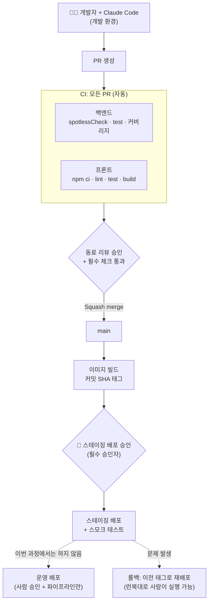
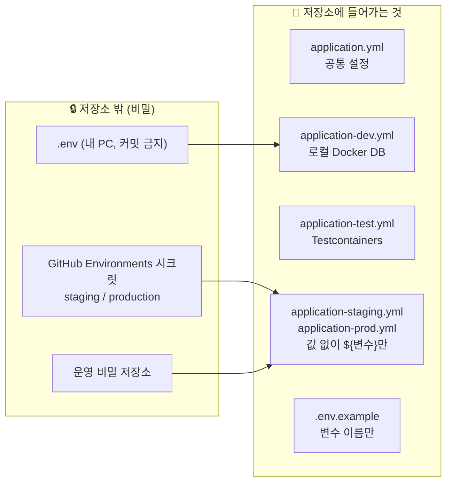
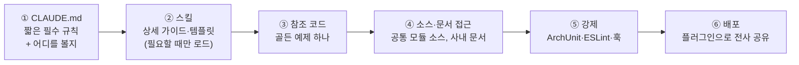
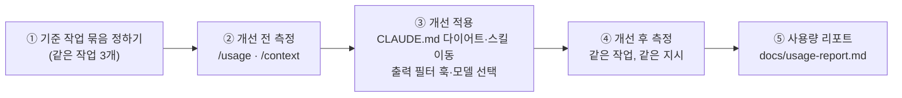
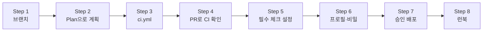

# 7회차: CI/CD·환경 분리 완성·사내 프레임워크·토큰 최적화 (NFR-05, NFR-06)

🧭 ⬅️ 이전: [6회차: 플러그인·아티팩트 — 마이크로프론트엔드 완성과 알림(FR-09)](./session-06-plugins-artifacts-mfe.md) · ➡️ 다음: [8회차: 자동화·Agent SDK·거버넌스 — 성능·보안 점검과 AI 없이 핫픽스 훈련 (NFR-02, NFR-03)](./session-08-automation-sdk-governance.md) · 📚 [전체 커리큘럼](../CURRICULUM.md#-회차별-강의-자료)

> **대상**: 6회차까지 EduHub의 기능(FR-01~09)과 MFE 분리를 진행한 팀
> **시간**: 120분 (강의 약 40% + 따라하기 약 60%)
> **목표**
> 1. EduHub에 **GitHub Actions CI**(백엔드·프론트 빌드·테스트·포맷)를 만들고, `main`에 **필수 상태 체크**를 건다 (NFR-05)
> 2. **스테이징 배포는 사람 승인 후에만** 실행되는 배포 흐름을 만들고, 개발·테스트·스테이징·운영 설정과 비밀 관리를 완성한다 (NFR-06)
> 3. 사람이 그대로 따라 할 수 있는 **런북**(`docs/runbook.md`: 빌드, 배포, 롤백, 수동 핫픽스)을 쓴다 (원칙 ②)
> 4. 가상의 **사내 공통 모듈**(공통 응답, 공통 예외·에러 코드, 사내 인증 필터)을 Claude가 **추측하지 않고 따르게** 만드는 6단계 장치를 적용한다 (모듈 16)
> 5. 고정된 작업 묶음으로 **토큰 사용량을 측정 → 개선 → 비교**하고 팀 **사용량 리포트**를 만든다 (모듈 19)
>
> **관련 모듈**: 16(사내 커스텀 프레임워크 적용), 19(토큰 사용량 최적화) + EduHub CI/CD
> **사전 준비**
> - 6회차 과제 PR이 `main`에 병합되어 있을 것 (MFE 분리, 알림)
> - GitHub 저장소의 **Settings에 접근할 수 있는 권한**(팀에서 한 명 이상, 보통 저장소 관리자)
> - 로컬에서 `cd backend && ./gradlew test`, `cd frontend && npm test`가 통과하는 상태
> - Docker Desktop 실행 (Testcontainers, 이미지 빌드 확인용)

---

## 진행 순서

| 시간 | 내용 | 형식 |
|---|---|---|
| 0:00 – 0:08 | 지난 회차 복습 & 과제 리뷰 | 강의 + 공유 |
| 0:08 – 0:24 | 1. CI/CD 큰 그림과 환경 분리 완성 | 강의 |
| 0:24 – 0:36 | 2. 사내 공통 모듈을 Claude가 따르게 하는 법 | 강의 |
| 0:36 – 0:46 | 3. 토큰 최적화: 측정 → 개선 → 리포트 | 강의 |
| 0:46 – 1:16 | 4. 따라하기 ①: CI, 필수 체크, 승인 배포, 프로필·비밀, 런북 | 실습 |
| 1:16 – 1:24 | ☕ 휴식 | — |
| 1:24 – 1:44 | 5. 따라하기 ②: 사내 공통 모듈 적용과 강제 | 실습 |
| 1:44 – 1:56 | 6. 따라하기 ③: 토큰 사용량 측정과 사용량 리포트 | 실습 |
| 1:56 – 2:00 | 8. 정리, 과제 안내 | 강의 |

> 7장(더 해 보기)은 시간이 남으면 수업 중에, 아니면 과제로 진행합니다.

---

## 지난 회차 복습 & 과제 리뷰

**6회차 핵심 3문장**
1. 마이크로프론트엔드는 **shell과 remote의 계약**(공유 의존성, 노출 모듈)이 핵심이다
2. 반복해서 쓰는 스킬·에이전트·훅은 **플러그인**으로 묶어 팀이 같은 도구로 일한다
3. 진행 현황은 **아티팩트**로 만들어 공유하되, 판단과 승인은 사람이 한다

**과제 리뷰 (팀별 1분)**
- 이번 주 PR 하나: "Claude에게 맡긴 것 / 직접 한 것"
- 주간 회고의 `/usage` 기록: 지난주보다 늘었나 줄었나, 이유는?
- "AI 없이 설명하기": MFE가 실제로 어떻게 로드되는지 화이트보드에 그려 보기

> 💬 **강사 노트:** 오늘은 "만든 것을 **안전하게 자동 검증·배포**하는 날"이라고 소개합니다. 지금까지는 사람이 매번 테스트를 돌렸지만, 오늘부터는 **CI가 기준**이 됩니다. Claude가 만든 코드든 사람이 만든 코드든 같은 기준을 통과해야 `main`에 들어갑니다.

---

# 1. CI/CD 큰 그림과 환경 분리 완성

> 자세한 내용: [빌드·배포 파이프라인 모범 사례](../examples/28-build-deploy-pipeline.md), [개발자의 책임](../examples/27-developer-responsibility.md)

---

## 1-1. EduHub 파이프라인 전체 그림



| 단계 | 자동/수동 | EduHub에서 지킬 것 |
|---|---|---|
| CI | 자동 | 10분 이내. 실패하면 병합 불가 (**필수 상태 체크**) |
| 리뷰·병합 | 사람 | 동료 리뷰 1명 이상, Squash merge |
| 이미지 빌드 | 자동 | **한 번 빌드한 이미지**를 모든 환경에 그대로. 환경마다 다시 빌드하지 않음 |
| 스테이징 배포 | **사람 승인 후 자동** | GitHub Environments의 필수 승인자 |
| 운영 배포 | 사람 승인 + 파이프라인 | 이번 과정에서는 구조만 설계하고 실행하지 않음 |
| 롤백 | 사람이 실행 가능 | 런북의 명령 그대로, 이전 이미지 태그로 재배포 |

---

## 1-2. Claude Code의 역할: 만드는 것은 함께, 승인은 사람이

| 일 | Claude Code | 사람 |
|---|---|---|
| 워크플로우·Dockerfile·배포 스크립트 **작성** | ⭕ Plan 모드로 계획 후 작은 단위로 | 계획 검토, diff 리뷰 |
| CI 실패 **원인 분석** | ⭕ 로그 요약, 수정 제안 | 수정 여부 판단 |
| 저장소 **설정**(보호 규칙, Environments, 시크릿 등록) | ✕ | ⭕ GitHub 화면에서 직접 |
| 스테이징·운영 배포 **승인** | ✕ | ⭕ |
| 운영 비밀 값 다루기 | ✕ (읽지도, 대화에 붙이지도 않음) | ⭕ 비밀 저장소에만 |

> **"파이프라인은 Claude와 함께 만들되, 문은 사람이 연다."** 파이프라인 자체가 운영으로 가는 길이므로 `.github/workflows/` 변경은 일반 코드보다 엄격하게 리뷰합니다.

---

## 1-3. 환경 분리 완성: 프로필과 비밀

2회차에 만든 `dev`, `test` 프로필에 `staging`, `prod`를 더해 완성합니다.



| 프로필 | DB | 비밀 값이 오는 곳 | Claude Code 접근 |
|---|---|---|---|
| `dev` | 로컬 Docker PostgreSQL | 내 PC의 `.env` | ⭕ (단, `.env` 읽기는 deny) |
| `test` | Testcontainers (테스트마다 새 컨테이너) | 필요 없음 | ⭕ |
| `staging` | 스테이징 DB | GitHub `staging` Environment 시크릿 | ✕ |
| `prod` | 운영 DB | 운영 비밀 저장소, GitHub `production` Environment | ✕ |

**규칙**
- `application-staging.yml`, `application-prod.yml`에는 **값을 쓰지 않고** `${DB_URL}`처럼 변수만 쓴다. 기본값도 두지 않는다 (값이 없으면 기동 실패 → 실수로 엉뚱한 DB에 붙는 것을 막는다)
- 시크릿은 **환경별로 분리**: 스테이징 시크릿은 `staging` 환경에, 운영 시크릿은 `production` 환경에만 등록
- 저장소에 비밀이 한 번이라도 커밋되면 **이력에 남는다** → 값을 바꾸는(교체) 것이 먼저, 이력 정리는 그다음

---

## 1-4. 런북: "AI 없이도 배포·롤백할 수 있는가"

1회차 원칙 ②: **긴급 상황에는 직접 수정·빌드·배포할 수 있어야 한다.** 그 근거가 되는 문서가 런북입니다.

| 런북 절 | 내용 | 확인 방법 |
|---|---|---|
| 로컬 빌드 | 백엔드·프론트 빌드와 테스트 명령 | 팀원이 문서만 보고 실행 |
| 배포 | 이미지 태그 확인 → 배포 워크플로우 실행(또는 `scripts/deploy.sh`) → 스모크 테스트 | 스테이징에서 한 번 실행 |
| 롤백 | 이전 태그 찾기 → 그 태그로 재배포 | 스테이징에서 한 번 실행 |
| 수동 핫픽스 | `hotfix/*` 브랜치 → 최소 수정 → 로컬 빌드·테스트 → 긴급 리뷰 → 병합 → 배포 | 8주차 "AI 없이 핫픽스 훈련"에서 사용 |
| 연락처·권한 | 승인자, 시크릿 관리자, 장애 연락 경로 | — |

> 💬 **강사 노트:** 런북 초안은 Claude에게 맡겨도 좋습니다. 단, **런북의 명령을 사람이 한 줄씩 직접 실행해서 확인**하기 전에는 완성이 아닙니다. 다음 주(8주차) 핫픽스 훈련에서 이 런북만 보고 진행합니다.

---

# 2. 사내 공통 모듈을 Claude가 따르게 하는 법

> 자세한 내용: [사내 커스텀 프레임워크 적용](../examples/07-custom-framework.md)

---

## 2-1. 문제: Claude는 우리 회사 코드를 모른다

Claude는 공개된 Spring, React 코드로 학습했습니다. 그래서 사내 공통 모듈이 있어도 **표준 방식으로 쓰거나, 그럴듯한 사내 API를 지어내기도** 합니다.

이번 회차에서는 실습을 위해 저장소 안에 **가상의 사내 공통 모듈 `corp-common`**을 두고 진행합니다.

| 구성 요소 | 사내 규칙 | Claude가 흔히 하는 실수 |
|---|---|---|
| **공통 응답** `ApiResponse<T>` | 모든 API는 `ApiResponse.ok(data)`로 감싸 반환 | DTO를 그대로 반환, `ResponseEntity`를 제각각 사용 |
| **공통 예외** `BizException(ErrorCode)` | 업무 오류는 `ErrorCode` enum + `BizException` | `RuntimeException("full")`, 직접 만든 예외 클래스 |
| **에러 코드** `ErrorCode` | `도메인_의미` 이름, HTTP 상태와 메시지를 함께 정의 | 문자열 메시지 하드코딩, 상태 코드 임의 지정 |
| **사내 인증 필터** `CorpAuthFilter` | 사용자 정보는 `CurrentUser`로만 꺼냄 | 요청 본문의 `userId`를 그대로 믿음 (2회차 2-3 사례 ④) |

```java
// corp-common (가상) — 사내 공통 모듈의 핵심 API
public record ApiResponse<T>(boolean success, T data, ErrorBody error) {
    public static <T> ApiResponse<T> ok(T data) { return new ApiResponse<>(true, data, null); }
    public static ApiResponse<Void> fail(ErrorCode code) {
        return new ApiResponse<>(false, null, new ErrorBody(code.name(), code.message()));
    }
}

public class BizException extends RuntimeException {
    private final ErrorCode code;
    public BizException(ErrorCode code) { super(code.message()); this.code = code; }
    public ErrorCode code() { return code; }
}

public interface ErrorCode {           // 각 도메인이 enum으로 구현
    String name();
    HttpStatus status();
    String message();
}
```

---

## 2-2. 6단계 장치: 알려 주고, 보여 주고, 강제한다



| 단계 | 역할 | 비유 | 오늘 실습 |
|---|---|---|---|
| ① CLAUDE.md | 항상 알아야 할 규칙과 "어디를 보면 되는지" | 신입 온보딩 한 장 | ⭕ |
| ② 스킬 | 상세 사용법, 템플릿 | 업무 매뉴얼 | ⭕ |
| ③ 참조 코드 | "이렇게 만들면 된다"는 모범 구현 | 선배가 만든 예제 | ⭕ |
| ④ 소스·문서 접근 | 존재 여부를 직접 확인 | 사내 위키 검색 | 설명만 |
| ⑤ 강제 | 어기면 테스트·훅이 실패 | 출입 통제 | ⭕ |
| ⑥ 플러그인 | 프레임워크 팀이 전사 배포 | 표준 도구 키트 | 6회차 복습 |

> **CLAUDE.md는 부탁, 테스트와 훅은 강제입니다.** 둘을 함께 써야 Claude가 규칙을 미리 알고, 실수해도 막힙니다. 그리고 강제 장치는 **사람이 만든 코드에도 똑같이** 적용됩니다.

> 💬 **강사 노트:** "왜 CLAUDE.md에 다 쓰지 않나?"라는 질문이 나옵니다. CLAUDE.md는 매 세션 읽히므로 길면 **토큰 비용이 계속 들고 중요한 규칙이 묻힙니다.** 상세 내용은 스킬로 옮기면 필요할 때만 읽힙니다. 3장 토큰 최적화와 이어지는 이야기입니다.

---

# 3. 토큰 최적화: 측정 → 개선 → 리포트

> 자세한 내용: [토큰 사용량 최적화](../examples/08-token-optimization.md), [모델 가이드](../examples/29-models-guide.md)

---

## 3-1. 느낌이 아니라 숫자로

6주 동안 "아낀 방법"을 회고에 적었습니다. 이번 주는 **같은 작업 묶음을 개선 전후로 실행해 숫자로 비교**합니다.



| 측정 도구 | 보는 것 |
|---|---|
| `/context` | 지금 컨텍스트를 무엇이 얼마나 차지하는지 (CLAUDE.md, 도구 결과, 대화) |
| `/usage` (별칭 `/cost`) | 세션 토큰·비용, 프롬프트 캐시 적중률, 요금제 사용량, 스킬·서브에이전트·MCP별 사용 비중 |
| 헤드리스 `--output-format json` | CI에서 실행한 Claude의 사용량 기록 |

> 표시 항목은 버전과 요금제에 따라 다를 수 있습니다. 수업 전에 지금 버전에서 `/usage` 화면을 확인합니다.

---

## 3-2. 개선 수단: 어디를 줄일까

| 줄일 곳 | 수단 | EduHub 적용 |
|---|---|---|
| **매 턴 고정 비용** | CLAUDE.md 200줄 이내, 상세 절차는 스킬로, 영역별 CLAUDE.md | 루트 CLAUDE.md의 API 작성 절차를 `corp-api` 스킬로 이동, `backend/CLAUDE.md` 분리 |
| **도구 결과** (가장 큼) | 위치 지정, 생성물·의존성 읽기 차단, 테스트 출력 필터 훅 | `build/`, `node_modules/`, `generated/` 읽기 deny, `./gradlew test` 출력은 실패 부분만 |
| **재작업** | Plan 모드, 완료 기준, 일찍 멈추기, 간단한 건 직접 | 공통 모듈 적용 작업은 Plan 모드로 범위 합의 |
| **모델 단가** | 작업에 맞는 모델, 서브에이전트 모델 지정, effort 먼저 | 탐색 서브에이전트 `model: haiku`, 구현 `sonnet`, 설계·최종 검토 `opus` |
| **CI 사용량** | 변경 파일 중심, 최대 턴 수 제한, 읽기 전용 도구, 실행 조건 제한 | Claude PR 리뷰는 같은 저장소 PR만, `--max-turns` 지정 |

> 💡 **"요청당"이 아니라 "작업 완료당" 비용으로 판단합니다.** 싼 모델로 바꿨는데 재작업이 두 번 늘면 오히려 비쌉니다. 그래서 리포트에는 사용량과 함께 **품질 지표**(테스트 첫 통과 여부, 리뷰에서 나온 수정 수)도 적습니다.

---

# 4. 따라하기 ①: CI, 필수 체크, 승인 배포, 프로필·비밀, 런북

> **목표**: PR을 올리면 CI가 자동으로 돌고, 실패하면 병합할 수 없으며, 스테이징 배포는 사람이 승인해야만 실행되는 상태를 만듭니다.
> **팀 진행 방식**: 한 명이 화면을 공유하며 진행하고, 저장소 설정(Step 5, 7)은 관리자 권한이 있는 사람이 직접 합니다.



---

## Step 1. 브랜치 만들기

```bash
git switch main
git pull
git switch -c chore/ci-pipeline
```

새 세션(또는 `/clear`)에서 시작합니다. **한 세션 = 한 작업**: CI 작업과 공통 모듈 작업은 세션을 나눕니다.

---

## Step 2. Plan 모드로 파이프라인 계획 받기

권한 모드를 **Plan**으로 바꾸고 지시합니다.

```text
[목표] EduHub에 GitHub Actions CI를 만들어 PR마다 백엔드·프론트를 자동 검증하려고 해 (NFR-05).
[위치] 저장소 루트 .github/workflows/ (아직 없음), backend/build.gradle.kts, frontend/package.json
[범위]
- .github/workflows/ci.yml 하나: pull_request와 main push에서 실행
- backend 잡: Java 21, Gradle 캐시, ./gradlew spotlessCheck test jacocoTestCoverageVerification
  (Testcontainers 사용 테스트 포함. ubuntu 러너의 Docker 사용)
- frontend 잡: Node LTS, npm 캐시, npm ci → npm run lint → npm test -- --ci → npm run build
- 최상단 permissions: contents: read, 같은 브랜치 중복 실행 취소(concurrency)
- 서비스 계층 커버리지 70% 미만이면 실패하도록 JaCoCo 설정
[하지 않는 것] 배포, 이미지 빌드, Claude 자동 리뷰 (다음 단계와 다음 주에 한다)
[완료 기준] 로컬에서 같은 명령(./gradlew spotlessCheck test jacocoTestCoverageVerification, npm ci && npm run lint && npm test -- --ci && npm run build)이 통과
[진행 방식] 만들 파일 목록, 잡 구조, 바꿀 build.gradle.kts 부분만 먼저 보여줘. 외부 액션은 이름과 버전을 표로 정리해줘.
```

**계획을 받으면 이렇게 검토합니다**

- [ ] 외부 액션이 신뢰할 수 있는 것(공식 `actions/*`, `gradle/actions` 등)인가? 버전이 고정되어 있는가?
- [ ] 권한이 `contents: read`로 최소인가?
- [ ] 테스트를 건너뛰거나(`-x test`), 실패를 무시하는(`continue-on-error: true`) 설정이 없는가?
- [ ] 로컬 명령과 CI 명령이 **같은가**? (사람·AI·CI가 같은 기준을 쓴다)

---

## Step 3. 구현: ci.yml과 커버리지 설정

계획에 합의했으면 권한 모드를 **Accept edits**로 바꾸고 `좋아, 계획대로 구현해줘`라고 지시합니다. 결과는 대략 다음 모양입니다.

```yaml
# .github/workflows/ci.yml
name: CI
on:
  pull_request:
  push:
    branches: [main]

permissions:
  contents: read

concurrency:
  group: ci-${{ github.ref }}
  cancel-in-progress: true

jobs:
  backend:
    runs-on: ubuntu-latest
    steps:
      - uses: actions/checkout@v4
      - uses: actions/setup-java@v4
        with: { distribution: temurin, java-version: '21' }
      - uses: gradle/actions/setup-gradle@v4
      - name: Format, test, coverage
        working-directory: backend
        run: ./gradlew spotlessCheck test jacocoTestCoverageVerification

  frontend:
    runs-on: ubuntu-latest
    steps:
      - uses: actions/checkout@v4
      - uses: actions/setup-node@v4
        with: { node-version: 'lts/*', cache: npm, cache-dependency-path: frontend/package-lock.json }
      - name: Lint, test, build
        working-directory: frontend
        run: |
          npm ci
          npm run lint
          npm test -- --ci
          npm run build
```

```kotlin
// backend/build.gradle.kts (발췌) — 서비스 계층 커버리지 70% (NFR-05)
plugins { jacoco }

tasks.jacocoTestCoverageVerification {
    dependsOn(tasks.test)
    violationRules {
        rule {
            element = "CLASS"
            includes = listOf("com.example.eduhub.*.*Service")
            limit { counter = "LINE"; minimum = "0.70".toBigDecimal() }
        }
    }
}
```

**diff 검토 체크리스트**

- [ ] 시크릿을 쓰는 단계가 없는가? (CI에는 아직 필요 없다)
- [ ] `build.gradle.kts`에서 요청하지 않은 의존성·플러그인이 추가되지 않았는가?
- [ ] 커버리지 기준이 **우리가 정한 범위**(서비스 계층)에만 걸려 있는가?

✅ **확인**: 로컬에서 **직접** 실행합니다.

```bash
cd backend && ./gradlew spotlessCheck test jacocoTestCoverageVerification
cd ../frontend && npm ci && npm run lint && npm test -- --ci && npm run build
```

> 💡 커버리지가 70%에 못 미쳐 실패하면, 바로 기준을 낮추지 말고 **어떤 서비스가 부족한지** 확인합니다. 테스트 보강은 Claude에게 맡기기 좋은 반복 작업이지만, **"테스트를 통과시키려고 검증을 약하게 만들지 마"**를 지시에 꼭 넣습니다.

---

## Step 4. PR을 올려 CI가 도는 것 확인

```bash
git add .github/workflows/ci.yml backend/build.gradle.kts
git diff --staged
git commit -m "ci: 백엔드·프론트 CI 워크플로우와 커버리지 기준 추가"
git push -u origin chore/ci-pipeline
```

GitHub에서 PR을 만들고 **Checks** 영역에서 `backend`, `frontend` 잡이 실행되는지 봅니다.

**CI가 실패하면: Claude에게 원인 분석 맡기기**

```text
[목표] CI의 backend 잡이 실패했어. 원인을 찾고 수정 방향만 알려줘.
[위치] 아래 로그(실패 부분만 붙임), .github/workflows/ci.yml
[하지 않는 것] 테스트 건너뛰기, 검증 약화, 코드 수정 (원인 확인 후 내가 결정할게)
[완료 기준] 원인과 관련 파일, 수정 방향을 5줄 이내로

(여기에 로그의 FAILED 부분과 앞뒤 20줄만 붙여넣기)
```

> 💡 CI 로그 전체(수천 줄)를 붙이면 컨텍스트가 순식간에 찹니다. **실패 부분만** 붙입니다 (토큰 습관: 에러는 원문 그대로, 필요한 부분만).

---

## Step 5. `main`에 필수 상태 체크 걸기 (사람이 직접)

CI가 한 번 성공한 뒤에 설정합니다 (체크 이름이 목록에 나타나야 고를 수 있습니다).

1. 저장소 **Settings** → **Branches**(또는 **Rules** → **Rulesets**)
2. `main`에 규칙 추가
   - PR을 거쳐야만 병합 (직접 푸시 금지), 승인 1명 이상
   - **필수 상태 체크**: `backend`, `frontend`
   - 강제 푸시 금지, 브랜치 삭제 금지
3. 저장

> ⚠️ 비공개(private) 저장소에서 보호 규칙·필수 체크를 쓸 수 있는지는 **GitHub 요금제에 따라 다를 수 있습니다** (GitHub 문서 확인 필요). 쓸 수 없으면 팀 규칙으로 "CI 초록색이 아니면 병합하지 않는다"를 정하고, 강사가 교육용 조직 저장소를 제공하는 방법을 씁니다.

✅ **확인**: 일부러 포맷을 어긴 커밋을 올려 `spotlessCheck`가 실패하고 **Merge 버튼이 비활성화**되는지 봅니다. 확인 후 그 커밋은 되돌립니다.

---

## Step 6. 프로필과 비밀 정리 (NFR-06)

같은 브랜치에서 이어서 하지 말고 **커밋 후 `/clear`**하거나 새 브랜치 `chore/env-profiles`로 나눕니다. Plan 모드로 지시합니다.

```text
[목표] 개발·테스트·스테이징·운영 설정을 완성하려고 해 (NFR-06).
[위치] backend/src/main/resources/application*.yml, .env.example, .gitignore
[범위]
- application-staging.yml, application-prod.yml 추가: 접속 정보는 ${DB_URL}, ${DB_USERNAME}, ${DB_PASSWORD} 같은 변수만, 기본값 없음
- 운영·스테이징에서는 Swagger UI 비활성화, 로그 레벨 INFO
- .env.example에 필요한 변수 이름 정리 (값 없이)
- .gitignore에 .env, .env.* (단 .env.example은 제외) 확인
[하지 않는 것] 실제 값 입력, 배포 스크립트
[완료 기준] ./gradlew test 통과, 저장소 전체에서 비밀번호처럼 보이는 문자열 검색 결과 0건
[진행 방식] 바꿀 파일과 내용 요약을 먼저 보여줘
```

`.claude/settings.json`의 deny 규칙도 함께 확인합니다 (3주차에 만든 규칙에 추가).

```json
{
  "permissions": {
    "deny": [
      "Read(./.env)",
      "Read(./.env.*)",
      "Bash(./scripts/deploy.sh prod*)",
      "Edit(./.github/workflows/deploy.yml)"
    ],
    "ask": [
      "Edit(./.github/workflows/**)",
      "Bash(gh workflow run *)"
    ]
  }
}
```

> 💡 `.env.example`은 읽어야 하므로, deny 규칙이 `.env.example`까지 막는지 새 세션에서 `@.env.example`을 참조해 확인합니다. 막힌다면 규칙을 조정하거나 변수 목록을 런북에 둡니다.

**diff 검토 체크리스트**

- [ ] `application-staging.yml`, `application-prod.yml`에 **실제 값이나 기본값**이 없는가?
- [ ] `.env`가 `git status`에 나타나지 않는가?
- [ ] 운영 프로필에서 Swagger UI, 디버그 로그가 꺼져 있는가?

---

## Step 7. 승인 후에만 실행되는 스테이징 배포

### 7-1. GitHub에서 환경 만들기 (사람이 직접)

1. **Settings** → **Environments** → **New environment** → 이름 `staging`
2. **Required reviewers**에 팀원 1~2명 지정
3. 배포 가능한 브랜치를 `main`으로 제한
4. **Environment secrets**에 스테이징 접속 정보 등록 (강사가 제공하는 교육용 값. 운영 값은 절대 쓰지 않음)

> ⚠️ 비공개 저장소에서 Environments의 필수 승인자를 쓸 수 있는지도 요금제에 따라 다를 수 있습니다 (GitHub 문서 확인 필요). 쓸 수 없으면 배포 워크플로우를 **수동 실행(`workflow_dispatch`) 전용**으로 만들고, 실행 권한을 가진 사람이 승인 역할을 합니다.

### 7-2. 배포 워크플로우 작성 (Claude + 리뷰)

새 브랜치 `chore/staging-deploy`에서 Plan 모드로 지시합니다.

```text
[목표] main에 병합되면 백엔드 이미지를 한 번 빌드하고, 사람 승인 후 스테이징에 배포하는 워크플로우를 만들려고 해.
[위치] .github/workflows/deploy.yml (새 파일), backend/Dockerfile (새 파일), scripts/deploy.sh (새 파일)
[범위]
- build-image 잡: backend 멀티 스테이지 Dockerfile, 이미지 태그는 커밋 SHA 앞 12자리, GitHub Container Registry(ghcr.io)에 푸시
- deploy-staging 잡: environment: staging (필수 승인자 설정됨), scripts/deploy.sh staging <태그> 실행 후 스모크 테스트(/api/health)
- workflow_dispatch 입력 image_tag: 롤백할 때 이전 태그로 재배포
- scripts/deploy.sh: 사람이 로컬에서도 같은 명령으로 실행할 수 있게. 환경 이름이 staging이 아니면 즉시 실패
- 권한은 잡별 최소 권한 (packages: write는 build-image에만)
[하지 않는 것] 운영(production) 배포 잡, 운영 시크릿
[완료 기준] 로컬에서 docker build 성공, scripts/deploy.sh에 --dry-run 옵션으로 실행할 명령을 출력
[진행 방식] 계획과 각 잡의 권한 표를 먼저 보여줘
```

**검토 포인트**

| 볼 것 | 이유 |
|---|---|
| `deploy-staging`에 `environment: staging`이 있는가 | 이것이 승인 게이트. 빠지면 병합 즉시 배포된다 |
| 이미지를 환경마다 다시 빌드하지 않는가 | "한 번 빌드, 여러 번 배포" |
| `scripts/deploy.sh`가 운영 환경을 거부하는가 | 실수 방지 |
| 컨테이너를 root가 아닌 사용자로 실행하는가 | 기본 보안 |
| 외부 액션 버전이 고정되어 있는가 | 공급망 보안 |

✅ **확인**: PR 병합 후 **Actions** 탭에서 `deploy-staging` 잡이 **승인 대기(Waiting)** 상태로 멈추는지 봅니다. 지정된 승인자가 **Review deployments**에서 승인하면 실행됩니다.

> 💬 **강사 노트:** 교육 환경에 실제 스테이징 서버가 없으면 `scripts/deploy.sh`는 `--dry-run`으로 명령만 출력하게 두고, **승인 게이트가 동작하는 것**까지 확인합니다. 핵심은 배포 자체보다 "사람의 승인 없이는 아무것도 나가지 않는 구조"입니다.

---

## Step 8. 런북 작성과 직접 실행 확인

```text
[목표] docs/runbook.md를 작성하려고 해. 사람이 AI 없이 그대로 따라 할 수 있어야 해.
[위치] .github/workflows/ci.yml, .github/workflows/deploy.yml, scripts/deploy.sh, backend/, frontend/
[범위] 절: 로컬 빌드·테스트 / 스테이징 배포 / 롤백(이전 태그 찾기 포함) / 수동 핫픽스 절차 / 필요한 권한과 승인자
[하지 않는 것] 실제 시크릿 값, 운영 접속 정보
[완료 기준] 모든 명령은 복사해서 바로 실행할 수 있는 코드 블록, 각 절 끝에 "확인 방법" 한 줄
```

✅ **확인 (팀원 교대)**: Claude를 쓰지 않은 **다른 팀원**이 런북만 보고 다음을 실행합니다.
1. 로컬 빌드·테스트
2. `scripts/deploy.sh staging <태그> --dry-run`
3. 롤백할 이전 태그 찾기

막히는 곳이 있으면 런북을 **직접** 고칩니다. 이것이 1회차 원칙 ②를 매주 점검하는 방법입니다.

---

## 4-9. 자주 겪는 문제

| 증상 | 원인과 해결 |
|---|---|
| CI에서 Testcontainers 테스트 실패 | 러너의 Docker 사용 가능 여부 확인. 로컬 Docker 전용 설정(소켓 경로 등)이 커밋되지 않았는지 확인 |
| `npm ci` 실패 | `package-lock.json`이 커밋되지 않았거나 `package.json`과 어긋남. 로컬에서 `npm install` 후 lock 파일 커밋 |
| 필수 상태 체크 목록에 잡 이름이 없음 | 해당 잡이 한 번도 실행되지 않음. PR로 한 번 실행한 뒤 다시 설정 |
| 커버리지 기준 때문에 계속 실패 | 기준을 낮추기 전에 부족한 클래스 확인. 테스트 보강은 별도 PR로 |
| 배포 잡이 승인 없이 실행됨 | 잡에 `environment: staging`이 빠졌거나 환경에 필수 승인자가 설정되지 않음 |
| ghcr.io 푸시 권한 오류 | 잡의 `permissions`에 `packages: write`가 없음 |
| Claude가 워크플로우 수정 때마다 승인을 묻는다 | 의도한 동작 (`ask` 규칙). 워크플로우 변경은 매번 확인하는 것이 맞다 |

---

## ☕ 휴식 (8분)

---

# 5. 따라하기 ②: 사내 공통 모듈 적용과 강제

> **목표**: `corp-common`을 EduHub 백엔드에 적용하고, Claude가 새 API를 만들 때 **처음부터** 사내 규칙대로 쓰게 만듭니다. 그리고 규칙 위반은 테스트가 잡게 합니다.

---

## Step 1. 공통 모듈 가져오기

강사가 제공하는 `corp-common` 소스를 저장소의 `libs/corp-common/`에 복사하고 Gradle 멀티 모듈로 연결합니다 (실제 회사에서는 사내 Maven 저장소의 의존성으로 가져옵니다).

```bash
git switch main && git pull
git switch -c feature/corp-common
```

```kotlin
// settings.gradle.kts
include("backend", "libs:corp-common")

// backend/build.gradle.kts (발췌)
dependencies {
    implementation(project(":libs:corp-common"))
    testImplementation("com.tngtech.archunit:archunit-junit5:1.3.0")
}
```

> 💡 이 정도 연결은 **직접** 하는 편이 빠릅니다. Gradle 구성을 직접 만져 봐야 빌드가 깨졌을 때도 직접 고칠 수 있습니다.

---

## Step 2. 장치 ① CLAUDE.md에 짧은 필수 규칙

`backend/CLAUDE.md`에 다음을 **추가**합니다 (루트 CLAUDE.md가 아니라 백엔드 전용 파일 → 프론트 작업 때는 읽히지 않아 토큰 절약).

```markdown
## 사내 공통 모듈 corp-common (필수)
- API 응답은 `ApiResponse.ok(data)`로 감싼다. `ResponseEntity`를 직접 쓰지 않는다
- 업무 오류는 도메인별 `ErrorCode` enum + `throw new BizException(ErrorCode.XXX)`
- 현재 사용자는 `CurrentUser`로만 얻는다. 요청 본문의 userId를 믿지 않는다
- 사용법은 `corp-api` 스킬과 `reference/backend/CourseApiReference.java`를 본다
- corp-common에 없는 API를 추측해서 쓰지 않는다. 없으면 질문한다
```

---

## Step 3. 장치 ②③ 스킬과 참조 코드

Claude에게 초안을 맡기고, 내용은 사람이 검토합니다.

```text
[목표] corp-common 사용법을 스킬과 참조 코드로 정리하려고 해.
[위치] libs/corp-common/ (소스를 직접 읽고 확인해), backend/src/main/java/com/example/eduhub/course/
[범위]
- .claude/skills/corp-api/SKILL.md: name, description 머리말 + "언제 무엇을 읽을지" 안내만 짧게
- .claude/skills/corp-api/guides/error-codes.md: ErrorCode 추가 방법, 이름 규칙(도메인_의미), HTTP 상태 선택 기준
- .claude/skills/corp-api/templates/Controller.java.md: ApiResponse·BizException·CurrentUser를 쓰는 컨트롤러 템플릿
- reference/backend/CourseApiReference.java: 과정 조회 API를 사내 규칙대로 만든 골든 예제
[하지 않는 것] 기존 코드 수정 (다음 단계에서 한다)
[완료 기준] 스킬과 예제에 corp-common에 실제로 있는 클래스·메서드만 등장
[진행 방식] 파일 목록과 SKILL.md의 description 문장을 먼저 보여줘
```

```markdown
---
name: corp-api
description: EduHub 백엔드에서 Controller, Service, 예외, 에러 코드를 새로 만들거나 수정할 때 사용한다. 사내 공통 모듈 corp-common의 ApiResponse, BizException, ErrorCode, CurrentUser 사용법과 템플릿을 제공한다.
---

# corp-api 사용 가이드
- 새 API 컨트롤러 → templates/Controller.java.md 를 복사해서 시작
- 업무 오류·에러 코드 추가 → guides/error-codes.md
- 모범 구현 → reference/backend/CourseApiReference.java
```

**검토 포인트**: description이 **언제 쓰는지**를 분명히 말하는가? (Claude는 description을 보고 스킬을 쓸지 정합니다) 예제에 `corp-common`에 **없는 메서드**가 등장하지 않는가?

---

## Step 4. 장치 ⑤ ArchUnit으로 강제

```java
// backend/src/test/java/com/example/eduhub/architecture/CorpRulesTest.java
@AnalyzeClasses(packages = "com.example.eduhub")
class CorpRulesTest {

    @ArchTest
    static final ArchRule controllers_return_api_response =
        methods().that().areDeclaredInClassesThat().areAnnotatedWith(RestController.class)
                 .and().arePublic()
                 .should().haveRawReturnType(ApiResponse.class)
                 .because("모든 API는 ApiResponse로 감싸 반환한다 (corp-common)");

    @ArchTest
    static final ArchRule no_raw_runtime_exception =
        noClasses().that().resideInAPackage("..eduhub..")
                   .should().callConstructor(RuntimeException.class, String.class)
                   .because("업무 오류는 BizException(ErrorCode)를 쓴다");

    @ArchTest
    static final ArchRule controllers_do_not_use_repositories =
        noClasses().that().areAnnotatedWith(RestController.class)
                   .should().dependOnClassesThat().haveSimpleNameEndingWith("Repository")
                   .because("Controller → Service → Repository 계층 규칙");
}
```

> 이 테스트는 **직접 작성하거나**, Claude가 쓴 초안을 한 줄씩 이해하고 확정합니다. 강제 규칙은 팀 전체의 코드를 막으므로 **규칙의 주인은 사람**입니다.

✅ **확인**: `./gradlew test --tests "*CorpRulesTest"`를 실행합니다. 기존 코드가 규칙을 어기고 있으면 **실패 목록**이 나옵니다. 이것이 다음 단계의 작업 목록입니다.

---

## Step 5. 기존 코드 전환과 새 API로 효과 확인

**5-1. 기존 코드 전환** (여러 파일의 반복 작업 → Claude에게 맡기고 리뷰)

```text
[목표] CorpRulesTest가 실패하는 기존 컨트롤러와 예외 처리를 corp-common 규칙으로 전환해줘.
[위치] ./gradlew test --tests "*CorpRulesTest" 실패 목록의 클래스들
[범위] course, enrollment 패키지의 Controller와 Service의 예외 처리
[하지 않는 것] API 경로·요청 형식 변경, 업무 로직 변경, CorpRulesTest 수정
[완료 기준] ./gradlew test 전체 통과 (CorpRulesTest 포함), 프론트 API 클라이언트 재생성 필요 여부 보고
[진행 방식] 클래스별 변경 계획을 먼저 보여줘
```

> ⚠️ 응답 형식이 `ApiResponse`로 바뀌면 **프론트가 받는 JSON 구조도 바뀝니다.** API 클라이언트 재생성과 화면 수정이 필요한지 Claude에게 보고하게 하고, 필요하면 별도 PR로 나눕니다 (PR은 리뷰 가능한 크기로).

**5-2. 새 API로 효과 확인**: `/clear` 후 규칙을 따로 설명하지 않고 지시합니다.

```text
수강 신청 취소 마감이 지난 경우 취소를 막는 기능을 추가해줘.
마감이 지났으면 업무 오류로 응답해야 해. 위치는 enrollment 패키지.
완료 기준: ./gradlew test 통과.
```

**관찰할 점**
- Claude가 `corp-api` 스킬이나 참조 코드를 **스스로 찾아 읽었나?**
- `ErrorCode`에 `ENROLLMENT_CANCEL_DEADLINE_PASSED` 같은 규칙에 맞는 이름을 추가했나?
- 혹시 규칙을 어겼다면 `CorpRulesTest`가 잡았나?

**diff 검토 체크리스트**

- [ ] `corp-common`에 없는 클래스·메서드를 쓰지 않았는가? (지어낸 API는 컴파일 오류가 나지만, 비슷한 이름의 다른 메서드를 잘못 쓸 수 있다)
- [ ] 사용자 정보를 `CurrentUser`에서 얻는가?
- [ ] `CorpRulesTest`나 기준을 **약하게 고치지** 않았는가?

---

## Step 6. (선택) 훅으로 즉시 피드백

수정할 때마다 ArchUnit을 돌려 Claude가 바로 오류를 보고 고치게 할 수 있습니다.

```json
{
  "hooks": {
    "PostToolUse": [
      {
        "matcher": "Edit|Write",
        "hooks": [
          { "type": "command", "command": "bash .claude/hooks/corp-rules.sh" }
        ]
      }
    ]
  }
}
```

```bash
# .claude/hooks/corp-rules.sh
#!/usr/bin/env bash
FILE=$(jq -r '.tool_input.file_path // empty')
[[ "$FILE" == *"/backend/src/main/java/"* ]] || exit 0

if ! (cd backend && ./gradlew test --tests "*CorpRulesTest" -q > /tmp/corp-rules.log 2>&1); then
  grep -E "Rule '|was violated|because" /tmp/corp-rules.log | head -20 >&2
  exit 2   # 위반 내용을 Claude에게 전달 (PostToolUse에서는 이미 수정된 뒤이므로 "고치라"는 피드백 역할)
fi
exit 0
```

> 💡 훅에서 Gradle을 매번 돌리면 **느려집니다.** 출력은 위반 줄만 넘겨 토큰을 아끼고, 너무 느리면 훅 대신 "작업 끝에 `./gradlew test` 실행"을 완료 기준으로 두는 편이 낫습니다. PostToolUse 훅의 종료 코드 2가 어떻게 처리되는지는 [훅 예제](../examples/03-settings-skills-agents-hooks.md#모듈-12-훅)와 공식 문서로 확인합니다.

---

## 5-7. 커밋과 PR

```bash
git add libs settings.gradle.kts backend .claude/skills reference
git status                     # .env, build/ 가 없는지 확인
git commit -m "feat(common): corp-common 공통 모듈 적용과 아키텍처 규칙 테스트 추가"
git push -u origin feature/corp-common
```

PR 본문의 "Claude에게 맡긴 것 / 직접 한 것"에 **어떤 장치(CLAUDE.md, 스킬, 참조 코드, ArchUnit, 훅)가 효과가 있었는지** 한 줄씩 적습니다.

---

# 6. 따라하기 ③: 토큰 사용량 측정과 사용량 리포트

> **목표**: 같은 작업 묶음을 개선 전후로 실행해 숫자로 비교하고, `docs/usage-report.md`를 만듭니다.
> 시간이 부족하면 6-1, 6-2를 수업 중에 하고 6-3, 6-4는 과제로 합니다.

---

## 6-1. 기준 작업 묶음 정하기

팀이 같은 작업을 같은 지시로 실행해야 비교가 됩니다. 각 작업은 **새 세션(`/clear`) + 같은 모델·effort**로 시작합니다.

| ID | 작업 | 지시 (그대로 복사) |
|---|---|---|
| T1 | 코드 설명 | `수강 신청이 들어오면 정원 확인과 대기자 등록이 어떤 순서로 처리되는지 설명해줘` |
| T2 | 작은 기능 | `과정 목록 API에 category 필터를 추가해줘. 완료 기준: ./gradlew test 통과` |
| T3 | 실패 테스트 고치기 | (강사가 제공하는 깨진 테스트 브랜치에서) `./gradlew test 실패를 고쳐줘` |

> 기준 작업은 매번 원래 상태로 되돌린 뒤(`git restore`, `git switch`) 실행합니다.

---

## 6-2. 개선 전 측정

각 작업이 끝나면 다음을 기록합니다.

| 작업 | `/context` 사용량 | `/usage` 세션 토큰·비용 | 캐시 적중률 | 걸린 시간 | 테스트 첫 통과 | 재지시 횟수 |
|---|---|---|---|---|---|---|
| T1 | | | | | — | |
| T2 | | | | | | |
| T3 | | | | | | |

---

## 6-3. 개선 적용

| 개선 | 방법 | 기대 효과 |
|---|---|---|
| CLAUDE.md 다이어트 | 루트 CLAUDE.md의 상세 절차를 스킬로 옮겨 200줄 이내로. `/context`에서 CLAUDE.md 비중 확인 | 매 턴 고정 비용 감소 |
| 읽기 차단 | `build/`, `node_modules/`, `dist/`, 생성 클라이언트 읽기 deny | 넓은 탐색 비용 감소 |
| 테스트 출력 필터 훅 | `./gradlew test` 출력은 실패 부분만 ([토큰 최적화 6장의 훅 예시](../examples/08-token-optimization.md#6-공식-문서-기준-보강-2026년-10월-확인)) | 도구 결과 감소 |
| 탐색 서브에이전트 | `.claude/agents/code-explorer.md`, `model: haiku`, 읽기 도구만 | T1 같은 설명 작업 비용 감소 |
| 지시 개선 | T1·T2에 파일 위치(`@`) 추가 | 탐색 감소 |

```markdown
---
name: code-explorer
description: 코드 위치 찾기, 호출 흐름 설명처럼 읽기만 하는 탐색 작업에 사용한다. 결과는 관련 파일 경로와 요약만 반환한다.
tools: Read, Grep, Glob
model: haiku
---

너는 EduHub 코드 탐색 담당이다. 파일을 수정하지 않는다.
결과는 "관련 파일 경로 목록 + 10줄 이내 요약"으로만 돌려준다.
```

> ⚠️ 개선은 **하나씩** 적용하고 측정해야 무엇이 효과였는지 알 수 있습니다. 시간이 없으면 "CLAUDE.md 다이어트 + 위치 지정" 두 가지만 먼저 합니다.

---

## 6-4. 개선 후 측정과 사용량 리포트

같은 작업을 같은 지시로 다시 실행하고, Claude에게 리포트 초안을 맡깁니다.

```text
[목표] 토큰 최적화 전후 비교 리포트를 docs/usage-report.md로 만들어줘.
[위치] 아래 측정표 두 개 (개선 전, 개선 후)
[범위] 요약 3줄, 작업별 전후 비교 표, 개선 수단별 효과 추정, 품질 지표(테스트 첫 통과, 재지시) 변화, 다음 주에 시도할 것 2가지
[하지 않는 것] 측정하지 않은 수치를 추정해서 채우기 (빈 칸은 빈 칸으로)
[완료 기준] 마크다운 표로, 숫자는 측정표의 값만 사용

(측정표 붙여넣기)
```

**리포트 검토 포인트**
- 사용량이 줄었는데 **품질 지표가 나빠지지 않았는가?** (재지시 증가, 테스트 첫 통과 실패)
- 개선 효과를 **과장**하지 않았는가? (작업 3개, 1회 측정은 오차가 크다)
- 팀 규칙으로 남길 것은? → CLAUDE.md나 팀 위키에 한 줄로

> 💡 리포트를 6회차에 배운 **아티팩트**로 만들어 팀에 공유해도 좋습니다. 단, 사용량 수치에 개인을 평가하는 의미를 붙이지 않습니다. 목적은 **팀의 습관 개선**입니다.

---

# 7. 더 해 보기 (시간이 남으면 수업 중, 아니면 과제)

---

## 7-1. CI 실패 원인 자동 분석 (보조)

PR의 CI가 실패하면 Claude가 로그를 읽고 원인을 **PR 코멘트로만** 남기는 잡을 추가합니다. 설계 포인트는 [빌드·배포 파이프라인 4-2](../examples/28-build-deploy-pipeline.md#4-2-ci-실패-원인-자동-분석)를 봅니다.

- 읽기 전용 도구만 허용 (`--allowedTools "Read" "Grep" "Glob"`), 최대 턴 수 제한 (`--max-turns`)
- 외부 포크 PR에서는 실행하지 않음, API 키는 저장소 시크릿에만
- 결과는 코멘트로만, **수정·푸시는 하지 않음**
- 실행마다 사용량을 기록해 사용량 리포트에 CI 항목으로 추가

> 다음 주(8주차) 헤드리스·CI 자동 리뷰에서 본격적으로 다룹니다.

---

## 7-2. 프론트엔드도 사내 규칙으로

가상의 사내 HTTP 래퍼(예: `corpHttp`)를 정하고, ESLint `no-restricted-imports`로 `axios` 직접 import를 막아 봅니다 ([사내 커스텀 프레임워크 ⑤](../examples/07-custom-framework.md)). 생성된 API 클라이언트는 예외로 둡니다.

---

## 7-3. 운영 배포 설계만 해 보기

실행하지 않고 **설계 문서만** 씁니다: `production` 환경의 필수 승인자, 배포 가능 시간대, 운영 시크릿 관리 주체, 롤백 기준(스모크 테스트 실패 시), DB 마이그레이션의 하위 호환 원칙(expand → contract). Claude에게 "질문을 먼저 해 줘"라고 하면 빠뜨린 결정 사항을 찾는 데 도움이 됩니다.

---

# 8. 정리

---

## 8-1. 오늘의 핵심

1. **CI가 기준이다**: Claude가 쓴 코드든 사람이 쓴 코드든 같은 CI(포맷·테스트·커버리지)를 통과해야 `main`에 들어간다 (NFR-05)
2. **파이프라인은 함께 만들되, 문은 사람이 연다**: 저장소 설정과 배포 승인은 사람, 워크플로우 변경은 엄격하게 리뷰
3. **환경 분리 완성**: 스테이징·운영 설정에는 변수만, 비밀은 환경별 저장소에, Claude는 개발·테스트까지 (NFR-06)
4. **런북은 사람이 직접 실행해 봐야 완성**: AI 없이도 빌드·배포·롤백·핫픽스 (원칙 ②)
5. **사내 규칙은 알려 주고(CLAUDE.md), 보여 주고(스킬·참조 코드), 강제한다(ArchUnit·훅)**. 강제 규칙의 주인은 사람
6. **토큰은 숫자로 관리**: 같은 작업 묶음으로 전후 비교, 품질 지표와 함께, "작업 완료당 비용"으로 판단

---

## 8-2. 확인 퀴즈

1. 필수 상태 체크를 CI가 **한 번 성공한 뒤에** 설정하는 이유는?
2. 배포 워크플로우에서 사람 승인 게이트 역할을 하는 설정은 무엇이고, 빠지면 어떻게 되나?
3. `application-prod.yml`에 접속 정보의 **기본값**도 두지 않는 이유는?
4. 런북이 "완성"되었다고 말할 수 있는 조건은?
5. 사내 공통 모듈 규칙을 CLAUDE.md에 상세히 쓰지 않고 스킬로 옮기는 이유 두 가지는?
6. CLAUDE.md의 "`ApiResponse`로 감싼다"와 ArchUnit 테스트의 차이는? 둘을 함께 쓰는 이유는?
7. 토큰 최적화 전후를 비교할 때 사용량 외에 반드시 함께 봐야 하는 것은? 그 이유는?
8. CI에서 Claude를 실행할 때 비용과 위험을 통제하는 방법 세 가지는?

<details>
<summary>정답 보기</summary>

1. 체크(잡) 이름은 한 번 이상 실행된 뒤에야 설정 화면의 목록에 나타나기 때문
2. 배포 잡의 `environment: staging`(필수 승인자가 지정된 GitHub Environment). 빠지면 `main`에 병합되는 즉시 승인 없이 배포된다
3. 값이 없으면 기동이 실패해 실수를 바로 알 수 있다. 기본값이 있으면 엉뚱한 DB(예: 로컬 값)에 조용히 붙을 수 있고, 기본값 자체가 비밀 노출이 될 수 있다
4. Claude를 쓰지 않은 다른 팀원이 런북만 보고 빌드·(드라이런)배포·롤백 태그 찾기를 실제로 실행해 성공했을 때
5. CLAUDE.md는 매 세션 읽히므로 길면 토큰 비용이 계속 들고 중요한 규칙이 묻힌다. 스킬은 평소 이름과 설명만 로드되고 필요할 때만 본문을 읽는다
6. CLAUDE.md는 강제력이 없는 지침(부탁), ArchUnit은 어기면 테스트가 실패하는 강제. CLAUDE.md로 미리 알려 실수를 줄이고, 테스트로 실수를 확실히 잡는다. 테스트는 사람이 쓴 코드에도 적용된다
7. 품질 지표(테스트 첫 통과, 재지시 횟수, 리뷰 수정 수). 사용량이 줄어도 재작업이 늘면 작업 완료당 비용은 오히려 커지기 때문
8. 읽기 전용 도구만 허용, 최대 턴 수 제한, 외부 포크 PR 제외·실행 조건 제한, 결과는 코멘트로만(수정·푸시 금지), 실행별 사용량 기록 중 세 가지

</details>

---

## 8-3. 과제 (다음 회차 전까지)

- [ ] 따라하기 ①의 PR 3개(CI, 프로필·비밀, 스테이징 배포) 병합, `main` 필수 체크 동작 확인
- [ ] `docs/runbook.md`를 **Claude를 쓰지 않은 팀원**이 실행해 보고 고친 내용을 PR로
- [ ] `corp-common` 적용 PR 병합, `CorpRulesTest` 통과
- [ ] 6장 측정을 끝내고 `docs/usage-report.md` 완성 (팀 채널에 요약 3줄 공유)
- [ ] 주간 회고: Claude에게 맡긴 것 / 직접 한 것 / `/usage` 기록 / 이번 주 "AI 없이 설명하기" 주제(배포 흐름)
- [ ] (선택) 7장 더 해 보기 중 하나

## 8-4. 다음 회차 예고

**8주차: 성능·보안 점검, AI 없이 핫픽스 훈련, 헤드리스·CI 자동화, 거버넌스 (모듈 17, 18, 20)**
- 과정 목록 API 성능 개선 (NFR-02: N+1 제거, 응답 300ms)
- 보안 점검 (NFR-03: 본인 신청만 취소, 비밀 검사)
- **오늘 만든 런북만 보고 "AI 없이 핫픽스" 훈련**
- 헤드리스 모드(`claude -p`)와 CI 자동 리뷰, Agent SDK, 팀 거버넌스

**미리 읽어 오면 좋은 자료**
- [개발자의 책임 — 원칙 2 긴급 핫픽스](../examples/27-developer-responsibility.md#원칙-2-긴급-상황에서는-직접-수정빌드배포할-수-있어야-한다)
- [자동화와 캡스톤](../examples/05-automation-and-capstone.md)
- [빌드·배포 파이프라인 — 파이프라인 안에서 Claude 활용하기](../examples/28-build-deploy-pipeline.md#4-파이프라인-안에서-claude-활용하기)

---

## 참고 자료

- 교육 저장소: [2회차 자료(EduHub 요구사항·7주 계획·Git 작업 방식)](./session-02-hands-on-kickoff.md), [1회차 자료](./session-01-introduction.md), [빌드·배포 파이프라인](../examples/28-build-deploy-pipeline.md), [개발자의 책임](../examples/27-developer-responsibility.md), [사내 커스텀 프레임워크 적용](../examples/07-custom-framework.md), [토큰 사용량 최적화](../examples/08-token-optimization.md), [모델 가이드](../examples/29-models-guide.md), [GitHub 연결과 버전관리](../examples/06-github-version-control.md), [설정·스킬·에이전트·훅 예제](../examples/03-settings-skills-agents-hooks.md), [권한](../examples/23-permissions.md)
- Claude Code 공식 문서: Manage costs effectively, Hooks, Skills, Subagents, Settings — https://code.claude.com/docs
- GitHub 문서: Actions 워크플로우, Environments(배포 보호 규칙), 브랜치 보호 규칙·Rulesets (요금제별 지원 범위 확인)
