# 7회차: CI/CD·환경 분리 완성·사내 프레임워크·토큰 최적화 (NFR-05, NFR-06)

🧭 ⬅️ 이전: [6회차: 플러그인·아티팩트 — 마이크로프론트엔드 완성과 알림(FR-09)](./session-06-plugins-artifacts-mfe.md) · ➡️ 다음: [8회차: 자동화·Agent SDK·거버넌스 — 성능·보안 점검과 AI 없이 핫픽스 훈련 (NFR-02, NFR-03)](./session-08-automation-sdk-governance.md) · 📚 [전체 커리큘럼](../CURRICULUM.md#-회차별-강의-자료)

> **대상**: 6회차까지 EduHub의 기능(FR-01~09)과 MFE 분리를 진행한 팀
> **시간**: 120분 (강의 약 40% + 따라하기 약 60%)
> **목표**
> 1. EduHub에 **GitHub Actions CI**(백엔드·프론트 빌드·테스트·포맷)를 만들고, `main`에 **필수 상태 체크**를 건다 (NFR-05)
> 2. **스테이징 배포는 사람 승인 후에만** 실행되는 배포 흐름을 만들고, 개발·테스트·스테이징·운영 설정과 비밀 관리를 완성한다 (NFR-06)
> 3. 사람이 그대로 따라 할 수 있는 **런북**(`docs/runbook.md`: 빌드, 배포, 롤백, 수동 핫픽스)을 쓴다 (원칙 ②)
> 4. 가상의 **사내 공통 모듈**(공통 응답, 공통 예외·에러 코드, 사내 인증 필터)을 Claude가 **추측하지 않고 따르게** 만드는 6단계 장치를 적용한다 (모듈 16)
> 5. 고정된 작업 묶음으로 **토큰 사용량을 측정 → 개선 → 비교**하고 팀 **사용량 리포트**를 만든다 (모듈 19)
>
> **관련 모듈**: 16(사내 커스텀 프레임워크 적용), 19(토큰 사용량 최적화) + EduHub CI/CD
> **사전 준비**
> - 6회차 과제 PR이 `main`에 병합되어 있을 것 (MFE 분리, 알림, **한 주소 배포 구성**)
> - **스테이징 PC**(팀에 한 대, 수업 중 켜 둘 Windows PC): JDK 21, Git for Windows, 스테이징 DB(이 PC의 PostgreSQL 또는 강사가 제공하는 교육용 DB). 백엔드(7-2)와 화면(7-3, [6회차 Step 4](./session-06-plugins-artifacts-mfe.md#step-4-한-주소로-배포하기-운영-구성과-실습-구성)의 구성)의 자동 배포가 이 PC에서 실행됩니다
> - GitHub 저장소의 **Settings에 접근할 수 있는 권한**(팀에서 한 명 이상, 보통 저장소 관리자)
> - 로컬에서 `cd backend && ./gradlew test`, `cd frontend && npm test`가 통과하는 상태
> - (Testcontainers를 쓰는 팀) 로컬에 Docker Desktop. 스테이징 배포에는 Docker를 쓰지 않습니다
> 🖥️ **슬라이드 덱(42장, 발표자 노트 포함)**: https://claude.ai/artifact/LvvMiWcYjq4uLrkB72hBEM — 처음에는 만든 사람만 볼 수 있으며, 다른 사람에게 보여주려면 덱의 공유 메뉴에서 공유해야 합니다. PowerPoint(.pptx)·PDF로 내려받을 수 있습니다.

---

## 진행 순서

| 시간 | 내용 | 형식 |
|---|---|---|
| 0:00 – 0:08 | 지난 회차 복습 & 과제 리뷰 | 강의 + 공유 |
| 0:08 – 0:24 | 1. CI/CD 큰 그림(빌드 파이프라인, GitHub Actions vs Jenkins)과 환경 분리 완성 | 강의 |
| 0:24 – 0:36 | 2. 사내 공통 모듈을 Claude가 따르게 하는 법 | 강의 |
| 0:36 – 0:46 | 3. 토큰 최적화: 측정 → 개선 → 리포트 | 강의 |
| 0:46 – 1:16 | 4. 따라하기 ①: CI, 필수 체크, 승인 배포, 프로필·비밀, 런북 | 실습 |
| 1:16 – 1:24 | ☕ 휴식 | — |
| 1:24 – 1:44 | 5. 따라하기 ②: 사내 공통 모듈 적용과 강제 | 실습 |
| 1:44 – 1:56 | 6. 따라하기 ③: 토큰 사용량 측정과 사용량 리포트 | 실습 |
| 1:56 – 2:00 | 8. 정리, 과제 안내 | 강의 |

> 7장(더 해 보기)은 시간이 남으면 수업 중에, 아니면 과제로 진행합니다.
>
> ⏱ 따라하기 ①의 **7-3(프론트 자동 배포)**은 시간이 모자라면 강사가 워크플로우 구조와 승인 화면을 시연하고, 러너 설치와 D1~D3 확인은 과제로 합니다.

---

## 지난 회차 복습 & 과제 리뷰

**6회차 핵심 3문장**
1. 마이크로프론트엔드는 **shell과 remote의 계약**(공유 의존성, 노출 모듈)이 핵심이다
2. 반복해서 쓰는 스킬·에이전트·훅은 **플러그인**으로 묶어 팀이 같은 도구로 일한다
3. 진행 현황은 **아티팩트**로 만들어 공유하되, 판단과 승인은 사람이 한다

**과제 리뷰 (팀별 1분)**
- 이번 주 PR 하나: "Claude에게 맡긴 것 / 직접 한 것"
- 주간 회고의 `/usage` 기록: 지난주보다 늘었나 줄었나, 이유는?
- "AI 없이 설명하기": MFE가 실제로 어떻게 로드되는지 화이트보드에 그려 보기

> 💬 **강사 노트:** 오늘은 "만든 것을 **안전하게 자동 검증·배포**하는 날"이라고 소개합니다. 지금까지는 사람이 매번 테스트를 돌렸지만, 오늘부터는 **CI가 기준**이 됩니다. Claude가 만든 코드든 사람이 만든 코드든 같은 기준을 통과해야 `main`에 들어갑니다.

---

# 1. CI/CD 큰 그림과 환경 분리 완성

> 자세한 내용: [빌드·배포 파이프라인 모범 사례](../examples/28-build-deploy-pipeline.md), [개발자의 책임](../examples/27-developer-responsibility.md)

---

## 1-0. 개념 먼저: 빌드 파이프라인과 그것을 돌리는 도구

### ① 빌드 파이프라인이란

**빌드 파이프라인**은 코드가 바뀌었을 때 **정해진 단계를 정해진 순서대로 자동으로 거쳐** "배포해도 되는 결과물"을 만들고 배포까지 이어 주는 흐름입니다. 사람이 매번 손으로 빌드·테스트·복사하던 일을 **누가 해도, 언제 해도 똑같이** 되게 만드는 것이 목적입니다.

| 용어 | 뜻 | EduHub |
|---|---|---|
| **CI** (Continuous Integration, 지속적 통합) | 코드를 합칠 때마다(PR) 자동으로 빌드·테스트해서 **깨진 코드가 `main`에 들어가지 못하게** 한다 | 모든 PR (필수 상태 체크) |
| **CD** (Continuous Delivery, 지속적 전달) | `main`의 코드를 **언제든 배포할 수 있는 결과물**로 만들어 두고, 배포는 **사람이 승인**하면 자동으로 | ⭐ 스테이징 배포 (사람 승인 후 자동) |
| CD (Continuous Deployment, 지속적 배포) | 테스트를 통과하면 **승인 없이** 운영까지 자동 반영 | 쓰지 않음 |

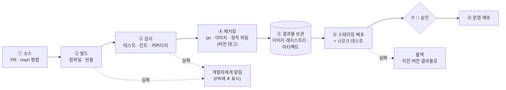

| 단계 | 하는 일 | 실패하면 |
|---|---|---|
| ①~③ 소스·빌드·검사 (**CI**) | 받은 코드를 깨끗한 환경에서 처음부터 빌드하고 테스트 | PR에 ✗, **병합 불가**. 빨리 알려 줄수록 고치기 싸다 (10분 이내 목표) |
| ④~⑤ 패키징·보관 | 배포할 결과물을 **한 번만** 만들어 버전(커밋 SHA)을 붙여 보관 | 결과물이 없으니 배포 단계가 시작되지 않음 |
| ⑥ 스테이징 배포 | 운영과 비슷한 환경에 **같은 결과물**을 배포하고 스모크 테스트 | 운영에 가기 전에 멈춤 → 이전 결과물로 롤백 |
| ⑦~⑧ 승인·운영 배포 (**CD**) | 사람이 확인하고 승인하면 같은 결과물을 운영에 | 런북대로 롤백 (1-4) |

**좋은 파이프라인의 원칙** (자세한 내용은 [모범 사례](../examples/28-build-deploy-pipeline.md))
- **한 번 빌드, 여러 번 배포**: 스테이징에서 확인한 바로 그 결과물이 운영으로 간다. 환경마다 다시 빌드하면 "스테이징에서는 됐는데"가 생긴다
- **빠른 피드백**: 오래 걸리는 검사는 뒤로, 자주 깨지는 검사는 앞으로
- **파이프라인도 코드**: 설정 파일을 저장소에 두고 PR로 리뷰한다. 누가 언제 무엇을 바꿨는지 남는다
- **문은 사람이 연다**: 운영으로 가는 승인, 비밀 값, 저장소 보호 규칙은 사람이 관리한다

### ② 파이프라인을 돌리는 도구: GitHub Actions와 Jenkins

위 단계 자체는 도구와 상관없습니다. **CI/CD 도구**는 이 단계들을 정의한 파일을 읽어 **언제(트리거), 어디서(실행 환경), 무엇을(단계), 누구 승인으로** 실행할지 관리하는 역할을 합니다.

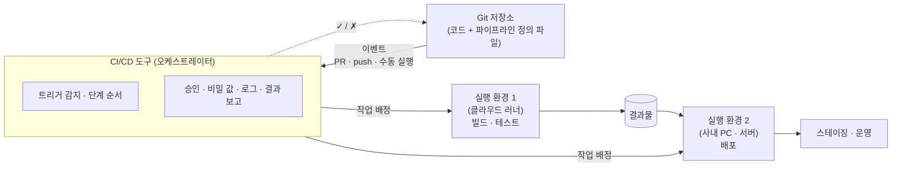

대표적인 도구가 **GitHub Actions**와 **Jenkins**입니다 (그 밖에 GitLab CI/CD, Azure Pipelines 등도 같은 역할). 먼저 각각이 무엇인지 봅니다.

**GitHub Actions란**

GitHub에 **들어 있는** CI/CD 기능입니다. 따로 설치할 것 없이 저장소에 `.github/workflows/` 폴더를 만들고 YAML 파일을 넣으면, GitHub가 그 파일을 읽어 정해진 때에 실행합니다. 결과는 PR 화면의 Checks와 Actions 탭에 바로 나옵니다.

| 용어 | 뜻 |
|---|---|
| **workflow** (워크플로우) | `.github/workflows/*.yml` 파일 하나 = 파이프라인 하나 |
| **trigger** (`on:`) | 언제 실행할지: PR, `main` push, 수동 실행(`workflow_dispatch`), 일정 등 |
| **job** (잡) | 한 러너에서 실행되는 작업 묶음. 여러 job은 기본적으로 **동시에**, `needs:`로 순서를 정한다 |
| **step** (스텝) | job 안의 한 단계. 명령(`run:`) 또는 action(`uses:`) |
| **action** (액션) | 남이 만들어 둔 재사용 단계 (예: `actions/checkout` = 코드 받기). Marketplace에서 찾는다 |
| **runner** (러너) | job을 실제로 실행하는 컴퓨터. GitHub가 주는 클라우드 러너(`ubuntu-latest` 등) 또는 우리 PC·서버에 설치한 **self-hosted runner** |

```yaml
# .github/workflows/ci.yml — 가장 작은 워크플로우 예
name: CI
on:
  pull_request:                 # 트리거: PR이 열리거나 커밋이 추가되면
jobs:
  backend:                      # job 하나 = 러너 한 대에서 실행
    runs-on: ubuntu-latest      # GitHub가 준비한 클라우드 러너
    steps:
      - uses: actions/checkout@v4          # action: 남이 만든 단계를 가져다 씀
      - uses: actions/setup-java@v4
        with: { distribution: temurin, java-version: "21" }
      - run: ./gradlew test                # run: 명령 실행
        working-directory: backend
```

위 예는 GitHub가 준비한 **클라우드 러너**(`ubuntu-latest`)에서 돕니다. 그런데 테스트나 배포에 **사내망 안의 자원**(사내 DB, 사내 패키지 저장소, 배포할 PC·서버)이 필요하면, 인터넷에 있는 클라우드 러너는 거기에 닿지 못합니다. 이때는 사내 PC·서버에 **self-hosted runner**를 설치하고 `runs-on`으로 그 러너를 고릅니다.

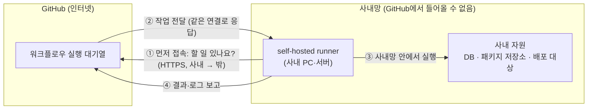

```yaml
# .github/workflows/ci.yml — GitHub에서 접속할 수 없는 사내망에서 실행할 때 (self-hosted runner)
name: CI
on:
  pull_request:
jobs:
  backend:
    # 사내 PC·서버에 설치한 러너에서 실행. 러너가 GitHub에 먼저 접속해 일을 받아 오므로
    # GitHub → 사내로 들어오는 포트는 필요 없다 (사내 → github.com HTTPS만 열려 있으면 된다)
    runs-on: [self-hosted, windows, eduhub-ci]   # 러너를 설치할 때 붙인 이름표
    steps:
      - uses: actions/checkout@v4                # 코드 받기 (러너가 GitHub에서 내려받음)
      # setup-java는 인터넷에서 JDK를 내려받는다. 사내망에서 막히면 러너 PC에 JDK 21을 미리 설치하고 이 단계를 뺀다
      - run: java -version                       # 미리 설치한 JDK 확인
      - run: .\gradlew.bat test                  # Windows 러너: gradlew.bat (기본 셸은 PowerShell)
        working-directory: backend
```

| | 클라우드 러너 (`ubuntu-latest`) | self-hosted runner |
|---|---|---|
| 어디서 도나 | GitHub가 준비한 인터넷의 가상 머신 (작업마다 새로) | **우리가 설치한** 사내 PC·서버 (계속 같은 컴퓨터) |
| 사내 자원 접근 | ✕ | ⭕ |
| 필요한 네트워크 | — | 사내 → `github.com` 방향 HTTPS만 (**들어오는 포트 불필요**) |
| 도구 준비 | `setup-java` 등이 매번 내려받음 | 인터넷이 막혀 있으면 JDK·Node 등을 **러너 PC에 미리 설치** |
| 관리 | GitHub | 우리 팀 (러너 업데이트, 작업 폴더 정리, 계정 권한) |

> ⚠️ self-hosted runner는 **비공개 저장소에서만** 씁니다 (공개 저장소에서는 누구나 PR로 우리 PC에서 코드를 실행시킬 수 있다). 사내 프록시가 있으면 러너에 프록시를 설정해야 하고, `actions/checkout` 같은 action도 러너가 GitHub에서 내려받으므로 `github.com` 접속이 막혀 있으면 동작하지 않습니다. actionlint를 쓰면 `.github/actionlint.yaml`에 이름표(`eduhub-ci`)를 등록합니다. 실제 러너 설치는 [7-1](#7-1-github-환경과-스테이징-pc-준비-사람이-직접), 배포 예는 7-2(백엔드)와 7-3(프론트)에서 합니다.

**Jenkins란**

**직접 설치해서 운영하는** 오픈소스 자동화 서버입니다 (Java로 만들어진, 오래되고 널리 쓰이는 CI/CD 도구). 회사 서버에 Jenkins를 띄우고, 웹 화면에서 저장소를 연결하면 저장소의 `Jenkinsfile`을 읽어 실행합니다. GitHub뿐 아니라 GitLab, Bitbucket, 사내 Git 등 어떤 저장소와도 쓸 수 있고, 수천 개의 **플러그인**으로 기능을 넓힙니다.

| 용어 | 뜻 |
|---|---|
| **controller** (컨트롤러) | Jenkins 본체 서버. 작업 예약, 화면, 설정, 결과 보관 |
| **agent** (에이전트) | 실제 빌드를 실행하는 컴퓨터. 레이블(예: `eduhub-staging`)로 골라 쓴다 (Actions의 러너에 해당) |
| **pipeline / Jenkinsfile** | 파이프라인 정의. 저장소의 `Jenkinsfile`에 Groovy 기반 문법으로 쓴다 |
| **stage / step** | 파이프라인의 단계(stage)와 그 안의 명령(step) (Actions의 job·step에 해당) |
| **plugin** (플러그인) | Git 연동, 승인, 알림, 비밀 값 관리 등 대부분의 기능이 플러그인 |

```groovy
// Jenkinsfile — 위 GitHub Actions 예와 같은 일
pipeline {
  agent { label 'linux' }                 // 이 레이블이 붙은 에이전트에서 실행
  stages {
    stage('Checkout') { steps { checkout scm } }          // 저장소 코드 받기
    stage('Backend test') {
      steps { dir('backend') { sh './gradlew test' } }     // 명령 실행
    }
  }
}
```

> ✅ 위 GitHub Actions 예 두 개(클라우드 러너, self-hosted runner)는 actionlint 검사를 통과했습니다 (실제 러너에서 실행해 보지는 않았습니다). ⚠️ Jenkinsfile 예는 Declarative Pipeline 문법으로 쓴 개념 예시이며, 교재 환경에서 Jenkins로 실행해 보지는 않았습니다 (실행하려면 Jenkins 서버와, 프로젝트의 JDK 21이 설치된 에이전트가 필요).

두 도구를 나란히 놓으면 다음과 같습니다.

| 비교 | GitHub Actions | Jenkins |
|---|---|---|
| 형태 | GitHub에 **내장된 서비스**. 설치할 서버 없음 | **직접 설치·운영**하는 오픈소스 서버 (Java) |
| 파이프라인 정의 | 저장소의 `.github/workflows/*.yml` (YAML) | 저장소의 `Jenkinsfile` (Groovy 기반 DSL) |
| 실행 환경 | GitHub 호스트 러너(클라우드) 또는 **self-hosted runner**(사내 PC·서버) | 컨트롤러 + **에이전트**(사내 서버·PC) |
| 사람 승인 | Environments의 **필수 승인자** | `input` 단계 + 권한 설정 |
| 비밀 값 | Secrets / Variables (저장소·환경별) | Credentials |
| 확장 | Marketplace의 action | 플러그인 (매우 많음) |
| PR 연동 | 기본 제공 (필수 상태 체크, PR 화면에 결과) | 플러그인·웹훅으로 연결 |
| 운영 부담 | 낮음 (GitHub가 관리) | 높음 (서버·플러그인 업데이트, 백업, 보안 패치를 팀이) |
| 잘 맞는 곳 | GitHub를 쓰는 팀, 빠르게 시작 | 사내망 안에서 **모든 것을 직접 통제**해야 하는 조직, 이미 Jenkins를 운영하는 회사, GitHub 외 저장소 |
| 비용 | 요금제별 무료 사용량이 있고 초과분 과금 (요금 정책은 바뀌므로 도입 전에 GitHub 요금 안내 확인) | 소프트웨어 무료, 대신 서버·운영 인력 비용 |

> 💡 어느 쪽이 "더 좋다"가 아니라 **조직의 환경에 맞는 쪽**을 고릅니다. 많은 회사가 이미 Jenkins를 운영하고 있고, 그런 곳에서는 오늘 배우는 내용을 Jenkinsfile로 옮기면 됩니다 (③의 대응표).

### ③ EduHub는 왜 GitHub Actions인가

1. **설치하고 운영할 서버가 없다**: Jenkins는 서버를 띄우고 플러그인·계정·백업·보안 업데이트를 관리해야 합니다. 수강생 대부분이 회사 Windows PC에서 실습하므로, 6회차에서 nginx·Docker를 실습에서 뺀 것과 같은 이유로 **추가 서버 없이** 갑니다
2. **이미 GitHub에서 일하고 있다**: 2회차부터 저장소·PR·브랜치 보호를 GitHub에서 했습니다. 필수 상태 체크, 배포 승인(Environments), 비밀 값이 **PR 흐름 안에서 바로** 연결됩니다
3. **Claude Code와 잘 맞는다**: 워크플로우가 저장소 안의 YAML이라 Claude가 작성하고 사람이 diff로 리뷰하며, actionlint로 미리 검사할 수 있습니다. 8회차의 헤드리스 실행·Claude Code GitHub 연동도 Actions 기준입니다
4. **사내 PC 배포도 된다**: 프론트 배포처럼 사내 PC에 닿아야 하는 단계만 self-hosted runner로 돌립니다 (7-3). 러너가 GitHub에 먼저 접속해 일을 받으므로 들어오는 포트를 열 필요가 없습니다

**Jenkins를 쓰는 회사라면** 개념은 그대로, 파일만 바뀝니다.

| 오늘 만드는 것 (GitHub Actions) | Jenkins에서는 |
|---|---|
| `.github/workflows/*.yml`의 job | `Jenkinsfile`의 `stage` |
| `on: pull_request` / `push` | Multibranch Pipeline + 저장소 웹훅 |
| `runs-on: [self-hosted, windows, eduhub-staging]` | `agent { label 'eduhub-staging' }` |
| `environment: staging` 필수 승인자 | `input` 단계(승인 버튼) + 승인 권한 |
| `secrets` / `vars` | Credentials / 환경 변수 |
| `workflow_dispatch` 입력(앱, rollback) | 매개변수가 있는 빌드 (`parameters`) |
| 필수 상태 체크 | 저장소에 빌드 결과를 보고하는 플러그인 + 저장소의 보호 규칙 |

> ⚠️ 이 교재의 예제와 검증은 GitHub Actions 기준입니다. Jenkins 대응표와 Jenkinsfile 예는 개념 대응이며, 교재 환경에서 Jenkins로 실행해 보지는 않았습니다.

---

## 1-1. EduHub 파이프라인 전체 그림

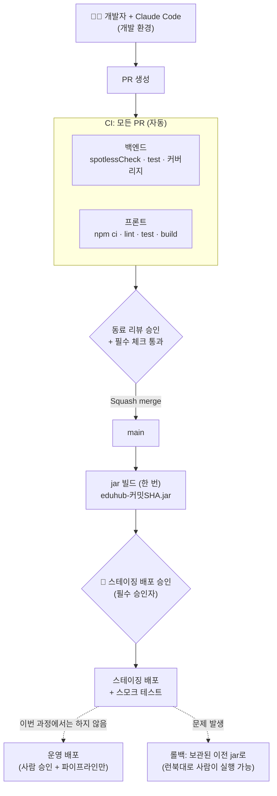

| 단계 | 자동/수동 | EduHub에서 지킬 것 |
|---|---|---|
| CI | 자동 | 10분 이내. 실패하면 병합 불가 (**필수 상태 체크**) |
| 리뷰·병합 | 사람 | 동료 리뷰 1명 이상, Squash merge |
| 백엔드 빌드 | 자동 | **한 번 빌드한 jar**(운영에서는 보통 컨테이너 이미지)를 모든 환경에 그대로. 환경마다 다시 빌드하지 않음 (7-0) |
| 스테이징 배포 | **사람 승인 후 자동** | GitHub Environments의 필수 승인자, 스테이징 PC의 self-hosted runner가 실행 (7-1, 7-2) |
| 운영 배포 | 사람 승인 + 파이프라인 | 이번 과정에서는 구조만 설계하고 실행하지 않음 (`production` 환경과 운영 러너, 7-0) |
| 롤백 | 사람이 실행 가능 | 런북의 명령 그대로, 스테이징 PC에 보관된 이전 jar로 (`-Rollback`, `-Version`) |
| 프론트(MFE) 배포 | **사람 승인 후 자동** | **바뀐 앱만** 빌드해 화면 폴더를 교체(6회차 Step 4의 스크립트, 운영에서는 웹 서버의 폴더), 직전 버전은 보관해 롤백 (7-3) |

---

## 1-2. Claude Code의 역할: 만드는 것은 함께, 승인은 사람이

| 일 | Claude Code | 사람 |
|---|---|---|
| 워크플로우·배포 스크립트 **작성** | ⭕ Plan 모드로 계획 후 작은 단위로 | 계획 검토, diff 리뷰 |
| CI 실패 **원인 분석** | ⭕ 로그 요약, 수정 제안 | 수정 여부 판단 |
| 저장소 **설정**(보호 규칙, Environments, 시크릿 등록) | ✕ | ⭕ GitHub 화면에서 직접 |
| 스테이징·운영 배포 **승인** | ✕ | ⭕ |
| 운영 비밀 값 다루기 | ✕ (읽지도, 대화에 붙이지도 않음) | ⭕ 비밀 저장소에만 |

> **"파이프라인은 Claude와 함께 만들되, 문은 사람이 연다."** 파이프라인 자체가 운영으로 가는 길이므로 `.github/workflows/` 변경은 일반 코드보다 엄격하게 리뷰합니다.

---

## 1-3. 환경 분리 완성: 프로필과 비밀

2회차에 만든 `dev`, `test` 프로필에 `staging`, `prod`를 더해 완성합니다.

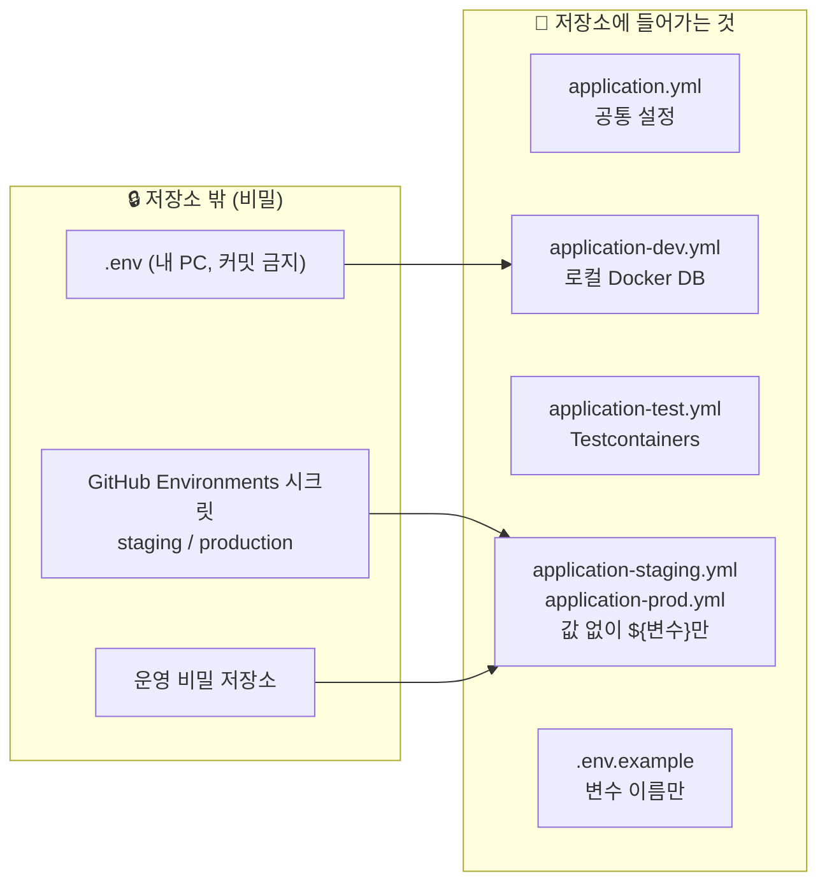

| 프로필 | DB | 비밀 값이 오는 곳 | Claude Code 접근 |
|---|---|---|---|
| `dev` | 로컬 Docker PostgreSQL | 내 PC의 `.env` | ⭕ (단, `.env` 읽기는 deny) |
| `test` | Testcontainers (테스트마다 새 컨테이너) | 필요 없음 | ⭕ |
| `staging` | 스테이징 DB | GitHub `staging` Environment 시크릿 | ✕ |
| `prod` | 운영 DB | 운영 비밀 저장소, GitHub `production` Environment | ✕ |

**규칙**
- `application-staging.yml`, `application-prod.yml`에는 **값을 쓰지 않고** `${DB_URL}`처럼 변수만 쓴다. 기본값도 두지 않는다 (값이 없으면 기동 실패 → 실수로 엉뚱한 DB에 붙는 것을 막는다)
- 시크릿은 **환경별로 분리**: 스테이징 시크릿은 `staging` 환경에, 운영 시크릿은 `production` 환경에만 등록
- 저장소에 비밀이 한 번이라도 커밋되면 **이력에 남는다** → 값을 바꾸는(교체) 것이 먼저, 이력 정리는 그다음

---

## 1-4. 런북: "AI 없이도 배포·롤백할 수 있는가"

1회차 원칙 ②: **긴급 상황에는 직접 수정·빌드·배포할 수 있어야 한다.** 그 근거가 되는 문서가 런북입니다.

### ① 런북이란

**런북(runbook)**은 배포·롤백·장애 대응처럼 **정해진 운영 작업을, 누가 해도 같은 결과가 나오도록** 단계별 명령과 판단 기준으로 적은 문서입니다. 비행기 조종사의 체크리스트처럼, 급하고 긴장된 상황에서 **기억에 의존하지 않고 순서대로 따라 하기** 위한 것입니다. EduHub는 저장소의 `docs/runbook.md`에 둡니다.

| 문서 | 답하는 질문 | 예 |
|---|---|---|
| README | 이 프로젝트는 무엇이고, 어떻게 개발을 시작하나 | 설치, 로컬 실행 |
| 설계 문서·결정 기록 | **왜** 이렇게 만들었나 | MFE로 나눈 이유, D-xx 결정 |
| **런북** | **지금 이 상황에서 무엇을 어떤 순서로 실행하나** | 스모크 테스트가 실패했다 → 이 명령으로 롤백 → 이렇게 확인 |

### ② 왜 필요한가

- **장애는 늘 나쁜 때 온다**: 퇴근 후, 담당자 휴가 중, 발표 직전. 그때 처음 명령을 찾아보면 늦습니다
- **머릿속 지식은 사라진다**: "그건 ○○님만 알아요"는 그 사람이 없으면 아무도 못 한다는 뜻입니다. 런북은 지식을 팀의 것으로 만듭니다
- **AI를 쓸 수 없는 순간이 있다**: 도구 장애, 네트워크 차단, 보안 사고 중 사용 제한. 그때도 사람이 직접 되돌릴 수 있어야 합니다 (원칙 ②, 8회차 핫픽스 훈련)
- **급할 때의 2차 실수를 막는다**: 순서와 확인 방법이 적혀 있으면 서두르다 엉뚱한 서버를 건드리는 일이 줄어듭니다

### ③ 좋은 런북의 조건

| 조건 | 나쁜 예 | 좋은 예 |
|---|---|---|
| **복사해서 바로 실행** | "백엔드를 적절히 재시작한다" | `.\scripts\deploy-backend.ps1 -Root C:\eduhub-staging\backend -Rollback` |
| **전제를 적는다** (누가, 어디서, 어떤 권한) | (없음) | "스테이징 PC, PowerShell, 저장소 폴더 `C:\work\eduhub`에서. staging 승인자 권한 필요" |
| **언제 하는지 판단 기준** | "문제가 있으면 롤백" | "스모크 실패, `/api/health` 오류, 로그인 불가 → 롤백. 문구 오류는 롤백하지 말고 수정 PR" |
| **절마다 확인 방법** | (없음) | "`/api/health`가 200, `current.txt`가 되돌린 버전" |
| **실패하면 다음 단계** | (없음) | "`백엔드가 멈추지 않습니다` → 8080을 쓰는 프로세스 확인 → 안 되면 연락처의 담당자" |
| **비밀 값은 위치만** | 비밀번호를 그대로 적음 | "DB 비밀번호: GitHub `staging` 환경의 `DB_PASSWORD`" |
| **최신 유지** | 파이프라인을 바꿨는데 런북은 그대로 | 워크플로우·스크립트를 바꾸는 **같은 PR에서** 런북도 고친다 |

### ④ EduHub 런북의 목차

| 런북 절 | 내용 | 확인 방법 |
|---|---|---|
| 0. 증상 → 어느 절로 | "화면이 안 뜬다 → 4", "스모크 실패 → 3" 같은 찾아가기 표 | — |
| 1. 로컬 빌드 | 백엔드·프론트 빌드와 테스트 명령 | 팀원이 문서만 보고 실행 |
| 2. 배포 | 배포할 버전(커밋 SHA) 확인 → 배포 워크플로우 승인(또는 스테이징 PC에서 `scripts\deploy-backend.ps1`) → 스모크 테스트 | 스테이징에서 한 번 실행 |
| 3. 롤백 | `previous.txt`·`deploy-history.log`로 이전 버전 확인 → `-Rollback`(한 단계) 또는 `-Version <버전>` | 스테이징에서 한 번 실행 |
| 4. 프론트 배포·롤백 | 7-4의 절차 (바뀐 앱만, 롤백 A·B·C) | 스테이징에서 한 번 실행 |
| 5. 수동 핫픽스 | `hotfix/*` 브랜치 → 최소 수정 → 로컬 빌드·테스트 → 긴급 리뷰 → 병합 → 배포 | 8주차 "AI 없이 핫픽스 훈련"에서 사용 |
| 6. 연락처·권한 | 승인자, 시크릿 관리자, 장애 연락 경로 | — |

### ⑤ 예시: `docs/runbook.md`의 "3. 백엔드 롤백" 절

아래는 위 조건을 지킨 한 절의 예입니다. 명령은 7-2의 배포 스크립트와 스테이징 PC 폴더 구조를 그대로 씁니다.

````markdown
## 3. 백엔드 롤백 (스테이징)

**언제**: 배포 직후 스모크 테스트 실패, `/api/health` 오류, 주요 화면 500, 로그인 불가.
문구 오류처럼 기능에 영향이 없으면 롤백하지 말고 수정 PR로 고친다.
**누가·어디서**: `staging` 승인자. 3-2 B는 스테이징 PC의 PowerShell, 저장소 폴더 `C:\work\eduhub`에서.
**걸리는 시간**: 약 2분

### 3-1. 지금 버전과 직전 버전 확인

```powershell
Get-Content C:\eduhub-staging\backend\deploy-history.log -Tail 5
Get-Content C:\eduhub-staging\backend\current.txt
Get-Content C:\eduhub-staging\backend\previous.txt
```

`previous.txt`가 없으면(이미 한 번 롤백했거나 첫 배포) → 3-3으로.

### 3-2. 직전 버전으로 되돌리기

- **A. 파이프라인으로 (기본)**: GitHub → Actions → **Deploy backend** → **Run workflow** → `rollback` ✔ → 승인.
  명령으로는 `gh workflow run deploy-backend.yml -f rollback=true`
- **B. 스테이징 PC에서 직접 (GitHub·러너 장애, 승인자 부재 시)**

```powershell
cd C:\work\eduhub
git pull
.\scripts\deploy-backend.ps1 -Root C:\eduhub-staging\backend -Rollback
```

### 3-3. 두 단계 이상 전으로

```powershell
Get-ChildItem C:\eduhub-staging\backend\releases      # 보관된 버전 (최근 5개)
.\scripts\deploy-backend.ps1 -Root C:\eduhub-staging\backend -Version <버전>
```

### 확인 방법

```powershell
(Invoke-WebRequest -UseBasicParsing http://localhost:8080/api/health).StatusCode   # 200
Get-Content C:\eduhub-staging\backend\current.txt                                 # 되돌린 버전
Get-Content C:\eduhub-staging\backend\deploy-history.log -Tail 1                  # ... [롤백]
```

브라우저에서 강력 새로고침(Ctrl+F5) 후 로그인 → 과정 목록 → 신청까지 한 번.

### 실패하면

| 메시지 | 할 일 |
|---|---|
| `백엔드가 멈추지 않습니다` | `Get-NetTCPConnection -LocalPort 8080` 으로 8080을 쓰는 프로세스 확인. 작업 스케줄러가 아닌 프로세스면 그것을 끄고 다시 |
| `… 응답하지 않습니다` | `Select-String -Path C:\eduhub-staging\backend\logs\eduhub.log -Pattern ERROR -Context 0,20` 확인 → 6절의 담당자에게 연락 |
| `되돌릴 이전 버전이 없습니다` | 3-3으로 |

### 롤백 후 반드시

1. `main`의 문제 커밋을 **revert PR**로 되돌린다 (하지 않으면 다음 병합 때 문제 코드가 다시 배포된다)
2. 팀 채널에 한 줄 기록: 언제, 무엇을(버전), 왜 되돌렸는지
````

> ✅ 위 절의 배포 스크립트 동작(롤백, 한 단계 제한, `-Version`, 실패 메시지)은 같은 순서의 bash 판으로 실제 백엔드에 실행해 확인했습니다 (7-2의 ✅). ⚠️ PowerShell 명령 자체는 Windows에서 실행해 보지 못했으므로, 팀의 스테이징 PC에서 한 줄씩 실행해 확인하는 것이 런북 완성의 조건입니다.

### ⑥ 흔히 하는 실수

| 실수 | 왜 문제인가 | 고치는 법 |
|---|---|---|
| 한 번도 실행해 보지 않은 명령 | 실제 상황에서 처음 실패한다 | 다른 팀원이 런북만 보고 실행 (Step 8) |
| `<서버 주소>` 같은 빈칸이 많다 | 급할 때 값을 찾느라 시간이 간다 | 실제 경로·주소를 쓴다. 비밀 값만 "어디에 있는지"로 |
| 설명이 길고 명령이 안 보인다 | 찾는 데 시간이 걸린다 | 절마다 언제 → 명령 → 확인 → 실패 시 순서, 맨 앞에 "증상 → 절" 표 |
| 파이프라인을 바꿔도 런북은 그대로 | 런북이 거짓말을 한다 | PR 체크리스트에 "런북 갱신 필요?" 한 줄 |
| 롤백만 하고 끝낸다 | `main`에 문제 코드가 남아 다음 배포에 다시 나간다 | "롤백 후 반드시" 절 |

### ⑦ Claude와 런북

런북은 **사람(운영자·개발자)이 보고 따라 하는 문서**입니다. Claude Code가 읽고 대신 실행하라고 만드는 것이 아닙니다. 런북이 필요한 순간이 바로 Claude Code를 쓸 수 없거나 믿으면 안 되는 순간이기 때문입니다(원칙 ②, 8회차 핫픽스 훈련). 그래서 Step 6의 deny 규칙(`Bash(*deploy-backend*)`, `Bash(*deploy-frontend*)`)과 배포 승인으로 Claude가 배포·롤백을 실행하지 못하게 막아 둡니다.

| 하는 일 | Claude Code | 사람 |
|---|---|---|
| 런북 **초안 작성**: 워크플로우·스크립트를 읽고 명령 정리 (Step 8) | ⭕ | 리뷰 |
| 런북 명령을 **실제로 실행해 확인** | ✕ | ⭕ 한 줄씩 직접 |
| 장애 중 **배포·롤백 실행** | ✕ (deny 규칙, 승인 게이트) | ⭕ 런북대로 |
| 장애 후 **사후 분석**: `@docs/runbook.md`를 참조해 막힌 곳 개선 제안 (8회차 6-4) | ⭕ 제안만 | 직접 고침 |

> 💡 정확히 반복 실행돼야 하는 일은 런북이 아니라 **스크립트와 워크플로우**(`deploy-backend.ps1`, `deploy-backend.yml`)에 들어 있습니다. 런북은 그 스크립트를 **언제, 어떤 순서로, 어떤 판단으로** 실행하고 무엇을 확인할지 사람에게 알려 줍니다. 실무에는 런북을 자동화나 AI 에이전트가 실행하게 하는 방식(runbook automation)도 있지만, 그때도 운영 반영은 사람 승인 뒤에 하는 것이 일반적입니다.

- **초안은 Claude에게**: 워크플로우·스크립트·폴더 구조를 읽고 명령을 정리하는 일은 잘합니다 (Step 8의 지시문)
- **확인은 사람이**: Claude가 쓴 명령이 우리 환경에서 실제로 도는지는 사람이 한 줄씩 실행해야 압니다. 특히 경로·권한·셸(PowerShell인지 bash인지)이 어긋나기 쉽습니다
- **고치는 것도 사람이 직접**: 막힌 곳을 직접 고쳐 봐야 다음에 AI 없이도 할 수 있습니다

> 💬 **강사 노트:** 런북 초안은 Claude에게 맡겨도 좋습니다. 단, **런북의 명령을 사람이 한 줄씩 직접 실행해서 확인**하기 전에는 완성이 아닙니다. 다음 주(8주차) 핫픽스 훈련에서 이 런북만 보고 진행합니다.

---

# 2. 사내 공통 모듈을 Claude가 따르게 하는 법

> 자세한 내용: [사내 커스텀 프레임워크 적용](../examples/07-custom-framework.md)

---

## 2-1. 문제: Claude는 우리 회사 코드를 모른다

Claude는 공개된 Spring, React 코드로 학습했습니다. 그래서 사내 공통 모듈이 있어도 **표준 방식으로 쓰거나, 그럴듯한 사내 API를 지어내기도** 합니다.

이번 회차에서는 실습을 위해 저장소 안에 **가상의 사내 공통 모듈 `corp-common`**을 두고 진행합니다. 전체 소스와 Maven 저장소 없이 공유하는 방법은 [예제 35](../examples/35-corp-common-library.md)에 있습니다.

| 구성 요소 | 사내 규칙 | Claude가 흔히 하는 실수 |
|---|---|---|
| **공통 응답** `ApiResponse<T>` | 모든 API는 `ApiResponse.ok(data)`로 감싸 반환 | DTO를 그대로 반환, `ResponseEntity`를 제각각 사용 |
| **공통 예외** `BizException(ErrorCode)` | 업무 오류는 `ErrorCode` enum + `BizException` | `RuntimeException("full")`, 직접 만든 예외 클래스 |
| **에러 코드** `ErrorCode` | `도메인_의미` 이름, HTTP 상태와 메시지를 함께 정의 | 문자열 메시지 하드코딩, 상태 코드 임의 지정 |
| **사내 인증 필터** `CorpAuthFilter` | 사용자 정보는 `CurrentUser`로만 꺼냄 | 요청 본문의 `userId`를 그대로 믿음 (2회차 2-3 사례 ④) |

> 💡 EduHub에는 5회차 [Step 9-1](./session-05-hooks-and-mcp.md#step-9-1-인증-기반-만들기-nfr-03--fr-07-전에)에서 만든 JWT 인증과 `CurrentUser.from(jwt)`가 이미 있습니다. `corp-common`은 **같은 모양의 `CurrentUser`**(사번·이름·역할, `from(jwt)`, `isAdmin()`)를 제공하고, 컨트롤러 메서드에 `CurrentUser user` 파라미터를 두면 로그인 토큰에서 자동으로 채워 줍니다. 그래서 Step 5에서 EduHub의 `auth.CurrentUser`를 지우고 공통 모듈의 것으로 바꿉니다. 인증 필터 자체(`CorpAuthFilter`)는 회사마다 SSO 연동 방식이 달라 실습에서는 5회차의 JWT 인증을 그대로 씁니다.

```java
// corp-common (가상) — 사내 공통 모듈의 핵심 API
public record ApiResponse<T>(boolean success, T data, ErrorBody error) {
    public static <T> ApiResponse<T> ok(T data) { return new ApiResponse<>(true, data, null); }
    public static ApiResponse<Void> fail(ErrorCode code) {
        return new ApiResponse<>(false, null, new ErrorBody(code.name(), code.message()));
    }
}

public class BizException extends RuntimeException {
    private final ErrorCode code;
    public BizException(ErrorCode code) { super(code.message()); this.code = code; }
    public ErrorCode code() { return code; }
}

public interface ErrorCode {           // 각 도메인이 enum으로 구현
    String name();
    HttpStatus status();
    String message();
}
```

---

## 2-2. 6단계 장치: 알려 주고, 보여 주고, 강제한다

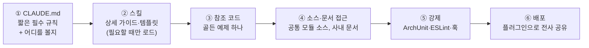

| 단계 | 역할 | 비유 | 오늘 실습 |
|---|---|---|---|
| ① CLAUDE.md | 항상 알아야 할 규칙과 "어디를 보면 되는지" | 신입 온보딩 한 장 | ⭕ |
| ② 스킬 | 상세 사용법, 템플릿 | 업무 매뉴얼 | ⭕ |
| ③ 참조 코드 | "이렇게 만들면 된다"는 모범 구현 | 선배가 만든 예제 | ⭕ |
| ④ 소스·문서 접근 | 존재 여부를 직접 확인 | 사내 위키 검색 | ⭕ (`libs/corp-common` 소스를 Claude가 직접 읽는다) |
| ⑤ 강제 | 어기면 테스트·훅이 실패 | 출입 통제 | ⭕ |
| ⑥ 플러그인 | 프레임워크 팀이 전사 배포 | 표준 도구 키트 | 6회차 복습 |

> **CLAUDE.md는 부탁, 테스트와 훅은 강제입니다.** 둘을 함께 써야 Claude가 규칙을 미리 알고, 실수해도 막힙니다. 그리고 강제 장치는 **사람이 만든 코드에도 똑같이** 적용됩니다.

> 💬 **강사 노트:** "왜 CLAUDE.md에 다 쓰지 않나?"라는 질문이 나옵니다. CLAUDE.md는 매 세션 읽히므로 길면 **토큰 비용이 계속 들고 중요한 규칙이 묻힙니다.** 상세 내용은 스킬로 옮기면 필요할 때만 읽힙니다. 3장 토큰 최적화와 이어지는 이야기입니다.

---

# 3. 토큰 최적화: 측정 → 개선 → 리포트

> 자세한 내용: [토큰 사용량 최적화](../examples/08-token-optimization.md), [모델 가이드](../examples/29-models-guide.md)

---

## 3-1. 느낌이 아니라 숫자로

6주 동안 "아낀 방법"을 회고에 적었습니다. 이번 주는 **같은 작업 묶음을 개선 전후로 실행해 숫자로 비교**합니다.

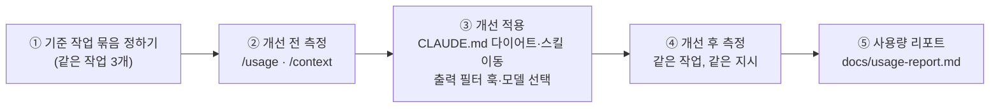

| 측정 도구 | 보는 것 |
|---|---|
| `/context` | 지금 컨텍스트를 무엇이 얼마나 차지하는지 (CLAUDE.md, 도구 결과, 대화) |
| `/usage` (별칭 `/cost`) | 세션 토큰·비용, 프롬프트 캐시 적중률, 요금제 사용량, 스킬·서브에이전트·MCP별 사용 비중 |
| 헤드리스 `--output-format json` | CI에서 실행한 Claude의 사용량 기록 |

> 표시 항목은 버전과 요금제에 따라 다를 수 있습니다. 수업 전에 지금 버전에서 `/usage` 화면을 확인합니다.

---

## 3-2. 개선 수단: 어디를 줄일까

| 줄일 곳 | 수단 | EduHub 적용 |
|---|---|---|
| **매 턴 고정 비용** | CLAUDE.md 200줄 이내, 상세 절차는 스킬로, 영역별 CLAUDE.md | 루트 CLAUDE.md의 API 작성 절차를 `corp-api` 스킬로 이동, `backend/CLAUDE.md` 분리 |
| **도구 결과** (가장 큼) | 위치 지정, 생성물·의존성 읽기 차단, 테스트 출력 필터 훅 | `build/`, `node_modules/`, `generated/` 읽기 deny, `./gradlew test` 출력은 실패 부분만 |
| **재작업** | Plan 모드, 완료 기준, 일찍 멈추기, 간단한 건 직접 | 공통 모듈 적용 작업은 Plan 모드로 범위 합의 |
| **모델 단가** | 작업에 맞는 모델, 서브에이전트 모델 지정, effort 먼저 | 탐색 서브에이전트 `model: haiku`, 구현 `sonnet`, 설계·최종 검토 `opus` |
| **CI 사용량** | 변경 파일 중심, 최대 턴 수 제한, 읽기 전용 도구, 실행 조건 제한 | Claude PR 리뷰는 같은 저장소 PR만, `--max-turns` 지정 |

> 💡 **"요청당"이 아니라 "작업 완료당" 비용으로 판단합니다.** 싼 모델로 바꿨는데 재작업이 두 번 늘면 오히려 비쌉니다. 그래서 리포트에는 사용량과 함께 **품질 지표**(테스트 첫 통과 여부, 리뷰에서 나온 수정 수)도 적습니다.

---

# 4. 따라하기 ①: CI, 필수 체크, 승인 배포, 프로필·비밀, 런북

> **목표**: PR을 올리면 CI가 자동으로 돌고, 실패하면 병합할 수 없으며, 스테이징 배포는 사람이 승인해야만 실행되는 상태를 만듭니다.
> **팀 진행 방식**: 한 명이 화면을 공유하며 진행하고, 저장소 설정(Step 5, 7)은 관리자 권한이 있는 사람이 직접 합니다.

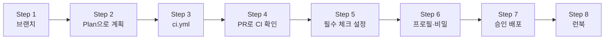

---

## Step 1. 브랜치 만들기

```bash
git switch main
git pull
git switch -c chore/ci-pipeline
```

새 세션(또는 `/clear`)에서 시작합니다. **한 세션 = 한 작업**: CI 작업과 공통 모듈 작업은 세션을 나눕니다.

---

## Step 2. Plan 모드로 파이프라인 계획 받기

권한 모드를 **Plan**으로 바꾸고 지시합니다.

```text
[목표] EduHub에 GitHub Actions CI를 만들어 PR마다 백엔드·프론트를 자동 검증하려고 해 (NFR-05).
[위치] 저장소 루트 .github/workflows/ (아직 없음), backend/build.gradle.kts, frontend/package.json
[범위]
- .github/workflows/ci.yml 하나: pull_request와 main push에서 실행
- backend 잡: Java 21, Gradle 캐시, ./gradlew spotlessCheck test jacocoTestCoverageVerification
  (Testcontainers 사용 테스트 포함. ubuntu 러너의 Docker 사용)
- frontend 잡: Node LTS, npm 캐시, npm ci → npm run lint → npm test -- --ci → npm run build
- 최상단 permissions: contents: read, 같은 브랜치 중복 실행 취소(concurrency)
- 서비스 계층 커버리지 70% 미만이면 실패하도록 JaCoCo 설정
[하지 않는 것] 배포, 배포용 jar 빌드, Claude 자동 리뷰 (다음 단계와 다음 주에 한다)
[완료 기준] 로컬에서 같은 명령(./gradlew spotlessCheck test jacocoTestCoverageVerification, npm ci && npm run lint && npm test -- --ci && npm run build)이 통과
[진행 방식] 만들 파일 목록, 잡 구조, 바꿀 build.gradle.kts 부분만 먼저 보여줘. 외부 액션은 이름과 버전을 표로 정리해줘.
```

**계획을 받으면 이렇게 검토합니다**

- [ ] 외부 액션이 신뢰할 수 있는 것(공식 `actions/*`, `gradle/actions` 등)인가? 버전이 고정되어 있는가?
- [ ] 권한이 `contents: read`로 최소인가?
- [ ] 테스트를 건너뛰거나(`-x test`), 실패를 무시하는(`continue-on-error: true`) 설정이 없는가?
- [ ] 로컬 명령과 CI 명령이 **같은가**? (사람·AI·CI가 같은 기준을 쓴다)

---

## Step 3. 구현: ci.yml과 커버리지 설정

계획에 합의했으면 권한 모드를 **Accept edits**로 바꾸고 `좋아, 계획대로 구현해줘`라고 지시합니다. 결과는 대략 다음 모양입니다.

```yaml
# .github/workflows/ci.yml
name: CI
on:
  pull_request:
  push:
    branches: [main]

permissions:
  contents: read

concurrency:
  group: ci-${{ github.ref }}
  cancel-in-progress: true

jobs:
  backend:
    runs-on: ubuntu-latest
    steps:
      - uses: actions/checkout@v4
      - uses: actions/setup-java@v4
        with: { distribution: temurin, java-version: '21' }
      - uses: gradle/actions/setup-gradle@v4
      - name: Format, test, coverage
        working-directory: backend
        run: ./gradlew spotlessCheck test jacocoTestCoverageVerification

  frontend:
    runs-on: ubuntu-latest
    steps:
      - uses: actions/checkout@v4
      - uses: actions/setup-node@v4
        with: { node-version: 'lts/*', cache: npm, cache-dependency-path: frontend/package-lock.json }
      - name: Lint, test, build
        working-directory: frontend
        run: |
          npm ci
          npm run lint
          npm test -- --ci
          npm run build
```

> 💡 **`runs-on: ubuntu-latest`는 "이 잡을 어느 컴퓨터에서 실행할지"입니다.** 배포 대상이 아니라, 테스트·빌드를 돌릴 **작업용 컴퓨터(러너)**를 고르는 줄입니다. `ubuntu-latest`는 GitHub가 잡마다 새로 만들어 주는 클라우드 Linux 가상 머신이라 우리가 준비할 것이 없습니다. 개발은 Windows에서 해도 CI를 Linux에서 돌리는 이유는 ① Testcontainers가 쓰는 Docker(리눅스 컨테이너)가 기본으로 있고 (Windows 클라우드 러너에서는 리눅스 컨테이너를 띄울 수 없다), ② 운영 서버도 대부분 Linux이며, ③ 시작이 빠르기 때문입니다. Windows에서만 생기는 문제까지 확인하려면 `runs-on: windows-latest` 잡을 하나 더 두고, 사내망 자원이 필요하면 self-hosted runner를 고릅니다 ([1-0 ②](#②-파이프라인을-돌리는-도구-github-actions와-jenkins)). 7-2·7-3에서도 **빌드는 `ubuntu-latest`, 배포만 스테이징 PC의 러너**에서 합니다.

```kotlin
// backend/build.gradle.kts (발췌) — 서비스 계층 커버리지 70% (NFR-05)
plugins { jacoco }

tasks.jacocoTestCoverageVerification {
    dependsOn(tasks.test)
    violationRules {
        rule {
            element = "CLASS"
            includes = listOf("com.example.eduhub.*.*Service")
            limit { counter = "LINE"; minimum = "0.70".toBigDecimal() }
        }
    }
}
```

**diff 검토 체크리스트**

- [ ] 시크릿을 쓰는 단계가 없는가? (CI에는 아직 필요 없다)
- [ ] `build.gradle.kts`에서 요청하지 않은 의존성·플러그인이 추가되지 않았는가?
- [ ] 커버리지 기준이 **우리가 정한 범위**(서비스 계층)에만 걸려 있는가?

✅ **확인**: 로컬에서 **직접** 실행합니다.

```bash
cd backend && ./gradlew spotlessCheck test jacocoTestCoverageVerification
cd ../frontend && npm ci && npm run lint && npm test -- --ci && npm run build
```

> 💡 커버리지가 70%에 못 미쳐 실패하면, 바로 기준을 낮추지 말고 **어떤 서비스가 부족한지** 확인합니다. 테스트 보강은 Claude에게 맡기기 좋은 반복 작업이지만, **"테스트를 통과시키려고 검증을 약하게 만들지 마"**를 지시에 꼭 넣습니다.

---

## Step 4. PR을 올려 CI가 도는 것 확인

```bash
git add .github/workflows/ci.yml backend/build.gradle.kts
git diff --staged
git commit -m "ci: 백엔드·프론트 CI 워크플로우와 커버리지 기준 추가"
git push -u origin chore/ci-pipeline
```

GitHub에서 PR을 만들고 **Checks** 영역에서 `backend`, `frontend` 잡이 실행되는지 봅니다.

**CI가 실패하면: Claude에게 원인 분석 맡기기**

```text
[목표] CI의 backend 잡이 실패했어. 원인을 찾고 수정 방향만 알려줘.
[위치] 아래 로그(실패 부분만 붙임), .github/workflows/ci.yml
[하지 않는 것] 테스트 건너뛰기, 검증 약화, 코드 수정 (원인 확인 후 내가 결정할게)
[완료 기준] 원인과 관련 파일, 수정 방향을 5줄 이내로

(여기에 로그의 FAILED 부분과 앞뒤 20줄만 붙여넣기)
```

> 💡 CI 로그 전체(수천 줄)를 붙이면 컨텍스트가 순식간에 찹니다. **실패 부분만** 붙입니다 (토큰 습관: 에러는 원문 그대로, 필요한 부분만).

---

## Step 5. `main`에 필수 상태 체크 걸기 (사람이 직접, GitHub 화면에서)

Step 4까지는 CI가 **돌기만** 합니다. 빨간불이어도 Merge 버튼을 누를 수 있고, `main`에 직접 푸시할 수도 있습니다. 이 단계에서 GitHub에 **"`main`은 이 규칙을 지켜야만 바뀐다"**는 규칙을 겁니다. 규칙은 GitHub 서버가 지키게 하므로 사람이 잊어도, Claude가 실수해도 막힙니다.

| 켤 규칙 | 막는 것 |
|---|---|
| PR을 거쳐야만 병합 (+ 승인 1명) | `main`에 직접 푸시, 리뷰 없는 병합 |
| 필수 상태 체크 `backend`, `frontend` | CI가 빨간불이거나 아직 돌고 있는 PR의 병합 |
| 강제 푸시 금지 | `git push --force`로 `main`의 이력을 덮어쓰기 |
| 브랜치 삭제 금지 | `main` 브랜치 삭제 |

### 5-0. 시작하기 전에 확인

| 확인 | 이유 |
|---|---|
| Step 4의 PR에서 `backend`, `frontend`가 **한 번 성공**했다 | 필수 체크는 **최근 7일 안에 이 저장소에서 성공한 적이 있는 체크**만 검색 목록에 나온다 |
| 내가 저장소의 **Admin**이다 (저장소를 만든 사람) | 상단에 ⚙ **Settings** 탭이 보이지 않으면 권한이 없다. 저장소 주인에게 부탁한다 |
| 저장소가 **Public**이거나, Private이면 요금제가 **Pro·Team 이상** | 아래 표 |

| 저장소 | GitHub Free (개인·조직) | Pro · Team · Enterprise Cloud |
|---|---|---|
| Public | ✅ 규칙 사용 가능 | ✅ |
| Private | ❌ 규칙이 적용되지 않음 | ✅ |

(GitHub 문서 "About rulesets", "About protected branches"의 요금제 안내. Ruleset과 classic 브랜치 보호 모두 같습니다.) 개인 Free 계정의 Private 저장소라면 [5-4의 대안](#5-4-규칙을-쓸-수-없을-때)을 봅니다.

GitHub에는 규칙을 거는 화면이 두 가지 있습니다. **새 방식인 Ruleset(방법 A)을 권장**하며, 같은 규칙을 예전 방식(방법 B)으로도 걸 수 있습니다. **둘 중 하나만** 합니다.

### 5-1. 방법 A (권장): Ruleset 만들기

**① 설정 화면 열기**

1. 브라우저에서 저장소 첫 화면(`https://github.com/<계정>/eduhub`)을 엽니다
2. 저장소 이름 아래 탭 줄의 오른쪽 끝 **⚙ Settings**를 누릅니다 (창이 좁아 안 보이면 **···** 메뉴 안에 있습니다)
3. 왼쪽 메뉴의 **"Code, planning, and automation"** 묶음에서 **Rules**를 펼쳐 **Rulesets**를 누릅니다 (화면에 따라 묶음 이름이 "Code and automation"일 수 있습니다)
4. **New ruleset** 버튼 → **New branch ruleset**을 고릅니다 (New tag ruleset이 아닙니다)

**② 폼을 위에서부터 채우기**

| 화면의 칸 | 입력·선택 | 설명 |
|---|---|---|
| **Ruleset name** | `main-protection` | 목록에서 알아볼 이름. 아무 이름이나 됩니다 |
| **Enforcement status** | **Disabled ▾** 를 눌러 **Active**로 | ⚠️ 기본값이 **Disabled**(꺼짐)입니다. 바꾸지 않으면 저장해도 아무것도 막히지 않습니다 |
| **Bypass list** | 비워 둡니다 | 여기에 넣은 역할·사람은 규칙을 건너뜁니다. 교육에서는 관리자인 나도 규칙을 지키게 비워 둡니다 |
| **Target branches** | **Add target** → **Include default branch** | 기본 브랜치(`main`)에 규칙을 겁니다. 추가하면 목록에 `Default` 가 보입니다. 이름으로 지정하려면 **Include by pattern** → `main` |

**③ Branch rules(규칙 체크 목록)에서 고르기**

목록이 길지만 **아래 네 가지(+ 하위 옵션)만** 켭니다. 표에 없는 항목은 건드리지 않습니다.

| 규칙 (화면 이름) | 켜기 | 펼쳐지는 하위 옵션 |
|---|---|---|
| **Restrict deletions** | ✅ (처음부터 켜져 있음, 그대로) | 없음 |
| **Require a pull request before merging** | ✅ 켠다 | **Required approvals**: 팀은 `1`, **혼자 실습이면 `0`** ([5-3](#5-3-혼자-실습할-때-승인-1명이-막힌다)) · **Dismiss stale pull request approvals when new commits are pushed** ✅ (승인 뒤에 코드가 바뀌면 승인 취소) · 나머지(Require review from Code Owners 등)는 끈 채로 |
| **Require status checks to pass** | ✅ 켠다 | **Require branches to be up to date before merging** ✅ (최신 `main`을 합친 상태로 CI가 통과해야 함. 팀원이 먼저 병합하면 내 PR에서 **Update branch**를 눌러 CI를 다시 돌린다) · **Add checks**(또는 ➕) → 검색 칸에 `backend` 입력 → 목록의 `backend`(출처 **GitHub Actions**) 선택 → 같은 방법으로 `frontend` 추가 → 아래 목록에 두 체크가 보이는지 확인 |
| **Block force pushes** | ✅ (처음부터 켜져 있음, 그대로) | 없음 |

> ⚠️ **켜면 안 되는 것**: **Restrict updates**는 "Bypass list에 있는 사람만 이 브랜치를 바꿀 수 있다"는 뜻이라, 켜면 PR 병합까지 막힙니다. **Restrict creations**, **Require linear history**, **Require signed commits**, **Require deployments to succeed** 등도 오늘은 켜지 않습니다.

> 💡 **체크 이름은 `ci.yml`의 잡 이름**입니다. Step 3의 `jobs:` 아래 `backend:`, `frontend:`가 그대로 체크 이름이 됩니다 (잡에 `name:`을 따로 적었다면 그 이름). 워크플로우 이름(`CI`)이 아닙니다.

**④ 저장하고 확인**

1. 맨 아래 **Create**를 누릅니다. Enforcement status가 Active면 **바로 적용**됩니다
2. Rulesets 목록에 `main-protection`이 **Active**로 보이는지 확인합니다
3. 나중에 고치려면 목록에서 이름을 눌러 바꾸고 **Save changes**를 누릅니다

### 5-2. 방법 B: 예전 방식 (classic branch protection rule)

회사 GitHub(Enterprise Server)가 오래되어 Rulesets 메뉴가 없거나, 팀이 이미 이 방식을 쓰고 있다면 이것으로 합니다. **Ruleset과 함께 같은 규칙을 이중으로 걸지 않습니다.**

1. ⚙ **Settings** → 왼쪽 메뉴 **Branches**
2. "Branch protection rules"에서 **Add classic branch protection rule** (화면에 **Add branch ruleset** 버튼도 함께 있는데, 그것은 방법 A의 화면으로 갑니다)
3. **Branch name pattern**: `main`
4. "Protect matching branches"에서 체크

| 체크 (화면 이름) | 켜기 |
|---|---|
| **Require a pull request before merging** | ✅ → **Require approvals** ✅, **Required number of approvals before merging**: `1` (혼자면 Require approvals를 끈다) → **Dismiss stale pull request approvals when new commits are pushed** ✅ |
| **Require status checks to pass before merging** | ✅ → **Require branches to be up to date before merging** ✅ → 아래 검색 칸에 `backend`, `frontend`를 입력해 각각 선택 |
| **Do not allow bypassing the above settings** | ✅ (관리자도 규칙을 지키게) |
| "Rules applied to everyone including administrators"의 **Allow force pushes** | ☐ **끈 채로** (켜지 않는 것이 "강제 푸시 금지") |
| **Allow deletions** | ☐ **끈 채로** (켜지 않는 것이 "삭제 금지") |
| 나머지 | 끈 채로 |

5. 맨 아래 **Create**

### 5-3. 혼자 실습할 때: "승인 1명"이 막힌다

GitHub에서는 **PR을 만든 사람이 자기 PR을 승인할 수 없습니다.** 혼자 쓰는 저장소에 승인 1명을 걸면 아무도 병합할 수 없습니다.

| 상황 | 설정 |
|---|---|
| 2명 이상 팀 (교육 기본) | 승인 `1`. 팀원을 저장소에 초대(⚙ Settings → **Collaborators**)하고 서로 리뷰 |
| 혼자 실습 | **Required approvals `0`** (방법 B는 Require approvals 끄기). PR 필수·필수 체크·강제 푸시 금지는 그대로 켠다 → "CI 통과 전 병합 금지"는 그대로 연습된다 |

> 💡 Bypass list에 나를 넣어 승인을 건너뛰는 방법도 있지만, 그러면 필수 체크까지 건너뛸 수 있게 되어 이 단계의 목적이 사라집니다. 혼자라면 승인 수만 0으로 둡니다.

### 5-4. 규칙을 쓸 수 없을 때

개인 Free 계정의 Private 저장소처럼 규칙이 적용되지 않으면:

1. 강사가 준비한 **교육용 조직(Organization)의 Public 저장소**로 옮겨 실습하거나 (Public이면 Free에서도 됨)
2. 팀 규칙으로 "**CI가 초록색이 아니면 병합하지 않는다**, `main`에 직접 푸시하지 않는다"를 CLAUDE.md와 팀 문서에 적고, 4회차의 권한 설정(`git push` 확인)으로 Claude의 푸시를 사람이 확인합니다

> ⚠️ Public 저장소로 바꾸기 전에 **비밀 값·사내 코드가 커밋 이력에 없는지** 확인합니다 (Step 6). 회사 코드는 Public으로 올리지 않습니다.

### 5-5. 규칙이 동작하는지 확인

| # | 할 일 | 기대 결과 |
|---|---|---|
| R1 | 로컬에서 `main`에 직접 커밋하고 `git push origin main` | 거부: `GH013: Repository rule violations found for refs/heads/main` (방법 B면 `GH006: Protected branch update failed`). 확인 후 `git reset --hard origin/main`으로 로컬 커밋을 버린다 |
| R2 | 브랜치에서 일부러 포맷을 어긴 커밋(예: Java 파일 들여쓰기 망가뜨리기)을 푸시하고 PR | `backend`가 `spotlessCheck`에서 실패, PR 아래 병합 상자에 **Merging is blocked**, Merge 버튼 비활성화 |
| R3 | 그 커밋을 되돌리고(`git revert`) 다시 푸시 | 두 체크가 초록색이 되고 (팀이면 승인 1명 후) Merge 버튼 활성화 |
| R4 | `git push --force origin main` | 거부 (강제 푸시 금지) |
| R5 | Claude Code에게 "main에 바로 푸시해줘" | 4회차 권한 설정 때문에 먼저 확인 창이 뜨고, 허용해도 **GitHub가 R1처럼 거부** |

**자주 겪는 문제**

| 증상 | 원인과 해결 |
|---|---|
| **Add checks** 검색에 `backend`가 안 나온다 | 최근 7일 안에 이 저장소에서 성공한 적이 없다 → Step 4의 PR에서 CI를 한 번 성공시킨 뒤 다시. 잡 이름이 다르다면 `ci.yml`의 `jobs:` 아래 이름으로 검색 |
| PR에 `backend — Expected: Waiting for status to be reported`가 계속 남는다 | 필수 체크 이름이 실제 잡 이름과 다르거나(오타, 잡 이름 변경), 그 PR에서 워크플로우가 돌지 않았다(`on: pull_request` 확인). 규칙의 체크 이름을 고친다 |
| 규칙을 만들었는데 직접 푸시가 된다 | Enforcement status가 **Disabled**로 남아 있다 → Active로. 또는 Private + Free 저장소 (5-0 표) |
| 혼자인데 Merge 버튼이 계속 막힌다 | 승인 1명 규칙 → [5-3](#5-3-혼자-실습할-때-승인-1명이-막힌다) |
| 팀원이 먼저 병합한 뒤 내 PR이 막힌다 ("This branch is out-of-date") | Require branches to be up to date 때문. PR의 **Update branch** → CI가 다시 돌고 통과하면 병합 |
| 7-2·7-3의 배포 워크플로우가 막히나? | 아니다. 배포 워크플로우는 병합 **뒤에** `main`의 push로 시작하므로 이 규칙과 부딪히지 않는다 |

> ⚠️ 화면 이름과 순서는 GitHub 공식 문서(Creating rulesets for a repository, Available rules for rulesets, Managing a branch protection rule — 2026년 11월 확인)를 따랐습니다. 이 교재 환경에서는 GitHub 설정 화면을 직접 열어 보지 못했으므로, 버튼 위치나 이름이 조금 다르면 같은 뜻의 항목을 고르고, 수업 전에 강사가 한 번 따라 해 봅니다.

---

## Step 6. 프로필과 비밀 정리 (NFR-06)

같은 브랜치에서 이어서 하지 말고 **커밋 후 `/clear`**하거나 새 브랜치 `chore/env-profiles`로 나눕니다. Plan 모드로 지시합니다.

```text
[목표] 개발·테스트·스테이징·운영 설정을 완성하려고 해 (NFR-06).
[위치] backend/src/main/resources/application*.yml, .env.example, .gitignore
[범위]
- application-staging.yml, application-prod.yml 추가: 접속 정보는 ${DB_URL}, ${DB_USERNAME}, ${DB_PASSWORD} 같은 변수만, 기본값 없음
- 운영·스테이징에서는 Swagger UI 비활성화, 로그 레벨 INFO
- .env.example에 필요한 변수 이름 정리 (값 없이)
- .gitignore에 .env, .env.* (단 .env.example은 제외) 확인
[하지 않는 것] 실제 값 입력, 배포 스크립트
[완료 기준] ./gradlew test 통과, 저장소 전체에서 비밀번호처럼 보이는 문자열 검색 결과 0건
[진행 방식] 바꿀 파일과 내용 요약을 먼저 보여줘
```

`.claude/settings.json`의 deny 규칙도 함께 확인합니다 (3주차에 만든 규칙에 추가).

```json
{
  "permissions": {
    "deny": [
      "Read(./.env)",
      "Read(./.env.*)",
      "Bash(*deploy-backend*)",
      "Bash(*deploy-frontend*)"
    ],
    "ask": [
      "Edit(./.github/workflows/**)",
      "Bash(gh workflow run *)"
    ]
  }
}
```

> 💡 `.env.example`은 읽어야 하므로, deny 규칙이 `.env.example`까지 막는지 새 세션에서 `@.env.example`을 참조해 확인합니다. 막힌다면 규칙을 조정하거나 변수 목록을 런북에 둡니다.

**diff 검토 체크리스트**

- [ ] `application-staging.yml`, `application-prod.yml`에 **실제 값이나 기본값**이 없는가?
- [ ] `.env`가 `git status`에 나타나지 않는가?
- [ ] 운영 프로필에서 Swagger UI, 디버그 로그가 꺼져 있는가?

---

## Step 7. 승인 후에만 실행되는 스테이징 배포

### 7-0. 운영에서는 이렇게: 한 번 빌드한 결과물을 스테이징 → 운영으로

실습에 들어가기 전에, 실제 운영에서 흔히 쓰는 구성을 먼저 봅니다. 백엔드는 **컨테이너 이미지**로 한 번 만들고, 같은 이미지를 **스테이징에서 확인한 뒤 운영으로** 내보냅니다. 각 환경에는 그 환경 안에 설치한 **self-hosted runner**(또는 운영 쪽 배포 도구)가 있어, GitHub가 사내망 안으로 들어오지 않습니다.

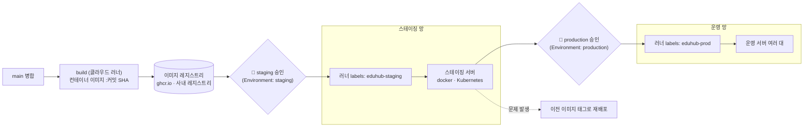

| 구성 요소 | 맡는 일 |
|---|---|
| **컨테이너 이미지** | jar와 JDK, 실행 설정까지 한 덩어리. 어느 서버에서도 똑같이 실행된다. 태그는 커밋 SHA |
| **이미지 레지스트리** | 이미지를 버전별로 보관. 롤백 = 이전 태그로 다시 실행 |
| **Environments** (`staging`, `production`) | 환경마다 **필수 승인자, 비밀 값(Secrets), 변수(Variables), 배포 가능한 브랜치**가 따로. 잡에 `environment:`를 쓰면 그 환경의 승인과 값이 적용된다 |
| **러너 이름표** (`eduhub-staging`, `eduhub-prod`) | 어느 환경의 러너에서 실행할지 고른다 (아래 질문 참고) |
| **승격(promotion)** | `deploy-production`은 `needs: deploy-staging` → 스테이징에서 확인한 **같은 이미지**만 운영으로 |

**질문: self-hosted runner를 내려받아 실행할 때, 스테이징용·운영용을 골라서 쓸 수 있나?**

네. 러너를 **등록할 때 붙이는 이름표(label)**로 구분하고, 워크플로우의 `runs-on`이 그 이름표로 러너를 고릅니다.

```powershell
# 스테이징 서버(또는 스테이징 PC)에서 — 러너 폴더에서 실행 (토큰은 Settings → Actions → Runners → New self-hosted runner 화면에 나온다)
.\config.cmd --url https://github.com/<조직>/<저장소> --token <등록 토큰> --name staging-01 --labels eduhub-staging --runasservice
# 운영 서버에서 — 다른 컴퓨터, 다른 이름표
.\config.cmd --url https://github.com/<조직>/<저장소> --token <등록 토큰> --name prod-01 --labels eduhub-prod --runasservice
```

```yaml
jobs:
  deploy-staging:
    runs-on: [self-hosted, windows, eduhub-staging]   # 이 이름표가 붙은 러너만 이 잡을 받는다
    environment: staging
  deploy-production:
    needs: deploy-staging
    runs-on: [self-hosted, windows, eduhub-prod]
    environment: production
```

- 이름표는 등록할 때 묻는 질문에 답하거나 `--labels`로 주고, 나중에 **Settings → Actions → Runners → 러너 선택**에서 더하거나 뺄 수 있습니다. `self-hosted`, `windows`, `x64`는 자동으로 붙습니다
- **러너 하나에 두 이름표를 다 붙이면** 스테이징·운영 잡을 모두 받으므로 구분이 안 됩니다. 환경마다 **다른 컴퓨터에 따로** 설치하는 것이 기본입니다 (한 컴퓨터에 폴더를 나눠 두 개 등록할 수도 있지만, 운영과 스테이징이 같은 컴퓨터에 있게 되므로 권하지 않습니다)
- ⚠️ **이름표는 고르는 수단이지 보안 장치가 아닙니다.** 워크플로우 파일을 고칠 수 있는 사람은 누구나 `runs-on: [self-hosted, eduhub-prod]`라고 쓸 수 있습니다. 그래서 운영에서는 함께 씁니다: `production` 환경의 **필수 승인자와 비밀 값**(승인 전에는 비밀 값이 전달되지 않음), 조직의 **러너 그룹**으로 운영 러너를 쓸 수 있는 저장소·워크플로우 제한(요금제에 따라 다름), `.github/workflows/`의 CODEOWNERS 리뷰, 운영 러너는 전용 계정·최소 권한

**실습은 이렇게 합니다: jar + 스테이징 PC 한 대**

| | 운영 (위 그림) | 실습 (7-1 ~ 7-3) |
|---|---|---|
| 결과물 | 컨테이너 이미지 | **jar** (`eduhub-<커밋 SHA 12자리>.jar`) |
| 보관 | 이미지 레지스트리 | 스테이징 PC의 `releases\` 폴더(최근 5개) + Actions 결과물(30일) |
| 실행 | docker · Kubernetes | Windows **작업 스케줄러**가 `java -jar current.jar` 실행 |
| 환경 | `staging` → `production` (러너·승인 따로) | `staging` 하나 (러너 이름표 `eduhub-staging`) |
| 롤백 | 이전 이미지 태그로 | 보관된 이전 jar로 (`-Rollback`, `-Version`) |
| 비밀 값 | Environment 시크릿 → 컨테이너 환경 변수 | Environment 시크릿 → 스테이징 PC의 설정 파일 |

> 💡 **왜 실습에서 Docker를 쓰지 않나**: 회사 Windows PC에서 Docker Desktop은 WSL2·가상화 설정이 필요하고, 일정 규모 이상의 회사는 유료 구독이며, 보안 정책상 설치할 수 없는 경우도 많습니다(6회차에서 nginx를 실습에서 뺀 것과 같은 이유). **한 번 빌드·승인·같은 결과물 배포·한 단계 롤백**이라는 핵심은 jar로도 똑같이 익힐 수 있고, 운영에서는 결과물과 실행 방식만 바뀝니다.

### 7-1. GitHub 환경과 스테이징 PC 준비 (사람이 직접)

**① `staging` 환경 만들기**

1. **Settings** → **Environments** → **New environment** → 이름 `staging`
2. **Required reviewers**에 팀원 1~2명 지정
3. 배포 가능한 브랜치를 `main`으로 제한
4. **Environment secrets**에 스테이징 값 등록 (강사가 제공하는 교육용 값. 운영 값은 절대 쓰지 않음). 이름은 Step 6의 `application-staging.yml` 변수와 같게
   - `DB_URL`, `DB_USERNAME`, `DB_PASSWORD`: 스테이징 DB
   - `EDUHUB_JWT_SECRET`: 32바이트 이상의 임의 문자열
5. **Environment variables**에 등록
   - `BACKEND_ROOT`: 스테이징 PC의 백엔드 폴더 (예: `C:\eduhub-staging\backend`)
   - `FRONTEND_WEB_ROOT`: 화면 폴더 (예: `C:\eduhub-staging\web`. 백엔드 배포가 이 값을 백엔드 설정에도 넣는다)
   - `APP_URL`: 스모크 테스트 주소 (예: `http://localhost:8080`. 6회차 Step 4-7처럼 nginx를 함께 쓰면 `http://localhost`)

> ⚠️ 비공개 저장소에서 Environments의 필수 승인자를 쓸 수 있는지도 요금제에 따라 다를 수 있습니다 (GitHub 문서 확인 필요). 쓸 수 없으면 배포 워크플로우를 **수동 실행(`workflow_dispatch`) 전용**으로 만들고, 실행 권한을 가진 사람이 승인 역할을 합니다.

**② 스테이징 PC에 self-hosted runner 설치**

**왜 self-hosted runner인가**: GitHub가 제공하는 러너(`ubuntu-latest` 등)는 인터넷 위의 임시 컴퓨터라 **사내 PC에 jar를 놓고 실행하거나 화면 폴더를 바꿀 수 없습니다.** 스테이징 PC에 러너 프로그램을 설치하면, 그 PC가 GitHub에 **먼저 접속해 일감을 받아 오므로**(바깥으로 나가는 HTTPS만 사용) 방화벽에 들어오는 포트를 열 필요가 없습니다. 빌드는 GitHub의 러너에서 하고, **배포(파일 교체·재시작)만** 이 PC에서 합니다.

1. 스테이징 PC에서 저장소 **Settings** → **Actions** → **Runners** → **New self-hosted runner** → **Windows**, **x64**
2. 화면에 나온 명령을 PowerShell에서 그대로 실행합니다 (러너 내려받기 → `.\config.cmd --url … --token …`). 설정 중 질문에서
   - **labels**에 `eduhub-staging` 추가 (워크플로우가 이 이름표로 이 PC를 고른다. 7-0의 질문 참고)
   - **서비스로 실행**: 예. 실행 계정은 `C:\eduhub-staging` 아래에만 쓰기 권한이 있는 **전용 계정**(예: `eduhub-runner`)을 권장 (관리자 계정 ✕)
3. **Runners** 목록에서 상태가 **Idle**(초록)인지 확인
4. 이 PC에서 저장소의 `.ps1`이 실행되도록 실행 정책 확인: `Get-ExecutionPolicy -List` (Windows PC의 기본값은 스크립트를 막는 경우가 많다. 팀이 판단해 `RemoteSigned` 등으로)

> ⚠️ **self-hosted runner의 보안**: 러너는 그 PC에서 **워크플로우의 명령을 그대로 실행**합니다. GitHub 문서는 **공개 저장소에는 self-hosted runner를 쓰지 말라**고 안내합니다(누구나 PR로 코드를 실행시킬 수 있다). EduHub는 비공개 저장소이고, 배포 워크플로우는 `main`에 대한 push와 수동 실행에서만 돌며, 배포 잡은 `staging` 승인을 거칩니다. 러너 PC에는 운영 비밀을 두지 않습니다.

**③ 백엔드를 실행할 작업 등록 (한 번만)**

1. 스테이징 PC에 **JDK 21** 설치 (`java -version`으로 확인)와 스테이징 DB 준비 (스테이징 PC의 PostgreSQL 또는 강사가 제공하는 교육용 DB)
2. 6회차에서 손으로 띄워 둔 백엔드가 있으면 끕니다 (8080을 함께 쓸 수 없다)
3. **관리자 PowerShell**에서 저장소의 `scripts\register-backend-task.ps1`을 실행합니다 (7-2에서 Claude와 함께 만든 뒤 실행해도 된다)

```powershell
.\scripts\register-backend-task.ps1 -Root C:\eduhub-staging\backend -User eduhub-runner
```

작업 스케줄러에 `EduHubBackend` 작업이 생기고, PC가 켜지면 `java -jar C:\eduhub-staging\backend\current.jar --spring.profiles.active=staging`을 실행합니다(죽으면 1분 뒤 다시 시작). 처음에는 jar가 없으므로 7-2의 첫 배포가 jar를 놓고 작업을 시작합니다.

> 💡 **왜 작업 스케줄러인가**: 러너가 실행한 프로세스는 **잡이 끝나면 함께 정리**됩니다. 그래서 배포 잡이 `java -jar`를 직접 띄우면 배포가 끝나는 순간 백엔드도 꺼집니다. Windows 기본 기능인 작업 스케줄러가 백엔드를 실행하면 잡과 상관없이 계속 돌고, PC를 재시작해도 다시 켜집니다. 별도 프로그램(서비스 래퍼 등)을 설치하지 않아도 됩니다.

### 7-2. 백엔드 배포 워크플로우 작성 (Claude + 리뷰)

새 브랜치 `chore/staging-deploy`에서 Plan 모드로 지시합니다.

```text
[목표] main에 backend가 바뀌어 병합되면 jar를 한 번 빌드하고, 사람 승인 후 스테이징 PC에 배포하는 워크플로우를 만들려고 해
[위치] .github/workflows/deploy-backend.yml, scripts/deploy-backend.ps1, scripts/register-backend-task.ps1 (모두 새 파일)
[범위]
- build 잡(ubuntu): bootJar → eduhub-<커밋 SHA 앞 12자리>.jar로 이름을 바꿔 결과물(backend-jar, 30일)로 업로드
- deploy 잡: runs-on [self-hosted, windows, eduhub-staging], environment: staging (필수 승인자 설정됨).
  결과물을 받아 deploy-backend.ps1 -Jar … -Root (staging 변수 BACKEND_ROOT) 실행 후 스모크 테스트(APP_URL의 /api/health, /api/v1/courses)
- workflow_dispatch 입력: rollback(직전 버전으로), version(보관된 특정 버전으로). 둘 다 빌드 없이
- deploy-backend.ps1: <Root>\releases에 버전별 jar 보관(최근 5개), 작업 스케줄러 작업 EduHubBackend를 멈추고 current.jar를
  바꾼 뒤 다시 시작, /api/health가 응답하지 않으면 이전 버전과 이전 설정으로 자동 복구. 롤백은 한 단계만.
  staging 비밀 값(DB_URL, DB_USERNAME, DB_PASSWORD, EDUHUB_JWT_SECRET)과 EDUHUB_WEB_ROOT가 넘어오면 <Root>\config\application.properties로 쓴다
  (넘어오지 않으면 기존 파일 그대로 → 사람이 런북대로 실행할 때도 같은 스크립트)
- register-backend-task.ps1: 사람이 한 번 실행. java -jar <Root>\current.jar --spring.profiles.active=staging, 작업 폴더 <Root>
- 권한 최소(contents: read), 배포는 동시에 하나만(concurrency, 중간에 취소하지 않음), 입력값·비밀 값은 env로 넘긴다
[하지 않는 것] 운영(production) 배포 잡, 운영 시크릿, Docker
[완료 기준] actionlint 통과. Windows가 아니면 같은 순서의 bash 판(scripts/deploy-backend.sh)으로 배포·롤백·자동 복구를 실제로 실행해 본 결과 표
[진행 방식] 잡 구성과 각 잡이 어디서(어느 러너) 도는지, 스테이징 PC의 폴더 구조를 먼저 보여줘
```

**스테이징 PC의 폴더** (`BACKEND_ROOT`)

```text
C:\eduhub-staging\backend\
  current.jar            ← 작업 스케줄러가 실행하는 jar (배포 때 교체)
  current.txt            ← 지금 버전 (커밋 SHA 12자리)
  previous.txt           ← 직전 버전 (-Rollback이 이리로 간다)
  broken.txt             ← 마지막으로 실패했거나 롤백으로 내린 버전
  releases\eduhub-<버전>.jar   ← 최근 5개 (+ 현재·직전은 항상 남김)
  config\application.properties ← staging 비밀 값 (배포가 쓴다. 저장소에 없음)
  logs\eduhub.log        ← 백엔드 로그
  deploy-history.log     ← 언제 무엇을 배포·롤백했는지 한 줄씩
```

**기대하는 결과** — 아래 세 파일은 actionlint로 검사했고, 같은 순서의 bash 판으로 실제 백엔드(staging 프로필, PostgreSQL)를 배포·롤백했습니다 (끝의 ✅)

<details>
<summary>.github/workflows/deploy-backend.yml</summary>

```yaml
# .github/workflows/deploy-backend.yml — 백엔드 jar를 한 번 빌드하고, 사람 승인 후 스테이징 PC에 배포
name: Deploy backend

on:
  push:
    branches: [main]
    paths: ['backend/**', 'libs/**', 'scripts/deploy-backend.ps1']   # libs: 사내 공통 모듈(따라하기 ②)
  workflow_dispatch:
    inputs:
      rollback:
        description: '빌드하지 않고 스테이징 PC에 보관된 직전 버전으로 되돌리기'
        type: boolean
        default: false
      version:
        description: '빌드하지 않고 보관된 특정 버전(커밋 SHA 앞 12자리)으로 배포 (두 단계 이상 전으로 갈 때)'
        type: string
        default: ''

permissions:
  contents: read

concurrency:
  group: deploy-backend-staging
  cancel-in-progress: false            # 배포 도중에 끊지 않는다

jobs:
  build:
    # 롤백·특정 버전 배포는 빌드하지 않는다
    if: ${{ !inputs.rollback && inputs.version == '' }}
    runs-on: ubuntu-latest             # 빌드는 GitHub 클라우드 러너 (테스트는 PR의 CI가 이미 통과)
    outputs:
      version: ${{ steps.ver.outputs.version }}
    steps:
      - uses: actions/checkout@v4
      - uses: actions/setup-java@v4
        with:
          distribution: temurin
          java-version: '21'
      - uses: gradle/actions/setup-gradle@v4
      - id: ver
        run: echo "version=${GITHUB_SHA::12}" >> "$GITHUB_OUTPUT"
      - name: Build jar (eduhub-<커밋 SHA 12자리>.jar)
        working-directory: backend
        env:
          VERSION: ${{ steps.ver.outputs.version }}
        run: |
          ./gradlew bootJar
          mkdir -p ../dist
          jar=$(find build/libs -name '*.jar' ! -name '*-plain.jar' | head -n 1)
          cp "$jar" "../dist/eduhub-$VERSION.jar"
      - uses: actions/upload-artifact@v4
        with:
          name: backend-jar
          path: dist/*.jar
          retention-days: 30

  deploy:
    needs: build
    # 빌드가 성공했거나, 롤백·특정 버전이라 빌드를 건너뛴 경우
    if: >-
      always() &&
      (needs.build.result == 'success' || (needs.build.result == 'skipped' && (inputs.rollback || inputs.version != '')))
    runs-on: [self-hosted, windows, eduhub-staging]   # 스테이징 PC의 러너 (7-3의 프론트 배포와 같은 PC)
    environment: staging                 # 필수 승인자가 승인해야 실행된다 (Step 7-1). 아래 vars·secrets도 이 환경의 값
    steps:
      - uses: actions/checkout@v4        # scripts/deploy-backend.ps1을 쓰려고
      - if: ${{ needs.build.result == 'success' }}
        uses: actions/download-artifact@v4
        with:
          name: backend-jar
          path: artifacts
      - name: Deploy, roll back, or redeploy a kept version
        shell: powershell
        env:
          ROOT: ${{ vars.BACKEND_ROOT }}                # 예: C:\eduhub-staging\backend
          APP_URL: ${{ vars.APP_URL }}                  # 예: http://localhost:8080
          ROLLBACK: ${{ inputs.rollback }}
          VERSION: ${{ inputs.version }}
          # 스테이징 비밀 값: 스크립트가 <ROOT>\config\application.properties로 쓴다 (화면에는 *** 로 가려짐)
          # 이름은 Step 6의 application-staging.yml 변수와 같다
          DB_URL: ${{ secrets.DB_URL }}
          DB_USERNAME: ${{ secrets.DB_USERNAME }}
          DB_PASSWORD: ${{ secrets.DB_PASSWORD }}
          EDUHUB_JWT_SECRET: ${{ secrets.EDUHUB_JWT_SECRET }}
          EDUHUB_WEB_ROOT: ${{ vars.FRONTEND_WEB_ROOT }}  # 프론트 배포(7-3)와 같은 화면 폴더
        run: |
          if (-not $env:ROOT) { throw "staging 환경 변수 BACKEND_ROOT가 없습니다" }
          $health = "$($env:APP_URL)/api/health"
          if ($env:ROLLBACK -eq 'true') { .\scripts\deploy-backend.ps1 -Rollback -Root $env:ROOT -HealthUrl $health }
          elseif ($env:VERSION) { .\scripts\deploy-backend.ps1 -Version $env:VERSION -Root $env:ROOT -HealthUrl $health }
          else { .\scripts\deploy-backend.ps1 -Jar (Get-Item artifacts\eduhub-*.jar).FullName -Root $env:ROOT -HealthUrl $health }
          if ($LASTEXITCODE) { exit $LASTEXITCODE }
      - name: Smoke test
        shell: powershell
        env:
          APP_URL: ${{ vars.APP_URL }}
          ROOT: ${{ vars.BACKEND_ROOT }}
        run: |
          foreach ($path in '/api/health', '/api/v1/courses') {
            $r = Invoke-WebRequest -UseBasicParsing "$($env:APP_URL)$path"
            if ($r.StatusCode -ne 200) { throw "$path -> $($r.StatusCode)" }
            Write-Host "OK $path"
          }
          Write-Host "지금 버전: $(Get-Content (Join-Path $env:ROOT 'current.txt'))"
```

</details>

<details>
<summary>scripts/deploy-backend.ps1</summary>

```powershell
# scripts/deploy-backend.ps1 — 백엔드 jar를 스테이징 PC에 배포(교체)하거나 되돌린다 (Windows PowerShell 5.1 이상)
# 사용:
#   .\scripts\deploy-backend.ps1 -Jar <eduhub-<버전>.jar>      새 버전 배포
#   .\scripts\deploy-backend.ps1 -Rollback                     직전 버전으로 (한 단계)
#   .\scripts\deploy-backend.ps1 -Version <버전>                보관된 특정 버전으로 (두 단계 이상 전)
# 백엔드는 작업 스케줄러 작업(register-backend-task.ps1로 한 번 등록)이 <Root>\current.jar를 실행한다.
param(
    [string]$Jar,
    [switch]$Rollback,
    [string]$Version,
    [string]$Root = (Join-Path $PSScriptRoot '..\run\backend'),   # 예: C:\eduhub-staging\backend
    [string]$TaskName = 'EduHubBackend',
    [string]$HealthUrl = 'http://localhost:8080/api/health',
    [int]$Keep = 5                                                 # releases에 남길 버전 수
)
$ErrorActionPreference = 'Stop'
$releases = Join-Path $Root 'releases'
$current = Join-Path $Root 'current.jar'
$cfg = Join-Path $Root 'config\application.properties'
New-Item -ItemType Directory -Force -Path $releases, (Join-Path $Root 'logs'), (Join-Path $Root 'config') | Out-Null

function Read-Mark([string]$Name) { $f = Join-Path $Root $Name; if (Test-Path $f) { (Get-Content $f -Raw).Trim() } else { '' } }
function Write-Mark([string]$Name, [string]$Value) {
    $f = Join-Path $Root $Name
    if ($Value) { Set-Content -Path $f -Value $Value -Encoding ASCII } elseif (Test-Path $f) { Remove-Item $f }
}
function Release-Path([string]$Ver) { Join-Path $releases "eduhub-$Ver.jar" }
function Test-Up { try { (Invoke-WebRequest -UseBasicParsing -TimeoutSec 3 $HealthUrl).StatusCode -eq 200 } catch { $false } }

# 배포 파이프라인이 staging 환경의 비밀 값을 넘겨주면 설정 파일로 쓴다 (없으면 기존 파일 그대로).
# 작업 폴더가 <Root>라서 Spring Boot가 <Root>\config\application.properties를 자동으로 읽는다
function Write-Config {
    if (-not $env:EDUHUB_JWT_SECRET) { return }
    if (Test-Path $cfg) { Copy-Item $cfg "$cfg.prev" -Force }     # 실패하면 되돌리도록 이전 파일을 남긴다
    # application-staging.yml의 ${DB_URL} 같은 변수를 이 파일이 채운다. 넘어온 값만 쓴다 (빈 값은 기본값을 덮어 기동 실패)
    # properties 형식이라 \ 는 \\ 로 (C:\eduhub-staging\web 같은 경로)
    $lines = foreach ($k in 'DB_URL', 'DB_USERNAME', 'DB_PASSWORD', 'EDUHUB_JWT_SECRET', 'EDUHUB_WEB_ROOT') {
        $v = [Environment]::GetEnvironmentVariable($k)
        if ($v) { "$k=$($v -replace '\\', '\\')" }
    }
    Set-Content -Path $cfg -Value $lines -Encoding UTF8
}

# 실행 중인 백엔드를 멈추고 <Ver>의 jar로 바꿔 다시 켠다. 성공하면 $true
function Switch-To([string]$Ver) {
    $jarPath = Release-Path $Ver
    if (-not (Test-Path $jarPath)) { throw "보관된 버전이 없습니다: $jarPath" }
    Stop-ScheduledTask -TaskName $TaskName
    for ($i = 0; (Test-Up) -and $i -lt 30; $i++) { Start-Sleep 1 }   # 이전 프로세스가 끝날 때까지
    if (Test-Up) { throw "백엔드가 멈추지 않습니다 (작업 '$TaskName'이 아닌 다른 프로세스가 8080을 쓰는지 확인)" }
    for ($i = 1; $i -le 10; $i++) {                                  # Windows가 jar를 잠깐 잠그고 있을 수 있다
        try { Copy-Item $jarPath $current -Force; break } catch { if ($i -eq 10) { throw }; Start-Sleep 1 }
    }
    Start-ScheduledTask -TaskName $TaskName
    for ($i = 0; $i -lt 120; $i++) {
        if (Test-Up) { return $true }
        # 프로세스가 이미 끝났으면(잘못된 jar, 설정 오류) 기다리지 않고 실패
        if ($i -ge 5 -and (Get-ScheduledTask -TaskName $TaskName).State -ne 'Running') { return $false }
        Start-Sleep 1
    }
    return $false
}

function Log([string]$Text) {
    Add-Content -Path (Join-Path $Root 'deploy-history.log') -Value "$(Get-Date -Format 'yyyy-MM-dd HH:mm:ss') $Text" -Encoding UTF8
    Write-Host $Text
}

$old = Read-Mark 'current.txt'
if ($Rollback) {
    $target = Read-Mark 'previous.txt'
    if (-not $target) { throw '되돌릴 이전 버전이 없습니다 (롤백은 한 단계만. 더 이전은 -Version <버전>)' }
} elseif ($Version) {
    $target = $Version
} else {
    if (-not $Jar -or -not (Test-Path $Jar)) { throw "배포할 jar가 없습니다: $Jar" }
    $name = Split-Path $Jar -Leaf
    if ($name -notmatch '^eduhub-(.+)\.jar$') { throw "jar 이름은 eduhub-<버전>.jar 이어야 합니다: $name" }
    $target = $Matches[1]
    Copy-Item $Jar (Release-Path $target) -Force
}

Write-Config
if (Switch-To $target) {
    Write-Mark 'current.txt' $target
    if ($Rollback) { Write-Mark 'previous.txt' ''; Write-Mark 'broken.txt' $old }   # 롤백은 한 단계만
    else { Write-Mark 'broken.txt' ''; if ($old -and $old -ne $target) { Write-Mark 'previous.txt' $old } }
    Log "배포 완료: $target (이전: $(if ($old) { $old } else { '없음' }))$(if ($Rollback) { ' [롤백]' })"
} else {
    Write-Mark 'broken.txt' $target
    if ($old -and $old -ne $target) {
        Log "실패: $target 이(가) $HealthUrl 에 응답하지 않아 $old 로 되돌립니다. 로그: $Root\logs\eduhub.log"
        if ($env:EDUHUB_JWT_SECRET -and (Test-Path "$cfg.prev")) { Copy-Item "$cfg.prev" $cfg -Force }   # 설정도 이전 것으로
        if (-not (Switch-To $old)) { Log "되돌린 $old 도 응답하지 않습니다. 런북의 수동 절차로 확인하세요" }
    } else {
        Log "실패: $target 이(가) $HealthUrl 에 응답하지 않습니다 (되돌릴 이전 버전 없음). 로그: $Root\logs\eduhub.log"
    }
    exit 1
}

# 오래된 버전 정리: 최근 $Keep개와 현재·직전 버전은 남긴다
$protect = @((Read-Mark 'current.txt'), (Read-Mark 'previous.txt')) | Where-Object { $_ } | ForEach-Object { "eduhub-$_.jar" }
Get-ChildItem $releases -Filter 'eduhub-*.jar' | Sort-Object LastWriteTime -Descending |
    Select-Object -Skip $Keep | Where-Object { $protect -notcontains $_.Name } | Remove-Item
```

</details>

<details>
<summary>scripts/register-backend-task.ps1</summary>

```powershell
# scripts/register-backend-task.ps1 — 스테이징 PC에서 사람이 한 번만 실행: 백엔드를 실행할 작업 스케줄러 작업을 등록한다
# 관리자 PowerShell에서: .\scripts\register-backend-task.ps1 -Root C:\eduhub-staging\backend -User <러너 서비스 계정>
# PC가 켜지면 자동으로 시작하고, 죽으면 1분 뒤 다시 시작한다. 배포 스크립트는 이 작업을 멈추고(Stop) 켠다(Start).
param(
    [string]$Root = (Join-Path $PSScriptRoot '..\run\backend'),
    [string]$TaskName = 'EduHubBackend',
    [string]$JavaExe = (Get-Command java.exe).Source,      # JDK 21의 java.exe
    [string]$SpringProfile = 'staging',
    [Parameter(Mandatory = $true)][string]$User             # self-hosted runner 서비스와 같은 계정을 권장
)
$ErrorActionPreference = 'Stop'
$Root = (New-Item -ItemType Directory -Force -Path $Root).FullName
New-Item -ItemType Directory -Force -Path (Join-Path $Root 'releases'), (Join-Path $Root 'logs'), (Join-Path $Root 'config') | Out-Null

$argLine = "-jar `"$Root\current.jar`" --spring.profiles.active=$SpringProfile --logging.file.name=`"$Root\logs\eduhub.log`""
$action = New-ScheduledTaskAction -Execute $JavaExe -Argument $argLine -WorkingDirectory $Root
$trigger = New-ScheduledTaskTrigger -AtStartup
$settings = New-ScheduledTaskSettingsSet -ExecutionTimeLimit ([TimeSpan]::Zero) -MultipleInstances IgnoreNew `
    -RestartCount 3 -RestartInterval (New-TimeSpan -Minutes 1)
$cred = Get-Credential -UserName $User -Message "작업을 실행할 계정($User)의 비밀번호"
Register-ScheduledTask -TaskName $TaskName -Action $action -Trigger $trigger -Settings $settings `
    -User $cred.UserName -Password $cred.GetNetworkCredential().Password -RunLevel Limited -Force | Out-Null
Write-Host "등록 완료: 작업 '$TaskName' → $JavaExe $argLine (작업 폴더 $Root)"
Write-Host "처음 한 번은 jar가 없으므로 배포 스크립트(deploy-backend.ps1 -Jar ...)로 첫 버전을 배포하세요."
```

</details>

<details>
<summary>scripts/deploy-backend.sh (같은 순서의 bash 판, Linux·macOS에서 배포 순서를 시험할 때)</summary>

```bash
#!/usr/bin/env bash
# scripts/deploy-backend.sh — deploy-backend.ps1과 같은 순서(Linux·macOS용, 교재 검증용).
# 작업 스케줄러 대신 pid 파일로 백엔드를 멈추고 켠다.
# 사용: scripts/deploy-backend.sh --jar <eduhub-<버전>.jar> | --rollback | --version <버전>
#       환경 변수 BACKEND_ROOT(기본: 프로젝트 루트의 run/backend), HEALTH_URL, JAVA_OPTS_EXTRA
set -euo pipefail
ROOT="${BACKEND_ROOT:-$(cd "$(dirname "$0")/.." && pwd)/run/backend}"
HEALTH_URL="${HEALTH_URL:-http://localhost:8080/api/health}"
KEEP="${KEEP:-5}"
mkdir -p "$ROOT/releases" "$ROOT/logs" "$ROOT/config"

mode=deploy; jar=""; version=""
case "${1:-}" in
  --jar) jar="$2" ;;
  --rollback) mode=rollback ;;
  --version) mode=version; version="$2" ;;
  *) echo "사용: $0 --jar <파일> | --rollback | --version <버전>" >&2; exit 2 ;;
esac

mark() { [ -f "$ROOT/$1" ] && cat "$ROOT/$1" || true; }
set_mark() { if [ -n "$2" ]; then printf '%s\n' "$2" > "$ROOT/$1"; else rm -f "$ROOT/$1"; fi; }
up() { curl -fsS -m 3 "$HEALTH_URL" >/dev/null 2>&1; }
log() { printf '%s %s\n' "$(date '+%F %T')" "$1" >> "$ROOT/deploy-history.log"; echo "$1"; }

CFG="$ROOT/config/application.properties"
SECRET_VARS="DB_URL DB_USERNAME DB_PASSWORD EDUHUB_JWT_SECRET EDUHUB_WEB_ROOT"
write_config() {   # 비밀 값이 넘어오면 설정 파일로 (없으면 기존 파일 그대로). 실패하면 되돌리도록 이전 파일을 남긴다
  [ -n "${EDUHUB_JWT_SECRET:-}" ] || return 0
  [ -f "$CFG" ] && cp "$CFG" "$CFG.prev"
  # application-staging.yml의 ${DB_URL} 같은 변수를 이 파일이 채운다. 넘어온 값만 쓴다
  for k in $SECRET_VARS; do [ -n "${!k:-}" ] && printf '%s=%s\n' "$k" "${!k}"; done > "$CFG"
}

stop_backend() {
  if [ -f "$ROOT/backend.pid" ]; then kill "$(cat "$ROOT/backend.pid")" 2>/dev/null || true; rm -f "$ROOT/backend.pid"; fi
  for _ in $(seq 30); do up || return 0; sleep 1; done
  echo "백엔드가 멈추지 않습니다 (다른 프로세스가 8080을 쓰는지 확인)" >&2; exit 1
}
start_backend() {   # 작업 폴더를 ROOT로: Spring Boot가 ROOT/config/application.properties를 읽는다
  (cd "$ROOT" || exit 1
   # 배포에 쓴 비밀 값 환경 변수는 넘기지 않는다: 설정 파일만 쓰게 (Windows 작업 스케줄러와 같은 조건)
   # shellcheck disable=SC2086
   nohup env $(printf -- '-u %s ' $SECRET_VARS) \
     java -jar current.jar --spring.profiles.active="${SPRING_PROFILE:-staging}" --logging.file.name="$ROOT/logs/eduhub.log" >/dev/null 2>&1 &
   echo $! > "$ROOT/backend.pid")   # java 프로세스의 pid
}
switch_to() {   # 성공하면 0
  local src="$ROOT/releases/eduhub-$1.jar"
  [ -f "$src" ] || { echo "보관된 버전이 없습니다: $src" >&2; exit 1; }
  stop_backend
  cp "$src" "$ROOT/current.jar"
  start_backend
  for _ in $(seq 120); do
    up && return 0
    kill -0 "$(cat "$ROOT/backend.pid")" 2>/dev/null || return 1   # 프로세스가 이미 죽었으면 바로 실패
    sleep 1
  done
  return 1
}

old="$(mark current.txt)"
case $mode in
  rollback) target="$(mark previous.txt)"
            [ -n "$target" ] || { echo "되돌릴 이전 버전이 없습니다 (롤백은 한 단계만. 더 이전은 --version <버전>)" >&2; exit 1; } ;;
  version)  target="$version" ;;
  deploy)   [ -f "$jar" ] || { echo "배포할 jar가 없습니다: $jar" >&2; exit 1; }
            name="$(basename "$jar")"
            [[ $name =~ ^eduhub-(.+)\.jar$ ]] || { echo "jar 이름은 eduhub-<버전>.jar 이어야 합니다: $name" >&2; exit 1; }
            target="${BASH_REMATCH[1]}"
            cp "$jar" "$ROOT/releases/$name" ;;
esac

write_config
if switch_to "$target"; then
  set_mark current.txt "$target"
  if [ $mode = rollback ]; then set_mark previous.txt ""; set_mark broken.txt "$old"
  else set_mark broken.txt ""; [ -n "$old" ] && [ "$old" != "$target" ] && set_mark previous.txt "$old"; fi
  log "배포 완료: $target (이전: ${old:-없음})$([ $mode = rollback ] && echo ' [롤백]' || true)"
else
  set_mark broken.txt "$target"
  if [ -n "$old" ] && [ "$old" != "$target" ]; then
    log "실패: $target 이(가) $HEALTH_URL 에 응답하지 않아 $old 로 되돌립니다. 로그: $ROOT/logs/eduhub.log"
    [ -f "$CFG.prev" ] && [ -n "${EDUHUB_JWT_SECRET:-}" ] && cp "$CFG.prev" "$CFG"   # 설정도 이전 것으로
    switch_to "$old" || log "되돌린 $old 도 응답하지 않습니다. 런북의 수동 절차로 확인하세요"
  else
    log "실패: $target 이(가) $HEALTH_URL 에 응답하지 않습니다 (되돌릴 이전 버전 없음). 로그: $ROOT/logs/eduhub.log"
  fi
  exit 1
fi

# 오래된 버전 정리: 최근 KEEP개와 현재·직전 버전은 남긴다
cur="$(mark current.txt)"; prev="$(mark previous.txt)"
ls -t "$ROOT"/releases/eduhub-*.jar | tail -n +$((KEEP + 1)) | while read -r f; do
  case "$(basename "$f")" in "eduhub-$cur.jar"|"eduhub-$prev.jar") ;; *) rm -f "$f" ;; esac
done
```

</details>

**검토 포인트**

| 볼 것 | 이유 |
|---|---|
| `deploy`에 `environment: staging`이 있는가 | 이것이 승인 게이트. 빠지면 병합 즉시 배포된다. 비밀 값도 이 환경에서만 나온다 |
| 빌드는 `ubuntu-latest`, 배포만 `self-hosted`인가 | 사내 PC에서는 꼭 필요한 일만 |
| 롤백·특정 버전 배포가 **다시 빌드하지 않는가** | "한 번 빌드, 여러 번 배포". 같은 jar를 다시 쓴다 |
| 헬스 체크 실패 시 **이전 jar와 이전 설정으로** 되돌리는가 | 잘못된 설정 값으로 되돌린 버전까지 죽는 것을 막는다 |
| 비밀 값이 `run:`에 `${{ }}`로 직접 들어가지 않고 `env`로 넘어가는가 | 로그 노출·명령 주입 방지 |
| 스크립트가 `.env`나 설정 파일 내용을 출력하지 않는가 | 로그에 비밀 값이 남지 않게 |

✅ **확인** (스테이징 PC, 브라우저와 Actions 화면)

| # | 할 일 | 기대 결과 |
|---|---|---|
| B1 | backend를 바꾼 PR 병합 | `build` 성공 후 `deploy`가 **승인 대기(Waiting)** |
| B2 | 승인자가 **Review deployments**에서 승인 | 배포·스모크 통과, `current.txt`가 이번 커밋 SHA 12자리 |
| B3 | **Run workflow** → `rollback` ✔ | 빌드 없이 직전 버전으로, `deploy-history.log`에 `[롤백]` |
| B4 | **Run workflow** → `version`에 두 번 전 버전 | 보관된 jar로 배포 |
| B5 | (선택) staging 시크릿 `DB_URL`을 일부러 틀리게 → 다시 배포 | 배포 실패, **이전 버전이 그대로 응답**. 시크릿을 고치고 다시 |

> 💬 **강사 노트:** 교육 환경에 스테이징 PC를 준비하지 못한 팀은 `deploy` 잡이 **승인 대기에서 멈추는 것**까지 확인하고(러너가 없으면 `Waiting for a runner`), 배포 순서는 로컬에서 `bash scripts/deploy-backend.sh --jar …`로 직접 실행해 봅니다. 핵심은 "사람의 승인 없이는 아무것도 나가지 않는 구조"와 "되돌릴 수 있는 배포"입니다.

> ✅ 교재 환경(Linux)에서 bash 판으로 실제 백엔드(staging 프로필, PostgreSQL 16)를 배포해 확인했습니다: 첫 배포 → 새 버전 → 깨진 jar는 이전 버전으로 자동 복구 → 잘못된 `DB_URL`은 **이전 버전·이전 설정**으로 자동 복구 → 롤백 → 한 번 더 롤백은 거부 → `--version`으로 특정 버전 → 비밀 값 없이 실행하면 기존 설정 유지 → 오래된 버전 정리(현재·직전은 남김). 워크플로우 3개 파일은 actionlint 통과. ⚠️ Windows 작업 스케줄러·PowerShell 스크립트·실제 Actions와 러너는 실행해 보지 못했습니다 (특히 러너 계정이 다른 계정으로 등록한 작업을 멈추고 시작할 권한 → 막히면 [4-9](#4-9-자주-겪는-문제)).

### 7-3. 프론트엔드를 스테이징 PC에 자동 배포 (self-hosted runner)

6회차 [Step 4](./session-06-plugins-artifacts-mfe.md#step-4-한-주소로-배포하기-운영-구성과-실습-구성)에서 사람이 하던 일(`build:deploy` → `deploy-frontend.ps1`)을 파이프라인이 하게 합니다. **바뀐 앱만** 빌드·배포해서 마이크로프론트엔드의 장점(독립 배포)을 살리고, 배포 전에는 7-1의 `staging` 승인을 받습니다.

> 💡 **운영과의 관계**: 운영에서는 배포 단계가 **웹 서버(nginx 등)의 화면 폴더**를 교체합니다(6회차 Step 4-1의 그림). 실습에서는 Windows용 nginx의 호환 문제 때문에 **스테이징 PC의 백엔드가 서비스하는 화면 폴더**를 교체합니다(6회차 Step 4-2). 워크플로우는 같고, 배포 폴더와 확인 주소만 환경 변수로 다릅니다.

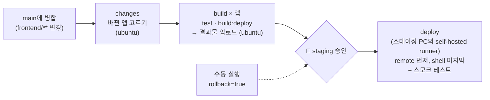

**① 준비**: 7-1에서 설치한 스테이징 PC의 러너(`eduhub-staging`)와 `staging` 환경 변수(`FRONTEND_WEB_ROOT`, `APP_URL`)를 그대로 씁니다. 추가로 할 일은 없습니다.

**② 워크플로우 작성 (Claude + 리뷰)** — 브랜치 `chore/frontend-deploy`, Plan 모드

```text
[목표] main에 frontend가 바뀌어 병합되면, 바뀐 MFE만 빌드해서 사람 승인 후 스테이징 PC의 화면 폴더에 배포하는 워크플로우를 만들려고 해
[위치] .github/workflows/deploy-frontend.yml (새 파일), scripts/changed-frontend-apps.sh (새 파일),
       scripts/deploy-frontend.ps1 (6회차 Step 4 그대로 사용)
[범위]
- 트리거: push(main, paths frontend/**), workflow_dispatch(app: all|shell|course-mfe|enrollment-mfe, rollback: boolean)
- changes 잡(ubuntu): push 직전 커밋과 비교해 바뀐 앱을 JSON 배열로. packages/·루트 package.json·lock이 바뀌면 셋 다.
  순서는 remote 먼저, shell 마지막. 비교 기준이 없으면 셋 다
- build 잡(ubuntu, 앱별 matrix): npm ci, 그 앱의 npm test, npm run build:deploy → 결과물을 frontend-<앱> 이름으로 업로드
- deploy 잡: runs-on [self-hosted, windows, eduhub-staging], environment: staging, 결과물을 받아 앱마다
  deploy-frontend.ps1 -WebRoot (staging 환경 변수 FRONTEND_WEB_ROOT), rollback이면 빌드 없이 -Rollback.
  끝나면 APP_URL의 /, /courses, remoteEntry.js 두 개, /api/v1/courses 스모크 테스트
- 권한 최소(contents: read), 배포는 동시에 하나만(concurrency, 중간에 취소하지 않음)
- 입력값·변수는 run에 ${{ }}로 직접 넣지 말고 env로 넘긴다
[하지 않는 것] 운영 배포, 백엔드 배포(7-2)
[완료 기준] actionlint 통과, changed-frontend-apps.sh를 여러 경우로 시험한 결과 표
[진행 방식] 잡 구성과 각 잡이 어디서(어느 러너) 도는지 먼저 보여줘
```

**기대하는 결과** — 아래 파일은 actionlint로 검사하고, 앱 고르기 스크립트는 9가지 경우로 시험했습니다 (끝의 ✅)

```yaml
# .github/workflows/deploy-frontend.yml — 프론트(MFE)를 사람 승인 후 스테이징 PC의 화면 폴더에 배포
name: Deploy frontend

on:
  push:
    branches: [main]
    paths: ['frontend/**']
  workflow_dispatch:
    inputs:
      app:
        description: '배포할 앱 (all = 셋 다)'
        type: choice
        options: [all, shell, course-mfe, enrollment-mfe]
        default: all
      rollback:
        description: '빌드하지 않고 화면 폴더에 보관된 직전 버전으로 되돌리기'
        type: boolean
        default: false

permissions:
  contents: read

concurrency:
  group: deploy-frontend-staging
  cancel-in-progress: false            # 배포 도중에 끊지 않는다

jobs:
  changes:
    runs-on: ubuntu-latest
    outputs:
      apps: ${{ steps.pick.outputs.apps }}
    steps:
      - uses: actions/checkout@v4
        with:
          fetch-depth: 0               # push 직전 커밋과 비교하려면 이력이 필요
      - id: pick
        env:
          EVENT: ${{ github.event_name }}
          INPUT_APP: ${{ inputs.app }}
          BEFORE: ${{ github.event.before }}
        run: bash scripts/changed-frontend-apps.sh >> "$GITHUB_OUTPUT"

  build:
    needs: changes
    if: needs.changes.outputs.apps != '[]' && !inputs.rollback
    runs-on: ubuntu-latest
    strategy:
      matrix:
        app: ${{ fromJSON(needs.changes.outputs.apps) }}
    steps:
      - uses: actions/checkout@v4
      - uses: actions/setup-node@v4
        with:
          node-version: 'lts/*'
          cache: npm
          cache-dependency-path: frontend/package-lock.json
      - name: Test and build (${{ matrix.app }})
        working-directory: frontend
        env:
          APP: ${{ matrix.app }}
        run: |
          npm ci
          npm test --workspace "apps/$APP"
          npm run build:deploy --workspace "apps/$APP"
      - uses: actions/upload-artifact@v4
        with:
          name: frontend-${{ matrix.app }}
          path: frontend/apps/${{ matrix.app }}/dist
          retention-days: 30

  deploy:
    needs: [changes, build]
    # 빌드가 성공했거나, 롤백이라 빌드를 건너뛴 경우
    if: >-
      always() && needs.changes.outputs.apps != '[]' &&
      (needs.build.result == 'success' || (inputs.rollback && needs.build.result == 'skipped'))
    runs-on: [self-hosted, windows, eduhub-staging]
    environment: staging                 # 필수 승인자가 승인해야 실행된다 (Step 7-1). 아래 vars도 이 환경의 변수
    steps:
      - uses: actions/checkout@v4        # scripts/deploy-frontend.ps1을 쓰려고
      - if: ${{ !inputs.rollback }}
        uses: actions/download-artifact@v4
        with:
          pattern: frontend-*
          path: artifacts                # artifacts\frontend-<앱>\ 마다 하나씩
      - name: Deploy or roll back (remote 먼저, shell 마지막)
        shell: powershell
        env:
          APPS: ${{ needs.changes.outputs.apps }}
          ROLLBACK: ${{ inputs.rollback }}
          WEB_ROOT: ${{ vars.FRONTEND_WEB_ROOT }}   # 예: C:\eduhub-staging\web (백엔드가 서비스하는 폴더)
        run: |
          if (-not $env:WEB_ROOT) { throw "staging 환경 변수 FRONTEND_WEB_ROOT가 없습니다" }
          $apps = $env:APPS | ConvertFrom-Json
          foreach ($app in $apps) {
            if ($env:ROLLBACK -eq 'true') { .\scripts\deploy-frontend.ps1 -App $app -WebRoot $env:WEB_ROOT -Rollback }
            else { .\scripts\deploy-frontend.ps1 -App $app -WebRoot $env:WEB_ROOT -Source "artifacts\frontend-$app" }
          }
      - name: Smoke test
        shell: powershell
        env:
          APP_URL: ${{ vars.APP_URL }}               # 예: http://localhost:8080
        run: |
          foreach ($path in '/', '/courses', '/mfe/course/remoteEntry.js', '/mfe/enrollment/remoteEntry.js', '/api/v1/courses') {
            $r = Invoke-WebRequest -UseBasicParsing "$($env:APP_URL)$path"
            if ($r.StatusCode -ne 200) { throw "$path -> $($r.StatusCode)" }
            Write-Host "OK $path"
          }
```

```bash
#!/usr/bin/env bash
# scripts/changed-frontend-apps.sh — 배포할 프론트 앱을 JSON 배열로 고른다 (GitHub Actions 출력: apps=[...])
# 순서: remote 먼저, shell 마지막 (새 shell이 새 remote를 찾도록)
set -euo pipefail
ALL='["course-mfe","enrollment-mfe","shell"]'

if [[ "${EVENT:-push}" == "workflow_dispatch" ]]; then          # 수동 실행: 고른 앱 (all이면 셋 다)
  if [[ "${INPUT_APP:-all}" == "all" ]]; then echo "apps=$ALL"; else echo "apps=[\"$INPUT_APP\"]"; fi
  exit 0
fi

# 비교 기준(push 직전 커밋)이 없으면(새 브랜치, 강제 푸시 등) 셋 다
if [[ -z "${BEFORE:-}" || "$BEFORE" =~ ^0+$ ]] || ! git cat-file -e "$BEFORE^{commit}" 2>/dev/null; then
  echo "apps=$ALL"; exit 0
fi
changed=$(git diff --name-only "$BEFORE" "${GITHUB_SHA:-HEAD}" -- frontend)

# 공통 파일(api-client 등 packages/, 루트 package.json·lock)이 바뀌면 셋 다
if grep -qE '^frontend/(packages/|package(-lock)?\.json$)' <<<"$changed"; then echo "apps=$ALL"; exit 0; fi

apps=()
for app in course-mfe enrollment-mfe shell; do
  if grep -q "^frontend/apps/$app/" <<<"$changed"; then apps+=("\"$app\""); fi
done
echo "apps=[$(IFS=,; echo "${apps[*]:-}")]"
```

```yaml
# .github/actionlint.yaml — actionlint가 직접 정한 러너 이름표를 알도록 (actionlint를 쓰는 팀만)
self-hosted-runner:
  labels:
    - eduhub-staging   # 스테이징 PC(백엔드와 화면 폴더가 있는 Windows)의 runner (7회차 Step 7-3)
```

**검토 포인트**

| 볼 것 | 이유 |
|---|---|
| `deploy`에 `environment: staging`이 있는가 | 승인 게이트. 빠지면 병합 즉시 사내 PC에 배포된다 |
| `deploy`만 `self-hosted`에서 도는가 | 빌드·테스트까지 사내 PC에서 돌리면 PC가 느려지고 공격 면이 넓어진다 |
| 트리거에 `pull_request`가 **없는가** | PR 코드는 아직 리뷰 전이다. self-hosted runner에서 돌면 안 된다 |
| 입력값·변수를 `env:`로 넘기는가 | `run:` 안에 `${{ }}`로 바로 넣으면 명령 주입 위험 |
| 배포 폴더·주소를 코드에 박지 않고 환경 변수로 받는가 | PC·환경마다 다르다. 운영에서는 같은 워크플로우가 웹 서버 폴더를 받는다 |
| 순서가 remote 먼저, shell 마지막인가 | 새 shell이 아직 없는 remote 모듈을 찾는 시간을 줄인다 |
| `concurrency`에서 `cancel-in-progress: false`인가 | 폴더를 바꾸는 도중에 끊기면 반쪽 상태가 될 수 있다 |
| 공통 파일 변경 시 **셋 다** 배포하는가 | api-client·lock 파일은 모든 앱에 들어간다 |

**③ 확인**

| # | 할 일 | 기대 결과 |
|---|---|---|
| D1 | course-mfe의 검색창 이름만 바꾼 PR을 병합 | `changes`의 출력이 `["course-mfe"]`, build는 course-mfe만, deploy는 **승인 대기(Waiting)** |
| D2 | 승인자가 **Review deployments**에서 승인 | 러너 PC에서 `deploy-frontend.ps1 -App course-mfe` 실행, 스모크 테스트 통과. 브라우저(`APP_URL`) 새로고침하면 바뀐 이름. 화면 폴더의 `mfe\course.prev`에 직전 버전 |
| D3 | **Actions** → **Deploy frontend** → **Run workflow**: app `course-mfe`, rollback ✔ | 빌드 없이 승인 후 직전 버전으로 복귀 |
| D4 | 백엔드·문서만 바꾼 PR 병합 | 이 워크플로우가 돌지 않는다 (`paths`) |
| D5 | `frontend/packages/api-client`를 바꾼 PR 병합 | 세 앱 모두 빌드, remote → shell 순서로 배포 |

> 💡 언제, 어떻게 되돌리는지와 되돌린 뒤 할 일은 바로 아래 **7-4**에 절차로 정리했습니다.

> ✅ 이 교재 환경에서 확인한 것: `deploy-frontend.yml`은 actionlint 1.7로 검사해 문제가 없었고(러너 이름표는 `actionlint.yaml`에 등록), `changed-frontend-apps.sh`는 9가지 경우(앱 하나, 둘, api-client, lock 파일, 백엔드·문서만, 비교 기준 없음, 강제 푸시, 수동 실행 all·shell)에서 기대한 결과를 냈습니다. 배포 단계가 쓰는 교체·롤백과 백엔드의 화면 폴더 서비스는 6회차 Step 4에서 확인했습니다. **실제 GitHub Actions 실행, Windows self-hosted runner 설치와 실행, 승인 화면, 환경 변수(`vars`), `download-artifact`의 폴더 구조, PowerShell 단계는 이 환경에서 실행해 보지 못했습니다.** 처음 적용할 때는 D1~D3을 꼭 직접 확인하고, Actions 로그에서 `artifacts\frontend-<앱>` 경로가 맞는지 봅니다.

### 7-4. 프론트 배포·롤백 절차 (런북에 그대로 옮긴다)

7-3의 파이프라인이 있어도, **언제 되돌릴지 정하고 실제로 되돌리는 것은 사람**입니다. 아래 절차를 `docs/runbook.md`의 "프론트 배포·롤백" 절로 옮기고(Step 8), 팀원 한 명이 실제로 한 번 해 봅니다.

**① 평소 배포 (자동)**

| 순서 | 누가 | 할 일 | 확인 |
|---|---|---|---|
| 1 | 개발자 | `frontend/` 변경 PR을 리뷰 받아 `main`에 병합 | CI 통과 |
| 2 | 파이프라인 | `changes` → 바뀐 앱만 `build` | `changes` 잡 로그의 `apps=[…]`가 바꾼 앱과 같은가 |
| 3 | 승인자 | **Review deployments**에서 승인. 배포 시간(사용자가 적은 때)인지, 무엇이 나가는지 PR 목록으로 확인 | 승인 전에 `apps=[…]`를 한 번 더 본다 |
| 4 | 파이프라인 | 스테이징 PC에서 앱마다 교체 → 스모크 테스트 | `deploy` 잡 초록, 로그에 `배포 완료: <앱> -> …`, `OK /` 등 5줄 |
| 5 | 승인자 | 브라우저에서 `APP_URL`(예: http://(스테이징 PC):8080)을 **강력 새로고침**(Ctrl+F5) 후 바꾼 화면과 로그인·목록 확인 | 5회차 6-2 확인 표 중 바뀐 화면에 해당하는 줄 |

**② 언제 되돌리나** (판단은 승인자·당번. 고쳐서 다시 배포할 수 있으면 그쪽이 먼저)

| 상황 | 조치 |
|---|---|
| `deploy` 잡의 **스모크 테스트 실패** | 이미 파일이 교체된 상태입니다. **바로 롤백**(③-A) 후 원인 조사 |
| 화면이 깨짐, 로그인·신청이 안 됨, 콘솔에 `remoteEntry.js` 로드 오류 | 롤백(③-A) |
| 일부 문구·스타일 문제처럼 기능에 영향이 없음 | 롤백하지 않고 수정 PR로 다시 배포 |

**③ 되돌리는 방법 세 가지**

| 방법 | 언제 | 어떻게 |
|---|---|---|
| **A. 직전 버전으로** (가장 빠름) | 방금 배포한 것이 문제 | Actions → **Deploy frontend** → **Run workflow** → app: 문제 앱, rollback: ✔ → 승인. 화면 폴더의 `.prev`(직전 버전)가 다시 서비스되고 문제 버전은 `.broken`으로 옮겨진다 |
| **B. 코드로 되돌리기** (근본 조치) | A를 이미 한 번 했거나, 두 단계 이상 전으로 가야 함 | 문제 커밋을 `git revert`한 PR → 병합 → 평소 배포(①)로 이전 코드가 다시 나간다. **A를 했더라도 B는 꼭 한다** (아래 ④) |
| **C. 사람이 직접** (파이프라인·러너가 안 될 때) | GitHub 장애, 러너 꺼짐, 승인자 부재 | 스테이징 PC에서 아래 명령. 6회차 Step 4와 같은 스크립트 |

```powershell
# C-1. 직전 버전으로 (스테이징 PC, 사람이 받아 둔 저장소 폴더에서. 러너의 작업 폴더가 아니다)
cd C:\work\eduhub
git pull
.\scripts\deploy-frontend.ps1 -App course-mfe -WebRoot C:\eduhub-staging\web -Rollback

# C-2. 특정 정상 버전을 다시 빌드해서 배포 (두 단계 이상 전으로 가야 할 때)
git switch --detach <정상이던 커밋>          # git log --oneline -- frontend/apps/course-mfe 로 찾는다
cd frontend; npm ci; npm run build:deploy --workspace apps/course-mfe; cd ..
.\scripts\deploy-frontend.ps1 -App course-mfe -WebRoot C:\eduhub-staging\web
git switch main
```

**롤백 스크립트가 남기는 폴더** (교재 환경에서 스크립트로 그대로 시험한 결과)

| 한 일 | 서비스 중 | `.prev` | `.broken` |
|---|---|---|---|
| v1 → v2 → v3 배포 | v3 | v2 | — |
| 롤백 (A 또는 C-1) | **v2** | — | v3 |
| 한 번 더 롤백 | v2 그대로, **"되돌릴 이전 버전이 없습니다"로 실패** | — | v3 |
| v4 배포 | v4 | v2 | v3 |
| 롤백 | v2 | — | **v4** (v3은 지워짐) |

- 롤백은 **한 단계만** 됩니다. 더 뒤로 가려면 B나 C-2
- `.broken`은 다음 롤백 때 덮어써집니다. 원인 조사에 필요하면 **바로 다른 이름으로 복사**해 둡니다

**④ 롤백한 뒤 반드시 할 일**

1. **`main`에는 아직 문제 코드가 있습니다.** 그 앱을 고친 다른 PR이 병합되면 문제 코드가 **다시 배포**됩니다. 바로 B(revert PR) 또는 수정 PR을 만들고, 그때까지는 그 앱을 건드리는 PR을 병합하지 않습니다. 급하면 Actions → **Deploy frontend** → ⋯ → **Disable workflow**로 자동 배포를 잠시 멈추고, 끝나면 **Enable workflow**
2. **공통 변경(api-client 등)이 들어간 배포를 되돌릴 때**는 그 배포에서 **함께 나간 앱을 모두** 되돌립니다(app: `all`, 또는 앱별로). 하나만 되돌리면 shell과 remote의 공유 코드가 어긋날 수 있습니다
3. 반대로 **그 배포에 없던 앱은 되돌리지 않습니다.** 롤백은 앱마다 "그 앱의 직전 배포"로 가므로, 이번에 배포되지 않은 앱을 되돌리면 **더 예전 버전**이 됩니다. 어떤 앱이 나갔는지는 그 실행의 `changes` 로그(`apps=[…]`)로 확인합니다
4. 기록: 언제, 무엇을, 왜 되돌렸는지 PR이나 `docs/retro/`에 한 줄. 8회차 "AI 없이 핫픽스" 훈련의 재료가 됩니다

> 💡 **Re-run으로 되돌리기**: 예전에 성공한 실행을 **Re-run all jobs** 하면 그 실행의 커밋으로 다시 빌드·배포됩니다(승인 필요). 다만 `changes`가 그때 바뀐 앱만 고르므로 다른 앱은 따라가지 않고, `main`의 코드는 그대로라 ④의 문제가 같이 남습니다. 이 교재 환경에서는 Re-run 동작을 실행해 보지 못했으니, 런북의 기본 방법은 A와 B로 둡니다.

> ✅ ③의 폴더 표는 `deploy-frontend.sh`(PowerShell 스크립트와 같은 논리)로 배포·롤백을 차례로 실행한 결과입니다. 6회차 Step 4에서 "백엔드 재시작 없이 롤백하면 이전 화면이 나온다"도 확인했습니다. Actions 화면의 메뉴 이름(Run workflow, Review deployments, Disable workflow)은 GitHub 화면 기준이며 실제 실행은 이 환경에서 해 보지 못했습니다.

---

## Step 8. 런북 작성과 직접 실행 확인

```text
[목표] docs/runbook.md를 작성하려고 해. 사람이 AI 없이 그대로 따라 할 수 있어야 해.
[위치] .github/workflows/ci.yml, .github/workflows/deploy-backend.yml, .github/workflows/deploy-frontend.yml, scripts/, backend/, frontend/
[범위] 절: 로컬 빌드·테스트 / 백엔드 스테이징 배포(승인, 스테이징 PC 폴더 구조, 사람이 직접 하는 방법) / 백엔드 롤백(previous.txt·deploy-history.log로 버전 찾기, -Rollback·-Version) / 프론트(화면 폴더) 배포와 롤백(7-4의 절차: 평소 배포, 판단 기준, 롤백 A·B·C, 롤백 후 할 일) / 수동 핫픽스 절차 / 필요한 권한과 승인자
[하지 않는 것] 실제 시크릿 값, 운영 접속 정보
[형식] 1-4 ⑤의 예처럼 절마다 언제 → 누가·어디서 → 명령 → 확인 방법 → 실패하면 → (롤백이면) 롤백 후 반드시. 맨 앞에 "증상 → 어느 절" 표
[완료 기준] 모든 명령은 복사해서 바로 실행할 수 있는 코드 블록(셸 종류 표시), 실제 경로 사용, 비밀 값은 위치만
```

✅ **확인 (팀원 교대)**: Claude를 쓰지 않은 **다른 팀원**이 런북만 보고 다음을 실행합니다.
1. 로컬 빌드·테스트
2. 스테이징 PC에서 `deploy-history.log`로 지금 버전과 직전 버전 찾기
3. 스테이징 PC에서 `.\scripts\deploy-backend.ps1 -Root C:\eduhub-staging\backend -Rollback`으로 롤백하고, `-Version <원래 버전>`으로 되돌려 놓기

막히는 곳이 있으면 런북을 **직접** 고칩니다. 이것이 1회차 원칙 ②를 매주 점검하는 방법입니다.

---

## 4-9. 자주 겪는 문제

| 증상 | 원인과 해결 |
|---|---|
| CI에서 Testcontainers 테스트 실패 | 러너의 Docker 사용 가능 여부 확인. 로컬 Docker 전용 설정(소켓 경로 등)이 커밋되지 않았는지 확인 |
| `npm ci` 실패 | `package-lock.json`이 커밋되지 않았거나 `package.json`과 어긋남. 로컬에서 `npm install` 후 lock 파일 커밋 |
| 필수 상태 체크 목록에 잡 이름이 없음 | 해당 잡이 한 번도 실행되지 않음. PR로 한 번 실행한 뒤 다시 설정 |
| 커버리지 기준 때문에 계속 실패 | 기준을 낮추기 전에 부족한 클래스 확인. 테스트 보강은 별도 PR로 |
| 배포 잡이 승인 없이 실행됨 | 잡에 `environment: staging`이 빠졌거나 환경에 필수 승인자가 설정되지 않음 |
| (백엔드) `Stop-ScheduledTask`·`Start-ScheduledTask`가 `액세스가 거부되었습니다` | 러너 계정이 작업을 다룰 권한이 없음 → 작업을 러너 계정으로 등록했는지(`-User`) 확인. 그래도 막히면 IT와 상의 (교재 환경에서 확인하지 못한 부분) |
| (백엔드) `백엔드가 멈추지 않습니다` | 작업 스케줄러가 아닌 다른 프로세스가 8080을 씀 (6회차에 손으로 띄운 백엔드 등) → 그 프로세스를 끄고 다시 |
| (백엔드) `… 응답하지 않아 … 로 되돌립니다` | 새 버전이 기동에 실패 → `BACKEND_ROOT\logs\eduhub.log`의 ERROR. 흔한 원인: staging 시크릿 이름(`DB_URL` 등)이 `application-staging.yml`과 다름, `EDUHUB_JWT_SECRET`이 32바이트 미만 |
| (백엔드) `staging 환경 변수 BACKEND_ROOT가 없습니다` | Environments → staging → Environment variables에 `BACKEND_ROOT` 추가 (7-1 ①의 5) |
| deploy 잡이 `Waiting for a runner…`에서 멈춤 | 스테이징 PC의 러너가 꺼져 있거나 이름표가 다름 → Settings → Actions → Runners에서 상태와 `eduhub-staging` 이름표 확인 |
| (프론트) deploy가 `staging 환경 변수 FRONTEND_WEB_ROOT가 없습니다` | Environments → staging → Environment variables에 `FRONTEND_WEB_ROOT`, `APP_URL` 추가 (7-1 ①의 5) |
| `…ps1 cannot be loaded because running scripts is disabled` | 러너 PC의 PowerShell 실행 정책 → 7-1 ②의 4 |
| (프론트) deploy에서 `빌드 결과가 없습니다: artifacts\frontend-…` | 결과물 이름·경로가 어긋남 → build의 `name`과 deploy의 `pattern`, 로그의 실제 폴더 확인 |
| (프론트) 프론트를 고쳤는데 배포가 안 돎 | `paths: frontend/**` 밖만 바뀌었거나, `changes`가 `[]`를 냈음 → changes 잡 로그 확인 |
| (프론트) 롤백이 `되돌릴 이전 버전이 없습니다`로 실패 | 이미 한 번 롤백했거나 첫 배포였음. 롤백은 한 단계만 → 7-4 ③-B(revert) 또는 C-2 |
| (프론트) 롤백했는데 며칠 뒤 같은 문제가 다시 배포됨 | `main`에 문제 코드가 남아 있었음 → 7-4 ④-1, revert PR |
| (프론트) 롤백 후 다른 화면이 예전 모습으로 돌아감 | 그 배포에 없던 앱까지 되돌림 → 그 앱은 다시 배포(Run workflow, 그 앱, rollback 해제) |
| (프론트) 배포는 성공인데 화면이 그대로 | 백엔드가 다른 폴더를 서비스 중(`EDUHUB_WEB_ROOT`와 `FRONTEND_WEB_ROOT`가 다름), 또는 브라우저 캐시 → `Cache-Control: no-cache`(6회차 Step 4-6의 N4) 확인 |
| Claude가 워크플로우 수정 때마다 승인을 묻는다 | 의도한 동작 (`ask` 규칙). 워크플로우 변경은 매번 확인하는 것이 맞다 |

---

## ☕ 휴식 (8분)

---

# 5. 따라하기 ②: 사내 공통 모듈 적용과 강제

> **목표**: `corp-common`을 EduHub 백엔드에 적용하고, Claude가 새 API를 만들 때 **처음부터** 사내 규칙대로 쓰게 만듭니다. 그리고 규칙 위반은 테스트가 잡게 합니다.

---

## Step 1. 공통 모듈 가져오기

실제 회사라면 공통 모듈을 **사내 Maven 저장소**(Nexus 등)에서 의존성으로 받습니다. 사내 저장소가 없고 공개 Maven Central에도 올릴 수 없다면, 공통 모듈 소스를 **같은 저장소의 `libs/corp-common/`에 두고 Gradle composite build(`includeBuild`)로 연결**하는 것이 가장 간단합니다. 서버도 업로드도 필요 없고, CI도 그대로 돌며, Claude가 공통 모듈 소스를 직접 읽을 수 있습니다(장치 ④). 다른 방법(공유 폴더를 Maven 저장소처럼 쓰기 등)과 비교는 [예제 35의 2장](../examples/35-corp-common-library.md#2-maven-저장소-없이-공유하는-방법)에 있습니다.

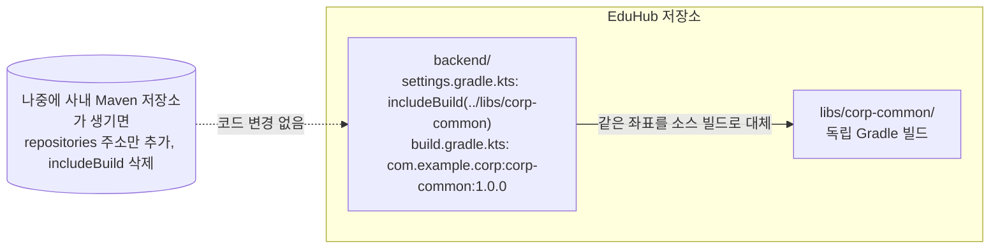

```bash
git switch main && git pull
git switch -c feature/corp-common
```

**① 공통 모듈 소스 넣기**: [예제 35의 4장](../examples/35-corp-common-library.md#4-전체-소스) 파일들을 `libs/corp-common/`에 만듭니다. 강사가 배포본을 주면 그대로 복사하고, 아니면 Claude에게 맡겨도 됩니다 (회사에서 공통 모듈 소스를 받아 오는 단계를 대신하는 것이므로 **내용을 고치지 않고 그대로** 만들게 합니다).

```text
examples/35-corp-common-library.md의 4장 "전체 소스"에 있는 파일들을 libs/corp-common/ 아래에 경로 그대로, 내용도 그대로 만들어줘.
내용을 고치거나 파일을 더하지 마. 끝나면 cd backend && ./gradlew :corp-common:test 가 통과하는지 보여줘.
```

**② backend에 연결 (사람이 직접)**

```kotlin
// backend/settings.gradle.kts (끝에 추가)
// 사내 공통 모듈: Maven 저장소 대신 같은 저장소의 소스를 함께 빌드 (Gradle composite build)
// dependencies의 com.example.corp:corp-common 을 이 빌드의 결과로 자동 대체한다
includeBuild("../libs/corp-common")
```

```kotlin
// backend/build.gradle.kts (dependencies에 추가)
implementation("com.example.corp:corp-common:1.0.0")
testImplementation("com.tngtech.archunit:archunit-junit5:1.3.0")
```

✅ **확인**

```bash
cd backend
./gradlew dependencies --configuration runtimeClasspath | grep corp-common
#   +--- com.example.corp:corp-common:1.0.0 -> project :corp-common   ← libs의 소스로 대체됨
./gradlew :corp-common:test      # 공통 모듈 테스트 5개
./gradlew test                   # 기존 EduHub 테스트 (아직 아무것도 바꾸지 않았으므로 그대로 통과)
```

> 💡 이 정도 연결은 **직접** 하는 편이 빠릅니다. Gradle 구성을 직접 만져 봐야 빌드가 깨졌을 때도 직접 고칠 수 있습니다. 공통 모듈이 들어오면 `libs/**`가 바뀌어도 백엔드가 다시 배포돼야 하므로, 7-2의 `deploy-backend.yml` `paths`에 `libs/**`가 있는지 확인합니다.

> ✅ 교재 환경(Gradle 8.14, Java 21, Spring Boot 3.5)에서 이 연결과 Step 4·5의 흐름을 확인했습니다: 의존성 대체, 공통 모듈 테스트 5개 통과, `CorpRulesTest`가 전환 전 코드의 위반 목록을 보여 줌, 전환한 API가 실제 서버에서 `ApiResponse` 모양과 `COURSE_NOT_FOUND`(404)로 응답, bootJar에 `corp-common-1.0.0.jar` 포함 ([예제 35의 6장](../examples/35-corp-common-library.md#6-확인한-것)).

---

## Step 2. 장치 ① CLAUDE.md에 짧은 필수 규칙

`backend/CLAUDE.md`에 다음을 **추가**합니다 (루트 CLAUDE.md가 아니라 백엔드 전용 파일 → 프론트 작업 때는 읽히지 않아 토큰 절약).

```markdown
## 사내 공통 모듈 corp-common (필수)
- API 응답은 `ApiResponse.ok(data)`로 감싼다. `ResponseEntity`를 직접 쓰지 않는다
- 업무 오류는 도메인별 `ErrorCode` enum + `throw new BizException(ErrorCode.XXX)`
- 현재 사용자는 `CurrentUser`로만 얻는다. 요청 본문의 userId를 믿지 않는다
- 사용법은 `corp-api` 스킬과 `reference/backend/CourseApiReference.java`를 본다
- 소스는 `libs/corp-common`. 없는 API를 추측해서 쓰지 않는다. 소스에서 확인하고, 없으면 질문한다
```

---

## Step 3. 장치 ②③ 스킬과 참조 코드

Claude에게 초안을 맡기고, 내용은 사람이 검토합니다.

```text
[목표] corp-common 사용법을 스킬과 참조 코드로 정리하려고 해.
[위치] libs/corp-common/ (소스를 직접 읽고 확인해), backend/src/main/java/com/example/eduhub/course/
[범위]
- .claude/skills/corp-api/SKILL.md: name, description 머리말 + "언제 무엇을 읽을지" 안내만 짧게
- .claude/skills/corp-api/guides/error-codes.md: ErrorCode 추가 방법, 이름 규칙(도메인_의미), HTTP 상태 선택 기준
- .claude/skills/corp-api/templates/Controller.java.md: ApiResponse·BizException·CurrentUser를 쓰는 컨트롤러 템플릿
- reference/backend/CourseApiReference.java: 과정 조회 API를 사내 규칙대로 만든 골든 예제
[하지 않는 것] 기존 코드 수정 (다음 단계에서 한다)
[완료 기준] 스킬과 예제에 corp-common에 실제로 있는 클래스·메서드만 등장
[진행 방식] 파일 목록과 SKILL.md의 description 문장을 먼저 보여줘
```

```markdown
---
name: corp-api
description: EduHub 백엔드에서 Controller, Service, 예외, 에러 코드를 새로 만들거나 수정할 때 사용한다. 사내 공통 모듈 corp-common의 ApiResponse, BizException, ErrorCode, CurrentUser 사용법과 템플릿을 제공한다.
---

# corp-api 사용 가이드
- 새 API 컨트롤러 → templates/Controller.java.md 를 복사해서 시작
- 업무 오류·에러 코드 추가 → guides/error-codes.md
- 모범 구현 → reference/backend/CourseApiReference.java
```

**검토 포인트**: description이 **언제 쓰는지**를 분명히 말하는가? (Claude는 description을 보고 스킬을 쓸지 정합니다) 예제에 `corp-common`에 **없는 메서드**가 등장하지 않는가?

---

## Step 4. 장치 ⑤ ArchUnit으로 강제

```java
// backend/src/test/java/com/example/eduhub/architecture/CorpRulesTest.java
package com.example.eduhub.architecture;

import static com.tngtech.archunit.lang.syntax.ArchRuleDefinition.methods;
import static com.tngtech.archunit.lang.syntax.ArchRuleDefinition.noClasses;

import com.example.corp.common.api.ApiResponse;
import com.tngtech.archunit.core.importer.ImportOption;
import com.tngtech.archunit.junit.AnalyzeClasses;
import com.tngtech.archunit.junit.ArchTest;
import com.tngtech.archunit.lang.ArchRule;
import org.springframework.web.bind.annotation.RestController;

@AnalyzeClasses(packages = "com.example.eduhub", importOptions = ImportOption.DoNotIncludeTests.class)
class CorpRulesTest {

    @ArchTest
    static final ArchRule controllers_return_api_response =
        methods().that().areDeclaredInClassesThat().areAnnotatedWith(RestController.class)
                 .and().arePublic()
                 .should().haveRawReturnType(ApiResponse.class)
                 .because("모든 API는 ApiResponse로 감싸 반환한다 (corp-common)");

    @ArchTest
    static final ArchRule no_raw_runtime_exception =
        noClasses().that().resideInAPackage("..eduhub..")
                   .should().callConstructor(RuntimeException.class, String.class)
                   .because("업무 오류는 BizException(ErrorCode)를 쓴다");

    @ArchTest
    static final ArchRule controllers_do_not_use_repositories =
        noClasses().that().areAnnotatedWith(RestController.class)
                   .should().dependOnClassesThat().haveSimpleNameEndingWith("Repository")
                   .because("Controller → Service → Repository 계층 규칙");
}
```

> 이 테스트는 **직접 작성하거나**, Claude가 쓴 초안을 한 줄씩 이해하고 확정합니다. 강제 규칙은 팀 전체의 코드를 막으므로 **규칙의 주인은 사람**입니다.

✅ **확인**: `./gradlew test --tests "*CorpRulesTest"`를 실행합니다. 기존 코드가 규칙을 어기고 있으면 **실패 목록**이 나옵니다. 이것이 다음 단계의 작업 목록입니다.

---

## Step 5. 기존 코드 전환과 새 API로 효과 확인

**5-1. 기존 코드 전환** (여러 파일의 반복 작업 → Claude에게 맡기고 리뷰)

```text
[목표] CorpRulesTest가 실패하는 기존 컨트롤러와 예외 처리를 corp-common 규칙으로 전환해줘.
[위치] ./gradlew test --tests "*CorpRulesTest" 실패 목록의 클래스들
[범위] course, enrollment 패키지의 Controller와 Service의 예외 처리. auth.CurrentUser는 지우고 corp-common의 CurrentUser로
       (컨트롤러는 @AuthenticationPrincipal Jwt 대신 CurrentUser 파라미터). 응답 모양이 바뀐 API의 기존 테스트는 JSON 경로만 $.data… 로
[하지 않는 것] API 경로·요청 형식 변경, 업무 로직 변경, CorpRulesTest 수정
[완료 기준] ./gradlew test 전체 통과 (CorpRulesTest 포함), 프론트 API 클라이언트 재생성 필요 여부 보고
[진행 방식] 클래스별 변경 계획을 먼저 보여줘
```

> ⚠️ 응답 형식이 `ApiResponse`로 바뀌면 **프론트가 받는 JSON 구조도 바뀝니다.** API 클라이언트 재생성과 화면 수정이 필요한지 Claude에게 보고하게 하고, 필요하면 별도 PR로 나눕니다 (PR은 리뷰 가능한 크기로).

**5-2. 새 API로 효과 확인**: `/clear` 후 규칙을 따로 설명하지 않고 지시합니다.

```text
수강 신청 취소 마감이 지난 경우 취소를 막는 기능을 추가해줘.
마감이 지났으면 업무 오류로 응답해야 해. 위치는 enrollment 패키지.
완료 기준: ./gradlew test 통과.
```

**관찰할 점**
- Claude가 `corp-api` 스킬이나 참조 코드를 **스스로 찾아 읽었나?**
- `ErrorCode`에 `ENROLLMENT_CANCEL_DEADLINE_PASSED` 같은 규칙에 맞는 이름을 추가했나?
- 혹시 규칙을 어겼다면 `CorpRulesTest`가 잡았나?

**diff 검토 체크리스트**

- [ ] `corp-common`에 없는 클래스·메서드를 쓰지 않았는가? (지어낸 API는 컴파일 오류가 나지만, 비슷한 이름의 다른 메서드를 잘못 쓸 수 있다)
- [ ] 사용자 정보를 `CurrentUser`에서 얻는가?
- [ ] `CorpRulesTest`나 기준을 **약하게 고치지** 않았는가?

---

## Step 6. (선택) 훅으로 즉시 피드백

수정할 때마다 ArchUnit을 돌려 Claude가 바로 오류를 보고 고치게 할 수 있습니다.

```json
{
  "hooks": {
    "PostToolUse": [
      {
        "matcher": "Edit|Write",
        "hooks": [
          { "type": "command", "command": "bash .claude/hooks/corp-rules.sh" }
        ]
      }
    ]
  }
}
```

```bash
# .claude/hooks/corp-rules.sh
#!/usr/bin/env bash
FILE=$(jq -r '.tool_input.file_path // empty')
[[ "$FILE" == *"/backend/src/main/java/"* ]] || exit 0

if ! (cd backend && ./gradlew test --tests "*CorpRulesTest" -q > /tmp/corp-rules.log 2>&1); then
  grep -E "Rule '|was violated|because" /tmp/corp-rules.log | head -20 >&2
  exit 2   # 위반 내용을 Claude에게 전달 (PostToolUse에서는 이미 수정된 뒤이므로 "고치라"는 피드백 역할)
fi
exit 0
```

> 💡 훅에서 Gradle을 매번 돌리면 **느려집니다.** 출력은 위반 줄만 넘겨 토큰을 아끼고, 너무 느리면 훅 대신 "작업 끝에 `./gradlew test` 실행"을 완료 기준으로 두는 편이 낫습니다. PostToolUse 훅의 종료 코드 2가 어떻게 처리되는지는 [훅 예제](../examples/03-settings-skills-agents-hooks.md#모듈-12-훅)와 공식 문서로 확인합니다.

---

## 5-7. 커밋과 PR

```bash
git add libs backend .claude/skills reference
git status                     # .env, build/ 가 없는지 확인
git commit -m "feat(common): corp-common 공통 모듈 적용과 아키텍처 규칙 테스트 추가"
git push -u origin feature/corp-common
```

PR 본문의 "Claude에게 맡긴 것 / 직접 한 것"에 **어떤 장치(CLAUDE.md, 스킬, 참조 코드, ArchUnit, 훅)가 효과가 있었는지** 한 줄씩 적습니다.

---

# 6. 따라하기 ③: 토큰 사용량 측정과 사용량 리포트

> **목표**: 같은 작업 묶음을 개선 전후로 실행해 숫자로 비교하고, `docs/usage-report.md`를 만듭니다.
> 시간이 부족하면 6-1, 6-2를 수업 중에 하고 6-3, 6-4는 과제로 합니다.

---

## 6-1. 기준 작업 묶음 정하기

팀이 같은 작업을 같은 지시로 실행해야 비교가 됩니다. 각 작업은 **새 세션(`/clear`) + 같은 모델·effort**로 시작합니다.

| ID | 작업 | 지시 (그대로 복사) |
|---|---|---|
| T1 | 코드 설명 | `수강 신청이 들어오면 정원 확인과 대기자 등록이 어떤 순서로 처리되는지 설명해줘` |
| T2 | 작은 기능 | `과정 목록 API에 category 필터를 추가해줘. 완료 기준: ./gradlew test 통과` |
| T3 | 실패 테스트 고치기 | (강사가 제공하는 깨진 테스트 브랜치에서) `./gradlew test 실패를 고쳐줘` |

> 기준 작업은 매번 원래 상태로 되돌린 뒤(`git restore`, `git switch`) 실행합니다.

---

## 6-2. 개선 전 측정

각 작업이 끝나면 다음을 기록합니다.

| 작업 | `/context` 사용량 | `/usage` 세션 토큰·비용 | 캐시 적중률 | 걸린 시간 | 테스트 첫 통과 | 재지시 횟수 |
|---|---|---|---|---|---|---|
| T1 | | | | | — | |
| T2 | | | | | | |
| T3 | | | | | | |

---

## 6-3. 개선 적용

| 개선 | 방법 | 기대 효과 |
|---|---|---|
| CLAUDE.md 다이어트 | 루트 CLAUDE.md의 상세 절차를 스킬로 옮겨 200줄 이내로. `/context`에서 CLAUDE.md 비중 확인 | 매 턴 고정 비용 감소 |
| 읽기 차단 | `build/`, `node_modules/`, `dist/`, 생성 클라이언트 읽기 deny | 넓은 탐색 비용 감소 |
| 테스트 출력 필터 훅 | `./gradlew test` 출력은 실패 부분만 ([토큰 최적화 6장의 훅 예시](../examples/08-token-optimization.md#6-공식-문서-기준-보강-2026년-10월-확인)) | 도구 결과 감소 |
| 탐색 서브에이전트 | `.claude/agents/code-explorer.md`, `model: haiku`, 읽기 도구만 | T1 같은 설명 작업 비용 감소 |
| 지시 개선 | T1·T2에 파일 위치(`@`) 추가 | 탐색 감소 |

```markdown
---
name: code-explorer
description: 코드 위치 찾기, 호출 흐름 설명처럼 읽기만 하는 탐색 작업에 사용한다. 결과는 관련 파일 경로와 요약만 반환한다.
tools: Read, Grep, Glob
model: haiku
---

너는 EduHub 코드 탐색 담당이다. 파일을 수정하지 않는다.
결과는 "관련 파일 경로 목록 + 10줄 이내 요약"으로만 돌려준다.
```

> ⚠️ 개선은 **하나씩** 적용하고 측정해야 무엇이 효과였는지 알 수 있습니다. 시간이 없으면 "CLAUDE.md 다이어트 + 위치 지정" 두 가지만 먼저 합니다.

---

## 6-4. 개선 후 측정과 사용량 리포트

같은 작업을 같은 지시로 다시 실행하고, Claude에게 리포트 초안을 맡깁니다.

```text
[목표] 토큰 최적화 전후 비교 리포트를 docs/usage-report.md로 만들어줘.
[위치] 아래 측정표 두 개 (개선 전, 개선 후)
[범위] 요약 3줄, 작업별 전후 비교 표, 개선 수단별 효과 추정, 품질 지표(테스트 첫 통과, 재지시) 변화, 다음 주에 시도할 것 2가지
[하지 않는 것] 측정하지 않은 수치를 추정해서 채우기 (빈 칸은 빈 칸으로)
[완료 기준] 마크다운 표로, 숫자는 측정표의 값만 사용

(측정표 붙여넣기)
```

**리포트 검토 포인트**
- 사용량이 줄었는데 **품질 지표가 나빠지지 않았는가?** (재지시 증가, 테스트 첫 통과 실패)
- 개선 효과를 **과장**하지 않았는가? (작업 3개, 1회 측정은 오차가 크다)
- 팀 규칙으로 남길 것은? → CLAUDE.md나 팀 위키에 한 줄로

> 💡 리포트를 6회차에 배운 **아티팩트**로 만들어 팀에 공유해도 좋습니다. 단, 사용량 수치에 개인을 평가하는 의미를 붙이지 않습니다. 목적은 **팀의 습관 개선**입니다.

---

# 7. 더 해 보기 (시간이 남으면 수업 중, 아니면 과제)

---

## 7-1. CI 실패 원인 자동 분석 (보조)

PR의 CI가 실패하면 Claude가 로그를 읽고 원인을 **PR 코멘트로만** 남기는 잡을 추가합니다. 설계 포인트는 [빌드·배포 파이프라인 4-2](../examples/28-build-deploy-pipeline.md#4-2-ci-실패-원인-자동-분석)를 봅니다.

- 읽기 전용 도구만 허용 (`--allowedTools "Read" "Grep" "Glob"`), 최대 턴 수 제한 (`--max-turns`)
- 외부 포크 PR에서는 실행하지 않음, API 키는 저장소 시크릿에만
- 결과는 코멘트로만, **수정·푸시는 하지 않음**
- 실행마다 사용량을 기록해 사용량 리포트에 CI 항목으로 추가

> 다음 주(8주차) 헤드리스·CI 자동 리뷰에서 본격적으로 다룹니다.

---

## 7-2. 프론트엔드도 사내 규칙으로

가상의 사내 HTTP 래퍼(예: `corpHttp`)를 정하고, ESLint `no-restricted-imports`로 `axios` 직접 import를 막아 봅니다 ([사내 커스텀 프레임워크 ⑤](../examples/07-custom-framework.md)). 생성된 API 클라이언트는 예외로 둡니다.

---

## 7-3. 운영 배포 설계만 해 보기

실행하지 않고 **설계 문서만** 씁니다: `production` 환경의 필수 승인자, 배포 가능 시간대, 운영 시크릿 관리 주체, 롤백 기준(스모크 테스트 실패 시), DB 마이그레이션의 하위 호환 원칙(expand → contract). Claude에게 "질문을 먼저 해 줘"라고 하면 빠뜨린 결정 사항을 찾는 데 도움이 됩니다.

---

# 8. 정리

---

## 8-1. 오늘의 핵심

1. **CI가 기준이다**: Claude가 쓴 코드든 사람이 쓴 코드든 같은 CI(포맷·테스트·커버리지)를 통과해야 `main`에 들어간다 (NFR-05)
2. **파이프라인은 함께 만들되, 문은 사람이 연다**: 저장소 설정과 배포 승인은 사람, 워크플로우 변경은 엄격하게 리뷰
3. **환경 분리 완성**: 스테이징·운영 설정에는 변수만, 비밀은 환경별 저장소에, Claude는 개발·테스트까지 (NFR-06)
4. **런북은 사람이 직접 실행해 봐야 완성**: AI 없이도 빌드·배포·롤백·핫픽스 (원칙 ②)
5. **사내 규칙은 알려 주고(CLAUDE.md), 보여 주고(스킬·참조 코드), 강제한다(ArchUnit·훅)**. 강제 규칙의 주인은 사람
6. **토큰은 숫자로 관리**: 같은 작업 묶음으로 전후 비교, 품질 지표와 함께, "작업 완료당 비용"으로 판단

---

## 8-2. 확인 퀴즈

1. 필수 상태 체크를 CI가 **한 번 성공한 뒤에** 설정하는 이유는?
2. 배포 워크플로우에서 사람 승인 게이트 역할을 하는 설정은 무엇이고, 빠지면 어떻게 되나?
3. `application-prod.yml`에 접속 정보의 **기본값**도 두지 않는 이유는?
4. 런북이 "완성"되었다고 말할 수 있는 조건은?
5. 사내 공통 모듈 규칙을 CLAUDE.md에 상세히 쓰지 않고 스킬로 옮기는 이유 두 가지는?
6. CLAUDE.md의 "`ApiResponse`로 감싼다"와 ArchUnit 테스트의 차이는? 둘을 함께 쓰는 이유는?
7. 토큰 최적화 전후를 비교할 때 사용량 외에 반드시 함께 봐야 하는 것은? 그 이유는?
8. CI에서 Claude를 실행할 때 비용과 위험을 통제하는 방법 세 가지는?

<details>
<summary>정답 보기</summary>

1. 체크(잡) 이름은 한 번 이상 실행된 뒤에야 설정 화면의 목록에 나타나기 때문
2. 배포 잡의 `environment: staging`(필수 승인자가 지정된 GitHub Environment). 빠지면 `main`에 병합되는 즉시 승인 없이 배포된다
3. 값이 없으면 기동이 실패해 실수를 바로 알 수 있다. 기본값이 있으면 엉뚱한 DB(예: 로컬 값)에 조용히 붙을 수 있고, 기본값 자체가 비밀 노출이 될 수 있다
4. Claude를 쓰지 않은 다른 팀원이 런북만 보고 빌드, 배포할 버전 찾기, 스테이징 롤백을 실제로 실행해 성공했을 때
5. CLAUDE.md는 매 세션 읽히므로 길면 토큰 비용이 계속 들고 중요한 규칙이 묻힌다. 스킬은 평소 이름과 설명만 로드되고 필요할 때만 본문을 읽는다
6. CLAUDE.md는 강제력이 없는 지침(부탁), ArchUnit은 어기면 테스트가 실패하는 강제. CLAUDE.md로 미리 알려 실수를 줄이고, 테스트로 실수를 확실히 잡는다. 테스트는 사람이 쓴 코드에도 적용된다
7. 품질 지표(테스트 첫 통과, 재지시 횟수, 리뷰 수정 수). 사용량이 줄어도 재작업이 늘면 작업 완료당 비용은 오히려 커지기 때문
8. 읽기 전용 도구만 허용, 최대 턴 수 제한, 외부 포크 PR 제외·실행 조건 제한, 결과는 코멘트로만(수정·푸시 금지), 실행별 사용량 기록 중 세 가지

</details>

---

## 8-3. 과제 (다음 회차 전까지)

- [ ] 따라하기 ①의 PR 3개(CI, 프로필·비밀, 스테이징 배포) 병합, `main` 필수 체크 동작 확인
- [ ] 7-2 백엔드 배포 B1~B4(승인 대기, 배포, 롤백, 특정 버전)를 스테이징 PC에서 확인하고 `deploy-history.log`를 PR에 붙이기
- [ ] 7-3 프론트 자동 배포(`chore/frontend-deploy`) 병합 후 D1~D3(바뀐 앱만 배포, 승인, 롤백)을 직접 확인하고 Actions 화면 캡처를 PR에
- [ ] 7-4 절차를 `docs/runbook.md`에 옮기고, **다른 팀원**이 런북만 보고 롤백(A)과 revert PR(B)을 한 번씩 해 보기
- [ ] `docs/runbook.md`를 **Claude를 쓰지 않은 팀원**이 실행해 보고 고친 내용을 PR로
- [ ] `corp-common` 적용 PR 병합, `CorpRulesTest` 통과
- [ ] 6장 측정을 끝내고 `docs/usage-report.md` 완성 (팀 채널에 요약 3줄 공유)
- [ ] 주간 회고: Claude에게 맡긴 것 / 직접 한 것 / `/usage` 기록 / 이번 주 "AI 없이 설명하기" 주제(배포 흐름)
- [ ] (선택) 7장 더 해 보기 중 하나

## 8-4. 다음 회차 예고

**8주차: 성능·보안 점검, AI 없이 핫픽스 훈련, 헤드리스·CI 자동화, 거버넌스 (모듈 17, 18, 20)**
- 과정 목록 API 성능 개선 (NFR-02: N+1 제거, 응답 300ms)
- 보안 점검 (NFR-03: 본인 신청만 취소, 비밀 검사)
- **오늘 만든 런북만 보고 "AI 없이 핫픽스" 훈련**
- 헤드리스 모드(`claude -p`)와 CI 자동 리뷰, Agent SDK, 팀 거버넌스

**미리 읽어 오면 좋은 자료**
- [개발자의 책임 — 원칙 2 긴급 핫픽스](../examples/27-developer-responsibility.md#원칙-2-긴급-상황에서는-직접-수정빌드배포할-수-있어야-한다)
- [자동화와 캡스톤](../examples/05-automation-and-capstone.md)
- [빌드·배포 파이프라인 — 파이프라인 안에서 Claude 활용하기](../examples/28-build-deploy-pipeline.md#4-파이프라인-안에서-claude-활용하기)

---

## 참고 자료

- 교육 저장소: [2회차 자료(EduHub 요구사항·7주 계획·Git 작업 방식)](./session-02-hands-on-kickoff.md), [1회차 자료](./session-01-introduction.md), [빌드·배포 파이프라인](../examples/28-build-deploy-pipeline.md), [개발자의 책임](../examples/27-developer-responsibility.md), [사내 커스텀 프레임워크 적용](../examples/07-custom-framework.md), [토큰 사용량 최적화](../examples/08-token-optimization.md), [모델 가이드](../examples/29-models-guide.md), [GitHub 연결과 버전관리](../examples/06-github-version-control.md), [설정·스킬·에이전트·훅 예제](../examples/03-settings-skills-agents-hooks.md), [권한](../examples/23-permissions.md)
- Claude Code 공식 문서: Manage costs effectively, Hooks, Skills, Subagents, Settings — https://code.claude.com/docs
- GitHub 문서: Actions 워크플로우, Environments(배포 보호 규칙), 브랜치 보호 규칙·Rulesets (요금제별 지원 범위 확인)
