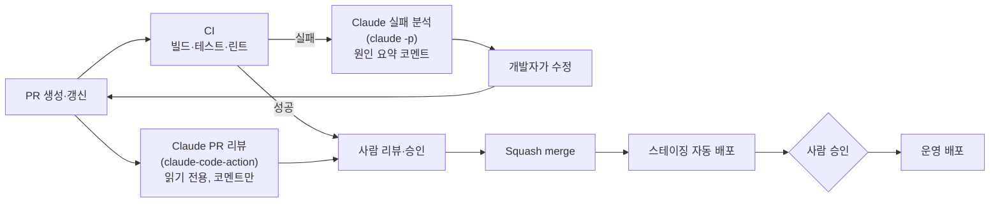
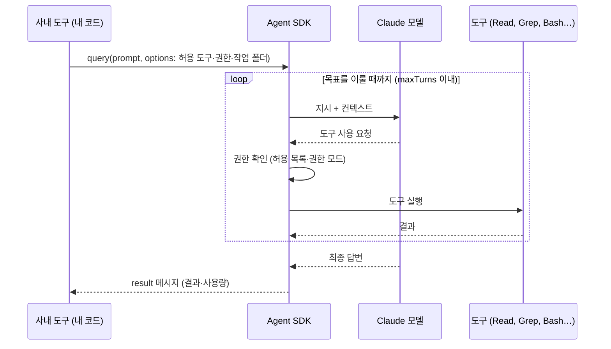
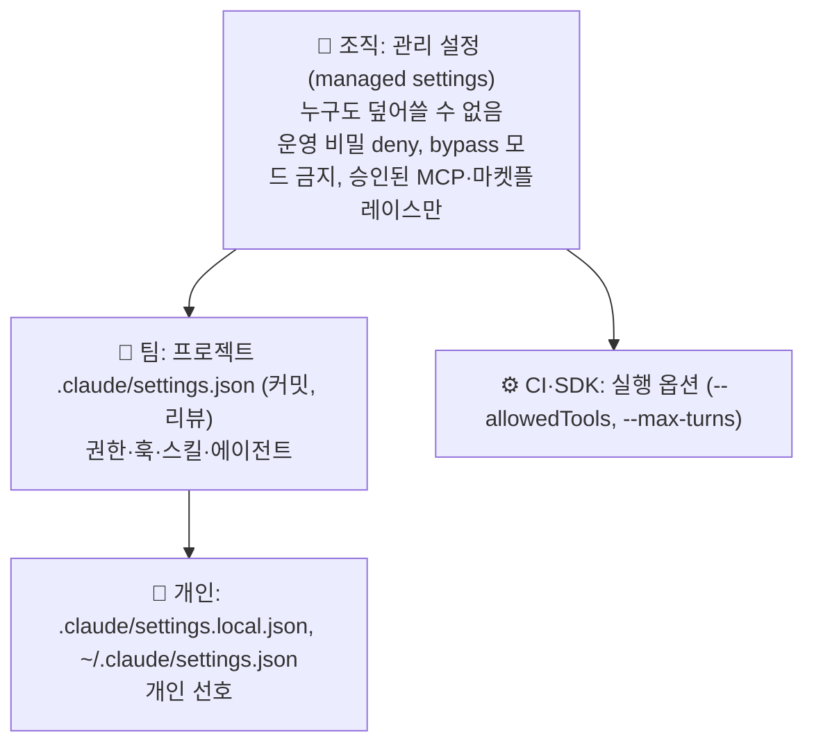
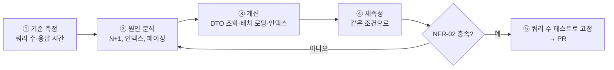
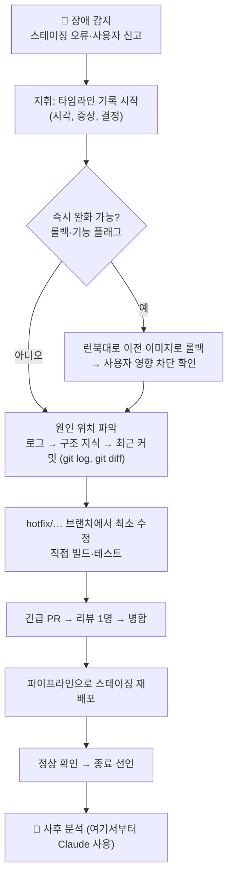

# 8회차: 자동화·Agent SDK·거버넌스 — 성능·보안 점검과 AI 없이 핫픽스 훈련 (NFR-02, NFR-03)

🧭 ⬅️ 이전: [7회차: CI/CD·환경 분리 완성·사내 프레임워크·토큰 최적화 (NFR-05, NFR-06)](./session-07-cicd-framework-tokens.md) · ➡️ 다음: [9회차: 캡스톤 발표 — EduHub 7주 결과와 앞으로](./session-09-capstone.md) · 📚 [전체 커리큘럼](../CURRICULUM.md#-회차별-강의-자료)

> **대상**: 7회차까지 EduHub에 CI/CD와 스테이징 배포를 갖춘 팀
> **시간**: 120분 (강의 약 40%, 따라하기 약 60%)
> **목표**
> 1. `claude -p` 헤드리스 실행과 GitHub Actions로 **사람 없이 도는 Claude 작업**을 설계하고, 비용·권한을 통제한다
> 2. Claude Agent SDK로 **사내 도구 안에 에이전트를 넣는 경우**와 그렇지 않은 경우를 구분한다
> 3. 조직 단위 **거버넌스**(관리 설정, 승인된 MCP·플러그인, 사용량 모니터링, 감사)의 큰 그림을 이해한다
> 4. EduHub의 **성능(NFR-02)**을 숫자로 측정하고 개선 전후를 비교한다
> 5. EduHub의 **보안(NFR-03)**을 점검하고 PR 자동 보안 리뷰를 붙인다
> 6. **AI 없이 핫픽스 훈련**으로 "시스템의 주인은 개발자"를 직접 증명하고, 사후 분석에서 Claude를 활용한다
>
> **관련 모듈**: 17(헤드리스 & CI/CD), 18(Claude Agent SDK), 20(운영 & 거버넌스) + 선택 심화 A(RAG)
> **사전 준비**
> - 7회차 결과: `main` 병합 시 스테이징에 자동 배포되는 파이프라인, 런북(`docs/runbook.md`), 이전 버전으로 되돌리는 롤백 절차
> - 과정 데이터 1만 건 시드 스크립트 (7회차 과제) 또는 강사가 배포한 `seed-10k.sql`
> - [k6](https://k6.io/) 설치 (`k6 version`으로 확인). 설치가 어려우면 강사 PC의 결과를 함께 봅니다
> - 저장소 Settings → Secrets에 `ANTHROPIC_API_KEY` 등록 권한 (팀장 1명)

---

## 진행 순서

| 시간 | 내용 | 형식 |
|---|---|---|
| 0:00 – 0:05 | 지난 회차 복습 & 과제 리뷰 | 강의 |
| 0:05 – 0:20 | 1. 헤드리스 실행과 CI 자동화 (모듈 17) | 강의 + 시연 |
| 0:20 – 0:30 | 2. Claude Agent SDK: 내 프로그램 안의 에이전트 (모듈 18) | 강의 |
| 0:30 – 0:40 | 3. 운영 & 거버넌스 (모듈 20) | 강의 + 토론 |
| 0:40 – 0:48 | ☕ 휴식 (스테이징이 정상인지 각 팀이 확인) | — |
| 0:48 – 1:08 | 4. 따라하기 ①: 성능 측정과 개선 (NFR-02) | 실습 |
| 1:08 – 1:23 | 5. 따라하기 ②: 보안 점검과 PR 자동 보안 리뷰 (NFR-03) | 실습 |
| 1:23 – 1:53 | 6. 따라하기 ③: ⭐ AI 없이 핫픽스 훈련 + Claude와 사후 분석 | 실습 |
| 1:53 – 2:00 | 8. 정리, 과제, 캡스톤 안내 | 강의 |

> 7장(SDK 미니 봇, RAG 맛보기)은 시간이 남으면 수업 중에, 아니면 **과제**로 진행합니다.
> 💬 **강사 노트:** 핫픽스 훈련(6장)은 **절대 줄이지 않습니다.** 시간이 밀리면 1~3장의 시연과 5장의 CI 리뷰 설정을 줄입니다.

---

## 지난 회차 복습 & 과제 리뷰

**7회차 핵심 3문장**
1. 빌드는 **한 번**, 배포는 같은 이미지를 **여러 환경에**
2. 운영 배포는 **사람의 승인**과 파이프라인으로만. Claude Code는 파이프라인을 **만드는 것을 돕지만**, 운영에 직접 배포하지 않는다
3. 런북은 **AI 없이 사람이 그대로 따라 할 수 있어야** 한다

**과제 확인 (팀별 1분)**
- [ ] 스테이징 자동 배포가 동작하는가? 마지막 배포 이미지 태그는?
- [ ] `docs/runbook.md`에 배포·롤백 절차가 명령어 수준으로 적혀 있는가?
- [ ] 이번 주 `/usage` 기록과 토큰을 아낀 방법 1개

> 💬 **강사 노트:** 오늘 6장의 핫픽스 훈련은 이 런북을 그대로 씁니다. 런북이 부실한 팀은 휴식 시간에 "롤백 명령" 한 줄이라도 채워 두라고 미리 알려 줍니다. (어떤 버그를 넣을지는 말하지 않습니다)

---

# 1. 헤드리스 실행과 CI 자동화 (모듈 17)

---

## 1-1. 대화형 vs 헤드리스

| 구분 | 대화형 (`claude`, 데스크톱 앱) | 헤드리스 (`claude -p "지시"`) |
|---|---|---|
| 누가 보나 | 사람이 화면을 보며 승인·수정 | **아무도 보지 않음**. 결과만 남음 |
| 권한 승인 | 승인 창에서 사람이 판단 | 승인할 사람이 없음 → **미리 허용한 도구만** 쓰게 해야 함 |
| 출력 | 화면 | 표준 출력: `text`(기본), `json`(결과+사용량), `stream-json`(진행 이벤트) |
| 어울리는 일 | 설계, 구현, 디버깅 | PR 리뷰, CI 실패 분석, 릴리스 노트, 정기 리포트 |

```bash
# 결과를 JSON으로 받아 사용량까지 기록 (CI 비용 추적에 사용)
claude -p "backend에서 @Operation이 없는 컨트롤러 메서드를 찾아 목록으로 알려줘. 코드는 수정하지 마." \
  --output-format json \
  --permission-mode dontAsk --allowedTools "Read" "Grep" "Glob" \
  --max-turns 8 > openapi-audit.json

# 파이프로 로그를 넘겨 분석
./gradlew test 2>&1 | tail -100 | claude -p "이 테스트 실패의 원인과 수정 방향을 5줄로 요약해줘"
```

> 💡 헤드리스의 3대 안전장치: **읽기 전용 도구만 허용**(`--allowedTools`), **턴 수 제한**(`--max-turns`), **분석만 하고 수정·푸시는 사람이**. 비용 상한은 `--max-budget-usd`로도 걸 수 있습니다. ([빌드·배포 파이프라인 4-2](../examples/28-build-deploy-pipeline.md#4-2-ci-실패-원인-자동-분석))

---

## 1-2. 파이프라인 안의 Claude



| 자동화 | 트리거 | 도구 | 권한 |
|---|---|---|---|
| PR 자동 리뷰 | `pull_request` | `anthropics/claude-code-action@v1` | `contents: read`, `pull-requests: write` |
| CI 실패 원인 분석 | CI 실패 | `claude -p` + `gh` | 읽기 전용 도구, 코멘트만 |
| 이슈 `@claude` 멘션 처리 | 이슈 코멘트 | `claude-code-action` | 브랜치·PR 생성까지 (사람 리뷰 필수) |
| 릴리스 노트 초안 | 태그 생성 | `claude -p` | 읽기 전용 |

> ⚠️ 액션의 입력값과 버전은 바뀔 수 있으므로 설정 전에 공식 문서로 확인합니다. 터미널에서 `/install-github-app`을 실행하면 설정을 안내받을 수 있습니다.

---

## 1-3. CI에서의 비용·보안 통제

| 위험 | 통제 방법 |
|---|---|
| PR마다 큰 저장소 전체를 읽어 비용 폭증 | 프롬프트에 **"변경된 파일만"** 명시, `--max-turns`, 비용 상한, 작은 모델(Sonnet·Haiku) |
| 외부 포크 PR이 시크릿을 빼냄 | `if: github.event.pull_request.head.repo.full_name == github.repository` 로 외부 PR 제외 |
| PR 본문·코드 주석의 숨은 지시(프롬프트 인젝션) | Claude 단계는 **읽기 전용 + 코멘트만**. 푸시·배포 권한 없음 |
| 워크플로우 파일을 몰래 바꿔 권한 확대 | `.github/workflows/`에 CODEOWNERS 지정 |
| 사용량을 아무도 모름 | `--output-format json` 결과의 사용량을 아티팩트로 저장, 주간 리포트 |

> 💬 **강사 노트:** "CI에 Claude를 붙이면 리뷰어가 필요 없나요?" → 아닙니다. Claude 리뷰는 **보조 리뷰어**입니다. 승인 버튼은 사람만 누른다는 7주 규칙을 그대로 유지합니다.

---

# 2. Claude Agent SDK: 내 프로그램 안의 에이전트 (모듈 18)

---

## 2-1. CLI·Actions·SDK 중 무엇을 쓸까

Claude Code를 움직이는 **같은 에이전트 루프**(1회차 2-3)를 내 프로그램 안에서 코드로 제어하는 것이 Agent SDK입니다.

| 상황 | 추천 |
|---|---|
| 개발자가 직접 쓰는 작업 | Claude Code (터미널·IDE·데스크톱) |
| CI에서 정해진 시점에 한 번 실행 | `claude -p` 또는 `claude-code-action` |
| **사내 도구·서비스 안에** 에이전트 기능을 넣어야 함 (사내 포털 버튼, 슬랙 봇, 배치 서버) | **Agent SDK** (TypeScript `@anthropic-ai/claude-agent-sdk`, Python `claude-agent-sdk`) |
| 에이전트 루프가 필요 없는 단순 생성·분류 | SDK 대신 Claude API(Messages API) 직접 호출 |

## 2-2. SDK 에이전트의 동작 시퀀스



**SDK로 만들 때 코드로 정해야 하는 것**

| 항목 | 예 (EduHub 릴리스 노트 봇) |
|---|---|
| 허용 도구 | `Read`, `Grep`, `Glob`, `Bash(git log *)` — 쓰기 도구는 금지 |
| 작업 폴더 | 저장소 체크아웃 경로 하나 |
| 턴 수·비용 상한 | 턴 10회 |
| 결과 처리 | `result` 메시지를 받아 사내 위키나 PR 코멘트로 |
| 비밀 | API 키는 환경 변수·비밀 저장소. 코드에 넣지 않음 |

> 자세한 예제: [Agent SDK 예제](../examples/05-automation-and-capstone.md#모듈-18-claude-agent-sdk), [SDK 동작 시퀀스](../examples/10-agents.md#5-agent-sdk로-만든-커스텀-에이전트의-동작-시퀀스). 직접 만들어 보기는 [7-1](#7-1-sdk-미니-봇-릴리스-노트-초안)에서.

---

# 3. 운영 & 거버넌스 (모듈 20)

---

## 3-1. 거버넌스는 왜 필요한가

개인이 쓸 때는 "조심해서 쓰면" 되지만, 조직 전체가 쓰면 **사람마다 설정이 달라** 사고가 납니다. 거버넌스는 "모두가 지켜야 하는 최소 규칙을 **강제**하는 장치"입니다.



> 우선순위: **관리 설정 > CLI 옵션 > 프로젝트 개인 > 프로젝트 공유 > 사용자**. 단, **deny는 어느 단계에 있든 이깁니다.** ([권한 3-1](../examples/23-permissions.md#3-1-설정하는-곳))

## 3-2. 거버넌스 체크리스트

| 영역 | 해야 할 일 | Claude Code에서의 수단 |
|---|---|---|
| **보안 정책** | 운영 설정·비밀 읽기 금지, 위험 명령 금지 | 관리 설정의 `permissions.deny`, 필요하면 `allowManagedPermissionRulesOnly` |
| **권한 모드** | 승인 없이 다 하는 모드 금지 | `permissions.disableBypassPermissionsMode`, `permissions.disableAutoMode`를 `"disable"`로 |
| **외부 연결** | 승인된 MCP 서버만 | `managed-mcp.json`, `allowedMcpServers`·`deniedMcpServers` ([MCP 서버 가이드](../examples/19-mcp-server-guide.md)) |
| **플러그인** | 사내 마켓플레이스만 허용 | 관리 설정의 마켓플레이스 제한 (설정 키는 공식 문서 확인 필요) |
| **비용·사용량** | 팀·사람·용도별 사용량 확인, 이상 사용 감지 | 관리 콘솔의 사용량 화면, `/usage`, 헤드리스 JSON 출력, OpenTelemetry 텔레메트리 내보내기 (공식 문서 확인 필요) |
| **데이터 정책** | 운영 데이터·개인정보를 AI 도구에 넣지 않음 | 환경 분리, 마스킹 데이터, DB MCP는 개발 DB 읽기 전용 계정 |
| **감사** | 누가 무엇을 바꿨는지 추적 | Git 이력(`Co-Authored-By`), PR 리뷰 기록, CI 로그, `.claude/` CODEOWNERS |
| **품질 문화** | AI 코드도 사람 리뷰 필수 | 브랜치 보호, 필수 리뷰 1명, CI 필수 체크 |
| **AI 없이 운영할 역량** | 런북, 핫픽스 절차, 기능 플래그, **정기 훈련** | 오늘 6장 |

**관리 설정 예시 (조직 보안 담당이 배포)**

```json
{
  "permissions": {
    "deny": [
      "Read(**/.env)",
      "Read(**/.env.*)",
      "Read(**/application-prod.yml)",
      "Bash(kubectl * --context prod*)",
      "Bash(./scripts/deploy.sh prod*)"
    ],
    "disableBypassPermissionsMode": "disable"
  }
}
```

> 관리 설정 파일은 운영체제별 시스템 경로(예: Linux `/etc/claude-code/managed-settings.json`)에 두거나, 관리 콘솔에서 배포합니다. 정확한 경로와 배포 방식은 공식 문서(Settings, Managed settings)로 확인합니다.

> 💬 **강사 노트 (토론 3분):** "우리 회사에서 Claude Code를 도입한다면 **관리 설정으로 강제해야 할 것 3가지**는?" 조별로 한 줄씩. 흔한 답: 운영 비밀 deny, bypass 금지, 승인된 MCP만. "강제할 것"과 "팀 자율로 둘 것"을 나누는 것이 핵심입니다.

---

## ☕ 휴식 (8분)

> 각 팀은 스테이징 URL에 접속해 과정 목록과 수강 신청이 정상인지 확인합니다. **6장 훈련 전 정상 상태를 알아 두는 것**이 장애 판단의 기준이 됩니다.

---

# 4. 따라하기 ①: 성능 측정과 개선 (NFR-02)

> **목표**: "과정 목록 API는 데이터 1만 건에서 응답 300ms 이내, N+1 쿼리 없음"(NFR-02)을 **숫자로** 확인하고 개선합니다.
> **원칙**: 성능은 "느낌"이 아니라 **측정 → 원인 → 개선 → 재측정**입니다. Claude에게 "빠르게 해줘"라고 하지 않고, 측정 결과와 함께 원인 분석을 맡깁니다.



---

## Step 1. 브랜치와 측정 준비

```bash
git switch main && git pull
git switch -c perf/nfr-02-course-list
```

`backend/src/main/resources/application-dev.yml`에 측정용 설정이 없으면 **직접** 추가합니다 (세 줄이라 Claude에게 맡기는 것보다 빠릅니다).

```yaml
spring:
  jpa:
    properties:
      hibernate:
        generate_statistics: true   # 실행된 쿼리 수 집계 (측정할 때만, 운영 프로필에는 넣지 않음)
logging:
  level:
    org.hibernate.SQL: debug                       # 실행되는 SQL 출력
    org.hibernate.stat: debug                      # 요청별 통계
```

1만 건 시드를 넣고 서버를 띄웁니다.

```bash
docker compose up -d postgres
psql -h localhost -U eduhub -d eduhub -f scripts/seed-10k.sql   # 7회차 과제 또는 강사 배포본
cd backend && ./gradlew bootRun --args='--spring.profiles.active=dev'
```

---

## Step 2. 기준 측정 (Before)

**쿼리 수**: 다른 터미널에서 한 번 호출하고 로그의 SQL 줄 수를 셉니다.

```bash
curl -s "http://localhost:8080/api/courses?page=0&size=20" > /dev/null
# 로그에서 이번 요청의 select 문 개수를 확인 (예: 21개 = 목록 1 + 회차 20)
```

**응답 시간**: k6로 간단한 부하를 줍니다.

```javascript
// perf/course-list.js
import http from 'k6/http';
import { check } from 'k6';

export const options = {
  vus: 20,               // 동시 사용자 20명
  duration: '30s',
  thresholds: { http_req_duration: ['p(95)<300'] },  // NFR-02 기준
};

export default function () {
  const res = http.get('http://localhost:8080/api/courses?page=0&size=20');
  check(res, { 'status 200': (r) => r.status === 200 });
}
```

```bash
k6 run perf/course-list.js
```

**측정 기록표** (PR 본문에 그대로 붙입니다)

| 항목 | Before | After |
|---|---|---|
| 요청 1회당 select 수 | | |
| p95 응답 시간 | | |
| 실패율 | | |
| k6 threshold 통과 | | |

---

## Step 3. 원인 분석은 Claude에게, 판단은 내가

권한 모드를 **Plan**으로 두고 측정 결과와 함께 지시합니다.

```text
[목표] 과정 목록 API(GET /api/courses)의 N+1 쿼리와 응답 시간을 개선하려고 해. 원인 분석과 개선 방안만 먼저 알려줘.

[위치]
- @backend/src/main/java/com/example/eduhub/course/CourseController.java
- @backend/src/main/java/com/example/eduhub/course/CourseService.java
- @backend/src/main/java/com/example/eduhub/course/CourseRepository.java

[측정 결과]
- 데이터 1만 건, page size 20 요청 1회에 select 21개
- k6 20 VU, 30초: p95 ○○○ms (기준 300ms 초과)
- 아래는 요청 1회의 SQL 로그 일부:
(로그 20줄 붙여넣기)

[범위 / 하지 않는 것]
- API 응답 형식(JSON 필드)은 바꾸지 않는다
- 캐시 도입은 하지 않는다 (이번 범위 아님)

[완료 기준]
- 요청 1회당 select 3개 이하, k6 p95 < 300ms
- ./gradlew test 통과

[진행 방식] 개선 방안을 2~3가지 비교표(장점·단점·페이징 영향)로 보여줘. 구현은 내가 고른 뒤에.
```

**Claude가 흔히 제시하는 방안과 판단 기준**

| 방안 | 장점 | 주의 (개발자가 알아야 할 것) |
|---|---|---|
| `JOIN FETCH` / `@EntityGraph`로 회차를 함께 조회 | 코드 변경이 작다 | **컬렉션 fetch join + 페이징**을 같이 쓰면 Hibernate가 전체를 메모리로 가져와 페이징한다(경고 로그 `HHH90003004`). 1만 건에서 오히려 느려질 수 있다 |
| `hibernate.default_batch_fetch_size` (또는 `@BatchSize`) | 페이징 유지, N+1 → 1+1 | 전역 설정이라 다른 쿼리에도 영향 |
| **DTO 조회 쿼리** (목록에 필요한 필드와 남은 자리 수만 `select new ...` 또는 집계 쿼리) | 필요한 데이터만, 페이징 정상 | 쿼리 코드가 늘어난다. 응답 형식과 맞는지 확인 |
| 인덱스 추가 (`course(category)`, `course_session(course_id)`, `enrollment(session_id, status)`) | 검색·집계가 빨라진다 | Flyway 마이그레이션으로만 추가. 쓰기 성능 영향 확인 |

> 💡 위 표의 "주의" 칸이 **2회차 2-2의 아키텍처 지식**입니다. 테스트는 세 방안 모두 통과하지만, fetch join + 페이징 문제는 지식이 있어야 보입니다.

---

## Step 4. 개선 구현

방안을 고른 뒤(예: DTO 조회 + 인덱스) 권한 모드를 **Accept edits**로 바꿔 지시합니다.

```text
DTO 조회 + 인덱스 방안으로 구현해줘.
- CourseRepository에 목록용 조회 쿼리 추가 (과정 정보 + 회차 수 + 남은 자리 합계), 페이징 유지
- Flyway 마이그레이션 V{다음 번호}__add_course_list_indexes.sql 추가
- 요청 1회의 select 수를 검증하는 테스트를 추가해줘 (Hibernate Statistics 사용)
완료 기준: ./gradlew test 통과
```

쿼리 수를 테스트로 고정하면 **나중에 누군가(AI 포함) N+1을 다시 만들어도 CI가 잡습니다.**

```java
@SpringBootTest
@Transactional
class CourseListQueryCountTest {

    @Autowired EntityManagerFactory emf;
    @Autowired CourseService courseService;

    @Test
    void 과정_목록_조회는_쿼리_3개_이하() {
        Statistics stats = emf.unwrap(SessionFactory.class).getStatistics();
        stats.setStatisticsEnabled(true);
        stats.clear();

        courseService.findCourses(PageRequest.of(0, 20), null);

        assertThat(stats.getPrepareStatementCount()).isLessThanOrEqualTo(3);
    }
}
```

```sql
-- V12__add_course_list_indexes.sql (번호는 팀 저장소에 맞춤)
CREATE INDEX IF NOT EXISTS idx_course_category ON course (category);
CREATE INDEX IF NOT EXISTS idx_course_session_course_id ON course_session (course_id);
CREATE INDEX IF NOT EXISTS idx_enrollment_session_status ON enrollment (session_id, status);
```

**diff 검토 체크리스트**

- [ ] API 응답 JSON 형식이 바뀌지 않았는가? (프론트 `api-client` 재생성이 필요 없어야 함)
- [ ] 페이징이 DB에서 일어나는가? (로그에 `limit`/`offset`, `HHH90003004` 경고 없음)
- [ ] 마이그레이션이 **새 파일**로 추가되었는가? (기존 Flyway 파일 수정 금지)
- [ ] `generate_statistics` 같은 측정 설정이 **운영 프로필에 들어가지 않았는가?**

---

## Step 5. 재측정과 PR

```bash
k6 run perf/course-list.js          # 같은 조건으로 재측정, 기록표 After 칸 채우기
cd backend && ./gradlew test        # 내 터미널에서 직접
git add backend/src perf/
git diff --staged                   # 측정용 로그 설정이 섞이지 않았는지 확인
git commit -m "perf(course): 과정 목록 N+1 제거와 인덱스 추가 (NFR-02)"
git push -u origin perf/nfr-02-course-list
```

PR 본문에 **측정 기록표(Before/After)**와 "Claude에게 맡긴 것 / 직접 한 것"을 적습니다.

> ✅ **확인**: k6 threshold가 통과(`✓ http_req_duration`)하고, 쿼리 수 테스트가 CI에서 통과하면 NFR-02 완료입니다.

---

# 5. 따라하기 ②: 보안 점검과 PR 자동 보안 리뷰 (NFR-03)

> **NFR-03**: 로그인한 사용자만 신청 가능, **본인 신청만 취소 가능**, 비밀 정보는 저장소에 두지 않음

## Step 1. 보안 리뷰 실행

```bash
git switch main && git pull
git switch -c fix/nfr-03-security
```

새 세션(`/clear`)에서 다음 순서로 진행합니다.

1. 내장 명령 `/security-review`로 현재 브랜치 변경의 보안 점검을 돌려 봅니다 (변경이 없으면 결과가 적을 수 있습니다)
2. 저장소 전체 관점의 점검은 읽기 전용으로 지시합니다. 보안 점검 전용 `security-reviewer` 에이전트를 아래 예시대로 만들어 두면 반복해서 쓸 수 있습니다 ([security-reviewer 예시](../examples/18-java-react-agents.md#3-5-security-reviewer-리뷰-읽기-전용-고성능-모델))

```text
[목표] EduHub의 NFR-03(인증·인가, 입력 검증, 비밀 정보) 점검. 수정하지 말고 발견 사항만 보고해줘.

[위치]
- @backend/src/main/java/com/example/eduhub/enrollment/
- @backend/src/main/java/com/example/eduhub/common/

[점검 항목]
1. 수강 신청 취소 API가 "본인 신청만" 취소하게 막는가? (다른 사람의 enrollmentId로 호출하면?)
2. 요청 DTO에 입력 검증(@Valid, @NotNull, @Size 등)이 있는가?
3. 신청자 ID를 요청 본문에서 받고 있지 않은가? (인증 정보에서 가져와야 함)
4. 에러 응답에 스택트레이스·SQL 같은 내부 정보가 노출되지 않는가?

[완료 기준] 항목별로 파일:줄, 위험도(높음/중간/낮음), 재현 방법, 수정 방향을 표로
```

> ⚠️ `.env`, `application-prod.yml`은 권한 규칙으로 읽기가 막혀 있어야 합니다. 점검 중 Claude가 이 파일을 읽으려다 거부되면 **정상**입니다.

## Step 2. 가장 위험한 것부터 고치기: 본인 신청만 취소

흔히 발견되는 코드와 수정 방향입니다.

```java
// Before: 누구나 아무 신청이나 취소할 수 있음
@Transactional
public void cancel(Long enrollmentId) {
    Enrollment e = enrollmentRepository.findById(enrollmentId)
        .orElseThrow(() -> new EnrollmentNotFoundException(enrollmentId));
    e.cancel();
    waitingPromoter.promoteNext(e.getSession());
}

// After: 인증된 사용자 본인의 신청인지 확인
@Transactional
public void cancel(Long enrollmentId, Long currentEmployeeId) {
    Enrollment e = enrollmentRepository.findById(enrollmentId)
        .orElseThrow(() -> new EnrollmentNotFoundException(enrollmentId));
    if (!e.isOwnedBy(currentEmployeeId)) {
        // 존재 여부를 숨기려면 404, 명시하려면 403 — 팀 규칙으로 정한다
        throw new EnrollmentNotFoundException(enrollmentId);
    }
    e.cancel();
    waitingPromoter.promoteNext(e.getSession());
}
```

```text
cancel()에 본인 확인을 추가해줘. currentEmployeeId는 컨트롤러에서 인증 정보로 받아 넘겨.
테스트: (1) 본인 취소 성공 (2) 다른 사람 신청 취소 시 404 (3) 취소 후 대기 1순위 승급 유지.
완료 기준: ./gradlew test 통과. 응답 상태 코드는 404로 통일.
```

## Step 3. 비밀 정보 스캔

```bash
# gitleaks: 저장소 이력 전체에서 비밀 정보 패턴 검사 (설치: https://github.com/gitleaks/gitleaks)
gitleaks detect --source . --redact
```

- GitHub 저장소 Settings의 **Secret scanning / Push protection**도 켜 둡니다 (저장소 종류·요금제에 따라 제공 범위가 다름)
- 발견되면: **키를 먼저 폐기·교체**하고, 그다음 이력 정리. 이력에서 지워도 이미 유출된 키는 안전하지 않습니다

## Step 4. PR 자동 보안 리뷰 붙이기

7회차 CI 워크플로우 옆에 리뷰 워크플로우를 추가합니다. (`ANTHROPIC_API_KEY`는 팀장이 저장소 Secrets에 등록)

```yaml
# .github/workflows/claude-review.yml
name: Claude PR Review
on:
  pull_request:
    types: [opened, synchronize]
permissions:
  contents: read
  pull-requests: write
jobs:
  review:
    if: github.event.pull_request.head.repo.full_name == github.repository   # 외부 포크 PR 제외
    runs-on: ubuntu-latest
    steps:
      - uses: actions/checkout@v4
      - uses: anthropics/claude-code-action@v1
        with:
          anthropic_api_key: ${{ secrets.ANTHROPIC_API_KEY }}
          prompt: |
            CLAUDE.md 규칙에 따라 이 PR의 변경 파일만 리뷰해줘.
            특히 NFR-03을 확인해줘: 본인 확인 없는 수정·취소, 입력 검증 누락, 비밀 정보, 내부 정보 노출.
            JPA는 N+1과 엔티티 직접 반환을 확인해줘.
            문제는 해당 줄에 인라인 코멘트로, 문제가 없으면 한 줄 요약만.
```

> ⚠️ 액션 입력값(`prompt`, `claude_args` 등)은 버전에 따라 다를 수 있으므로 공식 문서로 확인합니다. 비용을 줄이려면 리뷰 범위를 "변경 파일만"으로 한정하고 턴 수를 제한합니다.

```bash
git add backend .github/workflows/claude-review.yml
git commit -m "fix(enrollment): 본인 신청만 취소하도록 인가 추가 (NFR-03)"
git push -u origin fix/nfr-03-security
```

> ✅ **확인**: PR을 열면 몇 분 안에 Claude 리뷰 코멘트가 달리고, 사람 리뷰어 1명이 승인해야 병합됩니다. Claude 코멘트가 지적한 것 중 **틀린 지적**이 있으면 근거와 함께 답글로 반박합니다. 그것도 리뷰입니다.

---

# 6. 따라하기 ③: ⭐ AI 없이 핫픽스 훈련 + Claude와 사후 분석

> **"AI 없이는 고칠 수 없는 시스템은 운영할 수 없는 시스템이다."** (1회차 7-3)
> 7주 동안 Claude와 만든 EduHub를, 오늘은 **Claude 없이** 고치고 배포하고 되돌립니다. 그리고 끝난 뒤에 Claude와 함께 원인을 분석하고 재발을 막습니다.

---

## 6-1. 훈련 규칙

| 항목 | 규칙 |
|---|---|
| 시나리오 | 강사가 각 팀 스테이징에 **운영 장애처럼 보이는 버그**를 넣은 이미지를 배포합니다 (무엇인지 알려 주지 않음) |
| 시간 | **20분** 타임박스 (탐지·완화·수정·배포) + 사후 분석 10분 |
| 금지 | Claude Code, 웹 Claude, 다른 AI 도구 (데스크톱 앱 종료) |
| 허용 | IDE, 로그, `git`, 런북, CI/CD 파이프라인, 팀원과 대화, 공식 문서 검색 |
| 역할 | **지휘(1)**: 상황 판단·결정·기록 / **분석(1~2)**: 로그·코드로 원인 위치 / **수정·배포(1)**: hotfix 브랜치, 빌드, 배포 |
| 성공 기준 | ① 15분 안에 **완화**(롤백 등)로 사용자 영향 차단 ② 원인 수정 PR 병합 후 스테이징 재배포 ③ 타임라인 기록 |

> 💬 **강사 노트 (버그 시나리오 예시, 팀마다 다르게):**
> - 취소해도 대기 1순위가 승급되지 않음 (승급 메서드 호출 누락)
> - 특정 분류(`category=null`) 과정이 있으면 과정 목록이 500 (NPE)
> - 신청 마감 시간 비교가 UTC/KST 차이로 9시간 어긋남
> - 마이그레이션에서 `NOT NULL` 컬럼 추가로 신규 신청이 실패
> 버그 커밋은 일반 기능 커밋처럼 보이게 메시지를 쓰고, 이전 정상 이미지 태그를 기록해 둡니다. 막힌 팀에는 5분마다 힌트 하나(로그 위치 → 패키지 → 클래스).

---

## 6-2. 훈련 흐름



## 6-3. 단계별 명령 (Claude 없이)

**① 감지와 완화**: 런북의 롤백 절차를 그대로 실행합니다. 예 (팀 런북에 맞게):

```bash
# 지금 배포된 이미지와 이전 정상 이미지 확인
gh run list --workflow deploy.yml --limit 5
# 런북의 롤백 명령 실행 (예: 이전 태그로 재배포 워크플로우 수동 실행)
gh workflow run deploy.yml -f environment=staging -f image_tag=<이전-정상-태그>
```

**② 원인 위치 파악**: 2회차에 말한 "구조를 아는 개발자"의 시간입니다.

```bash
# 로그에서 예외와 위치 찾기 (팀 환경에 맞는 로그 확인 방법 사용)
docker logs eduhub-backend --since 15m 2>&1 | grep -n -A 20 "ERROR"
# 최근 바뀐 것 보기
git log --oneline -10
git show <의심 커밋> --stat
git diff <이전-정상-커밋> HEAD -- backend/src/main/java/com/example/eduhub/enrollment/
```

**③ 수정·빌드·배포**

```bash
git switch main && git pull
git switch -c hotfix/waiting-promotion
# IDE에서 직접 최소 수정 (리팩터링 금지, 원인만)
cd backend && ./gradlew test --tests "*Enrollment*"
git add -p                                   # 수정한 부분만 골라 담기
git commit -m "fix(enrollment): 취소 시 대기자 승급 누락 수정"
git push -u origin hotfix/waiting-promotion
# 긴급 PR → 리뷰 1명 → Squash merge → 파이프라인이 스테이징 배포
```

**지휘가 기록하는 타임라인 (예)**

| 시각 | 사건·결정 |
|---|---|
| 14:02 | 신고: 취소했는데 대기자가 확정되지 않음 |
| 14:05 | 이전 이미지로 롤백 결정 → 14:08 롤백 완료, 정상 확인 |
| 14:12 | 원인 위치: `EnrollmentService.cancel()`에서 `promoteNext` 호출 누락 (커밋 abc123) |
| 14:16 | hotfix PR 병합, 14:19 재배포, 14:20 종료 선언 |

---

## 6-4. 사후 분석: 이제 Claude를 씁니다

훈련이 끝나면 데스크톱 앱을 다시 열고, **새 세션**에서 사후 분석을 합니다. AI는 사후 정리 단계에서 가장 큰 도움이 됩니다. ([개발자 책임 원칙 2](../examples/27-developer-responsibility.md#긴급-핫픽스-흐름))

```text
[목표] 오늘 스테이징 장애의 사후 분석(포스트모템)과 재발 방지 작업.

[자료]
- 타임라인: (지휘 기록 붙여넣기)
- 원인 커밋: abc123, 수정 커밋: def456
- @docs/runbook.md

[해줄 일]
1. 원인 커밋과 수정 커밋을 비교해서 근본 원인을 3줄로 설명해줘
2. 이 버그를 잡았어야 할 테스트가 왜 없었는지 분석하고, 회귀 테스트를 추가해줘 (취소 → 대기 1순위 확정)
3. docs/postmortem/2026-xx-xx-waiting-promotion.md 를 작성해줘: 요약, 영향, 타임라인, 근본 원인, 잘된 점, 개선할 점, 후속 조치
4. 런북에서 오늘 막혔던 부분을 고칠 제안 (직접 고치지 말고 제안만)

[진행 방식] 1번과 2번의 계획부터 보여줘.
```

**포스트모템 원칙**
- **사람을 탓하지 않습니다** (blameless). "누가"가 아니라 "어떤 장치가 없어서" 통과했는지
- 후속 조치는 **장치**로: 회귀 테스트, CI 체크, 리뷰 체크리스트, 런북 수정
- AI가 만든 커밋이었다면: 그 PR의 리뷰에서 무엇을 놓쳤는지도 기록합니다

> ✅ **확인**: 회귀 테스트가 추가된 PR, `docs/postmortem/` 문서, 런북 개선 제안. 다음 주 캡스톤 발표에서 **"우리 팀의 핫픽스 시간"**을 함께 발표합니다.

---

## 6-5. 자주 겪는 문제

| 증상 | 원인과 해결 |
|---|---|
| 롤백 명령을 몰라 시간이 다 감 | 런북에 명령어가 없음 → 사후 분석의 1순위 개선 항목 |
| 이전 정상 이미지 태그를 모름 | 배포 기록(Actions 실행 이력, 이미지 레지스트리) 확인. 배포마다 태그를 기록하도록 파이프라인 개선 |
| 로그에 원인이 안 보임 | 로그 레벨·요청 ID 부족 → 후속 조치: 예외 로깅, 요청 추적 ID |
| 고치다가 리팩터링까지 함 | 핫픽스는 **최소 수정**. 정리는 사후에 별도 PR |
| 긴급 PR 리뷰를 건너뜀 | 긴급해도 리뷰 1명 + CI. 브랜치 보호가 막아 주는지 확인 |
| k6 결과가 매번 크게 다름 | 서버 워밍업 후 측정, 같은 PC·같은 데이터·같은 VU로 비교 |
| Claude PR 리뷰가 달리지 않음 | Secrets 이름, 워크플로우 `permissions`, 외부 포크 조건, Actions 로그 확인 |

---

# 7. 더 해 보기 (시간이 남으면 수업 중, 아니면 과제)

---

## 7-1. SDK 미니 봇: 릴리스 노트 초안

`main`에 병합된 커밋 목록으로 릴리스 노트 초안을 만드는 작은 사내 도구입니다. 쓰기 도구는 허용하지 않습니다.

```ts
// tools/release-notes/index.ts
import { query } from "@anthropic-ai/claude-agent-sdk";

const from = process.argv[2] ?? "v0.7.0";   // 이전 릴리스 태그

const prompt = `
${from}..HEAD 사이의 커밋을 git log로 확인하고 릴리스 노트 초안을 마크다운으로 써줘.
- feat / fix / perf / 기타로 분류, 요구사항 ID(FR-xx, NFR-xx)가 있으면 함께 표시
- 사용자에게 보이는 변경을 먼저, 내부 변경은 마지막에 한 줄씩
- 파일은 수정하지 말고 결과만 출력해줘
`;

for await (const message of query({
  prompt,
  options: {
    cwd: process.cwd(),
    allowedTools: ["Read", "Grep", "Glob", "Bash(git log *)", "Bash(git show *)"],
    disallowedTools: ["Write", "Edit"],
    maxTurns: 10,
  },
})) {
  if (message.type === "result") console.log(message);
}
```

> SDK의 옵션 이름과 메시지 형식은 버전에 따라 다를 수 있으므로 공식 문서(Agent SDK)로 확인합니다. 출력 결과는 사람이 검토한 뒤 GitHub Release에 붙입니다.

**생각해 볼 점**: 이 봇은 `claude -p` 한 줄로도 만들 수 있습니다. **SDK가 필요한 순간**은 언제일까요? (예: 사내 포털 버튼에서 실행, 결과를 사내 시스템 API로 저장, 사용자별 권한 제어)

## 7-2. CI 실패 자동 분석 붙이기

[빌드·배포 파이프라인 4-2](../examples/28-build-deploy-pipeline.md#4-2-ci-실패-원인-자동-분석)의 워크플로우를 EduHub CI에 추가하고, 일부러 테스트를 하나 깨뜨린 PR로 분석 코멘트가 달리는지 확인합니다. 분석 결과가 **맞았는지** 팀이 판정해 기록합니다.

## 7-3. 선택 심화 A: RAG 맛보기

EduHub에 "교육 도우미"(과정 안내 문서에 대한 질의응답)를 붙이고 싶다면, 사내 데이터를 외부로 보내지 않는 **오픈소스 LLM(Ollama) + RAG** 구성을 검토합니다. 이번 과정에서는 개념과 구성만 봅니다. ([오픈소스 LLM으로 RAG 구축](../examples/26-rag-with-ollama.md))

---

# 8. 정리

---

## 8-1. 오늘의 핵심

1. **헤드리스·CI의 Claude는 보조 리뷰어·분석가**: 읽기 전용 도구, 턴 수·비용 제한, 코멘트만. 승인과 배포는 사람
2. **SDK는 사내 도구 안에 에이전트가 필요할 때**: 허용 도구·권한·작업 폴더를 코드로 정한다
3. **거버넌스 = 최소 규칙의 강제**: 관리 설정(deny, bypass 금지, 승인된 MCP·마켓플레이스), 사용량 모니터링, 감사, 리뷰 문화
4. **성능은 측정 → 원인 → 개선 → 재측정**, 결과는 쿼리 수 테스트로 고정한다. 방안 선택은 아키텍처 지식이 있는 개발자가
5. ⭐ **AI 없이 고치고, 배포하고, 되돌릴 수 있어야** 시스템의 주인이다. AI는 사후 분석과 재발 방지에서 힘을 발휘한다

---

## 8-2. 확인 퀴즈

1. 헤드리스(`claude -p`)로 CI에서 Claude를 돌릴 때 반드시 걸어야 할 통제 세 가지는?
2. 외부 포크에서 온 PR에 Claude 리뷰를 돌리면 안 되는 이유는?
3. 같은 "릴리스 노트 만들기"를 `claude -p`가 아니라 Agent SDK로 만들어야 하는 경우는?
4. 관리 설정(managed settings)이 프로젝트 `.claude/settings.json`과 다른 점은?
5. 과정 목록 N+1을 고칠 때 `JOIN FETCH`를 페이징과 함께 쓰면 생기는 문제는?
6. N+1을 고친 뒤 "쿼리 수 테스트"를 추가하는 이유는?
7. 핫픽스 훈련에서 원인 수정보다 **롤백을 먼저** 하는 이유는?
8. 포스트모템의 후속 조치를 "더 조심하자"가 아니라 무엇으로 정해야 하나?

<details>
<summary>정답 보기</summary>

1. 허용 도구를 읽기 전용으로(`--allowedTools`, `--permission-mode dontAsk`), 턴 수·비용 제한(`--max-turns`, `--max-budget-usd`), 결과는 코멘트만 하고 수정·푸시·배포 권한을 주지 않기
2. 시크릿(`ANTHROPIC_API_KEY`)이 노출될 수 있고, PR 내용에 숨은 지시(프롬프트 인젝션)로 의도하지 않은 동작을 할 수 있기 때문
3. 사내 포털·봇·서비스 안에서 실행해야 하거나, 결과를 사내 시스템에 저장하거나, 사용자별 권한·도구를 코드로 제어해야 할 때
4. 조직이 배포하고 누구도 덮어쓸 수 없다. 우선순위가 가장 높고, deny 규칙·모드 금지·승인된 MCP 같은 정책을 강제할 수 있다
5. 컬렉션 fetch join과 페이징을 함께 쓰면 Hibernate가 결과 전체를 메모리로 가져와 페이징한다(`HHH90003004` 경고). 데이터가 많으면 오히려 느려지고 메모리를 많이 쓴다
6. 나중에 누군가(AI 포함) 코드를 바꿔 N+1이 다시 생겨도 CI에서 자동으로 잡기 위해
7. 사용자 영향을 가장 빨리 막을 수 있고, 원인 분석과 수정을 서두르다 생기는 2차 실수를 줄이기 때문
8. 장치로: 회귀 테스트, CI 체크, 리뷰 체크리스트, 런북 수정, 모니터링·알림

</details>

---

## 8-3. 과제 (캡스톤 발표 전까지)

- [ ] NFR-02 PR 병합: 측정 기록표(Before/After)와 쿼리 수 테스트 포함
- [ ] NFR-03 PR 병합: 본인 확인, 입력 검증, gitleaks 결과, Claude PR 리뷰 워크플로우
- [ ] 핫픽스 훈련 사후 분석: 회귀 테스트 PR, `docs/postmortem/…md`, 런북 개선 반영
- [ ] 팀 거버넌스 제안 1쪽: "우리 회사에 Claude Code를 도입한다면 관리 설정으로 강제할 것 / 팀 자율로 둘 것"
- [ ] (선택) 7-1 SDK 미니 봇 또는 7-2 CI 실패 분석
- [ ] 7주 회고 준비: 주차별 `/usage` 기록, 가장 효과가 컸던 토큰 절약 습관, Claude에게 맡긴 것 / 직접 한 것의 변화

## 8-4. 다음 회차 예고

**9주차: 캡스톤 발표**
- 팀별 데모: EduHub 기능(FR)과 비기능 품질(NFR) 결과
- **구조 이해도 검증 (NFR-08)**: AI 없이 아키텍처와 핵심 파일 역할 설명, 강사가 고른 변경 하나를 직접 수정·빌드
- Claude Code 활용 사례: CLAUDE.md, 스킬, 훅, 에이전트, MCP, 플러그인, CI 자동화
- 핫픽스 훈련 결과와 포스트모템, 7주 사용량과 토큰 절약 회고

**미리 읽어 오면 좋은 자료**
- [캡스톤 주제와 평가](../examples/05-automation-and-capstone.md#-캡스톤-프로젝트-주제-예시)
- [바이브 코딩 시대, 개발자의 책임](../examples/27-developer-responsibility.md)
- [2회차 3-7. 어떻게 진행하나 (평가 기준)](./session-02-hands-on-kickoff.md#3-7-어떻게-진행하나)

---

## 참고 자료

- Claude Code 공식 문서: Headless mode, GitHub Actions, Agent SDK, Settings(관리 설정), Managed MCP, Monitoring — https://code.claude.com/docs
- 교육 저장소: [자동화와 캡스톤](../examples/05-automation-and-capstone.md), [빌드·배포 파이프라인](../examples/28-build-deploy-pipeline.md), [권한](../examples/23-permissions.md), [토큰 최적화](../examples/08-token-optimization.md), [개발자의 책임](../examples/27-developer-responsibility.md), [에이전트](../examples/10-agents.md), [Java·React 에이전트](../examples/18-java-react-agents.md), [MCP 서버 가이드](../examples/19-mcp-server-guide.md), [RAG with Ollama](../examples/26-rag-with-ollama.md)
- 이전 회차: [1회차](./session-01-introduction.md), [2회차](./session-02-hands-on-kickoff.md)
- 도구: [k6](https://k6.io/), [gitleaks](https://github.com/gitleaks/gitleaks)
