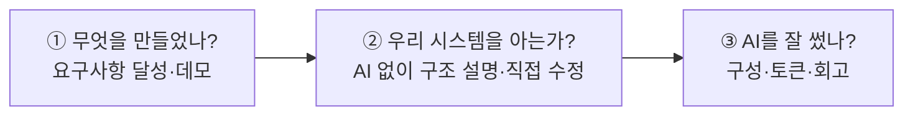
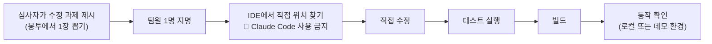
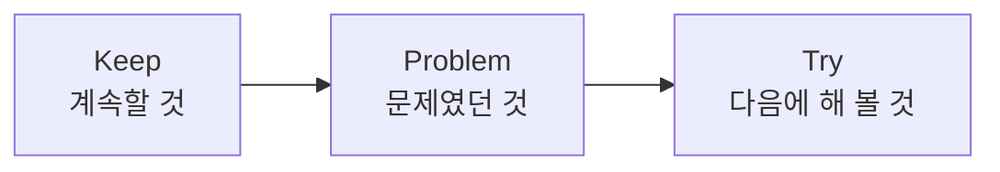
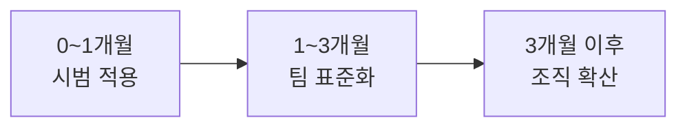

# 9회차: 캡스톤 발표 — EduHub 7주 결과와 앞으로

🧭 ⬅️ 이전: [8회차: 자동화·Agent SDK·거버넌스 — 성능·보안 점검과 AI 없이 핫픽스 훈련 (NFR-02, NFR-03)](./session-08-automation-sdk-governance.md) · 📚 [전체 커리큘럼](../CURRICULUM.md#-회차별-강의-자료)

> **대상**: 2~8주차 동안 EduHub Toy 프로젝트를 진행한 팀
> **시간**: 120분 (4팀 기준. 팀 수에 따라 [진행 순서](#진행-순서)를 조정)
> **목표**
> 1. 7주 동안 만든 EduHub를 **요구사항 달성 현황, 아키텍처, 데모**로 보여 준다
> 2. **AI 없이** 구조를 설명하고, 심사자가 즉석에서 낸 수정을 **직접 고치고 빌드**한다 (NFR-08)
> 3. Claude Code 활용 구성(CLAUDE.md, 스킬, 에이전트, 훅, MCP, 플러그인, 아티팩트)과 **토큰 사용 실적**을 공유한다
> 4. 과정 전체를 회고하고, **우리 팀에 도입하는 로드맵**을 정한다
>
> **관련 자료**: [2회차 EduHub 요구사항과 7주 계획](./session-02-hands-on-kickoff.md#3-toy-프로젝트-eduhub-소개와-7주-진행-계획), [캡스톤 주제 예시](../examples/05-automation-and-capstone.md#-캡스톤-프로젝트-주제-예시), [개발자의 책임](../examples/27-developer-responsibility.md)

---

## 사전 준비: 제출물 마감 체크리스트

> **마감: 발표 전날 18:00.** 팀 대표가 저장소 링크와 함께 팀 채널에 올립니다. 마감 뒤에는 `main`에 병합하지 않습니다 (발표 중 즉석 수정은 별도 브랜치에서).

- [ ] **저장소 링크**: 강사와 심사자에게 읽기 권한. `main` 보호 설정 유지
- [ ] **데모 환경**: 개발 또는 스테이징에서 동작 (운영 데이터 ✕). 데모 계정과 샘플 데이터 준비
- [ ] **README.md**: 프로젝트 소개, 실행 방법(백엔드·프론트·DB), 디렉터리 구조, 팀원 역할
- [ ] **`docs/requirements.md` 최종본**: FR-01~09, NFR-01~08 달성 여부 표시, 팀이 결정한 세부 규칙
- [ ] **런북** (`docs/runbook.md`): 빌드·배포·롤백·핫픽스 절차. **사람이 그대로 따라 할 수 있는 수준**
- [ ] **사용량 리포트** (`docs/usage-report.md`): 주차별 `/usage` 기록, 토큰을 아낀 사례
- [ ] **회고 문서** (`docs/retrospective.md`): 주간 회고 모음, "Claude에게 맡긴 것 / 직접 한 것"
- [ ] **발표 자료**: 슬라이드 또는 아티팩트 (아래 [발표 구성 템플릿](#2-팀-발표-구성-템플릿-20분) 순서)
- [ ] **Claude Code 구성 파일**: `CLAUDE.md`, `.claude/settings.json`, `.claude/skills/`, `.claude/agents/`, `.mcp.json`, 플러그인이 저장소에 있음
- [ ] **비밀 정보 점검**: `.env`, 운영 키가 저장소 이력에 없음 (`git log -p`나 비밀 검사 도구로 확인)

---

## 진행 순서

| 시간 | 내용 | 비고 |
|---|---|---|
| 0:00 – 0:05 | 오프닝: 진행 방식, 평가 기준 안내 | 강사 |
| 0:05 – 0:25 | 1팀 발표 (15분) + 질의응답 (5분) | 직접 수정·빌드 시연 포함 |
| 0:25 – 0:45 | 2팀 발표 + 질의응답 | |
| 0:45 – 0:50 | ☕ 휴식 (동료 평가 작성) | |
| 0:50 – 1:10 | 3팀 발표 + 질의응답 | |
| 1:10 – 1:30 | 4팀 발표 + 질의응답 | |
| 1:30 – 1:45 | 과정 전체 회고 (KPT) | 전원 |
| 1:45 – 1:55 | 강사 총평, 팀 도입 로드맵 안내 | 강사 |
| 1:55 – 2:00 | 수료 안내, 피드백 설문 | |

**팀 수에 따른 조정**

| 팀 수 | 팀당 시간 | 조정 방법 |
|---|---|---|
| 3팀 | 25분 (발표 18 + 질의 7) | 직접 수정 시연을 과제 2개로 늘림 |
| 4팀 | 20분 (발표 15 + 질의 5) | 기본 |
| 5~6팀 | 15분 (발표 11 + 질의 4) | 회고를 10분으로 줄이고, ⑤⑥은 제출 문서로 대체 |
| 7팀 이상 | — | 두 개 방으로 나누거나 2일로 나눔 |

---

# 1. 오프닝

---

## 1-1. 오늘 보는 것: 7주 결과의 세 가지 질문



> 💬 **강사 노트:** 오늘 평가의 핵심은 **②**라고 미리 알려 줍니다. 기능이 덜 완성되었어도 구조를 정확히 설명하고 직접 고칠 수 있는 팀이, 기능은 많지만 구조를 설명하지 못하는 팀보다 높은 점수를 받습니다. 1회차부터 강조한 **"시스템의 주인은 개발자"** 원칙의 최종 확인입니다.

---

## 1-2. 평가 기준 다시 보기

2회차 [3-7. 어떻게 진행하나](./session-02-hands-on-kickoff.md#3-7-어떻게-진행하나)에서 정한 평가 비중 그대로입니다. 세부 기준은 [3. 평가 루브릭](#3-평가-루브릭)에 있습니다.

| 항목 | 비중 | 발표에서 보는 곳 |
|---|---|---|
| 기능 완성도 | 25% | ① 요구사항 달성 현황, ③ 라이브 데모 |
| 비기능 품질 | 20% | ① NFR 달성 현황, 질의응답 |
| Claude Code 활용 | 20% | ⑤ 활용 구성 |
| 구조 이해도 | 20% | ② 아키텍처 설명, ④ 직접 수정·빌드 시연 |
| 토큰 효율·협업 | 15% | ⑥ 토큰 사용량, ⑦ 회고, PR 이력 |

---

# 2. 팀 발표 구성 템플릿 (20분)

> 모든 팀이 같은 순서로 발표합니다. 비교하기 쉽고, 빠뜨리는 항목이 없습니다.

| 순서 | 내용 | 시간 | 진행 |
|---|---|---|---|
| ① | 요구사항 달성 현황 (FR/NFR 표) | 2분 | 발표 자료 |
| ② | 아키텍처 설명 — **AI 없이 화이트보드로** | 3분 | 화이트보드 |
| ③ | 라이브 데모 | 3분 | 데모 환경 |
| ④ | **직접 수정·빌드 시연** | 4분 | IDE + 터미널 |
| ⑤ | Claude Code 활용 구성 | 1.5분 | 발표 자료 |
| ⑥ | 토큰 사용량과 절감 사례 | 1분 | 발표 자료 |
| ⑦ | 회고: 맡긴 것 / 직접 한 것, 실패 사례 | 0.5분 | 발표 자료 |
| — | 질의응답 | 5분 | 심사자 |

---

## ① 요구사항 달성 현황 (2분)

2회차의 [기능 요구사항](./session-02-hands-on-kickoff.md#3-3-기능-요구사항-개략)과 [비기능 요구사항](./session-02-hands-on-kickoff.md#3-4-비기능-요구사항-개략)을 기준으로 달성 여부를 표로 보여 줍니다.

**기능 요구사항 표 예시**

| ID | 요구사항 | 상태 | 근거 (테스트·화면·PR) |
|---|---|:---:|---|
| FR-01 | 과정 목록 조회·검색 | ✅ | `CourseControllerTest`, PR #3 |
| FR-02 | 과정 상세·회차 조회 | ✅ | 과정 상세 화면 |
| FR-03 | 과정·회차 등록·수정 | ✅ | |
| FR-04 | 수강 신청, 중복 신청 방지 | ✅ | `EnrollmentServiceTest` |
| FR-05 | 정원 초과 시 대기자 등록 | ✅ | |
| FR-06 | 취소 시 대기 1순위 자동 확정 | ⚠️ 부분 | 알림 미구현 |
| FR-07 | 내 신청 내역 | ✅ | |
| FR-08 | 명단·수료 처리 | ✅ | |
| FR-09 | 알림 기록 | ❌ | 범위 제외 결정 (회고 참고) |

**비기능 요구사항 표 예시**

| ID | 분류 | 상태 | 측정값·근거 |
|---|---|:---:|---|
| NFR-01 | 정합성 | ✅ | 동시 100건 신청 테스트, 정원 초과 0건 |
| NFR-02 | 성능 | ⚠️ | 목록 API 1만 건에서 420ms (목표 300ms), N+1 제거 완료 |
| NFR-03 | 보안 | ✅ | 본인 신청만 취소, 비밀 검사 통과 |
| NFR-04 | API 계약 | ✅ | Swagger UI, 클라이언트 생성 스크립트 |
| NFR-05 | 품질 | ✅ | 서비스 커버리지 74%, CI 통과 |
| NFR-06 | 운영성 | ✅ | 프로필 분리, 런북, 핫픽스 훈련 기록 |
| NFR-07 | 유지보수성 | ✅ | 아키텍처 테스트 |
| NFR-08 | 이해도 | — | ②와 ④에서 확인 |

> 💡 **"못 한 것"을 숨기지 않습니다.** 미완성 항목과 그 이유(범위 조정, 기술 문제)를 정직하게 보여 주는 것이 평가에 유리합니다.

---

## ② 아키텍처 설명 — AI 없이 화이트보드로 (3분)

- **노트북을 닫고** 화이트보드나 종이에 직접 그리며 설명합니다
- 발표자는 심사자가 **즉석에서 지명**합니다 (모든 팀원이 준비해야 합니다)

**반드시 들어가야 할 내용**

| 그림 | 설명할 것 |
|---|---|
| 전체 구성 | shell, course-mfe, enrollment-mfe, backend, PostgreSQL과 통신 방향 |
| 백엔드 계층 | Controller → Service → Repository, 트랜잭션 경계는 어디인가 |
| 핵심 흐름 1개 | 예: "수강 신청 버튼 클릭 → 정원 확인 → 확정 또는 대기"가 어느 파일·메서드를 거치는가 |
| 환경 구성 | 개발·테스트·스테이징·운영과 각 환경에서 Claude Code가 할 수 있는 일 |

> 💬 **강사 노트:** 그림의 아름다움이 아니라 **정확성**을 봅니다. 클래스 이름을 틀려도 괜찮지만, 정원 체크가 어디서 어떻게 동시성을 막는지 설명하지 못하면 구조 이해도 점수가 낮아집니다.

---

## ③ 라이브 데모 (3분)

**추천 시나리오** (한 흐름으로 이어서)

1. 임직원으로 로그인 → 과정 목록 검색 → 상세에서 신청 (FR-01, 02, 04)
2. 정원이 찬 회차에 신청 → 대기 순번 확인 (FR-05)
3. 앞 사람이 취소 → 대기자가 자동 확정되는 것 확인 (FR-06)
4. 관리자로 전환 → 명단 확인, 수료 처리 (FR-08)

- 데모는 **개발 또는 스테이징 환경**에서 합니다. 운영 데이터는 쓰지 않습니다
- 네트워크·환경 문제에 대비해 **녹화 영상을 백업**으로 준비합니다

---

## ④ 직접 수정·빌드 시연 (4분) ⭐

> **이 과정에서 가장 중요한 순서입니다.** 1회차 원칙 ② "긴급 상황에는 직접 수정·빌드·배포할 수 있어야 한다"를 확인합니다.

**진행 방법**



**규칙**
- Claude Code, AI 채팅, AI 자동완성 **사용 금지**. IDE 기본 기능(검색, 이동, 리팩터링)은 사용 가능
- 팀원 1명이 하고, 다른 팀원은 **말로만** 도울 수 있음 (1회까지)
- 제한 시간 4분. 시간 안에 못 끝내도 **어디를 왜 고치는지 설명**하면 부분 점수
- 시연은 `demo/` 브랜치에서 하고 `main`에 병합하지 않음

**수정 과제 예시 (심사자용, 팀 구현에 맞게 고름)**

| 난이도 | 과제 | 확인할 것 |
|---|---|---|
| 쉬움 | 대기자 최대 인원 상수를 10명에서 5명으로 변경 | 상수 위치를 바로 찾는가, 관련 테스트를 알고 있는가 |
| 쉬움 | 중복 신청 오류 메시지를 "이미 신청한 회차입니다"로 변경 | 예외 처리 위치, 프론트에 어떻게 전달되는가 |
| 보통 | 과정 목록 기본 정렬을 "최신 등록순"에서 "시작일순"으로 변경 | Repository·쿼리 위치, API 계약 영향 |
| 보통 | 과정 목록 화면의 "남은 자리" 표시를 "남은 자리 / 정원"으로 변경 | MFE 구조, 어느 remote의 어느 컴포넌트인가 |
| 어려움 | 취소 마감을 "시작 1일 전"에서 "시작 3일 전"으로 바꾸고 테스트 추가 | 업무 규칙 위치, 테스트 작성 |

**빌드 명령 예시** (각 팀의 README와 같아야 함)

```bash
cd backend && ./gradlew test --tests "*Enrollment*"   # 관련 테스트
cd backend && ./gradlew build                          # 빌드
cd frontend && npm run build                           # 프론트 변경 시
```

---

## ⑤ Claude Code 활용 구성 (1.5분)

7주 동안 만든 구성을 한 장으로 보여 줍니다. CURRICULUM의 캡스톤 요구 사항(CLAUDE.md, 스킬 1개 이상, 훅 1개 이상, MCP 1개 이상, 플러그인 패키징, 아티팩트 공유)을 기준으로 합니다.

| 구성 요소 | 우리 팀이 만든 것 | 왜 이 방식으로 만들었나 | 효과 |
|---|---|---|---|
| CLAUDE.md | 루트 + backend, frontend 하위 | 계층 규칙, 빌드 명령 | 규칙 위반 PR 감소 |
| 스킬 | 예: `add-api` (백엔드 → OpenAPI → 클라이언트 재생성) | 반복 절차 | API 추가 시간 단축 |
| 서브에이전트 | 예: `implementer`(sonnet), `reviewer`(opus, 읽기 전용) | 역할·모델 분리 | 리뷰에서 결함 조기 발견 |
| 훅 | 예: Java 수정 시 포맷, 운영 접속 명령 차단 | 반드시 지켜야 하는 것 | 포맷 지적 0건 |
| MCP | 예: 개발 DB 읽기 전용, GitHub | 외부 시스템 조회 | |
| 플러그인 | 위 구성을 묶은 팀 플러그인 | 다른 팀에 공유 | |
| 아티팩트 | 주간 진행 리포트 | 진행 현황 공유 | |

> 💡 **"많이 만든 것"보다 "왜 그 방식인가"**를 설명합니다. 1회차 8장 토론의 판단 흐름(CLAUDE.md / 훅 / 스킬 / 커맨드 / 서브에이전트 / MCP)으로 근거를 대면 좋습니다.

---

## ⑥ 토큰 사용량과 절감 사례 (1분)

| 보여 줄 것 | 예 |
|---|---|
| 주차별 사용량 추이 | `/usage` 기록을 막대그래프로 (아티팩트나 표) |
| 가장 많이 쓴 작업 | "4주차 수강 신청 동시성 처리: 계획 없이 바로 구현 → 두 번 재작업" |
| 절감 사례 1~2개 (전후 비교) | "한 세션 = 한 작업 + 위치 지정으로 같은 규모 작업 사용량 약 40% 감소" |
| 모델 선택 | "구현은 Sonnet, 설계·최종 리뷰는 Opus. 탐색은 Haiku 서브에이전트" |

> 💬 **강사 노트:** 사용량 숫자의 크고 작음보다 **"측정했고, 원인을 알고, 개선했는가"**를 봅니다. 1회차 6-3과 2회차 1장의 습관이 실제로 쓰였는지 확인합니다.

---

## ⑦ 회고: 맡긴 것 / 직접 한 것, 실패 사례 (30초)

| 질문 | 예 |
|---|---|
| Claude에게 맡겨 가장 효과가 컸던 일 | 테스트 대량 작성, OpenAPI 어노테이션 보완 |
| 직접 하는 편이 나았던 일 | 상수·메시지 수정, 충돌 해결 결과 확인 |
| 실패 사례 하나 | "Claude가 만든 마이그레이션을 검토 없이 병합 → 스테이징에서 실패 → 되돌림" |
| 그 실패에서 바꾼 것 | `db/migration/`에 CODEOWNERS, 마이그레이션 리뷰 체크리스트 |

> 💡 실패 사례를 발표하는 팀에 **가산점**을 줍니다. 실패를 구조(CLAUDE.md, 훅, 리뷰 규칙)로 바꾼 경험이 이 과정의 핵심 학습입니다.

---

## 질의응답 (5분)

심사자는 아래 [4. 심사자 질문 예시](#4-심사자-질문-예시)에서 **구조 이해도 질문 2개 이상**을 고르고, 답할 팀원을 지명합니다.

---

# 3. 평가 루브릭

> 각 항목을 1~5점으로 매기고 비중을 곱해 100점 만점으로 환산합니다.
> **환산식**: 항목 점수 ÷ 5 × 비중. 예: 구조 이해도 4점 → 4 ÷ 5 × 20 = 16점

---

## 3-1. 기능 완성도 (25%)

| 점수 | 기준 |
|:---:|---|
| 5 | 필수 FR(01~08) 모두 동작, 데모가 매끄럽고 예외 상황(정원 초과, 중복 신청)도 시연 |
| 4 | 필수 FR 모두 동작, 일부 예외 상황 처리 미흡 |
| 3 | 필수 FR 대부분(6~7개) 동작, 핵심 흐름(신청 → 대기 → 승급)은 동작 |
| 2 | 필수 FR 절반 정도 동작, 핵심 흐름 일부 미동작 |
| 1 | 데모 불가 또는 핵심 흐름 미동작 |

## 3-2. 비기능 품질 (20%)

| 점수 | 기준 |
|:---:|---|
| 5 | NFR-01~07 모두 측정 근거와 함께 달성. 동시성 테스트, 성능 측정, 보안 점검 결과 제시 |
| 4 | 대부분 달성, 미달 항목의 원인과 개선 계획이 명확 |
| 3 | 정합성(NFR-01)과 보안(NFR-03)은 달성, 나머지는 일부 |
| 2 | 테스트는 있으나 동시성·성능·보안 근거 부족 |
| 1 | 비기능 요구사항 확인 근거 없음 |

## 3-3. Claude Code 활용 (20%)

| 점수 | 기준 |
|:---:|---|
| 5 | 캡스톤 요구 구성 모두 포함, **각 구성의 선택 이유**가 명확하고 효과를 숫자나 사례로 제시. 플러그인을 다른 팀이 설치해 쓸 수 있음 |
| 4 | 요구 구성 모두 포함, 이유 설명이 대체로 적절 |
| 3 | 요구 구성 대부분 포함, 일부는 형식적 (만들었지만 쓰지 않음) |
| 2 | CLAUDE.md와 1~2개 구성만 사용 |
| 1 | 대화형 사용만 하고 구성 자산 없음 |

## 3-4. 구조 이해도 (20%)

| 점수 | 기준 |
|:---:|---|
| 5 | 지명된 팀원 누구나 AI 없이 구조와 핵심 흐름을 정확히 설명. 직접 수정 과제를 시간 안에 수정·테스트·빌드까지 완료 |
| 4 | 설명은 정확하고, 직접 수정은 완료했으나 테스트나 빌드 중 하나를 빠뜨림 |
| 3 | 설명은 대체로 맞으나 일부 팀원이 모름. 직접 수정은 위치를 찾고 방향은 맞음 |
| 2 | 특정 팀원만 설명 가능. 직접 수정 위치를 찾지 못함 |
| 1 | 구조 설명 불가, "Claude가 만들어서 모르겠다" |

## 3-5. 토큰 효율·협업 (15%)

| 점수 | 기준 |
|:---:|---|
| 5 | 주차별 사용량 기록, 원인 분석과 개선 전후 비교. 모든 변경이 PR·리뷰를 거침, PR 본문에 맡긴 것/직접 한 것 기록 |
| 4 | 사용량 기록과 절감 사례 있음. PR·리뷰 대부분 준수 |
| 3 | 사용량 기록은 있으나 분석 부족. PR은 있으나 리뷰가 형식적 |
| 2 | 사용량 기록 일부. `main` 직접 커밋 다수 |
| 1 | 기록 없음, 협업 이력 없음 |

**가산·감산 (최대 ±5점)**

| 구분 | 항목 |
|---|---|
| ➕ | 실패 사례를 구조적 개선(CLAUDE.md, 훅, 리뷰 규칙)으로 바꾼 경험 발표 |
| ➕ | 다른 팀이 재사용할 수 있는 스킬·플러그인 공유 |
| ➖ | 비밀 정보(`.env`, 키)가 저장소 이력에 남아 있음 |
| ➖ | 운영 데이터 또는 운영 환경에 AI 도구를 직접 연결 |

---

## 3-6. 심사 기록지

| 팀 | 기능 (25) | 비기능 (20) | Claude Code (20) | 구조 이해 (20) | 토큰·협업 (15) | 가감 | 합계 | 한 줄 평 |
|---|:---:|:---:|:---:|:---:|:---:|:---:|:---:|---|
| 1팀 | | | | | | | | |
| 2팀 | | | | | | | | |
| 3팀 | | | | | | | | |
| 4팀 | | | | | | | | |

---

# 4. 심사자 질문 예시

> **구조 이해도 질문은 반드시 2개 이상**, 답할 사람을 지명해서 묻습니다. 정답보다 **근거를 들어 설명하는지**를 봅니다.

**구조·아키텍처**
1. 수강 신청 요청이 들어오면 어떤 클래스와 메서드를 거쳐 DB에 저장되나요?
2. 두 사람이 동시에 마지막 자리를 신청하면 어떤 코드가 정원 초과를 막나요? 다른 방법 대신 그 방법을 고른 이유는?
3. `@Transactional`은 어디에 걸려 있고, 대기자 자동 확정까지 한 트랜잭션인가요?
4. 과정 목록에서 N+1 쿼리를 어떻게 확인했고 어떻게 없앴나요?
5. course-mfe와 enrollment-mfe는 어떻게 MUI와 React를 공유하나요? 공유하지 않으면 무슨 일이 생기나요?
6. API를 바꾸면 프론트 타입은 어떻게 따라 바뀌나요? (OpenAPI → 클라이언트 생성)

**운영·환경**
7. 지금 운영에서 장애가 나서 Claude Code를 쓸 수 없다면, 어떤 순서로 원인을 찾고 고쳐서 배포하나요? 런북의 어디를 보나요?
8. 롤백은 어떻게 하나요? DB 마이그레이션이 포함된 배포라면?
9. 개발·테스트·운영 설정은 어디서 어떻게 나뉘나요? 운영 접속 정보는 어디에 있나요?
10. Claude Code가 `.env`를 읽지 못하게 하는 장치는 무엇인가요? CLAUDE.md에만 적으면 왜 부족한가요?

**Claude Code 활용**
11. 이 규칙을 CLAUDE.md가 아니라 훅(또는 스킬)으로 만든 이유는?
12. 서브에이전트의 모델은 어떻게 정했나요? 구현과 리뷰에 같은 모델을 쓰면 어떤 위험이 있나요?
13. Claude가 만든 코드에서 리뷰로 잡아낸 가장 중요한 문제는 무엇이었나요?
14. 사용량이 가장 많았던 주는 언제였고, 왜 그랬나요?

> 💬 **강사 노트:** "잘 모르겠습니다"라는 답이 나오면 바로 감점하지 말고 "그럼 어디를 보면 알 수 있을까요?"라고 한 번 더 묻습니다. **찾아갈 위치를 아는 것**도 구조 이해입니다.

---

# 5. 동료 평가 양식

> 다른 팀 발표를 들으며 작성합니다. 강사 평가에 **참고**로만 쓰고, 결과는 각 팀에 익명으로 전달합니다.

| 항목 | 1팀 | 2팀 | 3팀 | 4팀 |
|---|:---:|:---:|:---:|:---:|
| 구조를 이해하기 쉽게 설명했다 (1~5) | | | | |
| 직접 수정 시연이 인상적이었다 (1~5) | | | | |
| 우리 팀이 가져다 쓰고 싶은 구성이 있다 (1~5) | | | | |
| **가져다 쓰고 싶은 것** (한 줄) | | | | |
| **이 팀에게 주는 조언** (한 줄) | | | | |

- 자기 팀은 평가하지 않습니다
- "가져다 쓰고 싶은 것"이 가장 많이 나온 스킬·플러그인은 과정 공용 저장소에 공유합니다

---

# 6. 과정 전체 회고 (KPT, 15분)



**진행 방법**
1. 개인별로 포스트잇(또는 온라인 보드)에 Keep, Problem, Try를 각 2개 이상 씁니다 (5분)
2. 비슷한 것끼리 묶고, 많이 나온 주제에 투표합니다 (5분)
3. 상위 Try 3개를 "팀 도입 로드맵"의 첫 행동으로 정합니다 (5분)

**생각할 질문**

| 구분 | 질문 |
|---|---|
| Keep | 7주 동안 가장 도움이 된 습관이나 구성은? (예: 한 세션 = 한 작업, Plan 모드로 먼저 합의, 리뷰 에이전트) |
| Problem | 가장 많이 시간과 토큰을 버린 순간은? Claude를 믿었다가 문제가 된 경험은? |
| Try | 내일 실제 업무에서 바로 해 볼 것 하나는? |

**KPT 기록표**

| Keep | Problem | Try |
|---|---|---|
| | | |
| | | |
| | | |

---

# 7. 수료 기준

| 기준 | 내용 |
|---|---|
| 출석 | 전체 회차의 80% 이상 |
| 과제 | 주차별 과제(PR, 회고) 80% 이상 제출 |
| 캡스톤 | 팀 발표 참여, 평가 60점 이상 |
| 구조 이해도 | ② 아키텍처 설명 또는 ④ 직접 수정 시연에서 **개인별로 최소 1회** 설명·수정 참여 (질의응답 지명 포함) |
| 동료 평가 | 다른 팀 동료 평가 제출 |

> 구조 이해도 기준을 채우지 못한 수강생은 강사와 **1:1 보충 시연**(EduHub 구조 설명 + 수정 과제 1개)으로 대신할 수 있습니다.

---

# 8. 과정 이후: 우리 팀 도입 로드맵

> 교육에서 쓴 방식을 실제 팀 프로젝트로 옮기는 단계입니다. **작게 시작해서 측정하며 넓힙니다.** 자세한 점검 항목은 [운영 & 거버넌스 체크리스트](../examples/05-automation-and-capstone.md#모듈-20-운영--거버넌스-체크리스트-eduhub-팀-기준)를 봅니다.



## 8-1. 첫 1개월: 시범 적용

| 할 일 | 산출물 |
|---|---|
| 시범 프로젝트 1개 선정 (위험이 낮고 테스트가 있는 서비스) | 대상과 범위 문서 |
| 팀 `CLAUDE.md` 작성: 빌드 명령, 계층 규칙, 금지 사항 (200줄 이내) | `CLAUDE.md` |
| 권한 기본값: 비밀 파일 읽기 금지, 운영 접속 명령 금지 | `.claude/settings.json` |
| 교육에서 만든 스킬·리뷰 에이전트 중 1~2개 옮겨 쓰기 | 스킬, 에이전트 |
| 브랜치 보호, PR 리뷰 필수, CI 통과 필수 | 저장소 설정 |
| **측정 시작**: 사용량, PR 리드타임, 리뷰에서 나온 결함 수 | 주간 기록 |

## 8-2. 1~3개월: 팀 표준화

| 할 일 | 산출물 |
|---|---|
| 잘 된 구성을 **팀 플러그인**으로 묶어 공유 (스킬, 에이전트, 훅, 커맨드) | 팀 플러그인 저장소 |
| 운영 보호 규칙을 **관리 설정**으로 강제 (공식 문서 확인 필요: 조직 관리 설정 적용 방법) | 관리 설정 |
| 승인된 MCP 서버·플러그인 목록 관리 | 허용 목록 |
| 모델 선택 기준: 설계·위험 영역 리뷰는 Opus, 일반 구현은 Sonnet, 탐색은 Haiku | 팀 가이드 |
| CI 자동 리뷰(헤드리스 모드, GitHub Actions) 도입 | 워크플로 |
| 분기별 **"AI 없이 핫픽스" 훈련** | 훈련 기록 |

## 8-3. 3개월 이후: 조직 확산

- 도입 전후 지표 비교(리드타임, 결함, 사용량)를 리포트로 공유하고 다음 팀 선정
- 사내 프레임워크용 스킬·플러그인을 공용 마켓플레이스로 운영
- 신규 입사자 온보딩에 이 교육 과정의 1~2회차를 포함

**측정 지표**

| 지표 | 왜 보나 |
|---|---|
| PR 리드타임 (생성 → 병합) | 생산성 |
| 리뷰·테스트에서 발견된 결함 수, 운영 결함 수 | 품질이 떨어지지 않았는지 |
| 기능 1건 완료당 사용량 | 비용 효율 ("요청당"이 아니라 "완료당") |
| 재작업 횟수 | 지시·계획의 질 |
| "AI 없이 설명·수정" 가능 인원 비율 | 시스템의 주인이 여전히 개발자인가 |

---

# 9. 계속 학습 자료

| 주제 | 자료 |
|---|---|
| 과정 전체 커리큘럼 | [CURRICULUM.md](../CURRICULUM.md) |
| 개발자의 책임 4원칙 | [개발자의 책임](../examples/27-developer-responsibility.md) |
| 토큰 최적화 | [토큰 사용량 최적화](../examples/08-token-optimization.md) |
| 모델 선택 | [모델 가이드](../examples/29-models-guide.md) |
| 스킬과 오픈 스킬 | [스킬 카탈로그](../examples/09-skills-catalog.md) |
| 에이전트 설계 | [에이전트](../examples/10-agents.md), [Java·React 프로젝트의 에이전트](../examples/18-java-react-agents.md) |
| MCP 서버 | [MCP 서버 가이드](../examples/19-mcp-server-guide.md) |
| 빌드·배포 | [빌드·배포 파이프라인](../examples/28-build-deploy-pipeline.md) |
| 사내 프레임워크 | [커스텀 프레임워크 적용](../examples/07-custom-framework.md) |
| Codex와 함께 쓰기 | [Codex와 Claude Code](../examples/24-codex-with-claude-code.md) |
| 오픈소스 LLM RAG | [Ollama로 RAG 구축](../examples/26-rag-with-ollama.md) |
| 공식 문서 | Claude Code 공식 문서 https://code.claude.com/docs (기능이 자주 바뀌므로 정기적으로 확인) |

---

# 10. 교육 과정 피드백 설문

> 수료 안내 직후 5분 동안 작성합니다. 결과는 다음 기수 커리큘럼 개선에 씁니다.

**점수 문항 (1: 전혀 아니다 ~ 5: 매우 그렇다)**

| # | 문항 | 점수 |
|---|---|:---:|
| 1 | 과정 목표(에이전트 이해, 실무 활용, 팀 적용)를 달성했다 | |
| 2 | 1~2회차 개념 강의가 이후 실습에 도움이 되었다 | |
| 3 | EduHub Toy 프로젝트의 난이도와 분량이 적절했다 | |
| 4 | 주차별 Claude Code 기능과 EduHub 작업의 연결이 자연스러웠다 | |
| 5 | 따라하기 자료만 보고도 실습을 진행할 수 있었다 | |
| 6 | "시스템의 주인은 개발자" 원칙이 실제 업무 방식에 영향을 주었다 | |
| 7 | 토큰을 아끼는 습관이 생겼다 | |
| 8 | 교육 내용을 내 팀에 적용할 자신이 있다 | |
| 9 | 이 과정을 동료에게 추천하겠다 | |

**서술 문항**

1. 가장 유익했던 회차나 주제는? 그 이유는?
2. 시간이 부족했거나 더 깊이 다루었으면 하는 주제는?
3. 빼거나 줄여도 될 내용은?
4. 실습 환경(설치, 계정, 네트워크)에서 겪은 문제는?
5. 교육 후 내 업무에서 가장 먼저 바꿀 것 하나는?

---

# 부록 A. 발표 준비 체크리스트 (1주 전)

**8주차 종료 시점에 팀별로 점검합니다.**

- [ ] 발표자 역할 분담 (단, ②④는 **누구든 지명될 수 있음**을 전제로 모두 준비)
- [ ] 팀원 전원이 화이트보드에 아키텍처를 그려 보는 연습 1회 이상
- [ ] 팀원끼리 서로 수정 과제를 내고 **AI 없이** 수정·테스트·빌드 연습 (4분 안에)
- [ ] README의 실행 방법대로 **새 PC(또는 새 클론)에서** 실행되는지 확인
- [ ] 데모 시나리오 리허설, 데모 데이터 초기화 스크립트 준비, 녹화 백업
- [ ] `docs/requirements.md` 달성 현황 표 업데이트
- [ ] `/usage` 기록 정리, 절감 사례 1~2개 선정
- [ ] 실패 사례와 개선 내용 정리
- [ ] 비밀 정보 점검 (`.env`, 키가 이력에 없는지)
- [ ] 발표 자료를 [발표 구성 템플릿](#2-팀-발표-구성-템플릿-20분) 순서에 맞춤

> 💡 발표 자료를 Claude에게 만들게 할 수 있습니다. 예: "`docs/requirements.md`와 `docs/retrospective.md`를 읽고 9회차 발표 템플릿 순서로 발표 개요를 만들어줘". 단, ②④는 AI 도움 없이 준비합니다.

---

# 부록 B. 강사용 운영 노트

**사전 준비**
- 팀별 저장소를 미리 클론해 **각 팀 README대로 실행되는지** 확인합니다. 실행되지 않으면 전날까지 팀에 알립니다
- 팀 구현을 보고 **직접 수정 과제를 팀별로 2~3장씩** 봉투(카드)에 준비합니다. 난이도는 팀 간에 비슷하게 맞춥니다
- 화이트보드, 마커, 타이머, 심사 기록지, 동료 평가 양식(온라인 폼 권장)을 준비합니다
- 외부 심사자(팀장, 아키텍트)를 초대하면 질문의 현실감이 높아집니다. 심사자에게 [평가 루브릭](#3-평가-루브릭)과 [질문 예시](#4-심사자-질문-예시)를 미리 공유합니다

**진행 중**
- 시간 관리가 가장 중요합니다. 각 순서마다 남은 시간을 알려 주고, ④는 4분이 지나면 멈추고 설명으로 넘어갑니다
- ④에서 AI 도구 사용 여부를 확인합니다 (IDE의 AI 자동완성 기능도 꺼 두게 합니다)
- 데모가 실패하면 녹화 백업으로 넘어가고 **감점하지 않습니다**. 대신 원인을 질문합니다
- 비판보다 **"그 결정의 이유"**를 묻는 질문을 합니다

**마무리 총평에서 강조할 것**
1. **시스템의 주인은 개발자**: AI가 코드를 써도 구조를 알고, 직접 고치고, 운영과 개발·테스트를 분리한다
2. **토큰 습관**: 한 세션 = 한 작업, 위치 지정, 계획부터, 이상하면 멈추기, 간단한 건 직접
3. **반복은 자산으로**: 같은 설명을 세 번 하면 CLAUDE.md·스킬·훅으로
4. **측정하고 개선한다**: 사용량, 결함, 리드타임을 기록하며 팀 기준을 만든다

**사후**
- 평가 결과와 동료 평가 의견을 팀별로 정리해 1주 안에 전달합니다
- 우수 스킬·플러그인을 과정 공용 저장소에 모읍니다
- 피드백 설문 결과를 다음 기수 커리큘럼 개선 항목으로 정리합니다
