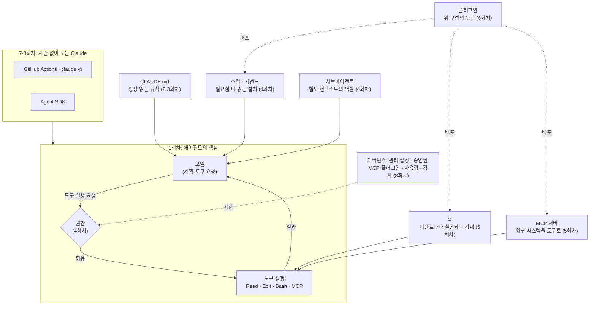
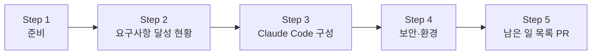
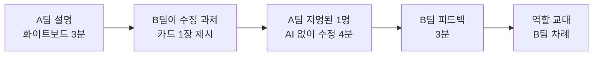

# 9회차: Wrap-up — 1~8회차 다시 점검하고 캡스톤 준비하기

🧭 ⬅️ 이전: [8회차: 자동화·Agent SDK·거버넌스 — 성능·보안 점검과 AI 없이 핫픽스 훈련 (NFR-02, NFR-03)](./session-08-automation-sdk-governance.md) · ➡️ 다음: [10회차: 캡스톤 발표 — EduHub 7주 결과와 앞으로](./session-10-capstone.md) · 📚 [전체 커리큘럼](../CURRICULUM.md#-회차별-강의-자료)

> **대상**: 8회차까지 EduHub를 진행한 팀 (새 기능은 만들지 않는 회차)
> **시간**: 120분 (강의 약 30%, 점검·리허설 약 70%)
> **목표**
> 1. 1~8회차에서 배운 개념과 원칙을 **한 장의 지도**로 다시 연결한다
> 2. **개인 자가 진단과 종합 퀴즈**로 "설명할 수 없는 부분"을 찾는다
> 3. 팀 EduHub의 **요구사항·Claude Code 구성·보안·토큰 기록**을 점검표로 확인하고, 캡스톤 전까지 할 일을 정한다
> 4. **캡스톤 리허설**: AI 없이 구조를 설명하고 직접 고치는 연습을 짝 팀과 한다
>
> **사전 준비**
> - 8회차 과제 결과: 성능 개선 PR(NFR-02), 보안 수정 PR(NFR-03), 핫픽스 훈련 포스트모템
> - `docs/requirements.md` 최신본, 주차별 `/usage` 기록, 주간 회고
> - 아래 [2-1. 개인 자가 진단표](#2-1-개인-자가-진단표)를 **수업 전에 혼자 먼저** 채워 오기 (5분)
>
> 🖥️ **슬라이드 덱(25장, 발표자 노트 포함)**: https://claude.ai/artifact/9AgF5ijZsxSEtq6RFMnw6j — 처음에는 만든 사람만 볼 수 있으며, 다른 사람에게 보여주려면 덱의 공유 메뉴에서 공유해야 합니다. PowerPoint(.pptx)·PDF로 내려받을 수 있습니다.
>
> **관련 자료**: [10회차 캡스톤 제출물 체크리스트](./session-10-capstone.md#사전-준비-제출물-마감-체크리스트), [10회차 평가 루브릭](./session-10-capstone.md#3-평가-루브릭), [개발자의 책임](../examples/27-developer-responsibility.md), [도구 고르기](../examples/13-choosing-the-right-tool.md)

---

## 진행 순서

| 시간 | 내용 | 방식 |
|---|---|---|
| 0:00 – 0:10 | 오프닝, 8회차 과제 확인 | 강의 |
| 0:10 – 0:35 | 1. 1~8회차 핵심 다시 보기 | 강의 + 질문 |
| 0:35 – 0:50 | 2. 개인 자가 진단과 종합 퀴즈 | 개인 → 짝 |
| 0:50 – 0:58 | ☕ 휴식 | |
| 0:58 – 1:30 | 3. 따라하기: 팀 EduHub 점검 (Step 1~5) | 팀 실습 |
| 1:30 – 1:52 | 4. 캡스톤 리허설 (짝 팀) | 팀 대 팀 |
| 1:52 – 2:00 | 5. 정리, 남은 일 확정, 10회차 안내 | 강의 |

> 💬 **강사 노트:** 이 회차의 목적은 **새로운 것을 배우는 것이 아니라 빈 곳을 찾는 것**입니다. "다 안다"는 느낌보다 "이 부분은 설명을 못 하겠다"를 찾아낸 수강생을 칭찬합니다. 찾은 빈 곳은 캡스톤 전 1주 동안 메우면 됩니다.

---

## 지난 회차 복습 & 과제 리뷰

**과제 확인 (팀별 1분)**

| 확인할 것 | 보는 곳 |
|---|---|
| 성능 개선 전후 숫자 (p95, 쿼리 수) | 성능 PR 본문, 쿼리 수 테스트 |
| 본인 신청만 취소 수정과 보안 리뷰 결과 | 보안 PR |
| 핫픽스 훈련에 걸린 시간과 포스트모템 | `docs/postmortem/` |

> 💡 과제를 다 못 했어도 괜찮습니다. 오늘 3장 점검에서 **남은 일 목록**에 넣고 캡스톤 전까지 끝냅니다.

---

# 1. 1~8회차 핵심 다시 보기

---

## 1-1. 한 장으로 보는 여정

| 회차 | Claude Code에서 배운 것 | EduHub에서 한 것 | 꼭 기억할 한 문장 |
|---|---|---|---|
| [1회차](./session-01-introduction.md) | 에이전트 루프, 도구·권한, 사용 환경, 확장 생태계 | (과정 소개) | 모델은 **요청**하고 Claude Code가 **실행**한다. 그 사이에 권한이 있다 |
| [2회차](./session-02-hands-on-kickoff.md) | 토큰 습관, 프로젝트 생성, GitHub 연결, 요구사항 전달 | 저장소, `docs/requirements.md`, 뼈대 | 한 세션 = 한 작업. **AI는 How, 개발자는 What·Why·Where** |
| [3회차](./session-03-feature-dev-and-github.md) | 탐색 → 계획 → 구현 → 검증, PR·리뷰·충돌 해결, 세션 관리 | FR-01~03 과정 조회·관리 | 핵심 업무 규칙의 **테스트는 사람이** 쓰고 Claude가 통과시킨다 |
| [4회차](./session-04-permissions-skills-subagents.md) | 권한, 스킬, 서브에이전트 | FR-04~06 수강 신청, NFR-01 동시성 | **deny는 어디서든 이긴다.** 락을 빼면 실패하는 테스트가 진짜 테스트 |
| [5회차](./session-05-hooks-and-mcp.md) | 훅, MCP (개발 DB 읽기 전용), MCP vs CLI | FR-07~08 내 신청·명단·수료 | 훅은 **강제**, MCP는 **개발 DB + 읽기 전용 계정**으로만 |
| [6회차](./session-06-plugins-artifacts-mfe.md) | 플러그인, 아티팩트, 병렬 작업 | MFE 완성, FR-09 알림 | 플러그인은 **팀 자산의 배포 단위**, 알림은 **커밋 이후에** |
| [7회차](./session-07-cicd-framework-tokens.md) | GitHub Actions, 사내 프레임워크, 토큰 측정 | CI/CD, 런북, NFR-05·06 | **CI가 기준**이고, 배포의 문은 사람이 연다 |
| [8회차](./session-08-automation-sdk-governance.md) | 헤드리스, Agent SDK, 거버넌스 | NFR-02 성능, NFR-03 보안, 핫픽스 훈련 | **AI 없이 고치고, 배포하고, 되돌릴 수 있어야** 시스템의 주인 |

---

## 1-2. 개념 지도: 모든 것은 "에이전트 루프"에 붙어 있다



**읽는 법**
- **모델에 들어가는 것**(CLAUDE.md, 스킬, 서브에이전트)은 "알려 주는 것"이라 모델이 **판단해서** 따릅니다
- **도구 쪽에 붙는 것**(권한, 훅)은 모델의 판단과 관계없이 **하네스가 강제**합니다
- 그래서 반드시 지켜야 하는 규칙은 CLAUDE.md만으로 부족하고 권한·훅이 함께 필요합니다 (5회차 1-1)

---

## 1-3. 이 규칙은 어디에 둘까: 판단표

1회차 토론과 5회차 OpenAPI 토론에서 쓴 판단을 하나로 모은 것입니다.

| 하고 싶은 것 | 둘 곳 | 누가 시작하나 | EduHub 예 |
|---|---|---|---|
| 항상 알아야 하는 사실·규칙 | **CLAUDE.md** | 자동으로 읽힘 | 빌드 명령, 계층 규칙, "엔티티를 API로 반환하지 않는다" |
| 해도 되는 것 / 물어볼 것 / 절대 안 되는 것 | **권한** (`settings.json`) | 하네스가 매번 검사 | `.env` 읽기 deny, `git push` ask |
| 반드시 지켜야 하고 기계적으로 검사 가능 | **훅** | 이벤트 발생 시 자동 | 운영 설정 수정 차단, 수정 후 자동 포맷 |
| 가끔 쓰는 여러 단계의 절차 | **스킬** | Claude 판단 또는 사람 | `add-api-endpoint` |
| 사람이 시작 시점을 정하는 작업 | **슬래시 커맨드** (또는 `disable-model-invocation` 스킬) | 사람 | 릴리스 노트 작성 |
| 컨텍스트를 분리하고 싶은 역할 | **서브에이전트** | Claude가 위임 | `reviewer` (읽기 전용) |
| 외부 시스템 조회 | **MCP** (CLI가 있으면 CLI 먼저) | Claude 판단 | 개발 DB 읽기 전용, GitHub는 `gh` |
| 위 구성을 다른 팀과 공유 | **플러그인** | 설치한 사람 | 팀 플러그인 |
| 사람 없이 반복 실행 | **헤드리스 · Actions · SDK** | 이벤트·스케줄 | PR 자동 리뷰 (코멘트만) |

> 💬 **질문:** "PR 본문에 '맡긴 것 / 직접 한 것'을 꼭 쓰게 하려면 어디에 두나요?" → 알리는 것은 CLAUDE.md·PR 템플릿, 빠지면 잡는 것은 CI 검사. 정답은 하나가 아니고 **근거를 대는 것**이 중요합니다.

---

## 1-4. 네 가지 원칙, 우리 팀은 지키고 있나

| 원칙 | 처음 나온 곳 | 지키고 있다는 증거 (EduHub) |
|---|---|---|
| ⭐ **시스템의 주인은 개발자** (구조 이해, 직접 수정·빌드·배포, 환경 분리, 간단한 건 직접) | 1회차 6장 | 매주 "AI 없이 설명하기", 핫픽스 훈련 기록, 운영 접속 정보가 개발 PC에 없음 |
| **토큰 습관** (한 세션 = 한 작업, 위치 지정, 계획부터, 이상하면 멈추기) | 1회차, 2회차 1장 | 주차별 `/usage` 기록, 절감 사례 |
| **반복은 자산으로** (같은 설명 세 번이면 CLAUDE.md·스킬·훅) | 1회차 | 스킬·훅·에이전트가 실제로 쓰인 PR |
| **측정하고 개선** (전후 비교, 작업 완료당 비용) | 7·8회차 | 성능 리포트, 사용량 리포트, 커버리지 |

---

## 1-5. 자주 한 실수 다시 보기

각 회차의 "자주 겪는 문제"에서 실제로 많이 나온 것만 모았습니다.

| 실수 | 왜 문제인가 | 바로잡기 | 회차 |
|---|---|---|---|
| 한 세션에서 여러 작업을 이어 함 | 컨텍스트가 커져 비용·정확도 모두 나빠짐 | 작업이 바뀌면 `/clear`, 필요하면 `/compact` | 2 |
| 계획 없이 큰 구현 시작 | 방향이 틀리면 전부 재작업 | Plan 모드로 먼저 합의, 틀리면 `Esc` → `/rewind` | 2·3 |
| `settings.local.json`이나 `.env`를 커밋 | 개인 설정·비밀이 팀에 퍼짐 | `.gitignore`, 권한 deny, 보호 파일 훅 | 4·5 |
| 서브에이전트 호출 때 모델 지정 | 정의 파일의 모델 선택이 무시됨 | 모델은 정의 파일에, CLAUDE.md에 "호출 시 model 지정 금지" | 4 |
| 스킬 description이 모호 | Claude가 언제 쓸지 몰라 쓰지 않음 | description에 "언제" 쓰는지를 적음 | 4 |
| 훅 차단 메시지에 "금지"만 | Claude가 우회 방법을 찾음 | 메시지에 **이유 + 대신 할 일** | 5 |
| MCP에 쓰기 가능한 계정·운영 DB 연결 | 판단 실수 한 번이 데이터 손실 | 개발 DB + 읽기 전용 계정, 결과는 작게 | 5 |
| `.mcp.json`의 `${VAR}`가 `.env`에서 읽힌다고 생각 | 변수가 비어 연결 실패 | Claude Code를 실행하는 셸에 환경 변수 | 5 |
| 아티팩트에 실제 데이터·비밀 | 공유 링크로 퍼짐 | 근거 숫자만, 개인정보·운영 데이터 ✕ | 6 |
| CI의 Claude에 쓰기 권한 | 사람 검토 없이 변경이 들어감 | 읽기 전용 도구, 턴·비용 제한, 코멘트만 | 8 |

---

## 1-6. 명령어·설정 한 장 정리

**대화 중 명령**

| 목적 | 명령 |
|---|---|
| 작업 전환·정리 | `/clear`, `/compact`, `/rename`, `claude --resume` |
| 되돌리기 | `Esc` (즉시 중단), `/rewind` |
| 상태 보기 | `/context` (컨텍스트), `/usage` (사용량), `/mcp` (MCP 서버), `/hooks` (훅), `/agents` (서브에이전트), `/permissions` (권한) |
| 계획 | Plan 모드 (`Shift+Tab`으로 권한 모드 전환) |

**파일 위치**

| 파일 | 범위 | 커밋 |
|---|---|:---:|
| `CLAUDE.md` (루트, 하위 폴더) | 프로젝트 규칙 | ○ |
| `.claude/settings.json` | 팀 권한·훅 | ○ |
| `.claude/settings.local.json` | 나만의 설정 | ✕ |
| `.claude/skills/<이름>/SKILL.md` | 팀 스킬 | ○ |
| `.claude/agents/<이름>.md` | 팀 서브에이전트 | ○ |
| `.claude/hooks/*.sh` (`*.ps1`) | 훅 스크립트 | ○ |
| `.mcp.json` | 팀 MCP 서버 (비밀은 `${VAR}`) | ○ |
| `~/.claude/settings.json` | 내 모든 프로젝트 | — |

---

# 2. 개인 자가 진단과 종합 퀴즈

---

## 2-1. 개인 자가 진단표

> **AI 없이, 노트북을 닫고** 동료에게 설명할 수 있는지로 매깁니다. 0 = 설명 못 함, 1 = 대충 설명, 2 = 근거와 함께 설명.

| # | 항목 | 0 / 1 / 2 |
|---|---|:---:|
| 1 | Claude Code가 파일을 고칠 때 모델과 하네스가 각각 하는 일 | |
| 2 | 우리 팀이 한 세션에 한 작업만 하는 이유와 `/clear`·`/compact`의 차이 | |
| 3 | EduHub 전체 구성 (shell, course-mfe, enrollment-mfe, backend, DB)과 통신 방향 | |
| 4 | 수강 신청 요청이 거치는 클래스·메서드, 트랜잭션 경계 | |
| 5 | 마지막 자리를 두 사람이 동시에 신청할 때 정원 초과를 막는 코드와 그 방식을 고른 이유 | |
| 6 | 우리 `settings.json`의 allow / ask / deny와 각각의 이유 | |
| 7 | 우리 팀 스킬 하나의 description과 언제 쓰이는지 | |
| 8 | 구현·리뷰 서브에이전트의 모델과 도구를 그렇게 정한 이유 | |
| 9 | 우리 훅 각각의 이벤트·matcher·종료 코드 | |
| 10 | DB MCP가 데이터를 바꿀 수 없는 이유 (계정 권한까지) | |
| 11 | API를 바꾸면 프론트 타입이 어떻게 따라 바뀌는지 (OpenAPI → 클라이언트 생성) | |
| 12 | 알림이 롤백된 신청에 나가지 않게 하는 방법 | |
| 13 | CI 단계와 스테이징 배포 승인 흐름, 운영 비밀이 있는 곳 | |
| 14 | 런북만 보고 빌드·배포·롤백하는 순서 | |
| 15 | N+1을 찾은 방법과 고친 방법, 그것을 고정한 테스트 | |
| 16 | 지난 7주 중 토큰을 가장 많이 쓴 작업과 그 이유 | |

- **0점 항목**은 오늘 리허설과 캡스톤 전 1주 동안 메울 **개인 숙제**입니다
- 팀 안에서 **같은 항목에 0점이 몰리면** 그 부분을 맡았던 팀원이 팀 설명회를 엽니다 (10회차에서는 누구든 지명됩니다)

---

## 2-2. 종합 퀴즈 (회차별 2문항)

혼자 풀고 짝과 답을 맞춰 봅니다 (10분).

1. **(1회차)** Claude가 파일을 수정할 때, 실제로 파일을 쓰는 것은 모델인가요?
2. **(1회차)** "시스템의 주인은 개발자" 원칙 중, AI로 유지보수할 때 환경에 관한 원칙은?
3. **(2회차)** `git add`와 `git commit`을 나눠서 하는 이유는?
4. **(2회차)** 지시할 때 "위치"를 알려 주면 무엇이 줄어드나요?
5. **(3회차)** 버그를 고치는 세 단계의 순서는?
6. **(3회차)** 충돌을 해결한 뒤 반드시 해야 하는 일은?
7. **(4회차)** `allow`에 `Bash(git *)`, `deny`에 `Bash(git push *)`가 있으면 `git push`는?
8. **(4회차)** 정원 체크 동시성 테스트가 "진짜 테스트"인지 확인하는 방법은?
9. **(5회차)** `PreToolUse` 훅의 종료 코드 2와 `PostToolUse` 훅의 종료 코드 2는 어떻게 다른가요?
10. **(5회차)** `mcp__eduhub-db__execute_sql`의 세 부분은 각각 어디에서 정해지나요?
11. **(6회차)** MFE에서 React와 MUI를 `singleton`으로 공유하지 않으면 무슨 일이 생기나요?
12. **(6회차)** 알림을 `@TransactionalEventListener(AFTER_COMMIT)`로 보내는 이유는?
13. **(7회차)** 스테이징·운영 설정 파일에는 비밀 대신 무엇이 들어가나요?
14. **(7회차)** 토큰 절감이 "진짜"인지 판단하는 기준 두 가지는?
15. **(8회차)** CI에서 자동 리뷰하는 Claude에 주는 권한의 원칙은?
16. **(8회차)** 핫픽스 훈련에서 Claude를 쓰는 단계는?

<details>
<summary>정답 보기</summary>

1. 아니요. 모델은 도구 실행을 **요청**하고, Claude Code(하네스)가 권한을 확인한 뒤 실행합니다
2. **운영과 개발·테스트 환경을 분리**한다. Claude Code는 개발·테스트까지, 운영은 사람 승인과 파이프라인으로만
3. 바뀐 것 중 **이번 커밋에 넣을 것만 골라**(staging) 의미 있는 단위로 기록하기 위해서
4. 탐색이 줄어 **토큰과 시간**이 줄고, 엉뚱한 파일을 고칠 위험도 줄어듭니다
5. **원인 파악 → 재현 테스트 → 수정** (한 줄 수정이면 직접)
6. 테스트를 돌리고, 상대 변경을 지우지 않았는지 **상대에게 확인**받기
7. **막힙니다.** deny는 어디서든 이깁니다 (deny → ask → allow 순)
8. **락을 빼면 실패하는지** 확인합니다. 락이 없어도 통과하면 동시성을 검증하지 못하는 테스트입니다
9. `PreToolUse`는 도구 실행을 **막고** 이유를 전달, `PostToolUse`는 이미 실행된 뒤라 **막지 못하고 알려서** 고치게 합니다
10. `mcp__`는 Claude Code의 접두사, `eduhub-db`는 **`.mcp.json`의 서버 이름(키)**, `execute_sql`은 **MCP 서버 코드**가 정한 도구 이름
11. 라이브러리가 두 벌 로드되어 훅 오류, 테마·스타일 불일치, 번들 크기 증가가 생깁니다
12. 신청이 **롤백되었는데 알림만 나가는 것**을 막기 위해서 (커밋된 뒤에만 실행)
13. **변수 이름만** (`${...}`). 실제 값은 환경별 비밀 저장소에
14. **같은 작업 묶음으로 전후 비교**, **품질 지표와 함께** 보고 "작업 완료당 비용"으로 판단
15. **읽기 전용 도구, 턴 수·비용 제한, 코멘트만.** 승인과 병합·배포는 사람
16. **사후 분석과 재발 방지** (포스트모템, 회귀 테스트, 런북 개선). 원인 찾기·수정·배포는 사람이 직접

</details>

---

## ☕ 휴식 (8분)

휴식 후 팀별로 모입니다. 팀장은 저장소의 `main`을 최신으로 받아 둡니다.

---

# 3. 따라하기: 팀 EduHub 점검

> **목표**: 캡스톤 제출물 기준으로 팀 저장소의 현재 상태를 확인하고, **남은 일 목록**(`docs/wrap-up.md`)을 PR로 남깁니다. 코드 수정은 하지 않습니다.



**역할 나누기 (3~4명 팀)**: Step 2는 함께, Step 3·4는 둘씩 나눠 동시에, Step 5는 팀장이 정리합니다.

---

## Step 1. 준비

```bash
git switch main && git pull
git switch -c docs/wrap-up-check
```

- Claude Code는 **새 세션**으로 시작하고 권한 모드를 **Plan**으로 둡니다. 오늘은 점검만 하므로 수정이 필요 없습니다
- 점검 결과는 Step 5에서 사람이 직접 `docs/wrap-up.md`에 정리합니다

---

## Step 2. 요구사항 달성 현황 (10분)

Claude에게는 **대조 초안**만 맡기고, 판정은 사람이 테스트를 돌려 확인합니다.

```text
[목표] 캡스톤 발표용 요구사항 달성 현황 초안이 필요해. 판정은 우리가 직접 확인할 거야.
[위치] docs/requirements.md, backend/src/test/, frontend/apps/
[범위]
- FR-01~09, NFR-01~08 각각에 대해: 관련 코드·테스트 파일 경로, 상태 추정(✅/⚠️/❌), 근거 한 줄
- 근거가 될 테스트가 없으면 "테스트 없음"이라고 적기
[하지 않는 것] 파일 수정, 테스트 실행, 추측으로 ✅ 표시
[출력] 표 하나. 판정이 애매한 항목은 맨 아래에 따로 목록으로
```

**사람이 할 일**
1. 표의 ✅ 항목마다 근거 테스트를 **직접 실행**합니다: `cd backend && ./gradlew test --tests "*Enrollment*"`
2. 데모로 확인할 항목(화면)은 로컬에서 직접 눌러 봅니다
3. 테스트가 없는 ✅는 ⚠️로 내립니다. **근거 없는 ✅는 캡스톤에서 감점 요인**입니다 (10회차 3-1, 3-2)

> ✅ **확인**: FR·NFR 표의 모든 행에 "근거(테스트·화면·PR)" 칸이 채워져 있다

---

## Step 3. Claude Code 구성 점검 (8분)

10회차 루브릭의 "Claude Code 활용"은 **만든 것의 개수가 아니라 쓰였는지와 이유**를 봅니다.

| 구성 | 확인 방법 | 점검 질문 |
|---|---|---|
| CLAUDE.md | 파일 열어 보기 | 200줄 이내인가? 실제로 틀렸던 것만 있는가? 오래된 내용은? |
| 권한 | `/permissions`, `.claude/settings.json` | `.env`·운영 설정 deny가 있는가? 너무 넓은 allow(`Bash(*)`)는 없는가? |
| 스킬 | `.claude/skills/` | description에 "언제"가 있는가? 지난 PR에서 실제로 쓰였는가? |
| 서브에이전트 | `/agents` | 모델·도구가 역할에 맞는가? 리뷰 에이전트는 읽기 전용인가? |
| 훅 | `/hooks` | 차단 메시지에 대안이 있는가? 느려진 훅은 없는가? |
| MCP | `/mcp` | 쓰지 않는 서버가 켜져 있지 않은가? 읽기 전용 계정인가? |
| 플러그인 | 팀 플러그인 저장소 | 다른 팀이 설치해서 쓸 수 있는가? CHANGELOG가 있는가? |
| 아티팩트 | 진행 리포트 링크 | 숫자에 근거가 있는가? 실제 개인정보·비밀은 없는가? |
| CI 자동 리뷰 | `.github/workflows/` | 읽기 전용 도구, 턴·비용 제한이 있는가? |

> 💡 **"왜 이 방식인가"를 한 줄씩** 적어 둡니다. 10회차 발표 ⑤번(Claude Code 활용 구성)의 표가 그대로 됩니다.

---

## Step 4. 보안·환경 점검 (8분)

```bash
# 1) 비밀 파일이 Git에 들어간 적이 있는가 (이력 전체)
git log --all --oneline -- .env '*.env' '.claude/settings.local.json'

# 2) 코드·설정에 비밀처럼 보이는 값이 있는가 (현재 파일)
git grep -nEi "(password|secret|api[_-]?key|token)\s*[:=]\s*['\"]?[A-Za-z0-9]" -- ':!*.md' ':!*test*'

# 3) .gitignore에 꼭 있어야 하는 항목
grep -nE "^\.env|settings\.local\.json" .gitignore
```

```powershell
# Windows PowerShell에서 1), 3)
git log --all --oneline -- .env '*.env' '.claude/settings.local.json'
Select-String -Path .gitignore -Pattern '^\.env', 'settings\.local\.json'
```

| 점검 항목 | 기대 결과 |
|---|---|
| 1)의 결과 | **아무것도 나오지 않음.** 나오면 강사와 바로 상의 (키 교체가 먼저) |
| 2)의 결과 | 실제 값 없음. 예시·더미 값이면 그렇다고 표시 |
| 3)의 결과 | `.env`, `settings.local.json`이 있음 (`.env.example`은 커밋) |
| 스테이징·운영 설정 (`application-prod.yml` 등) | 비밀 대신 `${...}` 변수만 |
| `.mcp.json` | 접속 정보는 `${VAR}`만 |
| 개발 PC | 운영 DB 접속 정보·운영 키가 **없음** |

> ⚠️ 2)의 정규식은 흔한 형태만 찾는 **간이 검사**입니다. 8회차에서 쓴 비밀 검사 도구 결과를 함께 봅니다.

---

## Step 5. 남은 일 목록 정리와 PR (6분)

`docs/wrap-up.md`는 **사람이 직접** 씁니다. Step 2~4에서 찾은 것을 아래 양식에 옮깁니다.

```markdown
# Wrap-up 점검 결과 (9회차)

## 남은 일 (캡스톤 전까지)
| 우선순위 | 할 일 | 근거 (Step) | 담당 | 마감 |
|:---:|---|---|---|---|
| 1 | FR-06 대기자 자동 확정 테스트 추가 | Step 2: 테스트 없음 | 김OO | 수 |
| 2 | 리뷰 에이전트 도구에서 Edit 제거 | Step 3 | 이OO | 화 |
| 3 | 사용량 리포트 6~7주차 기록 채우기 | Step 3 | 박OO | 목 |

## 범위에서 뺄 것 (발표 때 이유와 함께 설명)
- FR-09 메일 발송: 기록만 남기고 발송은 제외

## 개인 자가 진단 0점 항목과 설명 담당
- #5 동시성: 최OO가 팀 설명회 (월 30분)
```

**우선순위 기준**

| | 발표 영향 큼 | 발표 영향 작음 |
|---|---|---|
| **금방 끝남** | ① 바로 한다 | ③ 시간이 남으면 |
| **오래 걸림** | ② 범위를 줄여서 한다 | ④ 뺀다 (이유를 발표) |

```bash
git add docs/wrap-up.md
git commit -m "docs: 9회차 wrap-up 점검 결과와 남은 일"
git push -u origin docs/wrap-up-check
gh pr create --fill
```

> ✅ **확인**: PR에 남은 일 목록이 있고, 모든 항목에 **담당과 마감**이 있다. 남은 일은 각각 별도 브랜치·PR로 처리합니다.

---

# 4. 캡스톤 리허설 (짝 팀, 22분)

> 10회차 발표의 ②(AI 없이 아키텍처 설명)와 ④(직접 수정·빌드)를 **미리 한 번** 해 봅니다. 점수는 매기지 않습니다.

## 4-1. 진행 방법



| 시간 | A팀 | B팀 |
|---|---|---|
| 0:00 – 0:10 | 설명(3) + 수정(4) + 피드백 듣기(3) | 지명, 과제 제시, 피드백 |
| 0:10 – 0:20 | 지명, 과제 제시, 피드백 | 설명 + 수정 + 피드백 듣기 |
| 0:20 – 0:22 | 팀 안에서 "다음 주까지 고칠 것" 한 줄 | 같음 |

**규칙** (10회차와 같음)
- 설명하는 사람과 수정하는 사람은 **상대 팀이 지명**합니다
- Claude Code, AI 채팅, AI 자동완성 **사용 금지**. IDE 검색·이동은 가능
- 수정은 `rehearsal/` 브랜치에서 하고 병합하지 않습니다

## 4-2. 리허설 과제 카드 예시

> 10회차 실제 과제와 겹치지 않도록 **다른 종류**로 고릅니다. 상대 팀 코드에 맞게 바꿔 씁니다.

| 난이도 | 과제 | 보는 것 |
|---|---|---|
| 쉬움 | 과정 목록 API의 기본 페이지 크기를 20에서 10으로 | 기본값이 어디에 있는가 (컨트롤러, 설정, 프론트 중 어디?) |
| 쉬움 | 대기 순번 표시를 "대기 3번" → "대기 3번째"로 | 어느 remote의 어느 컴포넌트인가 |
| 보통 | 회차 정원 0 이하 등록을 막는 검증 추가와 테스트 | 검증 위치(DTO·서비스), 오류 응답 형식 |
| 보통 | 수료 처리 API의 로그에 처리 건수 남기기 | 로깅 규칙, 개인정보를 남기지 않는가 |

## 4-3. 피드백 양식 (짝 팀이 작성)

| 항목 | 좋았던 점 | 다음 주까지 보완할 점 |
|---|---|---|
| 구조 설명 (정확성, 흐름) | | |
| 위치를 찾는 속도 | | |
| 테스트·빌드까지 했는가 | | |
| 모르는 질문에 "어디를 보면 되는지" 답했는가 | | |

> 💬 **강사 노트:** 리허설에서 막힌 팀을 탓하지 않습니다. 오늘 막힌 것이 다음 주에 막히지 않으면 성공입니다. 막힌 지점은 대개 **자가 진단 0점 항목**과 겹치니, 그 항목을 남은 일 목록에 넣게 합니다.

---

# 5. 정리

---

## 5-1. 오늘의 핵심

1. **새 기능보다 빈 곳 찾기**: "설명할 수 없는 부분"을 찾은 것이 오늘의 성과다
2. **알려 주기(CLAUDE.md·스킬) + 경계(권한) + 강제(훅)**: 규칙은 성격에 맞는 곳에 둔다
3. **근거 없는 ✅는 없다**: 달성 현황의 모든 칸은 테스트·화면·PR로 뒷받침한다
4. **남은 일은 우선순위와 담당으로**: 다 못 하면 범위를 줄이고, 뺀 것은 이유와 함께 발표한다
5. ⭐ **시스템의 주인은 개발자**: 다음 주에는 누구든 지명되어 AI 없이 설명하고 고친다

---

## 5-2. 과제 (10회차 캡스톤 전까지)

1. `docs/wrap-up.md`의 **남은 일**을 각각 PR로 처리 (마감: 발표 전날 18:00)
2. 개인 자가 진단 **0점 항목을 1점 이상**으로: 팀 설명회 또는 직접 코드 읽기
3. [10회차 제출물 마감 체크리스트](./session-10-capstone.md#사전-준비-제출물-마감-체크리스트)와 [발표 준비 체크리스트](./session-10-capstone.md#부록-a-발표-준비-체크리스트-1주-전)를 모두 확인
4. 팀 안에서 리허설을 **한 번 더**: 서로 과제를 내고 4분 안에 수정·테스트·빌드

---

## 5-3. 다음 회차 예고

**10회차: 캡스톤 발표 — EduHub 7주 결과와 앞으로**
- 팀별 발표: 요구사항 달성 현황, **AI 없이 아키텍처 설명**, 라이브 데모, **직접 수정·빌드 시연**
- Claude Code 활용 구성, 토큰 사용량과 절감 사례, 회고
- 평가 루브릭, 과정 전체 회고(KPT), 팀 도입 로드맵

**미리 읽어 오면 좋은 자료**
- [10회차 평가 루브릭](./session-10-capstone.md#3-평가-루브릭)과 [심사자 질문 예시](./session-10-capstone.md#4-심사자-질문-예시)

---

## 강사용 운영 노트

- **사전**: 수강생 자가 진단표를 미리 받아(온라인 폼 권장) 0점이 많은 항목을 1장에서 더 길게 다룹니다
- **1장**: 강사가 설명하기보다 "이건 어디에 둬야 하죠?"처럼 **질문으로** 진행합니다. 답이 갈리는 항목이 좋은 토론거리입니다
- **3장**: Claude에게 맡긴 초안을 그대로 붙여 넣는 팀이 있는지 봅니다. 판정은 사람이 테스트를 돌려 하게 합니다
- **3장 Step 4**: 비밀 이력이 발견되면 그 자리에서 이력을 지우는 것보다 **키 교체가 먼저**입니다. 저장소 이력 정리는 팀장·강사와 따로 합니다
- **4장**: 짝 팀은 실력이 비슷한 팀끼리 묶습니다. 수정 과제 카드는 강사가 미리 팀별로 준비해 두면 시간이 절약됩니다
- **마무리**: 각 팀의 남은 일 PR 링크를 강사가 모아 캡스톤 전날까지의 진행을 확인합니다

---

## 참고 자료

- 회차별 자료: [1회차](./session-01-introduction.md) · [2회차](./session-02-hands-on-kickoff.md) · [3회차](./session-03-feature-dev-and-github.md) · [4회차](./session-04-permissions-skills-subagents.md) · [5회차](./session-05-hooks-and-mcp.md) · [6회차](./session-06-plugins-artifacts-mfe.md) · [7회차](./session-07-cicd-framework-tokens.md) · [8회차](./session-08-automation-sdk-governance.md) · [10회차](./session-10-capstone.md)
- 교육 저장소: [도구 고르기](../examples/13-choosing-the-right-tool.md), [권한](../examples/23-permissions.md), [토큰 최적화](../examples/08-token-optimization.md), [개발자의 책임](../examples/27-developer-responsibility.md), [에이전트](../examples/10-agents.md), [MCP 서버 가이드](../examples/19-mcp-server-guide.md)
